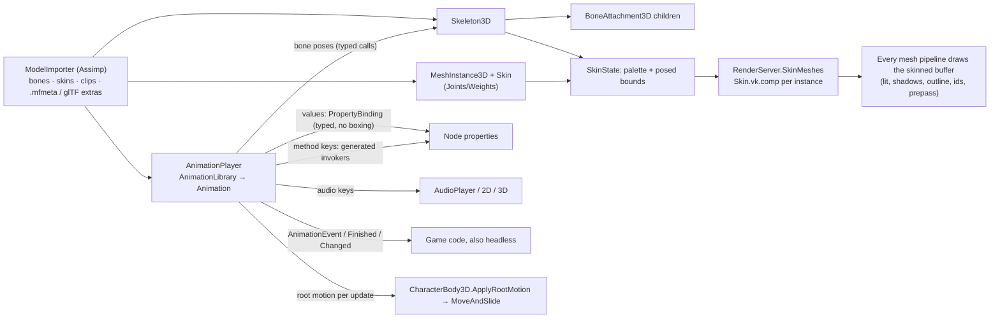
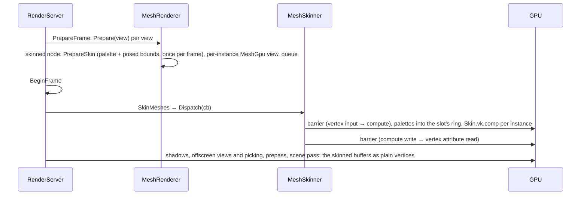

# Animation and skinning

## Purpose

Keyframe animation of any node property and skeletal animation of 3D characters (G1a, G1b; ADRs 0207, 0208, 0244):
`Animation`s with transform, value, bezier, method, audio and event tracks, played by an `AnimationPlayer` with
crossfades, queues, signals and root motion (ADR 0210) that a `CharacterBody3D` applies; `Skeleton3D` bones, skinned
`MeshInstance3D`s drawn through a compute pre-skinning pass and `BoneAttachment3D`; skinned glTF/FBX characters import
with their clips; and the editor's **Animation panel**, a timeline that keys, previews and edits animations. Names
follow Godot 4. The authoring tools for Claude-made clips are [Animation authoring](future/animation-authoring.md)
(G1e shipped: root motion).



Code: [`Src/Animation/`](../../MainframeEngine/Src/Animation/) (`Animation`, tracks, `AnimationLibrary`,
`AnimationPlayer`, `AnimationValueOps`/`PropertyBinding`, `AnimationMethodAttribute`), [`Scene/Nodes3D/Skeleton3D.cs`](../../MainframeEngine/Src/Scene/Nodes3D/Skeleton3D.cs),
[`Skin.cs`](../../MainframeEngine/Src/Scene/Nodes3D/Skin.cs) (`Skin`, `SkinState`),
[`BoneAttachment3D.cs`](../../MainframeEngine/Src/Scene/Nodes3D/BoneAttachment3D.cs),
[`Rendering/Meshes/MeshSkinning.cs`](../../MainframeEngine/Src/Rendering/Meshes/MeshSkinning.cs) (`MeshSkinner`,
`SkinnedMeshGpu`), [`Assets/Shaders/Skinning/Skin.vk.comp.slang`](../../MainframeEngine/Assets/Shaders/Skinning/Skin.vk.comp.slang),
[`Resources/Import/ModelAnimationImport.cs`](../../MainframeEngine/Src/Resources/Import/ModelAnimationImport.cs).

## Skeletons, skins and attachments

- **`Skeleton3D`** (a `Node3D`): `BoneNames`, `BoneParents` (−1 for roots, parents before children) and `BoneRests`
  (relative to the parent) are what a scene saves. Poses (`SetBonePosePosition/Rotation/Scale`, `SetBonePose`,
  `ResetBonePoses`) start at the rests and are not saved. `GetBoneGlobalPose` (skeleton space) recomputes the global
  poses once after a change, parents first. `FindBone` takes a span (no allocation); `AddBone` builds skeletons in code.
  A pose change inside a tree queues one deferred update per frame (a static callback, no allocation), which moves the
  attachments and raises `SkeletonUpdated`; `ForceUpdatePose` does it now.
- **`Skin`** (resource): `BindNames` (the bone of each joint, matched by name; re-matched when the bones change) and
  `BindPoses` (inverse bind matrices, mesh space → bone space). Without a skin, joint `i` is bone `i` bound at its rest.
  At most `Skin.MaxJoints` (256) joints.
- **Skinned surfaces:** `MeshSurface.Joints` (four per vertex) and `Weights` (one `Vector4` per vertex, summing to 1;
  all-zero weights leave a vertex unskinned, so a mesh can mix skinned and static surfaces). `Mesh.IsSkinned`.
- **`MeshInstance3D.Skeleton`** (default `..`, Godot's) and **`Skin`**. `GetSkeleton()` returns the skeleton a skinned
  mesh follows; without one it draws its bind pose (the editor warns).
- **`BoneAttachment3D`**, a child of the skeleton, sets its transform to `BoneName`'s skeleton-space pose whenever the
  pose changes: put a tool, a hat or a light under it. Its own transform is overwritten.
- **Ragdolls:** a `PhysicalBoneSimulator3D` child with `PhysicalBone3D` bodies follows the animation and, once
  simulated, writes the bones' poses after the `AnimationPlayer` (ADR 0212,
  [Physics joints → Ragdolls](physics-joints.md#ragdolls)); the editor's Skeleton3D inspector creates one. Active
  ragdolls (G9.10c, ADR 0235) pull the simulated bodies towards the animated pose with drives and holds, so the
  character keeps its pose under physics ([Active ragdolls](physics-joints.md#active-ragdolls)).

## AnimationPlayer

`Animation` (resource; name = `ResourceName`): `Length`, `LoopMode` (`None`, `Linear`, `PingPong`), `Step` (the
editor's snap, 1/30 s) and `Tracks`. Every track has `Path` (from the player's `RootNode`), `Enabled` and ascending
`Times` in seconds; values are parallel arrays:

| Track | Target | Values |
|---|---|---|
| `Position3DTrack`, `Rotation3DTrack`, `Scale3DTrack` | a `Node3D`, or a `Skeleton3D` bone with `Bone` | `Vector3[]`/`Quaternion[]` |
| `ValueTrack` | any animatable `[Export]` property: `Property` = `"Energy"`, `"Position"`, `"Position:y"`, `"Modulate:a"` | `Components` floats per key; `Update` `Continuous` or `Discrete` (only the key's value, as the playhead reaches it) |
| `BezierTrack` | one float property (or component) | `Values` + per-key `InHandles`/`OutHandles` (time, value offsets): the cubic Bézier through the keys, solved for time |
| `MethodTrack` | a node's `[AnimationMethod]` methods | `Methods` (a name per key) + `Arguments` (a JSON array per key, `[]`, `[2, "open"]`) |
| `AudioTrack` | an `AudioPlayer`, `AudioPlayer2D` or `AudioPlayer3D` | `Streams` + `StartOffsets` (seconds into the stream) |
| `EventTrack` | — | `Names`: raised as `AnimationEvent(animation, name)` |

The transform and value tracks are `InterpolatedTrack`s: `Interpolation` `Nearest`, `Linear` (rotations slerp, shortest
arc) or `Cubic` (Godot's cubic in time through the neighbouring keys, spherical for rotations; a missing neighbour is
mirrored, so the ends do not overshoot), per-key `Transitions` (Godot's easing exponent, `Mathf.Ease`: 1 linear, above 1
ease in, below 1 ease out, negative in-out) and `LoopWrap` (on a looping animation the last key blends into the first;
off, the value holds). Bools, integers and enums are always discrete.

**Bindings.** A value track binds once per animation through the property's generated registration:
`PropertyBinding.Create(node, "Position:y")` returns a typed `PropertyBinding<TOwner, TValue>` over the setter, and
`AnimationValueOps.Get<T>()` packs and unpacks the value as floats (floats, doubles, integers, bools and enums directly;
vectors, quaternions, both colour types, `Vector2I`, rects and any game `[SerializableValue]` struct with a float-array
codec through `IFloatVectorCodec<T>`). A `:x`/`:y`/`:z`/`:w` (or `:r`/`:g`/`:b`/`:a`) suffix animates one component and
leaves the rest. No reflection and no boxing: writes allocate nothing. An unknown property or type is logged once at bind
time and the track skipped.

**Method tracks.** `[AnimationMethod]` on an instance method (public or internal, non-generic, by-value parameters of
types `[Export]` supports, resources excepted) makes the source generator emit a typed invoker and a codec per parameter
(`NodeTypeInfo.AnimationMethods`, `FindAnimationMethod`); anything else is error MFG011. The key's JSON arguments are
parsed once at bind time (missing trailing arguments take their defaults), so calls allocate nothing. The engine marks
`Play`/`Stop` on the audio players and `Restart` on the particle nodes. `CallbackModeMethod` is `Deferred` (after the
update's values are applied, in key order; default) or `Immediate` (as the playhead passes the key).

**Audio tracks** start the key's stream on the target player at the key's offset (a key crossed late starts that far
in) and stop it when the animation stops.

`AnimationLibrary` is a list of animations; its `ResourceName` prefixes them (`""` the default library,
`"moves/roll"`). `AnimationPlayer` (Godot's API):

- `Play(name = "", customBlend = -1, customSpeed = 1, fromEnd = false)`, `PlayBackwards`, `Pause`, `Stop(keepState)`,
  `Seek(seconds, update)`, `Queue`/`ClearQueue`, `Advance(delta)`; `Autoplay`, `SpeedScale`, `PlaybackDefaultBlendTime`,
  `RootNode` (default `..`), `Active`, `CallbackModeProcess` (`Idle`: `OnProcess`; `Physics`: the fixed step; `Manual`:
  only `Advance`).
- `CurrentAnimation` (`""` when not playing), `AssignedAnimation`, `CurrentAnimationPosition`, `CurrentAnimationLength`,
  `IsPlaying()`, `IsBlending`, `GetPlayingSpeed()`. Fit a clip to a gameplay duration with
  `Play(name, customSpeed: (float)(length / seconds))` or `SpeedScale`.
- Playing the animation that is playing (or paused) continues it; a finished one restarts.
- `BlendTimes`: `AnimationBlendTime` entries (`From`, `To`, `Seconds`) override the default crossfade per pair (Godot's
  blend times).
- `GetSyncState()`/`ApplySyncState(state)`: the current animation, position and playing flag for a late-joining peer.
- **Signals:** `AnimationStarted(name)`, `AnimationFinished(name)` (non-looping only), `AnimationChanged(old, new)` (a
  queued animation took over), `AnimationEvent(animation, event)`.
- **Events, method and audio keys** fire when the playhead passes their key, in play direction, across loop wraps (once per ping-pong pass);
  the first frame of a play includes keys at the start; `Seek` raises none. Events are collected while the pose is
  evaluated and raised after it is applied, so handlers can call `Play`.
- **Crossfade:** `Play` with a blend (custom, else `PlaybackDefaultBlendTime`) keeps the old animation advancing and mixes
  per channel (transforms and values; discrete values switch at half the blend): both → lerp/slerp by the blend weight; only the new one → its value; only the old one → toward the bone's
  rest (a node: its value when the blend started). A `Play` during a blend starts a new one from the pose as it is at that
  moment (captured, held still).
- **Binding** happens once per animation (first play, or after its `Version` changed): paths and bone names resolve to
  slots shared by every animation of the player. Each frame finds the key from a per-track cursor, interpolates and
  calls the typed setter. Steady playback, crossfades, events, value tracks and method keys allocate nothing
(`AnimationHeadlessTests`, `ValueTrackTests`' 1 000-node gate; `AnimationBenchmarks`).
- **Physics bodies:** animate an `AnimatableBody3D`/`2D` with `CallbackModeProcess = Physics`; its motion becomes a
  velocity for the step and characters standing on it ride along ([Paths → Moving platforms](paths.md#moving-platforms-g135)). The editor
  warns about a `StaticBody3D` moved by a track (it teleports) and a body animated outside the physics callback.
- **Determinism and servers:** the pose and the events depend only on (clip, time), so peers that start clips from
  replicated state agree; nothing needs a renderer, so animations and events run under `HeadlessHost` too.

## Root motion

Clips that travel (a walk covering ground, a leap, a turn) move a character body instead of sliding away from it
(ADR 0210, Godot's `root_motion_track`):

- **`AnimationPlayer.RootMotionTrack`** (a `NodePath` to the `Skeleton3D`, relative to `RootNode`; empty: off),
  **`RootMotionBone`** (empty: the skeleton's first root bone) and **`RootMotionVertical`** (default false). A rig with a
  bone above the hips (Unreal's `root`) uses that bone; one whose hips are the top bone (Mixamo, Blender rigs) uses the
  hips. The bone's pose is read relative to its parent.
- **Taken out of the pose:** the bone's horizontal position and its yaw (the twist about its parent's +Y), relative to
  its rest; vertical position too with `RootMotionVertical`. Everything else stays: the hips keep their rest position
  horizontally and their rest facing, while a crouch or a jump's arc still moves them up and down.
- **Reported per update:** `GetRootMotionPosition()` (skeleton space, in the facing the character had at the start of
  the update) and `GetRootMotionRotation()` (a turn about the skeleton's +Y). Each update replaces them (zero when
  nothing played), so read them once per update. A body that moves by the position and then turns by the rotation
  retraces the clip's path.
- **Loops, direction, crossfades:** the update is split into stretches of clip time without a wrap (the same stretches
  that raise events), each adding `value(to) − value(from)`; a loop wrap therefore adds the clip's whole displacement
  (a stretch over the whole clip adds its whole turn, the sum of its key-to-key turns, so a clip turning 360° loops
  right), and backwards or ping-pong play subtracts. Crossfades lerp the two clips' motion by the blend weight; a clip
  without root tracks contributes none. `Play`, `Seek` and clip switches never jump: nothing depends on the previous
  update's sample. Turns per update must stay under half a circle.
- **`CharacterBody3D.ApplyRootMotion(player)`** turns the motion into world space with the skeleton's global basis (its
  scale included), sets `Velocity` so the next `MoveAndSlide` covers it in one step (only the horizontal part without
  `RootMotionVertical`, so the game's gravity still applies) and turns the body by the yaw now:

```csharp
public sealed class Walker : CharacterBody3D
{
    private AnimationPlayer? _player; // CallbackModeProcess = Physics, RootMotionTrack = "Armature", RootMotionBone = "Hips"

    protected override void OnReady() => _player = GetNode<AnimationPlayer>("Model/AnimationPlayer");

    protected override void OnPhysicsProcess(float delta)
    {
        if (_player is not null)
            ApplyRootMotion(_player);
        Velocity -= UpDirection * (9.81f * delta);
        MoveAndSlide();
    }
}
```

- The player should run in the `Physics` callback mode, one motion per physics step (the editor warns otherwise). A body
  that processes before its player (its parent) moves by the previous step's motion: one step late, nothing lost.
- Steady root motion with crossfades and `MoveAndSlide` allocates nothing; the motion depends only on clip time and the
  fixed step, so it is deterministic and runs under `HeadlessHost`.

## GPU skinning: compute pre-skinning



- **Per instance** (`SkinnedMeshGpu`): one `MeshVertex` buffer per frame slot (vertex + storage usage, device-local), a
  descriptor set per slot (source, palette, output), and a `MeshGpu` *view* that uses the slot's output as its vertices
  and the shared mesh's indices, colour/wind streams and surface ranges. Draw lists, shadow casters and picking hold the
  view, so the lit, unshaded, outline (`MaterialOverlay`/`NextPass`), object-ID, shadow (CSM, atlas, point cubes) and
  sub-viewport pipelines draw the pose unchanged, as will spatial shader materials. Skinned instances are not batched
  together (each has its own buffer).
- **Per mesh** (`MeshGpu.SkinSource`): a storage buffer of `SkinVertex` (64 B: bind position and normal with the UV in
  `w`, four joints, four weights), uploaded with the mesh.
- **Palette:** `SkinState.Update` builds `inverse bind × bone global pose × skeleton → mesh` per joint (row vectors) and
  the posed bounds (per-joint bind-space boxes transformed by the pose, merged: O(joints)); `MeshSkinner` writes three
  float4 rows per joint into a host-visible ring per `FrameSlot` (grown by doubling), the shader indexes it with a
  push-constant base.
- **Frame order:** `RenderServer.SkinMeshes()` runs right after `BeginFrame`, before `OnShadowPass`; the upload queue's
  buffer barrier includes the compute stage, so a mesh uploaded this frame is ready.
- **Motion vectors** (ADR 0163): the prepass draws skinned surfaces with `Mesh/MeshDepthSkinned.vk.vert`, which reads last
  frame's skinned vertices at binding 5 (the previous slot's buffer; this frame's when the instance was not skinned
  then), so limbs get their own velocity for TAA and motion blur.
- **Cost:** 32 B × vertices × 2 slots per instance, one dispatch per instance. 12 characters of ~6 000 triangles (and up
  to 192 in a sweep) run at the 120 Hz display cap on an M5 in Release (`skinned-crowd`).

## Import

`ModelImporter` (Assimp; [Asset pipeline](asset-pipeline.md#models)) turns rigs into the nodes above (ADR 0208):

- **Bones** are the nodes a mesh's bones name, the nodes between them and their common ancestor, and mesh-less subtrees
  under them. The ancestor's parent (Blender's armature node) becomes the `Skeleton3D`; bone nodes leave the node tree;
  other nodes under bones become `BoneAttachment3D`s.
- **Skinned meshes** move under the skeleton (identity transform, `Skeleton = ".."`) with a `Skin` of their bones'
  offset matrices; four weights per vertex (`LimitBoneWeights`), normalised. FBX pivots are not preserved.
- **Clips** become `Animation`s named after the actions (Blender's `Armature|` prefix removed) in an `AnimationLibrary`
  on an `AnimationPlayer` child of the model root. Channels that never leave their rest are dropped; with
  `optimizeAnimations` (default) keys that linear interpolation reproduces are removed.
- **Loop modes and events:** a `-loop`/`-cycle` name suffix loops a clip; glTF animation `extras` (`"loop": true`,
  `"events": { "HammerFist": 0.42 }` or `[ { "name": …, "time": … } ]`; Blender writes an action's custom properties
  there with *Include → Custom Properties*) override it; the `.mfmeta` `clips` list overrides both and covers FBX:

```json
{ "importer": "model", "settings": { "scale": 1, "importAnimations": true, "optimizeAnimations": true,
  "clips": [ { "name": "run", "loop": "Linear" }, { "name": "swing", "events": [ { "name": "HammerFist", "time": 0.4 } ] },
             { "name": "Jump", "rename": "jump_start" } ] } }
```

- The importer's `scale` applies to the model root, so skeletons, skins and clips scale with it.
- Silk.NET's key structs are larger than the bundled Assimp's (`mInterpolation`); the importer detects the native key
  stride from the key times and reads through it.

## Editor

The nodes and resources are registered like any other: inspector rows for every `[Export]` (bone arrays, the skin,
libraries), icons (`bone` for `Skeleton3D`/`Skin`, `link` for `BoneAttachment3D`, `player-play` for `AnimationPlayer`,
`movie` for `Animation`), semantic property icons (`BoneName`, `Libraries`, `SpeedScale`, `LoopMode`), and node warnings
for a skinned mesh without its skeleton, an attachment outside a skeleton or naming no bone, a player without
animations, root motion that is not on the physics step or names no skeleton or bone (`RootMotionTrack` has the
`run` icon, `RootMotionBone` `bone`, `RootMotionVertical` `arrow-up`), and transform tracks that move a `StaticBody3D`
or a body outside the physics callback. Skinned meshes draw (and pick) posed in the editor's views.

### Animation panel


Selecting an `AnimationPlayer` adds an **Animation** tab to the bottom dock (Output | Profiler | Tile Map | Animation);
the pin keeps the panel on that player while other nodes are selected for keying. Code:
[`MainframeEngine.Editor/Src/Animation/`](../../MainframeEngine.Editor/Src/Animation/) (`AnimationEditor` the model,
`AnimationPanel` the RmlUi panel over `Assets/Editor/animation.rml`, `AnimationTimelineCanvas`), the undo actions in
`Undo/AnimationActions.cs`, the shared timeline in [`Src/Timeline/`](../../MainframeEngine.Editor/Src/Timeline/).

- **Header** (icon buttons with tooltips): play from start, play/pause, stop, the playhead; the animation picker, new
  (into the player's default library, created when missing), duplicate, rename, delete; length − / +, loop mode (one
  button cycling none / linear / ping-pong), snap to the step, frames on the ruler; add a method track or an audio track
  for the selected node; zoom; pin.
- **Track list:** a row per track with its kind's icon and `path · property`, and buttons for interpolation (nearest /
  linear / cubic), loop wrap, enable and remove.
- **Timeline:** the seconds (or frames) ruler (click or drag to scrub), keys as diamonds (selected blue), method keys
  labelled, audio keys as clips, the area past the length shaded. Click selects (Shift/Cmd adds), drag moves keys
  (snapped), drag on empty space draws a rubber band, double-click a row inserts a key: the current value, the audio
  player's stream, or a method picked from the node's `[AnimationMethod]`s. Wheel scrolls, Cmd/Ctrl+wheel zooms
  around the mouse. Delete removes the selected keys; K keys the selected 3D nodes' transforms.
- **Key row:** the selected key's time, its value per component (X/Y/Z coloured) and its easing.
- **Inspector key buttons:** while an animation is edited, every animatable inspector row gets a `key` button that
  inserts the current value at the playhead, creating the track: `Position`/`RotationDegrees`/`Scale` of a `Node3D`
  make transform tracks, other rows value tracks.
- **Preview:** the scene is in edit mode, so the player does not process; the panel poses it with
  `Seek(t, update: true)` (scrub) or each frame while playing (looping by the loop mode). Method and audio keys do not
  fire in the editor. Before the first preview the panel records the values the animation touches and puts them back on
  Stop, when the edited player changes, and around every save, so saved scenes hold authored values, never a preview
  frame (Godot's `RESET` animation is not needed).
- **Undo:** every edit (keys, tracks, animation settings, library changes) is one step in the scene tab's history
  (`AnimationEditAction` snapshots the animation's tracks, `AnimationLibraryAction` the library); a key drag is one step,
  Esc cancels it.

The timeline component is shared with the song editor: `TimelineZoom` (scroll, pixels per unit, `X`/`TimeAt`,
`ZoomAround`), `TimelineSnap`, `TimelineRuler` (adaptive steps, cached labels), `TimelineHost.Place` (sizes the canvas
`SubViewport` and publishes it) and `TimelineCanvasBase` (ruler, shaded regions, playhead).

## Humanoid map (G1c)

The first step of [animation authoring](future/animation-authoring.md) (G1.12, ADR 0281), in
`MainframeEngine/Src/Animation/Humanoid/`. It describes any humanoid `Skeleton3D` in one canonical space, so later steps
(the pose baker, `mfe anim describe`, checks, the editor's sliders) speak one set of angles on every rig.

- **Canonical space:** Y up, +Z forward, +X the character's left; the canonical T-pose is the reference.
  `HumanoidBone` is VRM 1.0's humanoid set (55 bones); `HumanoidBones` gives each one's parent, side, mirror, direction
  and joint axes, and which are required (hips, spine, head, and per side the three leg and three arm bones; VRM's set).
- **Angles:** `JointAngles` (`Flex`, `Abduct`, `Twist`, degrees), composed intrinsically twist → abduct → flex about the
  bone's joint axes; right-side axes mirror the left ones, so equal numbers are equal motions on both sides; hinges
  (lower legs, lower arms) flex only. `HipsPose` is an offset in metres plus yaw/pitch/roll. `HumanoidPose` holds a whole
  body; `HumanoidLimits` the range of every component; `HumanoidPoses` the named poses (`tpose`, `stand`, `rest`).
- **`HumanoidMap.Detect(skeleton, overrides, out report)`:** names first (prefixes such as `mixamorig:`, `DEF-` and
  `J_Bip_?_` stripped, side tokens split off, tables for VRM/VRoid, Mixamo, Unreal, Blender/Rigify and generic names;
  numbered spines become Spine/Chest/UpperChest by depth; twist, IK, roll and end bones are skipped), then the skeleton's
  shape for what names miss (the hips have two similar chains down and one up; the arms branch where two similar chains
  go sideways), then the `.mfmeta` `humanoid` overrides
  ([Asset pipeline](asset-pipeline.md#humanoid-map-overrides-g1c)). The `HumanoidMapReport` lists each entry's source
  and confidence, unmapped rig bones, missing required bones and notes.
- **`HumanoidRig(skeleton, map)`:** binds a map to the rest pose. The character frame comes from the rest (ankles to
  hips is up, right to left upper leg is left), so rigs facing any way, in any unit, map the same. Upper and lower legs
  and arms are straightened to the T-pose by a shortest-arc rest correction (an A-pose rig takes the same angles as a
  T-pose rig); every other bone keeps its rest relation to its parent, so feet stay flat and the torso keeps its
  posture. `ToBoneRotation`/`FromBoneRotation` convert one bone; `ApplyPose`/`ReadPose` a whole body (canonical bones
  the rig lacks pass their rotation on to the next mapped bone); `RestKind` (T, A, other), `RestArmAngle`,
  `Proportions` (metres) and `MetresPerUnit` describe the rig.
- **Singularity:** at abduct ±90° (an arm straight up from the T-pose) twist and flex share an axis; reading the angles
  back then gives twist 0.

## Pose scripts and baking (G1c)

G1.13 ([animation authoring](future/animation-authoring.md#pose-script)), in `MainframeEngine/Src/Animation/Authoring/`.
A pose script is JSON: a few key poses in canonical angles, IK pins, arcs and a root mode; `PoseScriptParser.Parse`
reads it (every error with its JSON path, unknown properties rejected) and `PoseBaker.Bake` turns it into an ordinary
`Animation`. Scripts are input only: the keys are the truth.

- **Keys:** `t`, a named `pose` (the first key needs one; later keys start from the previous key), `hips`
  (`x/y/z/yaw/pitch/roll`), `joints` (any of `flex/abduct/twist` per bone; hinges flex only), `mirror` (left to right, or
  right to left where only the right is given), `ik` (`"pin"`, `"release"`, `{ "pos": [x, y, z] }` in character space) and
  `ease` (`linear`, `in`, `out`, `inOut` or a number: the `Transitions` value of the segment **after** the key).
- **Root:** `inPlace` (default) keeps the keys' hips offsets and ignores arcs, with a note; `motion` keeps horizontal
  offsets and adds arcs, for root motion with `RootMotionBone` = the hips (`PoseBakeResult.HipsBone`).
- **Arcs** add `4k·u(1−u)` to the keyed hips height between `from` and `to`: `k = g·T²/8` from the project's gravity, or
  solved so the apex is `height` above take-off (a note when that is more than 25 % off gravity's apex).
- **IK** (`TwoBoneIk`): the knee or elbow stays in the plane of the hip or shoulder, the target and the pole (knees
  forward, elbows back, turned with the upper bone's current pose), each bone turns by the shortest arc so the authored
  twist is kept, a target out of reach straightens the limb towards it (noted). A pin holds the effector's position and
  rotation from its key to `release`.
- **Keys written:** at the script's times, a cubic `Rotation3DTrack` per mapped bone that leaves its rest (and every IK
  chain bone), a `Position3DTrack` for the hips; quaternions kept in one hemisphere. A 60 Hz pass then samples the clip
  as played (`ClipSampler`) and adds a key to the IK chain (or the hips) at the worst sample where a pin slides or an arc
  misses by more than 1 cm, until none does; a pin out of reach is noted rather than chased.
- **`Animation.BakedHash`** is `AnimationHash.Compute` of the keys written. `PoseLibrary.Write` puts the clip into a
  library `.mfres` (created as the default library) and replaces a clip of that name only when it is an untouched bake,
  or when told to (`replace`), so hand fixes are never overwritten by accident; it links the library in the model's
  `.mfmeta` `libraries` ([Asset pipeline](asset-pipeline.md#linked-animation-libraries-g1c)), changing nothing else there,
  and notes when the baked clip hides an imported clip of the same name.

## Guide

[Getting started → Animate a character](../getting-started.md#animate-a-character) walks through exporting from
Blender, importing, playing clips with crossfades, events and a hand attachment.

## Testing

- **Unit** ([`Tests/MainframeEngine.Tests/Animation/`](../../Tests/MainframeEngine.Tests/Animation/)):
  `SkinnedImportTests` (the generated character: skeleton, skin, weights, ten clips, loop modes and events from extras
  and `.mfmeta`, the CPU skinning reference at rest and posed, posed bounds containing every vertex, the import scale,
  clip settings round trip, `CleanClipName`), `AnimationPlayerTests` (loops and events across loops, crossfade values,
  fitting to a duration, queue, seek/stop/pause, backwards and ping-pong events, process modes and autoplay,
  `BoneAttachment3D` keeping a mesh and a light on the bone, global poses, scene round trip, static surfaces),
  `AnimationHeadlessTests` (events on the same frames every run under `HeadlessHost`, a root-motion body ending at the
  same pose every run, 0 B steady playback with crossfades, events and palettes), `RootMotionTests` (the pose without the
  motion, per-update replacement, vertical, loop wraps over one and several loops, backwards, turns carried into the
  facing closing a circle in small or large steps, a 360° clip, crossfade weights, settings changes, the yaw
  extraction), `RootMotionCharacterTests` (the character's jump and circle moving a turned `CharacterBody3D`; 0 B with
  crossfades, `MoveAndSlide` and palettes for four walkers), `ValueTrackTests` (value kinds and sub-components, discrete
  values, cubic and transitions, loop wrap, bezier, method keys across loops, backwards and ping-pong, deferred and
  immediate, audio keys, blend times, sync state, value crossfades, `.mfres` round trip, 0 B over 1 000 nodes). Generator:
  `AnimationMethodsGetInvokersAndInvalidOnesAreReported` (MFG011). Benchmark: `AnimationBenchmarks`.
- **Editor:** `AnimationNodesTests` (warnings, icons), `AnimationEditorTests` (every undo action, key buttons and K,
  drags with snap and cancel, rubber band, method and audio keys, preview capture and restore, saving while previewing),
  `TimelineTests` (zoom around the mouse, ruler steps); the song tab's tests run on the shared timeline.
- **QA:** [`Tests/QA/animation-walkthrough.qa`](../../Tests/QA/animation-walkthrough.qa) (`just qa-editor
  Tests/QA/animation-walkthrough.qa`): create an animation on a player, key a node's position from the inspector at two
  times, scrub, capture the panel.
- **Test asset:** `Tests/Assets/Models/Character/character.glb`, written by
  [`SkinnedCharacter`](../../Tests/MainframeEngine.Tests/TestAssets/SkinnedCharacter.cs) (31 bones, two primitives,
  ~6 000 triangles, ten actions (`jump` and `circle` carry root motion in the hips), both event forms, a `.mfmeta` clip); `TheCommittedCharacterMatchesTheGenerator` keeps it
  in sync (`UPDATE_TEST_ASSETS=1`).
- **Render** (`SkinnedTests`): `skinned` (two posed characters with CSM and point shadows, an outline overlay and a
  hand-attached hammer and torch; self-checks the dispatch count, a pick on the raised hand and the torch position;
  golden), `skinned-crowd` (12 characters crossfading: 0 B with the prepass and TAA, and the 120 fps budget).
- **Demo:** the `animation_3d` scene ([Demo](demo.md)): a second character on a `RootMotionWalker` body walks half
  circles and jumps around a closed loop (`Animation3DSceneTests` checks that it closes), and a workshop animated by
  tracks alone: an `AnimatableBody3D` lift on the physics tick, a door that a method key unlocks (`DoorLatch`), swings
  open and shut and locks again, a lamp flickering on a cubic value track and a chime on an audio track.

## Known issues

- No blend trees, IK or morph targets ([Animation graph](future/animation-graph.md),
  [Animation authoring](future/animation-authoring.md)).
- The panel has no curve view for bezier tracks (their handles are edited as data), no copy/paste or duplicate of keys,
  no play-backwards button and no track filter; tracks are added from the inspector's key buttons, K and the method and
  audio buttons, not a `+` menu. Imported libraries are edited with the scene; there is no "Save animations as `.mfres`"
  yet ([Editor viewport tools](editor.md#viewport-tools), G7).
- Normals are skinned with the palette's 3×3 (renormalised), not its inverse transpose: non-uniform bone scale shades
  slightly wrong.
- Skinned instances draw one by one (no instancing of identical characters).
- The editor's viewport focus and selection box use the mesh's bind-pose bounds.
- Skinned surfaces with vertex colours draw their prepass without skinned motion vectors (the `MeshDepthExt` path).
- Root motion comes from bone tracks only (not a plain `Node3D`'s), has no accumulators (Godot's
  `get_root_motion_position_accumulator`), and a hips-as-root rig hands the hips' sideways sway to the body. The G1c
  baker's `root: "motion"` is not written yet.

## Changes from the proposal

G1a followed the Keyframe animation proposal (now folded into this page) with these differences:

- **Timeline extraction:** one `Src/Timeline/` with `TimelineZoom` (not `TimelineViewState`, which the video timeline
  already names), `TimelineRuler`, `TimelineSnap`, `TimelineHost` and `TimelineCanvasBase`. The song tab's gestures stay
  its own; the press/drag state machine (`TimelineGestures`) was not extracted, because the song and animation gestures
  share little beyond the threshold.
- **Undo** is two snapshot actions (`AnimationEditAction` over an animation's tracks and settings,
  `AnimationLibraryAction` over a library's list) instead of seven fine-grained ones: an animation's key arrays are small,
  and one shape covers every edit.
- **Track list** is part of the panel's chrome, not a separate data-bound list; the `+` add-track menu became the
  inspector key buttons, K, and two header buttons for method and audio tracks.
- **Not built:** the curve view, Alt-duplicate, key copy/paste and Cmd/Ctrl+D, play backwards, the track filter and the
  missing-target warning icon, persisting the tab and pin in `editor_layout.json`. They are follow-ups (see Known issues).
- **Events** stay an `EventTrack` beside method tracks (games already subscribe to `AnimationEvent`).
- **Engine methods:** the audio players' `Play`/`Stop` and the particles' `Restart` are `[AnimationMethod]`s, so method
  tracks work on built-in nodes too.

Still open from the proposal: compute versus vertex-shader skinning on mobile; Assimp versus a glTF reader; large clips
as JSON once G7 saves them; editing external `.mfres` libraries with their own history; built-in replication of player
state (games use `GetSyncState`); an auto-key (record) mode; discrete string and resource tracks; morph targets and
instancing identical skinned characters.

## Related

[Animation authoring](future/animation-authoring.md) · [Asset pipeline](asset-pipeline.md) ·
[Materials & meshes](materials-and-meshes.md) · [GPU resources](gpu-resources.md) ·
[Post-processing](post-processing.md) · [Shadow system](shadow-system.md) · [Scene graph & nodes](scene-graph-and-nodes.md)
