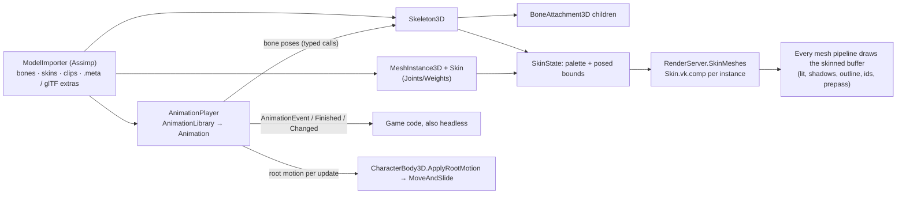
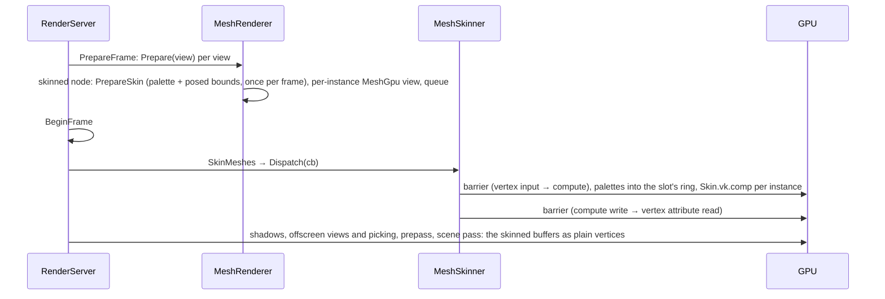

# Animation and skinning

## Purpose

Skeletal animation of 3D characters (ADR 0207, ADR 0208): `Skeleton3D` bones, skinned `MeshInstance3D`s drawn through a
compute pre-skinning pass, `BoneAttachment3D`, and keyed `Animation`s played by an `AnimationPlayer` with crossfades,
queues, named events and root motion (ADR 0210) that a `CharacterBody3D` applies; skinned glTF/FBX characters import
with their clips. Names follow Godot 4. This is the shipped part of the [Keyframe animation](future/keyframe-animation.md)
proposal (G1a core, G1b) and of [Animation authoring](future/animation-authoring.md) (G1e); value/method/audio tracks
and the editor's Animation panel are still proposals there.



Code: [`Src/Animation/`](../../MainframeEngine/Src/Animation/) (`Animation`, tracks, `AnimationLibrary`,
`AnimationPlayer`), [`Scene/Nodes3D/Skeleton3D.cs`](../../MainframeEngine/Src/Scene/Nodes3D/Skeleton3D.cs),
[`Skin.cs`](../../MainframeEngine/Src/Scene/Nodes3D/Skin.cs) (`Skin`, `SkinState`),
[`BoneAttachment3D.cs`](../../MainframeEngine/Src/Scene/Nodes3D/BoneAttachment3D.cs),
[`Rendering/Meshes/MeshSkinning.cs`](../../MainframeEngine/Src/Rendering/Meshes/MeshSkinning.cs) (`MeshSkinner`,
`SkinnedMeshGpu`), [`Assets/Shaders/Skinning/Skin.vk.comp.slang`](../../MainframeEngine/Assets/Shaders/Skinning/Skin.vk.comp.slang),
[`Resources/Import/ModelAnimationImport.cs`](../../MainframeEngine/Src/Resources/Import/ModelAnimationImport.cs).

## Skeletons, skins and attachments

- **`Skeleton3D`** (a `Node3D`): `BoneNames`, `BoneParents` (−1 for roots, parents before children) and `BoneRests`
  (relative to the parent) are what a scene saves. Poses (`SetBonePosePosition/Rotation/Scale`, `SetBonePose`,
  `ResetBonePoses`) start at the rests and are not saved. `GetBoneGlobalPose` (skeleton space) recomputes the global
  poses once after a change, parents first. `FindBone` takes a span (no allocation); `AddBone` builds skeletons in code.
  A pose change inside a tree queues one deferred update per frame (a static callback, no allocation), which moves the
  attachments and raises `SkeletonUpdated`; `ForceUpdatePose` does it now.
- **`Skin`** (resource): `BindNames` (the bone of each joint, matched by name; re-matched when the bones change) and
  `BindPoses` (inverse bind matrices, mesh space → bone space). Without a skin, joint `i` is bone `i` bound at its rest.
  At most `Skin.MaxJoints` (256) joints.
- **Skinned surfaces:** `MeshSurface.Joints` (four per vertex) and `Weights` (one `Vector4` per vertex, summing to 1;
  all-zero weights leave a vertex unskinned, so a mesh can mix skinned and static surfaces). `Mesh.IsSkinned`.
- **`MeshInstance3D.Skeleton`** (default `..`, Godot's) and **`Skin`**. `GetSkeleton()` returns the skeleton a skinned
  mesh follows; without one it draws its bind pose (the editor warns).
- **`BoneAttachment3D`**, a child of the skeleton, sets its transform to `BoneName`'s skeleton-space pose whenever the
  pose changes: put a tool, a hat or a light under it. Its own transform is overwritten.

## AnimationPlayer

`Animation` (resource; name = `ResourceName`): `Length`, `LoopMode` (`None`, `Linear`, `PingPong`) and `Tracks`:

| Track | Target | Values |
|---|---|---|
| `Position3DTrack`, `Rotation3DTrack`, `Scale3DTrack` | `Path` (from the player's `RootNode`) to a `Node3D`, or to a `Skeleton3D` with `Bone` | `Times` + `Vector3[]`/`Quaternion[]`, `Interpolation` `Nearest` or `Linear` (rotations slerp, shortest arc) |
| `EventTrack` | — | `Times` + `Names`: raised as `AnimationEvent(animation, name)` |

`AnimationLibrary` is a list of animations; its `ResourceName` prefixes them (`""` the default library,
`"moves/roll"`). `AnimationPlayer` (Godot's API):

- `Play(name = "", customBlend = -1, customSpeed = 1, fromEnd = false)`, `PlayBackwards`, `Pause`, `Stop(keepState)`,
  `Seek(seconds, update)`, `Queue`/`ClearQueue`, `Advance(delta)`; `Autoplay`, `SpeedScale`, `PlaybackDefaultBlendTime`,
  `RootNode` (default `..`), `Active`, `CallbackModeProcess` (`Idle`: `OnProcess`; `Physics`: the fixed step; `Manual`:
  only `Advance`).
- `CurrentAnimation` (`""` when not playing), `AssignedAnimation`, `CurrentAnimationPosition`, `CurrentAnimationLength`,
  `IsPlaying()`, `IsBlending`, `GetPlayingSpeed()`. Fit a clip to a gameplay duration with
  `Play(name, customSpeed: (float)(length / seconds))` or `SpeedScale`.
- Playing the animation that is playing (or paused) continues it; a finished one restarts.
- **Signals:** `AnimationStarted(name)`, `AnimationFinished(name)` (non-looping only), `AnimationChanged(old, new)` (a
  queued animation took over), `AnimationEvent(animation, event)`.
- **Events** fire when the playhead passes their key, in play direction, across loop wraps (once per ping-pong pass);
  the first frame of a play includes keys at the start; `Seek` raises none. Events are collected while the pose is
  evaluated and raised after it is applied, so handlers can call `Play`.
- **Crossfade:** `Play` with a blend (custom, else `PlaybackDefaultBlendTime`) keeps the old animation advancing and mixes
  per channel: both → lerp/slerp by the blend weight; only the new one → its value; only the old one → toward the bone's
  rest (a node: its value when the blend started). A `Play` during a blend starts a new one from the pose as it is at that
  moment (captured, held still).
- **Binding** happens once per animation (first play, or after its `Version` changed): paths and bone names resolve to
  slots shared by every animation of the player. Each frame finds the key from a per-track cursor, interpolates and
  calls the typed setter. Steady playback, crossfades and events allocate nothing (`AnimationHeadlessTests`).
- **Determinism and servers:** the pose and the events depend only on (clip, time), so peers that start clips from
  replicated state agree; nothing needs a renderer, so animations and events run under `HeadlessHost` too.

## Root motion

Clips that travel (a walk covering ground, a leap, a turn) move a character body instead of sliding away from it
(ADR 0210, Godot's `root_motion_track`):

- **`AnimationPlayer.RootMotionTrack`** (a `NodePath` to the `Skeleton3D`, relative to `RootNode`; empty: off),
  **`RootMotionBone`** (empty: the skeleton's first root bone) and **`RootMotionVertical`** (default false). A rig with a
  bone above the hips (Unreal's `root`) uses that bone; one whose hips are the top bone (Mixamo, Blender rigs) uses the
  hips. The bone's pose is read relative to its parent.
- **Taken out of the pose:** the bone's horizontal position and its yaw (the twist about its parent's +Y), relative to
  its rest; vertical position too with `RootMotionVertical`. Everything else stays: the hips keep their rest position
  horizontally and their rest facing, while a crouch or a jump's arc still moves them up and down.
- **Reported per update:** `GetRootMotionPosition()` (skeleton space, in the facing the character had at the start of
  the update) and `GetRootMotionRotation()` (a turn about the skeleton's +Y). Each update replaces them (zero when
  nothing played), so read them once per update. A body that moves by the position and then turns by the rotation
  retraces the clip's path.
- **Loops, direction, crossfades:** the update is split into stretches of clip time without a wrap (the same stretches
  that raise events), each adding `value(to) − value(from)`; a loop wrap therefore adds the clip's whole displacement
  (a stretch over the whole clip adds its whole turn, the sum of its key-to-key turns, so a clip turning 360° loops
  right), and backwards or ping-pong play subtracts. Crossfades lerp the two clips' motion by the blend weight; a clip
  without root tracks contributes none. `Play`, `Seek` and clip switches never jump: nothing depends on the previous
  update's sample. Turns per update must stay under half a circle.
- **`CharacterBody3D.ApplyRootMotion(player)`** turns the motion into world space with the skeleton's global basis (its
  scale included), sets `Velocity` so the next `MoveAndSlide` covers it in one step (only the horizontal part without
  `RootMotionVertical`, so the game's gravity still applies) and turns the body by the yaw now:

```csharp
public sealed class Walker : CharacterBody3D
{
    private AnimationPlayer? _player; // CallbackModeProcess = Physics, RootMotionTrack = "Armature", RootMotionBone = "Hips"

    protected override void OnReady() => _player = GetNode<AnimationPlayer>("Model/AnimationPlayer");

    protected override void OnPhysicsProcess(float delta)
    {
        if (_player is not null)
            ApplyRootMotion(_player);
        Velocity -= UpDirection * (9.81f * delta);
        MoveAndSlide();
    }
}
```

- The player should run in the `Physics` callback mode, one motion per physics step (the editor warns otherwise). A body
  that processes before its player (its parent) moves by the previous step's motion: one step late, nothing lost.
- Steady root motion with crossfades and `MoveAndSlide` allocates nothing; the motion depends only on clip time and the
  fixed step, so it is deterministic and runs under `HeadlessHost`.

## GPU skinning: compute pre-skinning



- **Per instance** (`SkinnedMeshGpu`): one `MeshVertex` buffer per frame slot (vertex + storage usage, device-local), a
  descriptor set per slot (source, palette, output), and a `MeshGpu` *view* that uses the slot's output as its vertices
  and the shared mesh's indices, colour/wind streams and surface ranges. Draw lists, shadow casters and picking hold the
  view, so the lit, unshaded, outline (`MaterialOverlay`/`NextPass`), object-ID, shadow (CSM, atlas, point cubes) and
  sub-viewport pipelines draw the pose unchanged, as will spatial shader materials. Skinned instances are not batched
  together (each has its own buffer).
- **Per mesh** (`MeshGpu.SkinSource`): a storage buffer of `SkinVertex` (64 B: bind position and normal with the UV in
  `w`, four joints, four weights), uploaded with the mesh.
- **Palette:** `SkinState.Update` builds `inverse bind × bone global pose × skeleton → mesh` per joint (row vectors) and
  the posed bounds (per-joint bind-space boxes transformed by the pose, merged: O(joints)); `MeshSkinner` writes three
  float4 rows per joint into a host-visible ring per `FrameSlot` (grown by doubling), the shader indexes it with a
  push-constant base.
- **Frame order:** `RenderServer.SkinMeshes()` runs right after `BeginFrame`, before `OnShadowPass`; the upload queue's
  buffer barrier includes the compute stage, so a mesh uploaded this frame is ready.
- **Motion vectors** (ADR 0163): the prepass draws skinned surfaces with `Mesh/MeshDepthSkinned.vk.vert`, which reads last
  frame's skinned vertices at binding 5 (the previous slot's buffer; this frame's when the instance was not skinned
  then), so limbs get their own velocity for TAA and motion blur.
- **Cost:** 32 B × vertices × 2 slots per instance, one dispatch per instance. 12 characters of ~6 000 triangles (and up
  to 192 in a sweep) run at the 120 Hz display cap on an M5 in Release (`skinned-crowd`).

## Import

`ModelImporter` (Assimp; [Asset pipeline](asset-pipeline.md#models)) turns rigs into the nodes above (ADR 0208):

- **Bones** are the nodes a mesh's bones name, the nodes between them and their common ancestor, and mesh-less subtrees
  under them. The ancestor's parent (Blender's armature node) becomes the `Skeleton3D`; bone nodes leave the node tree;
  other nodes under bones become `BoneAttachment3D`s.
- **Skinned meshes** move under the skeleton (identity transform, `Skeleton = ".."`) with a `Skin` of their bones'
  offset matrices; four weights per vertex (`LimitBoneWeights`), normalised. FBX pivots are not preserved.
- **Clips** become `Animation`s named after the actions (Blender's `Armature|` prefix removed) in an `AnimationLibrary`
  on an `AnimationPlayer` child of the model root. Channels that never leave their rest are dropped; with
  `optimizeAnimations` (default) keys that linear interpolation reproduces are removed.
- **Loop modes and events:** a `-loop`/`-cycle` name suffix loops a clip; glTF animation `extras` (`"loop": true`,
  `"events": { "HammerFist": 0.42 }` or `[ { "name": …, "time": … } ]`; Blender writes an action's custom properties
  there with *Include → Custom Properties*) override it; the `.meta` `clips` list overrides both and covers FBX:

```json
{ "importer": "model", "settings": { "scale": 1, "importAnimations": true, "optimizeAnimations": true,
  "clips": [ { "name": "run", "loop": "Linear" }, { "name": "swing", "events": [ { "name": "HammerFist", "time": 0.4 } ] },
             { "name": "Jump", "rename": "jump_start" } ] } }
```

- The importer's `scale` applies to the model root, so skeletons, skins and clips scale with it.
- Silk.NET's key structs are larger than the bundled Assimp's (`mInterpolation`); the importer detects the native key
  stride from the key times and reads through it.

## Editor

The nodes and resources are registered like any other: inspector rows for every `[Export]` (bone arrays, the skin,
libraries), icons (`bone` for `Skeleton3D`/`Skin`, `link` for `BoneAttachment3D`, `player-play` for `AnimationPlayer`,
`movie` for `Animation`), semantic property icons (`BoneName`, `Libraries`, `SpeedScale`, `LoopMode`), and node warnings
for a skinned mesh without its skeleton, an attachment outside a skeleton or naming no bone, a player without
animations, and root motion that is not on the physics step or names no skeleton or bone (`RootMotionTrack` has the
`run` icon, `RootMotionBone` `bone`, `RootMotionVertical` `arrow-up`). Skinned meshes draw (and pick) posed in the editor's views. There is no Animation panel or timeline yet, and
players do not advance in edit mode.

## Guide

[Getting started → Animate a character](../getting-started.md#animate-a-character) walks through exporting from
Blender, importing, playing clips with crossfades, events and a hand attachment.

## Testing

- **Unit** ([`Tests/MainframeEngine.Tests/Animation/`](../../Tests/MainframeEngine.Tests/Animation/)):
  `SkinnedImportTests` (the generated character: skeleton, skin, weights, ten clips, loop modes and events from extras
  and `.meta`, the CPU skinning reference at rest and posed, posed bounds containing every vertex, the import scale,
  clip settings round trip, `CleanClipName`), `AnimationPlayerTests` (loops and events across loops, crossfade values,
  fitting to a duration, queue, seek/stop/pause, backwards and ping-pong events, process modes and autoplay,
  `BoneAttachment3D` keeping a mesh and a light on the bone, global poses, scene round trip, static surfaces),
  `AnimationHeadlessTests` (events on the same frames every run under `HeadlessHost`, a root-motion body ending at the
  same pose every run, 0 B steady playback with crossfades, events and palettes), `RootMotionTests` (the pose without the
  motion, per-update replacement, vertical, loop wraps over one and several loops, backwards, turns carried into the
  facing closing a circle in small or large steps, a 360° clip, crossfade weights, settings changes, the yaw
  extraction), `RootMotionCharacterTests` (the character's jump and circle moving a turned `CharacterBody3D`; 0 B with
  crossfades, `MoveAndSlide` and palettes for four walkers). Editor: `AnimationNodesTests` (warnings, icons).
- **Test asset:** `Tests/Assets/Models/Character/character.glb`, written by
  [`SkinnedCharacter`](../../Tests/MainframeEngine.Tests/TestAssets/SkinnedCharacter.cs) (31 bones, two primitives,
  ~6 000 triangles, ten actions (`jump` and `circle` carry root motion in the hips), both event forms, a `.meta` clip); `TheCommittedCharacterMatchesTheGenerator` keeps it
  in sync (`UPDATE_TEST_ASSETS=1`).
- **Render** (`SkinnedTests`): `skinned` (two posed characters with CSM and point shadows, an outline overlay and a
  hand-attached hammer and torch; self-checks the dispatch count, a pick on the raised hand and the torch position;
  golden), `skinned-crowd` (12 characters crossfading: 0 B with the prepass and TAA, and the 120 fps budget).
- **Demo:** the `animation_3d` scene ([Demo](demo.md)): a second character on a `RootMotionWalker` body walks half
  circles and jumps around a closed loop (`Animation3DSceneTests` checks that it closes).

## Known issues

- No value, bezier, method or audio tracks, no cubic interpolation, no editor timeline, blend trees, IK or morph
  targets ([Keyframe animation](future/keyframe-animation.md), [Animation graph](future/animation-graph.md),
  [Animation authoring](future/animation-authoring.md)).
- Normals are skinned with the palette's 3×3 (renormalised), not its inverse transpose: non-uniform bone scale shades
  slightly wrong.
- Skinned instances draw one by one (no instancing of identical characters).
- The editor's viewport focus and selection box use the mesh's bind-pose bounds.
- Skinned surfaces with vertex colours draw their prepass without skinned motion vectors (the `MeshDepthExt` path).
- Root motion comes from bone tracks only (not a plain `Node3D`'s), has no accumulators (Godot's
  `get_root_motion_position_accumulator`), and a hips-as-root rig hands the hips' sideways sway to the body. The G1c
  baker's `root: "motion"` is not written yet.

## Related

[Keyframe animation (proposal)](future/keyframe-animation.md) · [Asset pipeline](asset-pipeline.md) ·
[Materials & meshes](materials-and-meshes.md) · [GPU resources](gpu-resources.md) ·
[Post-processing](post-processing.md) · [Shadow system](shadow-system.md) · [Scene graph & nodes](scene-graph-and-nodes.md)
