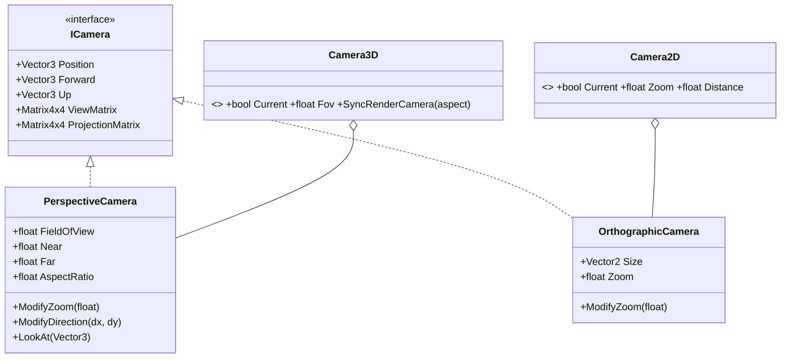

# Cameras & Input

## Purpose

Cameras provide view and projection matrices to every drawable. In scenes they are nodes
(`Camera3D`, `Camera2D`) that the render server uses for their viewport; the matrix math lives in
`PerspectiveCamera` / `OrthographicCamera`, which tree-less code can still use directly. Input from the
window is routed through the scene tree as `InputEvent`s (`Node.OnInput` / `OnUnhandledInput`); games
can also read Silk's `InputContext` directly.

## Key types

| Type | File |
|---|---|
| `ICamera` | [Camera/ICamera.cs](../../MainframeEngine/Src/Rendering/Camera/ICamera.cs) — `Position`, `Forward`, `Up`, `ViewMatrix`, `ProjectionMatrix` |
| `PerspectiveCamera` | [Camera/PerspectiveCamera.cs](../../MainframeEngine/Src/Rendering/Camera/PerspectiveCamera.cs) (was `Camera3D` before M2) |
| `OrthographicCamera` | [Camera/OrthographicCamera.cs](../../MainframeEngine/Src/Rendering/Camera/OrthographicCamera.cs) (was `Camera2D`) |
| `Camera3D` (node) | [Scene/Nodes3D/Camera3D.cs](../../MainframeEngine/Src/Scene/Nodes3D/Camera3D.cs) |
| `Camera2D` (node) | [Scene/Nodes2D/Camera2D.cs](../../MainframeEngine/Src/Scene/Nodes2D/Camera2D.cs) |
| `InputEvent*`, `InputRouter` | [Scene/Input/](../../MainframeEngine/Src/Scene/Input/) |
| `InputMap`, `InputAction`, `InputBinding` | [Scene/Input/InputMap.cs](../../MainframeEngine/Src/Scene/Input/InputMap.cs), rebinding in [InputMap.Rebinding.cs](../../MainframeEngine/Src/Scene/Input/InputMap.Rebinding.cs), names in [InputBindingNames.cs](../../MainframeEngine/Src/Scene/Input/InputBindingNames.cs) |
| `InputRebinder` (node) | [Scene/Input/InputRebinder.cs](../../MainframeEngine/Src/Scene/Input/InputRebinder.cs) |

All math is `System.Numerics`: right-handed, row vectors. Projections produce depth in **[0, 1]**.

## Camera nodes

- **`Camera3D : Node3D`** looks along its global `-Z` from its global position. Exported: `Current`,
  `Fov` (45°), `Near` (0.1), `Far` (1000). The viewport's active camera is the last one made
  `Current`, else the first to enter (`SceneViewport.ActiveCamera3D`). Each frame the render server calls
  `SyncRenderCamera(aspect)` — position, forward, up (global basis Y) and the swapchain aspect — and draws
  with `RenderCamera` (the wrapped `PerspectiveCamera`). Orient it with `LookAt(target)` or
  `RotationDegrees`.
  **Rays:** `ProjectRayOrigin(pixel)` / `ProjectRayNormal(pixel)` give the world ray through a framebuffer pixel
  (top-left origin; the viewport's `Size`, so pass `SceneViewport`/input pixel coordinates), like Godot's
  `project_ray_origin/normal`. `Camera3D.ProjectRay(ICamera, pixel, viewportSize)` is the tree-less form; feed the
  ray to `DirectSpaceState` for picking.
- **`Camera2D : Node2D`**: `Current`, `Zoom`, `Distance` (how far in front of the z = 0 plane it sits,
  default 500). Used when the viewport has no 3D camera; the framebuffer size becomes its `Size`.
  A viewport that has any `Camera3D` in its tree always renders with one: clearing `Current` on the active
  camera makes another take over, or leaves the same one active when it is the only one (`ClearCurrent`). A
  `Camera2D` only takes over once every `Camera3D` has left the tree (the Demo's Spine scene detaches its
  `Camera3D` in 2D mode and re-adds it for 3D).

## `PerspectiveCamera`

| Property | Default / behaviour |
|---|---|
| `Forward` / `Up` | −Z / +Y |
| `Yaw` / `Pitch` | −90° / 0°. Pitch is clamped to ±89°. |
| `FieldOfView`, `Near`, `Far` | 45°, 0.1, 1000. `ModifyZoom` clamps the FOV to 1–90°. |
| `ViewMatrix` | `CreateLookAt(Position, Position + Forward, Up)` |
| `ProjectionMatrix` | `CreatePerspectiveFieldOfView(FOV, AspectRatio, Near, Far)` |
| `ModifyDirection(dx, dy)` | `yaw += dx; pitch -= dy`, then rebuilds `Forward` |
| `LookAt(target)` | sets `Forward` and recomputes yaw/pitch |

Tree-less code must set `AspectRatio` every frame (from `IVulkanContext.SwapchainExtent` — pixels, the
image being rendered; see [Build & platforms](build-and-platforms.md#windowing-sdl2)).

## `OrthographicCamera`

Orthographic projection: `CreateOrthographic(Size.X·Zoom, Size.Y·Zoom, 0.1, 1000)`, centred on
the camera. `ModifyZoom(a)` computes `Zoom = clamp(Zoom + a·0.1, 0.001, 10)`.

## Input

The engine creates `InputContext` in `OnLoad` (Silk's **SDL** input backend: keyboard, mouse, gamepads)
and an `InputRouter` that turns its callbacks into events pushed through the scene tree
(`SceneTree.PushInput`): `InputEventKey` (key, scancode, pressed), `InputEventText`,
`InputEventMouseButton`, `InputEventMouseMotion` (position, relative), `InputEventMouseWheel`,
`InputEventGamepadButton`, `InputEventGamepadAxis` (sticks, triggers). Nodes get them in `OnInput` in
reverse tree order, then `OnUnhandledInput`, until one calls `GetViewport().SetInputAsHandled()`; paused
nodes get none. Events are reused instances (read them in the callback, `Clone()` to keep one). Devices
connected later are picked up. See [Scene graph & nodes](scene-graph-and-nodes.md#input).

**Input actions (M10).** Every tree also keeps polled state (`SceneTree.Input`, an `InputState`) fed by `PushInput`
before the UI and nodes: `InputMap` actions (keys, mouse buttons, gamepad buttons and axis directions, from
`project.mfproj`), read with `Input.IsActionPressed/JustPressed/JustReleased`, `GetActionStrength`, `GetAxis`,
`GetVector`, or on events with `inputEvent.IsActionPressed("jump")`. See
[Projects & GameHost → Input actions](project-and-gamehost.md#input-actions).

`CursorMode.Raw` maps to SDL relative mouse mode. The render test `ASyntheticRightDragLooksAroundThroughTheInputPath`
(the host's `--input <frame>` and its `mouse-look` scene) pushes a synthetic SDL right-button drag and checks that it
reaches a node's `OnInput` through SDL → Silk `IMouse` → `InputRouter` and turns the camera. The path allocates nothing
per event, Silk's SDL pump included ([ADR 0139](../../memory/decisions/0139-sdl-event-pump-without-allocation.md)):
the `gamehost` allocation gate pushes mouse motion, keys and window events every measured frame.

**Mouse mode ([ADR 0125](../../memory/decisions/0125-mouse-mode.md)).** Games set `Input.MouseMode` (or
`SceneTree.Input.MouseMode`) like Godot's `Input.mouse_mode`: `Visible` (default), `Hidden`, `Captured` (mouse look),
`Confined`, `ConfinedHidden`. The engine applies it to every mouse through `InputRouter.ApplyMouseMode`: `Captured` →
Silk's `CursorMode.Raw` (SDL relative mode; Silk accumulates SDL's `xrel`/`yrel` into the reported position, so
`InputEventMouseMotion.Relative` keeps working past the window edge), `Hidden`/`ConfinedHidden` → `Hidden`, otherwise
`Normal`. `Confined` and `ConfinedHidden` also keep the pointer in the window (SDL's window mouse grab,
`SilkWindowControl.SetMouseConfined`); SDL lets go while the window is unfocused and grabs again on focus, and any other
mode releases it. Every change resets the router's last position, so the first motion after a switch reports no jump. The game
UI already ignores the mouse in Raw mode (`UiServer.MouseIsRaw`).

### Rebinding (G4.4)

Players rebind actions at run time through `InputMap` (the running map is `Input.Map`; keep a `Clone()` of the
project's map taken before any change as the defaults). Proposal: [Save games and settings → Key
rebinding](future/save-and-settings.md#key-rebinding).

- **Actions** carry what a settings menu needs, stored in `project.mfproj` as optional keys of each action (no format
  bump) and edited on the editor's Input Map page: `Label` (`"label"`, the text the menu shows and translates; null
  shows the name), `Group` (`"group"`, the conflict scope, default empty) and `Rebindable` (`"rebindable": false`
  locks the action, a lock icon toggle in the editor). `Clone` copies them.
- **Slots.** `InputBinding.DeviceClass` is `KeyboardMouse` (keys, mouse buttons) or `Gamepad` (pad buttons, axis
  directions). Slot *n* of a class is the *n*-th binding of that class in the action's list order, so no extra storage
  is needed: `GetBinding(action, class, slot)` reads it (empty when the slot is empty) and
  `Rebind(action, class, slot, binding, policy)` replaces it in place, appends to an empty slot, or clears it with an
  empty binding. When the action already has the input in another slot, the two slots swap.
- **Conflicts.** `FindConflicts(action, binding, results)` lists the other actions in the same `Group` that use the same
  input: the same kind and code, the same axis direction and overlapping pads (`Device = -1` overlaps every pad index).
  `RebindConflictPolicy` decides: `Swap` (default; the other action gets the slot's previous binding in place of the
  taken one, or loses it when the slot was empty), `Unbind` (the other action loses it), `Allow` (both keep it),
  `Reject` (nothing changes). `RebindResult(Applied, ConflictWith, Previous)` reports what happened, so a menu can say
  "Esc is used by Pause".
- **Locked actions** (`Rebindable = false`) never lose a binding: rebinding one, or taking one of its inputs, is
  rejected whatever the policy.
- `SetBindings` replaces an action's whole list (settings files store changed actions as full lists), `ResetAction` /
  `ResetAll` copy the defaults back, and `DiffersFrom` tells which actions changed. Every change bumps `Version`, so
  input states rebuild their tables; no-ops and rejections do not.
- **Display names.** `InputBinding.DisplayName()` turns a binding into player text through a small table translated with
  `Tr.P("input", "…")` (literals, so the extractor sees them): `Space`, `Left Shift`, `Esc`, `Mouse Left`, `Numpad 5`;
  modifiers follow the platform (`Left Option`/`Left Cmd` on macOS). Gamepads use the Xbox layout and printed labels stay
  untranslated: `A`/`B`/`X`/`Y`, `LB`/`RB`, `LT`/`RT`, `LS`/`RS`; stick directions are words (`LS Up`, stick Y is
  positive down; the bundled UI fonts have no arrow glyphs), `D-Pad Up`; one pad's binding adds `(Pad 2)`. The strings
  are in the engine's `Assets/UI/settings/settings.pot` (`just l10n-engine`), which games merge into their catalog
  with `mf-l10n extract --include` ([Localization](localization.md)).

**`InputRebinder`** is the "press a key" capture node. `Begin(InputDeviceClass)` arms it and `Captured(InputBinding)`,
`Cleared` or `Cancelled` ends it; the menu then calls `Rebind`. It runs its `OnInput` before the game UI
(`InputBeforeUi`, [ADR 0138](../../memory/decisions/0138-input-before-ui.md)) and handles every event it takes, so
neither RmlUi nor the game reacts to the key being bound. It processes while the tree is paused (`ProcessMode.Always`).

- Capture starts on the next frame. Inputs held when `Begin` runs (the click or button press that opened it) are
  ignored until released, and their release goes on to the UI, which saw the press: clicking "Interact" never binds
  Mouse Left. Key repeats are ignored.
- Keyboard capture takes keys and mouse buttons; gamepad capture takes pad buttons and axis directions past
  `AxisThreshold` (0.6, the UI's press threshold), the strongest direction winning, and a trigger becomes
  `axis:RightTrigger+`. Captured gamepad bindings match any pad. Inputs of the other class are swallowed and ignored.
- `ReservedInputs` never bind: Escape and gamepad Back cancel, Backspace and Delete clear, F8 (RmlUi debugger) and
  F12 (dev overlay) pass through untouched. Games add their own (they pass through too) or remove one to make it
  bindable.
- `TimeoutSeconds` (default 5; 0 waits forever) cancels a capture that got nothing.
- While capturing, key, button, axis, wheel and text events are handled (mouse motion is not); afterwards the
  captured input's repeats and release are handled too. `OnInput` allocates nothing (the allocation gate covers it).

### Demo controls

The [Demo](demo.md) has no free-fly camera: Basic 3D orbits automatically (`OrbitCamera`), Basic 2D zooms from its
panel, and the click-driven scenes (Audio 2D, Physics 2D and 3D) map the mouse into the world — canvas units through
the root viewport's transforms (`CanvasInput`), a `Camera3D.ProjectRay*` ray for Physics 3D. Number keys 1–8 switch
scenes and Escape quits.

Tree-less code (no scene tree) can use the math cameras directly; in 2D, mouse movement pans and the wheel zooms.

## Known issues

- README says "right-click to capture, Alt to release". The code is hold-right-click to move, and Alt only toggles the cursor.
- The dev overlay and game UI see input before the tree (`UiServer`, M8); a consumed event never reaches nodes.
- A captured mouse is not released when the window loses focus (Godot keeps the mode too, but the OS releases it).

## Related docs

[Coordinate conventions](coordinate-conventions.md) · [Demo](demo.md) · [Developer overlay](dev-overlay.md) ·
[Scene graph & nodes](scene-graph-and-nodes.md)
