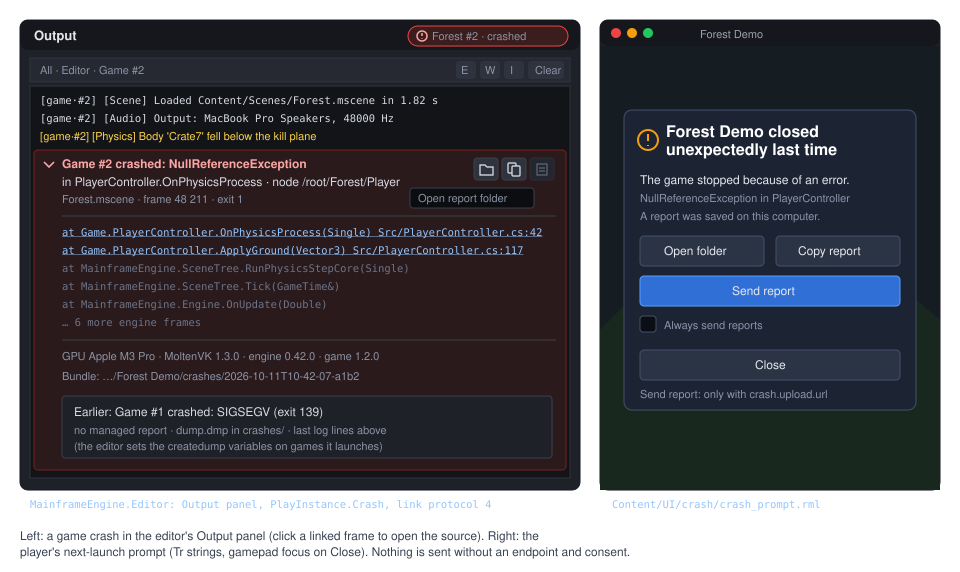
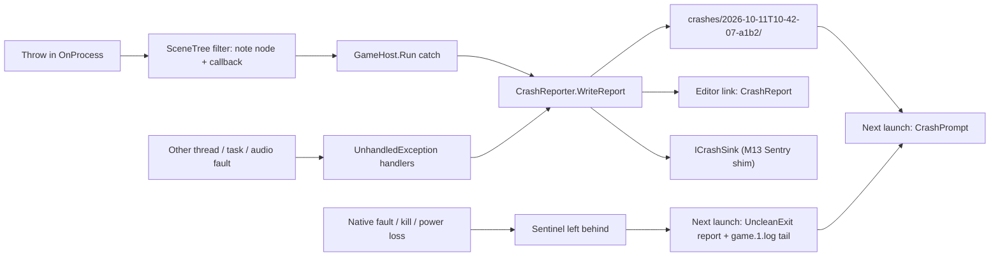

# Crash reporting (desktop, editor and games)

**Milestone:** [Gameplay toolkit](../milestones.md#gameplay-toolkit-) (G15) · **Status:** ✅ shipped (G15.1–G15.8; hang
detection and per-draw markers are G15.9, later) · **Decisions:** [ADR 0221](../../memory/decisions/0221-native-crash-capture-in-house.md)
(native capture: in-house, no new dependency), [ADR 0222](../../memory/decisions/0222-crash-report-policies.md) (fail-fast
nodes, both upload formats, shipped PDBs, logs on) · **Related:** [Project and GameHost](project-and-gamehost.md),
[Editor](editor.md), [Game UI](game-ui.md), [Native libraries](natives.md), [Release](release.md), [Testing](testing.md),
[M13 mobile services](future/mobile-services.md#analytics-and-crash-reporting) (layer 1 is this API)

When a game or the editor dies, it leaves a report bundle: the exception chain with its frames, the node and callback it
left, versions, OS, GPU and driver, the scene, frame counts and the last log entries. A native crash, a stack overflow,
a kill or a power loss is noticed on the next start. The player's next start offers the report (open the folder, copy
it, or send it to the game's own endpoint, never without their agreement), and the editor shows a game crash as one
expandable Output row with click-to-source frames and a decoded exit signal.



## Overview

| Type | Where | Role |
|---|---|---|
| `CrashReporter`, `CrashReporterOptions` | `MainframeEngine/Src/Debugging/Crash/` | Install, capture hooks, pending reports and handling, sinks, providers, upload policy |
| `CrashReport` (+ `CrashException`, `CrashFrame`, …), `CrashKind` | `Src/Debugging/Crash/CrashReport.cs`, `CrashTypes.cs` | The report model and its source-generated JSON (`format: 1`) |
| `CrashContext` | `Src/Debugging/Crash/` | The node an exception left (noted by the scene tree's filters) and crash-time providers (scene, frames, GPU, settings) |
| `CrashSession` (internal) | `Src/Debugging/Crash/` | The unclean-exit sentinel |
| `CrashBundleWriter` (internal) | `Src/Debugging/Crash/` | Builds reports, writes bundles (`.tmp` + rename), prunes, scrubs |
| `NativeDumps`, `CrashSupervisor` (internal) | `Src/Debugging/Crash/`, `Src/Project/` | The runtime's `createdump` variables; the opt-in relaunch of shipped desktop games |
| `GpuInfo` + `IRenderer.Gpu` | `Src/Rendering/GpuInfo.cs` | Backend-neutral GPU and driver identity, logged at start-up |
| `VulkanDeviceLostException`, `GpuBreadcrumbs` (internal) | `Src/Rendering/Vulkan/` | Device loss as its own type; per-pass markers; `VK_EXT_device_fault` |
| `CrashPrompt` + `Assets/UI/crash/` | `Src/UI/Crash/` | The player's next-launch prompt |
| `ICrashUploader`, `HttpCrashUploader`, `SentryEnvelope`, `SentryDsn` | `Src/Debugging/Crash/Upload/` | Opt-in sending (the only crash code that opens a connection) |
| `ExitCodes` | `Src/Core/ExitCodes.cs` | Exit code → signal or NTSTATUS name (the editor, reports) |
| Link `CrashReport` (protocol 5), `PlayService.Crashed`, `OutputCrash`, `CrashDialog`, `EditorCrashReporting` | `Src/EditorLink/`, `MainframeEngine.Editor/` | Game crashes in the editor; the editor's own next-start dialog |
| `mf-symbolicate` (`Symbolicator`) | `Tools/MainframeEngine.Symbolicate/` | Frames' MVID + method token + IL offset → file and line from PDBs |



## Public API

```csharp
namespace MainframeEngine;

public static class CrashReporter
{
    public static void Install(CrashReporterOptions options); // idempotent; GameHost.Run (and headless), the editor
    public static void Shutdown();                            // a clean end: the sentinel goes
    public static bool IsInstalled { get; }
    public static string Directory { get; }                   // {user data}/crashes; the editor: ~/.mainframe/crashes

    // Earlier runs (M13 relies on these names)
    public static IReadOnlyList<CrashReportInfo> PendingReports { get; }
    public static CrashReport? Load(CrashReportInfo info);
    public static CrashReport? LoadFolder(string folder);
    public static void MarkHandled(CrashReportInfo info, CrashDisposition how); // Dismissed, Copied, Sent (handled.json)
    public static void Delete(CrashReportInfo info);

    // This run
    public static string? WriteReport(Exception exception, CrashKind kind);    // fatal path; returns the bundle folder
    public static string? ReportError(Exception exception, string? note = null); // non-fatal; one per type per run
    public static void SetContext(string key, Func<string?>? provider);        // game keys; read only at crash time
    public static event Action<CrashReport>? Crashing;                          // on the way down: keep it short
    public static void AddSink(ICrashSink sink);                                // M13 Sentry shim, console heads, the editor link
    public static bool RemoveSink(ICrashSink sink);

    public static bool UploadConsent { get; set; }          // the player's choice (UserSettings.CrashUploadConsent)
    public static ICrashUploader? Uploader { get; set; }    // from project.mfproj crash.upload (HttpCrashUploader.FromProject)
}

public enum CrashKind
{
    ManagedException, ThreadException, UnobservedTask, AudioThread, DeviceLost, UncleanExit, NativeDump, Hang, Error,
}

public readonly record struct CrashReportInfo(string Folder, string Id, CrashKind Kind, DateTime TimestampUtc, string Summary);

public interface ICrashSink
{
    bool RunsBeforeWrite => false;     // M13's Sentry shim forwards before the local write
    void OnCrash(CrashReport report);  // must not throw
}
```

`GameHost.Run` installs the reporter right after the file log (unless `crash.enabled` is false). Its fatal catch is
`CrashReporter.WriteReport(e, CrashKind.ManagedException)` → `Log.Fatal(e)` → shutdown, each shutdown step guarded
(`ShutdownStep`): a second exception is logged, never thrown over the first. The headless path does the same and sends
the editor `Goodbye(1)`. `Engine.Run` notes a run that ended with an exception, so `Engine.Dispose` does not throw
Silk.NET's "cannot call Reset inside of the render loop" over it. The editor installs its own (below); the render-test
host does not, because a crash there fails a test.

## Capture points

- **Main thread:** the catch in `GameHost.Run`.
- **Which node.** The scene tree notes the node and callback with an exception filter that returns `false`, so nothing
  is caught, the exception keeps its stack, and the note is taken before unwinding:

  ```csharp
  Node? current = null;
  try { foreach (var node in …) { current = node; node.InvokeProcess(gameTime); } }
  catch (Exception e) when (CrashContext.NoteNode(current, NodeCallback.Process, e)) { } // always false: never catches
  ```

  Process and physics process note once per loop (a local store per node, no extra call); `OnEnterTree`, `OnReady`,
  `OnExitTree`, `OnInput`, `OnUnhandledInput` per call, deferred calls by the call's target or state. The innermost node
  wins (filters run inner first): a child's `OnReady` thrown through its parent's names the child. The note holds the
  node's path, type name and callback as text in a `ConditionalWeakTable` keyed by the exception, so an exception that
  was caught after all (the editor's Simulate guard) never keeps a game node or a collectible assembly alive. Signals
  are C# events raised inside callbacks: their exceptions name the emitting callback. Node exceptions stay fail-fast
  (ADR 0222).
- **Other threads:** `AppDomain.UnhandledException` writes a `ThreadException` report, then the process ends as before.
  `OutOfMemoryException`, which `GameHost.Run` does not catch, arrives here too.
- **Tasks and audio (non-fatal):** `TaskScheduler.UnobservedTaskException` and the audio mixer's fault
  (`AudioServer`, logged once) call `ReportError`, at most one report per exception type per run.
- **Not capturable in process:** `StackOverflowException`, `Environment.FailFast` and native faults. The sentinel
  notices all of them; native dumps capture them on desktop.

## What a report holds

```text
{user data}/crashes/
├── session-48213.json                   sentinel of the running process (deleted on a clean exit)
├── session-48213.lock                   held open with no sharing while it runs (the liveness test)
└── 2026-10-11T10-42-07-a1b2/
    ├── report.json                      the report (format 1)
    ├── log.txt                          the last entries (crash.logEntries, 200), formatted like the file log
    ├── settings.json                    effective project.mfproj (crash.upload left out), render state, the player's settings.json
    ├── game.log.tail                    UncleanExit only: the last 256 KB of the previous run's log
    ├── dump.dmp, crashreport.json       NativeDump only: the runtime's dump (and its own report, Linux and macOS)
    └── handled.json                     once the player (or the game) handled it
```

```json
{
  "format": 1, "id": "a1b2c3d4…", "kind": "ManagedException", "timestamp": "2026-10-11T10:42:07.123Z",
  "app": { "name": "Forest Demo", "version": "1.2.0", "engine": "0.42.0", "engineCommit": "92dbb40a",
           "demo": false, "debugBuild": false, "runtime": ".NET 10.0.1", "rid": "osx-arm64", "headless": false, "editor": false },
  "os": { "description": "Darwin 27.0.0 …", "arch": "Arm64", "cpus": 12, "memoryMB": 36864, "locale": "en-AU" },
  "gpu": { "name": "Apple M3 Pro", "vendorId": "0x106b", "deviceId": "0x…", "type": "IntegratedGpu",
           "driver": "MoltenVK", "driverInfo": "1.3.0", "driverVersion": "0.2.2208", "api": "1.2.296" },
  "session": { "uptimeSeconds": 812.4, "renderedFrames": 48211, "processFrames": 48190,
               "scene": "Assets/Scenes/Forest.mscene", "node": "/root/Forest/Player",
               "nodeType": "Game.PlayerController", "callback": "OnPhysicsProcess", "args": ["--fixed-fps", "60"], "processId": 48213 },
  "exception": [{ "type": "System.NullReferenceException", "message": "Object reference not set to …",
                  "frames": [{ "method": "Game.PlayerController.OnPhysicsProcess(Single)",
                               "file": "Src/PlayerController.cs", "line": 42, "module": "Game.dll",
                               "mvid": "5f0c…", "ilOffset": 37, "token": 100663320 }] }],
  "context": { "level": "north-ridge" },
  "device": { "tier": null, "thermalState": null },
  "gpuLoss": null, "log": "log.txt", "note": null, "exitCode": null
}
```

- **Exception chain:** inner and aggregate exceptions flattened, outermost first (16 at most, 128 frames each). The MVID,
  method token and IL offset of each frame let `mf-symbolicate` find its line in a build shipped without PDBs.
- **GPU:** `IRenderer.Gpu` (`GpuInfo`, a default interface member) is read once from `VkPhysicalDeviceProperties2` and
  `VkPhysicalDeviceDriverProperties` (vendor version packing decoded: NVIDIA 10.8.8.6, Intel on Windows 18.14) and logged
  at start-up (`[Vulkan] GPU: …`). The renderer sets `CrashContext.Gpu`, which also updates the sentinel.
- **`device.tier` / `thermalState`** stay null on desktop; M13 fills them.
- **Scrubbing:** the home folder becomes `~` and the user name (three letters or more) `<user>` in every string of the
  report, the log and the settings. The machine name is never collected.

## Writing on the way down

- **One writer:** an `Interlocked` flag lets only the first fatal crash write; a second one goes to stderr (the same
  exception reported again — a filter, then the runtime's handler — is silent).
- **Headroom:** `Install` allocates a 1 MB reserve and a 256 KB JSON buffer; the fatal path frees the reserve first.
- **Durable and bounded:** written to `<folder>.tmp`, `report.json` flushed to disk, then renamed. Context providers run
  on a worker with a 2 s budget (`ProviderBudget`); one that throws or stalls is skipped. `crash.maxReports` (10) keeps
  the newest bundles; bundles over 64 MB (dumps aside) are refused; the file log is flushed last.
- **Order:** facts and the exception, providers and `SetContext` keys, `Crashing` handlers, sinks with
  `RunsBeforeWrite`, the write (and the sentinel marked with the report id), the other sinks.

## The unclean-exit sentinel

At start, `CrashSession` writes `crashes/session-<pid>.json` (start time, versions, OS, GPU once known, arguments, log
path) and holds `session-<pid>.lock` open with no sharing. `CrashReporter.Shutdown` (the end of `GameHost.Run`, of a
headless run, of the editor) deletes both. On the next start, a sentinel whose lock can be taken belongs to a process
that is gone: unless it names a report it wrote, it becomes an **`UncleanExit`** report with its facts and the tail of
its log (the `.1` file when this run's `FileLogSink` rotated it away). It notices segfaults, stack overflows,
`FailFast`, force-quits, OOM kills and power loss on every platform at no cost, but has no stack; the log stops at its
last flush (at most a second before the end). Sentinels of running instances keep their lock and are left alone. No
process API is used: the managed layer stays console-safe.

## Native crashes on desktop

ADR 0221 picked the in-house path: **A** (the sentinel) always; **B** (the .NET runtime's `createdump`) for games the
editor launches, which get `DOTNET_DbgEnableMiniDump=1`, `DOTNET_DbgMiniDumpType=1` (mini),
`DOTNET_DbgMiniDumpName={user data}/crashes/dump-%p.dmp` and, on Linux and macOS, `DOTNET_EnableCrashReport=1`
(`NativeDumps.Environment`); **B + C** for shipped desktop games with `crash.nativeDumps` set (`triage`, `mini`, `heap`;
default `off`): `GameHost.Run` relaunches the game as its own child with the variables (`CrashSupervisor`), waits, and
when the child ends abnormally turns its sentinel into the report at once (`UncleanExit`, or `NativeDump` with the dump
and the runtime's `crashreport.json` moved into the bundle) with the exit code. The supervisor is skipped under a
debugger, when the editor launched the game, headless, when the variables are already set, and on mobile and consoles.
A dump found for a dead session on a normal start goes into its bundle too.

The variables are environment-only: the G15.6 spike set them as `runtimeconfig.json` properties and the runtime ignored
them (it reads them with `CLRConfigNoCache`). A mini dump of the fixture game is ~20 MB and takes ~3 s while the process
is frozen; triage dumps hold stacks only. Option D (a signal handler in a shim) stays rejected; E (`sentry-native` or
Crashpad) stays possible behind `ICrashSink`.

## GPU device loss and breadcrumbs

- **A typed loss.** `Result.Check`, acquire and present throw `VulkanDeviceLostException : VulkanException` (now
  unsealed) on `VK_ERROR_DEVICE_LOST`; a report finding one in the chain is `DeviceLost`, summary "The graphics driver
  stopped responding". After a loss the renderer's `Dispose` skips `vkDeviceWaitIdle` and never throws.
- **Breadcrumbs** (`EngineOptions.GpuBreadcrumbs`, `crash.gpuBreadcrumbs`, on by default). `GpuBreadcrumbs` owns one
  host-visible coherent buffer of `uint`s, frame slot × pass × {begin, end}. Nine passes mark their boundaries in frame
  order — `Uploads`, `Skinning`, `Shadows`, `Offscreen`, `Prepass`, `Scene`, `UiOffscreen`, `BeforeTonemap`, `Present`
  (the tonemap, the effects after it and the overlay, one render pass sequence) — with `vkCmdFillBuffer`, which is
  legal only outside render passes; an end mark follows an execution barrier (all commands → transfer), so a pass whose
  end equals the frame had finished. About twenty small commands a frame, no allocation, goldens unchanged. The
  exception reads the last submitted frame's marks as it is constructed: passes with `begin == frame` and
  `end != frame` were in flight (`gpuLoss.inFlight`).
- **Fault info.** With `VK_EXT_device_fault` (Silk.NET's `ExtDeviceFault`; enabled with its `deviceFault` feature when
  the device has it — MoltenVK and lavapipe do not), `vkGetDeviceFaultInfoEXT` adds the description, faulting addresses
  and vendor codes.
- **The player** sees the next-launch prompt; the game exits (no device re-creation, ADR 0222).

## Next-launch prompt (games)


If `crash.prompt` is `"ask"` (default) and `PendingReports` is not empty, `GameHost` shows `CrashPrompt` once the first
scene is on screen (after the loading screen, ADR 0183) — not in automated runs (`--max-frames`, `--screenshot`,
`--hidden`, offline recording). It is an engine `UiDocument` (`Assets/UI/crash/crash_prompt.rml`/`.rcss`) on the widget
library, laid out in `dp`, gamepad-usable (`nav: auto`; B or Escape closes), its code strings through
`Tr.P("crash", …)` and its RML text through the text contract (`Assets/UI/crash/crash.pot`, `just l10n-engine`):

- "{game} closed unexpectedly last time" and the newest report's summary, plus how many earlier ones it stands for;
- **Open folder** (desktop, through SDL's `OpenURL`: no process is started), **Copy report** (`report.json` + the log,
  never a dump, `UiServer.ClipboardText`), **Send report** (only with an uploader), **Close**, and "Always send reports"
  (`UploadConsent`, saved as `crash.uploadConsent` in the player's `settings.json`).

The first choice marks the shown report handled with its disposition and the earlier ones dismissed, so each is offered
once. Games with their own flow set `"prompt": "none"` and use `PendingReports`, `Load` and `MarkHandled`. Headless
runs log the pending reports instead.

## Upload (opt-in)

- `ICrashUploader.SendAsync(CrashReportInfo, CancellationToken)` runs on a worker; the prompt polls it.
  `HttpCrashUploader` (`HttpCrashUploader.FromProject`) uses the BCL `HttpClient`. Formats (ADR 0222, both):
  `"sentry-envelope"` (default: the event mapped from `report.json` — the chain innermost cause first with frames oldest
  first, contexts for app, OS, device, runtime, GPU, session and GPU loss, tags, `extra` from the context keys — the log
  as breadcrumbs, `log.txt`/`settings.json`/`crashreport.json` as attachments, POSTed to `/api/<project>/envelope/` of
  the DSN with `X-Sentry-Auth`) or `"zip"` (`multipart/form-data`: `report` and the bundle as `bundle`, a zip).
  Server errors (5xx, 408, 429 with `Retry-After`) and network failures are retried three times.
- **Policy.** Nothing is sent without `crash.upload.url`. `"mode": "ask"` sends only on the player's **Send report**;
  `"consented"` sends earlier reports on the next start while `UploadConsent` is true (and shows no prompt). Dumps go
  only with `includeDumps`; `includeLog` (default true) drops the logs for games whose logs hold chat or names. The
  server sees the player's IP address: the game's privacy policy must say so. Self-hosted Sentry is a ready receiver.

## Editor: game crashes and its own

- **Link protocol 5** adds `CrashReport = 9` (game → editor): `report.json` (at most 256 KB; larger is not sent) and the
  bundle folder. `EditorLinkCrashSink` (registered by `GameSession` while the link is up) sends it on the way down after
  the queued logs, waiting at most 1 s — also for a link still connecting — before the goodbye. An older game still
  works; it sends no report (the editor warns about the protocol, as before).
- **`PlayService.Crashed`** fires once per crashed instance after its exit, with `PlayInstance.Crash`,
  `CrashFolder`, `DumpPath` and `ExitDescription` (`ExitCodes.Describe`: `139` → `SIGSEGV, a native crash`, Windows codes
  to NTSTATUS names). A protocol-5 game gets 1 s for its report to arrive; without one, the editor looks for
  `dump-<pid>.dmp` in the project's crash folder (every launched game writes mini dumps there). The Play chip's tooltip
  names the exit and the summary.


- **Output crash row** (`OutputLog.AddCrash`, `OutputCrash.From`): an error row "Game #2 crashed: NullReferenceException
  in PlayerController.OnPhysicsProcess" with the node path and scene, the message and the GPU passes in flight. Icon
  buttons with tooltips: Frames (expands the first exception's frames; game frames with a file on this machine are
  click-to-source through `Workspace.SourceOpener`, engine frames are muted), Open Report (the bundle folder), Copy
  Report, Show Dump (when one exists). The game's earlier log rows stay above it.
- **The editor's own crashes** (`EditorCrashReporting`): `Program.cs` installs the reporter in `~/.mainframe/crashes`
  with a rotating `~/.mainframe/logs/editor.log`, reports a main-loop exception from an exception filter (so it still
  ends the process as before), and its `Crashing` handler writes the recovery copies of unsaved scenes and lists them in
  the report (`context.recoveryCopies`). On the next start `CrashDialog` shows the summary, the recovery copies with
  **Open** each, Copy Report, Open Folder and Report Issue (copies the report, then opens the repository's new-issue page
  with only the version in the title). Scripted and test runs (no `CrashDirectory`) install nothing.
- **Project Settings › Crash Reports** edits the `crash` section.


## Symbols

- **Managed:** portable PDBs stay next to the assemblies in editor releases and game packages (ADR 0222).
  `build/package-game.sh --symbols separate` moves them, with their assemblies, into `<exe>-<version>-<rid>-symbols.zip`
  (`build/collect-symbols.sh`; G5's editor export will offer the same as `"symbols": "ship" | "separate"`).
  `mf-symbolicate <report.json> --symbols <folder> [--out <file>]` matches each frame's module MVID to an assembly in the
  folder and maps its method token and IL offset to the sequence point at or before it.
- **Commit:** `EngineInfo.Commit` reads the `+<sha>` SourceLink adds to the informational version (8 digits; null
  without it).
- **Natives:** `natives.yml` builds Release with debug info (`-g`; `/Zi` + `/DEBUG`), then `build/split-native-symbols.sh`
  strips the staged binaries (`dsymutil` + `strip -x`, `objcopy --only-keep-debug` + `--strip-debug`, the linker's
  `.pdb`) and uploads the symbols as `native-symbols-<leg>`. The binaries committed today predate this (no debug info)
  until the workflow next runs; `natives.lock` records binaries, not symbols. `publish.yml` attaches
  `MainframeEngine-<version>-symbols.zip` (engine and editor PDBs with their assemblies, per RID) to each release.

## `project.mfproj`

```json
{
  "crash": {
    "enabled": true, "prompt": "ask", "logEntries": 200, "maxReports": 10, "gpuBreadcrumbs": true,
    "nativeDumps": "off",
    "upload": { "url": "", "format": "sentry-envelope", "mode": "ask", "includeLog": true, "includeDumps": false }
  }
}
```

All keys are optional with defaults (only changed values are written), so `format` stays 3. `nativeDumps` is one of
`off | triage | mini | heap`.

## Mobile and consoles

- **M13** keeps its decision: `CrashReporter`, `CrashReport` and `PendingReports` are its layer 1 unchanged; its Sentry
  shim is an `ICrashSink` with `RunsBeforeWrite`. The desktop-only parts (the supervisor, `nativeDumps`) are skipped on
  mobile.
- **Consoles** implement `ICrashSink` and the platform's dump services in their private repositories. The managed layer
  uses no `Process` and no `HttpClient` outside the upload service and the desktop supervisor, and `CrashReport` uses
  source-generated JSON.

## Threading and allocation

Nothing runs per frame except the breadcrumb commands (no allocation) and a local store per processed node; filters run
only on a throw. `MemoryLogSink` stops allocating once its ring is full. Providers run only at crash time. Pending
reports are listed on a worker at `Install`; the first `PendingReports` access waits for it. The scene tree's allocation
gate (`SceneTreeAllocationTests`) and the render tests' allocation gates stay at 0 B.

## Tests

- **Unit (`Tests/MainframeEngine.Tests/Crash/`):** the report and its JSON round trip; chains (inner, aggregate); MVID,
  token and IL offset; scrubbing; a throwing `Crashing` handler and sinks; a stalling or throwing provider (budget);
  one fatal writer and the reserve; non-fatal once per type; pruning; pending, handled and deleted reports; device loss in
  the chain; `CrashSession` (clean exit, dead sentinel → `UncleanExit` with the log tail, the rotated log, a live
  instance, a reported one, a dump moved in); `NativeDumps` and the supervisor's conditions; the scene tree's filters per
  callback kind (same exception and stack, `Tick` still throws, the child named over its parent, deferred calls);
  `ExitCodes`, `GpuInfo` decoding, `EngineInfo.ReadCommit`; the `crash` section; the settings snapshot; upload consent;
  the link frame; `SentryDsn`, the envelope's structure; `HttpCrashUploader` against a local `HttpListener` (envelope
  with auth, zip without the log, retries, client errors); `mf-symbolicate`.
- **Out of process (`CrashProcessTests`):** the fixture game `Tests/MainframeEngine.CrashTests.Fixture` runs headless in
  its own process with `++ crash=<kind>`: a throw in `OnPhysicsProcess` and in a child's `OnReady` (report names the
  node), a thread (report, the process dies, no duplicate next start), an unobserved task (non-fatal, exit 0),
  `FailFast`, a stack overflow and a native fault (`UncleanExit` with the log tail on the next start), a native fault
  with the dump variables (`NativeDump` with `dump.dmp`; Unix), and `--editor-port` against an `EditorLinkServer`
  (`CrashReport` before `Goodbye(1)`).
- **Render (`SceneTests.ADeviceLossNamesThePassesAndShutsDownCleanly`):** `--simulate-device-lost 20`
  (`EngineOptions.SimulateDeviceLostAtFrame`): the frame is submitted and finished, then reported lost; every pass of it
  completed, none in flight; the previous frame's marks read `begin == end`; teardown is validation-clean. Every other
  render test runs with breadcrumbs on: goldens unchanged, validation and allocation gates green.
  `UiRenderTests.TheCrashPromptMatchesGolden` (`ui-crash-prompt`).
- **Editor:** `GameCrashTests` (dump variables on launched games, a link report raised once, an exit without a report
  with its dump, the crash row's frames) and `CrashUiTests` (the Output row expands and opens game frames only;
  `CrashDialog` lists existing recovery copies, opens one, the issue link has only the version, closing marks handled).

## Changes from the proposal

- **Link protocol 5**, not 4 (4 had shipped with recording); the message is `CrashReport = 9`.
- **The sentinel's liveness is a lock file**, not a process query, and the clean end is `CrashReporter.Shutdown` at the
  end of the host's run rather than `Engine.OnClose`.
- **Node notes are text in a weak table keyed by the exception** (code reload must unload game types); process and
  physics process note once per loop instead of wrapping each call.
- **`CrashKind.Error`** for `ReportError`; the report adds `note`, `exitCode`, `session.processId`, `app.editor` and each
  frame's metadata `token` (with the MVID and IL offset it is what `mf-symbolicate` needs).
- **Breadcrumbs use `vkCmdFillBuffer` only** (no local driver has `VK_AMD_buffer_marker`; per-draw AMD markers stay
  G15.9), nine passes with `Present` covering the tonemap through the overlay, and an execution barrier before each end
  mark. A *simulated* loss keeps the renderer's waits (the device is fine).
- **No G4 `DurableFile` for bundles:** a `.tmp` folder with a flushed `report.json`, renamed.
- **The prompt shows the newest report** and dismisses the earlier ones with it; Open folder goes through SDL.
- **The supervisor writes the report itself** and shows no native message box (the next start's prompt does).
- **`settings.json` also carries the player's `settings.json`.** Upload consent is `UserSettings.CrashUploadConsent`.
- **`Engine.Run`/`Dispose`** learned that a run ended with an exception (Silk.NET's dispose would throw over it).
- **Crash tests live in `MainframeEngine.Tests`** (`Crash/`) with a fixture game project, not a separate test project.
- **Natives:** the workflow builds and splits symbols, but the committed binaries are unchanged until `natives.yml`
  runs, and `natives.lock` does not record symbols. **G5's `symbols` option** exists as `package-game.sh --symbols`
  until the editor's export lands.

## Related

- [Project and GameHost](project-and-gamehost.md) (`GameHost.Run`, log routing, editor link, user data),
  [Scene graph and nodes](scene-graph-and-nodes.md) (exception policy), [Editor](editor.md) (Play, Output, crash
  dialog), [Native libraries](natives.md) and [Release](release.md) (symbols), [Testing](testing.md)
- [Mobile services](future/mobile-services.md#analytics-and-crash-reporting) (M13): layer 1, Sentry native SDKs
- [Consoles](future/consoles.md): the plumbing checklist (no processes or HTTP in runtime code)
- Gameplay toolkit siblings: [Save games and settings](future/save-and-settings.md) (G4: `UserSettings`),
  [Game export](future/game-export.md) (G5: symbols), [Profiler](future/profiler.md) (G10: GPU zones per pass)
