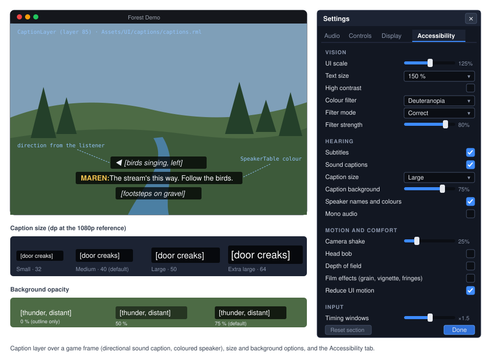
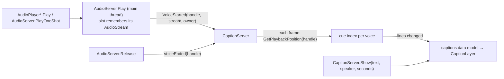

# Proposal: Accessibility (UI scale, colour vision, captions, comfort, input assists)

**Milestone:** [Gameplay toolkit](../../milestones.md#gameplay-toolkit-) (G14) · **Status:** ⬜ planned ·
**Depends on:** [M8 game UI](../game-ui.md) (RmlUi layers, widget library, ADR 0181 scaling), [M7 audio](../audio.md)
(voices, listener), [Post-processing](../post-processing.md) (ADR 0163 stages), [M9 localization](../localization.md) ·
**Related:** [Save games and settings](save-and-settings.md) (G4: `UserSettings`, settings menu, rebinding),
[Haptics and input glyphs](input-haptics-and-glyphs.md) (G12), [Video playback](video-playback.md) (G16: captions for
video), [Forest](../forest.md#pause-menu) (ADR 0180 pause menu), [Consoles](consoles.md) (platform requirements)

## Problem

Players with low vision, colour-vision deficiency, hearing loss, motion sensitivity or limited mobility need options
that every game would otherwise build by hand. The engine has some of the pieces, but no accessibility feature: a search
of `MainframeEngine/Src`, `MainframeEngine/Content` and the example games for accessibility, subtitle, caption,
colour-blind and daltonize finds nothing relevant.

- **UI scale follows the screen, not the player.** ADR 0181 gives every `UiScaleMode.Project` layer one dp ratio from
  `UiServer.Scaling` (`MainframeEngine/Src/UI/UiServer.cs:257`), computed by `UiScaling.ComputeDpRatio`
  (`MainframeEngine/Src/UI/UiScaling.cs:95-105`). `MinScale` exists to keep text readable in small windows
  (`UiScaling.cs:67-77`), but there is no player multiplier. G4 plans one (`UiServer.UserScale`, see
  [save-and-settings.md → UserSettings](save-and-settings.md#usersettings)); it is not built.
- **Text cannot grow on its own.** The widget library sets text in fixed `dp` (`body { font-size: 14dp }`, `h1` 22dp,
  `MainframeEngine/Content/UI/widgets/widgets.rcss:16`, `:22`), and rows have a fixed `height: 28dp; line-height: 28dp`
  (`widgets.rcss:52-56`). Larger text would be clipped. Nothing checks that a game's smallest text is readable.
- **RmlUi themes are bound but unused.** `RmlContext.ActivateTheme(name, activate)` wraps RmlUi's
  `@media (theme: name)` (`MainframeEngine/Src/UI/Rml/RmlContext.cs:86`). No engine code calls it, and `widgets.rcss` has
  no theme blocks. A high-contrast or reduced-motion style has nowhere to go. Focus rings are a 1dp border colour change
  (`widgets.rcss:85`, `:160`, `:191`).
- **UI animations cannot be turned off.** The loading screen breathes and sweeps forever
  (`MainframeEngine/Content/UI/loading/loading.rcss:37`, `:93`).
- **No colour filter.** Post effects run in three stages (`MainframeEngine/Src/Rendering/Post/PostEffect.cs:7-29`).
  `AfterTonemap` runs on the display-encoded LDR image, with FXAA at order 100 and the colour grade at 150
  (`PostEffect.cs:75-83`). The renderer tonemaps into an LDR image only when an `AfterTonemap` effect is enabled
  (`MainframeEngine/Src/Rendering/Vulkan/VulkanRenderer.Presentation.cs:871`). The overlay renderers (canvas, gizmos, UI,
  dev overlay) draw into the swapchain after that stage (`VulkanRenderer.Presentation.cs:929-940`), so no current hook
  can filter the whole frame.
- **No captions.** `AudioPlayer.Play` and `GetPlaybackPosition` exist (`MainframeEngine/Src/Audio/Nodes/AudioPlayer.cs:66`,
  `:74`). The position comes from the voice's frame counter, as of the last audio block
  (`MainframeEngine/Src/Audio/AudioServer.cs:520-528`). Every voice starts in one private `AudioServer.Play`
  (`AudioServer.cs:901`) and ends in `Release` (`AudioServer.cs:1061-1085`). But nothing knows what a sound *means*:
  `AudioStream` has file, load mode, loop and pitch fields only (`MainframeEngine/Src/Audio/AudioStream.cs:33-88`).
- **Comfort options are per game.** The Forest has a horizontal FOV, head bob and look settings in its own
  `ForestSettings` (`Examples/Forest/Forest/Src/Player/ForestSettings.cs:17-28`), applied by
  `FirstPersonController.ApplySettings` (`Examples/Forest/Forest/Src/Player/FirstPersonController.cs:210-218`). Depth
  of field, film grain, vignette and chromatic aberration are world settings
  (`MainframeEngine/Src/Rendering/Post/PostProcessSettings.cs:178-220`). They reach the renderer through
  `RenderServer.RootPostProcess` (`MainframeEngine/Src/Servers/RenderServer.cs:695-701`), so a player switch means
  editing the world's profile, which the Forest does row by row (`Examples/Forest/Forest/Src/Menu/ForestOptions.cs:243`,
  `:269-286`). The engine has no camera shake and no motion blur.
- **Input timing is fixed.** Actions are hold-only: `InputState` tracks `Pressed` and edge frames per action
  (`MainframeEngine/Src/Scene/Input/InputState.cs:57-66`, `:95-110`). There is no toggle mode. The UI's gamepad
  navigation repeat is two constants, 0.4 s and 0.1 s (`UiServer.cs:114-115`). Only the tooltip delay is settable
  (`UiServer.cs:154`). The axis deadzone is per action (`MainframeEngine/Src/Scene/Input/InputMap.cs:174-178`).
- **Strings are not always localized.** The Forest's menu labels are literals with no `Tr` (`ForestOptions.cs:74`),
  so an accessibility page copied from it would not translate.

## Goals

- One **`AccessibilitySettings`** object with standard keys that the engine applies itself where it can (UI, renderer,
  audio, input). Games read the rest (FOV, head bob). It persists through G4's `UserSettings` and works without it.
- **Vision:** a player UI scale (G4's), text size steps that reflow the widget library, a high-contrast theme, a
  reduced-motion theme and stronger focus rings. Plus a colour-vision filter that can simulate (for developers) or
  correct (daltonize, for players) protanopia, deuteranopia and tritanopia, with a strength slider.
- **Hearing:** subtitles and closed captions tied to audio playback. That means timed dialogue cues with speaker names
  and colours, sound-effect captions from a caption key on the `AudioStream`, direction arrows for positional sounds,
  all localized through `Tr`. A drop-in caption layer with size, background and speaker options. Mono audio.
- **Motion and comfort:** standard keys for camera shake, head bob, field of view, depth of field, film effects and
  reduced UI motion. A small camera-shake node that honours them.
- **Input:** hold-or-toggle per action, adjustable UI repeat timings, a timing-window scale for games. Rebinding is G4.
- An **Accessibility tab** for G4's settings menu (standalone before G4), used by the Forest and the Demo.
- A design that maps onto the [Xbox Accessibility Guidelines](https://learn.microsoft.com/gaming/accessibility/guidelines)
  (XAG 101 text display, 102 contrast, 103 additional channels for visual and audio cues, 104 subtitles and captions,
  105 audio accessibility, 107 input, and the motion and photosensitivity guidelines) and the "basic" tier of the
  [Game Accessibility Guidelines](https://gameaccessibilityguidelines.com/).

## Non-goals

- **Difficulty and assist modes** (aim assist, slow-motion, skip puzzle, invincibility). These are game design. The
  engine provides the settings store, not the rules.
- **Screen narration in this milestone.** UI narration and screen-reader support are a later phase
  ([Screen narration](#screen-narration-later-phase)). They need a platform choice and possibly a native dependency.
- **Audio description, sign-language video, haptic captions.** Haptics belong to [G12](input-haptics-and-glyphs.md).
- **A photosensitivity analyser** (automated flash detection on captured frames). There is a `reduceFlashing`
  key for games to honour; analysing frames is a QA tool for later.
- **Text and voice chat accessibility** (speech-to-text, text-to-speech for chat). The engine has no chat.
- **The editor's own accessibility.** The editor is a desktop tool on `ConstantPixelSize` (ADR 0181). This proposal is
  about shipped games.
- **Console platform APIs** (system caption styles, system text-to-speech). They go into the private console ports
  ([consoles.md](consoles.md)), behind the same settings.

## Design

### Overview

| Type (all new unless noted) | Where | Role |
|---|---|---|
| `AccessibilitySettings` | `Src/Accessibility/` | Standard keys, defaults from `project.mfproj`, live apply, JSON read/write |
| `UiServer.TextScale`, `.HighContrast`, `.ReduceMotion`, `.NavigationRepeatDelay/Interval` (new members) | `Src/UI/` | RmlUi themes on game layers; settable repeat |
| `ColorVisionSettings`, `ColorVisionMode`, `ColorVisionFilter` | `Src/Rendering/Post/` | The filter's settings and its 3×3 matrix |
| `ColorVisionEffect` (internal) + `Post/ColorVision.vk.frag.slang` | `Src/Rendering/Post/` | `AfterTonemap` pass |
| `ComfortOverrides`, `RenderServer.Comfort` (new member) | `Src/Servers/` | Player switches applied over the world's post settings |
| `CameraShake3D`, `CameraShake2D` | `Src/Scene/Nodes3D/`, `Nodes2D/` | Trauma-based shake scaled by the setting |
| `SubtitleTrack`, `SubtitleCue`, `SpeakerTable`, `SpeakerInfo`, `CaptionKind` | `Src/Accessibility/Captions/` | Caption resources |
| `AudioStream.Caption`, `.CaptionKind`, `.Subtitles` (new members) | `Src/Audio/` | What a sound means |
| `CaptionServer : IFrameServer` | `Src/Accessibility/Captions/` | Active cues from playing voices and manual calls |
| `CaptionLayer : UiLayer` + `Content/UI/captions/` | `Src/Accessibility/Captions/` | The drop-in caption UI |
| `SubtitleImporter` | `Src/Resources/Import/` | `.vtt` / `.srt` → `SubtitleTrack` |
| `AudioServer.MonoOutput` (new member) | `Src/Audio/` | Mono downmix in `AudioMixRoot` |
| `InputActionMode`, `InputAction.Mode`, `InputState.SetActionMode` (new) | `Src/Scene/Input/` | Hold or toggle |
| `AccessibilityPanel : UiDocument` + `Content/UI/settings/accessibility.rml` | `Src/UI/Settings/` | The settings tab |

### Settings

`AccessibilitySettings` is a plain object with typed properties. Every setter applies at once (where the engine owns
the behaviour) and raises `Changed`. It never touches disk itself:

```csharp
// new — MainframeEngine/Src/Accessibility/AccessibilitySettings.cs; one property per key in the table below
public sealed class AccessibilitySettings
{
    /// <summary>The running game's settings; GameHost creates it from project.mfproj before the first frame.</summary>
    public static AccessibilitySettings Current { get; internal set; } = new();

    // Vision: also HighContrast, ReduceMotion, ColorVisionSettings ColorVision
    public float TextScale { get; set; } = 1f;
    // Hearing: also Captions, CaptionSize, CaptionBackground, SpeakerNames, SpeakerColors, CaptionDirections, MonoAudio
    public bool Subtitles { get; set; } = true;
    // Comfort: also HeadBob, float? FieldOfView, DepthOfField, FilmEffects, MotionBlur (reserved), ReduceFlashing
    public float CameraShake { get; set; } = 1f;
    // Input: also NavigationRepeatDelay, NavigationRepeatInterval, IReadOnlySet<string> ToggleActions
    public float TimingScale { get; set; } = 1f;
    public void SetToggle(string action, bool toggle);

    [Signal] public event Action<AccessibilitySection>? Changed;   // Vision, Hearing, Comfort, Input
    public void Apply(SceneTree tree);                              // everything (startup, after loading)
    public void Reset(AccessibilitySection section);                // back to project.mfproj defaults
    public void ReadFrom(JsonObject section);                       // missing keys keep defaults; wrong types warn once
    public void WriteTo(JsonObject section);                        // only keys that differ from the defaults
}
```

**With G4.** `UserSettings` gains `Accessibility` and stores it as the `accessibility` section of `settings.json`
(G4's [ConfigFile](save-and-settings.md#configfile) sections are top-level JSON objects). `UserSettings.Apply` calls
`AccessibilitySettings.Apply` in `GameSession.Start`, before autoloads (`MainframeEngine/Src/Project/GameSession.cs:88`).
The player UI scale stays G4's `display.uiScale` → `UiServer.UserScale`. This proposal does not duplicate it.

**Without G4.** `GameHost` still creates `Current` from the project defaults and applies it. Games persist it in their
own file through `ReadFrom`/`WriteTo`. The Forest does this into its `settings.json` until G4 lands. If G14 ships first,
G14.1 adds `UiServer.UserScale` exactly as G4 specifies it, and G4 then only adds persistence.

**Standard keys** (`accessibility` section; every key optional, a missing key means the project default):

| Key | Type | Default | Applied by |
|---|---|---|---|
| `textScale` | number | 1 | `UiServer.TextScale` |
| `highContrast`, `reduceMotion` | bool | false | `UiServer` themes |
| `colorVision` | `{ "mode": "Deuteranopia", "filter": "Correct", "strength": 0.8 }` | none | `RenderServer.ColorVision` |
| `subtitles`, `captions` | bool | project | `CaptionServer` |
| `captionSize`, `captionBackground` | name, number | `Medium`, 0.75 | `CaptionLayer` |
| `speakerNames`, `speakerColors`, `captionDirections` | bool | true | `CaptionLayer` |
| `monoAudio` | bool | false | `AudioServer.MonoOutput` |
| `cameraShake` | number 0..1 | 1 | `CameraShake3D/2D` |
| `depthOfField`, `filmEffects`, `motionBlur` | bool | true | `RenderServer.Comfort` |
| `headBob`, `fieldOfView`, `reduceFlashing` | bool, number, bool | true, null, false | the game |
| `timingScale` | number 1..3 | 1 | the game (`InputState.ScaleWindow`) |
| `navRepeatDelay`, `navRepeatInterval` | seconds | 0.4, 0.1 | `UiServer` |
| `toggleActions` | string array | `[]` | `InputState` |

`project.mfproj` gains an optional `accessibility` section with the game's defaults (`subtitles`, `captions`, a
`fieldOfView` range) and caption setup (`speakers`: a `SpeakerTable` path; `captionDocument`; `promptOnFirstLaunch`,
which offers subtitles and text size on first run, before any dialogue, as both guideline sets recommend). It is
additive, like G4's `userDataName`, so it needs no format bump.

### Vision: text size, contrast, reduced motion

All three are **RmlUi themes** activated on game contexts through the existing `RmlContext.ActivateTheme`:

| Setting | Themes |
|---|---|
| `TextScale` 1.25 / 1.5 / 2 | `text-125`, `text-150`, `text-200` (one at a time) |
| `HighContrast` | `high-contrast` |
| `ReduceMotion` | `reduce-motion` |

- `UiServer` activates them on every layer's context when it is created and again when a value changes. A new
  `UiLayer.AccessibilityThemes` (`[Export]`, default true) opts a layer out. The dev overlay and the editor's layers set
  it to false: developer tools keep their look.
- **Text size reflows.** `widgets.rcss` moves font sizes to `rem`: the document body is the root element, so `h1`
  becomes `1.571rem` against the 14dp body. Fixed `height`/`line-height` rows become `min-height` with `em` line height,
  so a row grows with its text. Theme blocks set the base size:

  ```css
  body { font-size: 14dp; }
  @media (theme: text-150) { body { font-size: 21dp; } }
  @media (theme: high-contrast) {
      .panel { background-color: #000000; border: 2dp #ffffff; }
      button:focus-visible, select:focus-visible { border: 3dp #ffd400; }
      .muted { color: #d0d6e2; }
  }
  @media (theme: reduce-motion) { * { transition: none; animation: none; } }
  ```

  Game documents that size text in `rem` follow automatically. The authoring rule in `game-ui.md` becomes "sizes in
  `dp`, text in `rem`". The `UiScale` from G4 still scales everything, and the two multiply.
- **High contrast** also raises focus rings to 3dp in a colour that differs from the selection colour, and uses an
  accent palette that stays distinguishable under all three deficiencies (Okabe–Ito). The colours are documented in
  `game-ui.md` for games that style their own widgets.
- **Reduced motion** also stops the loading screen's breathing and sweep (`loading.rcss`), and `LoadingScreen` skips its
  fade.
- **Minimum text size audit.** A dev-overlay command and a QA-script step (`ui-text-audit`) walk every visible document.
  They report text whose rendered size is below a threshold at the current window size (default per project:
  `accessibility.minTextPx`, see [Open questions](#open-questions)). This needs one shim export,
  `mfrmlui_element_get_font_size` (the computed value; the binding has setters but no computed-style getter), built
  through `natives.yml` ([natives.md](../natives.md)).

### Colour vision filter

```csharp
// new — public
public enum ColorVisionMode { None, Protanopia, Deuteranopia, Tritanopia, Achromatopsia }
public enum ColorVisionFilter { Correct, Simulate }

public readonly record struct ColorVisionSettings(ColorVisionMode Mode, ColorVisionFilter Filter = ColorVisionFilter.Correct,
    float Strength = 1f)
{
    public bool IsActive => Mode != ColorVisionMode.None && Strength > 0f;
    /// <summary>The linear-RGB 3×3 matrix (in a Matrix4x4) the shader applies. Pure arithmetic, no allocation.</summary>
    public Matrix4x4 ComputeMatrix();
}

public sealed class RenderServer
{
    public ColorVisionSettings ColorVision { get; set; }   // forwarded to IVulkanContext.ColorVision each frame
}
```

**The maths is one matrix.** Both filters are linear in linear RGB, so the shader multiplies by one precomputed 3×3
matrix:

- **Simulate:** Machado, Oliveira and Fernandes (2009) publish protan, deutan and tritan matrices at severities
  0.0–1.0 in 0.1 steps. `Strength` is the severity, interpolated between the two nearest table rows. Achromatopsia is
  Rec. 709 luminance.
- **Correct (daltonize):** the error a viewer loses is `c − S·c`. It is redistributed into channels they can see with
  an error-shift matrix `E` (Fidaner, Lin and Ozguven 2005), giving `C = I + E·(I − S)`. `Strength` blends from the
  identity: `M = I + k·(C − I)`. Achromatopsia has no correction (the mode only simulates).

The matrix is recomputed only when the settings change.

**The effect.** `ColorVisionEffect` is an `AfterTonemap` effect at a new `PostEffectOrder.ColorVision = 200`: after the
colour grade (150), so the grade is filtered too, and before the debug views (1000).

- `PostEffectSettings` gains `ColorVision` (an init member, like `ContactShadows`). `IsEnabled` returns
  `settings.ColorVision.IsActive`.
- `Post/ColorVision.vk.frag.slang` decodes the display-encoded LDR texel, multiplies, saturates and encodes. The matrix
  is three `float4` push constants. It follows the `LdrInputSets` and `PassPipelines` patterns of `ColorGradeEffect`.
- Enabling it while no other `AfterTonemap` effect runs switches the tonemap to the LDR path
  (`VulkanRenderer.Presentation.cs:871`). That costs one extra fullscreen pass while the filter is on, and nothing when
  it is off. Zero allocation per frame.
- The effect is also registered on `SubViewportPost` stacks. The **editor viewport** gets a toolbar icon button (an eye,
  tooltip "Simulate colour vision") with a menu of the four modes. It is an editor-session setting and never saved into
  the project.

**Scope: the 3D scene, not the UI.** The overlay renderers draw after the `AfterTonemap` stage
(`VulkanRenderer.Presentation.cs:929-940`), so the canvas and RmlUi are not filtered. For **correction** this is
deliberate: UI colours are authored, and the high-contrast theme plus shape cues fix them better than a filter. For
**simulation** a developer wants the whole frame. A later `ColorVisionScope.FullFrame` would render the overlay into an
LDR image and apply the same matrix in a final pass to the swapchain. That needs every overlay renderer to build
pipelines for a second output pass, which is why it is an open question and not part of G14.3.

### Subtitles and captions



#### Resources

```csharp
public enum CaptionKind { Dialogue, SoundEffect, Music, Ambience }

public sealed class SubtitleCue : Resource
{
    [Export(Range = "0,3600,0.001")] public float Start { get; set; }      // seconds into the audio
    [Export(Range = "0,3600,0.001")] public float End { get; set; }
    [Export] public string Speaker { get; set; } = "";                      // SpeakerTable id; empty = no name
    [Export(Translatable = true, Multiline = true)] public string Text { get; set; } = "";
}

public sealed class SubtitleTrack : Resource
{
    [Export] public List<SubtitleCue> Cues { get; set; } = [];              // sorted by Start when loaded
}

public sealed class SpeakerInfo : Resource
{
    [Export] public string Id { get; set; } = "";
    [Export(Translatable = true)] public string Name { get; set; } = "";
    [Export] public System.Drawing.Color Color { get; set; } = System.Drawing.Color.White;   // sRGB
}

public sealed class SpeakerTable : Resource
{
    [Export] public List<SpeakerInfo> Speakers { get; set; } = [];
}

// AudioStream additions
[ExportGroup("Captions")]
[Export(Translatable = true)] public string? Caption { get; set; }            // "[door creaks]"
[Export] public CaptionKind CaptionKind { get; set; } = CaptionKind.SoundEffect;
[Export] public SubtitleTrack? Subtitles { get; set; }                        // timed dialogue for this file
```

- All the types are exportable as they are: `Resource` subclasses and lists of them, translatable strings and
  `System.Drawing.Color` ([scene-serialization.md](../scene-serialization.md)). `mf-l10n extract --scenes` already reads
  `.mres` and inline resources ([localization.md → Scene strings](../localization.md#scene-strings)). Stored text is
  the source string, and the caption server translates it at display time with `Tr._(text)`. A locale change refreshes
  the visible lines.
- **Imported audio files** take the same three values from their `.meta` import settings: `"caption"`,
  `"captionKind"` and `"subtitles"` (a path or UID). `AudioImporter` sets them on the stream. `mf-l10n extract` learns
  to read `caption` from `.meta` files.
- **`.vtt` and `.srt` files** import as `SubtitleTrack`s through a new `SubtitleImporter`. WebVTT voice spans
  (`<v maren>`) become `Speaker` ids, SRT has no speakers. `mf-l10n extract` learns both formats, with `#:` references
  to the cue's line.
- `AudioPlayer`, `AudioPlayer2D` and `AudioPlayer3D` gain `[Export(Translatable = true)] string? Caption`, an override
  for one player (the same creak can be "[door creaks]" or "[gate creaks]").

#### Triggering and timing



- The voice slot keeps a reference to its `AudioStream`, set by `AudioPlayback.Play` and `PlayOneShot`, which both
  have it. `AudioServer` calls an internal `ICaptionListener` from `Play` (`AudioServer.cs:901`) and `Release`
  (`AudioServer.cs:1061`). Both run on the main thread, so no new cross-thread state is needed.
- **Dialogue.** For a voice whose stream has `Subtitles`, the server keeps a cursor into the cues. `Process` reads
  `AudioServer.GetPlaybackPosition(handle)` for each tracked voice (at most 32, a fixed array) and moves the cursor.
  Seeking, pausing and pitch all work, because the position is the voice's own frame count. The position lags by one
  audio block (10 ms by default), which nobody can see. A cue is shown for at least `MinCueSeconds` (1 s), and long cues
  wrap to at most two lines at the layer.
- **Sound captions.** For a stream with a `Caption` (or a player override), the server shows the line while the voice
  plays, for at least 1.5 s and at most 4 s for a one-shot. Looped streams (ambience) show while they loop. An
  identical line that is already visible is extended, not repeated, so ten footsteps make one "[footsteps on gravel]".
- **Audibility.** A positional voice is captioned only while its last computed gain is above −40 dB, so distant sounds
  do not flood the screen. A voice on a muted bus is never captioned.
- **Direction.** For 3D voices the server compares the source position with `AudioServer.Listener3D`
  (`AudioServer.cs:242`) and picks one of four arrows (◀ ▶ ▲ ahead ▼ behind). For 2D voices it uses the listener's x
  offset. The line updates only when the arrow changes.
- **Categories.** `Subtitles` gates `Dialogue`. `Captions` gates the other three kinds.
- **Manual and video.** `CaptionServer.Show(string text, string speaker = "", float seconds = 3f, CaptionKind kind =
  CaptionKind.Dialogue)` covers games with text-only dialogue and code-driven events. [G16](video-playback.md) feeds
  video subtitle tracks through the same server, using its own clock.
- **Allocation.** Lines live in a fixed pool of eight `CaptionLine` structs. Strings are created only when a cue starts
  or the locale changes, never per frame. `Process` with no tracked voices, or with cues that do not change, allocates
  0 B, and it joins the allocation gate.

```csharp
// new — registered in Engine.OnLoad next to the AudioServer (Engine.cs:426-431); works without audio for Show()
public sealed class CaptionServer : IFrameServer
{
    public SpeakerTable? Speakers { get; set; }
    public IReadOnlyList<CaptionLine> Lines { get; }             // oldest first
    public CaptionLine Show(string text, string speaker = "", float seconds = 3f,
        CaptionKind kind = CaptionKind.Dialogue);
    public void Clear();
    [Signal] public event Action? LinesChanged;
}

public readonly record struct CaptionLine(int Id, CaptionKind Kind, string Text, string SpeakerName,
    System.Drawing.Color SpeakerColor, CaptionDirection Direction, double ShownAt);
```

#### The caption layer

`CaptionLayer : UiLayer` is added under the root by `GameHost` when the project has an `accessibility` section, or by
the game with `CaptionLayer.Ensure(tree)`.

- **Layer 85.** That is above HUDs, below G4's settings menu (90) and below the loading screen (10 000). It uses
  `ProcessMode.Always`, so paused dialogue stays on screen.
- **Scaling.** `UiLayer.Scaling` is set to `ScaleWithScreenSize` at 1920×1080 (the per-layer override exists,
  `MainframeEngine/Src/UI/UiLayer.cs:104`). Caption sizes therefore mean the same fraction of the screen in every
  project, whatever its own UI scale mode.
- **Document.** `Content/UI/captions/captions.rml`, or `accessibility.captionDocument` in `project.mfproj`, binds a
  `captions` data model: a struct list (`BindList`) of `kind`, `speaker`, `color`, `text`, `arrow`, plus scalars
  `size`, `background`, `showNames`, `showColors`.
- **Layout.** Bottom centre, `max-width: 60%`, at most two lines per cue and at most three cues (the oldest drops).
  Each line has its own background box, at `background` opacity. At 0 % the text gets a 2dp outline instead.
- **Sizes.** `Small` 32, `Medium` 40, `Large` 50, `ExtraLarge` 64 dp at the 1080p reference. Sound captions are
  italic, and speaker names are bold in the speaker's colour (white when `speakerColors` is off, hidden when
  `speakerNames` is off).
- Games restyle the layer by copying `captions.rml`. The data-model contract is documented in `game-ui.md`.

#### Editor

- The inspector edits `SubtitleTrack.Cues` as a list (start, end, speaker, text). A cue row has an icon button (▶,
  tooltip "Play from this cue") that plays the owning stream from `Start`.
- Audio import settings (the `.meta` sidecar) gain the three caption keys wherever the editor edits import settings.
- Project Settings gets an Accessibility section for the `project.mfproj` keys.

### Mono audio

`AudioServer.MonoOutput` (a new property) sends one command to the audio thread. After it mixes the
graph, `AudioMixRoot` (`MainframeEngine/Src/Audio/Graph/AudioMixRoot.cs:19`) averages the channels in place,
allocation-free and lock-free like the rest of the block. Players who hear with one ear then get every panned sound.

### Motion and comfort

- **Post overrides.** `RenderServer.Comfort` is a small struct (`DepthOfField`, `FilmEffects`, `MotionBlur`).
  `RootPostProcess` (`RenderServer.cs:695-701`) applies it after the camera attributes, as a `with` on the
  `PostProcessSettings` struct: no DoF blur, and zero grain, vignette and chromatic aberration. The world's profile is
  untouched, so the Forest no longer needs to edit its profile for these rows, and editor previews stay as authored.
  Struct copies do not allocate.
- **Camera shake.** `CameraShake3D` (child of a `Camera3D`) and `CameraShake2D` implement trauma-based shake:
  `AddTrauma(0..1)`, `Decay`, `MaxOffset`, `MaxRoll`, `Frequency`, and seeded value noise (repeatable under
  `--fixed-fps`). The offset
  is multiplied by `AccessibilitySettings.Current.CameraShake`, so at 0 there is no shake, and games with their own
  shake read the same value.
- **Field of view.** `Camera3D.Fov` is vertical (`MainframeEngine/Src/Scene/Nodes3D/Camera3D.cs:37`). A static helper
  `Camera3D.HorizontalToVerticalFov(degrees, aspect)` moves the Forest's formula into the engine
  (`FirstPersonController.VerticalFov`, `Examples/Forest/Forest/Src/Player/FirstPersonController.cs:188`). The setting is
  horizontal degrees, clamped to the project's `fieldOfView` range, and applied by the game's controller.
- **Head bob, flashing.** These are game behaviour. The keys are standard, so every game's menu shows them the same way,
  and the Forest's `HeadBob` reads the shared key.
- **TAA and blur.** Anti-aliasing stays a display setting (G4, and the Forest's `aa` row). The Accessibility tab links
  to it with the note "TAA can look soft in motion".

### Input assists

- **Hold or toggle.** `InputAction.Mode` (`Hold` default, `Toggle`) comes from `project.mfproj` (`"mode": "toggle"`,
  additive). The player's `toggleActions` overrides it through `InputState.SetActionMode`. In toggle mode,
  `ActionState` (`InputState.cs:57`) latches: a press edge flips `Pressed`, and releases are ignored. `JustPressed` and
  `JustReleased` follow the latched state, so game code is unchanged. Events from the router still report the physical
  input (`InputEvent.IsActionPressed`, `MainframeEngine/Src/Scene/Input/InputEvent.cs:27`). That difference is
  documented, and an open question.
- **Timing windows.** `InputState.ScaleWindow(seconds)` returns `seconds · TimingScale`, a one-line helper so QTEs,
  double-taps and parry windows use one setting. `InputState.GetActionHeldTime(action)` supports "hold to confirm"
  without per-game timers.
- **UI repeat.** `UiServer.NavigationRepeatDelay` and `NavigationRepeatInterval` replace the constants
  (`UiServer.cs:114-115`). `TooltipDelaySeconds` is already settable and joins the keys.
- **Rebinding, one-handed layouts, deadzones** are G4's [Key rebinding](save-and-settings.md#key-rebinding). Glyphs and
  vibration strength are [G12](input-haptics-and-glyphs.md). This proposal adds no second rebinding path.

### Settings UI and consumers

- **`AccessibilityPanel : UiDocument`** (`Content/UI/settings/accessibility.rml`) shows the four groups in the mockup
  above. It uses only widget-library controls and translates every label through `Tr` / RML text. A live sample
  caption ("[door creaks]") previews size and background as the player drags. With G4 it is the menu's
  `SettingsTabs.Accessibility` tab. Without G4, games open it as a modal document.
- **Forest.** Its pause menu (ADR 0180) gets an Accessibility page. Rows are added to the `ForestOptions` table and
  call `AccessibilitySettings`. Its synthesized birds, footsteps and stream get caption keys, with directions ("◀
  [birds singing]"). Its `HeadBob` and FOV move to the shared keys, so `ForestSettings` keeps only what is
  Forest-specific. Labels on the new page go through `Tr`.
- **Demo.** The Audio 3D and Audio 2D scenes get caption keys and one dialogue line with a `.vtt` track. The UI scene
  gets toggles for text size, high contrast and colour filter, so `just demo-screenshots` can show them.

### Screen narration (later phase)

UI narration reads the focused element aloud as focus moves. The hooks exist: `RmlContext.FocusElement`
(`RmlContext.cs:98`) and `UiElement.Focused` events. A `UiNarrator` would read an element's `aria-label`, `title` or
text. The open part is the output:

| Option | Platforms | Dependency | Trade-offs |
|---|---|---|---|
| Platform TTS through P/Invoke: SAPI (COM), `AVSpeechSynthesizer` (Objective-C runtime), speech-dispatcher (`libspeechd`) | all three | none new | Speaks, but is not a screen reader: no braille, ignores the player's screen-reader settings |
| `System.Speech` NuGet | Windows | new package | Easy on Windows only |
| AccessKit (native, C API) exposing the RmlUi tree through UIA, NSAccessibility and AT-SPI | all three | new native library under `Native/` | Real screen-reader support (Godot 4.5 adopted it), but a tree adapter and a native build |

The choice needs a dependency discussion ([Open questions](#open-questions)), so it is task G14.10 after the rest.

## Testing

- **Unit (`Tests/MainframeEngine.Tests/Accessibility/`):**
  - `AccessibilitySettings`: defaults from `project.mfproj`, `ReadFrom`/`WriteTo` round trip, only changed keys
    written, wrong types warn once, `Changed` sections, `Reset`.
  - `ColorVisionSettings.ComputeMatrix`: identity at strength 0 and for `None`; Machado severity 1 rows match the
    published values; interpolation at 0.55; daltonize keeps neutral greys neutral; the achromatopsia rows sum to 1.
  - `CaptionServer` over the null device (`AudioServer.RenderNullDevice`, `AudioServer.cs:626`), with deterministic
    positions: cues advance with playback, seek and pause; minimum duration; dedupe and extension; the −40 dB gate;
    muted bus; direction buckets from the listener; `Subtitles`/`Captions` gating; locale change refreshes lines;
    `.meta` caption keys; player overrides.
  - `SubtitleImporter`: VTT voices, SRT, timestamps, malformed cues reported with line numbers.
  - Input: toggle latching, edges in process and physics frames, `ScaleWindow`, held time.
  - `AudioServer.MonoOutput`: hard-panned input comes out equal on both channels.
  - `RenderServer.Comfort` on a `PostProcessSettings` with DoF, grain, vignette and aberration.
  - **Allocation gate:** `CaptionServer.Process` (idle, with stable cues), `ColorVisionEffect` record, toggle-mode
    input, the caption layer with unchanged lines, theme switches after the first.
- **UI (`SerialRmlUi`):** themes activate on game layers and not on the dev overlay; `widgets.rcss` at `text-200` has
  no clipped rows; `qps` pseudo-locale captions fit; the accessibility panel is reachable by gamepad (`nav: auto`).
- **Render tests (both drivers, `just golden-update`):** `post-color-vision-deutan-correct`, `-protan-simulate` and
  `-tritan-simulate` on a colour-chart scene; `ui-captions` (three lines, speaker colour, arrow);
  `ui-widgets-high-contrast`; `ui-widgets-text-200`.
- **Extraction:** `mf-l10n` fixtures for caption keys in `.meta`, `.vtt` and `.srt`.
- **QA (`Tests/QA/accessibility.qa`):** open the Accessibility tab, set Large captions and the deuteranopia filter, play
  the Demo's dialogue line, capture, restart and check the values were restored (with G4). Forest: a capture with bird
  captions and arrows.

## Acceptance

- A game with an `accessibility` section shows translated subtitles for a dialogue file with a `.vtt` track, and
  sound captions for streams with a caption key, with no code. Positional sounds show their direction, and repeated
  sounds collapse into one line.
- Caption size, background, speaker names and speaker colours change live, and keep their screen fraction at 720p,
  1080p and 4K.
- Text at 150 % and 200 % reflows the widget library with no clipping. High contrast and reduced motion apply to game
  layers and not to the dev overlay.
- The colour filter simulates and corrects three deficiencies with a strength slider, costs nothing when off, and
  previews in the editor viewport.
- Depth of field and film effects switch off without editing the world, camera shake scales to zero, and mono audio
  works.
- Toggle mode works for any action without game code changes. UI repeat timings are settable.
- Settings persist through G4's `settings.json` when G4 exists, and through `ReadFrom`/`WriteTo` before it.
- The Forest and the Demo use the shared keys. The Accessibility tab is translated into Spanish and `qps`.
- Allocation gate, render tests, `just build`, `just test`, `just test-render`, `just format-check` and
  `just shaders-check` pass.
- Docs updated when it ships: `game-ui.md` (themes, `rem` rule, caption layer contract), `post-processing.md`
  (`ColorVisionEffect`, comfort overrides), `audio.md` (caption keys, mono), `localization.md` (`.vtt`/`.srt`/`.meta`
  extraction), `cameras-and-input.md` (toggle mode, timing helpers), `project-and-gamehost.md` (`accessibility`
  section), `forest.md`, `demo.md`, and a new `docs/design/accessibility.md` with the XAG mapping.

## Task list

1. **G14.1 Settings core:** `AccessibilitySettings`, the standard keys, the `project.mfproj` `accessibility` section,
   `GameHost` creation and `Apply`, `ReadFrom`/`WriteTo`, `UiServer.UserScale` if G4 has not added it; tests.
2. **G14.2 UI themes:** `UiServer.TextScale`/`HighContrast`/`ReduceMotion` through `ActivateTheme`,
   `UiLayer.AccessibilityThemes`, `widgets.rcss` in `rem` with reflowing rows and theme blocks, loading-screen motion,
   settable navigation repeat; the shim's font-size getter and the text audit; UI tests and the two widget goldens.
3. **G14.3 Colour vision filter:** `ColorVisionSettings` and the matrices, the `ColorVision.vk.frag.slang` shader (with
   `.spv` and `shaders.lock`), `ColorVisionEffect` on the main and sub-viewport stacks, `RenderServer.ColorVision`,
   the editor viewport toggle; tests and three goldens.
4. **G14.4 Comfort and audio:** `RenderServer.Comfort` in `RootPostProcess`, `CameraShake3D`/`CameraShake2D`,
   `Camera3D.HorizontalToVerticalFov`, `AudioServer.MonoOutput`; tests.
5. **G14.5 Caption runtime:** `SubtitleTrack`/`SubtitleCue`/`SpeakerTable`/`SpeakerInfo`, the `AudioStream` and
   player members and `.meta` keys, the voice-start and voice-end hooks, `CaptionServer` with timing, dedupe, the gain
   gate and directions, `Show`; tests and the allocation gate.
6. **G14.6 Caption layer:** `CaptionLayer`, `captions.rml`/`.rcss`, sizes, background, speaker options, arrows, the
   data-model contract; the `ui-captions` golden.
7. **G14.7 Import, localization and editor:** `SubtitleImporter` (`.vtt`, `.srt`), `mf-l10n` extraction of `.vtt`,
   `.srt` and `.meta` captions, the inspector cue list with preview, caption import settings, the Project Settings
   section.
8. **G14.8 Input assists:** `InputActionMode` and toggle latching, `toggleActions`, `ScaleWindow`,
   `GetActionHeldTime`, the `"mode"` action key in `project.mfproj`; tests.
9. **G14.9 Settings UI and consumers:** `AccessibilityPanel` (a G4 tab or standalone), the first-launch prompt, Forest
   Accessibility page and caption keys, Demo captions and toggles, Spanish and `qps` strings, `accessibility.qa`, docs.
10. **G14.10 Screen narration (later):** a spike on the three output options, the dependency decision, then
    `UiNarrator` over RmlUi focus.

## Open questions

1. **Full-frame colour filter.** Should simulation also cover the canvas and UI (`ColorVisionScope.FullFrame`)? It needs
   the overlay to render into an LDR image and every overlay renderer to build pipelines for that pass. That is one
   more fullscreen pass and an extra render-pass switch, which tilers (MoltenVK) feel most. Default: scene only, and
   revisit when the editor needs a full-frame preview.
2. **Which daltonization.** Machado simulation plus Fidaner error shift is simple and is one matrix. Brettel (1997) is
   more accurate for tritanopia but needs two half-planes (a branch in the shader). Should the "correct" mode ship at
   all, or only simulation plus palette guidance? Studies on daltonization's benefit are mixed, but many games offer it.
3. **Caption defaults.** Are 40 dp Medium and 75 % background right for TV distance? Guidance from caption research
   suggests larger defaults for the living room. Should subtitles default to on in the template?
4. **Code-set captions.** The C# extractor only sees literals in `Tr._`/`Tr.P` calls. A caption key set from code
   (the Forest's synthesized birds) is not extracted. Options: a no-op marker method mapped as an extractor alias, or
   requiring such keys in `.mres` files.
5. **Screen narration backend.** Platform TTS (no dependency, not a real screen reader), the `System.Speech` package
   (Windows only), or AccessKit (a new native library, real screen-reader integration). A new package or native shim
   needs discussion before G14.10.
6. **Minimum text threshold.** XAG 101 recommends a minimum text size at 1080p. Which default should the audit use,
   and should it be per platform (desktop vs TV and handheld)?
7. **Toggle mode and events.** Should `InputEvent.IsActionPressed` report the latched state too, for event-driven
   code, or stay physical? Latching events means synthesizing release events.
8. **Text scale mechanism.** The `rem` themes need game documents to author text in `rem`. The alternative is a font
   size multiplier in the native shim's font engine, which scales every document with no authoring rule, at the cost of
   a native change and layouts that were not designed for it.

## Related

- [Save games and settings](save-and-settings.md) (G4): `UserSettings`, `ConfigFile`, settings menu, rebinding,
  `UiServer.UserScale`
- [Game UI](../game-ui.md): scaling (ADR 0181), widget library, data binding, loading screen (ADR 0183)
- [Post-processing](../post-processing.md): `AfterTonemap` stage, `ColorGradeEffect`, sub-viewport stacks
- [Audio](../audio.md): voices, streams, listener, bus mute
- [Localization](../localization.md): `Tr`, translatable exports, `mf-l10n`
- [Cameras and input](../cameras-and-input.md): `InputMap`, `InputState`
- [Haptics and input glyphs](input-haptics-and-glyphs.md) (G12), [Video playback](video-playback.md) (G16)
- [Forest](../forest.md#pause-menu): the ADR 0180 option table that gets the Accessibility page
- [Natives](../natives.md): the shim export for the text audit
