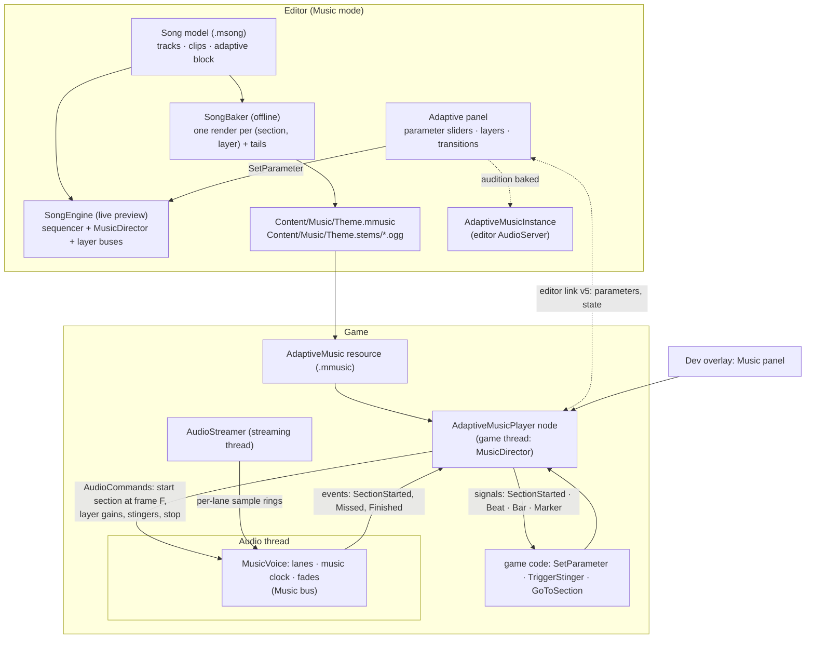
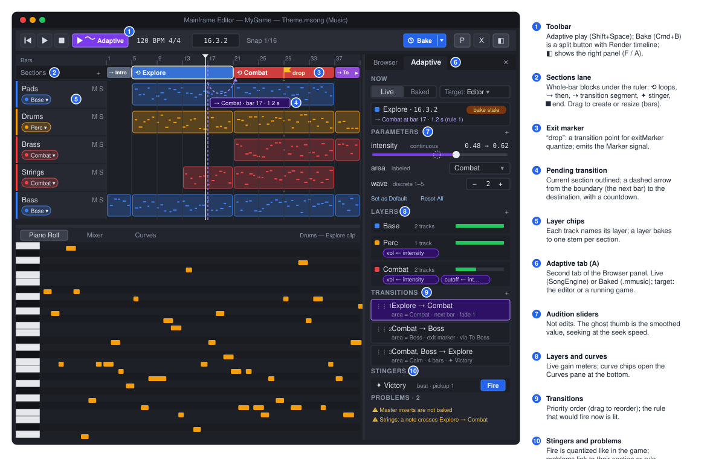
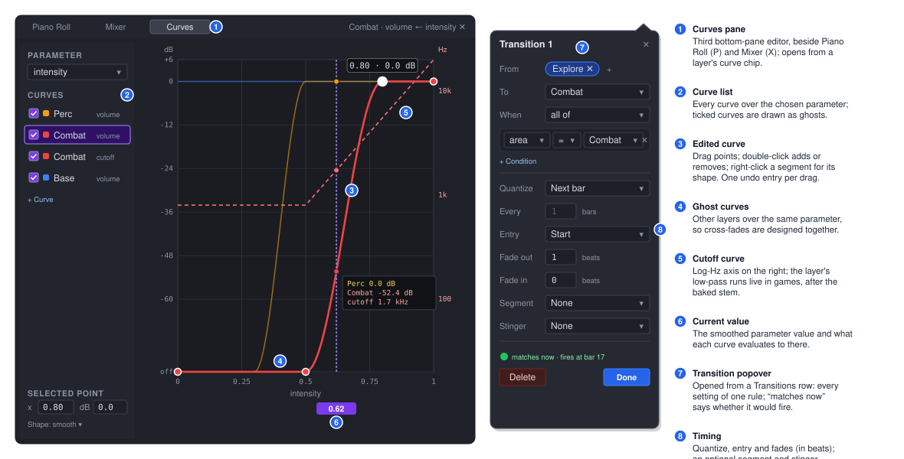
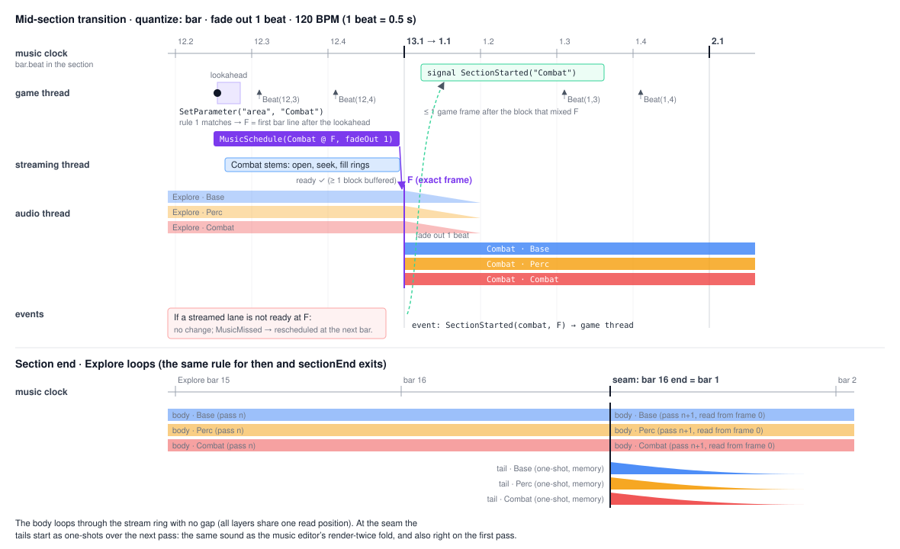

# Proposal: Adaptive music (FMOD-style, baked stems)

**Milestone:** unscheduled (editor tooling + audio runtime; Phase 3 of the Logic-style Music mode) · **Status:** proposal
(2026-10-18), [ADR 0196](../../../memory/decisions/0196-adaptive-music-baked-stems.md) (proposed) · **Depends on:**
[Music editor](music-editor.md) (songs, `SongEngine`, Render), [Audio](../audio.md) (`AudioServer`, streaming, the
command queue), [Editor](../editor.md) (Music mode), the Phase 1 right-hand Browser and built-in effects
(`docs/design/music-effects.md`, not written yet) · **Related:** [Project and GameHost](../project-and-gamehost.md)
(editor link), [Developer overlay](../dev-overlay.md), [Sound designer](sound-designer.md)

## Problem

Games can only play the music editor's output as one rendered `.ogg` on an `AudioPlayer`
([music-editor.md, Non-goals](music-editor.md#non-goals)). Game music is rarely one fixed loop: exploration should
build up as danger rises, combat should start on the next bar instead of cutting in, a boss needs its own section, and
a victory sting has to land on the beat. Today a game can only do this by hand: several renders, two players
cross-faded by script, and loop points and bar lengths copied around as numbers. FMOD Studio and Wwise solve this with
authored *adaptive* music: sections, layers, parameters and quantized transitions, all designed in the tool and driven
from game code by a few parameter values. The music editor already holds everything a song needs. It lacks the
adaptive structure and a runtime that plays it.

VST3 plugins exist only on the developer's machine, and games never host them. The user has decided that **games play
baked stems**: the editor renders one stem per layer per section, plus a manifest, and a runtime player mixes and
transitions those stems live, beat-quantized, from parameters.

## Goals

- **Author adaptive music in the song editor**, in the same `.msong`:
  - **Sections** on the ruler (Intro, Explore, Combat, Boss, Outro), each looping or continuing to another.
  - **Parameters**: continuous (`intensity` 0–1), discrete (`wave` 1–5) and labeled (`area` = Calm/Combat/Boss),
    each with a default and a seek speed.
  - **Layers**: groups of tracks whose volume, and optionally a filter, follows curves over parameters (vertical
    re-mixing).
  - **Transitions**: rules such as "when `area` = Combat, go from Explore to Combat at the next bar". Each rule can
    have fades, a transition segment and a stinger.
  - **Stingers** and **markers**.
- **Hear it before baking.** The editor's live `SongEngine` plays the adaptive logic. Parameter sliders audition it,
  with the same transition timing the game will have.
- **Bake** in one command. It renders sample-aligned stems with their reverb and delay tails, writes an `.mmusic`
  manifest resource, and on later bakes renders again only what changed.
- **Play it in games** with an `AdaptiveMusicPlayer` node: `SetParameter`, `Play`/`Stop`, `TriggerStinger`,
  `GoToSection`, and signals for section, beat, bar and marker. Scheduling is sample-accurate on the audio thread.
  Stems are streamed, and steady-state playback allocates nothing.
- **Tweak a running game**: drive its parameters from the editor's Adaptive panel over the editor link, or from a
  dev overlay panel.

## Non-goals (v1)

- **Tempo or time-signature changes between sections.** Each song has one tempo and one signature (the music editor's
  rule). The manifest leaves room to add a tempo per section later.
- **Live synthesis at run time.** Games never run instruments, sequencers or VST3. A curve over a parameter can only
  drive what the runtime can do on a baked stem: layer volume and a layer filter (see
  [Curve targets](#curve-targets)).
- **Generative or random note logic**: random clip choice, weighted playlists, note-level variation. Random choice
  between alternative sections is listed in [Open questions](#open-questions).
- Positional (2D/3D) adaptive music, nested events, sidechain ducking of other buses, global parameters shared
  between players, and middleware import (FMOD `.fspro`, Wwise).
- Audio Units, CLAP and similar; plugin support is unchanged.

## Concepts

| FMOD Studio | Here | Notes |
|---|---|---|
| Event + timeline | An **adaptive song**: a `.msong` with an `adaptive` block | The arrangement stays the timeline |
| Parameter (continuous / discrete / labeled, seek speed) | **Parameter** on the song | The same three kinds; seek speed in units per second |
| Loop region, destination marker | **Section** on the Sections lane: a whole-bar range, looping or with a `then` | A section is both a loop region and a destination |
| Transition marker / region, quantization, condition | **Transition** rule: from → to, `when`, `quantize` | Ordered list; the first matching rule wins |
| Transition timeline | **Transition segment**: a section of kind `transition`, played once between from and to | |
| Multi-instrument layering + automation on a parameter | **Layer** (a group of tracks) + **curves** (layer volume or filter over a parameter) | Vertical re-mixing |
| Fade in/out on transitions | `fadeOutBeats` / `fadeInBeats` on a transition | In beats, so they follow the tempo |
| Stinger / one-shot | **Stinger**: a section of kind `stinger`, quantized, with an optional pickup | From code or from a transition |
| Marker / callback | **Marker** on the Sections lane (`Marker` signal); `exit` markers are transition points | |
| Built and banked in Studio | **Bake** → `.mmusic` + `.ogg` stems | The runtime never sees the song |

## Overview



The design rests on four decisions:

1. **One logic, two clocks.** All adaptive decisions are made by a pure C# `MusicDirector` in the engine
   (`MainframeEngine/Src/Audio/Music/`): parameter smoothing, curve evaluation, rule selection and quantization. The
   editor's live preview and the game both run this same code, so a transition lands on the same bar in both.
2. **The game thread decides; the audio thread executes.** The director runs on the game thread and schedules actions
   at exact frames of the *music clock*, a little ahead of time. The audio thread's `MusicVoice` carries them out
   sample-accurately and reports what happened. This follows the engine's rule that the game thread owns logic and the
   audio thread only mixes ([ADR 0033](../../../memory/decisions/0033-audio-threading-and-command-queue.md)).
3. **Stems are rendered in isolation.** Each section is rendered per layer from a clean start. Its tail (reverb and
   delay after the end) is rendered as a separate one-shot. One run-time rule covers loop seams and transitions:
   *whenever a section ends at its end, its tail plays over whatever comes next.*
4. **Additive data.** The adaptive data is a new `adaptive` block in `.msong` plus a `layer` field on tracks. A song
   without it behaves exactly as today, and an older editor keeps it unchanged.

## The adaptive song model

New editor types in `MainframeEngine.Editor/Src/Music/Adaptive/` (`SongAdaptive`, `SongSection`, `SongParameter`,
`SongLayer`, `SongCurve`, `SongTransition`, `SongMarker`). The enums and condition types are the engine's own (see
[Shared logic](#shared-logic-mainframeengineaudiomusic)), so the editor and the runtime cannot disagree about what a
value means.

```json
{
  "format": 1,
  "tempo": 120, "timeSignature": [4, 4], "ppq": 960,
  "tracks": [
    { "id": "t1", "name": "Pads",  "layer": "base",   "kind": "instrument", "clips": [] },
    { "id": "t2", "name": "Drums", "layer": "perc",   "kind": "instrument", "clips": [] },
    { "id": "t3", "name": "Brass", "layer": "combat", "kind": "instrument", "clips": [] }
  ],
  "adaptive": {
    "start": "intro",
    "output": "Content/Music/Theme.mmusic",
    "tailSeconds": 4,
    "parameters": [
      { "name": "intensity", "kind": "continuous", "min": 0, "max": 1, "default": 0, "seekSpeed": 0.5 },
      { "name": "area", "kind": "labeled", "labels": ["Calm", "Combat", "Boss"], "default": 0 },
      { "name": "wave", "kind": "discrete", "min": 1, "max": 5, "default": 1 }
    ],
    "sections": [
      { "id": "intro",   "name": "Intro",    "kind": "section",    "start": 0,      "end": 15360,  "loop": false, "then": "explore" },
      { "id": "explore", "name": "Explore",  "kind": "section",    "start": 15360,  "end": 76800,  "loop": true },
      { "id": "combat",  "name": "Combat",   "kind": "section",    "start": 76800,  "end": 138240, "loop": true },
      { "id": "toboss",  "name": "To Boss",  "kind": "transition", "start": 138240, "end": 153600 },
      { "id": "boss",    "name": "Boss",     "kind": "section",    "start": 153600, "end": 215040, "loop": true },
      { "id": "victory", "name": "Victory",  "kind": "stinger",    "start": 215040, "end": 230400, "quantize": "beat", "pickupBeats": 1 },
      { "id": "outro",   "name": "Outro",    "kind": "section",    "start": 230400, "end": 261120, "loop": false }
    ],
    "markers": [
      { "id": "m1", "name": "drop", "tick": 107520, "exit": true }
    ],
    "layers": [
      { "id": "base",   "name": "Base",   "color": "#3b82f6" },
      { "id": "perc",   "name": "Perc",   "color": "#f59e0b" },
      { "id": "combat", "name": "Combat", "color": "#ef4444", "filter": "lowpass" }
    ],
    "curves": [
      { "layer": "perc",   "target": "volume", "parameter": "intensity", "shape": "smooth", "points": [[0, -80], [0.3, -80], [0.5, 0], [1, 0]] },
      { "layer": "combat", "target": "volume", "parameter": "intensity", "shape": "smooth", "points": [[0, -80], [0.5, -80], [0.8, 0], [1, 0]] },
      { "layer": "combat", "target": "cutoff", "parameter": "intensity", "shape": "linear", "points": [[0.5, 800], [1, 20000]] }
    ],
    "transitions": [
      { "from": ["explore"], "to": "combat", "when": { "all": [{ "parameter": "area", "op": "==", "value": "Combat" }] },
        "quantize": "bar", "fadeOutBeats": 1 },
      { "from": ["combat"], "to": "boss", "when": { "all": [{ "parameter": "area", "op": "==", "value": "Boss" }] },
        "quantize": "exitMarker", "segment": "toboss" },
      { "from": ["combat", "boss"], "to": "explore", "when": { "all": [{ "parameter": "area", "op": "==", "value": "Calm" }] },
        "quantize": "bars", "every": 4, "stinger": "victory", "fadeOutBeats": 2 }
    ]
  }
}
```

**Time and structure**

- **Ticks, as everywhere in the song.** Section `start`/`end` and marker `tick` are ticks at the song's PPQ. Sections
  start and end **on bar lines**; the editor snaps them, and the loader rounds stray values to the nearest bar with a
  warning. Whole bars make the beat/bar grid of every section unambiguous and keep every quantum inside a section.
- **Sections never overlap.** Gaps between them are allowed (scratch material that is never baked). The kinds are:
  - **`section`**: playable and a transition destination.
  - **`transition`**: played once by the rules that name it as `segment`.
  - **`stinger`**: a one-shot overlay.
- **Continuation.**
  - `loop: true` repeats the section until a transition fires.
  - `loop: false` with `then` continues to that section at the end.
  - `loop: false` without `then` ends the music after the tail; the player emits `Finished`.

**Layers**

- **A track names its layer** with a new `layer` field on `SongTrack`. A track without one belongs to the implicit
  **Main** layer, which is always at full volume and has no curves. Each layer bakes to one stem per section.
- **Limit:** at most 8 layers. Together with the incoming section during a transition, that is 16 continuous lanes
  per player.

**Parameters**

- **Kinds:**
  - **Continuous:** a float in `[min, max]`.
  - **Discrete:** integers in `[min, max]`.
  - **Labeled:** an index into `labels`. Code may pass the label or the index.
- **Seek speed** (units per second; 0 = instant) smooths continuous parameters only. Discrete and labeled ones always
  jump.

**Curves**

- **Points** are `[parameterValue, value]` pairs sorted by parameter value; values outside the points hold the end
  values.
- **Shape:** `linear`, or `smooth` (cosine ease between points). Over a discrete or labeled parameter, a curve is a
  step function: each integer or label takes the value of its point.
- **Several curves on one target multiply** (volume) or take the minimum (low-pass cutoff), so `intensity` and `health`
  can both shape one layer.
- **Units:** volume is in dB, where −80 dB or less is silence; interpolation happens in dB, so a cross-fade sounds even.
  The filter target is the cutoff in Hz, interpolated on a log scale.

**Transitions**

- **Matching:**
  - `from` lists source sections; `"*"` means any.
  - `when` is `{ "all": [...] }` or `{ "any": [...] }` of comparisons. `op` is `== != < <= > >=`, and a `value` is a
    number or a label.
  - A rule without `when` never fires by itself, only through `GoToSection`, which uses its settings.
- **Timing** (`quantize`):

  | Value | The transition happens at… |
  |---|---|
  | `immediate` | the next block after the scheduling lookahead |
  | `beat` | the next beat |
  | `bar` | the next bar |
  | `bars` + `every` | the next multiple of `every` bars from the section's start |
  | `sectionEnd` | the end of the current section |
  | `exitMarker` | the next marker with `exit: true` in the current section, else the section end |

- **Entry:** `entry: "start"` (the default) enters the destination at its start. `"sync"` enters at the same offset
  into the destination as into the source (wrapped to its length), for parallel arrangements.
- **Fades:** `fadeOutBeats` (the outgoing layers fade after the boundary while the destination starts) and
  `fadeInBeats`. The default is 0 for `sectionEnd` and `exitMarker` exits, where the baked tail carries the decay, and
  ½ beat otherwise.
- **Extras:** `segment` names a transition section to play once in between. `stinger` names a stinger to fire at the
  boundary.

**Stingers and markers**

- **Stingers** have their own `quantize` (anything but `sectionEnd`/`exitMarker`) and `pickupBeats`: how many beats of
  the stinger come *before* the quantum, so an anacrusis lands its downbeat on the beat.
- **Markers** are named ticks inside sections. Every marker emits `Marker(name)` when the music crosses it. Markers
  with `exit: true` are also transition points.

**Back-compatibility.** Every field is additive and nothing bumps the `.msong` format. The `adaptive` block and the
track `layer` are read through the existing `[JsonExtensionData] Extra` by an older editor and written back unchanged.
A song without `adaptive` plays, renders and loops exactly as today. Unknown ids (a curve on a deleted layer, a
transition to a missing section) are kept in the file, ignored with a warning in the Adaptive panel's problems list,
and never fail a load.

**Undo.** Every adaptive edit is a `SongDocument` action, like note edits. Section and curve-point drags merge into
one entry. Moving a parameter slider to *audition* is not an edit; Set as Default makes the current value the
parameter's default, as one undoable entry.

**Validation** runs on every snapshot. The results show in the Adaptive panel and fail a bake only where marked ✖:

- ✖ a section that is not whole bars, or that overlaps another
- ✖ `start` missing, or not a playable section
- a note that starts in one section and ends in the next (it is cut at the section end in the bake)
- an unreachable section
- a rule shadowed by an earlier one
- a stinger longer than 4 bars
- master inserts present (see [Master chain](#master-chain))

## Shared logic: `MainframeEngine.Audio.Music`

The engine owns everything both sides must agree on. These are pure C# types with no SoundFlow, no nodes and no
allocation after construction:

| Type | What it does |
|---|---|
| `MusicGrid` | Tempo and signature at a sample rate. `FrameOfBeat(long beat)` = `round(beat × 60 × rate / tempo)`, computed once in `double` and rounded, so beat *n* is the same frame everywhere. `NextQuantum(sectionFrame, quantize, every, markers)`. A section's `LengthFrames` is `FrameOfBeat(bars × beatsPerBar)`. |
| `MusicParameterSet` | Values, targets and seek speeds per parameter; `Advance(seconds)` moves values towards targets; index lookup by name (dictionary built at load, so `SetParameter("intensity", …)` does not allocate). |
| `MusicCurve` | Evaluates a compiled curve (sorted point arrays, shape) at a parameter value. |
| `MusicCondition` / `MusicRule` | Compiled `when` trees (flat arrays) and the transition settings. |
| `MusicDirector` | The state machine: current section and its start on the music clock, the pending transition, layer targets. `Update(nowFrame, horizonFrame)` re-evaluates rules when a parameter changed or a section started, and returns the actions to schedule. It applies rule priority, cancels a pending transition whose rule stopped matching, and replaces one when an earlier rule matches. |

**The music clock** counts frames at the manifest's sample rate from `Play`. It is independent of the device rate and
stops while paused. Every scheduled action is keyed by a music-clock frame.

**Quantum eligibility.** The director picks the first quantum at or after `now + lookahead`:

- In the editor's live preview the director runs on the render thread itself, so `lookahead` = 0.
- In a game it is `AdaptiveMusicPlayer.ScheduleAhead` (default 100 ms), plus the stream prefill time when a
  destination stem is streamed and not yet buffered (about 50 ms).

A boundary that falls inside the lookahead moves to the next quantum. With bars at 120 BPM (2 s) that is rare, and
with `beat` quantization it adds at most one beat.

## Editor UX

### Sections lane and layers



- **Sections lane.** A 22 dp lane under the ruler, part of the arrangement canvas (`SongCanvases`, drawn in the same
  `SubViewport`, so there are no extra RmlUi elements).
  - **Drawing:** a section is a coloured block with its name and an icon for its kind: loop ⟲, then → *name*,
    transition ⇢, stinger ✦, end ■.
  - **Editing:** drag in an empty part to create a section (snapped to bars); drag a block to move it or its edges to
    resize. Double-click renames it.
  - **Right-click menu:** Loop, Then ▸ (sections / End), Kind ▸, Set as Start, Add Marker, Delete.
  - **Markers** are flags; drag one to move it, and Alt-click toggles `exit`.
  - **The loop region.** It stays a timeline tool. Clicking a section block sets the loop region to that section, so
    ordinary Play loops it while it is being written.
- **During adaptive playback:**
  - The current section is outlined, and the playhead follows the music, not the timeline.
  - A pending transition shows as a dashed arrow from its boundary to the destination block, with the time left
    ("→ Combat · bar 9 · 1.2 s").
- **Layer chips.** Each track header gets a chip in its layer's colour. Click it to choose a layer, or New Layer….
  Mixer strips show the same chip, and the Adaptive panel's layer rows show the tracks they hold. Assigning a layer is
  one undoable entry.

### The Adaptive panel

The right-hand panel from Phase 1 becomes a two-tab panel, **Browser** (F) | **Adaptive** (A); both share its width
and splitter. The Adaptive tab (`Music/Adaptive/AdaptivePanel.cs`, `Content/Editor/song_adaptive.rml`) lists, top
to bottom:

- **Now.**
  - **Mode switch:** Live | Baked (see [Live preview](#live-preview-in-the-songengine)).
  - **Target:** *Editor* or a connected game's player (see [Editor link](#editor-link-and-dev-overlay)).
  - **State:** the current section, bar.beat, and the pending transition with its countdown.
  - **Last bake:** its time, and an "out of date" badge when the song changed since.
- **Parameters.** One row each: name, kind badge, and an audition control (a slider for continuous, a stepper for
  discrete, a select for labeled) with the smoothed value drawn as a ghost thumb while it seeks.
  - A popover edits the name, kind, range, labels, default and seek speed.
  - **Set as Default**, and **Reset All** to the defaults.
  - Audition values are kept per tab, not in the song.
- **Layers.** Colour, name, track count and a live gain meter (the evaluated layer gain). Curve chips such as
  "vol ← intensity" or "cutoff ← intensity" open the curve editor. **+ Curve** adds one.
- **Transitions.**
  - **Rows** read as sentences: "Explore → Combat · when area = Combat · next bar · fade 1 beat". Drag them to
    reorder priority; click one to edit it in a popover (from, to, conditions, quantize/every, entry, fades, segment,
    stinger).
  - **The row that would fire now is highlighted**, so a rule shadowed by an earlier one is visible.
- **Stingers.** Each has a **Fire** button (quantized like the game) and its quantize/pickup.
- **Problems.** The [validation](#the-adaptive-song-model) list; click a problem to select its section or rule.

The panel builds its rows only when the song version, the playback state or a parameter value changes (the Phase 1
Browser rule), so steady frames allocate nothing. RmlUi cannot nest lists, so condition lists are text in the rows
and full controls only in the popover.

### Curve editor



- **Where it lives.** A third bottom-pane editor, **Curves**, beside Piano Roll (P) and Mixer (X). It opens from a
  curve chip, and from View › Curves; it has no single-key shortcut in v1.
- **Layout.** An `EditorCanvas` (like Phase 1's EQ graph) with the parameter on x (labels as columns for labeled
  parameters) and the target on y: dB from −80 to +6 for volume, log Hz from 20 Hz to 20 kHz for cutoff.
- **What it draws:**
  - The curve being edited.
  - The other layers' curves over the same parameter, as ghosts, so cross-fades can be designed against each other.
  - A vertical line at the parameter's current (smoothed) value.
- **Editing.** Drag points; double-click to add or remove one. Shift constrains the drag to one axis. Right-click on a
  segment chooses its shape. Each drag is one undo entry.
- **Live feedback.** While the song plays in Live mode, the edit is heard at once (the curve compiles into the next
  snapshot).

### Commands

`song.adaptive_play` (Shift+Space) plays adaptively from the start section, or from the section under the playhead
with Alt. Plain Space keeps playing the timeline. The music shortcut table also gets:

| Command | Key |
|---|---|
| Adaptive tab | A |
| Bake | Cmd+B |
| Fire selected stinger | T |

The toolbar's Render button becomes a split button: **Bake** (adaptive songs), with **Render timeline to .ogg** in its
menu. Both stay in the Song menu.

## Live preview in the SongEngine

**Two audition modes**, switched in the Adaptive panel:

- **Live** (the default) plays the song model through `SongEngine`. Edits are heard instantly, there is no bake, and
  plugins run.
- **Baked** plays the last `.mmusic` through a real `AdaptiveMusicInstance` on the editor's `AudioServer`. This is
  exactly what the game will play. Baked mode is greyed out when no bake exists.

How Live works:

- **Snapshot.** `SongSnapshot` gains an `AdaptiveSnapshot`: section frame ranges, layer → track slots, and the
  compiled `MusicDirector` data (built by `SongSnapshotBuilder` from the shared types, at the engine's rate).
- **The director runs on the render thread** with `lookahead` = 0. Parameter changes from the panel are `SetParameter`
  commands on the engine's existing lock-free command queue and apply at the next block. Seek speed advances per block.
- **Sequencing.** The sequencer's loop wrap becomes a section program. At a boundary frame the cursor jumps to the
  destination, held notes get their note-off there (as at a loop wrap today), and the director records the new
  section. A second **overlay cursor** sequences a stinger's section range on top. Its notes go to the same track
  instruments, which are polyphonic.
- **Layer buses.** In adaptive mode tracks sum into one bus per layer, before the master. On that bus the engine
  applies the layer filter (Phase 1's `Svf`, see [Curve targets](#curve-targets)) and then the layer gain, ramped
  per sample. A track's own inserts, volume and pan stay before the layer bus, which is the same order the bake uses.
- **Where Live and the bake differ.**
  - **Same in both:**
    - transition timing: the same `MusicDirector` and the same `MusicGrid` rounding
    - layer gains and filter values
    - continuations and loops
  - **Different, by design:**
    - **Mid-section exits.** In Live, the outgoing notes are released at the boundary and their real effect tails
      ring through the live inserts. Baked, the outgoing stems fade over `fadeOutBeats` (the stems contain those
      notes' full lengths). Live ignores `fadeOutBeats`, because two positions on one track cannot have separate
      gains without a second set of instruments.
    - **Fade-in.** Live applies `fadeInBeats` to the layer buses, so the outgoing tails are faded in too.
    - **Tails.** Baked tails are cut at `tailSeconds`.
  - **Section-end transitions** sound the same in both.
- **Determinism.** Offline (`SongRenderer`-style, block by block) the director makes the same decisions as live. A
  test pins a scripted parameter timeline to its section start frames and compares them with the runtime director's
  (see [Testing](#testing)).

## The bake

**Bake** (`Music/Adaptive/SongBaker.cs`, `SongBakeJob` on a worker like `SongRenderJob`, `--bake-song <path.msong>`
for CI and `just bake-song`) turns the adaptive song into stems and a manifest.

### What is rendered

| Section kind | Rendered |
|---|---|
| `section`, `transition` | per layer: a **body** stem, exactly the section's `LengthFrames`, and a **tail** stem |
| `stinger` | one mixed stem (all layers; layer gains do not apply to one-shots) with its tail appended |

A layer with no clip or note in a section bakes nothing for it, and the manifest records `null`, which plays as
silence.

### Rendering a stem in isolation

For section *S* = ticks `[a, b)` and layer *L*:

1. **Build a snapshot with only L's tracks.** Other layers' tracks are left out, so their instruments do no work.
   Master volume is kept; master inserts are not (see [Master chain](#master-chain)).
2. **Start clean at a.** Instruments and effects start fresh. Notes that start inside `[a, b)` play. Notes that start
   before `a` belong to the earlier section and do not sound here (validation warns when a note crosses a boundary).
   Audio clips overlapping `a` are sliced at it.
3. **Cut at b.** Notes still held at `b` get their note-off at `b`, exactly as at a loop wrap today. Their release,
   and every reverb and delay tail, rings out after `b`.
4. **Render on past b** with the sequencer stopped, up to `tailSeconds` (default 4). The plugin-delay-compensation
   latency of the chain is rendered first and dropped, so frame 0 of every stem is the section's downbeat whatever
   the plugins' latency. Frames `[0, length)` are the body; the rest is the tail.
5. **Trim the tail** at the last frame above −90 dBFS, plus a 10 ms fade. An all-silent tail is not written.

**Sample alignment.** All body stems of a section have exactly `LengthFrames` (from `MusicGrid`, the runtime's own
rounding), so the layers stay aligned through any number of loops. The bake checks that each encoded stem decodes to
exactly that many frames: Vorbis granule positions keep decoded lengths exact, which the seamless song render already
relies on.

### Loop seams and tails at run time

A looping section's body is rendered once, cleanly, not with the music editor's render-twice fold. At the wrap the
player restarts the body *and* fires the section's tail stems as one-shots over the restart. The result equals the
seamless render's fold, and it is also correct the first time a section plays, when there is no previous pass to fold
in. The same rule handles every section-end exit: `then` continuations, `sectionEnd` transitions and the end of a
transition segment.

**Mid-section exits** (`beat`, `bar`, `bars`, `immediate`) have no baked tail at their boundary. The outgoing body
keeps playing under a linear fade of `fadeOutBeats`, and the stem's own content supplies the decay. An `exitMarker`
exit gets a baked tail only if the marker is promoted to a **tail point**: the bake then also renders "cut at the
marker + tail" for that section. See [Open questions](#open-questions).

### Master chain

Master inserts (compressor, limiter, EQ) act on the sum of all layers, which no longer exists once the layers are
separate stems. An adaptive bake therefore **bakes the master volume into every stem and does not bake master
inserts**. The Adaptive panel flags them ("master effects are not baked; use the Music bus's effects"), and adaptive
playback in Live mode bypasses them so it sounds like the bake; plain timeline Play still uses them. In a game, glue
compression belongs on the Music bus
(`AudioBusLayout`: the engine's compressor, filters and reverb). This keeps the sum of a section's stems equal to a
render of the section, which is the bake's main test.

### Curve targets

Curves can only target what the runtime can do on a baked stem:

| Target | Runtime | Editor |
|---|---|---|
| `volume` | layer gain, ramped per sample | layer bus gain |
| `cutoff` (with the layer's `filter`: `lowpass` or `highpass`) | a 12 dB/oct state-variable filter per lane | the same filter on the layer bus |

The layer is baked *before* its filter and gain, which are applied live. Phase 1's DSP blocks (`Svf`, the smoothers)
live in the editor (`Music/Effects/Dsp/`). The filter moves into the engine (`MainframeEngine/Src/Audio/Dsp/`) and the
editor uses the engine's copy, so both sides run the same filter code. Driving any other built-in effect parameter
from a game parameter would mean running that effect at run time; that is listed in [Open questions](#open-questions).

### Output, names and UIDs

```
Content/Music/Theme.mmusic                     the manifest (mus_ UID, stable across bakes)
Content/Music/Theme.stems/explore.perc.3f9a1c.ogg        body stem   (name.layer.hash)
Content/Music/Theme.stems/explore.perc.3f9a1c.tail.ogg   its tail
Content/Music/Theme.stems/victory.7b20e4.ogg             stinger (one stem, tail included)
```

- **The manifest is the asset games reference.** `.mmusic` is a new extension with a new UID prefix `mus`
  (`AssetUid.MusicPrefix`, `PrefixForExtension(".mmusic")`). A re-bake reads the existing manifest's UID and keeps it,
  so scenes that reference the music never break.
- **Stems are content-addressed.** The short hash in the name comes from the stem's inputs (see below). Stems get
  ordinary `aud_` UIDs from the `AssetDatabase`, and the manifest references them by UID and by path (the path is a
  fallback and for people). Nothing but the manifest references a stem.
- **Commit order makes bakes atomic.** New stems are written to temporary names and moved into place. The manifest is
  written last through `DurableFile`, and then the stems the old manifest listed and the new one does not are deleted
  with their `.meta`. The bake only ever deletes files a previous manifest listed. A cancelled or failed bake leaves the
  previous manifest and all its stems intact, and a running game still streaming an old stem is not disturbed: a
  delete that fails because a file is open is retried at the next bake.
- **The folder is generated.** The FileSystem panel shows `*.stems/` folders collapsed with a "generated" badge, and
  the song's `.msong` gets the "bake out of date" badge the way a render does today.

### Incremental rebuild

Each stem's **input hash** is a SHA-256 over a canonical JSON of everything that changes its samples:

- the bake format version, sample rate and encoder settings
- tempo and signature
- the section's range and kind, `tailSeconds`
- the layer's tracks: instrument with state, inserts with state, volume, pan, and the clips and notes that start in the
  section
- the contents of the audio files those clips use (size and modification time, then a content hash when those change)
- master volume
- the versions of the plugins involved, from the scan catalog, because a plugin update changes the sound

If `Theme.stems/` already has a stem with that hash, it is reused. Editing a note in Combat/Perc re-renders one body
and one tail; changing the tempo re-renders everything. Parameter, curve, transition and marker edits re-render
nothing and rewrite only the manifest, so a re-bake after them is instant.

### Bake job

- **Progress and cancel.** The splash shows progress ("Baking Theme… Combat/Perc 7 of 18", cancellable). The Output
  panel gets the result: stems rendered and reused, the stream and memory counts, and the decoded memory one-shots
  will use at run time.
- **Plugins.** Plugin stems render through one offline helper, one stem after another, as Render does today. Stems
  that use only built-in instruments render in parallel on up to `Environment.ProcessorCount − 1` workers.
- **Failures.** A missing plugin fails the bake with the list of affected stems. The bake never writes silence in
  place of a missing plugin. Encoding uses the helper's Vorbis encoder; without the helper, stems are written as
  16-bit `.wav` and a warning says so (the Render rule).

### The `.mmusic` manifest

```json
{
  "format": 1,
  "uid": "mus_8c1f…",
  "song": "sng_41aa…",
  "sampleRate": 48000,
  "tempo": 120, "timeSignature": [4, 4],
  "start": "intro",
  "parameters": [ { "name": "intensity", "kind": "continuous", "min": 0, "max": 1, "default": 0, "seekSpeed": 0.5 } ],
  "layers": [ { "id": "perc", "name": "Perc", "filter": null } ],
  "sections": [
    {
      "id": "explore", "name": "Explore", "kind": "section", "bars": 16, "lengthFrames": 1536000,
      "loop": true, "then": null,
      "markers": [ { "name": "drop", "frame": 768000, "exit": true } ],
      "stems": {
        "perc": { "body": { "uid": "aud_…", "path": "Content/Music/Theme.stems/explore.perc.3f9a1c.ogg" },
                  "tail": { "uid": "aud_…", "path": "Content/Music/Theme.stems/explore.perc.3f9a1c.tail.ogg", "frames": 61440 } }
      }
    }
  ],
  "curves": [ { "layer": "perc", "target": "volume", "parameter": "intensity", "shape": "smooth", "points": [[0, -80], [0.5, 0]] } ],
  "transitions": [ { "from": ["explore"], "to": "combat", "when": { "all": [ { "parameter": "area", "op": "==", "value": "Combat" } ] }, "quantize": "bar" } ],
  "bake": { "editor": "0.1.212", "date": "2026-10-18T12:00:00Z", "inputs": { "explore/perc": "3f9a1c…" } }
}
```

- **Frames, not ticks.** Everything the runtime needs is precomputed in frames at `sampleRate`: section lengths,
  marker frames, tail lengths. Tempo and signature come along for the beat grid and signals. `bake` is ignored by
  games.
- **Versioned and forward-tolerant.** It is versioned like `project.mfproj` (migrations). Unknown fields are kept, and
  a section may later gain its own `tempo`, which is the hook for tempo changes in v2.
- **Read without reflection.** It is read through a source-generated `JsonSerializerContext`, the way saves are, so
  trimmed and AOT games can load it.

## Runtime

All of it is in `MainframeEngine/Src/Audio/Music/` (and `Audio/Graph/` for the audio-thread part). Game code never
calls SoundFlow, and nothing outside `Src/Audio` does either.

### `AdaptiveMusic` (resource)

- **Loading.** `AdaptiveMusicImporter : IAssetImporter` makes `.mmusic` loadable through `ResourceLoader`, so an
  `[Export] AdaptiveMusic? Music` property references it by `mus_` UID like any asset. It parses the manifest,
  compiles the shared logic (grid, parameter set, curves, rules) into immutable arrays, and holds one `AudioStream`
  per stem.
- **Load modes:**
  - **Body stems stream.** A 30 s stereo section decodes to 11.5 MB, too much to keep a whole score in memory.
  - **Tails, stingers and transition segments** are memory-loaded, decoded once at `Preload()`, which the player does
    when it enters the tree. They must start at an exact frame with no prefill.
  - **Overrides:** `PreloadSections` (a list of section ids) memory-loads chosen sections too, so transitions into
    them need no prefill.
- **Failures.** A missing stem file logs one error naming the section and layer and plays that lane as silence. The
  rest of the music keeps playing.

### `AdaptiveMusicPlayer` (node)

`AdaptiveMusicPlayer : Node` is a thin node over a public `AdaptiveMusicInstance`. The instance is what the editor's
Baked audition uses without a scene tree.

| Member | |
|---|---|
| `[Export] AdaptiveMusic? Music`, `Bus` ("Music"), `VolumeDb`, `Autoplay`, `StartSection` ("" = the manifest's) | |
| `[Export] float ScheduleAhead` (0.1 s) | The scheduling lookahead (see [Quantum eligibility](#shared-logic-mainframeengineaudiomusic)) |
| `Play(string? section = null)` | Starts at a section's downbeat |
| `Stop(MusicQuantize quantize = Immediate, float fadeBeats = 0.5f)` | Stops at a quantum; tails ring out |
| `SetParameter(string name, float value)`, `SetParameter(string name, string label)`, `SetParameter(int index, float value)` | Clamped; continuous parameters seek. The `int` overload skips the name lookup |
| `SetParameterImmediate(…)` | Skips the seek |
| `GetParameter(string name)`, `GetParameterIndex(string name)` | |
| `TriggerStinger(string name, MusicQuantize? quantize = null)` | Uses the stinger's quantize and pickup |
| `GoToSection(string name, MusicQuantize quantize = Bar, float fadeOutBeats = 0.5f)` | Code-driven transition; replaces a pending one |
| `Playing`, `CurrentSection`, `PendingTransition` | |
| `GetPosition()` → `MusicPosition` | Section, bar, beat, beat fraction, seconds. Interpolated from the last reported clock and the frame time, minus the output latency estimate, for visual sync |
| `[Signal] SectionStarted(string section)`, `Beat(int bar, int beat)`, `Bar(int bar)`, `Marker(string name)`, `TransitionScheduled(string to, float seconds)`, `Finished` | Bars and beats are 1-based within the section. Signal arguments are the manifest's preallocated strings, so raising them allocates nothing |

Like `AudioPlayer`, the node stops when it leaves the tree, follows its `ProcessMode` against `SceneTree.Paused` (the
music clock stops while paused), and is silent in the editor's edit mode.

### Threading



**Game thread** (`AudioServer.Process`, after transform sync), each frame for each playing instance:

1. Applies events from the audio thread: section started, transition executed or missed, stinger played, finished.
   It raises their signals.
2. Advances parameter seeks by the frame time and evaluates the curves. A layer gain or cutoff that changed is sent as
   one `MusicSetLayer` command per layer (coalesced, latest wins, like `SetVoiceParams`).
3. Runs `MusicDirector.Update(now, now + lookahead)` with `now` = the voice's last reported music frame. Its actions
   become commands:
   - `MusicSchedule` (start section *S* at music frame *F*, entry offset, fade-in and fade-out for the outgoing lanes,
     tails on/off)
   - `MusicCancel` (a pending action by id)
   - `MusicStinger` (stinger *X* at frame *F*)
   - `MusicStop`

   The game thread also asks the `AudioStreamer` for the destination's streamed stems at their entry frames, so the
   rings fill before *F*.
4. Raises `Beat`, `Bar` and `Marker` for every grid line or marker crossed since the last frame, derived from the
   reported clock. No per-beat traffic crosses the event ring.

**Audio thread.** `MusicVoice` is a SoundFlow component created up front in its bus's mixer, like the pooled voices
(`AudioBusInfo.MusicVoices`, default 2 on Music, 0 elsewhere). Two voices are enough to cross-fade from one piece of
music to another. Each voice holds:

- **Lanes.** 16 continuous lanes: up to 8 layers for the current section plus 8 for an incoming one. Each lane has its
  own `AudioStreamChannel` (created lazily on the game thread, like a voice's) or reads a memory clip. There are also
  8 one-shot lanes for tails and stingers.
- **The music clock**, advanced by `deviceFrames × (sampleRate / deviceRate)`. All lanes share one fractional read
  position per section instance and the same linear-interpolation step, so layers resampled from 48 kHz to 44.1 kHz
  stay sample-aligned.
- **A small action queue**, sorted by frame (a fixed array of 32). Each block is split at every action frame, so an
  action happens on its exact sample:
  - section start (lanes retargeted, gain envelope from 0 or 1)
  - outgoing fade (a linear ramp over the fade's frames, then the lanes are released)
  - tail and stinger one-shots
  - stop
- **Section ends.** At the end of a section with no scheduled action at that frame, the voice follows the section's
  authored continuation from the `MusicSchedule` that started it: loop (rewind, fire the tails), `then` (start that
  section, fire the tails) or end. Authored flow keeps going even if the game thread stalls. The game thread prefetches
  the `then` section's streams when the section starts.
- **Per-lane processing:** layer gain (target from `MusicSetLayer`, ramped per sample over ~10 ms) × the fade envelope
  → optional SVF (cutoff ramped the same way) → sum. The voice's volume and fader go through `BusProcessor`, like any
  bus.
- **Readiness.** At a scheduled start the voice checks that every streamed destination lane has at least one block
  buffered. If one is not ready, the action is **missed**: nothing changes and a `MusicMissed` event goes back. The
  director then reschedules at the next eligible quantum, and `Stats.LateMusicTransitions` counts it. A miss is never
  half a transition.
- **Authority.** The audio thread's events are the truth. A pending transition is "pending" on the game thread until
  its `SectionStarted` event arrives. A `MusicCancel` that arrives after the frame has passed is ignored, and the
  director learns the outcome from the event. A cancel never undoes a transition that already happened.

**Commands and events** extend `AudioCommand` and `AudioEvent` with the music fields (instance index, generation,
action id, frame, section, entry offset, fade frames, layer gains) as plain values. Immutable plan data (the compiled
manifest and the stems' sources) travels as the existing `Ref`, which the audio thread reads but never frees.

**Streaming.**

- **Requests.** A streamed lane is an ordinary `AudioStreamChannel` request with the body's loop points
  (`[0, lengthFrames)`). The `AudioStreamer` rewinds at the loop end, so a looping section streams seamlessly.
- **Seeking costs.** Entering at an offset (`entry: "sync"`) seeks the OGG, which decodes forward from the start (see
  [Audio known issues](../audio.md#known-issues)). That is cheap for short sections and costly for long ones; the bake
  report lists sections over 60 s that are `sync` destinations.
- **Prefetch.** At most the current and the incoming section's layers are open at once (16 decoders per voice).

**Allocation.** Everything is created when an instance starts playing (the lanes, their channels, the action queue) or
when the resource loads (the compiled plan). Steady playback, parameter changes, transitions, stingers, misses and
pause/resume allocate nothing on the game thread, the audio thread or the streaming thread. An allocation gate test
covers this (see [Testing](#testing)).

**Faults.** A music voice is mixed inside `AudioMixRoot`'s fault guard like everything else, so an exception silences
the audio for that graph but never crashes the process. A stem that fails to decode ends its lane only
(`VoiceFailed`-style, logged once).

## Editor link and dev overlay

**Editor link, protocol version 5.**

- **Editor → game commands:**
  - `WatchMusic` / `UnwatchMusic`: the game only reports music state while some editor panel is watching.
  - `SetMusicParameter`: argument `<nodePath>\n<parameter>\n<value>`; the value is a number or a label.
  - `TriggerMusicStinger` and `GoToMusicSection`: argument `<nodePath>\n<name>`.
  - `ReloadMusic`: argument a `mus_` UID.
- **Game → editor, a new `Music` message.** It is latest-wins like `Status`, at up to 10 Hz while watched and only on
  change. For up to 8 playing instances it carries: node path, manifest UID, song UID, section, bar.beat, the pending
  transition and its countdown, and the parameter values.
- **The Adaptive panel's Target menu** lists *Editor* plus every connected game's instances whose song UID matches the
  open song.
  - **Targeting a game:** the sliders and Fire buttons send commands, the Now row shows the game's state, and the
    Sections lane draws the game's position.
  - **Copy to Defaults** turns the game's current values into the parameters' defaults, as one undo entry.
- **Bake while a game plays.** The editor sends `ReloadMusic`. Players using that manifest load it in the background
  and switch at the next section boundary, continuing with the same section id when it still exists.

**Dev overlay.** A **Music** panel (`DevOverlayPanels`, registered when the first instance plays) shows each instance:

- the song, section, bar.beat and the pending transition with its countdown
- layer gain bars
- a slider, select or stepper per parameter, and Fire per stinger
- a **Next** button that takes the first matching transition now, quantized

Writes go through `SetParameter`, so they behave exactly like game code. The panel updates allocation-free, like the
Audio panel. Release builds keep it (the dev overlay is a development tool everywhere, F12).

## Error handling

| Situation | Behaviour |
|---|---|
| Validation error (✖) in the adaptive song | the bake is refused with the list; Live preview skips the broken section or rule |
| Missing plugin during a bake | the bake fails listing the stems; the previous bake is intact |
| Bake cancelled or I/O failure | temp files deleted; the previous manifest and stems are untouched |
| `.mmusic` from a newer format | loads read-only what it understands, warns once; unknown kinds play as silence |
| Stem file missing or undecodable at run time | that lane is silent, one error names the section and layer; the music goes on |
| Streamed lane not ready at a transition | the transition is missed and rescheduled at the next quantum (`LateMusicTransitions`) |
| `SetParameter` with an unknown name or label | ignored, one warning per name (no exception in shipped games) |
| `GoToSection`/`TriggerStinger` with an unknown name | ignored, one warning per name |
| No music voice free on the bus | `Play` fails like a rejected voice (`Stats.Rejected`), warning once |
| Device rate ≠ manifest rate | lanes resample together (aligned); quality as for streams |

## Testing

**Shared logic** (`Tests/MainframeEngine.Tests/Audio/Music/`):

- **`MusicGrid`:** beat frames at a tempo whose frames per beat is not an integer (123 BPM at 48 kHz) round the same
  way everywhere. A section's length equals the sum of its bars' lengths with no drift after 1 000 loops.
- **Quantization:**
  - the next beat, bar, `bars`/`every` and section end from every position, including exactly on a boundary and
    inside the lookahead
  - an `exitMarker` exit with and without exit markers
- **Conditions, rules and parameters:**
  - all/any conditions, labels as names and indices
  - rule priority, a pending transition cancelled when its rule stops matching, and replaced by an earlier rule
  - seek speed, and discrete and labeled parameters jumping
- **Curves:**
  - linear and smooth shapes, interpolation in dB, log-Hz cutoff
  - step curves over labels
  - multiplication of several curves on one target

**Runtime** (on `AudioDeviceMode.NullManual`, deterministic):

- **Synthetic stems:**
  - every section body is a constant DC per layer with an impulse at frame 0
  - every tail is a decaying ramp
  - every stinger is an impulse at its pickup point
- **What they prove:**
  - **Timing:** transitions land on the exact output sample (the impulse's position). Stingers put their downbeat on
    the quantum.
  - **Loops and tails:** loop seams are continuous, and tails overlap the restart.
  - **Fades:** fades are linear over the right number of frames. Layer gains ramp without zipper (< 0.005 per sample).
  - **Clock:** pause and resume keep the clock.
  - **Resampling:** two inverted copies of a stem on two layers cancel to silence at 44.1 kHz output, so the lanes are
    aligned.
- **Misses:** a fake streamer that holds a channel back makes the transition miss and land exactly one quantum later.
  A late `MusicCancel` does not undo an executed transition.
- **Signals:** `Beat`, `Bar`, `Marker` and `SectionStarted` fire once each, in order, across frames of varying
  length, including several beats in one long frame.
- **Allocation gate:** `AdaptiveMusicAllocationTests`. It plays four layers through two transitions, a stinger,
  parameter sweeps, a miss and pause/resume, and requires 0 B on the game thread and the audio thread. The
  render-test `showcase` scene also plays an adaptive player, so the frame allocation gate covers it in a real frame.

**Editor** (`Tests/MainframeEngine.Editor.Tests/Music/Adaptive/`):

- **Model:**
  - JSON round trip of the `adaptive` block and the track `layer`
  - an older editor's `Extra` preserving them byte for byte
  - unknown ids kept
  - each validation rule
  - undo and merge of section and curve drags
- **Live preview:** a scripted parameter timeline rendered offline through `SongEngine` gives pinned section start
  frames. The runtime `MusicDirector` with lookahead 0 produces the same frames from the same script; this is the
  test that the editor and the game agree.
- **Bake:**
  - every body is exactly `lengthFrames`
  - the sum of a section's layer bodies equals a render of that section with all its layers, within 1e-6, before
    encoding
  - tails continue the body without a gap
  - a fake plugin with known latency leaves frame 0 on the downbeat
- **Incremental bake, UIDs and atomicity:**
  - editing one note re-renders one body and one tail
  - curve, rule and parameter edits re-render nothing
  - the manifest's `mus_` UID survives a re-bake
  - stale stems are deleted, and only those
  - a cancelled bake leaves the previous files untouched
- **UI** (workspace tests): Sections lane gestures (create, resize snapping to bars, rename, kind menu), layer chips,
  the Adaptive panel rows and popovers, and the curve editor's point drags as one undo entry each. Goldens: an
  `editor-music-adaptive` capture on both drivers.
- **QA:** `editor-walkthrough.qa` adds `song section`, `song layer`, `song param` and `song bake` verbs, and checks
  the captures by eye.
- **Link:** round trips of the version 5 frames, and an old (version 4) game ignoring watch commands.

**Demo:** a new "Adaptive music" scene with an intensity slider, an area select and a stinger button, captured by
`just demo-screenshots`.

## Performance budget

| Where | Budget |
|---|---|
| Game thread, per instance per frame | < 2 µs (8 layers × 2 curves, rule re-evaluation only on change) |
| Audio thread, per 10 ms block | about 16 streamed lanes + 4 one-shots, comparable to 20 voices (≈ 40 µs on an M5) |
| Streaming thread | one Vorbis decoder per active lane: ≤ 8 steady, ≤ 16 during a transition |
| Memory | 256 KB ring per streamed lane; one-shots decoded, reported by the bake |
| Bake | about real time × layers for plugin stems, faster for built-ins in parallel; incremental re-bakes render only changed stems |

The benchmarks get an adaptive-instance frame and a 16-lane mix, with baselines in `baseline.json`.

## Delivery

Six PRs, each usable on its own:

| PR | Contents | After |
|---|---|---|
| **A1 — Shared logic** | `MainframeEngine/Src/Audio/Music/`: `MusicGrid`, parameters, curves, conditions, rules, `MusicDirector`, the `.mmusic` manifest types and reader; the `mus` UID prefix; the editor's `adaptive` model, `layer` field, validation and `SongDocument` actions (no UI). Tests. | — |
| **A2 — Runtime** | `MusicVoice` (lanes, clock, action queue, fades, filter), music commands and events, `AudioBusInfo.MusicVoices`, `AdaptiveMusic` + importer, `AdaptiveMusicInstance`, `AdaptiveMusicPlayer` + signals, the SVF moved to `Src/Audio/Dsp/`, allocation gate, benchmarks, the showcase render-test player. Tested with hand-written manifests and generated WAV stems. | A1 |
| **A3 — Bake** | `SongBaker`, `SongBakeJob`, isolation renders, tails, PDC trim, content-addressed stems, manifest writer, incremental hashes, atomic commit, `--bake-song` / `just bake-song`, FileSystem badges. | A1 (parallel with A2) |
| **A4 — Editor: sections, layers, Live preview** | Sections lane, markers, layer chips, the Adaptive tab (Now, Parameters, Layers, Transitions, Stingers, Problems), `SongEngine` adaptive mode (section program, overlay cursor, layer buses), Shift+Space, Bake split button. | A1 (A3 for the Bake button) |
| **A5 — Curves, transition popover, Baked audition** | The Curves pane, the transition popover, Live/Baked switch through `AdaptiveMusicInstance`. | A2, A4 |
| **A6 — Link, overlay, Demo, docs** | Editor link v5, the Target menu, `ReloadMusic`, dev overlay Music panel, the Demo scene, the as-built docs (`audio.md` Adaptive music section, `editor.md` Song tab, this proposal rewritten as `docs/design/adaptive-music.md`), the landing page's DAW section and README with screenshots, milestone row. | A2, A5 |

A2 and A3 touch disjoint files and can run in parallel; A4 can start as soon as A1 lands. PRs A4 and A5 share
`song.rml` and the song panel with the Phase 1 Browser work, so they go after Phase 1's Browser PR (C).

## Open questions

These need a decision before the matching PR starts. The recommendation comes first in each.

1. **Master inserts in adaptive songs.** Recommended: do not bake them; flag them and point to the Music bus's effects
   (above). Alternatives: bake the master chain into every stem (each layer gets compressed on its own, so the sum
   sounds different from the song), or refuse to bake while master inserts exist.
2. **What curves can drive at run time.** Recommended for v1: layer volume plus one LP/HP filter per layer, both
   running in the engine. Driving any built-in effect parameter (delay feedback, reverb mix, EQ bands) from a game
   parameter means running that effect live in games, which means moving the Phase 1 effects from the editor into the
   engine runtime. Is that wanted, as v2 or ever?
3. **Stem format.** Recommended: separate stereo `.ogg` per layer per section (the decision as given; simple, each
   lane independent). The alternative is one multichannel `.ogg` per section with the layers as channel pairs: one
   decoder per section and alignment by construction, but the engine downmixes sources wider than stereo today, so
   that path would need a raw-channel mode, and a silent layer still costs channels.
4. **Tails at mid-section exits.** Recommended: fades only, plus optional *tail points* on exit markers that bake an
   extra "cut here + tail" per layer (more files, but authentic decays where the composer wants them). Alternatively,
   no tail points in v1.
5. **Stingers as one mixed stem.** Recommended: yes, so layer curves do not apply to stingers. The alternative is per
   layer, so a stinger follows the current intensity.
6. **Where the Adaptive UI lives.** Recommended: a second tab of the right-hand Browser panel (A), with the curve
   editor as a third bottom pane. The alternative is its own docked panel, which costs width next to the Browser.
7. **`.mmusic` and the `mus_` prefix.** Recommended: its own extension (a FileSystem icon, out-of-date badges, an
   importer). The alternative is an ordinary `.mres` `AdaptiveMusic` resource with a `res_` UID, which would show in
   the Inspector but can be hand-edited out of sync with its stems.
8. **Random variation**, in v1.1 or never? FMOD playlists and multi-instruments, such as "pick one of three Explore
   variants each loop", would fit as sections grouped into a variation set chosen by the director with a seeded RNG.
9. **Fade units.** Recommended: beats only, so fades follow the music. Alternatively, a seconds option per fade for
   sound designers.
10. **Auto-bake.** Recommended: explicit Bake only, as Render is explicit today, plus a "bake out of date" badge. The
    alternative is baking on save while a game is running, with `ReloadMusic`.
