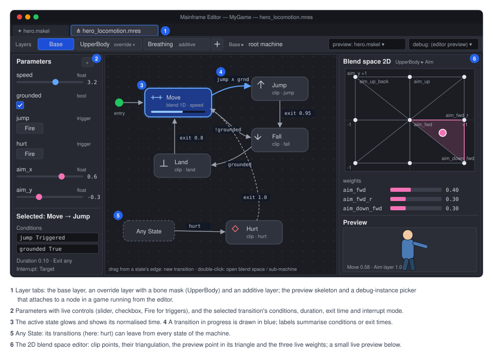
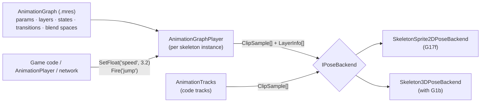

# Proposal: Animation graph (state machines, blend spaces, layers)

**Milestone:** [Gameplay toolkit](../../milestones.md#gameplay-toolkit-) (G17f; 3D adoption with G1b) · **Status:** ⬜
planned · **Depends on:** [2D skeletal animation](skeleton-2d.md) (G17a: `AnimationTracks`, `SkeletonSprite2D`),
[Skeleton editor](skeleton-2d-editor.md) (G17c: Animate mode, preview) · **Related:**
[Keyframe animation](keyframe-animation.md) (G1a `AnimationPlayer`, G1b `Skeleton3D`; this is the "later proposal" its
non-goals mention), [Networking](../networking.md) · **ADR:**
[0184](../../../memory/decisions/0184-engine-owned-2d-skeletal-animation.md)



## Problem

A character has dozens of clips and rules for moving between them: idle → walk → run by speed, jump from any ground
state, shoot over the top of locomotion, hurt interrupts everything. With only tracks
([2D skeletal animation → Tracks and mixing](skeleton-2d.md#tracks-and-mixing)), every game writes that logic in code,
and artists can't see or tune it. G1a deliberately left `AnimationTree`, state machines, blend spaces and layers out
([Keyframe animation → Non-goals](keyframe-animation.md#non-goals)), and said a later proposal could add them. This is
that proposal. It is designed for 2D skeletons first, and so that 3D skeletons (G1b's `Skeleton3D`) use the same asset
and player.

## Goals

- **An `AnimationGraph` resource** (`.mres`), with:
  - **parameters**: bool, int, float, trigger;
  - **layers**: base plus override or additive layers, each with a weight and an optional bone mask;
  - per layer, a **state machine** whose states are clips, 1D blend spaces, 2D blend spaces or nested state machines;
  - **transitions** with conditions, exit time, mix duration, interruption rules and an "any state" source.
- **An `AnimationGraphPlayer`** evaluates a graph each frame:
  - no allocation, no reflection;
  - it emits weighted clip samples to the skeleton through one small interface, `IPoseBackend`;
  - it knows nothing about bones or slots.
- **One asset, two skeleton kinds.** The same graph drives `SkeletonSprite2D`/`SkeletonSprite3D` now and `Skeleton3D` after
  G1b, with clips resolved by name and masks by bone names.
- **Editor.** A graph tab:
  - a node canvas for states and transitions;
  - layer tabs;
  - a parameter panel with live values;
  - a blend space editor;
  - live preview on a chosen skeleton;
  - the active state and transition highlighted while previewing or while a game runs from the editor.
- **Networking.** A graph's state replicates as a few integers ([2D skeletal animation → Networking](skeleton-2d.md#networking)).

## Non-goals

- Blend trees with arbitrary operator nodes (add, sub, time scale, IK nodes) in the Unreal or Godot `AnimationTree`
  style. States are clips, blend spaces or sub-machines; layers do the combining. A later step can add a blend-tree
  state kind (see [open question 1](#open-questions)).
- Scripted states, or C# code inside the graph. Code reacts to signals (`StateEntered`, `StateExited`) and sets
  parameters.
- Inverse kinematics or procedural pose nodes. Those stay in the skeleton (constraints, bone overrides).
- Root motion. 3D root motion has shipped ([Animation and skinning → Root motion](../animation.md#root-motion)); a blend tree mixes it like the player's crossfades; 2D clips are in place.
- Driving non-skeleton node properties. That is G1a's `AnimationPlayer`, which can set graph parameters.

## Overview



The code goes in two places:

- `MainframeEngine/Src/Animation/Graph/`: the graph and its player.
- `MainframeEngine/Src/Animation/Core/`: the contract, shared with `Tracks/`.

Editor code goes in `MainframeEngine.Editor/Src/AnimationGraph/`.

## The contract

Everything a graph or a set of tracks produces is a flat list of weighted clip samples per layer:

```csharp
public enum ClipBlend : byte { Replace, Additive }

public struct ClipSample
{
    public int Clip;               // backend clip index (ResolveClip)
    public float Time, PrevTime;   // seconds; PrevTime for events, < Time unless reversed
    public float Weight;           // within its layer; a layer's Replace weights sum to ≤ 1
    public byte Layer;
    public bool Looped;            // wrapped between PrevTime and Time (events across the loop)
}

public struct LayerInfo
{
    public ClipBlend Blend;        // Replace: lerp over lower layers by Weight; Additive: add (value − setup) × Weight
    public float Weight;
    public int Mask;               // backend mask index (ResolveMask), −1 none
    public float EventThreshold;   // samples below it don't fire events
}

public interface IPoseBackend
{
    int ResolveClip(string name);            // −1 when missing (warned once)
    int ResolveMask(BoneMask mask);          // turns bone names into the backend's own mask
    float ClipLength(int clip);
    bool ClipLoops(int clip);
    void Apply(ReadOnlySpan<ClipSample> samples, ReadOnlySpan<LayerInfo> layers);   // reset → layers in order → events
}
```

- **How layers combine.** Layer 0 is the base, and its replace weights fill the pose from setup. Each higher layer is
  computed the same way into its own result (masked bones only), then lerped (Replace) or added (Additive) over the
  layers below by its weight. This is the contract each backend implements. `SkeletonSprite2DPoseBackend` does it in the
  SoA pose arrays ([2D skeletal animation → Applying clips](skeleton-2d.md#applying-clips)); `Skeleton3DPoseBackend`
  does it on `Skeleton3D` bone poses with slerp.
- **Discrete values** (attachments, draw order, IK bend in 2D) come from the highest-weight sample on the highest layer
  whose weight is at least 0.5.
- **Sizes are fixed.** The player writes into a buffer sized at bind time: the maximum number of samples the graph can
  produce at once, computed from the graph (states that can be active × points per blend space). Nothing grows per
  frame.

### Tracks

`AnimationTracks` ([2D skeletal animation → Tracks and mixing](skeleton-2d.md#tracks-and-mixing)) is the other
producer:

- **Without a graph,** the tracks are the whole animation: track 0 is layer 0, track N is layer N.
- **With a graph,** code tracks layer **above** the graph's layers: track 0 of the tracks becomes layer
  `graph.Layers.Count`. That is how a game plays a one-off emote or hit reaction over a graph without adding it to the
  graph.

Both write into the same sample buffer before `Apply`. Each track's `Blend` and `Mask` become its `LayerInfo`.

## The resource

`AnimationGraph` is an ordinary resource, saved by the existing `ResourceSaver` as `.mres`. Its parts are concrete
sub-resource classes in lists, because the generator skips generic types, as G1a's tracks do:

```csharp
[EditorIcon("graph")]
public sealed class AnimationGraph : Resource
{
    [Export] public List<GraphParameter> Parameters { get; set; } = [];
    [Export] public List<GraphLayer> Layers { get; set; } = [];        // [0] is the base layer
    [Export] public List<GraphMixOverride> Mixes { get; set; } = [];   // per clip pair, like AnimationTracks.SetMix
    [Export] public float DefaultMix { get; set; } = 0.2f;
}

public sealed class GraphParameter : Resource
{
    [Export] public string Name { get; set; } = "";
    [Export] public GraphParameterType Type { get; set; }               // Bool | Int | Float | Trigger
    [Export] public float Default { get; set; }
}

public sealed class GraphLayer : Resource
{
    [Export] public string Name { get; set; } = "Base";
    [Export] public ClipBlend Blend { get; set; }
    [Export(Range = "0,1,0.01")] public float Weight { get; set; } = 1f;
    [Export] public string WeightParameter { get; set; } = "";          // optional float param driving Weight
    [Export] public BoneMask? Mask { get; set; }
    [Export] public GraphMachine Machine { get; set; } = new();
}

public sealed class BoneMask : Resource                                  // by name, so it works on any backend
{
    [Export] public string[] Bones { get; set; } = [];                   // included bones (and their slots in 2D)
    [Export] public bool IncludeChildren { get; set; } = true;
}

public sealed class GraphMachine : Resource
{
    [Export] public List<GraphState> States { get; set; } = [];
    [Export] public List<GraphTransition> Transitions { get; set; } = [];
    [Export] public string Entry { get; set; } = "";
}

public abstract class GraphState : Resource
{
    [Export] public string Name { get; set; } = "";
    [Export] public float Speed { get; set; } = 1f;
    [Export] public string SpeedParameter { get; set; } = "";            // optional multiplier
    [Export] public Vector2 EditorPosition { get; set; }                 // graph canvas layout
}
public sealed class ClipState : GraphState { [Export] public string Clip { get; set; } = ""; [Export] public bool Loop { get; set; } = true; }
public sealed class BlendSpace1DState : GraphState
{
    [Export] public string Parameter { get; set; } = "";
    [Export] public string[] Clips { get; set; } = [];
    [Export] public float[] Positions { get; set; } = [];                // ascending
    [Export] public bool SyncTime { get; set; } = true;                  // normalised-time sync (walk/run feet match)
}
public sealed class BlendSpace2DState : GraphState
{
    [Export] public string ParameterX { get; set; } = ""; [Export] public string ParameterY { get; set; } = "";
    [Export] public string[] Clips { get; set; } = [];
    [Export] public Vector2[] Positions { get; set; } = [];
    [Export] public bool SyncTime { get; set; } = true;
}
public sealed class SubMachineState : GraphState { [Export] public GraphMachine Machine { get; set; } = new(); }

public sealed class GraphTransition : Resource
{
    [Export] public string From { get; set; } = "";                      // "*" = any state (not itself)
    [Export] public string To { get; set; } = "";
    [Export] public List<GraphCondition> Conditions { get; set; } = []; // all must hold (AND); several transitions = OR
    [Export] public float Duration { get; set; } = -1f;                  // −1: Mixes / DefaultMix
    [Export] public float ExitTime { get; set; } = -1f;                  // normalised; −1: any time
    [Export] public float Offset { get; set; }                           // start time in the target, normalised
    [Export] public TransitionInterrupt Interrupt { get; set; }          // None | Source | Target | Both
    [Export] public int Priority { get; set; }                           // higher first; ties: list order
}

public sealed class GraphCondition : Resource
{
    [Export] public string Parameter { get; set; } = "";
    [Export] public ConditionOp Op { get; set; }                         // True, False, Greater, Less, Equal, NotEqual, Triggered
    [Export] public float Value { get; set; }
}
```

An abridged example `.mres`:

```json
{
  "format": 2,
  "uid": "res_0a4c9e71b3f2",
  "type": "AnimationGraph",
  "resources": {
    "p_speed": { "type": "GraphParameter", "props": { "Name": "speed", "Type": "Float" } },
    "p_jump": { "type": "GraphParameter", "props": { "Name": "jump", "Type": "Trigger" } },
    "s_move": { "type": "BlendSpace1DState", "props": { "Name": "Move", "Parameter": "speed",
                "Clips": ["idle", "walk", "run"], "Positions": [0, 1.5, 4] } },
    "s_jump": { "type": "ClipState", "props": { "Name": "Jump", "Clip": "jump", "Loop": false } },
    "c_jump": { "type": "GraphCondition", "props": { "Parameter": "jump", "Op": "Triggered" } },
    "t_jump": { "type": "GraphTransition", "props": { "From": "*", "To": "Jump", "Duration": 0.1,
                "Conditions": [ { "res": "c_jump" } ] } },
    "t_land": { "type": "GraphTransition", "props": { "From": "Jump", "To": "Move", "ExitTime": 0.9 } },
    "m_base": { "type": "GraphMachine", "props": { "Entry": "Move",
                "States": [ { "res": "s_move" }, { "res": "s_jump" } ],
                "Transitions": [ { "res": "t_jump" }, { "res": "t_land" } ] } },
    "l_base": { "type": "GraphLayer", "props": { "Name": "Base", "Machine": { "res": "m_base" } } }
  },
  "props": { "Parameters": [ { "res": "p_speed" }, { "res": "p_jump" } ], "Layers": [ { "res": "l_base" } ] }
}
```

## States and transitions

- **Clip states** play a clip at `Speed × SpeedParameter`. A non-looping clip holds its last frame and reports
  `normalisedTime ≥ 1`.
- **1D blend spaces** find the two positions around the parameter and weight them linearly. Below the first or above
  the last position, the end clip gets full weight.
- **2D blend spaces.** The positions are triangulated once, at bind time, with the same Delaunay `Triangulator` as
  meshes ([2D skeletal animation → Auto mesh](skeleton-2d.md#auto-mesh-and-triangulation)). The parameter point's
  barycentric weights in its triangle give three clip weights. Outside the hull, the point is projected onto the
  nearest hull edge. Two-point and collinear spaces fall back to 1D.
- **Time sync.** With `SyncTime`, a blend space's clips advance in **normalised** time. The playback rate is the
  weighted average of the clips' rates, so a walk and a run with different lengths keep their feet in phase.
  Without it, each clip runs at its own rate.
- **Sub-machines** are nested state machines with their own entry. Leaving one is a transition from the sub-machine
  state in the parent. Transitions inside can target `"<exit>"` to hand back to the parent's transitions.
- **Choosing a transition.** Each frame, per layer, the current state's outgoing transitions (and the `*` ones) are
  checked in priority order. The first whose conditions hold, and whose `ExitTime` has passed when set, starts.
  Triggers are consumed when a transition that tests them starts, and reset at the end of the frame if nothing used
  them. That is a documented choice: the alternative, a trigger that stays latched until used, is a flag on the
  parameter (`Latch`).
- **During a transition** the source and target both produce samples, weighted `1 − t` and `t` over `Duration`. The
  source keeps advancing. `Interrupt` says which side's transitions may cut in:
  - **None:** none may.
  - **Source:** the source's transitions are checked during the mix.
  - **Target:** the target's are checked.
  - **Both.**

  An interrupting transition freezes the current blend as the new source, so it never pops.
- **`ExitTime > 1`** waits that many loops, for example 2.0 means after the second loop.
- **Signals.** The player raises `StateEntered(layer, state)`, `StateExited(layer, state)` and
  `TransitionStarted(layer, from, to)`. State ids are indices, and the names come from the graph, so nothing is
  allocated per raise.

## The player

```csharp
public sealed class AnimationGraphPlayer
{
    public AnimationGraphPlayer(AnimationGraph graph, IPoseBackend backend);   // binds: resolves clips and masks, sizes buffers
    public void SetBool(int param, bool value); public void SetFloat(int param, float value);
    public void SetInt(int param, int value);   public void Fire(int trigger);
    public int FindParameter(string name);                                     // resolve once, then use the index
    public bool GetBool(int param); public float GetFloat(int param);          // …
    public int CurrentState(int layer); public float NormalisedTime(int layer);
    public bool InTransition(int layer);
    public void Travel(int layer, string state);                               // force-start a transition (cutscenes, debug)
    public void SetLayerWeight(int layer, float weight);
    public void Advance(float delta, SampleBuffer output);                     // called by the skeleton node
    public void Rebind();                                                      // after the graph or the skeleton data changed
}
```

- **Typed access.** Name-based overloads (`SetFloat("speed", v)`) exist for convenience. They look the name up in a
  dictionary built at bind time, so they don't allocate, but the index forms are faster.
- **AnimationPlayer reach.** Parameters are reachable from G1a's `AnimationPlayer` as properties
  `Parameters/<name>` on the skeleton node. The node's generated accessors expose them like exported properties, so
  value tracks key them.
- **Per-frame work.** Evaluation is O(layers × (active states + transitions checked)). Each blend space adds
  O(points) for 1D and one triangle lookup for 2D, over a triangle grid built at bind time. A typical locomotion graph
  costs a few microseconds.
- **Allocation.** The player holds no per-frame allocations. Every list is sized at bind.

`SkeletonSprite2D.Graph` creates the player when the node binds its data. `Skeleton3D` gets the same `Graph` export with
G1b.

## Networking

Replication sends the graph's state per layer, not the pose. That is the current state, its entry tick and any
in-flight transition, plus bool parameters as a bitmask and float parameters interpolated
([2D skeletal animation → Networking](skeleton-2d.md#networking)). Remote players re-run the graph from those values.
Transitions are deterministic for the same parameters and ticks, so peers agree without sending times.

## Editor

The **graph tab** (`AnimationGraphTab : IDocumentTab`, [Skeleton editor → Prerequisite](skeleton-2d-editor.md#prerequisite-document-tabs))
opens an `AnimationGraph` `.mres`. Double-clicking the graph file opens it, and the Skeleton tab's Animate mode has an
**Edit Graph** button for the skeleton's assigned graph.

- **The canvas** is a `[Tool]` canvas in a `SubViewport`, like the timeline canvases:
  - **States** are rounded boxes with the clip or blend-space icon. The entry state has a marker and "any state" has
    its own box.
  - **Transitions** are arrows with a condition summary (`speed > 2`, `jump`).
  - **Editing.** Drag from a state's edge to create a transition. Double-click a sub-machine to enter it, with a
    breadcrumb to go back.
  - **Navigation.** Pan with the middle mouse or Space, zoom with the wheel.
  - **Layout** positions are saved as `EditorPosition`.
- **Layers** are tabs above the canvas, with add, remove, reorder, blend, weight and mask. The mask editor picks bones
  from the preview skeleton's hierarchy.
- **The inspector** shows the selected state's or transition's fields. Conditions are rows with parameter, operator and
  value.
- **The parameter panel** lists parameters with live controls: checkbox, slider, field, and a Fire button for
  triggers. The controls drive the preview.
- **The blend space editor** (double-click a blend space state):
  - a 1D line or a 2D plot of the clip points;
  - for 2D, the triangulation drawn;
  - a draggable preview point that sets the parameters;
  - each point's weight shown live;
  - drag a clip from the clip list onto the plot to add a point.
- **Preview.** The tab picks a skeleton (any `.mskel` whose clips the graph names) and shows it in a viewport pane. The
  preview uses the runtime player. The active state glows, a transition's arrow fills while it runs, and normalised
  time shows as a bar in each active state.
- **Live debugging.** While a game runs from the editor (Play), the graph tab can attach to a node in the running game
  through the editor link, a "debug instance" picker listing `SkeletonSprite2D`s using this graph. It then shows that
  instance's states and parameters live. This is read-only; setting parameters from the editor is a later step.
- **Undo, save and reload** work as in the Skeleton tab: one history per tab, `ResourceSaver` writes, and instances
  rebind on `Version` changes.

## Testing

- **Unit tests** (`Tests/MainframeEngine.Tests/Animation/Graph/`), using a fake `IPoseBackend` that records samples:
  - **Transitions:** condition evaluation, priority, exit time (including > 1), trigger consumption and latching,
    interruptions (each mode), any-state transitions, sub-machine exits.
  - **Blend spaces:** 1D weights and clamping; 2D barycentric weights, hull projection, collinear fallback; sync time.
  - **Layers:** masks, additive, weight parameters; code tracks above the graph.
  - **Allocation:** zero per `Advance` after bind.
  - **Determinism:** two players with the same inputs produce the same samples.
- **Skeleton integration:** a render test with a graph-driven character in a fixed parameter script, with goldens at
  three frames.
- **Editor:** graph document edits round-trip, the blend space editor maths, and the preview sync.

## Delivery

G17f, after G17a and G17c:

1. Contract types and `AnimationGraphPlayer` with clip states and transitions, plus `SkeletonSprite2DPoseBackend` layering.
2. Blend spaces, sub-machines and masks.
3. The graph tab: canvas, inspector, parameters, preview.
4. The blend space editor and live debugging.
5. Networking state in `SkeletonAnimationSynchronizer` (G17g).

With G1b: `Skeleton3DPoseBackend`, and a `Graph` export on `Skeleton3D`. The 3D docs ([Keyframe animation](keyframe-animation.md))
then point here instead of listing state machines as a non-goal.

## Open questions

1. **Blend-tree states.** Some locomotion needs a small tree, for example "lean = additive(clip, param)". A
   `BlendTreeState` with add, lerp and time-scale nodes would fit the contract. Leave it out until a game needs it.
2. **Inertialization** instead of crossfades (the modern 3D approach). It suits 3D more than 2D. Add it to the 3D
   backend if crossfades look poor on 3D characters.
3. **Graph parameters bound to gameplay values** (for example `speed` ← a `CharacterBody2D`'s velocity length), without
   code. A small "parameter source" list on the skeleton node could do it.
