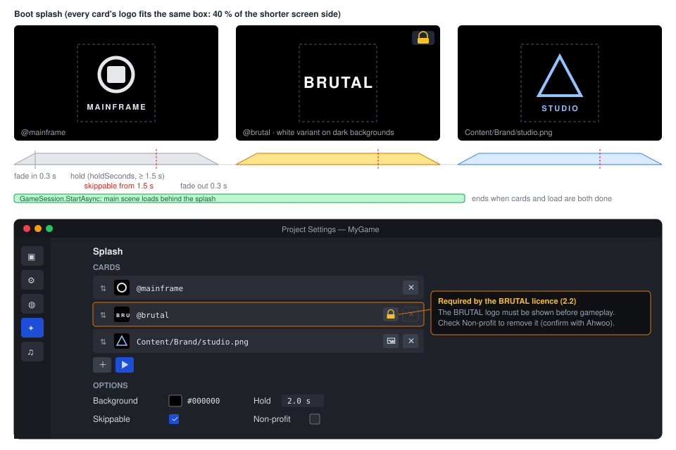

# Proposal: BRUTAL as the engine's backend tech

**Milestone:** [BRUTAL backend](../../milestones.md#brutal-backend-) (B1–B7) · **Status:** B1 ✅ (plumbing and attribution), B2 ✅ (physics seam); B3–B7 ⬜ planned ·
**Decision:** [ADR 0192](../../../memory/decisions/0192-brutal-backend-tech.md) · **Depends on:** [M6 physics](../physics.md),
[M10 project and GameHost](../project-and-gamehost.md), [Game UI](../game-ui.md) · **Related:**
[Physics joints](physics-joints.md) (G9, written against the seam once B2 lands),
[Rendering backend abstraction](rendering-backend-abstraction.md) (M11, shares B7), [Mobile](mobile.md) (M12),
[Distribution (NuGet)](../distribution-nuget.md), [Natives](../natives.md)



## Problem

Mainframe's low-level layer is a set of unrelated third-party packages: Silk.NET 2.23 for Vulkan, SDL2 windowing and
input, and Assimp; Jitter2 for 3D physics; Box2D.NET for 2D. [BRUTAL](https://github.com/ahwootech/BRUTAL) (Ahwoo
Limited, first published to NuGet on 2026-10-15) is a C# framework of exactly that layer: one interop layer and
generated bindings for Vulkan + VMA, SDL3, Jolt, Box2D, Slang, FreeType, RenderDoc and more, plus allocation-free
collections, memory and numerics. Kitten Space Agency and RimWorld's Waylith engine are built on it. The engine's author
is a founding contributor (BRUTAL's `CONTRIBUTORS.md`), and "built on BRUTAL" is worth having in the engine's and its
games' marketing.

Adopting BRUTAL all at once would rewrite the renderer and the platform layer for parity at best. The first piece that
improves the engine is **Jolt** (5.5, through `Ahwoo.BRUTAL.Jolt`): a much stronger 3D physics engine than Jitter2
(performance, compounds, height fields, mesh building, joints and vehicles later). Everything else can follow in phases.

## Goals

- BRUTAL becomes a dependency of the `MainframeEngine` package itself; games **inherit its licence** (ADR 0192): the
  BRUTAL logo before gameplay, its copyright on a credits screen, `NOTICE.txt` next to the game. The engine does all
  three by default, so a game is compliant without doing anything.
- A **splash sequence** in every game (Mainframe, BRUTAL, then the game's own cards), configurable in
  `project.mfproj`, with the BRUTAL card locked.
- A **backend seam** under `PhysicsSpace3D`: Jitter2 moves behind it with no behaviour change.
- A **Jolt backend** that passes the same physics tests, goldens and allocation gate as Jitter2, selected per project
  (`physics.3d.backend`). Jolt becomes the default once it reaches parity; Jitter2 stays as the pure-C# fallback.
- A roadmap for the rest of BRUTAL (interop and collections, RenderDoc, SDL3, Vulkan + VMA), each phase with its own
  spec.

## Non-goals

- Replacing Silk.NET in B1–B3. Windowing, input and Vulkan stay as they are.
- Jolt features beyond today's 3D node set: joints, soft bodies, vehicles and `CharacterVirtual` come later (G9 joints
  are written against the seam, see [Physics joints](physics-joints.md)).
- 2D physics: Box2D.NET stays. `Ahwoo.BRUTAL.Box2D` (native Box2D v3) could replace it later; nothing here depends on that.
- Cross-platform deterministic physics. The shipped Jolt build is not compiled with `JPH_CROSS_PLATFORM_DETERMINISTIC`;
  ADR 0020 stands.
- A commercial BRUTAL licence or an opt-in BRUTAL package. Both are recorded as ways out in ADR 0192.

## Roadmap

| Phase | Scope | In this doc |
|---|---|---|
| **B1** Plumbing and attribution | Package pins, transitive dependencies, `NOTICE.txt` and credits, the splash sequence, the editor's splash and About | full design |
| **B2** Physics seam | `PhysicsBackend3D`, neutral shape descriptions, Jitter2 behind the seam, `physics.3d.backend`; no behaviour change | full design |
| **B3** Jolt backend | `JoltBackend` on `Ahwoo.BRUTAL.Jolt`, both backends in every physics test, goldens per backend, benchmarks, a Demo toggle | full design |
| **B4** Jolt by default | Flip the default when B3's parity criteria hold; G9 joints on the seam | criteria |
| **B5** Low-level adoption | BRUTAL Interop/Collections/Memory where they replace engine code; RenderDoc capture | outline |
| **B6** Platform layer | SDL3 (`Ahwoo.BRUTAL.Sdl`) replacing Silk.NET's SDL2 windowing and input | outline |
| **B7** GPU layer | `Ahwoo.BRUTAL.Vulkan` + `Vulkan.Vma` replacing `Silk.NET.Vulkan` and the engine allocator, inside M11's Vulkan backend | outline |

B1 and B2 are independent and can be built in parallel; B3 needs both. Each phase merges as its own PR (B3 may be two:
bodies and queries first, then signals and characters).

## What BRUTAL ships (2026.10)

Verified from the `Ahwoo.BRUTAL.*` packages on nuget.org (inspected, not run) and the repository:

- **50 packages**, all `net10.0`, CalVer `YYYY.MM.N` per package, one version each so far, dependency ranges
  minimum-only (`[2026.10.1, )`). The repository has no tags, releases or source build yet ("use the NuGet packages").
- **`Ahwoo.BRUTAL.Jolt` 2026.10.2**: Jolt **5.5.0**, single precision, 16-bit object layers, Profile and Debug Renderer
  compiled in, no cross-platform determinism. Natives: `win-x64/jolt.dll` (2 MB), `linux-x64/libjolt.so` (50 MB,
  unstripped), `osx-arm64/libjolt.dylib` (3.1 MB). **No osx-x64**, no Android, iOS or consoles. It depends on Core,
  Interop, Logging, Memory, Numerics and Strings. The package README calls it "highly experimental".
- **Binding style**: generated `readonly partial struct` handles mirroring Jolt's C++ classes (`PhysicsSystem`,
  `BodyInterface`, `*ShapeSettings`, `NarrowPhaseQuery`, …) over a flat C shim of 8 160 exports
  (`[LibraryImport("jolt")]`, `DisableRuntimeMarshalling`, standard `runtimes/<rid>/native` probing). Handles are
  `IDisposable` with **no finalizers**. Vectors are `Brutal.Numerics.float3`/`floatQuat`/`float4x4`.
- **Callbacks** are abstract `Managed*` classes (`ManagedObjectLayerPairFilter`, `ManagedBodyFilter`,
  `ManagedContactListener`, …) that pin themselves with a `GCHandle` and are called through `[UnmanagedCallersOnly]`
  thunks on Jolt's worker threads; exceptions are caught and read back with `TakeCallbackException()`. The
  allocation-free contact path is `ContactEventListener(capacity, mask)`, recorded natively and drained into a
  `Span<ContactEvent>` between updates (`Removed` events carry body ids only; overflow counts in `Dropped`).
- **Queries** write into `Span<T>` with an `out uint` count: `CastRay`, `CastShape`, `CollideShape`, `CollidePoint`.
- **Third-party transitive dependencies** (new to the engine): `CommunityToolkit.HighPerformance` 8.4.2 and
  `Microsoft.Extensions.Logging` / `.Console` 10.0.0, from `Ahwoo.BRUTAL.Core`/`Logging`, which bring about nine more
  `Microsoft.Extensions.*` packages (options, configuration, dependency-injection abstractions, primitives) with them. Core, Numerics and Strings
  ship Roslyn analyzers; Interop ships a source generator; downstream package edges exclude both.

### The licence

"BRUTAL License v1.0": MIT-style plus three conditions on any product that includes BRUTAL.

| Condition | What the engine does |
|---|---|
| 2.1 The copyright line ("BRUTAL game development framework is Copyright (c) 2024 Ahwoo Limited.") on the credits screen or equivalent | registers it in `Credits` (B1); the `SettingsMenu` Credits page shows it |
| 2.2 The BRUTAL logo before gameplay, unaltered except for scaling, legible, no less prominent than other logos | the `@brutal` splash card, locked, same box as every other card |
| 2.3 `NOTICE.txt` alongside the product | copied next to the game by `buildTransitive` |

Exceptions: written permission from Ahwoo, or a product that cannot display graphics (headless servers). The README
waives the logo for non-profits and where it would be detrimental; the waiver is requested from brutal@ahwoo.com. The
licence is New Zealand law. Third-party licences (Jolt's MIT notice among them) are in each package's `LICENSES/`.

## B1: plumbing and attribution

### Packages

- `Directory.Packages.props` pins every `Ahwoo.BRUTAL.*` package **exactly** (`[2026.10.2]` style), because upstream
  ranges are minimum-only and the API is experimental. B1 adds Core, Interop, Logging, Memory, Numerics, Strings and
  Jolt (Jolt is referenced in B1 so the natives, notices and package size are settled before B3 writes code).
- The two transitive third-party packages are recorded in ADR 0192 (approved dependencies) and in
  `THIRD_PARTY_NOTICES.md`; their versions are pinned centrally too.
- BRUTAL's analyzers stay off for the engine's own projects (`ExcludeAssets="analyzers"` on the references) so the
  0-warning build does not depend on another project's rule set. B5 can turn them on deliberately.
- The `MainframeEngine` NuGet package depends on the BRUTAL packages, so their natives reach games through NuGet's
  `runtimes/<rid>/native` like Silk.NET's. They are not in `Native/natives.lock` (that lists the engine's own shims).
- **Size**: the unstripped 50 MB `libjolt.so` lands in every Linux game and editor build. `package-editor.sh` strips it
  in editor releases; upstream gets an issue to ship it stripped. Games are on their own until then (documented).

### Notices

- The engine project copies BRUTAL's `NOTICE.txt` to its output as `BRUTAL-NOTICE.txt` (project-source games get it the
  way they get `Content/`), and the package carries it as `mainframe/BRUTAL-NOTICE.txt`, which
  `build/package/MainframeEngine.targets` copies to `$(OutDir)` and the publish directory, next to the game executable. `just template-smoke` checks it exists after build and publish.
- `THIRD_PARTY_NOTICES.md` gets a BRUTAL section (licence text, the three conditions in plain words for game
  developers) and Jolt's notice. The template gains a README (it has none today) telling new projects what they inherit.

### Credits

```csharp
public static class Credits
{
    public static IReadOnlyList<CreditEntry> Entries { get; }
    public static void Add(string section, string name, string? notice = null);
}
public readonly record struct CreditEntry(string Section, string Name, string? Notice);
```

- The engine registers, before any game code runs: section "Engine": Mainframe Engine (its MIT line) and BRUTAL (the
  2.1 copyright line); section "Third-party": the entries of `THIRD_PARTY_NOTICES.md` (generated into a resource at
  build, so they cannot drift).
- `SettingsMenu` gets a **Credits** page (one more tab, styled like the existing text tabs) listing
  `Credits.Entries` by section in a scrolling list. Games add their own team with `Credits.Add` from an autoload's
  `OnReady`, or build their own screen from `Entries`. Section names and engine names are not translated; notices are
  legal text and stay in English.

### Splash settings

B1 and B2 each bump `ProjectSettingsFormat.Current` by one and add their own `ProjectMigration` step, in the order they
merge (B1's adds `splash` with the defaults; B2's moves the Jitter2 keys). Shipped steps are never edited. The new
section:

```json
"splash": {
  "cards": ["@mainframe", "@brutal"],
  "background": "#000000",
  "holdSeconds": 2.0,
  "skippable": true,
  "nonProfit": false
}
```

| Key | Meaning |
|---|---|
| `cards` | Ordered. `@mainframe` and `@brutal` are built in; any other entry is an image path in the game's `Content/` (PNG, loaded through `ContentPaths.Resolve`). Empty is allowed only with `nonProfit` |
| `background` | sRGB hex, the clear colour behind every card |
| `holdSeconds` | Fully visible time per card, clamped to ≥ 1.5 (legibility) and ≤ 10 |
| `skippable` | Input skips the current card once its hold has elapsed |
| `nonProfit` | Unlocks `@brutal` (the README's waiver); the docs and the editor tooltip say to confirm it with Ahwoo |

**The lock**: when `nonProfit` is false and `cards` lacks `@brutal`, the settings loader inserts it after `@mainframe`
(or first). `ProjectSettings.Load` logs one warning per problem naming the licence (`Parse` logs none: the editor parses
clones on every edit). `@mainframe` is not locked (Mainframe is MIT). A repeated card shows once (warning); an unknown
`@` entry or a path that is not a `Content/…png` is a load error. `ProjectSettings.Splash` exposes the resolved list; the
saver writes what the user set, so the warning repeats until the file is fixed.

### The splash sequence

`SplashSequence` (`Src/Project/Splash/`), owned by `GameHost`:

- An engine `UiLayer` above every game layer (`Layer = int.MaxValue - 1`, below the dev overlay) with one document,
  `Content/UI/splash/splash.rml` + `.rcss`, holding a full-screen background and one centred ``.
- **Equal prominence by construction**: every card's image fits a square box of 40 % of the shorter screen side,
  aspect kept, centred. No card is scaled differently, so "no less prominent" holds whatever the game adds.
- **Logo files**: `MainframeEngine/Content/Brand/brutal/LOGO_BRUTAL_WHT.png` and `LOGO_BRUTAL_BLK.png`, copied
  byte-for-byte from BRUTAL's `docs/branding/` (the licence allows scaling only). The card uses white on a background
  whose relative luminance is below 0.5, black otherwise. `@mainframe` uses `Content/Brand/logo-512.png`.
- **Timing** per card: fade in 0.3 s, hold `holdSeconds`, fade out 0.3 s (RCSS opacity transitions driven by a class).
  Time comes from the frame's real delta, unaffected by pause, and counts at most 0.1 s per frame so a hitch cannot
  jump over a card.
- **Skipping**: a key press, mouse click or gamepad button (from `IInputServer`, consumed so the game never sees it)
  during a card's hold, once the hold has elapsed for at least 1.5 s, ends that card early (straight to its fade out).
  With `skippable` false, input does nothing. No card can be skipped before 1.5 s; `@brutal` therefore always shows
  legibly.
- **Loading behind it**: `GameHost` starts the session with `GameSession.StartAsync` (ADR 0183) on the first update as
  today; the splash is drawn above the loading scene. The sequence ends when the last card has faded out **and** the
  scene load has completed; if the load is still running, the last card stays at full opacity with a small spinner
  under it (a new `.spinner` in `widgets.rcss`) until it finishes, then fades. `SceneTree` keeps reporting loading until
  the splash ends. A failed load ends the splash and takes the existing error path (log, quit with an error). With a
  synchronous load (`loading.async` false, `--sync-load`) the splash plays first and the load runs after it.
- **Text**: none, so nothing to translate. `role="img"` and `alt` on the image for screen readers.
- The layer is removed when the sequence ends; nothing of it is left in the tree.

**When the splash does not run**: `--headless` (no graphics: the licence's own exception), `--editor-port` (launched
by the editor's Play), `--scene` (QA, screenshots, tests start a specific scene), `--max-frames` with `--hidden` (CI
smoke), and `--no-splash` (a documented development flag; the `gamehost` render test and the Forest scripts pass it). A
shipped game launched normally always shows it.

`--qa-splash` runs only the sequence (the editor's Preview); `--qa-splash-out <dir>` runs it unskippable and writes a
screenshot per card, for the docs and the render-test golden (`splash`).

### The editor

The editor ships BRUTAL too:

- Its `SplashScreen` (`MainframeEngine.Editor/Src/UI/SplashScreen.cs`, `splash.rml`) shows the BRUTAL logo next to the
  Mainframe logo, both in boxes of the same size.
- **Help → About** lists `Credits.Entries` (the engine's and third-party sections).
- **Project Settings → Splash** (an icon-and-label nav entry like the others, see the mockup): the card list with
  up/down, image-picker and remove icon buttons per card, and an add-card icon button; `@brutal` shows a lock icon whose tooltip quotes the
  licence condition and disables remove unless **Non-profit** is checked; background colour, hold seconds, skippable;
  a **Preview** icon button that runs `--qa-splash` for the project.

## B2: the physics seam

### Layout

```
MainframeEngine/Src/Physics/3D/
  PhysicsServer3D.cs, PhysicsSpace3D.cs, CollisionObject3D.cs, …   engine logic, no backend types
  Backend/PhysicsBackend3D.cs        internal abstract class, one instance per space
  Backend/ShapeDescription3D.cs      neutral shape descriptions
  Backend/BackendResults3D.cs        hit/contact structs passed across the seam
  Jitter/Jitter2Backend.cs           every Jitter2 call (moved out of PhysicsSpace3D)
  Jitter/JitterMath.cs, SphereContactFilter.cs, JitterLogMute.cs
  Jolt/                              B3
```

The CLAUDE.md rule "keep every Jitter2/Box2D call inside `Src/Physics`" becomes "inside its backend folder"
(`Src/Physics/3D/Jitter`, `Src/Physics/3D/Jolt`, `Src/Physics/2D`). A unit test greps the engine sources and fails
when `Jitter2.` or `Brutal.JoltApi` appears outside them.

### What stays in the engine

`PhysicsSpace3D` keeps everything that defines the engine's behaviour, so both backends get it from one place:

- `BodyRecord3D` (minus the Jitter2 `RigidBody`/shape list, replaced by a backend handle), dirty tracking, flush before
  steps and queries, membership lists (moving, monitors, areas), creation-order sequence numbers.
- Interpolation: previous/current/target poses, `BeforeFixedSteps`/`AfterFixedSteps`, `PhysicsInterpolation`.
- User moves → teleport (dynamic), move (static, area) or kinematic target (kinematic, character), and the velocity that
  reaches a kinematic target in one step.
- The layer rule, as one function both backends call from their filters:
  `static bool Collides(uint layerA, uint maskA, bool areaA, uint layerB, uint maskB, bool areaB)` (ADR 0021: OR of the
  two directions, areas detect bodies by their mask, never areas).
- Signal diffing, ordering, dispatch and removal exits (ADR 0022): backends report **current** touching and overlapping
  sets; the engine diffs them against the previous step exactly as today.
- Damping conversion (per second → per step), gravity-scale semantics, the concave-on-dynamic error, disabled-node
  removal (ADR 0130).
- Debug draw (from the shape resources and render poses; unchanged).
- `CharacterBody3D.MoveAndSlide`: recovery, slide, classify, stop-on-slope, snap and settle stay engine code over the
  backend's character primitives.

### `PhysicsBackend3D`

Internal, abstract (not an interface: two sealed implementations, devirtualizable, no boxing of handles). Bodies are
`BackendBody` handles (`readonly record struct BackendBody(int Index)`), so nothing crosses the seam as an object.

| Group | Members |
|---|---|
| World | `Create(kind, settings)`, `Kind`, `Gravity`, `ActiveBodyCount`, `Step(dt)`, `Dispose()` |
| Bodies | `CreateBody(desc)` (no shapes: they come at the first flush), `DestroyBody`, `SetKind`, `SetShapes(body, shapes, dynamicMass, errors)`, `SetFilter(body, layer, mask)`, `SetProperties`, `SetMaterial` |
| State | `GetPose`, `SetPose`, `Teleport`, `MoveKinematic`, `Get/SetLinearVelocity`, `Get/SetAngularVelocity`, `ApplyForce/Impulse/Torque`, `IsSleeping`, `Wake`, `WakeTouching`, `ClearContacts` |
| Scans | `CollectTouching`, `CollectOverlaps` (false: the area has no shapes) |
| Queries | `RayCast`, `ShapeCast`, `IntersectShape`, `IntersectPoint` |
| Character | `CastBody`, `GetShapeCount`, `CollectNearbyShapes` + `Penetration` (recovery pushes the pose between pairs), `Distance` (settle) |

Built (B2): `CreateBody` takes no shapes (they arrive at the space's first flush, as before); mass is a `SetShapes`
argument because inertia follows the shapes; friction and bounce have their own `SetMaterial` (the material changes on its
own); `SetFilter` takes no area flag (the kind says it); `CastBody` takes no margin (the caller extends the motion);
recovery is `CollectNearbyShapes` + `Penetration`, because the engine moves the pose between pairs. Shape indices in hits
are description indices; the record maps them to `CollisionShape3D`s.

Every method is main-thread only, allocation-free and called only between steps. The space calls `Step` once per fixed
step; sub-stepping is the backend's (`SubstepCount`).

### Shapes

`Shape3D.CreateShapes(List<RigidBodyShape>, …)` and `CreateBaseShape()` (Jitter2 types in public resources) become:

```csharp
internal abstract void Describe(List<ShapeDescription3D> output, in Basis linear, Vector3 translation);
internal int ChangeCount { get; }   // bumped whenever a property that affects the geometry changes
```

`ShapeDescription3D` is a struct: `Kind` (box, sphere, capsule, cylinder, convex hull, concave mesh, height map), the
sizes, the local transform (translation + rotation·scale, as today), the owning `CollisionShape3D` index, and a reference
to the resource (for point/face/height arrays, never copied). Each backend builds native shapes and caches them by
(resource, `ChangeCount`, baked scale) where the library allows sharing: Jolt shapes are reference-counted and shared, so
a resource used by 500 bodies is built once per space; a Jitter2 shape belongs to exactly one body, so the Jitter2
backend caches only query shapes. Jitter2 areas stay bodiless queried shapes (as today); Jolt areas are sensor bodies.

### Settings

`PhysicsSettings3D` gains `Backend` (`PhysicsBackendKind.Jitter2` | `Jolt`, default `Jitter2`); `Jitter2` and `Jolt`
sub-objects hold what only one engine understands. In `project.mfproj`:

```json
"physics": { "3d": {
  "backend": "jitter2",
  "gravity": [0, -9.81, 0], "substeps": 1, "allowDeactivation": true, "multiThreaded": true, "deterministic": false,
  "jitter2": { "solverIterations": 6, "relaxationIterations": 4 },
  "jolt": { "velocitySteps": 10, "positionSteps": 2, "maxBodies": 65536, "maxBodyPairs": 65536,
            "maxContactConstraints": 10240, "tempAllocatorMB": 16, "contactEventCapacity": 4096 }
}}
```

B2's migration step moves `physics.3d.solverIterations`/`relaxationIterations` into `physics.3d.jitter2`. The editor's
Project Settings → Physics shows the shared keys and the selected backend's group. `EngineOptions.Physics3D` carries the
same object; `PhysicsServer3D(settings)` creates each space's backend from it.

### B2's gate

No Jolt code exists yet. Every physics unit test, both allocation gates, the `physics` and `physics-debug` goldens, the
determinism check and the physics benchmarks pass **unchanged** on Jitter2 (benchmarks within the noise of
`baseline.json`), checked by a bit-exact Jitter2 call trace recorded before the refactor. The physics internals, settings,
project format, editor Project Settings, tests and docs change; nodes, scenes, the public node API and game code do not
(`PhysicsSettings3D.SolverIterations`/`RelaxationIterations` stay as forwarders to `Jitter2`). The trace is `PhysicsTraceTests` (opt-in, per RID).

## B3: the Jolt backend

### Runtime and availability

`JoltRuntime` (static, `Src/Physics/3D/Jolt/`):

- `TryInitialize(out string? reason)` runs once per process: `NativeLibrary.TryLoad` of `jolt` through the assembly's
  normal probing, then `Jolt.RegisterDefaultAllocator()`, `Factory.Instance`, `Jolt.RegisterTypes()`. These stay for the
  process lifetime (Jolt has no cheap re-init; spaces come and go).
- Unavailable (osx-x64, a missing native, Android/iOS/consoles later) → `PhysicsServer3D` logs once
  `[Physics] Jolt is not available on <rid> (<reason>); using Jitter2.` and creates Jitter2 spaces. A test forces the
  unavailable path.
- Jolt traces and asserts are routed to `Log` (`[Jolt] …`) through `Jolt.SetTraceHandler`/`SetAssertHandler` (the Jolt
  binding does not use BRUTAL's logging), filtered like the Jitter2 listener so a muted level formats nothing.

### Per space

| Object | Settings |
|---|---|
| `TempAllocatorImplWithMallocFallback` | `jolt.tempAllocatorMB` (16); the plain `TempAllocatorImpl` aborts the process when it runs out |
| `JobSystemThreadPool` | `MultiThreaded`: `min(Environment.ProcessorCount - 1, 8)` workers; otherwise `JobSystemSingleThreaded.Create(maxJobs)` (the binding has both; a facts test pins 0-worker behaviour too) |
| Layer interfaces | see Layers |
| `PhysicsSystem.Init` | `maxBodies`, `maxBodyPairs`, `maxContactConstraints`; `PhysicsSettings` velocity/position steps, `mAllowSleeping = AllowDeactivation` |
| `ContactEventListener` | `contactEventCapacity` events, Added + Removed, for contact monitors and areas |
| Query filters | one reusable `ManagedBodyFilter` and object-layer filter per space, reconfigured per query (mask, exclude) |

`Step(dt)` calls `PhysicsSystem.Update(dt, SubstepCount, tempAllocator, jobSystem)`, then `TakeCallbackException()` on
every managed callback object (a thrown filter rethrows on the main thread), then drains the contact events.

**Teardown** in this order (the system holds raw pointers to the layer objects; the handles have no finalizers):
remove and destroy bodies → `PhysicsSystem` → contact listener → filters and layer interfaces → job system → temp
allocator → cached shapes. `PhysicsSpace3D.Dispose` runs it; a debug-build check asserts every native handle the
backend created was disposed.

### Layers

Jolt object layers are 16-bit, too small for Godot's 32-bit layer + 32-bit mask, so the backend interns combinations:

- **Broad-phase layers** (3): `Static` (static bodies), `Moving` (dynamic, kinematic, character), `Area` (sensors).
- **Object layer** = `(broadPhase << 14) | index`, where `index` (up to 16 383 per broad-phase layer) is the interned
  `(layer, mask)` pair. A space starts with the pairs its bodies use; a new pair gets the next index.
- `BroadPhaseLayerInterfaceTable` is filled once at space creation for all 65 536 object layers from the top two bits,
  so it never grows.
- Object-vs-broad-phase filter: `Static`↔`Static` never; `Area`↔`Area` never; everything else yes.
- Object-pair filter: a `ManagedObjectLayerPairFilter` that looks both indices up in a `(layer, mask)` array and calls
  the engine's `Collides`. It runs on worker threads, so the array is fixed-size and written only between steps (a new
  pair takes the next slot; no allocation). The 65 536-entry broad-phase table and the stateless filters are created
  once per process. If benchmarks show the managed call per broad-phase pair matters, B3 replaces it with an
  `ObjectLayerPairFilterTable` rebuilt between steps for the pairs in use.

A layer or mask change moves the body to its new object layer (`BodyInterface.SetObjectLayer`) and drops its contacts,
as the Jitter2 backend does.

### Bodies

| Engine | Jolt |
|---|---|
| `StaticBody3D` | `EMotionType.Static`, broad-phase `Static` |
| `RigidBody3D` dynamic / kinematic | `Dynamic` / `Kinematic`, broad-phase `Moving` |
| `CharacterBody3D` | `Kinematic`, broad-phase `Moving`, moved by `MoveKinematic` |
| `Area3D` | `Kinematic` sensor (`SetIsSensor(true)`, collide-kinematic-vs-non-dynamic on, so it sees static and kinematic bodies), broad-phase `Area` |
| Body user data | the backend handle index; the backend keeps a body-id → handle table (needed for `Removed` events, which carry ids only) |
| `Mass` | `OverrideMassProperties = CalculateInertia`, mass from the node |
| `LinearDamp`/`AngularDamp` (per second) | Jolt applies `v · max(0, 1 − c·dt)`; the backend sets `c = (1 − e^(−d·dt)) / dt`, so the per-step factor equals the Jitter2 backend's |
| `GravityScale` | `GravityFactor` (native; no force workaround) |
| `AxisLocks` | `AllowedDOFs`, changed in place through `MotionProperties.SetMassProperties` (no re-creation); all six axes locked holds the body kinematic, since Jolt cannot lock every axis |
| `Ccd` | `EMotionQuality.LinearCast` |
| `CanSleep` | `AllowSleeping` |
| `PhysicsMaterial` friction / bounce | body friction / restitution; Jitter2 2.9 combines with `max` of both (its `ContactData.Init`), Jolt's default friction is the geometric mean, so the backend installs `max` through `SetCombineFriction`/`SetCombineRestitution` (pinned by a test) |
| `Teleport` | `SetPositionAndRotation` with `Activate`, velocity kept |
| Kinematic target | `MoveKinematic(position, rotation, dt)`: Jolt derives the velocity, as the engine does for Jitter2 |

### Shapes

| Resource | Jolt |
|---|---|
| `BoxShape3D` | `BoxShape(half extents, convexRadius = min(0.05, 0.1 · smallest half extent))` |
| `SphereShape3D` | `SphereShape(r)` |
| `CapsuleShape3D` | `CapsuleShape(halfHeightOfCylinder = MidHeight / 2, r)` (Y axis, as Jolt) |
| `CylinderShape3D` | `CylinderShape(Height / 2, r, convexRadius as for boxes)` |
| `ConvexPolygonShape3D` | `ConvexHullShapeSettings(points)` |
| `ConcavePolygonShape3D` | `MeshShapeSettings(triangles)` (static/kinematic only, as today) |
| `HeightMapShape3D` | `HeightFieldShapeSettings` when the grid is square and Jolt's sample-count rules allow it, otherwise a mesh (as Jitter2 does today) |
| Offset or rotated child | `RotatedTranslatedShape` |
| Scaled child | scale baked into the shape's own sizes (no `ScaledShape`); spheres and capsules take uniform scale only, so non-uniform scale on them uses the largest axis and logs once (the Jitter2 backend accepts any linear map: a documented difference) |
| Several `CollisionShape3D` children | one `StaticCompoundShape`; the sub-shape id → child index map gives `BackendHit3D.ShapeIndex` |

Shape building happens in the step's flush on the main thread; the Forest terrain (524k triangles) is the benchmark
for `MeshShape` building (Jitter2: ≈ 2.1 s in the first step).

### Contacts and areas

- Contact monitors and areas both come from the `ContactEventListener` drain after each step: `Added` puts the other
  body into the receiver's current set, `Removed` takes it out (by body id). `CollectTouching`/`CollectOverlaps`
  enumerate those sets; the engine's diff turns them into the same signals, in the same order, as with Jitter2.
- Events arrive per sub-shape pair; the backend counts pairs so a body stays touching while any of its shapes does. The
  seam has no monitor flag, so every body keeps a touching set (cheap: sets are pooled and only touched by events).
- **Overflow**: `Dropped > 0` → that space switches to `CollideShape` queries for monitors and areas for the rest of its
  life (a rebuilt set cannot be reconciled with Jolt's later `Removed` events) and logs once; the next space gets
  double the `contactEventCapacity`.
- Contacts start within Jolt's speculative distance (2 cm by default) where Jitter2's start at touching; the shared
  tests allow 2 cm here (see Testing).

### Queries and the character primitives

| Engine | Jolt |
|---|---|
| `RayCast(..., hitFromInside)` | `NarrowPhaseQuery.CastRay`, `RayCastSettings.TreatConvexAsSolid = hitFromInside`, closest hit |
| `ShapeCast` | `CastShape` with the query shape at scale 1, closest hit |
| `IntersectShape` | `CollideShape` into a span sized to the result list, each body once |
| `IntersectPoint` | `CollidePoint` |
| `CastBody` | `CastShape` of the body's (compound) shape, deepest point returned for "already touching" |
| `CollectNearbyShapes` / `Penetration` | broad-phase query of the expanded bounds, then `CollideShape` per pair with `MaxSeparationDistance = maxDistance`: penetration depth (negative = separated) and axis |
| `Distance` | the same query against one body |

All results go into spans owned by the space; queries never allocate. Jitter2's EPA fallbacks (ADR 0128) and the
sphere contact filter (ADR 0134) are Jitter2-specific and stay in its backend.

### Determinism

Jolt is deterministic for the same binary and the same sequence of API calls, multi-threaded included. The engine
already creates, updates and steps bodies in tree order, so `Deterministic` needs no Jolt setting: it keeps the
determinism render test meaningful for both backends. Nothing cross-platform (ADR 0020).

## B4: Jolt by default

The default `physics.3d.backend` becomes `jolt` (new projects and projects that never set it) when, on Jolt:

1. Every shared physics test passes (with the documented per-backend tolerances only).
2. The allocation gates are 0 B for the engine's managed code.
3. The `physics`, `physics-debug` and determinism render tests pass on moltenvk and lavapipe.
4. Benchmarks: step of 1 000 resting boxes ≤ Jitter2's, 10 000 raycasts ≤ Jitter2's, Forest terrain build ≤ 0.5 s.
5. The Demo's Physics 3D scene and the Forest play the same on both backends (QA walkthrough).

Jitter2 stays the fallback (Intel Macs, platforms without Jolt natives) and the choice for projects that pin it. G9
joints are then designed on the seam (Jolt constraints first, Jitter2's where they exist).

## B5–B7 outline

Each gets its own spec before work starts.

- **B5 Low-level adoption.** BRUTAL Interop's UTF-8 marshalling generator for the `mfrmlui` and ENet bindings;
  Collections/Memory where they replace engine-local pooled or unmanaged containers (renderer, audio rings) with no
  behaviour change; turn BRUTAL's analyzers on if they pass the 0-warning build. **RenderDoc** (`Ahwoo.BRUTAL.RenderDoc`):
  an in-app capture key (Ctrl+F12) and a dev overlay panel, Debug builds only.
- **B6 Platform layer.** `Ahwoo.BRUTAL.Sdl` (SDL3 3.4) replaces `Silk.NET.Windowing.Sdl`/`Input.Sdl` (≈ 77 files touch
  Silk.NET windowing, input or SDL). Open questions for its spec: SDL3's HiDPI model against
  `Engine.FramebufferSize`, `VulkanLoaderBootstrap` on `SDL_Vulkan_LoadLibrary`, gamepads on SDL3's gamepad API, text
  input and IME, and mobile (M12): BRUTAL ships no Android/iOS natives today. It is the same move as
  [Consoles](consoles.md#c2--platform-layer) C2's SDL3 platform layer, so the two share one spec.
- **B7 GPU layer.** `Ahwoo.BRUTAL.Vulkan` (headers to 1.4) and `Vulkan.Vma` replace `Silk.NET.Vulkan` (≈ 110 files)
  and the engine's allocator behind `GpuBuffer`/`GpuImage`. It is done **inside** M11's Vulkan backend
  ([Rendering backend abstraction](rendering-backend-abstraction.md)), so code moves once: subsystems port to
  `IGpuDevice`, and only the Vulkan backend touches BRUTAL. BRUTAL bundles neither MoltenVK nor a Vulkan loader, so
  macOS keeps `Silk.NET.MoltenVK.Native` (the native only) or a MoltenVK built in `Native/`. The Vulkan 1.2 baseline
  stays unless that spec raises it.

## Testing

**B1**
- Unit: splash settings parse, defaults, clamping, B1's migration step, the `@brutal` lock and its warning,
  `nonProfit`; `SplashSequence` as a state machine on a fake clock (fades, hold, skip rules, the 1.5 s floor, waiting on
  a slow load, a failed load); which launch flags skip it; `Credits` (engine entries present before game code, order,
  third-party entries match `THIRD_PARTY_NOTICES.md`).
- Render test `splash`: one golden per card at full opacity (both drivers).
- `just template-smoke[-package]`: `BRUTAL-NOTICE.txt` in the build and publish output; the game starts headless with
  no splash.
- Editor QA (`Tests/QA`): Project Settings → Splash (lock, add, reorder, preview), About.

**B2**
- The gate above. Plus the source-grep test for backend types outside their folders, and a `ShapeDescription3D` test
  per shape kind (sizes, transforms, scale baking).

**B3**
- `PhysicsHarness3D` takes a `PhysicsBackendKind`. Every 3D physics test class becomes abstract with two sealed
  subclasses (`…_Jitter2`, `…_Jolt`), so the whole suite runs on both; Jolt classes skip with a reason when
  `JoltRuntime` is unavailable (osx-x64 CI never sees them).
- Per-backend tolerances live in the harness (`h.Tolerances.RestingPenetration`, `ContactStartDistance`, …), named and
  documented, never inline.
- Allocation gates on both backends (Jolt's native allocations do not count; managed code is 0 B).
- Render tests `physics-jolt`, `physics-debug-jolt`, and the determinism check on Jolt; goldens per driver.
- Benchmarks: `PhysicsBenchmarks` parameterized by backend; Jolt numbers added to `baseline.json`, plus the terrain
  build.
- Fallback test: forced-unavailable Jolt creates Jitter2 spaces and logs once.

## Docs, site and README

- `docs/design/physics.md` grows a Backends section and a Jolt column in the shape and query tables (B3);
  `project-and-gamehost.md` documents `splash` and the launch flags; `game-ui.md` the Credits page; `editor.md` the
  Splash page and About; `distribution-nuget.md` and `release.md` the notices and the stripped `libjolt.so`;
  `THIRD_PARTY_NOTICES.md` BRUTAL and Jolt.
- The README, the landing page and the docs site say **Built on BRUTAL** (with the logo, in the subsystems list:
  "3D physics: Jolt via BRUTAL, or Jitter2"), with editor screenshots of the Splash page, and state the licence
  inheritance plainly in Getting started.
- Release notes of the first release with B1 call out the licence change for existing projects.

## Risks

| Risk | Mitigation |
|---|---|
| BRUTAL is days old, "highly experimental", one version per package | exact pins; all calls in one backend folder; Jitter2 stays the fallback; upgrades are their own PRs with the full test run |
| The licence change surprises existing Mainframe users | release notes, README, template README; ADR 0192 lists the ways out (opt-in package, commercial licence) |
| No osx-x64, Android, iOS or console natives | Jitter2 fallback for physics; B6/B7 blocked on those platforms until upstream ships them (tracked in their specs) |
| 50 MB unstripped `libjolt.so` | strip in editor releases; upstream issue; documented for games |
| Native handles without finalizers leak or crash at teardown | strict teardown order in one method; debug-build leak check; tests create and dispose hundreds of spaces |
| Managed callbacks on Jolt worker threads | filters read immutable snapshots only; exceptions surfaced with `TakeCallbackException()` after each step |
| Behaviour differences between backends | the engine owns signals, interpolation, layers and `MoveAndSlide`; differences are named tolerances in the harness and listed in `physics.md` |
| New transitive dependencies (CommunityToolkit.HighPerformance, Microsoft.Extensions.Logging and the `Microsoft.Extensions.*` packages it brings) | approved in ADR 0192, pinned centrally, listed in notices |

## Open questions

Answered from the 2026.10.2 metadata while planning B3 (pinned by B3 task 1's facts tests): the binding has
`JobSystemSingleThreaded`; `float3`/`floatQuat` are sequential X, Y, Z(, W) floats and `float4x4` four rows, so `JoltMath`
bit-casts; Jitter2 combines friction and restitution with `max`. Still open:

- Jolt's height-field cell diagonal against `HeightMapShape3D`'s (B3 task 3 measures it and picks the grid orientation).
- The non-profit waiver: is the README's blanket waiver enough, or does each project need Ahwoo's confirmation? The
  docs say to ask until Ahwoo answers.
