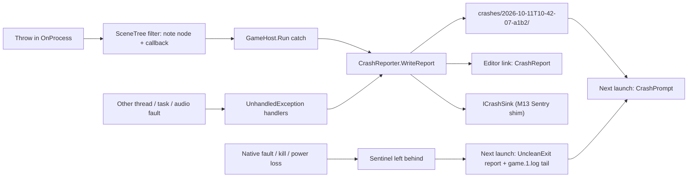

# Proposal: Crash reporting (desktop, editor and games)

**Milestone:** [Gameplay toolkit](../../milestones.md#gameplay-toolkit-) (G15) · **Status:** ⬜ planned ·
**Depends on:** [M10 projects](../project-and-gamehost.md) (`GameHost`, `project.mfproj`, log routing, editor link),
[M8 game UI](../game-ui.md) (the next-launch prompt) · **Related:**
[M13 mobile services](mobile-services.md#analytics-and-crash-reporting) (layer 1 is this proposal; Sentry native SDKs
on mobile), [Consoles](consoles.md) (plumbing checklist),
[Save games and settings](save-and-settings.md) (G4: `UserSettings` holds the upload consent),
[Profiler](profiler.md) (G10: GPU zones per pass), [Game export](game-export.md) (G5: symbols),
[Release](../release.md), [Native libraries](../natives.md)

## Problem

When a game or the editor dies, the engine leaves one `FATAL` log line at best, and nothing at all for a native crash.
Nobody can tell a player's crash apart from a driver bug, and the editor shows a number.

- **Main-thread exceptions end the game with a log line.** Node callbacks run without a catch
  (`MainframeEngine/Src/Scene/SceneTree.cs:405`, `:429`; `Tick` only resets its flag in a `finally`, `:321-378`). The
  exception leaves `Engine.OnUpdate` (`MainframeEngine/Src/Core/Engine.cs:484`) and `Engine.Run` (`:670-674`), and
  `GameHost.Run` catches it, calls `Log.Fatal(e)` and returns 1 (`MainframeEngine/Src/Project/GameHost.cs:230-233`;
  headless `:261-264`). The node, callback, scene and frame are not recorded. The `finally` then disposes the engine
  (`:235-245`), which after a lost device can throw again and hide the first error. Because the exception is caught,
  the runtime's unhandled-exception path (and any .NET dump setting) never runs.
- **Other threads have no handler.** The engine registers no `AppDomain.UnhandledException` or
  `TaskScheduler.UnobservedTaskException` handler; the only one is the editor's, which writes recovery copies
  (`MainframeEngine.Editor/Program.cs:35-41`). An audio-thread exception is stored
  (`MainframeEngine/Src/Audio/Graph/AudioMixRoot.cs:61-66`) and logged once
  (`MainframeEngine/Src/Audio/AudioServer.cs:762-766`); the game plays on in silence.
- **The log ring exists but is not used.** `MemoryLogSink` is documented as being for "crash reports"
  (`MainframeEngine/Src/Debugging/LogSinks.cs:54-58`), but only tests create one. `GameHost.Run` adds a `FileLogSink`
  in user data (`GameHost.cs:217-219`) that flushes at least every second and right after errors, and keeps the
  previous run as `game.1.log` (`MainframeEngine/Src/Debugging/FileLogSink.cs:7-15`). The editor writes no log file;
  its only sink is the Output panel (`MainframeEngine.Editor/Src/Output/OutputLog.cs:164`).
- **No GPU identity.** Vendor, device, driver version and driver id are read only to name the pipeline cache file
  (`MainframeEngine/Src/Rendering/Vulkan/PipelineCache.cs:310-318`); the device name is never read or logged.
  `EngineInfo.Version` drops the build metadata, so the commit is lost (`MainframeEngine/Src/Core/EngineInfo.cs:57-64`).
  The rest exists: `ProjectSettings.Version` (`MainframeEngine/Src/Project/ProjectSettings.cs:32`),
  `GameSession.CurrentScenePath` (`MainframeEngine/Src/Project/GameSession.cs:430`), `Engine.RenderedFrameCount`
  (`Engine.cs:200`) and `SceneTree.ProcessFrames` (`SceneTree.cs:131`).
- **A lost device looks like any other failure.** `Result.Check` throws a plain `VulkanException` with the result in
  its message (`MainframeEngine/Src/Rendering/Vulkan/VulkanException.cs:26-30`), for the fence wait, the submit and the
  present alike (`MainframeEngine/Src/Rendering/Vulkan/VulkanRenderer.cs:237-238`, `:318`, `:343-347`). Only the
  swapchain, portability and presentation extensions are enabled (`VulkanRenderer.cs:91`), and `Src/Rendering` has no
  debug labels, markers or fault queries, so `VK_ERROR_DEVICE_LOST` says nothing about the pass. `Dispose` calls
  `vkDeviceWaitIdle` (`VulkanRenderer.cs:1082`).
- **Native crashes leave nothing.** RmlUi/FreeType (`mfrmlui`), ThorVG (`mfsvg`), ENet, miniaudio (SoundFlow), SDL,
  Steam and the Vulkan driver run in the game process; a segfault there ends it with no report, and the log stops at
  its last flush. The natives are built `-DCMAKE_BUILD_TYPE=Release` without debug info
  (`.github/workflows/natives.yml:72`, `:77`). Only the editor's VST host runs out of process
  (`docs/design/natives.md:147`).
- **The editor sees an exit code.** Play marks a non-zero exit it did not cause as `Crashed`
  (`MainframeEngine.Editor/Src/Play/PlayService.cs:38-39`, `:517-526`; chip icon
  `MainframeEngine.Editor/Src/UI/Panels.cs:179`). After the link drops, raw stderr is shown with a guessed level
  (`MainframeEngine.Editor/Src/Play/PlayController.cs:275-311`). Link protocol 3 carries only `Goodbye(exitCode)`
  (`MainframeEngine/Src/EditorLink/EditorLinkProtocol.cs:25-26`, `:134`): no structured crash, `134` is not shown as
  `SIGABRT`, and the Output panel's click-to-source (`MainframeEngine.Editor/Src/UI/OutputPanel.cs:176-181`) cannot
  reach the stack.
- **Recovery copies are never offered back.** `WriteRecoveryCopies`
  (`MainframeEngine.Editor/Src/EditorWorkspace.cs:753`) fills `~/.mainframe/recovery`, and nothing reads it. The editor
  does report one earlier failure on its next start, the update result
  (`MainframeEngine.Editor/Src/Updates/UpdateApplier.cs:64-84`, read and deleted at `:408-412`).
- **Symbols are not managed.** CI builds are deterministic with mapped source paths (`Directory.Build.props:18-19`).
  `publish.yml` publishes ReadyToRun editors (`.github/workflows/publish.yml:103-105`); neither
  `build/package-editor.sh` nor `build/package-game.sh` deletes `.pdb` files, so managed frames probably carry lines
  (⚠ confirm in a release zip). Nothing archives symbols per release, and the natives have none.
- **Other plans assume this exists.** M13's crash layer 1 is "`CrashReporter.PendingReports`" with the last 200 log
  entries, device, OS and versions (`docs/design/future/mobile-services.md:423-447`). The consoles checklist forbids
  `HttpClient` and `Process.Start` in runtime code outside services (`docs/design/future/consoles.md:367-372`).

## Goals

- **Every fatal managed error writes a report bundle** to user data first: main thread (node callbacks, servers,
  renderer), other threads, tasks, and the editor. The report names the failing node and callback.
- **One versioned report format** (`report.json`) shared with M13, mapping field for field onto a Sentry event, so an
  uploader is a small serializer and not an SDK.
- **Context without per-frame cost:** versions, OS, GPU and driver, scene, frames, settings and the last 200 log
  entries, gathered at crash time or once at start-up.
- **Every abnormal end is noticed** (native crashes, kills, power loss) through a session sentinel and the previous log.
- **Device loss is diagnosed:** a typed exception, per-pass GPU breadcrumbs, `VK_EXT_device_fault` where available.
- **Native dumps on desktop as an option**; the dependency decision stays open.
- **The player decides:** a next-launch prompt to open the folder or copy the report; nothing is sent without a
  project endpoint and the player's agreement.
- **The editor shows a game crash as a crash** (exception, click-to-source frames, decoded signal, bundle), and its own
  crashes offer the recovery copies back.
- **Symbols per release** for engine, editor and natives.

## Non-goals

- **Automatic upload, engine telemetry or a hosted backend.** A game that wants reports names its own endpoint.
- **Recovering from device loss** (re-creating the device). The game reports the loss and exits.
- **Isolating game `[Tool]` code in the editor;** it still runs in the editor process.
- **Mobile and console native capture.** M13 uses Sentry's native SDKs through its shim; console ports use the
  platforms' reporting in private repositories. This proposal fixes the shared managed layer and format.
- **Hang detection** before G15.9, and **a symbol server** (symbols are release artefacts; symbolication is offline).

## Design

### Overview

| Type (all new unless noted) | Where | Role |
|---|---|---|
| `CrashReporter`, `CrashReporterOptions` | `Src/Debugging/Crash/` | Install, capture hooks, pending reports, prompt and upload policy |
| `CrashReport`, `CrashException`, `CrashFrame`, `CrashKind` | `Src/Debugging/Crash/` | The report model and its JSON (`format: 1`) |
| `CrashContext` | `Src/Debugging/Crash/` | Start-up facts and crash-time providers (scene, node, frames, game keys) |
| `CrashSession` | `Src/Debugging/Crash/` | The unclean-exit sentinel |
| `GpuInfo` + `IRenderer.Gpu` (new member) | `Src/Rendering/` | Backend-neutral GPU and driver identity |
| `VulkanDeviceLostException`, `GpuBreadcrumbs` (internal) | `Src/Rendering/Vulkan/` | Device loss as its own type; per-pass markers; fault info |
| `CrashPrompt : UiDocument` + `Content/UI/crash/` | `Src/UI/Crash/` | The player's next-launch prompt |
| `ICrashUploader`, `HttpCrashUploader`, `SentryEnvelope` | `Src/Debugging/Crash/Upload/` | Opt-in sending |
| `ExitCodes` | `Src/Core/` | Exit code → signal or NTSTATUS name (shared by the editor and the sentinel) |
| Editor link `CrashReport` (protocol 4), `CrashDialog` | `Src/EditorLink/`, `MainframeEngine.Editor/Src/UI/` | Game crashes in the editor; the editor's own next-start dialog |



### Public API

```csharp
namespace MainframeEngine;

public static class CrashReporter
{
    public static void Install(CrashReporterOptions options); // idempotent; GameHost.Run, HeadlessHost, the editor
    public static bool IsInstalled { get; }
    public static string Directory { get; }       // {UserDataDirectory}/crashes; the editor: ~/.mainframe/crashes

    // Earlier runs (M13 relies on this name)
    public static IReadOnlyList<CrashReportInfo> PendingReports { get; }
    public static CrashReport? Load(CrashReportInfo info);
    public static void MarkHandled(CrashReportInfo info, CrashDisposition how); // Dismissed, Copied, Sent
    public static void Delete(CrashReportInfo info);

    // This run
    public static string? WriteReport(Exception exception, CrashKind kind);    // fatal path; returns the bundle folder
    public static void ReportError(Exception exception, string? note = null);  // non-fatal; one per type per run
    public static void SetContext(string key, Func<string?> provider);         // game keys; read only at crash time
    public static event Action<CrashReport>? Crashing;                          // on the way down: keep it short
    public static void AddSink(ICrashSink sink);                                // M13 Sentry shim, console heads

    public static bool UploadConsent { get; set; }          // the player's choice (persisted by G4 UserSettings)
    public static ICrashUploader? Uploader { get; set; }    // default from project.mfproj crash.upload
}

public enum CrashKind
{
    ManagedException, ThreadException, UnobservedTask, AudioThread, DeviceLost, UncleanExit, NativeDump, Hang,
}

public readonly record struct CrashReportInfo(string Folder, string Id, CrashKind Kind, DateTime TimestampUtc,
    string Summary);

public interface ICrashSink
{
    bool RunsBeforeWrite => false;     // M13's Sentry shim forwards before the local write
    void OnCrash(CrashReport report);  // must not throw
}
```

`GameHost.Run` installs the reporter right after the file log (`GameHost.cs:217`). Its fatal catch becomes
`CrashReporter.WriteReport(e, CrashKind.ManagedException)` → `Log.Fatal(e)` → shutdown, with each shutdown step
guarded so a second exception cannot hide the first. `HeadlessHost` does the same. Engine subclasses (the editor) call
`Install` themselves; the render-test host does not, because a crash there fails a test.

### Capture points

- **Main thread:** the catch in `GameHost.Run`, the reporter's main entry point.
- **Which node.** `SceneTree` wraps each callback dispatch in an exception filter that records the node and callback
  and returns `false`, so the exception propagates unchanged with its stack, and the record is taken before unwinding:

  ```csharp
  try { node.InvokeProcess(gameTime); }
  catch (Exception e) when (CrashContext.NoteNode(node, NodeCallback.Process, e)) { } // always false: never catches
  ```

  This covers `OnPhysicsProcess`, `OnProcess`, `OnInput`, `OnUnhandledInput`, `OnReady`, signals and deferred calls.
  The non-exceptional path costs nothing; `NoteNode` stores references, and the node path is built at crash time.
- **Other threads:** `AppDomain.UnhandledException` writes a `ThreadException` report, then the process ends as today.
  `OutOfMemoryException`, which `GameHost.Run` deliberately does not catch, arrives here too.
- **Tasks and audio (non-fatal):** `TaskScheduler.UnobservedTaskException` and the audio fault
  (`AudioServer.cs:762-766`) call `ReportError`, at most one report per exception type per run.
- **Not capturable in process:** `StackOverflowException`, `Environment.FailFast` and native faults. The sentinel
  notices all of them; native dumps capture the native ones.

### What a report holds

```text
{user data}/crashes/
├── session-48213.json                   sentinel of the running process (deleted on a clean exit)
└── 2026-10-11T10-42-07-a1b2/
    ├── report.json                      the report (format 1)
    ├── log.txt                          the last 200 entries, formatted like the console sink
    ├── settings.json                    effective project.mfproj (ProjectSettings.ToJson) + runtime render state
    ├── game.log.tail                    UncleanExit only: the last 256 KB of game.1.log
    └── dump.dmp                         NativeDump only (G15.6)
```

```json
{
  "format": 1, "id": "a1b2c3d4…", "kind": "ManagedException", "timestamp": "2026-10-11T10:42:07.123Z",
  "app": { "name": "Forest Demo", "version": "1.2.0", "engine": "0.42.0", "engineCommit": "92dbb40a",
           "demo": false, "debugBuild": false, "runtime": ".NET 10.0.1", "rid": "osx-arm64", "headless": false },
  "os": { "description": "macOS 27.0", "arch": "Arm64", "cpus": 12, "memoryMB": 36864, "locale": "en-AU" },
  "gpu": { "name": "Apple M3 Pro", "vendorId": "0x106b", "deviceId": "0x…", "type": "IntegratedGpu",
           "driver": "MoltenVK", "driverInfo": "1.3.0", "driverVersion": "0.2.2208", "api": "1.2.296" },
  "session": { "uptimeSeconds": 812.4, "renderedFrames": 48211, "processFrames": 48190,
               "scene": "Content/Scenes/Forest.mscene", "node": "/root/Forest/Player",
               "nodeType": "Game.PlayerController", "callback": "OnPhysicsProcess", "args": ["--fixed-fps"] },
  "exception": [{ "type": "System.NullReferenceException", "message": "Object reference not set to …",
                  "frames": [{ "method": "Game.PlayerController.OnPhysicsProcess(Single)",
                               "file": "Src/PlayerController.cs", "line": 42, "module": "Game.dll",
                               "mvid": "5f0c…", "ilOffset": 37 }] }],
  "context": { "level": "north-ridge" },
  "device": { "tier": null, "thermalState": null },
  "gpuLoss": null, "log": "log.txt"
}
```

- **Exception chain.** Inner and aggregate exceptions are flattened, outermost first. `StackFrame.GetILOffset` and the
  module MVID let a release without PDBs be symbolicated offline.
- **GPU.** `IRenderer.Gpu` (`GpuInfo`) is read once from `VkPhysicalDeviceProperties2` and
  `VkPhysicalDeviceDriverProperties`, with vendor version packing decoded (NVIDIA 10.8.8.6, Intel on Windows 18.14), and
  logged at start-up (`[Vulkan] GPU: …`). The record is backend-neutral for M11's `IGpuDevice`.
- **Settings snapshot:** the effective `ProjectSettings` (after the demo override), the live renderer state
  (anti-aliasing, 3D scale, shadows, VSync) and G4's `UserSettings` once they exist; `crash.upload` is left out.
- **`device.tier` / `thermalState`** are filled on mobile (M12/M13) and null on desktop, so M13 writes the same file.
- **Scrubbing:** the home folder becomes `~` and the user name `<user>` in every string (local builds put absolute
  source paths into frames). The machine name is never collected.

### Writing on the way down

- **One writer:** an `Interlocked` flag lets only the first crash write; a crash while writing goes to stderr only.
- **Headroom:** `Install` allocates a 1 MB reserve and a 256 KB `Utf8JsonWriter` buffer; the writer frees the reserve
  first, so an out-of-memory report can still be written.
- **Durable and bounded:** written to `<folder>.tmp` and renamed (G4's `DurableFile` once it lands); a 2 s budget,
  skipping providers that throw or stall; `FileLogSink.Flush()` last. `crash.maxReports` (10) keeps the newest bundles;
  bundles over 64 MB, dumps aside, are refused.
- **Order:** own facts, `SetContext` keys, `Crashing` handlers, the write, then `ICrashSink`s. Sinks with
  `RunsBeforeWrite` go first, as M13 decided for Sentry
  ([mobile services](mobile-services.md#analytics-and-crash-reporting)).

### The unclean-exit sentinel

At start, `CrashSession` writes `crashes/session-<pid>.json` (start time, versions, GPU, log path); `Engine.OnClose`
deletes it after a clean shutdown. On the next start, a sentinel whose process is gone and that has no matching report
becomes an **`UncleanExit`** report with the sentinel's facts and the tail of `game.1.log`, which `FileLogSink` already
keeps. It notices segfaults, stack overflows, `FailFast`, force-quits, OOM kills and power loss on every platform, at no
cost, but gives no stack. Sentinels of instances still running are left alone.

### Native crashes on desktop: options

| Option | Catches | Costs and risks |
|---|---|---|
| **A. Sentinel + previous log** (above, always on) | every abnormal end | no stack and no dump |
| **B. .NET `createdump`** (`DOTNET_DbgEnableMiniDump=1`, `DOTNET_DbgMiniDumpType` 1–4, `DOTNET_DbgMiniDumpName`, `DOTNET_EnableCrashReport` on Linux/macOS) | native faults and runtime fatal errors, with managed and native stacks | must be set **before the runtime starts**: a launcher, a relaunch or (⚠ to verify) `runtimeconfig.json` knobs; heap dumps are hundreds of MB, triage dumps are small and strip memory; read with `dotnet-dump`, WinDbg or lldb + SOS; not available under NativeAOT; no new dependency |
| **C. Supervisor process** (Crashpad's model): the game relaunches itself as a child with B's variables set and waits on it | everything A does, plus the exit signal, a dump of a hung child (`createdump <pid>`) and a native message box after the child died | two processes and about 100 ms more start-up; Steam overlay and launcher interplay ⚠; against the consoles' "no processes" rule, so desktop heads only; antivirus heuristics |
| D. Signal handler in the `mfrmlui` shim (`sigaction` + `sigaltstack`, `SetUnhandledExceptionFilter`) | native faults | the .NET runtime's own SIGSEGV handler turns managed null dereferences into `NullReferenceException`; a handler installed in front of it sees every one of them, and chaining correctly is fragile; async-signal-safety; **not recommended** |
| E. `sentry-native` (MIT, CMake, Crashpad backend) or Crashpad itself (Apache 2.0, gn build) in a native shim | native faults with minidumps from an out-of-process handler | a new native dependency built per RID in `natives.yml`; Crashpad needs depot_tools; the Sentry variant matches M13's choice and can upload minidumps; a decision (open question 2) |

**Proposed:** A always. B for editor-launched games, where the editor sets the variables on the child
(`GameLauncher`, which is editor code, so the console rule does not apply), with `DbgMiniDumpName` pointing into the
game's `crashes/` folder. B + C for shipped desktop games as an opt-in, `crash.nativeDumps`. C is skipped under a
debugger, when the editor launched the game, and for `--headless` unless asked. E stays open. If the spike shows
`runtimeconfig.json` can carry the dump settings, C reduces to hang handling.

### GPU device loss and breadcrumbs

- **A typed loss.** `Check`, acquire and present throw `VulkanDeviceLostException : VulkanException` on
  `ErrorDeviceLost`; the report kind is `DeviceLost`. After a loss the renderer's `Dispose` skips waits and never
  throws.
- **Breadcrumbs.** `GpuBreadcrumbs` owns one host-visible, coherent buffer of `uint`s: frame slot × pass × {begin, end}.
  Each pass in frame order (uploads, shadows, offscreen, prepass, scene, each post stage, tonemap, overlay) writes the
  frame number into its cells, with `vkCmdWriteBufferMarker2AMD` (`VK_AMD_buffer_marker`; top and bottom of pipe, legal
  inside render passes) when present, else `vkCmdFillBuffer`, which is legal only **outside** render passes, so markers
  sit at pass boundaries. That is about 24 small commands a frame, no allocation and no visual change; on by default
  (`crash.gpuBreadcrumbs`). After a loss, passes of the last submitted frame with `begin == frame` and `end != frame`
  were in flight: `gpuLoss.inFlight: ["Scene", "Glow"]`. Markers sit beside the begin/end of
  [G10's `GpuProfiler`](profiler.md) zones for the same passes.
- **Fault info.** With `VK_EXT_device_fault`, the `deviceFault` feature is enabled and `vkGetDeviceFaultInfoEXT` adds
  the description, faulting addresses and vendor codes (⚠ Silk.NET binding and MoltenVK support to check).
  `VK_NV_device_diagnostic_checkpoints` and NVIDIA Aftermath (a proprietary SDK) are not planned.
- **The player** sees the next-launch prompt; the window may be unusable after the loss.

### Next-launch prompt (games)


If `crash.prompt` is `"ask"` (the default) and `PendingReports` is not empty, `GameHost` shows `CrashPrompt` once the
first scene is on screen (after the loading screen, ADR 0183). It is an engine `UiDocument`
(`Content/UI/crash/crash_prompt.rml`) on the widget library, laid out in `dp`, reachable by gamepad (`nav: auto`), with
strings through `Tr` (an engine `crash.pot`, merged like G4's `settings.pot`):

- "{game} closed unexpectedly last time" and a one-line summary ("The graphics driver stopped responding");
- **Open folder** (desktop; behind `IAppPlatform.OpenUrl` once [M12](mobile.md) adds it), **Copy report**
  (`UiServer.ClipboardText`: `report.json` + `log.txt`, never a dump), **Send report** (only with `crash.upload.url`),
  **Close**, and "Always send reports" (`UploadConsent`, persisted by G4's `UserSettings`).

Each choice calls `MarkHandled`, so a report is offered once. Games with their own flow set `"prompt": "none"` and use
`PendingReports`, `Load` and `MarkHandled`.

### Upload (opt-in)

- `ICrashUploader.SendAsync(CrashReportInfo, CancellationToken)` runs on a worker and completes on the main thread.
  `HttpCrashUploader` uses the BCL `HttpClient` (no NuGet package) and lives in the crash *service*, as the consoles
  checklist allows. Formats: `"sentry-envelope"` (newline-delimited JSON: an event mapped from `report.json`, log
  entries as breadcrumbs, `log.txt` and `settings.json` as attachments, POSTed to `/api/<project>/envelope/` with
  `X-Sentry-Auth` from the DSN; Sentry, self-hosted Sentry and compatible servers accept it) or `"zip"` (a multipart
  POST of the bundle to the game's own endpoint).
- **Policy.** Nothing is sent without `crash.upload.url`. With `"mode": "ask"` only the player's **Send report**
  sends; with `"consented"` reports go on the next launch while `UploadConsent` is true. Dumps go only with
  `includeDumps`; `includeLog` can drop the log for games whose logs hold chat or names. The server sees the player's
  IP address, so the game's privacy policy must say so.

### Editor: game crashes and its own

- **Link protocol 4** adds `CrashReport = 8` (game → editor). It carries `report.json` without the log, which the
  editor already has, capped at 256 KB. The crash handler sends it with a 1 s timeout before `Goodbye`
  (`GameSession.DisconnectEditor`, `GameSession.cs:362-373`). A protocol 3 game still works; it just sends no report.
- **`PlayInstance.Crash`** (`CrashReportInfo?`) and **`ExitCodes.Describe(code)`**. Unix exit codes above 128
  decode to a signal (`134 → SIGABRT`, `139 → SIGSEGV`), Windows codes to NTSTATUS names (`0xC0000005` access
  violation, `0xC00000FD` stack overflow, `0xE0434352` unhandled .NET exception), for the chip tooltip and the Output
  row. When no link report arrived, the editor looks for a dump that the variables above put in `crashes/`.
- **Output crash row** (the SVG above). It is an error row: "Game #2 crashed: NullReferenceException in
  PlayerController.OnPhysicsProcess", with node path and scene. It expands to the frames; game frames with a file are
  click-to-source through `Workspace.SourceOpener`, and engine frames are muted. It has icon buttons with tooltips:
  open bundle folder, copy report, open dump folder (when a dump exists). The game's earlier log rows stay above it.
- **The editor's own crashes.** `Program.cs` calls `CrashReporter.Install` with `~/.mainframe/crashes`, and its
  recovery-copy hook becomes a `Crashing` handler that lists the copies in the report. On the next start,
  `CrashDialog` (after the `UpdateCleanup` result, the same pattern) shows the summary, the recovery copies with
  **Open** each, **Copy report**, **Open folder** and **Report issue** (copies the report and opens the repository's
  new-issue page with only the version in the title; no report data goes into the URL). The editor also gains a
  rotating `FileLogSink` in `~/.mainframe/logs`, so its sentinel has a previous log to attach.

### Symbols

- **Managed:** portable PDBs stay next to the assemblies in editor releases and (G5) game exports. They let
  `Exception.StackTrace` show file and line, ReadyToRun included. Export gains `"symbols": "ship" | "separate"`. With
  `separate`, the PDBs go into `<name>-<version>-symbols.zip` beside the build, and `mf-symbolicate` (shared with M13's
  NativeAOT tool) maps `mvid` + `ilOffset` back to lines.
- **Commit:** `EngineInfo.Commit` reads the `+<sha>` that `EngineInfo.Version` drops today (⚠ check that the SDK's
  SourceLink adds it in CI builds).
- **Natives:** `natives.yml` builds `RelWithDebInfo` and splits the debug info (`dsymutil` on macOS,
  `objcopy --only-keep-debug` on Linux, `/Zi` + `.pdb` on Windows). The stripped binaries are committed as today; the
  symbols are a workflow artefact recorded in `natives.lock`. `publish.yml` attaches
  `MainframeEngine-<version>-symbols.zip` (engine, editor and native symbols) to each GitHub release.

### `project.mfproj` additions

```json
{
  "crash": {
    "enabled": true, "prompt": "ask", "logEntries": 200, "maxReports": 10, "gpuBreadcrumbs": true,
    "nativeDumps": "off",
    "upload": { "url": "", "format": "sentry-envelope", "mode": "ask", "includeLog": true, "includeDumps": false }
  }
}
```

`nativeDumps` is one of `off | triage | mini | heap`. All keys are optional with defaults, so `format` stays 3
(`ProjectSettingsFormat.cs:20`). The editor's Project Settings dialog gains a **Crash reports** page.

### Mobile and consoles

- **M13** keeps its decision. `CrashReporter`, `CrashReport` and `PendingReports` are its layer 1 unchanged. The Sentry
  shim is an `ICrashSink` with `RunsBeforeWrite`, and the native SDKs handle signals and ANRs. The desktop-only parts,
  the supervisor (C) and `nativeDumps`, are skipped on mobile, where processes cannot be spawned.
- **Consoles** implement `ICrashSink` and the platform's dump services in their private repositories. The public
  engine guarantees that the managed layer uses no `Process` and no `HttpClient` outside the upload service, and that
  it is AOT-clean: `CrashReport` uses source-generated JSON.

### Threading and allocation

Nothing runs per frame except the breadcrumb commands (no allocation) and field stores in the exception filters, which
only run on a throw. `MemoryLogSink` stops allocating once its ring is full. Context providers run only at crash time.
Pending-report listing reads `report.json` headers on a worker at start-up. The prompt waits for the result.

## Testing

- **Unit (`Tests/MainframeEngine.Tests/Crash/`):**
  - `report.json` round trip and schema golden; inner and aggregate exception chains; scrubbing; IL offset and MVID;
  - re-entrancy (a throwing `Crashing` handler, a second crash); slow or throwing providers; reserve released; `.tmp`
    rename; pruning; oversize refusal;
  - `CrashSession`: clean exit deletes the sentinel; a dead pid becomes `UncleanExit` with the log tail; a live pid is
    ignored; no duplicate when a report exists;
  - `SceneTree` filter: node and callback recorded per callback kind; exception, type and stack trace unchanged;
    `Tick` still throws; allocation gate on a non-throwing frame;
  - `ExitCodes.Describe` per OS; `GpuInfo` version decoding; `SentryEnvelope` golden; `HttpCrashUploader` against a
    local `HttpListener` (each policy, `includeLog`, retries).
- **Out of process (`Tests/MainframeEngine.CrashTests`):** a small `GameHost` fixture game, launched like the
  render-test host, crashes on `++ crash=<kind>` (managed in `OnPhysicsProcess`, a thread, an unobserved task,
  `FailFast`, a stack overflow, and a native fault through a fixture-only P/Invoke of `raise(SIGSEGV)` /
  `RaiseException(0xC0000005)`). Each run asserts the bundle (or the next run's `UncleanExit`), the exit code and, with
  `--editor-port` against a test `EditorLinkServer`, the `CrashReport` frame before `Goodbye`. With B's variables set,
  a native fault leaves a dump.
- **Device loss:** an internal `VulkanRendererOptions.SimulateDeviceLostAtFrame` makes `Check` throw the typed
  exception at frame N (kind `DeviceLost`, clean shutdown). After normal frames every breadcrumb has
  `begin == end == frame`. Render tests run with breadcrumbs on: goldens unchanged, validation and allocation gates
  green.
- **UI (`SerialRmlUi`):** `CrashPrompt` loads, binds, translates (`qps`) and is gamepad-reachable; golden
  `ui-crash-prompt` for both drivers.
- **Editor:** `PlayService` with a fake process (exit codes, link `CrashReport`, no report and a dump present);
  Output crash row and click-to-source; `CrashDialog` with recovery copies; QA script step
  `Tests/QA/editor-game-crash.qa` (Play a scene whose node throws, expand the row, open source).

## Acceptance

- A throw in any node callback, thread or task of a `GameHost` game leaves a bundle with the exception, its frames, the
  node path, callback, scene, frame counts, versions, OS, GPU and driver, and the last 200 log entries. Shutdown errors
  never hide the original.
- A native fault, stack overflow or kill is reported as `UncleanExit` on the next launch, with the previous log tail.
  With `nativeDumps` (or when launched by the editor) a dump is attached on macOS, Linux and Windows.
- `VK_ERROR_DEVICE_LOST` produces a `DeviceLost` report naming the passes in flight, with fault info where the driver
  supports it. Breadcrumbs cost no allocation and change no golden.
- The next launch shows the prompt once per report, localized and gamepad-usable. Nothing is sent without an endpoint
  and the player's consent. A Sentry-compatible server receives a valid envelope.
- The editor shows a game crash as one expandable Output row with click-to-source frames and a decoded exit signal. The
  editor's own crash brings up a next-start dialog that offers the recovery copies.
- A GitHub release has a symbols zip, and native frames in our shims resolve to functions with it.
- `just build`, `just test`, `just test-render` and `just format-check` pass.
- Docs updated when it ships: `project-and-gamehost.md` (crash section, sentinel, `crash` settings, link protocol 4),
  `scene-graph-and-nodes.md` (exception policy), `editor.md` (crash rows, `CrashDialog`, editor log file), `natives.md`
  and `release.md` (symbols), `testing.md` (crash tests), `future/mobile-services.md` (layer 1 → this API).

## Task list

1. **G15.1 Report core:** `CrashReport` model + source-generated JSON, writer (reserve, re-entrancy, scrubbing,
   `.tmp` rename, pruning), `CrashReporter` install, pending reports and handling, `MemoryLogSink` ring, `SetContext`,
   `Crashing`, `ICrashSink`. Also `EngineInfo.Commit`, `GameHost.Run`/`HeadlessHost` integration (report first,
   guarded shutdown), the thread, task and audio hooks, the `SceneTree` exception filters, and the `crash` project
   section; tests.
2. **G15.2 GPU identity and device loss:** `GpuInfo` + `IRenderer.Gpu` + start-up log line,
   `VulkanDeviceLostException`, loss-safe `Dispose`, `GpuBreadcrumbs` (AMD marker or fill), `VK_EXT_device_fault`;
   simulated-loss test; render, validation and allocation gates.
3. **G15.3 Unclean exits:** `CrashSession` sentinel, `UncleanExit` reports with the previous log tail, `ExitCodes`;
   the out-of-process crash test project and fixture game.
4. **G15.4 Player prompt:** `crash_prompt.rml`/`.rcss`, `CrashPrompt`, `crash.pot` merge, open folder and copy, G4
   consent persistence hook; Demo wiring and test; `ui-crash-prompt` golden.
5. **G15.5 Editor:** link protocol 4 `CrashReport`, `PlayInstance.Crash`, decoded exit codes, Output crash rows with
   frames and icon buttons, dump variables on launched games, editor `CrashReporter` + `FileLogSink` + `CrashDialog`
   with recovery copies; editor tests and QA script.
6. **G15.6 Native dumps on desktop:** a spike on `runtimeconfig.json` knobs and on the Steam overlay with a relaunched
   child; then `crash.nativeDumps` (B, plus C if needed), dumps in the bundle, `NativeDump` kind; tests on three OSes.
7. **G15.7 Upload:** `ICrashUploader`, `HttpCrashUploader`, `SentryEnvelope`, policies, prompt **Send report**,
   Project Settings page; tests against a local listener.
8. **G15.8 Symbols:** `RelWithDebInfo` + split symbols in `natives.yml` and `natives.lock`, a symbols zip in
   `publish.yml`, G5's `symbols` export option, `mf-symbolicate` for `mvid` + IL offset (with M13).
9. **G15.9 Later:** hang detection (a main-thread heartbeat watched by a worker, with the supervisor dumping a hung
   child), per-draw markers when `VK_AMD_buffer_marker` is present, and option E if chosen.

## Open questions

1. **Dumps without a relaunch.** Do `runtimeconfig.json` `configProperties` carry `DbgEnableMiniDump` and its
   siblings, or are they environment-only? If they are environment-only, is a supervisor relaunch acceptable for
   shipped games (Steam overlay injection, start-up time, two processes in the task manager), or do shipped games get
   only A while editor runs get B?
2. **Native capture dependency.** Choose between the in-house path (A + B + C, no dependency), `sentry-native` in a
   native shim (MIT; matches M13's Sentry choice and uploads minidumps), or Crashpad directly (Apache 2.0, heavy gn
   build). Any of the last two is a new native dependency and needs the usual discussion and a `natives.yml` build.
3. **Node exceptions.** Keep fail-fast (proposed: state after a half-run callback is suspect), or offer Godot's
   behaviour (log the error and keep running) as `crash.nodeErrors: "logAndContinue"`? If so, should a node that throws
   N times in a row stop processing?
4. **Upload format.** Ship both `sentry-envelope` and `zip`, or only the envelope, which self-hosted Sentry and
   compatible servers accept? Should the docs recommend a self-hostable receiver?
5. **Steam error reporting.** Is Steamworks' minidump upload (Windows only ⚠) worth wiring for Steam games, or does
   the game's own endpoint cover it?
6. **PDBs in player builds.** Ship them (better traces; IL metadata already exposes the names) or always keep them
   separate and symbolicate offline?
7. **Logs and privacy.** Should `includeLog` default to false for uploads? Game logs can hold player names or chat.
8. **Windows TDR.** Is a "graphics driver reset" worth re-creating the device for instead of exiting, as a later item?

## Related

- [Project and GameHost](../project-and-gamehost.md) (`GameHost.Run`, log routing, editor link, user data),
  [Scene graph and nodes](../scene-graph-and-nodes.md), [Editor](../editor.md) (Play, Output, recovery copies, ADR
  0083), [Native libraries](../natives.md) (`mfplughost`, the out-of-process precedent), [Release](../release.md),
  [Testing](../testing.md) (out-of-process tests, allocation and validation gates)
- [Mobile services](mobile-services.md#analytics-and-crash-reporting) (M13): layer 1, Sentry native SDKs
- [Consoles](consoles.md): the plumbing checklist (no processes or HTTP in runtime code)
- Gameplay toolkit siblings: [Save games and settings](save-and-settings.md) (G4: `DurableFile`, `UserSettings`),
  [Game export](game-export.md) (G5: symbols), [Profiler](profiler.md) (G10: GPU zones per pass)
