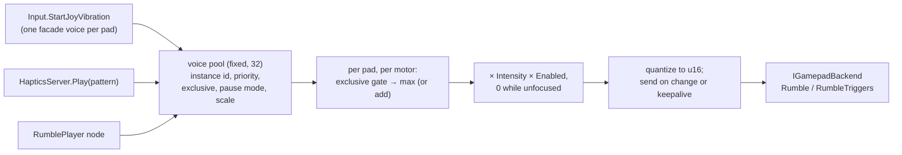

# Proposal: Gamepad haptics and input glyphs

**Milestone:** [Gameplay toolkit](../../milestones.md#gameplay-toolkit-) (G12) · **Status:** ⬜ planned ·
**Depends on:** [M10 projects](../project-and-gamehost.md) (`InputMap`, `project.mfproj`), [M8 game UI](../game-ui.md)
(RmlUi documents, data models), [M9 localization](../localization.md), [G4 rebinding](save-and-settings.md#key-rebinding)
(`InputDeviceClass`, binding slots, `DisplayName()`, `UserSettings`) ·
**Related:** [M12 mobile](mobile.md) (`IHaptics`, `HapticEffect`, sensors, `LastDeviceKind`),
[Consoles](consoles.md) (`IGlyphProvider`, glyph element, SDL3), [Steamworks](../steamworks.md),
G11 World-space UI, G14 Accessibility

## Problem

Gamepads drive actions, but the engine cannot talk back to them or show the player which button to press.

- **No rumble API.** `InputRouter` subscribes to buttons, sticks and triggers only
  (`MainframeEngine/Src/Scene/Input/InputRouter.cs:63-68`). The static `Input` has no vibration, no pad list and no
  device info; its only gamepad query is `GetJoyAxis` (`MainframeEngine/Src/Scene/Input/InputState.cs:436-497`).
  Silk.NET exposes `IGamepad.VibrationMotors`, but the decompiled `SdlGamepad.Update` of Silk.NET.Input.Sdl 2.23.0
  (pinned, `Directory.Packages.props:9`) sends `GameControllerRumble(c, (ushort)(65535f / speed), …, 65535)`. It
  divides where it should multiply, so 0 and 0.5 both overflow, and every change runs for 65 s.
- **No controller identity.** Pads are bare indices (`InputEventGamepadButton.Device = gamepad.Index`,
  `InputRouter.cs:168-174`; at most `InputState.MaxGamepads = 8`, `InputState.cs:39-40`). Silk reassigns those
  indices whenever a pad connects or disconnects (`SdlInputContext.RefreshJoysticksAndGamepads` sets `ActualIndex`),
  so "pad 1" can become another controller. There is no type, no capability query, and no connection signal for game
  code: the router handles `ConnectionChanged` internally (`InputRouter.cs:35-44`).
- **No "last used device".** Mobile's virtual controls already plan to hide on `Input.LastDeviceKind`
  (`mobile.md:466-467`), and the console plan wants `Input.DeviceDisconnected` (`consoles.md:245`).
- **Bindings have no glyphs.** A binding's only text is its enum name (`pad:A`, `axis:RightTrigger+`;
  `InputMap.cs:28-33`, `78-89`). G4 plans Xbox-layout text labels (`DisplayName()`, `save-and-settings.md:499`,
  `567-568`) and leaves glyph images as its open question 4 (`save-and-settings.md:819`). The console plan names an
  `IGlyphProvider` and a `<glyph action="jump"/>` element and defers both (`consoles.md:144`, `241-242`).
- **Key names ignore the keyboard layout.** Silk's SDL keyboard maps **scancodes** to `Key`, so `key:W` is a physical
  position: the key labelled Z on AZERTY. `InputEventKey` carries `Scancode` (`InputEvent.cs:57-66`), but nothing turns
  a position into the printed label. SDL can (`SDL_GetKeyFromScancode`, `SDL_GetKeyName`, `SDL_KEYMAPCHANGED`).
- **No image inside text.** The `mfrmlui` C ABI has no custom element instancer (`Native/RmlUi/include/mfrmlui.h`), so
  `<glyph>` is an unknown element today. The localization contract splits inline markup into separate messages and
  encodes translations as plain text (`docs/design/localization.md:239-242`), so "Press ⓐ to jump" cannot keep its
  glyph through translation. Canvas text is one font run (`CanvasItem.DrawString`,
  `MainframeEngine/Src/Scene/Canvas/CanvasItem.cs:369`; `Label2D`, `Scene/Nodes2D/Label2D.cs:12`).
- **The SDL pieces are within reach.** The engine runs Silk's SDL backend (`MainframeEngine/Src/Core/Engine.cs:319-323`)
  and already calls SDL through `Silk.NET.SDL`: `SdlWindowing.GetExistingApi` (`Src/UI/UiSystemInterface.cs:88`)
  and an `SDL_AddEventWatch` for IME events Silk does not surface (`UiImeWatch`, `UiSystemInterface.cs:124-145`). The
  bundled natives are SDL 2.32.10 (`Ultz.Native.SDL`), and Silk.NET.SDL 2.23 binds `GameControllerRumble`,
  `RumbleTriggers`, `HasRumble`, `GetType`, `GetVendor`/`GetProduct`, `SetLED`, `SetPlayerIndex`, sensors,
  `GetSteamHandle` and virtual joysticks with rumble callbacks.
- **A likely crash to confirm.** Silk's `SdlGamepad` indexes a 15-entry button table with the raw SDL button.
  `SDL_CONTROLLER_BUTTON_MISC1` (15: Xbox Series Share, Switch Capture), the paddles (16-19) and the touchpad click (20)
  would throw `IndexOutOfRangeException` in Silk's event pump. G12.1 reproduces this on hardware first.

## Goals

- **Rumble that composes:** voices with priorities, per-motor mixing, trigger motors where present, a global player
  intensity, a pause policy, and a guaranteed stop on focus loss, disconnect and exit. No allocation per frame.
- **Godot-compatible entry points:** `Input.StartJoyVibration`, `StopJoyVibration`, `GetJoyVibrationStrength`.
- **Authored patterns:** a `RumblePattern` resource (`.mres`) and a `RumblePlayer` node, previewed on a real pad.
- **Controller identity:** `GamepadInfo` (stable instance id, `GamepadType`, `GamepadFamily`, capabilities), connection
  signals, Steam Input-aware type detection, and last-used device tracking with an `InputDeviceChanged` signal.
- **Glyphs everywhere:** `Input.GetActionGlyph("jump")` with bundled CC0 atlases and layout-aware key labels; a
  `<glyph>` element, translatable `<prompt>` sentences and a `glyphs` data model in RmlUi; inline tokens in canvas text.
- **Optional extras where the hardware has them:** light-bar colour, player LEDs and gyro/accelerometer reads.

## Non-goals

- **Rebinding, conflicts and the settings menu** are [G4](save-and-settings.md#key-rebinding). G12 adds two settings and
  replaces G4's text labels with glyphs in its Controls tab.
- **Phone vibration** (`Haptics.Play(HapticEffect…)`, Core Haptics, `VibratorManager`) is [M12.4](mobile.md)
  (`mobile.md:477-486`). G12 builds the server it plugs into.
- **DualSense HD haptics and adaptive triggers** need raw `SDL_GameControllerSendEffect` reports
  ([Open question 5](#open-questions)).
- **Stable player slots and pairing** are the console `IUserPlatform` seam. G12 keeps today's indices and adds an
  instance id.
- **Gyro aiming** is a G14 input assist; G12 only exposes raw reads. **Steam Input action sets** are not used: the
  engine keeps its own `InputMap` and uses Steam only to identify controllers and, optionally, for glyphs.

## Design

### Code layout

| Type (all new unless noted) | Where | Role |
|---|---|---|
| `IGamepadBackend`, `SdlGamepadBackend`, `NullGamepadBackend` | `Src/Scene/Input/Gamepads/` | The only SDL calls for pads: describe, rumble, LED, sensors |
| `GamepadInfo`, `GamepadType`, `GamepadFamily`, `GamepadCaps` | `Src/Scene/Input/Gamepads/` | Identity and capabilities |
| `InputState` / `Input` additions (changed) | `Src/Scene/Input/InputState.cs` | Pads, events, last device, LEDs, sensors, Godot rumble facade |
| `HapticsServer : IFrameServer`, `RumbleHandle`, `RumbleOptions` | `Src/Haptics/` | Voices, mixing, intensity, pause, keepalive |
| `RumblePattern : Resource`, `RumblePlayer : Node` | `Src/Haptics/` | Authored patterns and their player node |
| `IGlyphProvider`, `BundledGlyphProvider`, `GlyphAtlas`, `InputGlyph` | `Src/Scene/Input/Glyphs/` | Binding → glyph |
| `KeyboardLayout` | `Src/Scene/Input/Glyphs/` | `Key` → layout label through SDL |
| `UiGlyphBinder` | `Src/UI/` | `<glyph>`, `<prompt>`, the `glyphs` data model |
| `GlyphText` | `Src/Scene/Canvas/` | Canvas text with glyph tokens |
| `SteamGamepadTypes` | `Src/Steamworks/` | Steam Input handle → real type, Steam Deck detection |
| `Assets/Input/Glyphs/` | engine content | Atlases per family, `glyphs.json`, `glyphs.rcss` |

`IGamepadBackend` lets unit tests use a fake, `HeadlessHost` use the null backend, and the SDL3 migration planned in
[Consoles](consoles.md) replace one class. `SdlGamepadBackend` reaches a pad's `GameController*` without reflection:
`GameControllerFromInstanceID(JoystickGetDeviceInstanceID(gamepad.Index))`.

### Controller identity and connection

```csharp
public enum GamepadType : byte
{
    Unknown, Xbox360, XboxOne, PS3, PS4, PS5, SwitchPro, JoyConLeft, JoyConRight, JoyConPair,
    SteamDeck, SteamController, Stadia, Luna, Shield, Virtual,
}
public enum GamepadFamily : byte { Generic, Xbox, PlayStation, Nintendo, SteamDeck }   // picks a glyph atlas
[Flags] public enum GamepadCaps : ushort
{ Rumble = 1, TriggerRumble = 2, Led = 4, PlayerLeds = 8, Gyro = 16, Accelerometer = 32, Touchpad = 64 }

public readonly record struct GamepadInfo(
    int Index,            // the index InputEvent*.Device and pad<N>: bindings use (shifts on reconnects)
    int InstanceId,       // SDL joystick instance id: stable while connected
    string Name,          // read once at connect
    GamepadType Type, GamepadFamily Family, GamepadCaps Caps,
    ushort VendorId, ushort ProductId,
    bool ViaSteamInput);  // a Steam virtual pad whose Type came from Steam

public sealed partial class InputState   // additions
{
    public int GetConnectedGamepads(Span<GamepadInfo> results);    // no allocation
    public bool TryGetGamepad(int device, out GamepadInfo info);
    public int FindGamepad(int instanceId);                          // current index, or -1
    [Signal] public event Action<GamepadInfo, bool>? GamepadConnectionChanged;   // Godot's joy_connection_changed
}
```

- **Type detection:** the Steam type for Steam virtual pads ([Steam](#steam-input-and-steam-deck)), then
  `SDL_GameControllerGetType`, then an engine VID/PID table for `Unknown`/`Virtual` (Valve `0x28DE`/`0x1205` is the
  Deck's built-in pad), else `Generic`. `Family` follows from the type.
- `InputRouter.Attach`/`Detach` already see every connection change (`InputRouter.cs:38-44`); they describe the pad
  through the backend, store it in `InputState` and raise `GamepadConnectionChanged`.
- **Events live on `InputState`** (the tree's instance); static `Input` only forwards `+=`/`-=`. No engine static holds
  game delegates past a collectible-assembly unload (CLAUDE.md: code reload). Nodes unsubscribe in `OnExitTree`.
- **Button guard.** If G12.1 confirms the crash, `SdlEventBatch`, which already walks every SDL event before Silk does
  (ADR 0139), drops controller button events with `button >= 15`. Binding them is [Open question 3](#open-questions).

### Last-used device

```csharp
public sealed partial class InputState   // additions (InputDeviceClass is G4's enum; M12 adds Touch)
{
    public InputDeviceClass LastDeviceClass { get; }                  // KeyboardMouse until the first input
    public int LastGamepad { get; }                                    // -1 if none
    public float DeviceSwitchStickThreshold { get; set; } = 0.35f;   // axes below this never switch
    public float DeviceSwitchMouseDistance { get; set; } = 6f;       // points of motion per frame
    [Signal] public event Action<InputDeviceClass, int>? InputDeviceChanged;
}
```

`ProcessEvent` sees every event first (`InputState.cs:213-255`). Keys, mouse buttons, the wheel and pad buttons switch
immediately; axes only past the threshold (stick drift never flips it); mouse motion only past the distance. Text events
and `ActionPress` never switch. The signal fires at most once per frame and allocates nothing. Mobile's
`Input.LastDeviceKind` (`mobile.md:467`) becomes `Input.LastDeviceClass`.

### Rumble: `HapticsServer`



```csharp
public readonly record struct RumbleHandle(int Slot, int Generation);   // stale handles are ignored
public static class RumbleTarget { public const int All = -1, LastUsed = -2; }
public enum RumbleMix : byte { Max, Add }

public record struct RumbleOptions()
{
    public sbyte Priority { get; init; }
    public bool Exclusive { get; init; }                                  // mutes lower priorities on its pads
    public RumbleMix Mix { get; init; } = RumbleMix.Max;
    public ProcessMode PauseMode { get; init; } = ProcessMode.Pausable;   // Always: menu ticks keep playing
    public float Scale { get; init; } = 1f;
}

public sealed class HapticsServer : IFrameServer
{
    public const int MaxVoices = 32;
    public bool Enabled { get; set; } = true;          // player setting (G4 UserSettings)
    public float Intensity { get; set; } = 1f;         // 0..1, player setting
    public bool MuteWhenUnfocused { get; set; } = true;
    public RumbleHandle Start(int device, float low, float high, float duration, in RumbleOptions options = default);
    public RumbleHandle StartTriggers(int device, float left, float right, float duration,
        in RumbleOptions options = default);
    public RumbleHandle Play(RumblePattern pattern, int device = RumbleTarget.LastUsed, in RumbleOptions options = default);
    public void SetScale(RumbleHandle handle, float scale);   // e.g. a looping engine rumble driven by RPM
    public void Stop(RumbleHandle handle);
    public void StopAll(int device = RumbleTarget.All);
    public bool IsPlaying(RumbleHandle handle);
    public Vector4 GetOutput(int device);                      // last mixed (low, high, leftTrigger, rightTrigger)
}

public static partial class Input   // Godot's names and semantics
{
    public static void StartJoyVibration(int device, float weak, float strong, float duration = 0f); // 0 = until stopped
    public static void StopJoyVibration(int device);
    public static Vector2 GetJoyVibrationStrength(int device);
}
```

- **Channels.** `low` is SDL's low-frequency (strong) motor, `high` the high-frequency (weak) one; Godot's
  `weak`/`strong` map to `high`/`low`. Trigger motors need `GamepadCaps.TriggerRumble` and are dropped otherwise.
- **Targets.** An index resolves to an instance id when the voice starts, so a reconnect that shifts indices keeps the
  same physical pad; a disconnect ends that pad's voices. `All` also covers pads connected later.
- **Mixing.** Per pad and motor: an `Exclusive` voice mutes lower priorities; the rest combine by `Max` (default;
  summed rumble saturates into mush) or clamped `Add`; then × `Intensity` × `Enabled`, and 0 while unfocused (Silk
  `IWindow.FocusChanged`).
- **Pause.** `Pausable` voices freeze and output 0 while `SceneTree.Paused` (`SceneTree.cs:75`) and resume after;
  `Always` voices keep playing. A new `StartJoyVibration` on a pad replaces its facade voice, as in Godot.
- **Sending.** Quantized to `ushort`, sent only on a change above 1/256 or as a 100 ms keepalive while non-zero, with
  a 250 ms SDL duration. If the frame loop stalls, SDL's expiry ends the rumble instead of holding the last value.
  Silence sends one 0; dispose, quit and disconnect send 0 to every pad.
- **Cost.** Fixed arrays, struct handles: `Process` and the API allocate nothing; at most one send per pad per frame;
  main thread only. `Engine.OnLoad` registers it with the other servers (`Engine.cs:391-413`); `HeadlessHost` registers
  it with `NullGamepadBackend`, so server code that calls rumble is a no-op.

### `RumblePattern` and `RumblePlayer`

```csharp
public enum RumbleInterpolation : byte { Linear, Step }

public sealed class RumblePattern : Resource      // .mres; parallel arrays like Gradient (Gradient.cs:19-22)
{
    [Export] public float[] Times { get; set; } = [0f, 0.15f];                           // seconds, ascending
    [Export] public Vector4[] Values { get; set; } = [new(1, 1, 0, 0), Vector4.Zero];    // low, high, LT, RT
    [Export] public RumbleInterpolation Interpolation { get; set; }
    [Export] public bool Loop { get; set; }
    [Export] public float Strength { get; set; } = 1f;
    public float Duration => Times.Length > 0 ? Times[^1] : 0f;
    public Vector4 Sample(float time);                                                    // no allocation
    public static RumblePattern Pulse(float low, float high, float seconds);
}

[EditorIcon("device-gamepad-2", Family = EditorIconFamily.Logic)]
public class RumblePlayer : Node
{
    [Export] public RumblePattern? Pattern { get; set; }
    [Export] public int Device { get; set; } = RumbleTarget.LastUsed;
    [Export] public sbyte Priority { get; set; }
    [Export] public bool Exclusive { get; set; }
    [Export] public bool Autoplay { get; set; }
    public bool Playing { get; }
    public void Play();
    public void Stop();                             // also on exit tree
    [Signal] public event Action? Finished;
}
```

`RumblePlayer` takes its pause mode from the node's `ProcessMode`, like `AudioPlayer`; its constructor does nothing.
The `RumblePattern` inspector draws the four channels as a read-only plot and has Play/Stop icon buttons with tooltips
("Preview on the first connected gamepad"); the editor process runs SDL, so no game is needed. A curve editor waits for
G1's animation editing, whose curve resource could later replace the parallel arrays.

### Light bar, player LEDs and sensors

```csharp
public static partial class Input
{
    public static bool SetJoyLight(int device, Color color);            // PS4/PS5 light bar; false without Led
    public static bool SetJoyPlayerIndex(int device, int player);       // Xbox ring / Switch / PS5 player LEDs
    public static bool SetJoySensorsEnabled(int device, bool enabled);  // off by default (battery)
    public static Vector3 GetJoyGyro(int device);                       // rad/s, controller space
    public static Vector3 GetJoyAccelerometer(int device);              // m/s², includes gravity
}
```

Enabled pads' sensors are polled once per frame (`SDL_GameControllerGetSensorData`) into fixed arrays; there are no
per-sample events. They are separate from M12's phone sensors. Light colours go to SDL as authored sRGB.

### Glyphs

```csharp
public enum GlyphStyle : byte { Auto, Xbox, PlayStation, Nintendo, SteamDeck, Generic }   // player override
public enum InputGlyphKind : byte { None, Sprite, Keycap }

public readonly record struct InputGlyph(
    InputGlyphKind Kind, InputBinding Binding,
    GlyphAtlas? Atlas, int Sprite,   // canvas: texture + rect index
    string SpriteName,               // RmlUi sprite id, e.g. "mf-ps-cross" (interned at load)
    string Label);                   // localized text and alt text: "Cross", "Z", "Left Shift", "LS ←"

public interface IGlyphProvider     // consoles.md:144; console heads replace it
{
    GamepadFamily ResolveFamily(in GamepadInfo pad);
    bool TryGetGlyph(InputBinding binding, GamepadFamily family, out InputGlyph glyph);
}

public static partial class Input
{
    public static GlyphStyle GlyphStyle { get; set; }          // Auto follows the last-used pad
    public static GamepadFamily ActiveGlyphFamily { get; }
    public static InputGlyph GetActionGlyph(string action, int slot = 0);   // last-used device class
    public static InputGlyph GetActionGlyph(string action, InputDeviceClass deviceClass, int slot = 0);
    public static InputGlyph GetBindingGlyph(InputBinding binding);
    public static InputGlyph GetVectorGlyph(string negX, string posX, string negY, string posY);  // stick/D-pad or None
    public static event Action? GlyphsChanged;   // device class, family, style, keymap, locale or map changed
}
```

- **Resolution.** `GetActionGlyph` takes the action's binding in the requested G4 slot for `LastDeviceClass`. For a
  pad binding the family is `GlyphStyle`, or with `Auto` the last pad's `Family`; the provider returns the sprite. Keys
  become keycaps, mouse buttons sprites. It uses `InputMap.IndexOf` and cached strings, so it allocates nothing.
- **Positions, not labels.** SDL2 swaps A/B and X/Y on Nintendo pads by default (`…_USE_BUTTON_LABELS` hint).
  The engine sets the hint to `0` before SDL opens a controller, so `pad:A` always means the bottom face button, as in
  Godot and SDL3. The glyph table maps position to label per family: bottom is A, Cross or B. The UI's A → Return,
  B → Escape mapping (`UiInputMap.cs:28-36`) then means bottom/right everywhere ([Open question 2](#open-questions)).
- **Keys.** `KeyboardLayout` maps a Silk `Key` back to its scancode (the inverse of Silk's table) and calls
  `SDL_GetKeyFromScancode`: printable keys show the layout's character (AZERTY `key:W` → "Z"); named keys use G4's
  display-name table through `Tr.P("input", …)`. The cache rebuilds on `SDL_KEYMAPCHANGED` (an event watch like
  `UiImeWatch`) and on locale change. Keycaps are a nine-patch frame plus the label in the UI or canvas font, so any
  script works and no text is baked into images.
- **Axes and gaps.** `axis:LeftX-` shows the left stick with an arrow; `axis:RightTrigger+` shows RT, R2 or ZR.
  `GetVectorGlyph` returns the plain stick or D-pad when all four actions share one, else `None`. An unbound slot
  returns `None` with `Label = Tr.P("input", "Unbound")`; the UI hides it by default.

### Glyph assets

Atlases live in `MainframeEngine/Assets/Input/Glyphs/` and load through `ContentPaths.Resolve`: one PNG per family at
2× (64 px cells), `glyphs.json` (sprite rects, binding code → sprite), and a generated `glyphs.rcss` with RmlUi
`@spritesheet` blocks at `resolution: 2x` so `dp` sizing stays sharp. A small packer in `Tools/` (StbImageSharp is
already a dependency) builds them with `just glyphs`; outputs are committed like the `.spv` fallbacks, and the source
pack version is pinned in `glyphs.lock`. Games override any atlas with the same file name in their own `Assets/`.

| Source | Licence | Coverage | Trade-offs |
|---|---|---|---|
| **Kenney "Input Prompts"** | CC0 | Xbox, PlayStation, Switch, Steam Deck, keyboard/mouse, generic; PNG + SVG | One style, actively updated; we credit it anyway |
| Xelu's "Free Controllers & Keyboard Prompts" | CC0 (check the bundled text) | Xbox, PS, Switch, Steam Deck, keyboard | Widely used; different rendered style, rarer updates |
| Our own vector set | ours | what we draw | Matches the editor icons; weeks of art work |
| Steam runtime glyphs (`GetGlyphPNGForActionOrigin`) | Valve, runtime only | every controller Steam knows | Only while Steam runs: an optional provider |

The recommendation is Kenney, credited in `THIRD_PARTY_NOTICES.md`, under 1 MB for all families. CC0 waives copyright,
not trademarks (the PlayStation shapes, console names); console builds must use the platform's own glyphs through their
`IGlyphProvider`. Shipping PlayStation and Nintendo art on desktop is [Open question 1](#open-questions).

### RmlUi: `<glyph>`, `<prompt>` and the `glyphs` model

```html
<link type="text/rcss" href="/Assets/Input/Glyphs/glyphs.rcss"/>
<p><glyph action="jump"/> Jump  <glyph action="interact" device="keyboard"/></p>
<prompt>Press [[jump]] to jump</prompt>
 <span>{{ glyphs.pause_label }}</span>
```

- **`<glyph action [device="auto|gamepad|keyboard"] [slot]>`.** RmlUi makes unknown tags plain elements, so no native
  change is needed. `UiGlyphBinder` runs on `UiDocument.Loaded`/`Reloaded` (`UiDocument.cs:87-91`), finds glyphs with
  `QuerySelectorAll` (allocating only at load), and fills each with `` or
  `<span class="mf-keycap">Z</span>`, a `title` with the label, and state classes (`mf-glyph--none`). On
  `GlyphsChanged` it re-fills the cached elements in the next `UiServer.Process`.
- **`<prompt>`** keeps a sentence one message (`Press [[jump]] to jump`), so translators can move the token and
  `mf-l10n` extracts it unchanged. After RmlUi translates the text, the binder replaces the content with text spans and
  `<glyph>` elements; the spans carry `RmlLocalization.OptOutMarker` (`RmlLocalization.cs:70`) so they are not looked up
  again. A locale change reloads documents (`UiServer.cs:648`) and the binder runs again.
- **The `glyphs` model.** Each `UiLayer` exposes `<action>` (sprite id) and `<action>_label` for every action, rebuilt
  when `InputMap.Version` changes and dirtied on `GlyphsChanged`, so `data-for` content never needs a rescan.
- `widgets.rcss` gets `glyph`, `.mf-keycap` and `prompt` styles (inline-block, `1.4em`, middle-aligned). A native
  instancer in `mfrmlui` is [Open question 4](#open-questions).

### Canvas text

```csharp
public static class GlyphText   // Src/Scene/Canvas/
{
    public static void Parse(string text, GlyphRunList runs);   // "[[action]]" tokens; re-parse on text change only
    public static Vector2 Measure(Font font, GlyphRunList runs, int fontSize);
}
public partial class CanvasItem
{
    public void DrawStringWithGlyphs(Font font, Vector2 position, GlyphRunList runs, int fontSize = 16,
        Vector4? modulate = null);
}
public partial class Label2D { [Export] public bool ResolveGlyphs { get; set; } }   // off: "[[" stays literal
```

Text runs use `DrawString`, sprites `DrawTextureRectRegion` (`CanvasItem.cs:358`), keycaps a nine-patch plus
`DrawString`. Glyphs are sized to ascent plus descent and centred on the line. `Label2D` re-parses on `Text` or locale
change and redraws on `GlyphsChanged`; a steady frame allocates nothing. G11's `Label3D` reuses `GlyphText`.

### Steam Input and Steam Deck

- **Virtual pads.** When a Steam-launched game has Steam Input on for a controller (the default for PlayStation, Switch
  and generic pads), SDL sees an Xbox 360-style "Steam Virtual Gamepad": rumble still works (Steam forwards it), but
  the type is wrong for glyphs. `SDL_GameControllerGetSteamHandle` gives the Steam handle, and with `SteamServer`
  running `SteamGamepadTypes` maps `SteamInput.GetInputTypeForHandle` (Facepunch.Steamworks 2.4.1,
  through the `MainframeEngine.Steamworks` shim) to `GamepadType`. This needs `SteamInput.Init` ([Open question 6](#open-questions)).
- **Steam Deck.** Identified by Steam type or VID/PID. With `Auto` and no external pad,
  `SteamUtils.IsSteamRunningOnSteamDeck()` makes the Deck family the default before the first input.
- **Steam glyphs.** An optional `SteamGlyphProvider` (`project.mfproj` `input.glyphs.steam: true`) loads Steam's PNG
  for `GetActionOriginFromXboxOrigin(handle, origin)` once per origin and falls back to the bundled atlas.

### Settings, project and editor

- **G4 `UserSettings`** gains a `controller` section beside G4's `input` bindings: `{ "rumble": 0.8, "rumbleEnabled":
  true, "glyphStyle": "auto" }`, applied to `HapticsServer` and `Input.GlyphStyle`. G4's Controls tab shows glyphs, a
  rumble slider with a test-pulse icon button, and a glyph-style dropdown.
- **`project.mfproj`** gains an additive `input.glyphs` object: `style`, `steam`, and a `families` allow-list.
- **The editor's input-map page** shows each binding's glyph, with a glyph-style preview dropdown (with a tooltip) so
  designers can check every family without owning the controllers.
- **The dev overlay** gets an **Input** panel (`DevOverlay.AddPanel`): pads with type, family, caps and Steam flag, the
  last-used device, live rumble bars per motor, and a glyph strip for every action.

### Mobile and consoles

- **M12** adds an `IHaptics` handheld backend (`mobile.md:134`) and `Haptics.Play(HapticEffect…)` to `HapticsServer`.
  G12 says `RumblePattern` so it does not take M12's `HapticEffect`; `Haptics.Enabled` (`mobile.md:484`) is
  `HapticsServer.Enabled`; touch adds `InputDeviceClass.Touch`.
- **Consoles** register their own `IGlyphProvider` (`consoles.md:144`); `<glyph>` documents need no change.
  `GamepadConnectionChanged` is `consoles.md:245`'s `Input.DeviceDisconnected`; the SDL3 migration rewrites
  `IGamepadBackend` only.

## Testing

- **Unit (`Tests/MainframeEngine.Tests/Input/`, with a recording `FakeGamepadBackend`):**
  - `HapticsServerTests`: `Max`/`Add` mixing, exclusive gating, intensity and `Enabled`, quantization dedupe,
    keepalive and duration, a single zero on silence, pause freeze vs `Always`, focus mute, disconnect, index shift,
    `LastUsed`/`All` targets, stale handles, dropped trigger channels, zeros on dispose.
  - `JoyVibrationFacadeTests` (Godot semantics), `RumblePatternTests` (sampling, loop, `Strength`, `.mres` round
    trip), `RumblePlayerTests` (autoplay, `Finished` once, stop on exit tree, `ProcessMode`).
  - `GamepadIdentityTests` (type → family tables, VID/PID fallback, Steam override, event order, `FindGamepad`) and
    `LastDeviceTests` (drift and jitter never switch, one event per change).
  - `GlyphResolutionTests` (position → label per family, `GlyphStyle`, slots and `None`, axis and vector glyphs, a fake
    AZERTY layout, `qps` key names, `GlyphsChanged` triggers) and `GlyphTextTests` (tokens, unterminated `[[`, measure).
  - **Allocation gate:** 4 voices on 2 fake pads, a device switch every 30 frames, a glyph `Label2D` and
    `GetActionGlyph` calls each frame.
- **SDL integration** (`SdlGamepadBackendTests`, joystick subsystem only, no window): an `SDL_JoystickAttachVirtualEx`
  pad with Rumble, RumbleTriggers and SetLED callbacks receives correctly scaled values through the real backend, and
  the `button >= 15` guard drops events. SDL reports these pads as `VIRTUAL`, so type tables stay in unit tests. Runs
  on the three CI OSes and in `just test-linux`.
- **UI (`SerialRmlUi`):** `<glyph>` fill and re-fill, `title` alt text, `<prompt>` in `es` and `qps` (marker present,
  no second lookup), the `glyphs` model in `data-for`, reload on locale change, `mf-l10n extract` keeps one msgid.
- **Render tests** (both drivers, `just golden-update`, PNGs inspected): `ui-input-glyphs` (the same prompts under each
  forced `GlyphStyle` plus a keycap row) and `canvas-glyph-label` (tokens with outline and shadow).
- **Demo:** an `input` scene (next free nav key, [Tile maps](../tile-maps.md#demo-scene) scheme): pad list, rumble
  buttons (pulse, an RPM-driven loop, an exclusive explosion over it), light-bar picker, gyro readouts, switching HUD
  prompts. `just demo-screenshots` adds `input.png`.
- **Manual QA matrix** (`Tests/QA/gamepads.md`): Xbox Series (USB and Bluetooth), DualSense, DualShock 4, Switch Pro,
  Steam Deck (Steam Input on and off), a generic XInput pad; on macOS, Windows and Linux: type, glyphs, rumble feel,
  LED, gyro, unplug and alt-tab while rumbling.

## Acceptance

- Two sources rumble one pad without fighting; an exclusive voice silences lower priorities until it ends. Pausing stops
  gameplay rumble but not menu ticks. Unfocusing, unplugging or quitting never leaves a pad rumbling.
  `Input.StartJoyVibration` behaves like Godot's.
- A designer authors a `RumblePattern`, previews it on a real pad from the inspector, and plays it with `RumblePlayer`.
- Xbox, PlayStation, Switch and Steam Deck pads report the right `GamepadType`, including Steam virtual pads when Steam
  runs. `GamepadConnectionChanged` and `InputDeviceChanged` fire once per change.
- `<glyph>`, `<prompt>`, the `glyphs` model and `Label2D` tokens show the last-used device's glyph within one frame of a
  switch; translated prompts keep the glyph where the translator put it; AZERTY shows "Z" for `key:W`.
- Allocation gate and render tests green; `just build`, `just test`, `just format-check` pass; the pack is credited.
- Docs updated when this ships: `cameras-and-input.md`, `game-ui.md`, `canvas.md`, `localization.md`, `steamworks.md`,
  `dev-overlay.md`, `project-and-gamehost.md`, `demo.md`; `future/mobile.md` (`LastDeviceClass`, `IHaptics` on
  `HapticsServer`), `future/consoles.md` (`IGlyphProvider`, `IGamepadBackend`), `future/save-and-settings.md` (open
  question 4 answered); and `CLAUDE.md`'s project structure (`Src/Haptics/`, `Assets/Input/Glyphs/`).

## Task list

G12.1–G12.3 do not need G4. G12.4 onwards use G4.4's `InputDeviceClass` and slots; if G12.4 lands first, it adds
`InputDeviceClass` and a first-binding-of-class helper that G4.4 builds on.

1. **G12.1 Gamepad backend and identity.** Reproduce the Silk button crash and add the `SdlEventBatch` guard if
   confirmed; `IGamepadBackend` (SDL, null, fake); `GamepadInfo`, types, families, caps, VID/PID table; `InputState`
   pad list and `GamepadConnectionChanged`; the positional button-label hint. Unit and SDL virtual-joystick tests.
2. **G12.2 HapticsServer.** Voices, mixing, priorities, intensity, pause, focus, keepalive, disconnects, the
   `Input.*JoyVibration` facade, registration in `Engine` and `HeadlessHost`; tests and allocation gate.
3. **G12.3 Patterns and extras.** `RumblePattern`, `RumblePlayer` (+ icon), inspector plot and preview button,
   `SetJoyLight`/`SetJoyPlayerIndex`, sensors; tests.
4. **G12.4 Last device and glyph core.** `LastDeviceClass`/`InputDeviceChanged`, `IGlyphProvider`,
   `BundledGlyphProvider`, `InputGlyph`, `GlyphStyle`, `KeyboardLayout` (+ keymap watch), the `Input` glyph API; tests.
5. **G12.5 Glyph assets.** Pack decision, packer and `just glyphs`, atlases, `glyphs.json`/`.rcss`/`.lock`, notices.
6. **G12.6 RmlUi integration.** `UiGlyphBinder` (`<glyph>`, `<prompt>`), the `glyphs` model, widget styles, `mf-l10n`
   `<prompt>` extraction; UI tests and the `ui-input-glyphs` golden.
7. **G12.7 Canvas text.** `GlyphText`, `DrawStringWithGlyphs`, `Label2D.ResolveGlyphs`; tests, `canvas-glyph-label`
   golden, allocation gate.
8. **G12.8 Steam.** `SteamGamepadTypes`, Deck detection, optional `SteamGlyphProvider`; fake-Steam tests, Deck QA.
9. **G12.9 Settings, editor, Demo.** G4 `controller` settings and Controls-tab glyphs (after G4.5), `input.glyphs`
   project keys, input-map glyph preview, dev overlay Input panel, Demo `input` scene and screenshot, QA matrix, docs.

## Open questions

1. **Glyph pack and trademarks.** Kenney (recommended), Xelu, our own art, or Steam-only? Is shipping PlayStation and
   Nintendo art on desktop acceptable, given CC0 does not cover marks? Fallback: ship Xbox, Steam Deck, generic and
   keyboard, and leave the other families to games.
2. **Nintendo confirm.** With positional bindings the UI confirms on the bottom button everywhere. Should `UiServer`
   swap confirm/back for `GamepadFamily.Nintendo`, as Nintendo players expect, at the cost of differing from gameplay?
3. **Extra buttons.** Should Misc1 (Share/Capture), the paddles and the touchpad click be bindable? Silk's `ButtonName`
   has no values for them: add engine-side codes (`pad:Misc1`) or wait for SDL3?
4. **Native `<glyph>` element.** Is the managed binder's load-time pass enough, or should `mfrmlui` gain an element
   instancer callback (an ABI minor bump and a natives rebuild for every RID)?
5. **DualSense effects.** Trigger resistance and HD haptics through raw `SDL_GameControllerSendEffect` reports: a later
   G12.10, or wait for SDL3's richer haptics?
6. **`SteamInput.Init`.** Does initializing Steam Input only to read controller types change how Steam treats the
   game's input? A spike with a test app id decides whether `SteamGamepadTypes` is on by default.
7. **Rumble from editor play sessions.** Should a game played from the editor forward its rumble output to an editor
   panel over the editor link, for designers without a pad, or is the in-game dev overlay enough?

## Related

- [Cameras and input](../cameras-and-input.md): `InputRouter`, `InputState`, `InputMap`, the static `Input`
- [Save games and settings](save-and-settings.md) (G4): rebinding, `InputDeviceClass`, `DisplayName()`, `UserSettings`
- [Game UI](../game-ui.md), [Localization](../localization.md), [Canvas](../canvas.md), [Steamworks](../steamworks.md)
- [Mobile](mobile.md) (M12): `IHaptics`, `HapticEffect`, sensors, virtual controls
- [Consoles](consoles.md): `IGlyphProvider`, controller-first UI, SDL3
- [Dev overlay](../dev-overlay.md), [Demo](../demo.md), [Testing](../testing.md)
