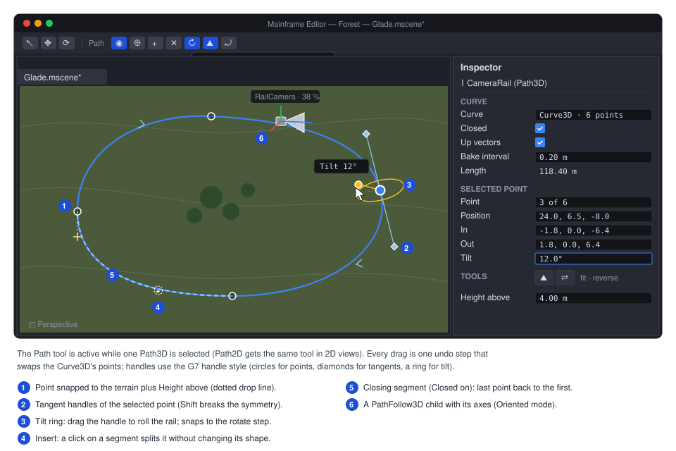

# Proposal: Paths (`Path3D`/`PathFollow3D`, `Path2D`/`PathFollow2D`)

**Milestone:** [Gameplay toolkit](../../milestones.md#gameplay-toolkit-) (G13) · **Status:** ⬜ planned ·
**Depends on:** [Water](water.md) (G8c.2: `Curve3D`, shipped), [M6 physics](../physics.md) (kinematic bodies,
`CharacterBody*`), [M10 editor](../editor.md), [Terrain](terrain.md) (G8a.2: `IEditorViewportTool`) ·
**Related:** [Editor viewport tools](../editor.md#viewport-tools) (G7.3 handles),
[Keyframe animation](keyframe-animation.md) (G1a: value tracks on `Progress`), [Navigation](navigation.md) (G3: patrol
routes), [Forest showcase](forest-showcase.md) (G8d: camera rails), [Networking](../networking.md)

## Problem

The engine can describe a 3D curve but has nothing that follows one. Every moving-along-a-line feature (camera rails,
patrols, platforms, conveyor props, projectiles on arcs) is hand-written today:

- **`Curve3D` exists and is river-shaped.** `MainframeEngine/Src/Resources/Curve3D.cs:23` is a Bézier resource with
  Godot's API subset plus per-point width and depth (12 floats per point, `:26`), a lazy, deterministic bake to equal
  arc length (`Bake`, `:289-351`), O(1) offset lookup (`Locate`, `:401-408`), `SampleBaked` with optional Catmull-Rom
  (`:211-226`), `SampleBakedWithRotation` (`:233-254`) and closest-point queries (`:266-277`). Its users are all water:
  `River3D.Curve` (`MainframeEngine/Src/Scene/Nodes3D/Water/River3D.cs:51-66`), `RiverBuilder.Build`
  (`RiverBuilder.cs:150`, sampling at `:240-251`), the Forest's stream
  (`Examples/Forest/Forest/Src/World/ValleyGenerator.cs:356-380`) and its stream audio.
- **No path nodes and no 2D curve.** A search of `MainframeEngine/`, `MainframeEngine.Editor/` and `Examples/` for
  `Path3D`, `PathFollow`, `Path2D` and `Curve2D` finds only proposal text. 2D code has `CanvasItem.DrawPolyline`
  (`MainframeEngine/Src/Scene/Canvas/CanvasItem.cs:300`) and nothing to sample.
- **Games re-implement rails.** The Forest has two: `ForestCameras` builds its own closed Catmull-Rom loop and a
  32-samples-per-segment arc-length table to fly at constant speed
  (`Examples/Forest/Forest/Src/Menu/ForestCameras.cs:26-33`, `:220-275`), and `ForestBenchmark` samples a second
  Catmull-Rom by parameter, so its speed varies with point spacing
  (`Examples/Forest/Forest/Src/Dev/ForestBenchmark.cs:21`, `:90-91`, `:286-296`). Neither can be edited in the editor.
- **Rotation along the curve is not good enough for a rail.** `SampleBakedWithRotation` takes the direction of the
  baked segment (`Curve3D.cs:238-242`), so the rotation steps every `BakeInterval`, which shows on a camera. It builds
  the basis from world up (`Transform3D.BasisLookingAlong`, `MainframeEngine/Src/Scene/Transform3D.cs:164-179`), so on
  a vertical segment it falls back to an arbitrary axis and a loop-the-loop flips. Up vectors were deferred until a
  road or path node needs them ([water decision 8](water.md#decisions)).
- **No closed curves.** The bake walks `count − 1` segments (`Curve3D.cs:318`); a loop needs a duplicated end point,
  which leaves a tangent kink at the seam.
- **Closest-point queries scan every baked segment** (`ClosestOnBaked`, `Curve3D.cs:421-447`). `StreamAudio` calls
  `GetClosestOffset` every frame (`Examples/Forest/Forest/Src/Audio/StreamAudio.cs:114`); a 2 km rail at 0.2 m is
  10 000 segments per call.
- **Tweening progress boxes.** `Tween.TweenProperty` reaches properties by reflection and boxes every step
  (`MainframeEngine/Src/Scene/Tween.cs:103`, `:898`, `:960` returns `object`); `TweenMethod(Action<float>, …)`
  (`Tween.cs:127`) does not.
- **Moving platforms carry nothing.** Moving a kinematic body's node already reaches the new pose in one step with a
  velocity, so it pushes dynamic bodies (`MainframeEngine/Src/Physics/3D/PhysicsSpace3D.cs:551-555`, `:727-733`;
  Box2D `b2Body_SetTargetTransform`, `Physics/2D/PhysicsSpace2D.cs:782`). But that velocity only goes to Jitter's body;
  `BodyRecord3D.GetLinearVelocity` returns the separate `KinematicVelocity` (`PhysicsSpace3D.cs:44-49`), and
  `CharacterBody3D`/`2D` have no platform velocity at all (no platform members in `Physics/3D/CharacterBody3D.cs` or
  `Physics/2D/CharacterBody2D.cs`), so a player on a lift is left behind. There is no `AnimatableBody*`; the only
  code-moved body is `RigidBody*` with `Mode = Kinematic`.
- **No curve editing in the editor.** `MainframeEngine.Editor/Src/Viewport/` holds only `TransformGizmo(2D)`,
  `EditorCamera` and `ViewportController`. The river editor (`River3DTool`, [water.md](water.md#editor), G8c.4) and the
  viewport-tool API it builds on ([`IEditorViewportTool`](terrain.md#editor-ieditorviewporttool), G8a.2) are still
  proposals, as is G7.3's handle API
  ([Editor → Range handles](../editor.md#range-handles-and-the-handle-api)).
  Terrain snapping exists only in code: `River3D.FitToTerrain` (`River3D.cs:397-416`) over `Terrain3D.HeightAt`
  (`MainframeEngine/Src/Scene/Nodes3D/Terrain/Terrain3D.cs:928`); `Terrain3D.Raycast` (`:1014`) can hit-test a cursor.

## Goals

- `Path3D` and `PathFollow3D` with Godot's behaviour (progress in metres or as a ratio, loop, cubic interpolation,
  h/v offsets, rotation modes None/Y/XY/XYZ/Oriented with tilt), built on the existing `Curve3D`.
- `Curve3D` grows what paths need: `Closed`, baked tangents and rotation-minimising up vectors, smooth rotation
  between baked points, accelerated and hinted closest-point queries, smooth-point helpers. Existing bakes stay
  bit-identical.
- `Curve2D`, `Path2D` and `PathFollow2D` (pixels), sharing `Curve3D`'s baker rather than copying it.
- No allocation per frame: following, sampling, closest-point queries, tweens of progress and editor idle drawing.
- Moving platforms that carry characters: `AnimatableBody3D`/`2D` and `CharacterBody*` platform velocity.
- A curve editing tool for 3D and 2D views: add, insert, delete, tangents, tilt, close, snap to terrain, undo. It is
  shared with `River3DTool` so rivers and paths edit the same way.
- The Forest's two rails and the Demo use the new nodes.

## Non-goals

- Road or rail **mesh generation** along a path (Godot's `CSGPolygon3D` path mode). `River3D` is the one ribbon
  generator; a general `PathMesh3D` is a later proposal.
- 1D `Curve` (value over 0..1) for easing or particle size. G6.3 plans it.
- Spline types other than cubic Bézier (B-splines, NURBS). Catmull-Rom input is converted to Bézier on entry.
- Navigation on paths (A* along a road network). [G3](navigation.md)'s `AStar3D` covers waypoint graphs.
- Network prediction of followers beyond replicating `Progress`.

## Design

### Overview

| Type (new unless noted) | Where | Role |
|---|---|---|
| `Curve3D` (extended) | `Src/Resources/Curve3D.cs` | `Closed`, `UpVectorEnabled`, baked tangents/up vectors, closest-point grid, helpers |
| `CurveBaker` (internal, extracted) | `Src/Resources/CurveBaker.cs` | Adaptive subdivision + equal-arc resampling shared by `Curve3D` and `Curve2D` |
| `Curve2D` | `Src/Resources/Curve2D.cs` | 2D Bézier resource (pixels): position, in, out per point |
| `Path3D`, `PathFollow3D` | `Src/Scene/Nodes3D/Paths/` | Curve holder; follower that places itself (and its children) on the curve |
| `Path2D`, `PathFollow2D` | `Src/Scene/Nodes2D/Paths/` | The same in 2D |
| `PathRotationMode`, `PathProcessCallback` | `Src/Scene/Nodes3D/Paths/` | Enums |
| `AnimatableBody3D`/`2D`; `CharacterBody*` platform members | `Src/Physics/3D`, `Src/Physics/2D` | Kinematic body moved by nodes; characters ride it |
| `CurveEditTool` (shared), `Path3DTool`, `Path2DTool` | `MainframeEngine.Editor/Src/Viewport/Curves/` | Viewport tool for any curve; `River3DTool` reuses it |

### `Curve3D` additions

```csharp
public sealed class Curve3D : Resource
{
    // New exports (old scenes load with the defaults, so rivers and their bake hash are unchanged).
    [Export] public bool Closed { get; set; }                  // adds the segment last → first (Touch on set)
    [Export] public bool UpVectorEnabled { get; set; }         // bake up vectors (Godot's up_vector_enabled)

    public Vector3 SampleBakedTangent(float offset);           // unit, interpolated between baked tangents
    public Vector3 SampleBakedUpVector(float offset, bool applyTilt = false);   // needs UpVectorEnabled
    // Existing; now uses interpolated tangents, and the baked up vector when UpVectorEnabled.
    public Transform3D SampleBakedWithRotation(float offset, bool cubic = false, bool applyTilt = false);

    public float GetClosestOffset(Vector3 toPoint);            // existing; grid-accelerated
    public float GetClosestOffset(Vector3 toPoint, float hintOffset, float window);   // searches hint ± window only
    public float WrapOffset(float offset);                     // Closed: offset mod length; open: clamp

    // Helpers (extension): smooth Bézier through points, as Catmull-Rom with the given tension, open or closed.
    public void SetSmoothPoints(ReadOnlySpan<Vector3> points, bool closed, float tension = 0.5f);
    public void SetPointSmooth(int index, float tension = 0.5f);   // the editor's "smooth this point"
    public void Reverse();                                     // swaps in/out, reverses order, negates tilt
}
```

- **Closed.** The bake appends the segment from the last point (its `out`) to the first (its `in`); `Locate` and the
  scalar tracks treat the seam like any segment. `Sample(index, t)` accepts `index == count − 1` when closed. Width
  and depth smoothstep across the seam too, so a closed river is possible, though `River3D` warns and ignores
  `Closed` for now.
- **Tangents** are baked per point with central differences of the dense polyline (one-sided at open ends, wrapped
  when closed), stored in a new `_bakedTangents` array, and interpolated (normalised lerp) by `SampleBakedTangent`.
  `SampleBakedWithRotation` uses them instead of the segment direction, which removes the per-`BakeInterval` steps.
- **Up vectors** use the double-reflection rotation-minimising frame (Wang et al. 2008): start from the first
  tangent's world-up-projected normal, reflect it point to point, so a vertical climb or a loop never flips. For a
  closed curve the leftover twist at the seam is spread linearly over the length, so the frame matches at the seam.
  Tilt rolls around the tangent after that. Only `+ − × ÷` and `MathF.Sqrt` in a fixed order, like the rest of the
  bake (`Curve3D.cs:16-19`), so up vectors are bit-identical on x64 and arm64.
- **Closest-point grid.** On the first closest query after a bake, the baked segments are bucketed into a uniform grid
  (cell = `max(4 × BakeInterval, length / 256)`, at most 64 k cells, one `int[]` of cell starts and one of segment
  ids, kept and reused). A query walks rings of cells outward until the best distance is inside the ring. Results
  are identical to today's scan (ties go to the lower offset, as now). The hinted overload scans
  `[hint − window, hint + window]` only (wrapping when closed); followers that track a moving point use it.
- **Shared baker.** `Bake`, `Subdivide` and `AppendDense` (`Curve3D.cs:289-383`) move to an internal `CurveBaker`
  struct that works on `Vector3` (2D curves pass `z = 0`). Both resources own one baker and its scratch, so a bake
  allocates only when the point count grows, as today. The committed bake hash in `Curve3DTests` proves the move
  changed nothing.

### `Curve2D`

Godot's `Curve2D` API (`AddPoint`, `Get/SetPointPosition/In/Out`, `RemovePoint`, `ClearPoints`, `Sample`,
`SampleBaked`, `SampleBakedWithRotation` → `Transform2D`, `GetBakedLength`, `GetBakedPoints`, `GetClosestOffset`,
`GetClosestPoint`) plus the same `Closed`, `SampleBakedTangent`, hinted closest query, `SetSmoothPoints` and `Reverse`.
`BakeInterval` defaults to 5 px (Godot). Storage is one exported `float[] Points`, 6 floats per point (position,
in, out). No tilt, width or depth. Icon: `vector-bezier` (resource family).

### `Path3D` and `Path2D`

```csharp
[EditorIcon("route-2")]
public class Path3D : Node3D
{
    [Export] public Curve3D? Curve { get; set; }               // ResourceSubscription while in the tree
    [Export] public Color DebugColor { get; set; } = new(0.38f, 0.65f, 0.98f);   // sRGB, editor drawing only
    [Signal] public event Action? CurveChanged;                // the curve was replaced or raised Changed
}
```

`Path2D : Node2D` is the same with `Curve2D`. Both subscribe through `ResourceSubscription<T>`
(`MainframeEngine/Src/Physics/PhysicsMaterial.cs:7`) so swapping the curve or leaving the tree never leaks a handler.
Neither draws in games. In the editor every `Path3D` in the scene draws its baked polyline into
`SceneViewport.DebugLines` (depth-tested), and the selected one into `OverlayLines`, from the existing
`DrawEditorVisuals` loops (`MainframeEngine.Editor/Src/Viewport/ViewportController.cs:766`,
`ViewportController.2D.cs:249`).

### `PathFollow3D` and `PathFollow2D`

```csharp
public enum PathRotationMode : byte { None, Y, XY, XYZ, Oriented }
public enum PathProcessCallback : byte { Idle, Physics }

[EditorIcon("map-pin")]
public class PathFollow3D : Node3D                             // must be a direct child of a Path3D (Godot)
{
    [Export(Range = "0,100000,0.01")] public float Progress { get; set; }      // metres along the curve
    [Export(Range = "0,1,0.0001")] public float ProgressRatio { get; set; }    // Progress / length
    [Export] public float HOffset { get; set; }                // along the follower's local X
    [Export] public float VOffset { get; set; }                // along the follower's local Y
    [Export] public PathRotationMode RotationMode { get; set; } = PathRotationMode.XYZ;
    [Export] public bool CubicInterp { get; set; } = true;
    [Export] public bool Loop { get; set; } = true;            // wrap Progress (Godot); else clamp
    [Export] public bool TiltEnabled { get; set; } = true;
    // Extensions: move without code.
    [Export(Range = "-1000,1000,0.01")] public float Speed { get; set; }       // m/s, 0 = only when Progress is set
    [Export] public bool PingPong { get; set; }                // with Speed and !Loop: reverse at the ends
    [Export] public PathProcessCallback ProcessCallback { get; set; }
    [Signal] public event Action? Looped;                      // wrapped past the end (or start)
    [Signal] public event Action? EndReached;                  // clamped at an end, or turned (PingPong)
}
```

| Mode | Rotation written to the follower |
|---|---|
| `None` | Unchanged (position only). |
| `Y` | Yaw only: −Z along the tangent projected on XZ. |
| `XY` | Yaw and pitch: −Z along the tangent, +Y toward world up, no roll. |
| `XYZ` | `XY` plus the curve's tilt (when `TiltEnabled`) as roll around the tangent. |
| `Oriented` | The baked rotation-minimising frame (needs `UpVectorEnabled`, else falls back to `XYZ` with a one-time warning) plus tilt. Loops and vertical climbs are smooth. |

- **Forward is −Z**, the engine's forward and what `SampleBakedWithRotation` already uses (ADR 0155). Godot's
  `use_model_front` is therefore not needed and not added. `PathFollow2D` has `Rotates` (bool) instead of a mode, and
  turns +X along the tangent, as in Godot.
- **Updates.** The follower writes its local transform when `Progress`, an offset or a mode changes, when it enters
  the tree and on its parent's `CurveChanged`. It does not process otherwise. With `Speed ≠ 0` it advances in
  `OnProcess` (`Idle`) or `OnPhysicsProcess` (`Physics`) and enables only that callback. The pose is a handful of
  `SampleBaked*` calls with no allocation.
- **Physics callback for bodies.** A kinematic body under a follower must move in the fixed step: the follower's
  write in `OnPhysicsProcess` becomes the body's target before the step (physics.md, "user moves"), and the engine
  interpolates the body's render pose. Visuals belong under the body. A follower in `Idle` mode with a body child
  logs one warning.
- **Progress setters.** `Loop` wraps with `Curve3D.WrapOffset` semantics (a closed curve always wraps). Setting
  `ProgressRatio` on an empty curve keeps `Progress` at 0.

### Tweens and animation

- **Tween.** `TweenProperty(follow, "ProgressRatio", 1f, 8)` works but boxes each step. The documented pattern is
  the boxing-free `TweenMethod` (`Tween.cs:127`) with a cached delegate:

  ```csharp
  [Export] public PathFollow3D? Rail { get; set; }
  private Action<float>? _setRatio;

  public void FlyRail()
  {
      _setRatio ??= r => Rail!.ProgressRatio = r;
      CreateTween().TweenMethod(_setRatio, 0f, 1f, 8).SetTrans(Tween.TransitionType.Sine).SetEase(Tween.EaseType.InOut);
  }
  ```

  No `Tween` change is needed. When [G1.7](keyframe-animation.md#task-list) moves `Tween` onto the generated
  bindings, `TweenProperty` on `Progress` stops boxing too.
- **Keyframe animation (G1a).** `Progress` and `ProgressRatio` are plain `[Export] float`s, so G1a's value tracks bind
  them through `ExportPropertyInfo<PathFollow3D, float>` without boxing
  ([binding](keyframe-animation.md#binding-properties-without-boxing-or-reflection)). A cutscene camera is a
  `Camera3D` under a `PathFollow3D` with one value track on `ProgressRatio`; nothing path-specific is added to G1.

### Uses

- **Camera rails.** `Path3D` (closed, `UpVectorEnabled`) → `PathFollow3D` (`Oriented`, `Speed` 7) → `Camera3D`. This
  replaces `ForestCameras`' fly-over and its arc-length table. `ForestBenchmark` keeps its numbered points and runs
  them through `SetSmoothPoints`, so frame *n* still shows the same pose on every machine (the bake is deterministic).
- **Patrol routes.** A guard is a `CharacterBody*` steered toward a "carrot": a `PathFollow` whose `Progress` is the
  body's closest offset (hinted query) plus a look-ahead. With [G3](navigation.md)'s agent, the carrot becomes
  `NavigationAgent2D.TargetPosition`, so the guard walks the route around obstacles and resumes from the closest point
  after a chase. This is a documented recipe and a Demo script, not an engine node: `PathFollow*` already provides it.
- **Moving platforms.** `Path3D` → `PathFollow3D` (`Speed`, `PingPong`, `ProcessCallback = Physics`) →
  `AnimatableBody3D` → mesh and `CollisionShape3D`. See below.

### Moving platforms: `AnimatableBody*` and platform velocity

```csharp
[EditorIcon("elevator")]
public class AnimatableBody3D : StaticBody3D                   // Godot's AnimatableBody3D; also AnimatableBody2D
{
    internal override PhysicsBodyKind Kind => PhysicsBodyKind.Kinematic;   // moved by its node, pushes bodies
    public Vector3 GetStepVelocity();                          // the velocity of the last step's move
}

// Additions to CharacterBody3D (and CharacterBody2D with Vector2):
public class CharacterBody3D
{
    [Export] public PlatformOnLeave PlatformOnLeave { get; set; } = PlatformOnLeave.AddVelocity;   // Godot's names
    [Export(Flags = true)] public uint PlatformFloorLayers { get; set; } = uint.MaxValue;
    public Vector3 GetPlatformVelocity();
}
```

- `BodyRecord3D` keeps the velocity it computes for a target move (`PhysicsSpace3D.cs:732`) and
  `GetLinearVelocity`/`GetAngularVelocity` return it for kinematic bodies, so `RigidBody3D` in kinematic mode reports
  its real speed as well. 2D reads Box2D's body velocity after `b2Body_SetTargetTransform`.
- `MoveAndSlide` remembers the floor collider. On the next call it first moves the character by the floor's velocity
  at the contact point (`v + ω × r`), then slides with its own `Velocity`. On leaving the floor, `PlatformOnLeave`
  adds the platform's velocity (or only its upward part, or nothing) to `Velocity`. Walls do not carry (Godot's
  `platform_wall_layers` is left out).
- All Jitter2 and Box2D calls stay inside `Src/Physics`. No allocation: the floor collider is a record reference.

### Editor: the curve tool



`CurveEditTool` (`MainframeEngine.Editor/Src/Viewport/Curves/`) is one implementation of G8a.2's
`IEditorViewportTool` over an `ICurveTarget` adapter (points, tangents, optional tilt, optional width/depth handles,
the node's global transform). `Path3DTool` and `Path2DTool` are thin `[EditorViewportTool]` classes. G8c.4's
`River3DTool` becomes a third adapter that adds its width/depth handles and Carve buttons. Whichever of G13.6 and
G8c.4 lands first builds `CurveEditTool`, and the other adopts it.

- **Toolbar** (icon buttons with `data-tooltip`s, the editor's icon lint): Select points (`pointer`), Add
  (`circle-plus`, or Ctrl+click), Insert (`plus`: splits the hovered segment at the clicked offset with de Casteljau,
  so the shape is unchanged), Delete (`trash`, or the Delete key), Close (`repeat`), Snap to ground (`mountain`),
  Tilt handles (`rotate`). The Path3D inspector gets **Fit to ground** and **Reverse** icon buttons and a
  `Height above` value.
- **Handles.** Points drag in the camera-facing plane through the point. Alt+drag moves vertically. Tangent
  diamonds are mirrored unless Shift is held; Ctrl-dragging out of a point pulls new handles. The tilt ring is drawn
  around the tangent with a handle at the rolled up vector, labelled "Tilt 12°", and snaps to `GizmoSnap.RotateDegrees`
  (`MainframeEngine.Editor/Src/Viewport/TransformGizmo.cs:27`). Moves snap to `GizmoSnap.Translate` when Snap is on.
  The handles use G7.3's style and grab distance if it has landed, else the tool draws its own.
- **Snapping to the ground.** With Snap to ground on, a dragged or added point goes to `Terrain3D.Raycast`
  (`Terrain3D.cs:1014`) under the cursor plus `Height above`; Fit to ground moves every point the same way with
  `HeightAt`. That is `River3D.FitToTerrain`'s loop (`River3D.cs:397-416`), extracted to a static
  `CurveTerrainFit.Fit(Curve3D, in Transform3D, Terrain3D, float heightAbove)` that the river calls too. The terrain
  is the first `Terrain3D` in the edited scene, or none (the button is disabled with a tooltip saying why).
- **Undo.** A drag applies live and commits once on release: a `SetPropertyAction`
  (`MainframeEngine.Editor/Src/Undo/Actions.cs:7`) on the curve's `Points` export with the before and after arrays,
  through `UndoRedo.Commit(action, alreadyApplied: true)` (`Undo/UndoRedo.cs:94`). Add, insert, delete, close,
  reverse and fit are one step each. Actions reference the curve, never the tool.
- **2D.** `Path2DTool` is the same tool in 2D tabs: the ray becomes the canvas point, no tilt, no ground snap; points
  snap to the 2D grid step when Snap is on.
- **Creating.** Adding a `Path3D` from the Add Node dialog gives it a new inline `Curve3D` with `UpVectorEnabled`
  on; the first click in the view adds the first point.
- **Allocation.** Idle frames draw from the baked spans into the reused line buffers; drags allocate the before and
  after arrays once per gesture.

### Networking and determinism

Followers are a pure function of the curve and `Progress`. Mark `Progress` `[Replicated]` on a game node (or the
follower when G13 adds it to the generator's list) and clients reproduce the pose exactly; curves are scene data and
bake identically on every CPU. `Speed`-driven followers in `Physics` mode advance on the fixed tick, so a server and
its clients agree after the same number of steps.

## Testing

- **Unit, `Tests/MainframeEngine.Tests/Paths/`** (and the existing `Water/Curve3DTests.cs`):
  - `Curve3DTests`: the committed bake hash unchanged after the `CurveBaker` move; `Closed` adds the seam segment
    (length of a closed square = 4 sides) and tangents match across it; `SampleBakedTangent` is continuous (max angle
    between neighbouring samples below a bound); up vectors stay perpendicular to tangents, never flip on a vertical
    loop, and close at the seam; a second hash covers tangents and up vectors; the grid closest query equals the
    linear scan on 1 000 seeded random curves and points; the hinted query finds the same offset within its window;
    `SetSmoothPoints` passes through every point; `Reverse` twice is the identity; all queries allocate nothing.
  - `Curve2DTests`: the same set in 2D, plus `Transform2D` rotation along +X.
  - `PathFollow3DTests` (headless tree): each rotation mode's basis on hand-made curves; offsets; `Loop`, clamp and
    `PingPong` with `Looped`/`EndReached` once per event; `ProgressRatio` round trip; curve change re-places the
    follower; `Speed` in `Idle` vs `Physics` advances on the right callback; a follower outside a `Path3D` does
    nothing and warns once. The same for `PathFollow2DTests`.
  - `MovingPlatformTests` (3D and 2D): a `CharacterBody` standing on an `AnimatableBody` on a path rides it within
    1 cm over 10 s, including a rotating platform; `PlatformOnLeave` variants on jumping off; a dynamic box is pushed;
    `RigidBody3D` kinematic reports its target velocity.
  - `PathAllocationTests`: **0 bytes** over 300 ticks after warm-up with 64 followers in every mode, 16 platforms
    carrying characters, and per-frame hinted closest queries (`AllocationGate.SmallestWindow`).
- **Editor, `Tests/MainframeEngine.Editor.Tests/`:** `CurveEditTool` add/insert/delete/close/reverse/fit each undo and
  redo to the same `Points`; a drag is one step; insert keeps the baked shape (max deviation below 1 mm); ground snap
  against a test terrain; 2D tool with grid snap.
- **Benchmarks:** `PathBenchmarks` (closest query on a 10 km curve: scan vs grid vs hinted; 1 000 followers per
  tick), added to `baseline.json`.
- **Render tests:** none. Paths draw only in the editor through the existing line renderers.
- **QA:** `Tests/QA/editor-walkthrough.qa` adds a `Path3D`, clicks four points, closes it, drags a tilt handle,
  undoes, and screenshots the viewport.
- **Demo** (`Examples/Demo`): a `paths_3d` scene (icon `route-2`): a closed camera rail with a toggle to ride it, two
  lifts and a turntable (`AnimatableBody3D` on followers) the player capsule can ride, and a guard patrolling with
  the carrot recipe. It is added to `DemoScenes.All`. The number keys are full at nine scenes
  (`Examples/Demo/Demo/Src/Nav/DemoNav.cs:102-103`), so it takes the next key of the 1–9-then-0 scheme in
  [2D content](2d-content.md#demo-scene), or none. `Demo.Tests` checks that the guard completes a lap headless.

## Acceptance

- `PathFollow3D`/`2D` match Godot's placement for every mode on the test curves (with −Z forward in 3D), never flip
  on a vertical loop in `Oriented` mode, and allocate nothing per frame.
- Existing `Curve3D` bakes, rivers and their tests are unchanged.
- A character rides a path-driven lift and turntable in the Demo, and jumping off keeps the platform's velocity.
- In the editor, a Path3D and a Path2D can be drawn, edited, closed, tilted, snapped to terrain and undone; the river
  tool uses the same code (once G8c.4 lands).
- The Forest's fly-over and benchmark use `Path3D`/`Curve3D`, and its hand-written arc-length code is gone.
- Docs updated when this ships: new `docs/design/paths.md` (current state); `docs/design/water.md` (`Curve3D`
  additions, shared tool), `docs/design/physics.md` (`AnimatableBody*`, platform velocity),
  `docs/design/editor.md` (curve tool, icons), `docs/design/scene-graph-and-nodes.md` (new nodes),
  `docs/design/demo.md` (new scene), `docs/design/forest.md` (rails), `docs/design/testing.md` (allocation gate
  row), and the project structure in `CLAUDE.md`.

## Task list

1. **G13.1 `Curve3D` for paths.** Extract `CurveBaker` (hash unchanged); `Closed`; baked tangents and smooth
   `SampleBakedWithRotation`; `UpVectorEnabled` with the rotation-minimising frame; closest-point grid and hinted
   query; `WrapOffset`, `SetSmoothPoints`, `SetPointSmooth`, `Reverse`; tests; benchmark.
2. **G13.2 `Curve2D`.** Resource on `CurveBaker`, the same queries and helpers in 2D; tests.
3. **G13.3 `Path3D` and `PathFollow3D`.** Nodes, rotation modes, `Speed`/`PingPong`/`ProcessCallback`, signals,
   editor drawing of paths, icons (`route-2`, `map-pin`, `vector-bezier`, `elevator` added to the vendored Tabler
   set, 201 icons today in `MainframeEngine.Editor/Icons/tabler/outline`); tests; allocation gate.
4. **G13.4 `Path2D` and `PathFollow2D`.** Nodes and 2D drawing; tests.
5. **G13.5 Moving platforms.** `AnimatableBody3D`/`2D`, step velocity in the body records, `CharacterBody*` platform
   velocity and `PlatformOnLeave`; tests in 3D and 2D; `physics.md`.
6. **G13.6 3D curve tool.** `CurveEditTool` + `ICurveTarget` (or adopt G8c.4's if it landed first), `Path3DTool`,
   toolbar, tangent and tilt handles, insert by de Casteljau, ground snap and `CurveTerrainFit` (River3D switches to
   it), undo; editor tests; QA step. Needs G8a.2.
7. **G13.7 2D curve tool.** `Path2DTool` with grid snap; editor tests.
8. **G13.8 Demo, Forest and docs.** `paths_3d` Demo scene and `Demo.Tests`; Forest fly-over and benchmark on
   `Path3D`; `just demo-screenshots`; `docs/design/paths.md` and the list in Acceptance; the ADR.

G13.1–G13.5 need nothing unbuilt and can ship before the editor tool; scenes can author paths in code until G13.6.

## Open questions

1. **`UpVectorEnabled` default.** Godot defaults to on. Off keeps today's `SampleBakedWithRotation` result for
   existing curves (one test, `WaterQueriesTests.cs:130`, samples it) and the bake cheaper for rivers. Proposed: off
   on the resource, on for curves the editor creates under a `Path3D`.
2. **Follower speed extensions.** `Speed`, `PingPong`, `ProcessCallback` and the two signals are not in Godot. Keep
   them (platforms and patrols with no code), or stay strictly Godot-shaped and put them on a separate
   `PathMover3D` node?
3. **Interpolating `Physics`-mode followers.** Bodies under a follower are interpolated by physics; plain visuals
   under the follower itself would step at 60 Hz. Is "put visuals under the body" enough, or should followers
   interpolate their own transform between steps (`SceneTree.PhysicsInterpolationFraction`, `SceneTree.cs:122`)?
4. **Ground snap targets beyond `Terrain3D`.** Snap to any collider needs physics queries in edit mode or a depth
   read-back from the object-ID pick pass. Which one, or terrain only for now?
5. **`Closed` rivers.** Allow a closed `River3D` (a moat), or keep rejecting `Closed` there?
6. **Up-vector seam correction.** Spreading the twist evenly is simple and deterministic; a closed rail whose tilt
   is authored by hand may prefer no correction and an explicit seam tilt. Expose a choice?

## Related

- [Water](water.md) (G8c: `Curve3D`, `River3D`, `River3DTool`), [Terrain](terrain.md) (G8a: viewport-tool API,
  `Terrain3D`), [Editor viewport tools](../editor.md#viewport-tools) (G7: handles),
  [Keyframe animation](keyframe-animation.md) (G1), [Navigation](navigation.md) (G3),
  [Forest showcase](forest-showcase.md) (G8d)
- [Physics](../physics.md), [Scene graph and nodes](../scene-graph-and-nodes.md), [Editor](../editor.md),
  [Demo](../demo.md), [Networking](../networking.md),
  [ADR 0155](../../../memory/decisions/0155-curve3d-river3d-forest-project.md) (`Curve3D`'s storage and determinism)
