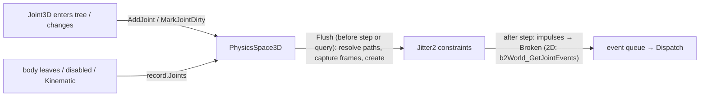

# Proposal: Physics joints and ragdolls

**Milestone:** [Gameplay toolkit](../../milestones.md#gameplay-toolkit-) (G9) · **Status:** 🚧 the 2D pin and damped
spring joints shipped ([ADR 0201](../../../memory/decisions/0201-2d-joints-on-box2d.md), [Physics → 2D joints](../physics.md#2d-joints-adr-0201)) ·
**Depends on:** [M6 physics](../physics.md) (bodies, spaces, signals), [M10 editor](../editor.md) (viewport, inspector,
undo), [Keyframe animation](keyframe-animation.md) G1b (`Skeleton3D`; only for `PhysicalBone3D`) · **Related:**
[Editor viewport tools](editor-viewport-tools.md) (G7.3 handles for limits), [Animation authoring](animation-authoring.md)
(G1c `HumanoidMap`/`HumanoidLimits` seed ragdoll limits), [Networking](../networking.md), [Demo](../demo.md)


## Problem

Bodies cannot be connected. Doors, chains, rope bridges, vehicles, breakable props and ragdolls all need joints, and
the engine has none: the physics doc lists "No joints, soft bodies, vehicles or ragdoll tooling" as a known issue
(`docs/design/physics.md:358`), and a search of `MainframeEngine/Src`, `MainframeEngine.Editor/Src`, `Examples/Demo`
and `Tests/MainframeEngine.Tests` for joint/ragdoll finds only unrelated uses of the word
(`MainframeEngine/Src/Trees/TreeOptions.cs:122`, `MainframeEngine/Src/Rendering/Post/SsaoEffect.cs:17`).

Both libraries ship joints; the engine wraps neither. Verified in the pinned packages
(`~/.nuget/packages/jitter2/2.9.0`, `~/.nuget/packages/box2d.net/3.1.654`):

- **Jitter2 2.9.0** (`Jitter2.Dynamics.Constraints`): primitive constraints created with
  `World.CreateConstraint<T>(body1, body2)` — `BallSocket`, `HingeAngle`, `ConeLimit`, `TwistAngle`, `FixedAngle`,
  `PointOnLine`, `PointOnPlane`, `DistanceLimit`, `AngularMotor`, `LinearMotor`, plus `Jitter2.SoftBodies.SpringConstraint`
  (`SetSpringParameters(frequency, damping, dt)`). Composite `Joint`s: `HingeJoint`, `PrismaticJoint`, `UniversalJoint`,
  `WeldJoint` (`Enable`/`Disable`/`Remove`). Every constraint has `IsEnabled`, `Softness`, `Bias` and an accumulated
  `Impulse`; limits are `AngularLimit`/`LinearLimit`. `World.NullBody` is a static body for joints to the world.
  `World.Remove(RigidBody)` removes the body's constraints too, and `World.ConstraintRemoved` fires when a motion-type
  change leaves neither constrained body dynamic (the constraint is then gone). There is no breaking, no "don't collide
  connected bodies" and no 6-DOF joint.
- **Box2D.NET 3.1.654**: `b2CreateRevoluteJoint`, `…Prismatic…`, `…Distance…`, `…Weld…`, `…Wheel…`, `…Motor…`,
  `…Filter…` from `B2*JointDef`s that share a `B2JointDef @base` (`bodyIdA/B`, `localFrameA/B`, `collideConnected`,
  `forceThreshold`, `torqueThreshold`, `constraintHertz`, `constraintDampingRatio`). Limits, motors and springs
  (`hertz`, `dampingRatio`) are settable live (`b2RevoluteJoint_SetLimits`, `…_SetMotorSpeed`, `…_SetSpringHertz`, …).
  A joint whose reaction exceeds a threshold is reported once per step by `b2World_GetJointEvents`, which wraps the
  world's own array (no allocation). `b2DestroyBody` destroys the body's joints; `b2Body_SetType` keeps them.

What joints must fit into:

- **Spaces own the library worlds.** `PhysicsSpace3D` creates one Jitter2 `World` per `World3D`
  (`MainframeEngine/Src/Physics/3D/PhysicsSpace3D.cs:193-210`), creates a `RigidBody` per collision object in
  `AddObject` (`:249`, `:268`), removes it in `RemoveObject` (`:294`, `:312`) and steps in `Step` (`:687`). The 2D space
  does the same with Box2D (`MainframeEngine/Src/Physics/2D/PhysicsSpace2D.cs:241-252`, `:322`/`:363`, `:370`/`:384`,
  `:750`), converting pixels with `PixelsPerMeter`. All library calls stay in these files (physics.md → Libraries).
- **Bodies come and go.** A body enters its space in `OnEnterTree`, leaves in `OnExitTree` and while disabled
  (`MainframeEngine/Src/Physics/3D/CollisionObject3D.cs:109-132`). `RigidBody3D.Mode` switches Dynamic ↔ Kinematic at
  run time (`RigidBody3D.cs:33`, `:202`) through `PhysicsSpace3D.OnKindChanged` (`:387`), which would silently drop
  Jitter2 constraints between two kinematic bodies.
- **Collision filtering.** 3D layers go through `LayerFilter : IBroadPhaseFilter`, which runs on Jitter2's worker
  threads and only reads record fields (`PhysicsSpace3D.cs:1197`); 2D uses a custom filter callback (`PhysicsSpace2D.cs:251`).
- **Signals** are queued during the step and dispatched on the main thread after it (`PhysicsSpace3D.cs:904`, ADR 0022).
- **Node paths.** `NodePath` resolves without allocating (`MainframeEngine/Src/Scene/NodePath.cs:9`,
  `Node.GetNodeOrNull`, `Node.cs:441`); `[Export(NodeType = …)]` restricts the inspector's picker
  (`MainframeEngine/Src/Serialization/Attributes.cs:34`, `MainframeEngine.Editor/Src/Inspector/InspectorProperty.cs:175`).
- **Editor.** The editor turns on the physics debug draw (`MainframeEngine.Editor/Src/EditorApp.cs:93`), which draws only
  collision shapes (`PhysicsSpace3D.cs:1146`, `PhysicsSpace2D.cs:1258`); selection gizmos are line drawings in
  `ViewportController` (`MainframeEngine.Editor/Src/Viewport/ViewportController.cs:765-788`). Edit mode creates bodies
  but never steps (`MainframeEngine/Src/Scene/SceneTree.cs:76-83`).
- **Nested dynamic bodies teleport.** A physics pose write on a parent counts as a user move of its body children
  (`CollisionObject3D.cs:141-146`), so a ragdoll cannot be a chain of nested `RigidBody3D`s.
- **No skeletons yet.** `Skeleton3D` (bones as data) is G1b (`docs/design/future/keyframe-animation.md:460-494`), which
  lists ragdolls as a non-goal (`:67`).

## Goals

- 3D joint nodes over Jitter2: `PinJoint3D`, `HingeJoint3D`, `SliderJoint3D`, `ConeTwistJoint3D` (Godot names),
  plus `DistanceJoint3D` (rope/spring) and `WeldJoint3D`.
- 2D joint nodes over Box2D: `PinJoint2D`, `GrooveJoint2D`, `DampedSpringJoint2D` (Godot names), plus `SliderJoint2D`,
  `WeldJoint2D`, `WheelJoint2D` (Box2D's prismatic, weld, wheel).
- Godot's model: a joint is a node whose global transform gives the anchor and axes, `NodeA`/`NodeB` are paths to
  physics bodies, an empty path means the world; connected bodies do not collide by default.
- Limits, motors and springs where the library has them, changeable at run time without rebuilding the joint.
- Breaking: `BreakForce`/`BreakTorque` and a `Broken` signal (main thread, after the step), `Rebuild()` to restore.
- Joints survive their bodies leaving and re-entering the space, being disabled, and Dynamic ↔ Kinematic switches.
- Debug draw for every joint; a richer gizmo for the selected joint in the editor; limit handles once G7.3 lands.
- Ragdolls: `Ragdoll3D` for rigid-part characters before skinning; `PhysicalBone3D` + `PhysicalBoneSimulator3D` on
  G1b skeletons, with an editor "Create physical skeleton" action.
- Zero managed allocation in steady-state physics frames with joints (3D; 2D excludes Box2D's own step allocations).

## Non-goals

- `Generic6DofJoint3D` in the first phases: Jitter2 has no 6-DOF constraint ([Open questions](#open-questions)).
- Soft bodies, cloth, vehicles beyond wheel joints (no `VehicleBody3D`), destruction/fracture.
- 2D ragdolls on Spine skeletons; 2D joints are enough for hand-built 2D rag figures.
- Active ragdolls (motors chasing the animated pose) and partial-body blending beyond `Influence` (later phase).
- Cross-platform deterministic joints (physics is single precision, [ADR 0020](../../../memory/decisions/0020-physics-precision-and-determinism.md)).
- Replicating joint state; joints simulate where the bodies do.
- New NuGet packages: none are needed.

## Design

### Code layout

All new; joint nodes are plain nodes, every library call is in the spaces.

| File | Contents |
|---|---|
| `Src/Physics/Joints/Joint3D.cs`, `Joints3D.cs` | `Joint3D` base and the 3D joint nodes |
| `Src/Physics/Joints/Joint2D.cs`, `Joints2D.cs` | `Joint2D` base and the 2D joint nodes |
| `Src/Physics/3D/PhysicsSpace3D.Joints.cs` | `JointRecord3D`, creation, re-creation, breaking, debug draw (Jitter2) |
| `Src/Physics/2D/PhysicsSpace2D.Joints.cs` | `JointRecord2D`, creation, joint events, debug draw (Box2D) |
| `Src/Physics/Ragdoll/Ragdoll3D.cs` | rigid-part ragdoll (G9.6) |
| `Src/Physics/Ragdoll/PhysicalBone3D.cs`, `PhysicalBoneSimulator3D.cs` | skeleton ragdoll (G9.8, after G1b) |

`PhysicsSpace3D`/`2D` become `partial` so joints live in their own file.

### Library mapping

| Node | Jitter2 2.9.0 | Node | Box2D.NET 3.1.654 |
|---|---|---|---|
| `PinJoint3D` | `BallSocket` | `PinJoint2D` | revolute joint |
| `HingeJoint3D` | `HingeJoint` (`HingeAngle` + `BallSocket` + `AngularMotor`) | `SliderJoint2D` | prismatic joint |
| `SliderJoint3D` | `PrismaticJoint` (`PointOnLine` + `FixedAngle`/`HingeAngle` + `LinearMotor`) | `GrooveJoint2D` | wheel joint, spring off, limit on |
| `ConeTwistJoint3D` | `BallSocket` + `ConeLimit` + `TwistAngle` | `DampedSpringJoint2D` | distance joint, spring + max length |
| `DistanceJoint3D` | `DistanceLimit` (+ `SpringConstraint` when springy) | `WeldJoint2D` | weld joint |
| `WeldJoint3D` | `WeldJoint` (`FixedAngle` + `BallSocket`) | `WheelJoint2D` | wheel joint |

Axes follow Godot: the hinge turns about the joint's local Z, sliders and cone-twist twist along local X; 2D sliders and
wheels run along local X, the groove along local Y. Box2D's prismatic/wheel axis is `localFrameA`'s X axis (checked in
`b2PrepareWheelJoint`), so frame A is rotated to match.

### Base nodes

```csharp
[EditorIcon("link", Family = EditorIconFamily.Physics)]
public abstract class Joint3D : Node3D
{
    [Export(NodeType = typeof(PhysicsBody3D))] public NodePath NodeA { get; set; }   // empty = the world
    [Export(NodeType = typeof(PhysicsBody3D))] public NodePath NodeB { get; set; }
    [Export] public bool ExcludeNodesFromCollision { get; set; } = true;
    [Export] public bool Enabled { get; set; } = true;               // false = constraints disabled, kept
    [ExportGroup("Breaking")]
    [Export(Range = "0,1000000,1")] public float BreakForce { get; set; }    // N; 0 = never
    [Export(Range = "0,1000000,1")] public float BreakTorque { get; set; }   // N·m; 0 = never

    public PhysicsBody3D? BodyA { get; }                 // resolved bodies (null = world or unresolved)
    public PhysicsBody3D? BodyB { get; }
    public bool IsActive { get; }                         // created in a space, not broken
    public bool IsBroken { get; }
    public float GetAppliedForce();                       // N, last step
    public float GetAppliedTorque();                      // N·m, last step
    public void Rebuild();                                // re-resolve paths, re-capture frames, clear IsBroken

    [Signal] public event Action? Broken;
}
```

`Joint2D` is the same in pixels with Godot's 2D name `DisableCollision` (default true) instead of
`ExcludeNodesFromCollision`; forces are kg·px/s² and torques kg·px²/s², converted with `PixelsPerMeter` like every
other 2D quantity. Infinity would need non-standard JSON, hence "0 = never" for the thresholds.

### Joint types

Angles follow `CharacterBody3D.FloorMaxAngleDegrees` (`CharacterBody3D.cs:57-68`): an exported `…Degrees` property and a
radians property for code. Only the degrees forms are shown.

```csharp
public sealed class PinJoint3D : Joint3D { }                                  // anchor only

public sealed class HingeJoint3D : Joint3D
{
    [ExportGroup("Limit")]  [Export] public bool UseLimit { get; set; }
    [Export(Range = "-180,180,0.1")] public float LowerAngleDegrees { get; set; } = -90f;
    [Export(Range = "-180,180,0.1")] public float UpperAngleDegrees { get; set; } = 90f;
    [ExportGroup("Motor")]  [Export] public bool MotorEnabled { get; set; }
    [Export] public float MotorTargetVelocity { get; set; }         // rad/s
    [Export] public float MotorMaxTorque { get; set; } = 100f;     // N·m
    [ExportGroup("Spring")] [Export] public bool SpringEnabled { get; set; }
    [Export] public float SpringFrequency { get; set; } = 2f;      // Hz
    [Export] public float SpringDampingRatio { get; set; } = 0.5f;
    [Export] public float SpringTargetAngleDegrees { get; set; }
    public float GetAngle();                                        // radians, relative to the authored pose
}

public sealed class SliderJoint3D : Joint3D       // UseLimit, Lower/UpperDistance (m), motor (m/s, N), spring
{
    [Export] public bool AllowTwist { get; set; }                   // false: Jitter2 "pinned" (FixedAngle)
    public float GetPosition();
}

public sealed class ConeTwistJoint3D : Joint3D
{
    [Export(Range = "0,180,0.1")] public float SwingSpanDegrees { get; set; } = 45f;
    [Export(Range = "0,180,0.1")] public float TwistSpanDegrees { get; set; } = 180f;  // ± around local X
}

public sealed class DistanceJoint3D : Joint3D     // rope or spring between the joint origin and AnchorB
{
    [Export] public Vector3 AnchorB { get; set; }                   // in the joint's local space
    [Export] public float MinLength { get; set; }                   // m; 0 = slack allowed
    [Export] public float MaxLength { get; set; }                   // m; 0 = the authored distance
    [Export] public float SpringFrequency { get; set; }             // Hz; 0 = no spring (a rope)
    [Export] public float SpringDampingRatio { get; set; } = 0.5f;
}

public sealed class WeldJoint3D : Joint3D { }                       // glue; usually with BreakForce

// 2D (pixels, radians in code, degrees exported):
public sealed class PinJoint2D : Joint2D           // UseLimit + Lower/UpperAngleDegrees, motor, spring (as HingeJoint3D)
public sealed class SliderJoint2D : Joint2D        // limit (px), motor (px/s, kg·px/s²), spring + target translation
public sealed class GrooveJoint2D : Joint2D        // Length = 50, InitialOffset = 25 (px), Godot semantics
public sealed class DampedSpringJoint2D : Joint2D  // Length = 50 (max), RestLength = 0 (= Length), SpringFrequency, ratio
public sealed class WeldJoint2D : Joint2D          // LinearFrequency, AngularFrequency (0 = rigid), damping ratios
public sealed class WheelJoint2D : Joint2D         // suspension spring (Hz, ratio), limit, drive motor (rad/s, torque)
```

**Springs are frequency + damping ratio** in both dimensions: Box2D's `hertz`/`dampingRatio` and Jitter2's
`SpringConstraint.SetSpringParameters(frequency, damping, dt)` take exactly that, so one model covers both (Godot's
`stiffness`/`damping` would need a mass-dependent conversion; see open question 1). A `DampedSpringJoint2D` with
`SpringFrequency = 0` is a rope (Box2D: spring off, limit on). Jitter2 has no angular or prismatic spring:
`HingeJoint3D`/`SliderJoint3D` springs are an engine PD torque/force applied in `PreStep` (equal and opposite on both
bodies, effective mass from the bodies' inertia about the axis), with the frequency clamped to a quarter of the physics
tick rate to stay stable (open question 2).

**Motors are always created** for joint types that have one (`HingeJoint(…, hasMotor: true)`); "off" is a maximum
force of 0, which clamps the motor's impulse to zero (`AngularMotor.MaxLambda = MaxForce / idt`). Toggling a motor is
then a field write, not a rebuild. Live changes: limits (`HingeAngle.Limit`, `b2RevoluteJoint_SetLimits`), motor speed and
force, spring parameters, thresholds and collision exclusion. A rebuild is needed only for `NodeA`/`NodeB`, the joint's
transform, `AllowTwist`, and the type-shaping fields (`DistanceJoint3D.AnchorB`, `GrooveJoint2D.Length`).

### Space integration



- **Records.** A `JointRecord3D` holds the node, the two `BodyRecord3D`s (or the world), the created constraints (an
  array sized at creation), the frames captured per body, and flags (`Pending`, `Broken`, `DroppedByLibrary`). Each
  `BodyRecord3D` gains a small `JointRecord3D[]` list of the joints attached to it.
- **Creation is deferred.** `Joint3D.OnEnterTree` registers the record with its viewport's space (`PhysicsServer3D.For`,
  like bodies, `PhysicsServer3D.cs:67`). The record is created in the space's `Flush` (before a step or a query), after
  body shapes and masses are rebuilt, so tree order between a joint and its bodies does not matter. Paths are resolved
  with `GetNodeOrNull` on the joint node. A path to a node that is not a `PhysicsBody3D`, both paths empty, or both
  pointing at the same body logs one error and leaves the joint pending. An empty path uses `World.NullBody` in 3D and a
  per-space static "world" body without shapes in 2D (created on first use).
- **Frames.** On first creation the joint's global transform (scale ignored) is stored in body A's and body B's local
  space: the authored pose. Box2D takes these as `localFrameA/B`. Jitter2's `Initialize` methods take world-space
  anchors and axes and capture the current relative rotation as rest (`HingeAngle`, `TwistAngle`, `FixedAngle`), so
  re-creation after the bodies moved sets `BallSocket.Anchor1/Anchor2` from each body's stored frame, uses the two-axis
  `ConeLimit.Initialize(axisBody1, axisBody2, limit)`, and offsets hinge/twist limits by the current angle measured
  from the authored relative rotation. Weld and pinned slider re-lock at the current relative rotation (documented).
- **Bodies leaving.** When a body leaves its space (`RemoveObject`), its joints are marked pending first: Jitter2's
  `World.Remove(body)` and Box2D's `b2DestroyBody` already destroy the constraints, so the record only forgets its
  handles (no double destroy). When the body joins again (re-enters, re-enabled), its pending joints are re-created
  at the next flush from the stored frames. A freed joint node removes its constraints immediately.
- **Kinematic bodies.** `OnKindChanged` marks the body's joints dirty. In 3D the space subscribes to
  `World.ConstraintRemoved` once (a cached delegate) and marks records whose constraints Jitter2 dropped as
  `DroppedByLibrary`; they are re-created when either body becomes dynamic again. Box2D keeps joints across
  `b2Body_SetType`, so 2D does nothing.
- **Collision exclusion.** 2D sets `collideConnected = !DisableCollision` (Box2D applies it before the custom filter).
  3D extends `LayerFilter`: each `BodyRecord3D` gets an `Excluded` array of records it must not collide with, replaced
  (copy-on-write, main thread, between steps) when exclusions change; the worker-thread filter only reads it. Turning
  exclusion on also clears the pair's cached contacts (`ClearContactCache`, as layer changes do).
- **Enabled / disabled.** `Enabled = false` or a disabled joint node (`ProcessMode.Disabled`) sets `IsEnabled = false`
  on every constraint (Jitter2 `Joint.Disable()`); 2D destroys the joint and re-creates it on enable, because Box2D 3.1
  has no joint enable flag.
- **Edit mode.** Joints are created in edit-mode worlds like bodies (so the debug draw shows them) and never step.

### Breaking

- **3D:** for joints with a threshold (a `_breakable` list, so the cost is O(breakable joints)), after `World.Step` the
  space sums the linear impulses (`BallSocket`, `PointOnLine`, `DistanceLimit`, `LinearMotor`) and the angular ones
  (`HingeAngle`, `FixedAngle`, `ConeLimit`, `TwistAngle`) of the last substep and divides by the substep length
  (`delta / SubstepCount`). The values are kept for `GetAppliedForce/Torque`.
- **2D:** `forceThreshold`/`torqueThreshold` are set on the def (converted to Box2D units; 0 → `float.MaxValue`, Box2D's
  "never"); after `b2World_Step` the space reads `b2World_GetJointEvents` and maps each event's `userData`
  (`B2UserData.Ref(record)`, set once at creation) back to its record. `GetAppliedForce` reads
  `b2Joint_GetConstraintForce` / `b2Joint_GetConstraintTorque`.
- A breaking joint is disabled (3D) or destroyed (2D) at once, `IsBroken` becomes true and a `JointBroken` event is
  queued. `Dispatch` emits `Broken` after the step's sleep changes, in joint creation order; handlers may free nodes
  (queued events of freed joints are skipped, as for bodies). `Rebuild()` clears `IsBroken` and re-creates.

### Debug draw and editor

- **Debug draw.** `PhysicsSpace3D/2D.DrawDebug` also draws joints into `DebugLines` when debug draw is on: anchors
  of both bodies (they separate when the joint is overstretched; red when more than 5 cm/5 px apart), axes, limit arcs
  (hinge, pin 2D), swing cones and twist arcs, slider ranges, distance/spring segments. Colours: joints amber, broken
  joints grey. Anchors are computed from the bodies' interpolated poses and stored frames, so lines match the render.
- **Selected joint** ([figure](../../images/physics-joint-gizmos.svg)): `ViewportController` adds overlay lines for
  the selected `Joint3D`/`Joint2D`: thick axis, current angle or position, labels at the limit ends, and a line from
  the joint to each resolved body (red when a path does not resolve). Unresolved paths also show as a node warning in
  the scene tree.
- **Inspector.** `NodeA`/`NodeB` use the existing node-path picker restricted to `PhysicsBody3D`/`PhysicsBody2D`. A
  custom inspector section adds icon buttons with tooltips: Rebuild (`rotate`) and "Swap A/B" (`arrows-horizontal`).
  New icons in `MainframeEngine.Editor/Assets/icons/icons.txt`: `pin`, `cone`, `arrows-horizontal`, `wave-sine`,
  `link-off`, `steering-wheel`, `accessible`; all joints use `EditorIconFamily.Physics`.
- **Handles (G9.7, after G7.3).** An `IHandleProvider` per joint type exposes the limit ends, swing span and slider
  range as `EditorHandle`s ([G7.3](editor-viewport-tools.md)), so limits are dragged in the viewport with undo.
- **Dev overlay.** The Physics panel (`MainframeEngine/Src/Debugging/DevOverlay/DevOverlayPanels.cs:238`) gains a
  joint count and broken-this-second count.

### Ragdolls

**What ships before skinning: `Ragdoll3D`.** A node that turns its **direct** `RigidBody3D` children (the parts) into a
ragdoll. Parts are flat siblings because nested dynamic bodies teleport (see Problem); visuals hang under each part.
Joints between the parts are ordinary joint nodes under the ragdoll. This covers rigid-part characters (capsule
mannequins, robots, low-poly figures), hanging signs and chains.

```csharp
[EditorIcon("accessible", Family = EditorIconFamily.Physics)]
public class Ragdoll3D : Node3D
{
    [Export] public bool Simulating { get; set; }                  // false: parts kinematic, following their nodes
    [Export] public bool ExcludePartCollisions { get; set; } = true;  // parts never collide with each other
    public void StartSimulation();                                   // parts → Dynamic, keeping their kinematic velocity
    public void StopSimulation();                                    // parts → Kinematic at their current pose
    public void ApplyImpulse(RigidBody3D part, Vector3 impulse, Vector3? position = null);
    [Signal] public event Action? SimulationStarted;
    [Signal] public event Action? SimulationStopped;
}
```

While not simulating, an `AnimationPlayer` (G1a) or code moves the parts; kinematic moves become velocities
(physics.md → interpolation), so they push props and, on `StartSimulation`, the parts carry that motion into the fall.
Jitter2 drops the joints between two kinematic parts; the re-creation rules above restore them with the authored limits.

**What waits for G1b: `PhysicalBone3D` and `PhysicalBoneSimulator3D`** (Godot 4.3's structure).

```csharp
public sealed class PhysicalBoneSimulator3D : Node3D       // child of a Skeleton3D; PhysicalBone3D children
{
    [Export(Range = "0,1,0.01")] public float Influence { get; set; } = 1f;   // blend: animated pose ↔ simulated
    public bool IsSimulating { get; }
    public void PhysicalBonesStartSimulation(ReadOnlySpan<string> bones = default);  // empty = all bones
    public void PhysicalBonesStopSimulation();
}

public sealed class PhysicalBone3D : RigidBody3D
{
    [Export] public string BoneName { get; set; } = "";
    [Export] public Transform3D BodyOffset { get; set; } = Transform3D.Identity;  // body relative to the bone
    [Export] public PhysicalBoneJointType JointType { get; set; }  // None, Pin, ConeTwist, Hinge, Slider
    [Export] public Transform3D JointOffset { get; set; } = Transform3D.Identity; // joint frame relative to the body
    // Swing/twist spans, hinge limits, slider range: the same exports as the joint nodes, grouped "Joint".
}
```

- The simulator creates one internal `JointRecord3D` per bone with a joint type, to the `PhysicalBone3D` of the nearest
  ancestor bone that has one (walking `Skeleton3D.BoneParents`); no joint nodes are added to the scene.
- **Simulated bones:** in `OnProcess` (with a process priority after `AnimationPlayer`, before `RenderServer.SkinMeshes`
  writes the palettes), each simulated bone's pose is written from its body's interpolated global transform:
  bone global = body global × `BodyOffset`⁻¹, then made local to the parent bone with `SetBonePosePosition/Rotation`,
  blended with the animated pose by `Influence`.
- **Animated bones:** bodies are kinematic; in `OnPhysicsProcess` they move to the animated bone pose × `BodyOffset`,
  so animated characters still push things and are hit by rays.
- **Create physical skeleton (G9.9).** An inspector button (`bone` icon, tooltip) on `Skeleton3D` builds the simulator
  and one `PhysicalBone3D` per bone longer than 5 cm: a capsule from the bone to its first child, radius 20 % of the
  length, cone-twist 45°/30° joints. With a G1c `HumanoidMap` (`docs/design/future/animation-authoring.md:123`), knees and
  elbows become hinges and limits come from `HumanoidLimits` (`:110-113`). One undo step.

### Networking and determinism

Joints are server-side state like bodies: the server simulates and replicates poses through the game's
`[Replicated]` members; clients may run cosmetic ragdolls locally (no authority). With `Deterministic` and one
thread, joint scenes reproduce on one machine/build like other physics (the render determinism test covers it).

### Allocation and threading

Joint records, constraint arrays, exclusion arrays and Jitter2 `Joint` objects are allocated at creation only. Per
step: impulse readback, PD springs, joint events and debug draw iterate pre-sized lists. The `ConstraintRemoved` handler
and the joint-event loop are cached delegates/static callbacks. All joint calls are main-thread; only the exclusion
arrays are read on Jitter2 workers, and they are replaced, never mutated, between steps.

## Testing

- **Unit, `Tests/MainframeEngine.Tests/Physics/`** (`PhysicsHarness`, `PhysicsHarness2D`):
  - `Joints3DTests`: pin pendulum period within 2 % of 2π√(L/g); anchors stay within 1 cm under load; hinge limits
    hold within 1°; motor reaches its target velocity and respects `MotorMaxTorque`; PD spring settles at the target
    angle; slider range and `AllowTwist`; cone-twist swing/twist spans; distance rope slack and spring period; weld
    holds a cantilever; world joints (empty path); live limit/motor changes without rebuild.
  - Lifecycle: joint before its bodies in tree order; body freed (no exception, joint pending), re-added (re-created at
    the authored frame); disabled joint and disabled body; both bodies kinematic then dynamic (Jitter2 drop → re-created
    with the authored limits); invalid paths log once; `ExcludeNodesFromCollision` on/off for touching bodies.
  - `JointBreakTests` (3D and 2D): a weld under a falling mass breaks once, `Broken` fires on the main thread after the
    step, `IsBroken`, freeing nodes inside the handler, `Rebuild()`; thresholds 0 never break.
  - `Joints2DTests`: each 2D type, pixel conversion of anchors, limits, motor speeds, forces and thresholds; groove and
    wheel axes; `DisableCollision`.
  - `Ragdoll3DTests`: start/stop simulation, velocity carried over, part collisions excluded, joints intact after
    kinematic periods.
  - `PhysicsSerializationTests`: round trips of every joint type and `Ragdoll3D`.
  - Allocation gates (`PhysicsAllocationTests`, `Physics2DAllocationTests`): 0 B over 300 steps with 200 joints (chains,
    breakable welds, motors, PD springs, debug draw on); 2D excludes Box2D's step allocations as today.
- **Editor, `Tests/MainframeEngine.Editor.Tests/`:** path pickers list only physics bodies; Rebuild/Swap A/B undo;
  "Create physical skeleton" builds the expected bones and undoes in one step (G9.9).
- **Render tests:** a new `physics-joints` catalog scene (`Tests/MainframeEngine.RenderTests/SceneTests.cs` next to
  `physics-debug`): a hinged chain, a cone-twist mannequin and a broken weld with debug draw on, frame 90, goldens for
  both drivers. Existing goldens are unchanged. The allocation gate's showcase scene gains a short hinged chain.
- **Benchmarks:** `JointBenchmarks` (100-link chain, 50 ragdolls of 11 parts) added to `baseline.json`.
- **QA and Demo:** `physics_3d` gains a rope bridge of hinged planks, a breakable welded sign and a capsule mannequin
  (`Ragdoll3D`) the crates knock down; `physics_2d` gains a chain, a car on `WheelJoint2D`s and a breakable bridge
  (`Examples/Demo/Demo/Src/Physics/Physics3DScene.cs`, `Physics2DScene.cs`, panels get a "show joints" toggle).
  `Demo.Tests` checks that the mannequin falls and the bridge holds; `just demo-screenshots`. The editor QA script
  selects the bridge hinge and screenshots its gizmo.

## Acceptance

- Every listed joint type works in a game and in the Demo, with limits, motors and springs changeable at run time.
- Bodies may leave, re-enter, be disabled and switch Dynamic ↔ Kinematic without losing or distorting their joints.
- `Broken` fires once per break on the main thread; `Rebuild()` restores the joint.
- The editor shows every joint in the debug draw and the selected joint's gizmo; paths are picked from physics bodies.
- 3D allocation gate 0 B with joints; 2D engine share 0 B; no validation warnings; render goldens recorded.
- With G1b: a skinned character ragdolls from its animation and back; "Create physical skeleton" gives a usable rig.
- Docs updated when this ships: `docs/design/physics.md` (joints, breaking, ragdolls; remove the known issue),
  `docs/design/editor.md` (gizmo, inspector buttons, icons), `docs/design/scene-graph-and-nodes.md` (new nodes),
  `docs/design/demo.md`, `docs/design/dev-overlay.md`, `docs/design/testing.md` (render test, gate), and an ADR for the
  joint-frame and re-creation rules.

## Task list

G9.1–G9.7 need nothing beyond `main` (G9.7 waits for G7.3); G9.8–G9.9 wait for G1b.

1. **G9.1 3D joint core.** `JointRecord3D`, deferred creation in `Flush`, path resolution, world joints, stored frames,
   removal/re-entry, `ConstraintRemoved` re-creation, collision exclusion in `LayerFilter`; `Joint3D`, `PinJoint3D`,
   `HingeJoint3D` (limits, motor); unit tests, serialization, allocation gate.
2. **G9.2 More 3D joints.** `SliderJoint3D`, `ConeTwistJoint3D`, `DistanceJoint3D` (`SpringConstraint`), `WeldJoint3D`;
   hinge/slider PD springs; tests.
3. **G9.3 Breaking.** Impulse readback, `GetAppliedForce/Torque`, `Broken` dispatch, `Rebuild()`; 3D tests.
4. **G9.4 2D joints.** `JointRecord2D`, world body, `Joint2D` and the six 2D types, unit conversion, joint events →
   `Broken`, enable/disable by re-creation; tests, allocation gate.
5. **G9.5 Debug draw and editor.** Joint debug lines in both spaces, selected-joint overlay, node warnings, inspector
   buttons, icons; `physics-joints` render test and goldens; editor tests; dev overlay counts.
6. **G9.6 Ragdoll3D and Demo.** `Ragdoll3D`; Demo additions in `physics_3d`/`physics_2d`, `Demo.Tests`, screenshots;
   benchmarks; docs (`physics.md` and the list in Acceptance); ADR.
7. **G9.7 Limit handles** (after G7.3). `IHandleProvider`s for hinge/pin limits, swing span, slider range; QA step.
8. **G9.8 Physical bones** (after G1.8). `PhysicalBone3D`, `PhysicalBoneSimulator3D`, internal bone joints, pose
   write-back with `Influence`, kinematic follow; tests.
9. **G9.9 Create physical skeleton** (after G1.10; humanoid limits after G1.12). Inspector action, capsule and joint
   heuristics, undo; Demo skinned ragdoll.
10. **G9.10 Later, on demand.** `Generic6DofJoint3D`, active ragdolls, `MotorJoint2D`.

## Open questions

1. **Spring parameters.** Frequency + damping ratio (both libraries' native form, mass-independent) as proposed, or
   Godot's `stiffness`/`damping` (needs an effective-mass conversion that changes when masses change)?
2. **3D hinge/slider springs.** An explicit PD torque in `PreStep` (clamped frequency) as proposed, a custom implicit
   Jitter2 constraint (a `Constraint<T>` subclass with `RegisterFullConstraint` function pointers, unsafe code in
   `Src/Physics`), or no 3D angular springs until a game asks?
3. **`Generic6DofJoint3D`.** Compose from Jitter2 primitives (covers only lock/free/limit combinations the primitives
   express), write a custom 6-DOF constraint, or leave it out?
4. **Solver tuning.** Expose Jitter2's per-constraint `Softness`/`Bias` and Box2D's `constraintHertz`/`DampingRatio`
   as an advanced "Solver" group, or keep library defaults?
5. **Break measurement.** Last substep's impulse (spiky on impacts, like Box2D's instantaneous check) or an average
   over a few steps for 3D? Should 2D match whichever 3D uses?
6. **Moving a joint node at run time.** Godot ignores it after creation (as proposed); should a moved joint re-anchor?
7. **Nested ragdoll parts.** Keep `Ragdoll3D` flat, or change the rule that a parent's physics pose write teleports body
   children (`CollisionObject3D.cs:141-146`) so nested hierarchies work?
8. **Ragdoll layers.** Should `Ragdoll3D`/`PhysicalBoneSimulator3D` set the parts' collision layer from a project
   setting ("ragdoll" layer), or leave layers to the game?

## Related

- [Physics](../physics.md), [Scene graph and nodes](../scene-graph-and-nodes.md), [Editor](../editor.md),
  [Networking](../networking.md), [Demo](../demo.md), [Testing](../testing.md)
- Gameplay toolkit siblings: [Keyframe animation](keyframe-animation.md) (G1b skeletons),
  [Animation authoring](animation-authoring.md) (G1c humanoid map and limits), [Editor viewport tools](editor-viewport-tools.md)
  (G7.3 handles, G7.5 simulate mode for trying joints in the editor), [2D content](2d-content.md) (G2)
