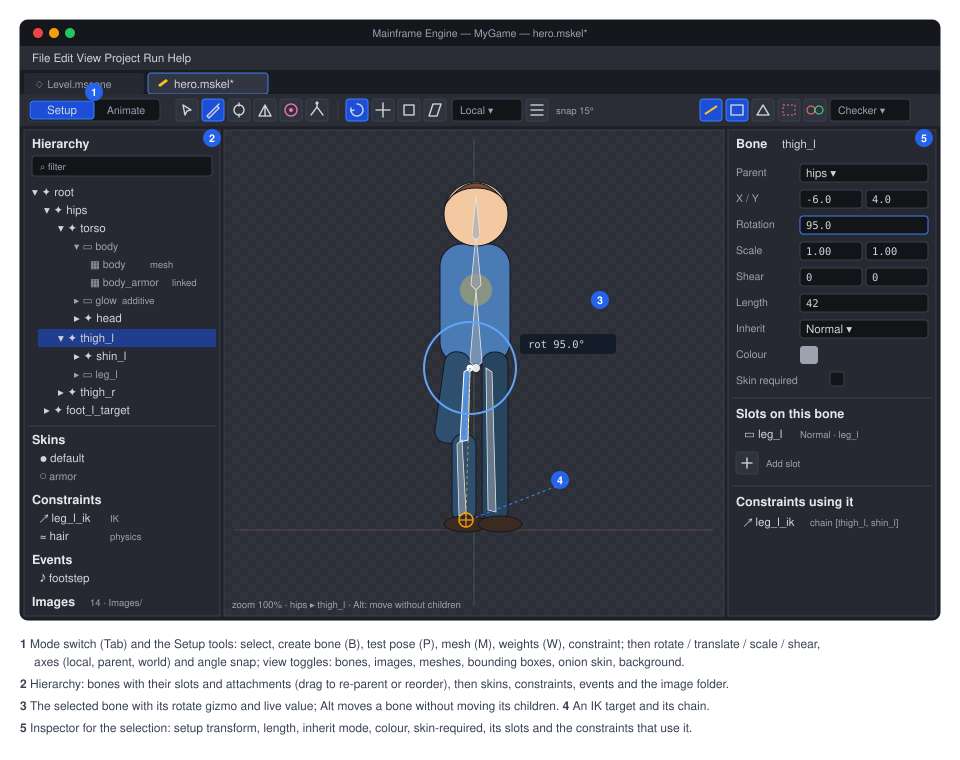
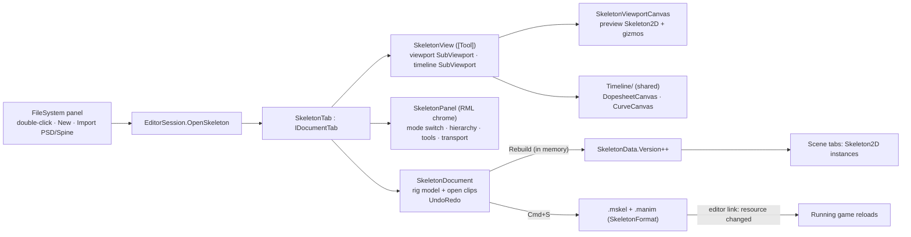
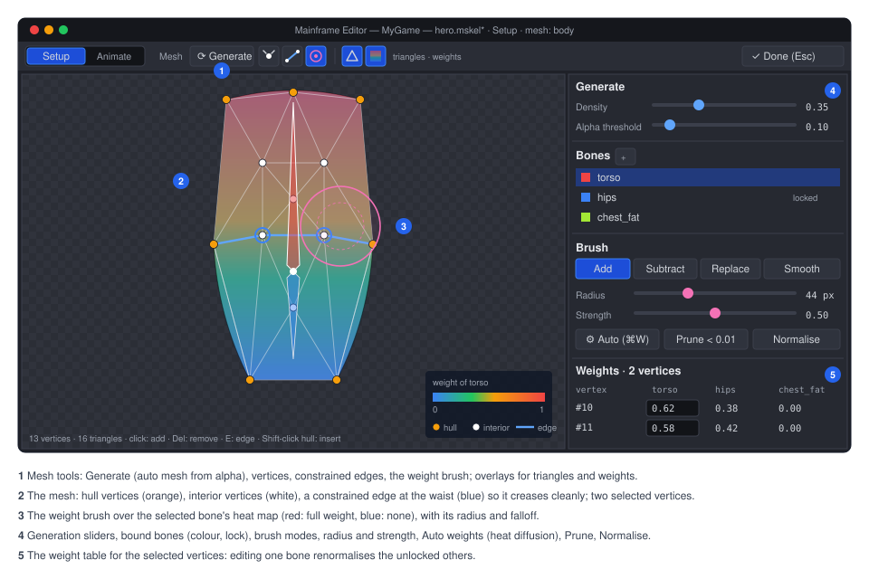

# Proposal: Skeleton editor (the Skeleton tab)

**Milestone:** [Gameplay toolkit](../../milestones.md#gameplay-toolkit-) (G17b Setup mode, G17c Animate mode, G17d meshes
and weights, plus the editor parts of G17e–G17f) · **Status:** ⬜ planned · **Depends on:**
[2D skeletal animation](skeleton-2d.md) (G17a runtime and data), [Editor](../editor.md) (tabs, undo, FileSystem),
the song tab ([Editor → Song tab](../editor.md#song-tab-music-editor)), whose timeline this extracts · **Related:**
[Animation graph](animation-graph.md) (its graph view), [Keyframe animation](keyframe-animation.md#shared-timeline-component)
(G1a reuses the shared timeline), [Animation authoring](animation-authoring.md) (`mfe`, reloading changed files) ·
**ADR:** [0184](../../../memory/decisions/0184-engine-owned-2d-skeletal-animation.md)



## Problem

[2D skeletal animation](skeleton-2d.md) gives the engine a runtime and a data format. Artists still need somewhere to
make rigs and clips. Spine's editor is the reference for what they expect:

- a hierarchy of bones, slots and attachments;
- a Setup mode for building the rig;
- an Animate mode with a dopesheet and a graph editor;
- mesh and weight tools;
- onion skinning;
- auto-key and IK posing.

The engine's editor has none of that today:

- **Tabs.** It has scene tabs, UI previews and song tabs (`MainframeEngine.Editor/Src/Session/IEditorTab.cs`). The
  session tells them apart with type checks (`tab is SongTab` at `Session/EditorSession.cs:144`, `:386`, `:442`,
  `:458`, `:694`), so a fourth tab type would add a fifth set of checks.
- **Timeline.** The song tab's timeline (`MainframeEngine.Editor/Src/Music/`) is the only one in the editor, and it is
  song-specific. [Keyframe animation](keyframe-animation.md#shared-timeline-component) planned to extract it but has
  not; its note that the song tab is not on `main` is out of date.
- **2D tools.** The 2D view can move, rotate and scale `Node2D`s (`Viewport/TransformGizmo2D.cs`). It cannot create
  bones, edit vertices or paint.

## Goals

- **A Skeleton tab** opens a `.mskel`: double-click, File › New Skeleton…, or the FileSystem panel's New Skeleton…,
  Import PSD… and Import Spine…. It has Spine's two modes:
  - **Setup**: bones, slots, attachments, skins, constraints, events, meshes and weights;
  - **Animate**: clips, keys, curves, posing.
- **One undo history per tab** covering the rig and every open clip. Every gesture is one entry. Cmd+S saves the
  `.mskel` and the changed `.manim` files.
- **Live in the scene.** `Skeleton2D` and `SkeletonSprite3D` nodes in open scene tabs update as soon as the rig or a
  clip changes, before saving. Saved files reload in running games through the editor link (see
  [Saving and live update](#saving-and-live-update)).
- **Art in:**
  - a folder of PNGs, by drag and drop or Import Images…;
  - a layered PSD, with re-import that keeps the rig.
- **Animation tools:**
  - dopesheet;
  - graph editor with bezier handles;
  - auto-key;
  - IK posing with FK/IK switching;
  - pose copy, paste and mirror;
  - onion skin;
  - loop, ping-pong and speed preview;
  - mix preview between two clips;
  - audio scrubbing with event audio;
  - a reference image layer.
- **Mesh tools:**
  - auto mesh from alpha;
  - vertex and edge editing;
  - auto weights;
  - a weight brush (add, subtract, smooth, prune);
  - a weight table.
- **A shared timeline.** `MainframeEngine.Editor/Src/Timeline/` is extracted from the song tab, the song tab is moved
  onto it, and the Skeleton tab and later G1a's Animation panel build on it. After this, the editor has one timeline.
- **Icon buttons with tooltips everywhere**, as the rest of the editor does: tool strips, transport and key buttons.

## Non-goals

- Drawing or painting the art itself. Artists draw in their own tools; the editor rigs and animates.
- A Spine-compatible UI layout or shortcuts. Familiar ideas, the engine's own layout. The [shortcut table](#shortcuts)
  stays close to Spine's where they don't clash with the editor's.
- Video reference. The reference layer takes an image or an image sequence, not video (see
  [open question 3](#open-questions)).
- Editing several skeletons in one tab. One `.mskel` per tab.
- Animating scene nodes other than the skeleton. That is G1a's Animation panel.

## Overview



Editor code lives in `MainframeEngine.Editor/Src/Skeleton/`:

| Type | Role |
|---|---|
| `SkeletonTab` | The tab: document, panel state, the selected mode and tool, the clip being animated, view state |
| `SkeletonDocument` | The editable model (`SkeletonModel` from `SkeletonFormat`, plus each open `ClipModel`) and its `UndoRedo`, as `SongDocument` (`Music/SongDocument.cs:34`) |
| `SkeletonPanel : EditorDocument` | The RmlUi chrome (`Content/Editor/skeleton.rml`) over the view area, as `SongPanel` |
| `SkeletonView` | The `[Tool]` driver: sizes and publishes the viewport and timeline `SubViewport`s, routes input to the active tool (the `SongView` pattern, now through `TimelineHost`) |
| `SkeletonViewportCanvas` | The 2D view: the preview `Skeleton2D`, a grid, bones, gizmos, mesh and weight overlays, onion skins |
| `Tools/` | `SelectTool`, `CreateBoneTool`, `PoseTool`, `MeshTool`, `WeightTool`, `ConstraintTool`; each implements `ISkeletonTool` (press, drag, release, hover, keys, draw) |
| `Timeline/` (Skeleton-specific) | `DopesheetCanvas`, `CurveCanvas`, their gesture targets |

Shared code lives in `MainframeEngine.Editor/Src/Timeline/` (see [Shared timeline](#shared-timeline)).

## Prerequisite: document tabs

Before the Skeleton tab, the session's song-specific branches move behind one interface. G17b does this first, as its
own PR:

```csharp
public interface IDocumentTab : IEditorTab
{
    void Activate();                             // the session calls these instead of `tab is SongTab` checks
    void Deactivate();
    void Tick(double delta);
    bool HandleKey(in KeyEvent key);             // before global shortcuts (EditorWorkspace.cs:577 today for songs)
    bool RunCommand(string command);             // Save, Save As, Undo, Redo, Copy, … (EditorCommands.RunSong today)
    void FilesMoved(string from, string to);     // EditorSession.cs:142-155 today
    UndoRedo History { get; }
    void Save(); void SaveAs(string path);
}
```

`SongTab` implements it with the code that is in `EditorSession` and `EditorCommands` today. The behaviour doesn't
change, and the song tab's tests (`Tests/MainframeEngine.Editor.Tests/Music/`) must stay green. `SkeletonTab` is the
second implementation.

## Shared timeline

The extraction follows [Keyframe animation → Shared timeline component](keyframe-animation.md#shared-timeline-component)
(the names and split are its own), done in G17b instead of G1.5:

- **`TimelineViewState`**: scroll, zoom, `X(time)`, `TimeAt(x)`, `ZoomAround`. Time is a `double`.
- **`ITimelineScale`**: `MusicalScale` for the song tab, `SecondsScale` with a frames option for skeletons and G1a.
- **`TimelineCanvas`**: ruler, grid, playhead, regions, and the dp drawing helpers.
- **`TimelineGestures`** with `ITimelineGestureTarget`: press, drag, release, threshold, double-click, rubber band,
  one merge key per gesture.
- **`TimelineHost`**: viewport sizing, `engine://` publishing, input routing.
- **`TimelineSnap`**: snapping.

The song tab moves onto these in the same PR, with its tests unchanged. Its drawing still allocates nothing in steady
state (cached labels), and the shared code keeps that rule.

The Skeleton tab adds two canvases on top:

- **`DopesheetCanvas`**: rows per timeline, keys as diamonds coloured by kind, summary rows for groups. It also draws
  event markers and the audio waveform lane.
- **`CurveCanvas`**: value-over-time curves with bezier handles. It shares the time axis with the dopesheet and has
  its own vertical scale.

G1a's Animation panel later uses the same two canvases with its own tracks.

## Opening, creating and importing

- **File types.** `.mskel` and `.manim` join `FileKind` (`FileSystem/FileKind.cs:54-71`) as `Skeleton` and
  `SkeletonClip`, with editor icons (`bone`, `movie`), peeks (`FilePeek`: bone, slot and clip counts) and
  `ReferenceFixer` handling (`FileSystem/ReferenceFixer.cs:10`, `:69-95`, where `.msong` is handled today).
- **Opening.** Double-click a `.mskel` to open its tab. Double-click a `.manim` to open its skeleton's tab in Animate
  mode with that clip.
- **New Skeleton…** (File menu and the FileSystem panel) asks for a name and folder. It writes `<name>.mskel` with a
  `root` bone, an empty `Images/` folder and an empty `<name>.clips/` folder, then opens the tab.
- **Import PSD…** (FileSystem context menu on a `.psd`; also in the tab) creates a skeleton from the layers, or
  re-imports into an open one. See [Importing art](#importing-art).
- **Import Spine…** (context menu on a Spine `.json`) runs the [Spine importer](skeleton-2d.md#spine-4x-json-importer)
  into a folder the user picks, shows its report and opens the result.
- **The `Skeleton2D` inspector.** A custom inspector (`[CustomInspector(typeof(Skeleton2D))]`, the
  `InspectorModel.cs:162-198` mechanism) adds:
  - a clip picker for `Clip`;
  - a skin picker (multi-select) for `Skins`;
  - a preview-time slider for edit mode;
  - an **Open in Skeleton tab** icon button.

## Layout

The tab replaces the centre view, like the song tab. The scene tree and inspector rest while it is active, and the tab
brings its own panels:

- **Top strip:**
  - a **Setup | Animate** mode switch;
  - the tool buttons for the mode;
  - snapping;
  - the view menu: bones, images, meshes, weights, bounding boxes, constraints, onion skin, reference layer.
- **Left: the hierarchy.** A tree of bones (with their slots and attachments under each bone), plus sections for
  skins, constraints, events and images. Setup mode also lists clips; Animate mode moves the clip list into the
  timeline header.
- **Centre: the viewport.** The skeleton on a neutral checker or a solid colour (view menu), with a pixel grid at high
  zoom.
- **Right: the item inspector.** Fields for the selected bone, slot, attachment or constraint. In Animate mode, every
  animatable field has a key button (◆) and shows its state: keyed, changed since the key, or interpolated.
- **Bottom, Animate mode:** the transport, clip header, dopesheet or graph editor, and the event and audio lanes.


The layout is part of the editor's persisted layout (`~/.mainframe/editor_layout.json`). The hierarchy and inspector
widths and the timeline's height are saved per editor install.

## Setup mode

### Hierarchy

- **Selection.** Click to select; Shift and Cmd add to it. The selection syncs with the viewport.
- **Editing.** Drag to re-parent bones, or to move slots in draw order. Double-click renames. Visibility (eye) and lock
  toggles apply per item in the editor only; they are never saved into the rig.
- **Filtering.** A search field filters by name.
- **Draw order.** A **Draw order** view lists slots flat in draw order, for reordering without the bone tree.

### Bones

- **Create** (B): click a parent bone, then drag from the bone's start to its tip. Shift snaps the angle to 15°.
  Releasing on empty space creates a bone under `root`.
- **Transform tools** (R/T/S/H: rotate, translate, scale, shear) act in **local**, **parent** or **world** axes (a
  menu). They work on the selection, with numeric fields in the inspector.
- **Edit the setup without children.** Holding Alt moves a bone without moving its children: their world transforms
  are kept and their local values recomputed. That is how Spine's "compensate" works, as a documented rule here.
- **Lengths and colours.** Bone length and colour are editor-visible properties. The tip drag handle changes length.
- **Inherit mode** per bone, in the inspector. `skinRequired` is a toggle there too.

### Slots and attachments

- **Images.** Dragging an image from the images list onto a bone creates a slot on that bone with a `Region`
  attachment, centred at the drop point.
- **Swapping.** A slot lists its attachments. Clicking one makes it the setup attachment. The attachment inspector has
  its type-specific fields: region offset, size and rotation; sequence count and naming; and the clipping end slot.
- **Blend and colour.** Slot blend mode, colour and dark colour (two-colour tint toggle) are set in the slot inspector.
- **New attachment** (slot context menu): Bounding Box, Clipping, Point and Path are drawn with a polygon or bezier tool
  in the viewport.

### Importing art

- **PNG folder.** The skeleton's `import.images` folder is watched. New PNGs appear in the images list. Changed PNGs
  rebuild the atlas in memory and the view updates.
- **Import Images…** copies files into the folder.
- **Import PSD** runs [`PsdReader`](skeleton-2d.md#psd-import):
  - **The preview dialog** shows the layer tree with the resulting bone, slot and skin for each layer, from the tags.
    The artist can toggle layers and pick scale, trim and whether to make meshes for `[mesh]` layers.
  - **On import** the PNGs are written, slots and attachments placed at the layer positions, and the layer → image
    map stored in the `.mskel` (`import.psd`: path plus map).
  - **Re-import** (Reimport PSD in the tab, or automatically when the PSD changes while the tab is open, after a
    prompt) shows a diff before applying it: changed layers, moved bounds, new layers, removed layers. Removing is
    always opt-in per layer.

  The re-import is one undo entry.

### Meshes



**Mesh mode** (M on a Region or Mesh attachment) converts a region to a mesh and edits it:

- **Generate**: auto mesh from alpha with density and alpha-threshold sliders and a live preview
  ([AutoMesh](skeleton-2d.md#auto-mesh-and-triangulation)).
- **Vertices**:
  - click adds a vertex;
  - drag moves;
  - Del removes;
  - Shift-click on the hull inserts a hull vertex;
  - a closed hull is required.
- **Edges.** E connects two vertices as a constrained edge, for creases such as an elbow. The mesh re-triangulates
  after each change with the constrained Delaunay `Triangulator`.
- **Deform in setup.** Moving vertices after the mesh is weighted moves their bind positions. In Animate mode, the
  same gestures make deform keys instead (see [Posing](#posing-and-auto-key)).
- **Linked meshes.** Create a linked mesh for another image, such as a damaged variant or a skin's version, sharing the
  geometry. It shows a link badge.

### Weights

- **Bind.** Select the bones in the hierarchy and click Bind on the mesh. Unbind keeps the current pose as unweighted
  positions.
- **Auto weights** (Cmd+W) uses heat diffusion over the mesh. Each vertex's weights solve a Laplace equation with the
  bones as heat sources and the bone-to-vertex visibility inside the hull as the constraint. The solve is a sparse
  Cholesky over at most a few thousand vertices; it runs on a worker and shows a progress bar for big meshes. Results
  are pruned to the influence cap (8) and to weights ≥ 0.01, then normalised.
- **The weight brush** (W):
  - modes: add, subtract, replace, smooth;
  - settings: radius, strength, falloff;
  - paints the bone selected in the weights list;
  - the overlay colours vertices by the selected bone's weight, or by the dominant bone in "all bones" view.
- **Prune** removes weights below a threshold. **Normalise** fixes totals. **Lock** keeps a bone's weights while
  others are painted.
- **The weight table** lists the selected vertices × bones as editable numbers. Edits normalise the other bones
  unless they are locked.
- **Test pose.** In Setup mode, the Pose tool (P) poses bones temporarily to test weights; it never keys. Reset Pose
  returns to setup.

### Skins

- **The skins panel** lists skins. A skin's **Active** toggle shows it in the viewport; several can be active at once
  to preview runtime composition.
- **Skin placeholders.** Attachments added while a skin is the *edit target* go into that skin. Each slot shows which
  skins have an attachment for it (dots).
- **Duplicate Skin** copies one skin into another. **Bones and constraints for this skin** lists `skinRequired`
  members.

### Constraints

- **Creating.** The Constraint tool creates IK (click bones in the chain, then the target), transform (bones, then the
  target) and path (bones, then the path slot) constraints. Physics constraints go on the selected bones.
- **Inspector.** Each constraint's inspector has its mixes and modes. The update order is a drag list in the
  constraints section, matching the runtime's `order`.
- **Viewport.** IK chains draw as a line to the target with a handle. Path constraints show the path with their
  bones' placements. Physics bones draw a spring glyph.
- **Physics preview.** Setup mode has a **Simulate physics** toggle that runs physics constraints while the artist
  drags the root, to tune hair or cloth. The simulation never changes the setup.

### Events

The events section lists event definitions with name, default int, float and string values, and an audio stream
(picked from the project, with a play button), volume and balance.

## Animate mode

### Clips

- **The clip header** has a clip menu (switch, new, duplicate, rename, delete; all undoable, with files written on
  save), plus length, fps and loop mode. **Mirror Clip** creates a mirrored copy, using the bone name pairs below.
- **Files.** Each clip is one `.manim` in `<skeleton>.clips/`. Clips that haven't been opened since the tab opened are
  not loaded, so a rig with 200 clips opens fast.

### Posing and auto-key

- **Posing.** The Pose tool (P) rotates (drag a bone), translates (Alt-drag or T) and scales (S) bones. Clicking an IK
  target's handle moves the target; the chain follows.
- **IK while posing.** The IK chain follows a dragged target. **Temporary IK** (hold Shift while dragging a bone's tip)
  solves a two-bone chain from the bone's parent without needing a constraint. When released, it keys the result as
  FK rotations. That is how artists pose arms quickly.
- **Auto-key** (the record button, K) keys every changed property at the playhead when a gesture ends. Each key gets
  the clip's default curve (Editor Settings › Default curve: linear, or bezier ease in/out).
  - **Off:** changed properties show as "changed since the key" (an orange key button) until keyed or reset.
  - **Key All** (Shift+K) keys every bone's transform at the playhead.
- **Deform in Animate mode.** Mesh mode's vertex gestures make deform keys, with the brush or with vertex selection.
- **Pose clipboard.** Cmd+C on the selection (or the whole skeleton) copies the pose at the playhead. Cmd+V pastes at
  the playhead. **Paste Mirrored** (Cmd+Shift+V) maps bones by the mirror pairs and negates the rotations and
  x-translations in the mirror's frame.
- **Mirror pairs.** Bones are paired by name suffix rules (`_l/_r`, `.L/.R`, `Left/Right`), overridable in the rig's
  `mirror` table. The rig inspector edits that table.
- **Reset** (Cmd+Shift+R) returns the selection to the setup pose at the playhead (keyed when auto-key is on).

### Dopesheet

- **Rows.** One row per keyed timeline, grouped under its bone, slot or constraint. A collapsed group shows a summary
  row with every key. The top row summarises the clip. Event markers and the audio lane run under the rows.
- **Keys.** Click selects; drag moves (snapped to frames, Shift unsnapped); Alt-drag copies; a rubber band selects
  several.
- **Retiming.** Dragging a selection's edge scales it in time (**retime**), keeping curves.
- **Editing.** Del deletes. Cmd+C, V and D copy, paste at the playhead, and duplicate. Right-click sets the
  interpolation of the selected segments: linear, stepped, bezier, or the presets ease-in, ease-out, ease-in-out and
  overshoot.
- **Clip length.** A handle on the ruler sets the length. Past-length time is shaded.
- **Filters.** Only selected, only keyed, and by kind (bones, slots, deform, constraints).

### Graph editor

- **Switching.** The bottom panel switches between Dopesheet and Graph (G), or shows them split.
- **Curves.** The graph shows the selected timelines' curves. Each component has its own colour (x red, y green,
  rotation blue, alpha white).
- **Editing.**
  - Keys drag in time and value.
  - Bezier handles drag freely. Alt breaks the tangent; Shift locks it flat.
  - **Auto-tangents** smooth through neighbours with no overshoot.
- **Framing.** F frames the selection; Home frames the whole clip. Normalised view (Spine's "scaled to fit") shows
  timelines of different ranges together.
- **What can't be curved.** Stepped and discrete timelines (attachment, draw order, events) show as steps and can't
  take curves.

### Onion skin

- **Ghosts.** The view menu's Onion skin shows N previous and N next frames (1–5 each), at a frame step. They are
  tinted, red before and green after, with falloff. The ghosts are the same skeleton evaluated at those times and
  drawn with a ghost colour, alpha 0.25 → 0.05.
- **Keys mode.** Instead of every N frames, it shows the neighbouring keys.
- **Cost.** Ghosts use the runtime's CPU path, since the editor viewport is one skeleton. It is cached while the
  playhead stays put.

### Preview, mixing and audio

- **Transport:** to start, previous key, play, next key, to end. Speed is 0.1× to 2×. Play mode is loop, once or
  ping-pong. Space plays and pauses; arrows step frames.
- **Mix preview.** Pick a second clip and a mix duration, and the transport plays clip A → B with the runtime's
  [mixing rules](skeleton-2d.md#tracks-and-mixing). It is a preview only and keys nothing. The pair's mix duration can
  be saved into the graph or the skeleton's mix table from here.
- **Physics in preview.** Physics constraints simulate during playback (`PhysicsMode = Update`) and pose without
  stepping while scrubbing (`Pose`), so a scrub is deterministic.
- **Audio.**
  - Event audio plays during playback.
  - Scrubbing plays a short slice of the event audio and of the reference audio lane.
  - **The reference audio lane** takes one audio file (dialogue, music) with a waveform from the song tab's
    `SongWaveforms`. It is editor-only and saved in the tab's view state, not the clip.
- **Reference layer.** An image or a numbered image sequence (for rotoscoping) is drawn behind or in front of the
  skeleton, with opacity, offset and scale, and synced to time for sequences. It is editor-only.

## Undo

- **One history per tab.** `SkeletonDocument` owns one `UndoRedo` for the rig and every open clip, so an edit in one
  clip undoes in the order it was done, whichever clip it was in.
- **What an edit is.** Every edit is a `SkeletonEdit` (`IEditorAction`) committed through
  `Commit(name, apply, revert, mergeKey)`, as `SongDocument` does (`Music/SongDocument.cs:469-481`). Gestures merge
  into one entry by merge key until release (`EndMerge`). Rubber-band moves, brush strokes and drags are each one entry.
- **Size.** Edits store compact diffs, such as one bone's old and new local transform, or a slice of one timeline's
  arrays, not snapshots. Brush strokes store the changed weights of the touched vertices only.
- **Expensive edits.** Undoing an auto-weight solve restores the previous weights instantly; the solve is never
  rerun on undo.
- **Dirty files.** The tab shows `*` when any file is dirty. Saving clears it, with per-file dirty tracking so only
  changed clips are written.

## Saving and live update

- **Save** (Cmd+S) writes the `.mskel` and each dirty `.manim` through `SkeletonFormat`, with an `AtomicFile` write as
  `SongFormat.cs:92` does. It registers new UIDs with `AssetDatabase` and marks the history saved. **Save As** copies
  the skeleton and its clips to a new folder with new UIDs.
- **Live update while editing.**
  - After every committed edit (not every drag frame), the document rebuilds the affected parts of the `SkeletonData`
    in memory: the setup pose, a clip, or the atlas when images change. It then bumps `SkeletonData.Version`.
  - Instances in scene tabs share that `SkeletonData` through `ResourceLoader`'s cache. They see the version change,
    rebind and redraw in edit mode.
  - Unsaved rebuilds never write to the bake cache; saved builds do on their next load.
- **Running games.** After save, the editor link sends a `ResourceChanged(path)` message. A game built in Debug that
  runs from the editor reloads the skeleton and clips, so an artist can see the change in the game without
  restarting. That uses the G1c resource reloader ([Animation authoring](animation-authoring.md)); G17b builds it if G1c
  has not.
- **Files changed on disk** (git checkout, `mfe skel key`, an external editor):
  - while the tab has no unsaved changes, the tab reloads them;
  - otherwise it asks: keep mine, or reload.
- **Crash recovery** writes recovery copies of unsaved skeletons and clips with the scenes (`~/.mainframe/recovery/`).

## Renames and references

- **Renaming in the tab.** Renaming a bone, slot, attachment, skin, constraint or event rewrites every clip of the
  skeleton, open or not, as one undo entry. Unopened clips are loaded, rewritten and saved with the skeleton. Graph
  assets ([Animation graph](animation-graph.md)) and bone masks that name bones are rewritten too.
- **Renaming a clip** renames its file. Graph states that reference the clip are rewritten.
- **Outside the editor.** A rename in a file that the tab doesn't see shows as a load warning with the missing name
  (see [Error handling](skeleton-2d.md#error-handling)).
- **Moving files.** The FileSystem panel's moves rewrite references through `ReferenceFixer`. Clips reference their
  skeleton by UID plus a path hint, and scenes reference skeletons the same way, so moves only refresh hints.

## Shortcuts

Keys are handled by the tab before global shortcuts, as the song tab's are. F5–F8 stay the Play keys, and F9 is the
RmlUi debugger.

| Key | Setup | Animate |
|---|---|---|
| Tab | toggle Setup / Animate | |
| V / B | select / create bone | select / — |
| P | test pose | pose |
| R / T / S / H | rotate / translate / scale / shear | same, keyed with auto-key |
| M / W | mesh mode / weight brush | mesh (deform keys) / — |
| K / Shift+K | — | auto-key toggle / key all |
| Space, ←/→ | — | play-pause, previous/next frame |
| , / . | — | previous/next key |
| G | — | dopesheet / graph |
| O | onion skin | onion skin |
| F / Home | frame selection / all | same (timeline when hovered) |
| Cmd+C / V / Shift+V | copy / paste items | copy / paste / paste mirrored pose |
| Cmd+W | auto weights | — |

Every tool button has a tooltip with its name and key.

## Error handling

- **Missing images, unknown names in clips, bad PSD layers.** These show in the Output panel with the item's path,
  and the hierarchy marks the item with a warning icon. Nothing blocks opening.
- **A failed auto-weight solve** (a disconnected mesh, or bones outside it) says why and leaves the weights unchanged.
- **Save failures** (read-only file, disk full) leave the document dirty and show the error. `AtomicFile` never
  leaves a half-written file.
- **Long operations** (PSD import, auto weights on a big mesh, the first atlas build) run on a worker with progress,
  and the tab stays responsive. Edits are disabled during the operation, which is applied as one undoable step at the
  end.

## Testing

- **Unit tests** (`Tests/MainframeEngine.Editor.Tests/Skeleton/`):
  - the document: each edit applies and reverts exactly, merges per gesture, and renames rewrite clips;
  - tools: bone creation, compensate moves, IK drag, auto-key results;
  - the weight brush and table (normalisation, locks, prune);
  - the PSD import mapping and the re-import diff;
  - mirror pairs and paste mirrored;
  - save and reload round-trips;
  - the `IDocumentTab` refactor (song tab behaviour unchanged, with the existing `SongTabTests`/`SongWorkspaceTests`).
- **Timeline tests** (`Tests/MainframeEngine.Editor.Tests/Timeline/`): view state maths, snapping, and the gestures
  state machine. These are the song tests' generic parts, moved.
- **Allocation.** An idle Skeleton tab and a playing preview allocate 0 B per frame after warm-up, as the editor's
  other idle tests check.
- **QA script.** New `skeleton` steps in `Tests/QA/editor-walkthrough.qa` (`just qa-editor`):
  1. new skeleton;
  2. import the mannequin PSD fixture;
  3. create bones;
  4. bind and auto-weight;
  5. key a two-key clip;
  6. play;
  7. save.

  Screenshots go into `artifacts/qa-editor`.
- **Smoke test.** `--smoke` opens a fixture skeleton tab in both modes.

## Delivery

The phases match [2D skeletal animation → Delivery](skeleton-2d.md#delivery):

1. **G17b.**
   1. `IDocumentTab` refactor (its own PR).
   2. `Timeline/` extraction with the song tab moved onto it (its own PR).
   3. The Skeleton tab: Setup mode with hierarchy, bones, slots, regions, the PNG folder, skins, events, New Skeleton,
      FileSystem integration, renames, live update and the `Skeleton2D` inspector.
2. **G17c.** Animate mode: clips, posing, auto-key, dopesheet, graph editor, onion skin, pose clipboard and mirror,
   preview and mix preview, audio and the reference layer.
3. **G17d.** Mesh mode, weights, Import PSD and re-import.
4. **G17e.** The constraint tool, physics preview, clipping, bounding-box and path drawing tools.
5. **G17f.** The graph view, in [Animation graph](animation-graph.md#editor).

Docs to update as each phase lands: [Editor](../editor.md) (Skeleton tab section, the shared timeline, document tabs)
and the QA script's step list in [Testing](../testing.md).

## Open questions

1. **Animate in the scene.** Should a skeleton also be posable in a scene tab's 2D view, for keying against the level?
   This proposal keeps animation in the Skeleton tab. A **background scene** option in the tab (pick a scene to draw
   behind the skeleton) may cover the need without a second editing path.
2. **Multiple artists on one clip.** Clip files avoid most conflicts, but two people editing one clip still conflict in
   git. A merge driver for `.manim` (merge per timeline) could resolve most of them automatically.
3. **Video reference.** It would need a decoder dependency. Image sequences cover rotoscoping for now.
4. **A Spine-like "tree with keys" hybrid view** (keys shown inline in the hierarchy, as Spine's dopesheet does) versus
   the separate dopesheet proposed here. Revisit after artists use G17c.
