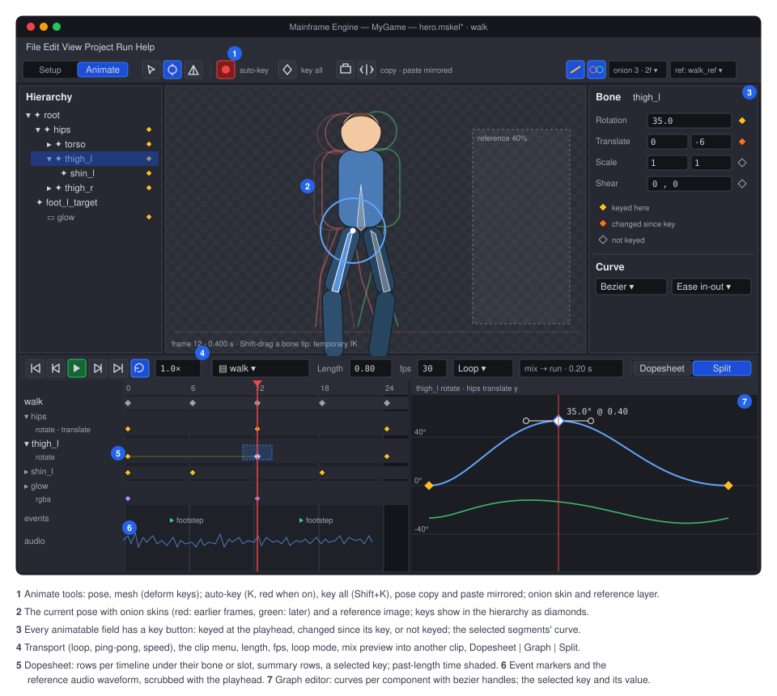
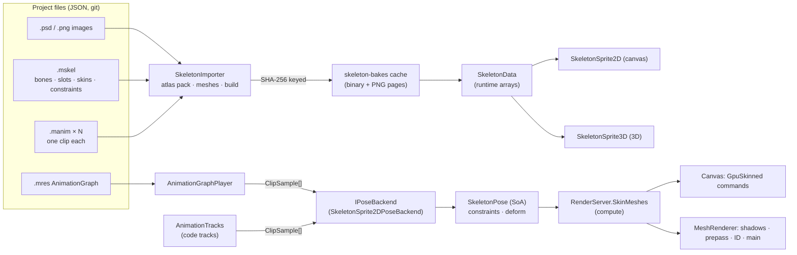

# Proposal: 2D skeletal animation (SkeletonSprite2D)

**Milestone:** [Gameplay toolkit](../../milestones.md#gameplay-toolkit-) (G17a–G17g) · **Status:** ⬜ planned ·
**Depends on:** [Canvas](../canvas.md), [Scene serialization](../scene-serialization.md),
[Asset pipeline](../asset-pipeline.md), [Editor](../editor.md) · **Related:**
[Skeleton editor](skeleton-2d-editor.md) (the Skeleton tab: Setup and Animate modes),
[Animation graph](animation-graph.md) (the state machine shared with 3D), [Keyframe animation](keyframe-animation.md)
(G1a `AnimationPlayer`, G1b compute skinning and `Skeleton3D`), [Animation authoring](animation-authoring.md) (`mfe`),
[Spine](../spine.md) (the vendored runtime, which stays), [2D content](2d-content.md) (G2 sprite frames) ·
**ADR:** [0184](../../../memory/decisions/0184-engine-owned-2d-skeletal-animation.md)



## Problem

Today the engine's only skeletal animation is Spine ([Spine](../spine.md)). The vendored spine-csharp 4.3 runtime
(`Plugins/Spine`) is drawn by `SpineNode` (3D, lit, `MainframeEngine/Src/Nodes/SpineNode.cs:14`) and `SpineSprite`
(2D canvas, `MainframeEngine/Src/Nodes/SpineSprite.cs:122`). That has four costs:

- **Licence.** The runtime is under the Spine Runtimes License: every game that ships it needs its own Spine Editor
  licence, and so does every artist who authors for it (`README.md:563-567`, `THIRD_PARTY_NOTICES.md`). An engine
  that wants indie users cannot make that the default 2D animation path.
- **Workflow.** Artists animate in an external tool, export JSON and an atlas, and only see the result in the engine
  after the round trip. They never animate against the real scene, lighting or gameplay.
- **Integration.** The engine cannot reach inside the runtime:
  - Spine has no bounds, so it is drawn into every shadow pass (`Servers/RenderServer.cs:344`).
  - It is not in the depth prepass, object-ID picking or motion vectors.
  - Its shadows are whole quads, because there is no alpha test ([Spine → Known issues](../spine.md#known-issues)).
  - Per-slot blend modes and two-colour tint are ignored.
  - In 2D, the canvas takes the blend mode from the item's material (`Rendering/Canvas/CanvasFrame.cs:179`), so
    `SpineSprite` warns and draws normal (`SpineSprite.cs:186-193`).
- **Control.** The runtime must not be modified (`docs/design/architecture-overview.md:27`). It allocates in places
  the engine's allocation gate would reject, skins on the CPU, and changes its API between minor versions (ADR 0116).

The engine has no replacement pieces either:

- no keyframe animation (G1a is planned, not built: [Keyframe animation](keyframe-animation.md));
- no 2D bones or deformable 2D meshes, and no atlas packer;
- no PSD reader;
- no compute pipelines (`Rendering/Vulkan/PipelineCache.cs` only mentions `vkCreateComputePipelines`).

## Goals

- **An engine-owned 2D skeletal system, heavily inspired by Spine,** under the engine's MIT licence:
  - bones;
  - slots;
  - region, mesh, bounding-box, clipping, point and path attachments;
  - weighted meshes and deform keys;
  - image sequences;
  - skins (with runtime composition);
  - draw-order keys;
  - slot colour and two-colour tint;
  - blend modes (normal, additive, multiply, screen);
  - normal maps lit by 2D and 3D lights;
  - IK, transform, path and physics constraints;
  - events carrying int, float and string payloads and audio.
- **Playback** like Spine's `AnimationState`: layered tracks, crossfade mix durations, queueing, per-track alpha,
  additive tracks. On top of that, a **state machine** ([Animation graph](animation-graph.md)) with parameters,
  transitions, 1D/2D blend spaces and masked layers. The graph is designed so that 3D skeletons can use the same asset
  later.
- **Two nodes, one runtime:**
  - `SkeletonSprite2D` on the canvas.
  - `SkeletonSprite3D` in 3D worlds: lit, shadow casting (alpha-tested), in the prepass, pickable, motion vectors.
- **Authoring in the editor** ([Skeleton editor](skeleton-2d-editor.md)):
  - a Skeleton tab with Spine's Setup and Animate modes;
  - PSD or PNG folder import, with atlases packed automatically;
  - mesh and weight tools;
  - a dopesheet and a graph editor;
  - onion skinning, auto-key and IK posing.
- **Assets:**
  - a diff- and merge-friendly JSON source: `.mskel` for the rig and skins, one `.manim` per clip;
  - a compact binary build plus packed atlas pages, built automatically and cached;
  - export ships only the build.
- **Performance.** About 200 mid-complexity skeletons (40 bones, 30 slots, 800 skinned vertices each) at 60 fps on a
  mid-range laptop:
  - zero per-frame allocation;
  - structure-of-arrays pose evaluation;
  - GPU skinning;
  - batching by atlas page;
  - culling by pose bounds;
  - off-screen skeletons that only advance time.
- **Gameplay integration:**
  - `BoneAttachment2D/3D`;
  - bone overrides from code;
  - bounding-box attachments as `Area2D`/`Area3D` shapes;
  - replication of animation state over the network;
  - keys for G1a's `AnimationPlayer`.
- **A one-way Spine 4.x JSON importer**, so existing rigs, and spineboy for tests, move over.
- **Agent tooling:** `mfe skel describe/check/render` and a Claude Code skill, so Claude can inspect, check and
  render rigs and clips and make small clips from text.

## Non-goals

- **Removing Spine.** `SpineNode`, `SpineSprite` and the vendored runtime stay for teams that own Spine licences. The two
  systems share nothing at run time.
- **Exporting to Spine's format,** or round-tripping with the Spine Editor.
- **Bit-exact parity with Spine's mixing and constraint maths.** The behaviour follows Spine's documented semantics;
  imported rigs look the same to the eye, not to the last bit (see [Clean-room rule](#clean-room-rule)).
- **Godot's `Bone2D` node model.** Bones are data inside a skeleton, as in Spine and Godot 4's `Skeleton3D`. A Godot
  scene that uses `Skeleton2D` + `Bone2D` nodes does not import as such (see
  [open question 5](#open-questions)).
- **Free-form deformation outside a mesh,** such as lattices, bones that bend images without a mesh, or Spine's
  "bone scaling inherits" variants beyond the documented `inherit` modes.
- **Crowds of thousands.** That needs baked, instanced playback, which is a later optimisation.
- **Stencil clipping.** Clipping attachments clip on the CPU in v1 (see [Canvas](#canvas)).
- **Aseprite or Krita import.** PSD and PNG only. Both tools export PSD.

## Overview



The code goes in these places:

- Shared animation playback, used by 2D now and by G1a/G1b 3D later: `MainframeEngine/Src/Animation/`.
- The skeleton system: `MainframeEngine/Src/Skeleton2D/`.
- Compute skinning: `MainframeEngine/Src/Rendering/Skinning/`. This is also G1b's skinning step.
- The PSD reader: `MainframeEngine/Src/Imaging/Psd/`.
- Editor code: `MainframeEngine.Editor/Src/Skeleton/` and the shared `MainframeEngine.Editor/Src/Timeline/` (see
  [Skeleton editor](skeleton-2d-editor.md)).

```
MainframeEngine/Src/Animation/
  Core/       ClipSample, LayerInfo, ClipBlend, IPoseBackend, AnimationCurve (bezier sampling)
  Tracks/     AnimationTracks, TrackEntry (Spine-style tracks, mixing, queueing)
  Graph/      AnimationGraph (+ states, transitions, blend spaces, layers, masks), AnimationGraphPlayer
MainframeEngine/Src/Skeleton2D/
  Data/       SkeletonData, SkeletonClip, SkinData, SkeletonBuild (runtime arrays), SkeletonFormat (JSON reader/writer)
  Runtime/    SkeletonPose, ClipSampler, SkinComposer, Deform, Constraints/{Ik,Transform,Path,Physics}
  Import/     SkeletonImporter, AtlasPacker (MaxRects), AutoMesh, Triangulator, SpineJsonImporter, SkeletonBakeCache
  Nodes/      SkeletonSprite2D, SkeletonSprite3D, BoneAttachment2D, BoneAttachment3D, SkeletonAnimationSynchronizer
MainframeEngine/Src/Rendering/Skinning/   SkinningPass, SkinJob, skinning shaders
MainframeEngine/Src/Imaging/Psd/          PsdReader
```

## Clean-room rule

The Spine Runtimes License covers derivative works of spine-csharp (`Plugins/Spine/spine-csharp/LICENSE`). The engine
code in this proposal must not be ported from it, and must not be written by reading it side by side. That includes:

- `AnimationState`;
- the constraint solvers;
- `SkeletonJson`;
- `Triangulator`;
- `SkeletonClipping`.

The rules:

- **Sources.** Spine's public user guide (concepts and behaviour), the published JSON format reference (the
  importer), and general literature: FABRIK, two-bone IK, Verlet and spring integrators, constrained Delaunay,
  marching squares.
- **Reviews.** A PR in G17 that touches the runtime states in its description that it was written without reference to
  spine-csharp. Reviews reject code whose structure mirrors it.
- **Tests compare pictures, not code paths.** The Spine importer's acceptance test renders spineboy with both systems
  and compares the frames with a tolerance (see [Testing](#testing)).
- **Names stay neutral.** Spine's vocabulary (bone, slot, skin, attachment, constraint, mix) describes ideas, which
  are free to use. Class layouts and method sets are ours.

## Coordinates and units

- **Y-down, pixels**, as everywhere in 2D ([ADR 0110](../../../memory/decisions/0110-y-down-2d.md)). A bone's local
  transform is `x, y, rotation (degrees, clockwise on screen), scaleX, scaleY, shearX, shearY`. A world transform is a
  `Transform2D`, so it maps 1:1 onto `Node2D`, `BoneAttachment2D` and bone overrides. `SpineSprite`'s
  mirror-around-the-draw dance (`SpineSprite.cs:237-244`) is not needed.
- **The Spine importer flips once at import:** y, rotation and shear signs, and the vertical order of mesh UVs.
- **`SkeletonSprite3D`** maps pixels to metres with `PixelSize` (default 0.01, like `Sprite3D`) and applies one Y
  mirror in its model matrix. `MeshRenderer` already handles mirrored determinants.
- **Time is in seconds.** The editor snaps to `fps` (default 30), which is stored per clip.

## Data model

### Skeleton (`.mskel`)

A `.mskel` file is self-describing JSON with an embedded UID (prefix `skl_`), like `.mres` and `.msong`
(`Resources/AssetDatabase.cs:270-272`). It holds the rig: bones, slots, skins with their attachments, constraints,
event definitions, the image list and import settings. It holds no clips. It is written by a dedicated
`SkeletonFormat` (like `SongFormat`), not the generic resource saver:

- the data is mostly flat arrays;
- the order of keys is fixed for diffs;
- the generator skips generic types.

```json
{
  "format": 1,
  "uid": "skl_7d1c40e2a9b3",
  "type": "Skeleton",
  "fps": 30,
  "import": { "images": "Images/", "pageSize": 2048, "padding": 2, "scale": 1, "filter": "Linear", "mipmaps": false,
              "normalSuffix": "_n" },
  "bones": [
    { "name": "root" },
    { "name": "hips", "parent": "root", "y": -96, "length": 24 },
    { "name": "torso", "parent": "hips", "rot": -90, "length": 64, "color": "#ffcc00" },
    { "name": "thigh_l", "parent": "hips", "rot": 95, "length": 42 },
    { "name": "shin_l", "parent": "thigh_l", "x": 42, "length": 40 },
    { "name": "foot_l_target", "parent": "root", "x": 8, "y": -2 }
  ],
  "slots": [
    { "name": "leg_l", "bone": "thigh_l", "attachment": "leg_l" },
    { "name": "body", "bone": "torso", "attachment": "body", "blend": "Normal" },
    { "name": "glow", "bone": "torso", "attachment": "glow", "blend": "Additive", "color": "#ffffffaa" }
  ],
  "ik": [ { "name": "leg_l_ik", "bones": ["thigh_l", "shin_l"], "target": "foot_l_target", "bend": 1, "mix": 1 } ],
  "transform": [],
  "path": [],
  "physics": [ { "name": "hair", "bone": "hair_1", "inertia": 0.5, "strength": 100, "damping": 0.85, "mass": 1,
                 "gravity": 0, "wind": 0, "mix": 1, "rotate": 1 } ],
  "events": [ { "name": "footstep", "audio": "Assets/Audio/step.ogg", "volume": 0.8 } ],
  "skins": [
    { "name": "default",
      "attachments": [
        { "slot": "body", "name": "body", "type": "Mesh", "image": "body",
          "uvs": [0, 0, 1, 0, 1, 1, 0, 1, 0.5, 0.5],
          "triangles": [0, 1, 4, 1, 2, 4, 2, 3, 4, 3, 0, 4],
          "hull": 4,
          "edges": [0, 1, 1, 2, 2, 3, 3, 0],
          "weights": { "bones": ["hips", "torso"],
                       "v": [[0, 1.0, -40, 32], [0, 1.0, 40, 32], [1, 1.0, 40, -60], [1, 1.0, -40, -60],
                             [0, 0.5, 0, -10, 1, 0.5, 0, 50]] } },
        { "slot": "leg_l", "name": "leg_l", "type": "Region", "image": "leg_l", "x": 20, "rot": 90 },
        { "slot": "hitbox", "name": "hitbox", "type": "BoundingBox", "vertices": [-30, -90, 30, -90, 30, 0, -30, 0] }
      ] },
    { "name": "armor", "attachments": [ { "slot": "body", "name": "body", "type": "LinkedMesh", "parent": "body",
                                          "skin": "default", "image": "body_armor" } ] }
  ]
}
```

Each part:

- **Bones** are ordered so that parents come before children, by name. They carry:
  - the setup pose: `x, y, rot, sx, sy, shx, shy`;
  - `length`;
  - `inherit`: `Normal`, `OnlyTranslation`, `NoRotationOrReflection`, `NoScale` or `NoScaleOrReflection`, as in Spine's
    guide;
  - an editor `color`;
  - `skinRequired`, for bones that only exist when a skin adds them.
- **Slots** come in setup draw order. They carry a bone, a setup attachment, a `color`, an optional `dark` colour
  (two-colour tint) and a `blend` (`Normal`, `Additive`, `Multiply` or `Screen`).
- **Attachments** belong to a skin, keyed by (slot, name). There are these types:

  | Type | Data |
  |---|---|
  | `Region` | image, offset, rotation, scale, size, colour |
  | `Mesh` | image, UVs, triangles, hull count, edges (editor only), and either unweighted vertices or weights |
  | `LinkedMesh` | shares a parent mesh's geometry and weights with another image; `deform: true` also shares its deform keys |
  | `BoundingBox` | polygon, optionally weighted |
  | `Clipping` | polygon plus an end slot |
  | `Point` | position plus rotation (spawn points) |
  | `Path` | bezier control points, closed flag, constant-speed flag, lengths |

  Weights are written per vertex as `[bone, weight, x, y] × influences`, in bone space. That is the layout the
  skinning shader reads (see [Compute skinning](#compute-skinning)), capped at `MAX_SKELETON_INFLUENCES` (8) by the
  importer.
- **Sequences.** A `Region` or `Mesh` with `"sequence": { "count": 8, "start": 1, "digits": 2, "setup": 0 }` takes
  images `name01…name08`. Sequence timelines pick the frame.
- **Constraints** run in an `order` that the editor maintains (Spine's model), mixed in with the bone updates. Each
  has `skinRequired`.
- **Images** are found by name under `import.images`, relative to the `.mskel`'s folder, as `.png` files. A PSD import
  writes those PNGs and remembers its source (see [PSD import](#psd-import)). `<name>_n.png` next to an image is its
  normal map.
- **Units.** Pixels in image space at `import.scale` 1. Changing `scale` rescales the setup pose at build time, which
  is used when the art was drawn at 2× and ships at 1×.

### Clips (`.manim`)

Each clip is its own self-describing file (UID prefix `anm_`) that references its skeleton by UID. This means:

- two artists can animate two clips without merge conflicts;
- clips load on demand (`SkeletonData.LoadClip`);
- a game can ship a character's combat clips in a separate pack later.

A skeleton finds its clips in two ways: the `clips` folder named in the `.mskel` (default `<name>.clips/` next to it),
plus any `.manim` registered in the `AssetDatabase` whose `skeleton` UID matches. A clip has no name field: its name
is its file name without the extension.

```json
{
  "format": 1,
  "uid": "anm_1f07c3a9e5d2",
  "type": "SkeletonClip",
  "skeleton": { "uid": "skl_7d1c40e2a9b3", "path": "Assets/Characters/Hero/hero.mskel" },
  "length": 0.8,
  "fps": 30,
  "loop": "Linear",
  "bones": {
    "thigh_l": {
      "rotate": { "t": [0, 0.4, 0.8], "v": [0, 35, 0], "curve": [[0.25, 0, 0.75, 1], [0.25, 0, 0.75, 1]] },
      "translate": { "t": [0, 0.4], "v": [[0, 0], [0, -6]], "curve": ["linear"] }
    }
  },
  "slots": {
    "glow": { "rgba": { "t": [0, 0.4], "v": ["#ffffffff", "#ffffff00"] } },
    "body": { "attachment": { "t": [0.6], "v": ["body_hurt"] } }
  },
  "ik": { "leg_l_ik": { "t": [0, 0.3], "mix": [1, 0], "bend": [1, -1] } },
  "physics": { "hair": { "reset": { "t": [0] } } },
  "deform": { "default": { "body": { "body": { "t": [0, 0.4], "offset": [0, 4], "v": [[0, 0, 1, -2], [3, 1]] } } } },
  "drawOrder": { "t": [0.5], "v": [[ ["glow", -1] ]] },
  "events": { "t": [0.2, 0.6], "v": [ { "name": "footstep" }, { "name": "footstep", "float": 0.5 } ] }
}
```

The layout rules:

- **One object per timeline, with parallel arrays.** Times go in `t[]`, values in `v[]` (a scalar, or an array when
  the value has several components) and interpolation in `curve[]`, one entry per segment. That is
  [Keyframe animation](keyframe-animation.md#animation-resource)'s flat-array rule. A changed key changes one or two
  lines in a diff. Agents can read and write it.
- **Curves.** A segment is `"linear"`, `"stepped"`, or a cubic bezier `[cx1, cy1, cx2, cy2]` in normalised segment
  space, with x the time fraction and y the value fraction, as in Spine. A multi-component value has either one shared
  curve or one per component (`[[...], [...]]`).
- **Deform keys** are sparse: an `offset` (the first float index) and the changed floats, relative to the setup or
  weighted local positions. `drawOrder` keys are slot moves relative to the setup order (`["glow", -1]`).
- **Timeline kinds:**

  | Group | Timelines |
  |---|---|
  | Bones | `rotate`, `translate`, `translateX`, `translateY`, `scale`, `scaleX`, `scaleY`, `shear`, `shearX`, `shearY`, `inherit` |
  | Slots | `attachment`, `rgba`, `rgb`, `alpha`, `rgba2` (two-colour), `sequence` (mode, index, delay) |
  | Constraints | `ik` (mix, softness, bend, compress, stretch); `transform` (mixRotate/X/Y/Scale/Shear); `path` (position, spacing, mixes); `physics` (inertia, strength, damping, mass, wind, gravity, mix, `reset`) |
  | Other | `deform`, `drawOrder`, `events` |

### The runtime build

`SkeletonImporter` turns the `.mskel`, its clips and its images into a `SkeletonBuild`, which is what the runtime uses:

- **Arrays.** Typed arrays sized from the data, with names resolved to indices: bone and slot arrays, the update order
  as `(kind, index)` pairs, skins as `(slot, name) → attachment` tables, the influence buffer for skinning, and
  attachment index ranges.
- **Atlas pages.** One RGBA8 page set with straight alpha in sRGB, premultiplied by the shader (see [Canvas](#canvas)),
  plus a normal page set in the same layout when any image has a normal map.
- **Clips.** One blob per clip: `Kinds[]`, `Targets[]`, `KeyStart[]`, `Times[]`, `Values[]`, and `CurveSamples[]`
  with every bezier pre-sampled into 10 linear pieces. That is the same approach Spine documents: evaluation does a
  lookup, never a solve.
- **Bounds.** Per clip, a conservative local box sampled at the clip's keys and midpoints. Off-screen skeletons are
  culled with it (see [Performance](#performance)).

**Caching.** Building a build packs atlases, triangulates meshes and samples curves, which can take hundreds of
milliseconds for a big rig. Builds are cached on disk the way tree bakes are (`Trees/Baking/TreeBakeCache.cs`,
[ADR 0172](../../../memory/decisions/0172-ez-tree-foliage-quality.md)):

- **Where:** `skeleton-bakes/` under the pipeline cache root (`Rendering/Vulkan/PipelineCache.cs:348`, for example
  `~/Library/Caches/MainframeEngine/skeleton-bakes` on macOS). `MAINFRAME_SKELETON_BAKE_CACHE_DIR` overrides it;
  `off` disables it.
- **Key:** the SHA-256 of the `.mskel`, every image's bytes, the import settings and `SkeletonBakeCache.Version`.
  Clips are cached separately, keyed by their own file and the skeleton's key.
- **Content:** zlib-compressed. A missing, short or corrupt entry is a miss; write failures only log.
- **What it changes:** the source in the project stays JSON and PNG, as
  [ADR 0011](../../../memory/decisions/0011-json-scenes-no-binary-bake.md) requires. The cache lives outside the
  project and can be deleted.
- **Exports:** `mf-cook` ([ADR 0100](../../../memory/decisions/0100-mobile-strategy.md), [Game export](game-export.md))
  ships the build files instead of the JSON and images. An exported game loads the cooked build directly.

`SkeletonData : Resource` is what `ResourceLoader.Load<SkeletonData>("…/hero.mskel")` returns. It wraps the build:

```csharp
[EditorIcon("bone")]
public sealed class SkeletonData : Resource
{
    public int BoneCount { get; }
    public int SlotCount { get; }
    public IReadOnlyList<string> BoneNames { get; }
    public IReadOnlyList<string> SlotNames { get; }
    public IReadOnlyList<string> SkinNames { get; }
    public IReadOnlyList<string> ClipNames { get; }          // every clip found (loaded or not)
    public int FindBone(string name);                        // -1 when missing
    public int FindSlot(string name);
    public int FindClip(string name);
    public SkeletonClip LoadClip(int clip);                  // loads and caches; SkeletonSprite2D preloads its graph's clips
    public float ClipLength(int clip);
    internal SkeletonBuild Build { get; }
    internal int Version { get; }                            // bumped when the editor or a reload replaces the build
}
```

`ResourceLoader.ReadFile` (`Resources/ResourceLoader.cs:288`) today sends only files that are not self-describing to an
importer. It is changed to: a self-describing file whose extension has a registered importer goes to that importer,
with the UID read by `ReadEmbeddedUid`. `.mscene` and `.mres` keep their direct path. The `skl_` and `anm_` prefixes
join `AssetUid.PrefixForExtension`.

## Runtime

### Pose

Each skeleton instance owns one `SkeletonPose`. It is allocated when the node loads its data and never grows:

```csharp
internal sealed class SkeletonPose
{
    // bones, structure of arrays (index = bone)
    public readonly float[] X, Y, Rot, ScaleX, ScaleY, ShearX, ShearY;    // local pose (animated)
    public readonly float[] A, B, C, D, WorldX, WorldY;                   // world 2×3, skeleton space, Y-down
    public readonly byte[] Inherit;
    public readonly bool[] Active;                                        // skinRequired bones of the current skin
    // slots
    public readonly uint[] Color, Dark;                                   // RGBA8, straight
    public readonly short[] Attachment;                                   // into the composed skin, -1 none
    public readonly short[] SequenceIndex;
    public readonly ushort[] DrawOrder;
    // constraints (animated mixes) and physics state
    public readonly float[] IkMix, IkSoftness; public readonly sbyte[] IkBend; /* … */
    public readonly PhysicsState[] Physics;
    // deform: per slot, a range into one float pool (only for slots with a deformed mesh)
    public readonly float[] DeformPool;
    public readonly int[] DeformStart;
}
```

The cost is about 100 B per bone and 24 B per slot. Hot loops walk these arrays in update order with no virtual calls
or per-bone objects.

### Applying clips

`AnimationTracks` (playback, [below](#tracks-and-mixing)) and the graph player ([Animation graph](animation-graph.md)) produce a span of `ClipSample`s each frame. Each one holds a
clip index, time, previous time, weight, layer, blend mode (`Replace` or `Additive`) and an optional bone mask.
`SkeletonSprite2DPoseBackend.Apply` (the `IPoseBackend` from [Animation graph](animation-graph.md#the-contract)) then:

1. **Resets** the local pose to the setup pose: bones, slot colours, attachments, draw order, constraint mixes.
2. **Samples each clip** with `ClipSampler`. Each timeline keeps a cursor, so the key search is amortised O(1) during
   forward playback, with a binary search after a seek. The sampler blends into the pose:
   - **Replace samples** lerp from the current value by `weight`. Rotation takes the shortest path; Spine's "first
     mix holds the angle" behaviour is replaced by a documented rule (see [Mixing](#tracks-and-mixing)).
   - **Additive samples** add `(value − setup) × weight`.
   - **Discrete timelines** (attachment, draw order, sequence mode, inherit, IK bend) take the value of the
     highest-weight sample above 0.5 on each layer. A layer whose weight is below its threshold leaves them alone.
   - **Bone masks** zero the weight for bones and slots outside the mask.
3. **Collects events** whose time lies in `(prevTime, time]` per sample, including loop wraps. Each sample's weight
   must be at least the track's `EventThreshold` (default 0.5 for mixing-out tracks, as in Spine).
4. **Applies bone overrides** from code ([below](#bone-overrides-and-attachments)).

### Update order and constraints

`SkeletonBuild.UpdateOrder` interleaves bones and constraints. A bone's world transform is computed just before the
first constraint that reads it, and again after constraints that change it:

- **Bones.** Parent world × local, honouring `inherit` and reflection. When a bone and every ancestor are unchanged
  from the last frame, the bone's world transform is copied instead of recomputed: that skips idle sub-trees such as
  hair in a still pose.
- **IK, one bone.** Rotate towards the target, with `mix`.
- **IK, two bones.** Analytic law-of-cosines solve with:
  - `bend` direction (±1);
  - `softness` (pixels of softening near full extension);
  - `compress`, `stretch` and `uniform`;
  - `mix`.

  Parent scale and shear are handled as Spine's guide describes: non-uniform parent scale is supported, while shear
  on the IK chain gives an approximate solve with a warning in the editor.
- **Transform constraints.** Copy or offset rotation, translation, scale and shear from a target bone in world or local
  space, absolute or relative, with per-channel mixes.
- **Path constraints.** Bones are placed along a `Path` attachment's world-space bezier with:
  - position mode (fixed or percent);
  - spacing (length, fixed, percent or proportional);
  - rotate mode (tangent, chain or chain-scale);
  - `mixRotate`, `mixX` and `mixY`.

  Arc lengths are computed once per frame per path into a scratch array owned by the constraint, with
  `PathCurveSegments` (default 10) samples per curve.
- **Physics constraints.** Secondary motion for hair, cloth and tails:
  - **Model:** a damped spring per constrained bone on translation, rotation, scale and shear. Each channel is
    enabled separately and has inertia, strength, damping, mass, gravity and wind.
  - **Integration:** semi-implicit Euler at a fixed step (`PhysicsStep`, default 1/60 s), consuming the frame's
    delta. The steps are capped at 4 per frame, after which the remaining time is dropped.
  - **Movement:** the skeleton node's world movement feeds inertia (teleports above `PhysicsTeleportDistance` reset the
    state).
  - **Reset:** `reset` keys and `SkeletonSprite2D.ResetPhysics()` restore the setup state.
  - **Mixing:** global and per-constraint `mix`.

  The skeleton-wide gravity and wind are exported on the node and come from the `World2D` defaults.
  `PhysicsMode` is `Update` (default), `Pose` (solve without stepping, used by the editor while scrubbing) or `None`.

Constraints never allocate. Each keeps fixed scratch arrays sized at load.

### Skins

- A `SkinComposer` builds the **active skin**: one or more skins merged in order, with later entries winning per
  (slot, name). That is runtime composition:

  ```csharp
  skeleton.SetSkins("base", "hair/long", "armor/plate");
  ```

  The composed table is cached per unique list in the `SkeletonData`, so 100 orcs with the same outfit share one
  table. Building a new combination allocates once, at the time of the call, not per frame.
- Bones and constraints marked `skinRequired` are active only when an active skin lists them.
- Changing skins re-resolves slot attachments that match by name, as in Spine. Slots whose attachment doesn't exist in
  the new skin go back to the setup attachment if it exists there, otherwise they go empty.

### Slots, deform and sequences

- **Two-colour tint.** Slot colour × attachment colour × node modulate is the light colour; `dark` is the dark colour.
  The shader applies `rgb = (1 − tex.rgb) × dark × tex.a + tex.rgb × light` with premultiplied texels.
- **Deform** keys add per-vertex offsets in each vertex's own space (bone space for weighted vertices). They are
  sampled into `DeformPool`, and the skinning job reads them (see [Compute skinning](#compute-skinning)).
- **Sequences** pick a frame from `SequenceIndex`, set by sequence timelines with these modes: hold, once, loop,
  ping-pong, the reverse of each, and a per-key delay. Each frame is its own atlas region, and all of an attachment's
  frames share one mesh.

### Events and audio

Events are defined in the `.mskel` (name, default int/float/string, optional audio stream, volume and balance) and keyed
in clips. After each frame's evaluation, `SkeletonSprite2D` raises:

```csharp
[Signal] public event Action<SkeletonSprite2D, SkeletonEvent>? AnimationEvent;   // SkeletonEvent: readonly struct (name id, int, float, string?, track)
```

- An event with an audio stream plays through the node's `AudioPlayer2D` (or `AudioPlayer3D` for `SkeletonSprite3D`).
  The engine creates that player as an internal child on first use, routed to `EventAudioBus` (an exported string,
  default `"SFX"`).
- Events fire on the main thread after the skeleton updates, never mid-evaluation.
- **Allocation:** nothing per event. `SkeletonEvent` is a struct, and its string values are interned at load.

### Tracks and mixing

`AnimationTracks` is Spine's `AnimationState` idea, written to the engine's rules. It is shared with 3D (see
[Animation graph → Tracks](animation-graph.md#tracks)):

```csharp
public sealed class AnimationTracks
{
    public TrackEntry SetClip(int track, int clip, bool loop);              // replace (mixes from current)
    public TrackEntry AddClip(int track, int clip, bool loop, float delay); // queue after current (delay ≤ 0: relative to end)
    public TrackEntry SetEmpty(int track, float mixDuration);               // mix out to setup pose
    public TrackEntry AddEmpty(int track, float mixDuration, float delay);
    public void ClearTrack(int track);
    public float DefaultMix { get; set; }
    public void SetMix(int from, int to, float duration);                  // pair table; built once, no per-frame allocation
    public float TimeScale { get; set; }
}

public sealed class TrackEntry                                             // pooled; valid until it ends (Ended signal)
{
    public int Clip { get; } public bool Loop { get; set; }
    public float TrackTime { get; set; } public float TimeScale { get; set; }
    public float Alpha { get; set; } public float MixDuration { get; set; }
    public float MixTime { get; }   public ClipBlend Blend { get; set; }   // Replace | Additive
    public float EventThreshold { get; set; } public float AlphaAttachmentThreshold { get; set; }
    public float MixAttachmentThreshold { get; set; } public float MixDrawOrderThreshold { get; set; }
    public bool HoldPrevious { get; set; } public bool Reverse { get; set; }
    public float AnimationStart { get; set; } public float AnimationEnd { get; set; }
    public BoneMask? Mask { get; set; }
}
```

- **Mixing.** A track that switches clips keeps the previous entry as a mixing-from entry. Its weight goes
  `1 − mixTime/mixDuration` while the new one goes up. The chain is capped at `MaxMixChain` (4): when a fifth switch
  happens mid-mix, the oldest entry is dropped and its weight folded into the next.
- **The rotation rule.** Each mixing pair interpolates rotation along the shortest arc, computed from the two clips'
  sampled angles, not from the previous frame's pose. The direction is latched when the mix starts, so a 179°/−179°
  pair never flips mid-mix. Spine's guide describes an equivalent behaviour; ours is defined by this rule.
- **`HoldPrevious`** keeps the outgoing entry at full weight during the mix, for poses that should not dip.
- **Layers.** Track 0 is the base. Higher tracks layer over it with `Alpha`, `Blend` and `Mask`. An empty track with
  `SetEmpty(track, 0.2)` fades a layer out.
- **Signals:** `TrackStarted`, `TrackInterrupted`, `TrackEnded`, `TrackCompleted` (each loop) and `TrackDisposed`,
  with `(SkeletonSprite2D, TrackEntry)` arguments.
- **Pooling.** `TrackEntry` objects come from a per-node pool with a fixed initial size (8). The pool grows only when a
  game queues more than that, and growing is a load-time cost. A disposed entry must not be kept, as in Spine.
  `TrackEntry.Generation` lets code check for a stale reference.

[Animation graph](animation-graph.md) is the second producer of samples. Without a graph, the tracks are the whole
animation. With a graph, code tracks layer above the graph's layers, for one-off emotes and hit reactions
([Animation graph → Tracks](animation-graph.md#tracks)).

## Nodes

### SkeletonSprite2D

```csharp
[EditorIcon("bone", Family = EditorIconFamily.Canvas)]
public class SkeletonSprite2D : Node2D
{
    [Export] public SkeletonData? Data { get; set; }
    [Export] public AnimationGraph? Graph { get; set; }                  // optional
    [Export] public string[] Skins { get; set; } = ["default"];         // composed in order
    [Export] public string Clip { get; set; } = "";                     // without a graph: track 0 plays this, looping
    [Export] public SkeletonUpdateMode UpdateMode { get; set; }         // Process | Physics | Manual
    [Export] public OffscreenUpdate Offscreen { get; set; }             // Full | TimeOnly (default) | Pause
    [Export(Range = "0,4,0.01")] public float TimeScale { get; set; } = 1f;
    [Export] public SkeletonPhysicsMode PhysicsMode { get; set; }
    [Export] public Vector2 PhysicsGravity { get; set; }                // added to the world's
    [Export] public Vector2 PhysicsWind { get; set; }
    [Export] public bool FlipH { get; set; }                            // mirrors the skeleton (not the node)
    [Export] public bool FlipV { get; set; }
    [Export] public string EventAudioBus { get; set; } = "SFX";

    public AnimationTracks Tracks { get; }
    public AnimationGraphPlayer? GraphPlayer { get; }
    public void SetSkins(params ReadOnlySpan<string> skins);
    public int FindBone(string name);
    public Transform2D GetBoneTransform(int bone);                      // skeleton space
    public Transform2D GetBoneGlobalTransform(int bone);                // canvas space
    public void SetBoneOverride(int bone, in BoneOverride value);       // see below; cleared with ClearBoneOverride
    public void ClearBoneOverride(int bone);
    public void SetSlotAttachment(int slot, string? attachment);        // until the next clip key or skin change
    public void ResetPhysics();
    public void Advance(float delta);                                   // Manual mode
    public Rect2 GetPoseBounds();

    [Signal] public event Action<SkeletonSprite2D, SkeletonEvent>? AnimationEvent;
    [Signal] public event Action<SkeletonSprite2D, TrackEntry>? TrackStarted;  // + Interrupted, Ended, Completed, Disposed
    [Signal] public event Action<SkeletonSprite2D>? PoseUpdated;               // after constraints, before draw
}
```

- **The per-tick update** runs in `OnProcess`, or `OnPhysicsProcess` when `UpdateMode = Physics`. The order is:
  1. graph or tracks;
  2. `Apply`;
  3. overrides;
  4. the update order;
  5. slots and deform;
  6. events;
  7. `PoseUpdated`;
  8. attachments sync;
  9. `QueueRedraw()`.
- **Off-screen.** When last frame's cull did not draw the item (it has a `WasCulled` flag from `CanvasCuller`), the
  behaviour depends on `Offscreen`:
  - `TimeOnly` advances tracks, graph and events but skips steps 2–5 and the redraw;
  - `Pause` stops time entirely;
  - `Full` always evaluates, for gameplay that reads bones off screen.
  
  Culling then uses the union of the playing clips' conservative bounds, so a skeleton walking back on screen is
  drawn on the first frame it would be visible.
- **In the editor's edit mode** a `SkeletonSprite2D` is a `[Tool]` node: it shows its setup pose, or `Clip`'s pose at
  `EditorPreviewTime`. That way scenes look right without running, which fixes the gap ADR 0127 notes for Spine rigs.
- **Constructors are cheap.** Data binds when `Data` is set and the node enters the tree, as `CLAUDE.md` requires.

### SkeletonSprite3D

`SkeletonSprite3D : GeometryInstance3D` is the 3D variant, named after `Sprite3D` (`GeometryInstance3D.cs:177`). It has
the same exports and API, plus:

```csharp
[Export(Range = "0.0001,1,0.0001")] public float PixelSize { get; set; } = 0.01f;   // metres per pixel
[Export] public SkeletonBillboard Billboard { get; set; }                           // None | Y | Full
[Export] public bool Shaded { get; set; } = true;                                    // lit by the scene's lights
[Export] public bool DoubleSided { get; set; } = true;
[Export(Range = "0,1,0.01")] public float AlphaCutoff { get; set; } = 0.5f;          // shadows and prepass
[Export] public float SlotDepthOffset { get; set; } = 0;                             // optional 3D layering (SpineNode's ZSpacing)
```

It replaces `SpineNode`'s `ZSpacing` hack: draw order is kept by draw ordering (see [3D](#3d)), and `SlotDepthOffset`
is opt-in for rigs that want physical layering.

### Bone overrides and attachments

```csharp
public readonly record struct BoneOverride(BoneOverrideSpace Space, Transform2D Transform, float Mix, BoneOverrideChannels Channels);
```

- **Overrides** apply after clips and before constraints, in local or world space, with a mix and a set of channels
  (rotation, translation, scale). Typical uses: aim the arm at the mouse, look at a target, ragdoll a limb. Constraints
  still run after, so an IK target can be overridden too.
- **`BoneAttachment2D`** is a `Node2D` child of a `SkeletonSprite2D`:
  - `[Export] string Bone`;
  - `[Export] bool OverridePose` (false: follow the bone; true: this node's transform drives the bone, Godot's
    `BoneAttachment3D` mode);
  - `[Export] bool FollowScale`.
  
  It syncs right after the pose updates, before `PoseUpdated`. Children such as weapons, particles, lights and
  collision shapes follow.
- **`BoneAttachment3D`** does the same for `SkeletonSprite3D`, in the sprite's plane. It is shared in name with G1b's
  `BoneAttachment3D`, which follows `Skeleton3D` bones: one node type whose `Skeleton` path accepts either.

### Physics hitboxes

`BoundingBox` attachments become physics shapes through an opt-in child node:

```csharp
public class SkeletonHitboxes2D : Node2D   // creates one Area2D per bounding-box slot (or a body: Mode)
{
    [Export] public HitboxMode Mode { get; set; }            // Area | KinematicBody
    [Export] public uint CollisionLayer { get; set; } = 1;
    [Export] public uint CollisionMask { get; set; } = 1;
    [Export] public string[] Slots { get; set; } = [];       // empty: all bounding-box slots
    [Signal] public event Action<SkeletonHitboxes2D, string, Node2D>? HitboxEntered;   // slot name, other
}
```

- **Shapes.** Each polygon is decomposed into convex pieces with Hertel–Mehlhorn at build time. The pieces are capped
  at 8 points because `ConvexPolygonShape2D` takes no more (`Physics/2D/Shapes2D.cs:229`). Each piece becomes a
  `CollisionShape2D` under the slot's `Area2D`.
- **Following the pose.** A rigid polygon on one bone moves with the bone's transform. A weighted polygon is skinned on
  the CPU, a few points per box, and its shape points are updated.
- **Timing.** The shapes update in `OnPhysicsProcess` from the latest pose. With `UpdateMode = Process` they lag the
  drawn pose by up to one physics tick, which is documented. Games that need exact hitboxes use `UpdateMode = Physics`.
- **3D.** `SkeletonHitboxes3D` builds `Area3D`s with thin convex prisms (`HitboxDepth`, default 0.1 m) in the sprite's
  plane.

### Networking

`SkeletonAnimationSynchronizer` is an opt-in child node, following `MultiplayerSynchronizer`
(`Networking/Replication/MultiplayerSynchronizer.cs:11`). It replicates the animation state, not the pose:

```csharp
public struct SkeletonNetState : INetworkTransferable, IEquatable<SkeletonNetState>
{
    public ushort GraphState; public uint StateTick;            // graph: current state and when it was entered
    public ushort TransitionTo; public uint TransitionTick;     // in-flight transition (0xFFFF: none)
    public ulong BoolParams;                                    // up to 64 bool/trigger params, by index
    public TrackNet Track0, Track1, Track2, Track3;             // without a graph: clip, start tick, speed, flags
    public ushort SkinSet;                                      // index into the synchronizer's Skins table
}
```

- **Sent only on change.** Times derive from ticks, so the struct changes only when the state changes, and delta
  snapshots stay idle while a character runs.
- **Continuous parameters**, such as a blend space's `speed`, are separate `[Replicated(Interpolate = true)] float`
  members listed in `FloatParams`.
- **Remote peers** reconstruct track times from `(serverTick − startTick) × speed` and let mixing smooth the jumps.
- **Events** fire locally on every peer from the reconstructed times. Gameplay-relevant events stay on the authority,
  through RPCs.
- **Physics constraints** run locally and are not replicated.

### AnimationPlayer bridge

G1a's `AnimationPlayer` ([Keyframe animation](keyframe-animation.md#animationplayer-node)) is for cutscenes and props.
It reaches skeletons without a new track type:

- `ValueTrack`s on `SkeletonSprite2D` exports (`Clip`, `Skins`, `TimeScale`) and on the graph player's parameters, through
  `AnimationGraphPlayer`'s generated property accessors for `Parameters/<name>`;
- `MethodTrack`s calling `Tracks.SetClip`-style wrappers (`PlayClip(string, bool)`, `QueueClip`), which are exported
  methods on `SkeletonSprite2D`;
- **scrubbing**: a `SkeletonClipTrack` (new, in G17g) holds clip keys. Seeking the player poses the skeleton at the
  right clip time, so cutscene editors can scrub character animation in the Animation panel. This needs G1a.

## Rendering

### Compute skinning

Every visible skeleton's vertices are skinned on the GPU by one compute pass. That is G1b's planned step
([Keyframe animation → G1b](keyframe-animation.md#g1b-skeletons-and-skinning)), built here first:

- **Frame order.** `RenderServer.SkinMeshes(Root)` (new) runs after `Renderer.BeginFrame()` and before `OnShadowPass`,
  with no render pass active.
- **CPU side.** For each skeleton drawn this frame, it writes into rings keyed by `IVulkanContext.FrameSlot` and sized
  `MaxFramesInFlight`:
  - a **bone palette** (world 2×3, 6 floats per bone);
  - **slot data** (light and dark colour, active attachment range);
  - the **deform floats** that changed.
- **Dispatch.** One compute dispatch per skeleton batch, then one barrier: compute write → vertex attribute read.
- **Static input** per `SkeletonData`, uploaded once:
  - the influence buffer (`bone, weight, x, y` per influence);
  - per-vertex `(firstInfluence, count, uv, attachment)`;
  - region quads as four vertices with one influence each.
- **Output** per skeleton and frame slot: positions, UVs and colours in the canvas vertex layout (`CanvasVertex`,
  32 B), plus an 8 B extension (dark colour RGBA8, tangent `half2` for normal maps). The 3D path writes `MeshVertex`
  (32 B) plus the same extension.
- **Memory.** 200 × 800 vertices × 40 B × 2 frame slots ≈ 13 MB.
- **First compute and storage-buffer user.** This lands compute pipeline creation in `IVulkanContext.Pipelines`
  (G1b's task G1.9) and storage-buffer descriptors. MoltenVK and lavapipe both support compute. The
  [backend abstraction](rendering-backend-abstraction.md) (M11) must add compute to its encoder API, which it does
  not mention today.
- **Fallback.** Slots inside a clipping range are skinned and clipped on the CPU (see below). Everything else goes
  through compute.

### Canvas

The canvas renders into an RGBA8 UNORM layer composited after the tonemap, so it works in gamma space
(`Rendering/Canvas/VulkanCanvasRenderer.cs:11-18`, [Canvas](../canvas.md)). It takes CPU vertices only today:
`CanvasDrawCommand` is texture + primitive + index range (`Scene/Canvas/CanvasDrawList.cs:37`), and `CanvasFrame.Append`
transforms every vertex on the CPU (`CanvasFrame.cs:163-177`). The changes:

- **A GPU-skinned command kind.** `CanvasDrawCommand` gains:
  - `Kind` (`Cpu`, `Lines` or `GpuSkinned`);
  - a source (`ICanvasGpuGeometry`, the skeleton);
  - a run index;
  - an optional per-command `Blend`;
  - an optional `NormalMap`.

  `SkeletonSprite2D.OnDraw` records one `GpuSkinned` command per run of slots that share page, blend and clip state. The
  runs are cached and rebuilt only when draw order, attachments or skins change. A frame where only the pose changes
  records no commands at all: the item just reports new pose bounds to the culler.
- **Per-command blend.** `CanvasFrame.Append` takes a command's `Blend` over the item's material when it is set
  (`CanvasFrame.cs:179`). This also lets `SpineSprite` honour slot blend modes, closing the known issue in
  [Spine](../spine.md#known-issues).
- **Batching.** Skinned runs from different skeletons on the same page, with the same blend and lights, merge into one
  batch, by the existing merge rule (`CanvasFrame.cs:198-208`). Their indices are rebased into the frame's skinned
  vertex ring.
- **Premultiplied blending.** Pages are sampled straight. The skeleton fragment variant (`Canvas.vk.frag` with a
  `SKELETON` define) premultiplies after two-colour tint, lights and canvas modulate, then blends with the new
  premultiplied modes. `CanvasBlendMode` (`Rendering/Canvas/CanvasItemMaterial.cs:4-29`) gains:

  | Mode | Colour blend |
  |---|---|
  | `PremultAlpha` (exists) | `ONE, 1 − SRC_ALPHA`, used for Normal |
  | `PremultAdd` | `ONE, ONE` |
  | `PremultMul` | `DST_COLOR, 1 − SRC_ALPHA` |
  | `Screen` | `ONE, 1 − SRC_COLOR` |

  The canvas works in gamma space, so these match how 2D tools, including Spine's editor, show blend modes.
  `CanvasItemMaterial` exposes the new modes to other items too.
- **Normal maps.** These are new for the whole canvas:
  - `CanvasTexture : Texture2D` (Godot's: diffuse plus `NormalTexture`, `Shininess`);
  - `PointLight2D.Height` (Godot's), and the light's pixel position in the light block (`CanvasFrame.cs:40-47`);
  - Godot's N·L term in `canvas_apply_lights` (`Assets/Shaders/include/canvas_lights.slang`, which today says
    "without normals"), with N rotated by the vertex tangent the skinning pass writes.

  `Sprite2D` and `Polygon2D` get normal maps with the same change.
- **Clipping attachments.** The canvas pass has no stencil. Slots between a clipping attachment and its end slot are
  skinned on the CPU (`SkeletonSprite2D` keeps a CPU skinning path for this), clipped against the convex pieces of the clip
  polygon with Sutherland–Hodgman, and recorded as ordinary `Cpu` commands in draw order. That costs CPU per clipped
  slot, which is documented. Stencil clipping is a later step.
- **Validation.** Every pipeline variant is prebuilt through `IVulkanContext.Pipelines` when a skeleton first draws,
  so there is no mid-frame creation hitch. Render tests run with validation.

### 3D

`SkeletonSprite3D` draws through `MeshRenderer` as a skinned mesh whose vertex buffer is replaced each frame by the
skinning output. That makes it an ordinary mesh for every pass:

| Pass | Today (`SpineNode`) | `SkeletonSprite3D` |
|---|---|---|
| Culling | none, drawn everywhere (`RenderServer.cs:26`) | frustum culling with pose bounds |
| Shadows | whole quads, no alpha test | cutout casters (`ShadowSystem.cs:1151-1152`) with `AlphaCutoff` |
| Depth prepass | not drawn | cutout depth |
| Object-ID picking | not pickable | picks `Node.Id` |
| Motion vectors | none (TAA smears) | previous frame slot's skinned positions |
| Draw order | z offset per slot (`ZSpacing`) | run order within the node, plus an optional `SlotDepthOffset` |

`MeshRenderer` (`Rendering/Meshes/MeshRenderer.cs`) gains:

1. **A per-`FrameSlot` vertex buffer override** for an instance. G1b needs this too.
2. **Dynamic draw runs** in place of fixed surfaces. Each run has a page material, a blend mode and an index range.
   Runs are rebuilt on draw-order changes.
3. **A transparent-sort tie-break by run index**, so runs of one node keep their order. Today the sort key is
   priority, depth, pipeline, material.
4. **Premultiplied `Additive`, `Multiply` and `Screen`** in the material blend state. `AlphaMode` today is Opaque,
   Cutout or Blend (`Rendering/Resources/Material.cs:9`).

Lighting is the mesh shader's lighting, so skeletons are lit like every other surface: Blinn-Phong now, PBR with G6.
With a normal page, the skinned tangent frame feeds the normal map. Without one, the normal is the sprite plane's
normal.

## Asset pipeline

### Images and the atlas packer

- **Input.** Artists never author atlases. A skeleton's images are its PNG folder (`import.images`). Each image is
  trimmed to its alpha bounds (the trim offset is kept, so attachments don't move), padded, and edge-extruded by
  `import.padding` pixels.
- **Alpha bleed.** Fully transparent pixels take their nearest opaque neighbour's colour, so filtering at
  silhouettes doesn't darken them.
- **Packing.** `AtlasPacker` is a MaxRects packer (best short-side fit, with rotation off so UVs stay simple) into
  pages of `import.pageSize`. Pages are written as PNG (`Imaging/Png.cs:111`) into the bake cache. Normal maps pack
  into a second page set with the same rectangles.
- **Reuse.** The packer is a general engine type. G2's sprite frames and the font atlas can adopt it later. The font's
  shelf packer (`Text/Font.cs:163-186`) stays as it is for now.
- **Sharing.** Several skeletons can share images through `import.images` pointing at a common folder. Each skeleton
  still packs its own pages, and cross-skeleton page sharing is an [open question](#open-questions).

### PSD import

`PsdReader` (`MainframeEngine/Src/Imaging/Psd/`, in house, no new package) reads what 2D artists' tools write:

- **Formats:** RGB, 8 and 16 bits per channel (16 is reduced to 8).
- **Layers:** layer records with Unicode names (`luni`), groups (`lsct`), visibility, opacity, blend mode name, and
  the layer bounds within the canvas.
- **Channel data:** raw and RLE. ZIP-compressed channels (rare in practice) are reported as unsupported, with the
  layer name.
- **Out of scope:** adjustment layers, smart objects and layer effects. The importer warns and skips them.

The editor's *Import PSD* ([Skeleton editor → Importing art](skeleton-2d-editor.md#importing-art)) runs it:

- Each visible pixel layer becomes a PNG in `import.images` and a slot with a `Region` attachment at the layer's canvas
  position.
- Groups become bones, or a group named `[skin] name` becomes a skin.
- Tags in layer names follow Spine's PSD script conventions, so artists' habits carry over: `[ignore]`, `[mesh]`,
  `[slot]`, `[bone]`, `[merge]`, `[normal]` (pair with the layer of the same name).
- **Re-import.** The rig keeps a map of layer → image. Changed layers update their PNGs and keep rig, meshes and
  weights. A layer whose bounds changed shifts its attachment by the bounds delta. New layers become new slots. Removed
  layers are listed in a dialog, never deleted silently.

### Auto mesh and triangulation

- **`AutoMesh`.** Traces an image's alpha with marching squares at an `alphaThreshold`, then simplifies the outline
  with Douglas–Peucker at a tolerance derived from `density`. It places interior points on a grid, also from
  `density`, and triangulates.
- **`Triangulator`.** A new constrained Delaunay triangulation, where the hull and edges are constraints. The canvas
  ear clipper (`Scene/Canvas/CanvasPrimitives.cs:582-689`) is for simple polygons and gives slivers. This one gives
  well-shaped triangles for deformation.
- **Auto weights.** Computed in the editor, not at build time, through heat diffusion over the mesh (see
  [Skeleton editor → Weights](skeleton-2d-editor.md#weights)). The data stores the results.

### Spine 4.x JSON importer

`SpineJsonImporter` reads Spine 4.0–4.3 JSON exports plus their `.atlas`. It is written from Spine's published JSON
format reference, under the [clean-room rule](#clean-room-rule). It writes a `.mskel`, one `.manim` per animation into
`<name>.clips/`, and PNGs:

- **Images.** Atlas regions are unpacked into individual PNGs (rotated regions unrotated, trimmed offsets restored,
  premultiplied pages un-premultiplied), so the result is editable like native art.
- **Data.** Bones, slots, skins, attachments (including linked meshes and sequences), constraints, events and all
  timelines map 1:1 onto [the data model](#data-model). Y, rotation and shear are flipped (see
  [Coordinates](#coordinates-and-units)). Bezier curves keep their control points.
- **Gaps.** Anything the runtime doesn't support is listed in an import report beside the output (`import-report.txt`)
  and in the editor's Output panel. One case: the binary `.skel` format is not read, so the importer says "export JSON
  from Spine".
- **Entry points.** In the editor, *Import Spine…* in the FileSystem panel's context menu on a `.json` file. On the
  command line, `mfe skel import-spine <json> --out <dir>`.

The importer is how the test corpus starts. Spineboy (`Examples/Demo/Assets/Models/Spine/SpineBoy/`) is imported once
and the result is committed as a test fixture under `Tests/Assets/Skeletons/SpineBoy/`. That copy is under the same
"demos and tests only" terms as the original, which `THIRD_PARTY_NOTICES.md` records. An in-house rig, `Tests/Assets/
Skeletons/Mannequin/` (an MIT puppet made in the editor during G17d), becomes the main fixture once it exists.

## Agent tooling

`mfe` (`Tools/MainframeEngine.Cli/`, the CLI planned in [Animation authoring](animation-authoring.md)) gets a `skel`
command group. Whichever of G1c and G17g lands first creates the tool.

| Command | What it does |
|---|---|
| `mfe skel describe <mskel> [--clip name]` | Prints the rig (bones with setup transforms, slots, skins, constraints, events) and clip summaries (length, keyed timelines, key times) as compact text or `--json`. Agents read this instead of the raw JSON |
| `mfe skel check <mskel> [--clip name]` | Validates: unknown bone, slot or attachment names; weights that don't sum to 1; influences over the cap; IK chains with shear; keys past the clip's length; curve values out of range; unreachable IK targets; joint flips (rotation jumping > 180° between keys); attachments missing images. Exit code 1 on errors |
| `mfe skel render <mskel> --clip name [--frames 8] [--out sheet.png]` | Renders a contact sheet headless (`--headless` uses lavapipe or the GPU): N frames, onion overlay, bone overlay, bounds, and a timeline strip with events |
| `mfe skel import-spine <json> --out <dir>` | The Spine importer |
| `mfe skel key <manim> --bone b --timeline rotate --t 0.4 --v 35 [--curve ease]` | Adds or edits one key. Agents then never hand-write arrays, and the file stays formatted by `SkeletonFormat` |

The **`skeleton` Claude Code skill** (`.claude/skills/skeleton/`) teaches the loop: `describe` → plan keys → `key` →
`check` → `render` → look at the sheet → adjust. It covers:

- the data model;
- Y-down angles (clockwise is positive);
- how to make a walk cycle from contact, passing and up poses, with IK feet;
- how to keep loops seamless.

Keys are the truth, as in [Animation authoring](animation-authoring.md#edits-keys-are-the-truth): the skill edits
existing clips and never regenerates over an artist's work. The editor reloads `.manim` and `.mskel` files changed on
disk. That reload uses the resource reloader planned in G1c; G17b builds it if G1c has not
([Skeleton editor → Saving and live update](skeleton-2d-editor.md#saving-and-live-update)).

## Performance

The budget for 200 skeletons on a mid-range laptop (M1-class or a Ryzen 5 with integrated graphics) at 60 fps:

| Stage | Budget | How |
|---|---|---|
| Tracks + graph + sampling | 1.0 ms | cursors, pre-sampled curves, SoA, no virtual calls per bone |
| Update order + constraints | 1.2 ms | dirty sub-tree skip; analytic IK; physics at a fixed step |
| Palette and slot uploads | 0.3 ms | ~40 × 24 B + 30 × 12 B per skeleton into the FrameSlot ring |
| Compute skinning | 0.3 ms GPU | one dispatch per batch |
| Canvas append | 0.2 ms | no per-vertex CPU work; cached runs |

The rules:

- **Allocation gate.** A render test scene with 200 animated skeletons (tracks, a graph, IK, physics, events and audio)
  runs under the allocation gate ([Testing](../testing.md)): no managed allocation per frame after warm-up.
- **A benchmark** (`Tests/MainframeEngine.Benchmarks/Skeleton2DBenchmarks`) measures evaluation per skeleton and joins
  `baseline.json`.
- **Off-screen.** `Offscreen = TimeOnly` (the default) costs a few hundred nanoseconds per skeleton.
- **Load time.** A first build packs and triangulates. Later loads come from the bake cache, which `mf-cook` replaces
  for shipped games.

## Error handling

- **Load errors** throw `ResourceLoadException` with the file and the JSON path (`skins[1].attachments[3].weights`),
  as the scene loader does. The editor shows the message in its Output panel and opens nothing.
- **Missing images** load as a magenta checker region with a warning once per image. The rig still plays, so a missing
  file never blocks an artist.
- **A clip that names an unknown bone, slot or constraint** loads with that timeline dropped and one warning per name.
  This happens when a bone is renamed outside the editor; inside the editor, renames rewrite clips (see
  [Skeleton editor → Renames](skeleton-2d-editor.md#renames-and-references)).
- **Runtime misuse,** such as an unknown clip name in `PlayClip` or a skin that doesn't exist, logs a warning once per
  name and does nothing. Gameplay never throws per frame.
- **Physics instability** (NaN, or a speed above a limit) resets that constraint's state and logs once.
- **The bake cache** is best effort: a corrupt entry is a miss, write failures log, and nothing fails a load.

## Testing

- **Unit tests** (`Tests/MainframeEngine.Tests/Skeleton2D/`):
  - format round-trips (JSON → model → JSON is stable, byte for byte);
  - bone world transforms for every `inherit` mode;
  - IK (reach, unreachable, bend, softness, stretch);
  - transform, path and physics constraints against reference numbers worked out by hand or in a spreadsheet;
  - skins and composition;
  - the track mixing rules (weights over time, the rotation rule, `HoldPrevious`, queue timing, events on loop
    wraps, thresholds);
  - the atlas packer (no overlaps, padding, bleed);
  - the triangulator (Delaunay property, constraints kept);
  - the PSD reader (fixture PSDs from Krita and Photopea: RLE, groups, Unicode names);
  - the Spine importer (field mapping on small hand-written JSON files);
  - networking (state struct round-trip, time reconstruction).
- **Render tests** (`Tests/MainframeEngine.RenderTests`), with goldens per driver:
  - `skeleton-2d`: spineboy walk at frames 0, 10 and 20 on the canvas;
  - `skeleton-2d-blend`: slot blend modes and two-colour tint;
  - `skeleton-2d-normals`: normal map plus `PointLight2D.Height`;
  - `skeleton-2d-clip`: a clipping attachment;
  - `skeleton-3d`: `SkeletonSprite3D` lit, shadow (cutout), in a SubViewport;
  - `skeleton-3d-prepass`: with TAA, no smear.

  Plus the allocation-gate scene above. Every render test runs under the validation gate.
- **The Spine comparison.** The `spine-vs-skeleton` render test draws spineboy with `SpineSprite` and with
  `SkeletonSprite2D` (the imported copy) side by side at the same clip times. It passes when the two halves differ by less
  than a perceptual threshold (the render tests' tolerance, at 2× the usual). That checks the importer and the
  runtime against the reference without sharing code.
- **Editor tests** (`Tests/MainframeEngine.Editor.Tests/Skeleton/`): see
  [Skeleton editor → Testing](skeleton-2d-editor.md#testing).
- **`mfe` tests:** `describe` and `check` against fixtures with known errors; `render` produces a PNG of the
  expected size.
- **Demo.** A `skeleton` Demo scene: spineboy and the mannequin on the canvas and in 3D, with a graph-driven
  character the player moves (walk/run blend space, jump, aim layer), hitboxes, and events with footstep audio. It
  appears in `just demo-screenshots`.

## Delivery

Runtime first: every phase ships something playable, and the editor builds on a runtime that already passes its
tests.

1. **G17a — Runtime and Spine import.**
   - Data model, `SkeletonFormat`, `SkeletonData` and the build;
   - bake cache;
   - `SkeletonPose`, sampler and update order (bones only);
   - region and mesh attachments, weighted meshes, deform, slots, skins and composition, sequences;
   - `AnimationTracks` and mixing;
   - events and audio;
   - `SkeletonSprite2D`, compute skinning, canvas `GpuSkinned` commands, per-command blend and the premultiplied modes,
     two-colour tint;
   - `SpineJsonImporter`.
   
   Done when spineboy plays on `SkeletonSprite2D` and the comparison test passes.
2. **G17b — Editor: Skeleton tab and Setup mode.**
   - The common document-tab interface;
   - shared `Timeline/` extraction with the song tab moved onto it;
   - `SkeletonTab`, `SkeletonDocument`, hierarchy, the bone, slot and attachment tools;
   - PNG folder import;
   - skins panel;
   - New Skeleton, FileSystem integration, renames.
3. **G17c — Editor: Animate mode.**
   - Clip list;
   - dopesheet and graph editor on the shared timeline;
   - auto-key, pose copy/paste/mirror;
   - onion skin;
   - preview modes, mix preview;
   - audio scrubbing with event audio;
   - IK posing (with the IK constraints from G17e, when G17e lands first; otherwise FK only until G17e).
4. **G17d — Meshes, weights and PSD.**
   - Mesh edit mode: auto mesh, vertices, edges;
   - weights: auto, brush, table;
   - `PsdReader`, Import PSD and re-import;
   - normal maps, `CanvasTexture`, `PointLight2D.Height`.
5. **G17e — Constraints and physics.**
   - IK, transform, path and physics constraints in the runtime and the editor;
   - clipping attachments (CPU path);
   - path attachments.
6. **G17f — Animation graph.** [Animation graph](animation-graph.md): resource, player, editor graph view, blend
   spaces, layers and masks.
7. **G17g — 3D and integrations.**
   - `SkeletonSprite3D` with the `MeshRenderer` changes;
   - `BoneAttachment2D/3D`, bone overrides, hitboxes;
   - `SkeletonAnimationSynchronizer`;
   - AnimationPlayer bridge (after G1a);
   - `mfe skel` and the `skeleton` skill;
   - the Demo scene.

G17b–G17d need G17a. G17e can run in parallel with G17c and G17d. G17f needs G17a and G17c (its preview). G17g's 3D part needs
only G17a.

Docs to update as each phase lands:

- a new `docs/design/skeleton-2d.md` (this proposal, folded in);
- [Canvas](../canvas.md): command kinds, blend modes, normal maps;
- [Asset pipeline](../asset-pipeline.md): self-describing importers, the bake cache;
- [Editor](../editor.md): the Skeleton tab;
- [Spine](../spine.md): points to the new system for new work;
- [Testing](../testing.md): the new gates;
- `README.md`: features and the showcase image;
- `CLAUDE.md`: project structure;
- ADR [0184](../../../memory/decisions/0184-engine-owned-2d-skeletal-animation.md) records the decisions.

## Open questions

1. **Shared atlas pages across skeletons.** Ten enemies with different rigs but common FX images each pack their own
   pages today. A project-level "atlas group" setting could share pages and cut draw calls. Decide after measuring the
   Demo.
2. **Clip-set packs.** Should clips be loadable from a separate pack, such as DLC or on-demand combat clips, through
   the asset database? The format allows it (clips find their skeleton by UID); the loader doesn't do it yet.
3. **Stencil clipping.** Is CPU clipping enough? It is fine for a few clipped slots. A UI with many masked skeletons
   would need stencil in the canvas pass.
4. **Binary `.skel` import.** It is skipped because it is versioned and undocumented across minors. Add it if users
   ask; JSON export is always available in Spine.
5. **Godot `Bone2D` scenes.** *Resolved (ADR 0202, 2026-10-20):* the engine now ships Godot's `Skeleton2D`, `Bone2D`,
   `Polygon2D` and `RemoteTransform2D` (a bone-node, CPU-skinned compatibility set), so this proposal's node is
   `SkeletonSprite2D` (like `SkeletonSprite3D`). An importer could still convert a Godot rig into a `.mskel`.
6. **Mesh attachments without a skeleton.** Should `Polygon2D` (shipped in ADR 0202) share the mesh
   tools, as a "single-image skeleton"? It would reuse the editor's mesh mode.

## Related

- [Skeleton editor](skeleton-2d-editor.md) — the Skeleton tab.
- [Animation graph](animation-graph.md) — state machine, blend spaces, layers; shared with 3D.
- [Keyframe animation](keyframe-animation.md) — G1a/G1b, compute skinning, the shared timeline.
- [Spine](../spine.md) — the existing runtime, kept.
- [Canvas](../canvas.md) — the 2D renderer this extends.
