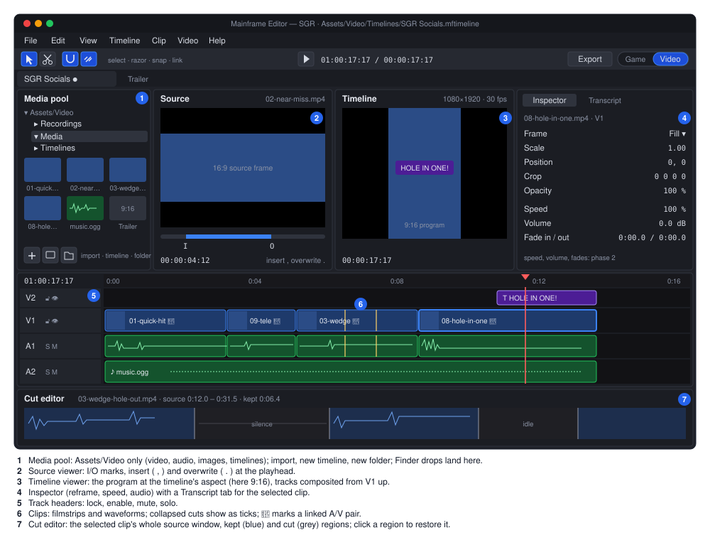
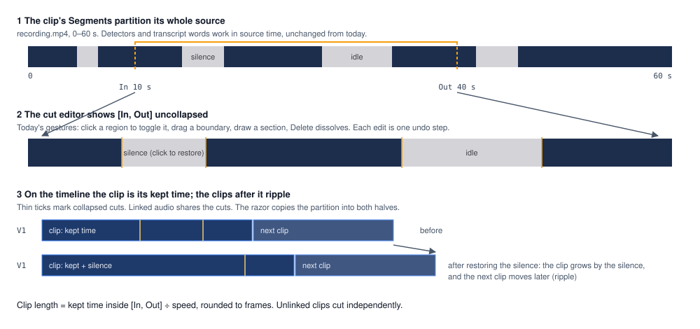

# Proposal: Video mode as a multi-track timeline editor

**Status:** accepted (owner, 2026-11-04)
**Milestone:** [Gameplay toolkit](../../milestones.md#gameplay-toolkit-) (G20a–G20d, G20.2, G20.3)
**Decision:** [ADR 0241](../../../memory/decisions/0241-video-mode-nle.md), which partly supersedes
[ADR 0191](../../../memory/decisions/0191-video-editing-mode.md)
**Depends on:** [Video editing mode](../video-editor.md) (today's mode, whose library this reuses),
[Gameplay recording](../recording.md), [Editor](../editor.md#editor-modes) (modes, undo, file drag),
[Song tab](../editor.md#song-tab-music-editor) (the track-header and canvas-lane pattern this copies)

## Problem

The owner cuts the game's social clips and trailers in DaVinci Resolve. A typical edit ("SGR Socials") goes like this:
1. Ten 16:9 gameplay recordings are reframed onto a 1080×1920 timeline.
2. Each is cut to its moment.
3. The audio is unlinked and partly replaced by music.
4. A title sits over the payoff.

Resolve is heavy for this, and every clip has to leave the editor to get there.

The editor's video mode (ADR 0191) cannot do it:
- **One recording per tab.** `VideoProject` holds a single `SourceInfo`, and its `Segments` partition that source
  (`MainframeEngine.Video/Models/VideoProject.cs`). There are no clips, tracks or media list anywhere.
- **No composition.** Export concatenates the kept ranges of input 0 (`Media/Export/FilterGraphBuilder.cs`). It has no
  scaling to another aspect, overlays, second audio, titles or images.
- **Video and audio are one thing.** A segment cuts both; nothing unlinks them.
- **Media lives outside projects.** Recordings go to the user-data folder
  (`MainframeEngine.Editor/Src/Play/RecordingPaths.cs:12`), and `.mfcut` files hold absolute source paths, so an edit
  does not travel with the game.
- **No drag-in from the OS.** SDL's drop event reaches Silk.NET's `IWindow.FileDrop`, but nothing subscribes
  (`MainframeEngine/Src/Core/Engine.cs:371` subscribes `Closing` only).

What the mode does well should stay: transcription, filler removal, silence and idle-gameplay detection with
click-to-restore cuts. Today those only apply to a lone recording.

## Goals

- **A Resolve-like Edit page.** Media pool, Source viewer, Timeline viewer, Inspector, multi-track timeline, and a cut
  editor for the selected clip.
- **Media that lives in the game project.** Under `Assets/Video/`, copied in from anywhere (including Finder drag and
  drop), and never shipped in a game build.
- **Timelines in any shape.** Each timeline sets its own resolution and frame rate (vertical, landscape, square, 4K),
  and each clip can be reframed.
- **Everyday editing tools.** Razor and add edit at the playhead, trims, ripple, moves across tracks, snapping, and
  link/unlink of audio.
- **Several tracks of each kind.** Many video tracks (overlay, picture-in-picture) and many audio tracks (music, SFX).
- **Cutback's tools on any clip.** Non-destructive, with click-to-restore.
- **Export presets** for vertical socials, YouTube/Steam, X/Discord, and GIF/WebM loops.
- **Phase 2 adds:** volume and fades, dissolves, fade to black, titles, stills, constant speed, and auto-captions from
  the transcript.

## Non-goals

- **No keyframes.** Neither motion, opacity nor effect parameters animate over time. Titles are static.
- **No colour grading, LUTs or effects** beyond reframe, opacity and fades.
- **No multicam, compound clips (other than nested timelines in phase 3), or audio plug-ins** in video mode.
- **No in-process decoding.** ffmpeg stays a child process (ADR 0190), and G16's `VideoTexture` is not a dependency.
- **Old `.mfcut` and `.cutback` projects are not migrated.** Their recordings still open as media.
- **The engine does not touch git.** It never edits `.gitignore` or `.gitattributes`; each project decides how media
  is versioned.
- **Games are unaffected.** Neither the runtime nor shipped games reference any of this.

## Design

### What the owner sees

**Entering the mode.** Video mode needs the open game project. With no project open, the Game|Video toggle opens the
Project Manager first. The last mode is still remembered (`EditorSettings.LastMode`), so opening a project after
working in video mode lands in video mode. The Project Manager's Video Editor button and Recent Videos go away.

**The screen** (the SVG above):
- **Top row:**
  - **Media pool:** the `Assets/Video` tree, showing only videos, audio, images and timelines. It shows posters and
    durations, and has buttons for Import, New Timeline and New Folder.
  - **Source viewer:** the clicked media, with I/O marks and insert/overwrite.
  - **Timeline viewer:** the active timeline, composited at its aspect.
  - **Inspector**, with a **Transcript** tab.
- **Timeline:**
  - track headers (V*n*…V1 above A1…A*n*; icon buttons with tooltips for lock, enable/eye, mute, solo);
  - clips with filmstrips (video) or waveforms (audio);
  - a ruler with timecode at the timeline's frame rate, and the playhead.
- **Cut editor:** a strip under the tracks showing the selected clip's whole source window, as today's video timeline
  does (see below).
- **Splitters:** every one persists in the editor layout file.

**Folders** (created on first use):

| Folder | What goes there |
|---|---|
| `Assets/Video/Recordings` | F10 recordings, and their `.mfcap.json` sidecars, while a project is open |
| `Assets/Video/Media` | Imported files, original names kept; a clash becomes `name-2.ext` |
| `Assets/Video/Timelines` | `*.mftimeline` |

`Assets/Video` is the editor-only folder. Builds do not copy it to `bin/`, and export never ships it.

**Importing.** File › Import Media…, the pool's Import button, or dragging files from Finder onto the pool or the
timeline. Each file is copied into `Assets/Video/Media`, or into the pool folder it was dropped on. A drop on a timeline
also places the clip at the drop time and track. A file already inside the project is used where it is, not copied. A
recording's `.mfcap.json` comes with it.

**Recording.** F10 in game mode writes into `Assets/Video/Recordings`. When it finishes, the dialog offers Open in Video
Editor. That creates `Assets/Video/Timelines/<recording>.mftimeline` with the recording on V1 and A1, linked, at a size
and rate matching the recording. Open in Cutback is removed.

### Timelines

**New Timeline** asks for a name, a resolution preset (1080×1920, 1920×1080, 1080×1080, 3840×2160 or custom), a frame
rate (24, 25, 30, 50, 60) and the starting tracks (default V1, V2, A1, A2). Timeline Settings in the Inspector changes
these later. Each timeline opens as a video-mode tab, and several can be open at once.

**Clips.** A clip is a window `[In, Out]` of a source, placed at `Start` on a track. A source is a video, audio file or
image (phase 2), or a title (phase 2).
- Video files with sound arrive as a **linked pair**: V on the target video track, A on the target audio track.
- Linked clips select, move and trim together. Clip › Unlink (Cmd+L) separates them, and Link joins any selected V and
  A again.

**Reframe** (Inspector, video clips):
- Fit, Fill or Stretch into the timeline frame;
- then Scale, Position (pixels from the centre), Crop (left/top/right/bottom) and Opacity.

A 16:9 clip dropped on a 9:16 timeline starts at Fill, which centres it and crops the sides.

**Tools and keys** (Premiere's):

| Key | Action |
|---|---|
| V / C | Select tool / Razor tool |
| Cmd+K / Shift+Cmd+K | Add edit at the playhead on the targeted tracks / on every unlocked track |
| Q / W | Ripple trim the start / end of the clip under the playhead to the playhead |
| Delete | Lift: remove the clip and leave a gap |
| Shift+Delete, Alt+Delete | Ripple delete: remove it and close the gap |
| J / K / L | Shuttle back / stop / forward (repeat for 2×, 4×) |
| Space | Play/pause |
| I / O | Mark in / out (Source viewer or timeline) |
| `,` / `.` | Insert / overwrite the Source viewer's marked range at the playhead |
| S | Snapping on/off |
| Cmd+L | Link / unlink |
| ← / → | One frame back / forward |
| Up / Down | Previous / next edit |
| Cmd+Z / Shift+Cmd+Z | Undo / redo |
| Cmd+S | Save |
| Cmd+E | Export |
| Cmd+I | Import Media… |

**Mouse:**
- Drag a clip body to move it, onto another track of the same kind too.
- Drag a clip edge to trim; Cmd+drag an edge to ripple trim.
- Alt+drag copies. Drag in empty space for a marquee selection.
- The wheel zooms about the cursor, and Shift+wheel scrolls.
- Snapping (on by default) catches clip edges, the playhead, markers and in/out within 8 dp.
- Locked tracks refuse every edit.

**Ripple** affects the edited track plus the tracks of linked clips. A sync lock that ripples every track is phase 3.

**Overlaps** resolve as overwrite: a clip moved or dropped onto another trims or splits what it covers.

### The cut editor and per-clip Cutback tools

A clip's cuts are Cutback's segment partition, now held by the clip:
- **It covers the whole source `[0, D]`**, not just `[In, Out]`, so the partition rules, every detector and the
  transcript's word times stay in source time unchanged.
- **The clip's timeline length** is the kept time inside `[In, Out]`, divided by speed and rounded to frames.
- **On the main timeline** the cuts are collapsed: the clip is shorter, with thin ticks where footage was removed.
- **The cut editor** shows the selected clip's `[In, Out]` uncollapsed: kept and greyed regions, the waveform, the
  transcript markers and the playhead. Today's gestures carry over unchanged:
  - click a region to toggle it;
  - drag a boundary (snapped to the quietest bucket);
  - draw a section;
  - Delete dissolves.

  Each change ripples the clips after it.
- **Linked clips share their cuts**: cutting the V of a linked pair cuts its A too. Unlinked clips cut independently.
- **The razor copies the partition into both halves**, so restoring a cut works on either side.

**Clip › Transcribe, Remove Fillers, Detect Silence, Detect Idle Gameplay** (and the Video menu's copies) run on the
selected clip. Each is one undo step and keeps manual edits, exactly as today:
- Silence detection and filler location run only over `[In, Out]`.
- Idle gameplay needs the recording's sidecar.
- The transcript is cached per media file in `<media>.mftranscript.json`, keyed by `SourceHash`, so a second clip of
  the same recording reuses it. The pool hides the sidecar.

The Transcript tab shows the selected clip's words inside `[In, Out]`, struck where cut, with today's gestures.

### Preview

- **The Timeline viewer** is a `SubViewport` at the timeline's aspect, with its long side at most 960 px (540×960 for
  vertical), published as `engine://video-program`.
  - Each enabled video track draws as a pooled `Sprite2D` over its own `Texture2D`, stacked V1 at the bottom.
  - Position, scale and crop come from the pure `ClipLayout`, which export shares, so both reframe the same way.
  - Opacity is the sprite's `Modulate`.
- **Decoders.** Each visible track has a `LayerPlayer`, which reuses `VideoPreview`'s machinery:
  - an ffmpeg raw-RGBA decoder per kept range at the clip's own aspect;
  - the next range prefetched 1 s ahead;
  - frames handed off with no seek at range joins;
  - decoders started and killed on the pool;
  - the plan held during drags.

  `PreviewDecoding` gains `setpts` for speed and an optional `-hwaccel videotoolbox` on macOS.
- **Audio.** `TimelineAudioMixer` is the one producer for the existing `AudioStreamGenerator` voice, which stays the
  clock.
  - It decodes each active audio clip (f32le, stereo, the server's rate), applies track and clip gain, mute and solo,
    and today's 8 ms splice fades, then mixes into preallocated buffers.
  - A timeline with no audio feeds silence, so the clock still runs. Today's refusal of sources without audio goes.
- **Scrubbing while paused** decodes one frame per visible track; the newest request wins.
- **The Source viewer** is today's `VideoPreview` over one media file, published as `engine://video-source`. Only one
  viewer plays at a time.
- **Caches** go in `<project>/.mainframe/cache/video/<SourceHash>/`:
  - `peaks.bin` (`WaveformExtractor`);
  - `filmstrip-<height>.png` (a new `FilmstripExtractor`: `fps=1/N,scale=-2:h,tile`);
  - `poster.png` for the pool, through a video generator added to the editor's `ThumbnailCache`.

### Export

**File › Export Video…** (Cmd+E) takes a preset, a range (the whole timeline or in to out) and an output path. The
default output is `<project>/Exports/<timeline>-<preset>.mp4`, outside `Assets/`.

| Preset | Size | Rate | Video | Audio |
|---|---|---|---|---|
| TikTok / Reels / Shorts | 1080×1920 | 30 or 60 | H.264, CRF 20 | AAC 192k |
| YouTube / Steam 1080p | 1920×1080 | timeline | H.264, CRF 18 (or VP9 `.webm`) | AAC 192k (Opus for webm) |
| YouTube 4K | 3840×2160 | timeline | H.264, CRF 18 | AAC 192k |
| X / Discord | 1280×720 or 720×1280 | 30 | H.264 at a bitrate that fits the size cap (default 25 MB) | AAC 128k |
| GIF loop | 480 px wide | 15 | palettegen/paletteuse | none |
| WebM loop | 720 px wide | 30 | VP9 | none |
| Timeline | the timeline's own | timeline | H.264, CRF 20 | AAC 192k |

- A preset whose size differs from the timeline adds one final scale, padding where the aspect differs.
- The size-capped bitrate is `cap × 8 / duration − audio`, with `-maxrate` and `-bufsize`.
- Fast (stream-copy) export is dropped: it cannot reframe or composite.

**The filter graph** (`TimelineGraphBuilder`, which replaces `FilterGraphBuilder`) is written to a file, as today.

*Inputs:*
- one `-ss In -t Len -i source` per clip window (seeking on input);
- a `color` base at the timeline's size and rate, and `anullsrc`;
- looped image inputs (phase 2).

*Video:*
- **Per clip:** `trim` per kept range → `concat` → `setpts=(PTS-STARTPTS)/speed` → `fps` → `ClipLayout` as
  `scale`/`crop`/`pad` → `format=yuva420p`.
- **Per track:** the clips and transparent gaps concatenate into one stream, so there is one `overlay` per track, not
  per clip, stacked from V1 up.

*Audio:*
- **Per clip:** today's `atrim` and fade splices → `concat` → `atempo` (phase 2) → `volume` → `adelay`.
- **Mix:** everything goes into `amix=normalize=0:duration=longest`, trimmed to the range.
- Muted, disabled and solo-excluded tracks are left out.

`DeliveryEncoder`'s encoder probe, `FfmpegProgressParser`, cancel, and the "same file as a source" refusal are reused.

### Phase 2 additions

- **Fades and volume:**
  - clip volume (dB) and fade handles on clip corners, for audio and for video (fade from or to black);
  - track volume in the header.
- **Transitions:** Cross Dissolve (video `xfade`, audio as overlapping fades into `amix`) and Fade to Black. Drop one
  on an edit point and drag its length; it needs handle frames on both clips, or it is refused with a reason.
- **Titles:**
  - A title clip on a video track. Its text, font (from `MainframeEngine/Assets/UI/fonts`), size, colour, outline,
    shadow, background box with padding and opacity, alignment and position are all set in the Inspector.
  - Rendered by the engine (`Label2D` in a `SubViewport` with `TransparentBg`, then `CaptureImage` → PNG in the cache)
    for both the preview and export (`overlay … enable='between(t,a,b)'`). No ffmpeg `drawtext`.
- **Images:** `.png`, `.jpg` and `.webp` as clips with a default length of 5 s, reframed like video.
- **Speed:** a constant 0.25×–4× per clip. `setpts` for video; `atempo` for audio, chained outside 0.5–2, which keeps
  the pitch.
- **Auto-captions:**
  - Clip › Create Captions turns the clip's kept transcript words into caption title clips on a new track above it.
    One caption holds at most N words, and a caption breaks at a pause or a sentence end.
  - Captions use a caption style (a title preset). Each stays an ordinary title clip, editable afterwards.

### Phase 3

- **Nested timelines:** a `.mftimeline` as a clip, rendered as an intermediate in export, with cycle detection.
- **Proxies:** optimised media for 4K sources.
- **More editing:** roll and slip, and sync lock.
- **Crash recovery** for timelines.

### Data model and code

All new library code is pure and immutable, in `MainframeEngine.Video/Timelines/`.

| Type | Role |
|---|---|
| `Timeline` | `Settings` (width, height, rational frame rate, 48 kHz, background), `Tracks`, `Clips`, `Transitions`, `Markers`, `InOut` |
| `Track` | Id, kind (video/audio), name, enabled, locked, muted, solo, gain; array order is stacking order |
| `Clip` | Id, track, kind (media/title/image/timeline), `MediaRef`, `Start`, `SourceIn`/`SourceOut`, `Speed`, `LinkGroup`, `Enabled`, `Segments`, `Transform`, `Audio` (gain, fades), title data |
| `MediaRef` | AssetDatabase UID (moves in the pool keep timelines working), a path fallback, `SourceHash`, cached probe info |
| `TimelineLayout` | Timeline time ↔ (clip, source time); each clip's kept source ranges; generalises `VideoPlaybackPlan` and `OutputTimeline` |
| `TimelineEdits` | Pure edits: Insert, Overwrite, Append, Razor, Trim, RippleTrim, RippleDelete, Lift, Move, Link/Unlink, SetTransform, SetClipCuts |
| `Snapping` | Snap candidates and resolution |
| `ClipLayout` | A clip's rectangle, scale and crop in the timeline frame (preview and export) |
| `TimelineFile`, `TimelineSerializer`, `TimelineMigrator` | `.mftimeline`, version 1, source-generated System.Text.Json (the `Projects/` pattern) |
| `TimelineGraphBuilder`, `ExportPresets` | Export |
| `FilmstripExtractor` | Filmstrip tiles |

`.mftimeline`:
- It stores its UID inside the file (AssetDatabase `IsSelfDescribing`, so no `.meta`) and is written atomically.
- `.mfcap.json` and `.mftranscript.json` count as part of their media, so they get no `.meta` and the pool hides them.

The editor side, in `MainframeEngine.Editor/Src/Video/`, copies music mode's arrangement pattern: RmlUi headers beside
canvas lanes in a `SubViewport` (`Music/SongPanel.cs`, `song.rml`, `ArrangementCanvas` in `Music/SongCanvases.cs`), and
the shared file drag (`EditorWorkspace.BeginFileDrag`).

| Type | Role |
|---|---|
| `TimelineDocument` | One timeline: `Apply(name, edit, mergeKey)` commits a before/after snapshot as an `IEditorAction` to the editor's `UndoRedo` (one step per drag; an edit that changes nothing adds none); dirty against the save marker |
| `TimelineTab : IEditorTab` | Replaces `VideoTab` |
| `TimelineCanvas`, `TimelineController`, `TimelineViewState` | The lanes, gestures and view |
| `CutEditorPane` | Today's `VideoTimelineView`/`Controller`/`Canvas`, limited to the selected clip |
| `TimelinePreview`, `LayerPlayer`, `TimelineAudioMixer`, `TimelinePlaybackPlan` | The Timeline viewer |
| `SourceViewer` | The Source viewer (today's `VideoPreview`) |
| `MediaPool`, `MediaPoolPanel`, `MediaImporter` | The pool, its model (the `Music/SongBrowser.cs` pattern) and copy-in jobs |
| `VideoInspector`, `NewTimelineDialog`, `ExportVideoDialog` | Panels and dialogs |

Retired from the editor:
- `VideoDocument`, `VideoTab`, `VideoPlaybackPlan`;
- the `.mfcut` and `.cutback` code (`MainframeEngine.Video/Projects/`, `VideoProject`, `FileKind.VideoProject`);
- Recent Videos;
- `SegmentEditor` and `EditHistory`, whose rules move into `TimelineDocument`.

### Engine work

- **`SceneTree.FilesDropped`**, an `Action<FilesDroppedEvent>` with the paths and the window position in window points
  (as mouse events). It lives in `Scene/SceneTree.Window.cs` beside `CloseRequested`, and is named after Godot's
  `files_dropped`.
  - `Engine` subscribes to `Window.FileDrop` next to `Window.Closing`.
  - SDL gives no drop position, so it is read from `SDL_GetGlobalMouseState` minus the window position, through
    `SilkWindowControl.TryGetSdl`.
  - SDL sends no drag-over events, so nothing highlights before the drop.
- **The editor-only folder.**
  - `ContentPaths.EditorOnlyFolder` is `"Assets/Video"`, with an `IsEditorOnly(path)` predicate.
  - An MSBuild target, `_MainframeExcludeEditorOnlyContent`, removes `None` and `Content` items under
    `<project>/Assets/Video/` before `AssignTargetPaths`. It goes in `build/MainframeGame.props`, which checkout games
    import and the package's `buildTransitive/MainframeEngine.props` imports, so it covers both. Every game's Desktop
    csproj copies `../Assets/**`, so this covers existing games.
  - `ContentFilter.Ships` (`Tools/MainframeEngine.Export/Glob.cs:112`) returns false for these paths, and
    `ExportValidator` warns (`editor-only-content`) when an include glob names `Assets/Video`. The default
    `Assets/**` does not warn, or every project with videos would warn on every export.
  - The G19 pack writer uses the same predicate (a line in `protected-exports.md`).
- **In-place texture updates.** Today `VulkanCanvasRenderer` re-creates a `Texture2D`'s GPU image and descriptor sets
  whenever its version changes (`Rendering/Canvas/VulkanCanvasRenderer.cs:211-226`). `GpuTexture.Update2D` writes
  through a staging copy and a barrier, and the renderer uses it when size and format are unchanged. Several preview
  layers at 30 fps need this; every dynamic canvas texture benefits.
- **Recordings.** `RecordingPaths.Directory` takes the project root and returns `Assets/Video/Recordings`. The editor
  only records from Play, which always has a project; a game run from a terminal takes an explicit `--record` path. The
  asset scan and the FileSystem panel skip a recording's `<name>.mp4.partial/` folder while it records.

## Scenarios

Test names are in the projects they will live in: `Video.Tests` (library), `Editor.Tests`, `Tests` (engine),
`Export.Tests`.

### G20a: engine prerequisites

- Given a window, when SDL reports two files dropped, then `SceneTree.FilesDropped` fires once with both paths and the
  pointer's window position in window points (the units of mouse events). Test:
  `FilesDroppedTests.RaisesOnceWithPathsAndPosition`.
- Given a game project with `Assets/Video/Media/a.mp4` and `Assets/Scenes/Main.mscene`, when its Desktop project
  builds, then `bin/…/Assets/Scenes/Main.mscene` exists and `bin/…/Assets/Video` does not. Test: template smoke
  (`build/template-smoke.sh`) asserts it.
- Given an export preset whose include glob is `Assets/**`, when the files to ship are listed, then nothing under
  `Assets/Video` ships. Given an include glob `Assets/Video/**`, the validator warns `editor-only-content`. Tests:
  `ExportLibraryTests.EditorOnlyFolderNeverShips`, `ExportPlanAndValidationTests.AnIncludeGlobNamingTheEditorOnlyFolderWarns`.
- Given an open project, when F10 finishes a recording, then the MP4 and its `.mfcap.json` are in
  `Assets/Video/Recordings`, and its `.partial` folder never gets `.meta` files or shows in the FileSystem panel. Tests:
  `RecordingPathsTests.ProjectRecordingsGoUnderAssetsVideo`, `PlayRecordingControllerTests.PlayAndRecordLaunchesWithRecordArgs`,
  `ProjectFileSystemTests.ARecordingsPartialFolderIsHiddenAndGetsNoMetas`.
- Given a `Texture2D` whose pixels change but whose size does not, when frames render, then the GPU image is updated
  in place (no new image, no descriptor set churn), with no validation warnings and 0 B per frame. Test: render test
  `CanvasRenderTests.CanvasTextureUpdatesInPlace` (host scene `canvas-texture-update`) with the allocation gate.

### G20b: timeline library

- Given a clip with segments over its whole source, when the razor cuts it at a timeline time, then both halves keep
  the partition, their windows meet at the source time under the cut, and the timeline is unchanged when played. Test:
  `TimelineEditsTests.RazorKeepsPartitionInBothHalves`.
- Given clips A, B, C on V1, when B is ripple deleted, then C starts where B started and the linked audio of C moves
  with it. Test: `TimelineEditsTests.RippleDeleteClosesGapAndMovesLinked`.
- Given a linked V/A pair, when a cut is drawn inside the V clip, then the A clip gets the same cut and both shorten by
  the same frames. Test: `TimelineEditsTests.LinkedClipsShareCuts`.
- Given the pair is unlinked, when the V clip is moved, then the A clip stays. Test:
  `TimelineEditsTests.UnlinkedClipsMoveAlone`.
- Given a locked track, when any edit targets it, then the timeline is returned unchanged (the same reference). Test:
  `TimelineEditsTests.LockedTrackRefusesEdits`.
- Given an audio clip, when it is moved onto a video track, then the move is refused. Test:
  `TimelineEditsTests.MoveRefusesWrongTrackKind`.
- Given clip X dropped by overwrite over the middle of clip Y, then Y is split around X with no overlap. Test:
  `TimelineEditsTests.OverwriteSplitsCoveredClip`.
- Given a 30 fps timeline, when an edit lands at 1.0101 s, then it snaps to frame 30. Test:
  `TimelineEditsTests.EditsSnapToFrames`.
- Given snapping on and a clip edge 5 dp from the playhead, when the edge is dragged, then it lands on the playhead.
  Test: `SnappingTests.EdgeSnapsToPlayhead`.
- Given a timeline time inside a clip whose middle is cut, when it is mapped, then it gives that clip and the source
  time after the cut. Test: `TimelineLayoutTests.MapsAcrossCollapsedCut`.
- Given a timeline, when it is saved and loaded, then it is equal. Given a version newer than the reader, then loading
  fails with a readable message. Test: `TimelineSerializerTests.RoundTripsAndRefusesNewer`.
- Given a 16:9 1920×1080 clip on a 1080×1920 timeline at Fill, then `ClipLayout` scales it to height 1920 and crops it
  to 1080 wide, centred. At Fit, it is 1080 wide, letterboxed. Test: `ClipLayoutTests.FillAndFitIntoVertical`.
- Given one clip, then the graph is a single trim/concat/scale chain onto the base, with the clip's audio in `amix`.
  Given two video tracks with a gap, then there is one overlay per track and a transparent gap of the right length.
  Test: `TimelineGraphBuilderTests` (expected graph strings per case).
- Given the X/Discord preset with a 25 MB cap and a 30 s timeline, then the video bitrate is
  `25·8·1024²/30 − 128 k` and `-maxrate` matches it. Test: `ExportPresetsTests.SizeCapBitrate`.
- Given the GIF preset, then the graph has no audio output and uses `palettegen`/`paletteuse`. Test:
  `TimelineGraphBuilderTests.GifUsesPaletteAndNoAudio`.

### G20c: the editor

- Given no project open, when video mode is chosen, then the Project Manager opens and the mode does not change. Test:
  `VideoModeTests.NeedsProject`.
- Given a project, when the pool shows `Assets/Video`, then it lists videos, audio, images and timelines, and hides
  `.mfcap.json`, `.mftranscript.json`, `.meta` and scenes. Test: `MediaPoolTests.ShowsMediaOnly`.
- Given `/tmp/clip.mp4` and `Assets/Video/Media/clip.mp4` already present, when the file is imported, then it is copied
  to `clip-2.mp4` through a `.tmp` name, and its `.mfcap.json` is copied too. Test:
  `MediaImporterTests.NumbersClashAndCopiesSidecar`.
- Given a file already inside the project, when it is imported, then nothing is copied and the pool selects it. Test:
  `MediaImporterTests.InProjectFileIsNotCopied`.
- Given a drop from Finder over the timeline at 0:12 on V2, when the import finishes, then the clip is inserted at
  0:12 on V2 with its audio on the matching audio track, as one undo step. Test:
  `TimelineDropTests.OsDropOnTimelineInsertsAtTimeAndTrack`.
- Given a clip dragged across 40 frames, when it is released, then undo restores it in one step. Test:
  `TimelineDocumentTests.DragIsOneUndoStep`.
- Given a timeline saved, edited and edited back, then the tab is clean. Test:
  `TimelineDocumentTests.DirtyAgainstSaveMarker`.
- Given the playhead over clip B on V1, when Cmd+K is pressed, then B is split at the playhead (and its linked audio).
  When Shift+Cmd+K is pressed, every unlocked track is split. Test: `VideoShortcutsTests.AddEditAtPlayhead`.
- Given three video tracks with clips under the playhead, when playback starts, then three layer players run with the
  fake decoder factory, stacked V1 lowest, and pausing kills them. Test:
  `TimelinePreviewTests.OneLayerPerVisibleTrack`.
- Given two audio clips at 0 dB under the playhead and A2 muted, then the mixer output equals A1's samples. Given A2
  soloed, it equals A2's. Test: `TimelineAudioMixerTests.MuteAndSolo`.
- Given a recording, when Open in Video Editor is pressed, then `Assets/Video/Timelines/<name>.mftimeline` exists with
  a linked V1/A1 pair at the recording's size and rate, and opens as a tab. Test:
  `RecordingNotifierTests.OpenInVideoEditorCreatesTimeline`.
- Given a timeline with a title-less 9:16 edit, when the TikTok preset is exported with a fake runner, then the runner
  receives the builder's graph and a 1080×1920 output path in `<project>/Exports`. Test:
  `ExportVideoDialogTests.PresetAndDefaultPath`.

### G20d: per-clip Cutback tools

- Given a clip whose window is 10–40 s of a 60 s recording with silence at 5 s and 20 s, when Detect Silence runs, then
  only the 20 s silence is cut, as one undo step, and later clips ripple. Test:
  `ClipDetectionTests.SilenceOnlyInsideWindow`.
- Given a manual cut in a clip, when Detect Silence runs again, then the manual cut is kept. Test:
  `ClipDetectionTests.ManualCutsSurvive`.
- Given two clips of the same recording, when the first is transcribed, then the second shows the transcript without
  transcribing again. Test: `TranscriptCacheTests.SharedBySourceHash`.
- Given the Transcript tab on a clip, when a word is clicked, then that word's range is cut in the clip and its linked
  partner. Test: `TranscriptPanelTests.WordCutAppliesToLinkGroup`.
- Given a clip whose recording has no sidecar, then Detect Idle Gameplay is disabled with a tooltip saying why. Test:
  `ClipDetectionTests.IdleNeedsSidecar`.
- Given a cut clicked in the cut editor, when it is restored, then the clip lengthens on the timeline and the clips
  after it move later. Test: `CutEditorTests.RestoreRipplesLater`.

### G20.2: polish

- Given two adjacent clips with 1 s of handles, when a 0.5 s Cross Dissolve is dropped on the edit, then the graph
  has an `xfade=transition=fade:duration=0.5`, and the audio fades overlap by 0.5 s. Test:
  `TimelineGraphBuilderTests.CrossDissolve`.
- Given clips with no handles, when a dissolve is dropped, then it is refused with "Not enough frames past the edit".
  Test: `TimelineEditsTests.TransitionNeedsHandles`.
- Given a clip at 2× speed, then its timeline length halves, its audio uses `atempo=2`, and at 4× it chains
  `atempo=2,atempo=2`. Test: `TimelineGraphBuilderTests.SpeedChainsAtempo`.
- Given a title clip, then the preview and export overlay the same cached PNG over the same frames. Test:
  `TitleRasterTests.PreviewAndExportShareRaster`, and render test `editor-video-title`.
- Given a clip's transcript with a 0.8 s pause after word 6, when Create Captions runs (max 7 words), then the first
  caption ends at word 6, and the captions cover only kept words. Test: `CaptionPlannerTests.BreaksAtPausesSkipsCuts`.

## Testing

- **No unit test runs ffmpeg or loads a model**, as today. The fake decoder factory and the fake export runner stay.
- **`just test-video-ffmpeg`** (opt-in, not in CI) runs the generated graphs from `TimelineGraphBuilderTests` on lavfi
  test sources, and checks output size, duration and frame rate with ffprobe.
- **Render goldens:**
  - `editor-video-empty` shows the pool with no tab.
  - `editor-video-timeline` is built in code: 3 video tracks, 2 audio tracks, a linked pair, a collapsed cut, the cut
    editor, filmstrips and waveforms from fakes.
  - `editor-video-title` (phase 2).
  - `canvas-texture-update-in-place` (G20a).
  - The allocation gate (0 B over 300 frames) runs on the timeline golden, paused and playing with the fake decoder.
- **QA script** `Tests/QA/video.qa`, rewritten:
  1. open a project;
  2. import the 12 s fixture;
  3. create a 1080×1920 timeline;
  4. insert, razor, ripple delete, unlink;
  5. Detect Silence on a clip (G20d);
  6. export the vertical preset;
  7. capture each step.
- **Performance:** with three video tracks of 1080p60 H.264 (the SGR recordings), the Timeline viewer plays at 30 fps
  at 540×960 with no dropped frames on M1-class hardware. This is checked by hand, with the profiler's frame graph.

## Human checklist

- [ ] Rebuild the "SGR Socials" edit:
  - drag the ten recordings in from Finder;
  - make a 1080×1920 timeline;
  - reframe, razor and ripple;
  - unlink audio and add music on A2;
  - export the TikTok preset.

  It should feel quicker than Resolve for this job.
- [ ] The playhead, the J/K/L shuttle and scrubbing feel responsive. Audio stays in sync with the picture after
  several edits.
- [ ] Trimming and snapping feel like Premiere: no fighting the snap, and edges are easy to grab.
- [ ] The exported mp4 plays on a phone and uploads to TikTok, YouTube and Discord without a re-encode warning.
- [ ] Captions (phase 2) are readable on a phone screen.

## Task list

- [ ] **G20a, engine prerequisites (PR):** `SceneTree.FilesDropped`, the editor-only folder (MSBuild target, export
  filter and validator, a G19 note), recordings under `Assets/Video/Recordings`, `GpuTexture.Update2D` and the in-place
  path; docs in `recording.md`, `editor.md`, `game-export.md` and `distribution-nuget.md`.
- [ ] **G20b, timeline library (PR; today's mode untouched):**
  - the `Timelines/` model, edits, layout, snapping and `ClipLayout`;
  - `.mftimeline` and its serializer;
  - `TimelineGraphBuilder`, `ExportPresets`, `FilmstripExtractor`;
  - `just test-video-ffmpeg`.
- [ ] **G20c, the editor (PR):**
  - the Edit-page layout, media pool, importer and OS drop;
  - the Source and Timeline viewers, preview and mixer;
  - the timeline canvas, tools and keys; Inspector with reframe and timeline settings;
  - the export dialog with presets;
  - the cut editor (view and gestures);
  - mode requires a project;
  - remove `.mfcut`, Recent Videos and Open in Cutback;
  - rewrite `video-editor.md`; README and docs-site with screenshots.
- [ ] **G20d, per-clip Cutback tools (PR):** Transcribe, Fillers, Silence and Idle on clips; the transcript cache; the
  Transcript tab.
- [ ] **G20.2, polish (PR or PRs):** volume and fades, dissolves and fade to black, titles, images, speed,
  auto-captions.
- [ ] **G20.3, later:** nested timelines, proxies, roll/slip, sync lock, crash recovery for timelines.

## Open questions

All design-changing questions were answered by the owner on 2026-11-04. These are the builder's calls, written here so
the owner can overrule them:

- **Transcripts are cached as `<media>.mftranscript.json` beside the media**, hidden in the pool, rather than in
  `.mainframe/cache`. They are slow to make, so they should travel with the project.
- **Titles are rasterised by the engine, not ffmpeg `drawtext`**, so preview and export match and no font path or
  libfreetype is needed.
- **Ripple is the edited track plus linked clips.** Sync lock is phase 3.
- **The default export folder is `<project>/Exports`**, outside `Assets/`, so exports never mix with source media.
- **Video tracks start at V1 and V2, audio at A1 and A2.** Tracks are added and removed from the header's context menu.
- **The Project Manager's Video Editor button is removed.** Opening a project returns to the last mode.

## Related

- [ADR 0241](../../../memory/decisions/0241-video-mode-nle.md) (this decision), [ADR 0191](../../../memory/decisions/0191-video-editing-mode.md)
  (today's mode), ADR 0190 (ffmpeg as a child process)
- [Video editing mode](../video-editor.md), [Gameplay recording](../recording.md), [Editor](../editor.md),
  [Game export](../game-export.md), [Protected exports](protected-exports.md) (G19, the pack writer's exclusion),
  [Video playback](video-playback.md) (G16, not used here)
