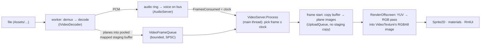
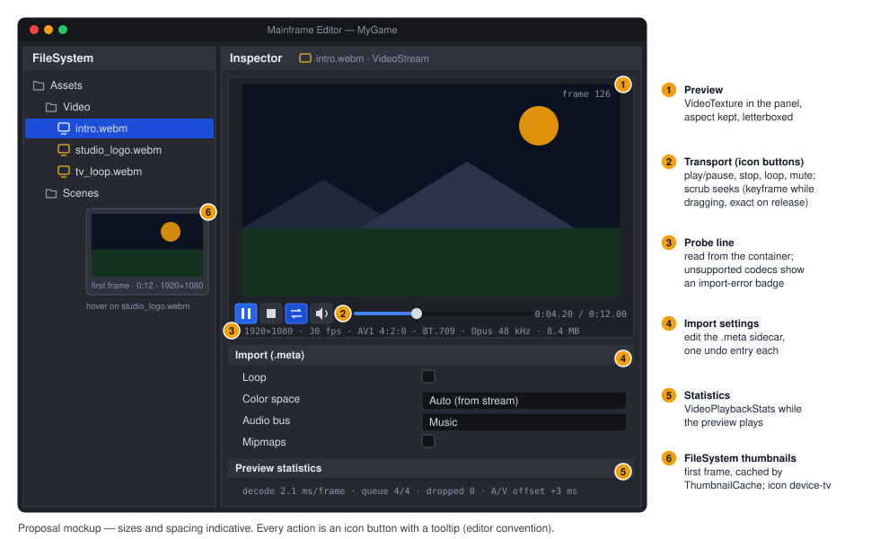

# Proposal: Video playback

**Milestone:** [Gameplay toolkit](../../milestones.md#gameplay-toolkit-) (G16) · **Status:** ⬜ planned ·
**Depends on:** [M7 audio](../audio.md) (buses, generator voices), [GPU resources](../gpu-resources.md) (upload queue,
deletion queue), [M8 game UI](../game-ui.md) (`engine://` textures), [Native libraries](../natives.md) (if the chosen
decoder is native) · **Related:** [Game export](../game-export.md) (G5), [World-space UI](world-space-ui.md) (G11: GPU
textures on meshes), [Accessibility](accessibility.md) (G14: subtitles), [Mobile core](mobile.md) (M12),
[Consoles](consoles.md), [Rendering backend abstraction](rendering-backend-abstraction.md) (M11)

## Problem

Games need intro logos, cutscenes, menu backgrounds and in-world screens. The engine cannot play a video file. A
search of `MainframeEngine/`, `MainframeEngine.Editor/` and `Examples/` for video, webm, mp4, theora and codec names
finds nothing. The editor maps no video extension to a file kind; `.ogg` is always audio
(`MainframeEngine.Editor/Src/FileSystem/FileKind.cs:60`) and thumbnails exist only for StbImageSharp formats
(`FileKind.cs:75`). `.mp4` is an LFS pattern (`.gitattributes:17`) but nothing reads it.

What exists and what video should build on:

- **Streaming audio.** The streaming thread decodes files ahead of playback into per-voice SPSC rings, so the game
  and audio threads never allocate (`MainframeEngine/Src/Audio/Threading/AudioStreamer.cs:3-8`,
  `AudioStreamChannel.cs:3-23`). Decoders open whole files by extension: WAV, Ogg Vorbis (NVorbis), MP3 and FLAC
  (`MainframeEngine/Src/Audio/Decoding/AudioDecoder.cs:106-131`). There is no packet-level entry point for an audio
  track that a video container demuxes.
- **Pushed audio and a clock.** `AudioStreamGenerator` plays frames that any one thread pushes into a lock-free ring,
  on a bus, resampled to the device rate (`MainframeEngine/Src/Audio/Synthesis/AudioStreamGenerator.cs:5-15`,
  `PushFrames` `:112`, `ClearBuffer` `:141`). `FramesConsumed` (`:106`) counts frames the audio thread actually
  played, which is the master clock video needs. `AudioServer.GetPlaybackPosition` is per audio block
  (`MainframeEngine/Src/Audio/AudioServer.cs:520-526`). The null device runs `Realtime` or `Manual` for tests
  (`MainframeEngine/Src/Audio/Devices/AudioOutput.cs:273-280`). Game code never calls SoundFlow.
- **CPU textures re-upload by recreating.** `Texture2D.SetPixels` bumps `Version`
  (`MainframeEngine/Src/Rendering/Resources/Texture2D.cs:317`). Every consumer then disposes and recreates the GPU
  texture from a fresh RGBA copy: `TextureGpu.Update`
  (`MainframeEngine/Src/Rendering/Meshes/MeshGpuResources.cs:221-240`) and the canvas `Upload`
  (`MainframeEngine/Src/Rendering/Canvas/VulkanCanvasRenderer.cs:221-224`). Video through
  `SetPixels` would allocate, convert colour on the CPU and create a `VkImage` every frame.
- **GPU-owned textures, partly.** `Texture2D.FromViewport` (`Texture2D.cs:254`) is a texture with no CPU pixels. The
  canvas skips its upload and binds the sub-viewport target (`VulkanCanvasRenderer.cs:208-209`, `:620-629`).
  `MeshRenderer.AcquireTexture` has no such branch (`MainframeEngine/Src/Rendering/Meshes/MeshRenderer.cs:468-481`),
  so 3D materials cannot sample a GPU-produced texture today. RmlUi can: `UiServer.RegisterTexture` publishes a
  `GpuTexture`, a `SubViewport`, a `RenderTarget` or an internal `Func<UiTextureView>` as `engine://name`
  (`MainframeEngine/Src/UI/UiServer.cs:343-368`).
- **Uploads.** `UploadQueue.UploadImage` copies a whole image's pixels into the 32 MiB staging ring and records the
  copy at frame start (`MainframeEngine/Src/Rendering/Vulkan/Memory/UploadQueue.cs:25`, `:99-128`). That is a second
  CPU copy of every decoded frame. `FormatInfo` knows `R8_UNORM` and `R8G8_UNORM` but not `R16_UNORM` (10-bit
  planes; `MainframeEngine/Src/Rendering/Vulkan/Memory/FormatInfo.cs:11-12`). `MaxFramesInFlight` is 2
  (`MainframeEngine/Src/Rendering/Vulkan/IVulkanContext.cs:18`). The renderer has no compute pipelines; full-screen
  fragment passes over `Assets/Shaders/Post/Fullscreen.vk.vert.slang` are the house pattern.
  `RenderServer.RenderOffscreen` runs before any pass samples (`MainframeEngine/Src/Servers/RenderServer.cs:384`).
- **Full-screen overlays.** `LoadingScreen : UiLayer` is a modal RmlUi layer over everything
  (`MainframeEngine/Src/Scene/Loading/LoadingScreen.cs:5-23`). `GameHost` shows it while the start scene loads on a
  worker (`MainframeEngine/Src/Project/GameHost.cs:365-369`), configured by the `loading` section of `project.mfproj`
  (`MainframeEngine/Src/Project/ProjectSettings.cs:80`, `:534-545`). Gamepad B reaches RmlUi as Escape
  (`MainframeEngine/Src/UI/UiInputMap.cs:25-36`).
- **Servers and importers.** Frame servers implement `IFrameServer.Process`
  (`MainframeEngine/Src/Servers/ServerRegistry.cs:12-15`); the engine registers servers in `base.OnLoad()`
  (`MainframeEngine/Src/Core/Engine.cs:391-431`), dedicated servers in `HeadlessHost`
  (`MainframeEngine/Src/Project/HeadlessHost.cs:43-52`). Importers register by extension
  (`MainframeEngine/Src/Resources/Import/AssetImporters.cs:25-33`). Editor custom inspectors with previews exist
  (`MainframeEngine.Editor/Src/Inspector/ZzfxStreamInspector.cs:24`).
- **No codec anywhere.** NuGet audio is NVorbis and SoundFlow (`Directory.Packages.props:28-29`). The only Xiph
  natives are libogg and libvorbis inside the editor-only `mfplughost` ([natives.md](../natives.md#layout)).

## Goals

- A `VideoStream` resource (imported from a file, `.meta` settings) and a `VideoPlayer` node: play, pause, stop,
  seek (exact or keyframe), loop, `Finished`, preroll, playback statistics.
- A `VideoTexture` (a `Texture2D` with no CPU pixels) usable by `Sprite2D`, 3D materials and RmlUi (`engine://`).
- A `Cutscene` helper: a full-screen, letterboxed, optionally skippable video layer, and intro videos in
  `project.mfproj` that play while the start scene loads.
- The audio track plays as a voice on an `AudioServer` bus (volume, mute, pause, user volume from G4) and is the
  master clock for A/V sync. Without audio, the clock is game time (deterministic under `--fixed-fps`).
- Decode on a worker thread into a bounded frame queue of pooled, persistently mapped staging buffers; copy to plane
  images through the upload queue; convert YUV → RGB in a Slang shader. No CPU colour conversion during playback, no
  per-frame allocation on the game thread, no validation warnings.
- A codec-neutral decoder seam, so the pipeline, nodes, editor and tests ship before the codec decision, and platform
  or licensed decoders can plug in later.
- Editor: import, thumbnails, an inspector preview; export notes.

## Non-goals

- **Encoding, transcoding or recording.** Authors encode with their own tools; the docs give `ffmpeg` recipes.
- **Network streaming** (HLS, DASH), DRM, and arbitrary user files (`.mp4`/`.mov` from players' disks).
- **HDR video** (PQ/HLG, BT.2020 wide gamut output). 10-bit SDR is in scope if the codec has it.
- **Alpha video**, 4:2:2/4:4:4, interlaced content, variable playback speed beyond 0.5–2× with pitch shift.
- **Subtitles inside the container.** Captions come from G14 ([Accessibility](accessibility.md)) on the same clock.
- **Choosing the codec in this document.** See [Codec and decoder](#codec-and-decoder-the-decision).

## Design

### Overview

| Type (all new) | Where | Role |
|---|---|---|
| `VideoStream`, `VideoInfo`, `VideoImporter` | `Src/Video/` | Resource over a file, probe results, `video` importer |
| `VideoPlayer` | `Src/Video/Nodes/` | Node: transport, clock, signals, audio voice owner |
| `VideoTexture : Texture2D` | `Src/Video/` | The frame as a GPU-only texture |
| `Cutscene : UiLayer` | `Src/Video/Nodes/` | Full-screen, skippable presentation; intro videos |
| `VideoServer : IFrameServer` | `Src/Video/` | Worker threads, frame selection per frame, statistics |
| `IVideoDemuxer`, `IVideoDecoder`, `IVideoAudioDecoder` | `Src/Video/Decoding/` | Codec seam (internal; one implementation per format) |
| `Y4mDemuxer` | `Src/Video/Decoding/` | Uncompressed YUV4MPEG2 for tests and development |
| `VideoFramePool`, `VideoFrameQueue` | `Src/Video/Threading/` | Pooled plane buffers, bounded SPSC queue |
| `VideoRenderer` | `Src/Rendering/Video/` | Plane images, upload, YUV → RGB pass; owned by `RenderServer` |
| `Video/VideoYuv.vk.frag.slang` | `Assets/Shaders/` | Conversion shader (with `Post/Fullscreen.vk.vert.slang`) |



### Public API

```csharp
namespace MainframeEngine;

/// <summary>A video file and how to play it (Godot's VideoStream). Imported by the "video" importer.</summary>
[EditorIcon("device-tv")]
public class VideoStream : Resource
{
    [Export(File = "*.y4m")]                // the codec's extensions join after the decision (e.g. *.webm)
    public string? File { get; set; }        // path or UID, resolved through AssetDatabase.Current like AudioStream
    [Export] public bool Loop { get; set; }
    [Export] public VideoColorSpace ColorSpace { get; set; } = VideoColorSpace.Auto;   // Auto, Bt601, Bt709, Bt2020
    [Export] public VideoRange Range { get; set; } = VideoRange.Auto;                  // Auto, Limited, Full
    [Export] public string AudioBus { get; set; } = "Music";
    [Export] public bool Mipmaps { get; set; }       // for screens seen at a distance; costs a blit chain per frame

    public static VideoStream Load(string path);     // applies the .meta settings
    public bool Preload();                            // probes the container (header only)
    public VideoInfo? Info { get; }                   // null until probed
    public string? LoadError { get; }
}

public sealed record VideoInfo(int Width, int Height, double FrameRate, double Length, string Codec, int BitDepth,
    VideoColorSpace ColorSpace, VideoRange Range, bool HasAudio, int AudioChannels, int AudioSampleRate);

public enum VideoSeekMode { Exact, Keyframe }

[EditorIcon("device-tv")]
public class VideoPlayer : Node
{
    [Export] public VideoStream? Stream { get; set; }
    [Export] public bool Autoplay { get; set; }
    [Export] public bool Loop { get; set; }                               // in addition to VideoStream.Loop
    [Export(Range = "-80,24,0.1")] public float VolumeDb { get; set; }
    [Export] public string? Bus { get; set; }                             // null = Stream.AudioBus
    [Export(Range = "0.5,2,0.01")] public float Speed { get; set; } = 1f; // pitch follows
    [Export(Range = "2,16,1")] public int QueueFrames { get; set; } = 4;

    public VideoTexture Texture { get; }       // stable for the node's lifetime; black until the first frame
    public bool Playing { get; }
    public bool Paused { get; set; }            // in addition to tree pause (ProcessMode)
    public bool IsReady { get; }                // first frame decoded and audio prerolled
    public double Position { get; }             // seconds on the playback clock
    public double Length { get; }
    public VideoPlaybackStats Stats { get; }    // decoded, dropped, late, queue depth, decode ms, A/V offset

    public void Play(double fromSeconds = 0);
    public void Prepare(double fromSeconds = 0);   // decode and preroll without starting the clock
    public void Stop();
    public void Seek(double seconds, VideoSeekMode mode = VideoSeekMode.Exact);

    [Signal] public event Action? Ready;           // IsReady became true
    [Signal] public event Action? Finished;        // played to the end (not on Stop, not when looping)
    [Signal] public event Action? Looped;
    [Signal] public event Action<string>? Failed;  // decode or I/O error; the texture keeps its last frame
}

/// <summary>A video frame on the GPU. Has no CPU pixels (DecodePixels throws, like a viewport texture).</summary>
public sealed class VideoTexture : Texture2D { public VideoPlayer? Player { get; } }

// New member on UiServer (sealed today): publishes a video as engine://name for  and image() decorators.
public void RegisterTexture(string name, VideoTexture texture);
```

`VideoPlayer` is not a visual node: show its `Texture` with any consumer (`Sprite2D.Texture`,
`StandardMaterial3D.AlbedoTexture`/`EmissionTexture`, an RmlUi `engine://` image) or use `Cutscene`. In
`SceneTree.EditMode` it is inert like the audio players; the editor previews videos itself.

### Decoder seam and threading

```csharp
internal interface IVideoDemuxer : IDisposable                // one per open stream, worker thread only
{
    VideoInfo Info { get; }
    IVideoDecoder CreateVideoDecoder();
    IVideoAudioDecoder? CreateAudioDecoder();                 // null without an audio track
    bool ReadPacket(out VideoPacket packet);                  // pooled buffers; false at the end
    void SeekToKeyframe(double seconds, out double keyframeSeconds);
}

internal interface IVideoDecoder : IDisposable
{
    /// <summary>Decodes into the frame's mapped planes; false when it needs more input.</summary>
    bool Decode(in VideoPacket packet, ref VideoFrame frame);
    void Flush();
}
```

- **One worker per playing video** (a dedicated thread, `IsBackground`, named after the file), like the audio streamer.
  Decoders that thread internally (dav1d, libvpx) get a thread budget from `VideoServer.MaxDecodeThreads`.
- **Frame pool.** At `Play`, the pool allocates `QueueFrames + MaxFramesInFlight + 1` buffers through
  `IVulkanContext.Allocator` with `GpuMemoryUsage.Staging` (persistently mapped; allocation stays on the main thread,
  the worker only writes mapped memory). Plane rows are padded to `optimalBufferCopyRowPitchAlignment`. Headless and
  tests use a `byte[]` pool allocated at open instead.
- **Queue.** `VideoFrameQueue` is an SPSC ring of `(pts, duration, poolIndex)`. The worker blocks when it is full; it
  never blocks the main thread. A pool buffer returns to the worker only after the GPU frame that copied it has
  completed (tagged with `IVulkanContext.FrameNumber`, released where the upload queue releases its staging ring).
- **Main thread** (`VideoServer.Process`, during `Tree.Tick`): pops every frame whose pts ≤ clock, keeps the newest,
  returns the others (counted as dropped), and hands the chosen buffer to `VideoRenderer`. No allocation: the per-video
  state is created at `Play`.
- **Headless** (`HeadlessHost`, no renderer): the worker demuxes and decodes audio only, skips video packets, and
  the clock still runs, so `Finished` fires on time for dedicated servers and logic tests.
- **Errors** end that video (`Failed`), log once and never take the game down, as `AudioStream` does.

### Clock and A/V sync

- **Audio master.** With an audio track and an audio device: `clock = FramesConsumed / rate − outputLatency`, where
  the latency estimate is the device period (`AudioOptions.BufferMilliseconds`). Video follows audio; audio is never
  resampled to chase video.
- **Game-time clock.** Without audio, on the `Manual` null device, or headless: the sum of the tree's process deltas
  × `Speed`, stopped while paused. Under `--fixed-fps` this makes frame selection deterministic (render tests).
- **Preroll.** `Play` starts the worker; the clock and the audio voice start together once the first video frame is
  queued and the audio ring holds 100 ms (`Ready`). `Prepare` does the same without starting, for frame-exact cues.
- **Late frames.** If the clock is more than 0.5 s ahead of the newest decoded frame (a hitch, a slow machine), the
  worker skips to the next keyframe after the clock (`Stats.Late`).
- **Seek.** The worker flushes the queue, `SeekToKeyframe`, then (Exact) decodes and discards up to the target. The
  audio ring is cleared (`ClearBuffer`) and refilled from the same point. The texture keeps the old frame until the
  new one arrives, so seeks never flash black.
- **Loop.** The worker restarts at the end without a gap and offsets pts by the length, so the clock is monotonic;
  `Looped` fires on the main thread when the wrap is presented.

### Audio track

The demuxed audio decodes on the video worker (Opus, Vorbis or MP2, depending on the codec decision) into an internal
`VideoAudioSource`, the same shape as `AudioGeneratorSource`: a per-play ring sized 0.5 s that the audio thread
consumes on the chosen bus. `VideoPlayer` implements the internal `IAudioVoiceOwner`, so tree pause, `ProcessMode`,
`Paused`, `VolumeDb` and bus mute behave like `AudioPlayer`; G4's `AudioBus.UserVolume` applies for free. If a voice
cannot be had (all voices busy at higher priority), the video plays silent on the game-time clock and logs once. The
null device plays nothing but advances `FramesConsumed`, so sync stays exercised in CI.

### GPU path

- **Plane images.** `VideoRenderer` creates, per `VideoTexture`, one image per plane: `R8_UNORM` Y, U, V (3-plane
  4:2:0), or `R8G8_UNORM` UV (NV12, from platform decoders); `R16_UNORM` for 10-bit (`FormatInfo` gains it). The
  copy from the pool buffer is a new upload-queue operation, `CopyBufferToImage(GpuBuffer, offset, rowLength, image)`,
  recorded with the other uploads at frame start; no bytes pass through the staging ring.
- **Conversion.** In `RenderServer.RenderOffscreen`, before sub-viewports, each texture with a new frame gets one
  full-screen draw into its output image: `R8G8B8A8_UNORM` with `MUTABLE_FORMAT` and an extra `R8G8B8A8_SRGB` view
  (`GpuImageDesc.ViewFormat`). Push constants: the 3×4 YCbCr → R'G'B' matrix (BT.601/709/2020 non-constant
  luminance), range offsets and scales, the bit-depth scale and the chroma siting offset. The output is gamma-encoded
  R'G'B'; the BT.709 transfer is treated as sRGB (documented, as other engines do). Optional mips are blitted after.
  No new frame this frame: nothing is recorded; the image keeps the last frame. Barriers follow the upload queue's
  "readers are the source stages" rule, so one output image suffices with two frames in flight.
- **Why a shader and not `VK_KHR_sampler_ycbcr_conversion`.** The sampler path needs immutable samplers baked into
  every consuming layout, and format support varies on MoltenVK. A plain shader is portable to M11's D3D12 and WebGPU
  backends and to lavapipe.
- **Consumers.**
  - *Canvas:* `VulkanCanvasRenderer.Prepare`/`TextureSet` gain a `VideoTexture` branch next to the viewport one
    (UNORM view; the canvas works on sRGB-encoded values).
  - *3D:* `MeshRenderer.AcquireTexture` gains **external textures**: a `TextureGpu` that borrows a view (sRGB for
    albedo and emission) and bumps `Generation` only when the image is recreated (size change), so material
    descriptor sets are not rewritten per frame. G11 needs the same for UI on meshes; whichever lands first builds it.
  - *RmlUi:* `UiServer.RegisterTexture(name, VideoTexture)` wraps the internal `Func<UiTextureView>` path; opaque.
- **Shader rules.** Slang, `mul(v, M)`, `SV_VulkanVertexID`, committed `.spv` + `shaders.lock`
  ([shaders.md](../shaders.md#writing-shaders)). Engine shaders resolve through `ContentPaths.Resolve`.

### Cutscenes and intro videos

```csharp
public class Cutscene : UiLayer                                   // like LoadingScreen: modal, above game UI
{
    public const string DefaultSource = "Assets/UI/video/cutscene.rml";
    [Export] public VideoStream? Stream { get; set; }
    [Export] public bool Skippable { get; set; } = true;
    [Export(Range = "0,3,0.05")] public float HoldToSkipSeconds { get; set; } = 0.6f;  // 0 = any press skips
    [Export] public string? SkipAction { get; set; }               // an InputMap action; Escape/B always work
    [Export(Range = "0,3,0.05")] public float FadeSeconds { get; set; } = 0.3f;
    [Signal] public event Action<bool>? Finished;                 // true when skipped
    public static Cutscene Play(SceneTree tree, VideoStream stream, bool skippable = true);
}
```

The document draws the video as a `decorator: image(engine://cutscene-N contain)` on a black body (letterboxed at
any aspect) and binds a `cutscene` data model (`skippable`, `hold` 0–1, `prompt`). The prompt is
`Tr._("Hold to skip")`, shown after the first input, never before. G12 can swap in a glyph. The video pauses with
the tree only if `ProcessMode` says so (default `Always`, as `LoadingScreen`).

`project.mfproj` gains optional keys in the existing `loading` section (no format bump):

```jsonc
"loading": { "intro": ["Assets/Video/studio_logo.webm", "Assets/Video/engine_logo.webm"], "introSkippable": true }
```

`GameHost` plays them in order while the start scene loads on its worker (ADR 0183). The loading screen appears only
if the load outlasts them. `--hidden`, `--max-frames` and QA runs skip intros (`GameHostOptions.SkipIntro`).

### Editor

- **Import.** `VideoImporter` (`video`) registers the chosen codec's extensions plus `.y4m`. `.meta` settings:
  `{"importer": "video", "settings": {"loop": false, "colorSpace": "auto", "range": "auto", "audioBus": "Music",
  "mipmaps": false}}`. The probe runs at import; an unsupported codec inside a known container sets the FileSystem's
  `ImportError` badge with the reason ("VP8 is not supported; re-encode as …").
- **FileSystem.** `FileKind.Video`, icon `device-tv` (added to `Assets/icons/icons.txt`; `video` is Camera3D's). The
  first frame becomes a `ThumbnailCache` entry through the CPU reference converter (tools only; playback never
  converts on the CPU). Play/Stop in the context menu as for audio.
- **Inspector.** `VideoStreamInspector` (`[CustomInspector(typeof(VideoStream))]`, `IWorkspaceInspector`): preview,
  icon-button transport with tooltips, scrubber (keyframe seeks while dragging, exact on release), probe line,
  import settings (one undo entry each) and live statistics. The preview plays on the editor's own `AudioServer`
  through a hidden `VideoPlayer` the workspace owns; it stops on selection change and before code reload.



### Export and packaging

- Videos ship through the preset's `include` globs like any `Assets/` file ([Game export](../game-export.md)).
  Archives store already-compressed video without deflate (`CompressionLevel.NoCompression` by extension).
- Validation (`ExportIssue`): `video-source-format` (a `.mov`/`.mp4`/`.y4m` under `Assets/` that the game cannot
  play: warning, with an `exclude` fix), `video-large` (over 200 MB: warning about Steam patch sizes).
- A native decoder ships in `MainframeEngine/runtimes/<rid>/native` like `mfrmlui`; its licence text joins
  `THIRD_PARTY_NOTICES.md` and the credits list. Mobile and console builds link it statically
  ([mobile.md](mobile.md), [consoles.md](consoles.md)).

### Codec and decoder (the decision)

The pipeline above is codec-neutral (4:2:0 planes in, RGB out). The decoder is a dependency choice for the user.
Sizes are approximate and need measuring in the spike; ⚠ marks claims to verify.

| Option | Code licence | Patents / royalties | Added size | Platforms (now → M12 → consoles) | Effort |
|---|---|---|---|---|---|
| **A. AV1** via dav1d (+ libopus), WebM | BSD-2 (dav1d), BSD-3 (libopus) | AOMedia royalty-free licence; ⚠ Sisvel runs an AV1 pool aimed mainly at device makers | ~1–2 MB per arch with assembly | C99 + asm (SSE/AVX2, NEON): desktop, Android/iOS (Android itself uses dav1d ⚠), consoles as plain C | Medium: dav1d builds with Meson + nasm (our natives are CMake/Ninja), WebM demux |
| **B. VP9** via libvpx, WebM | BSD-3 | Google's royalty-free grant | ~1–2 MB decoder-only ⚠ | Everywhere; broad hardware VP9 on Android | Medium: configure/make build, yasm/nasm |
| **C. Theora + Vorbis**, Ogg (libtheora, libogg) | BSD-3 | VP3 patents granted royalty-free by On2 | ~0.3 MB | Everywhere, plain C; Godot's only built-in format; FNA's Theorafile (zlib) is a precedent | Low: CMake-friendly, libogg already a submodule |
| **D. MPEG-1 + MP2** via a C# port of pl_mpeg | MIT | Expired | ~0.1 MB IL, no natives | Everywhere .NET runs, NativeAOT and consoles on day one | Medium: port ~4k lines, SIMD for IDCT/motion compensation |
| **E. Platform decoders**: Media Foundation, AVFoundation/VideoToolbox, MediaCodec; Linux via VA-API/GStreamer | OS | The OS vendor's licences cover H.264/HEVC ⚠ (Windows N lacks codecs without the Media Feature Pack) | 0 | Hardware decode, best battery; Linux has no single API; consoles via NDA SDKs | High: four backends, NV12 GPU interop to avoid readbacks |
| **F. FFmpeg** (libavcodec/libavformat) | LGPL-2.1+ (GPL if GPL parts enabled) | Per enabled codec; shipping an H.264/HEVC decoder exposes the distributor | 2–5 MB minimal custom build; tens of MB full | Desktop and mobile; LGPL relinking obligations clash with static linking on consoles and iOS | Medium build, ongoing licence compliance |
| **G. Bink 2** (RAD/Epic) | Commercial, per title | Covered by the licence | Vendor's | Standard on consoles | Game-supplied: plugs into `IVideoDecoder`, never an engine default |

Notes:

- **Quality per bit**, roughly: AV1 > VP9 > H.264 > Theora ≈ MPEG-4 Part 2 > MPEG-1. A 1080p cutscene at good
  quality is a few Mbit/s in AV1 and several times that in Theora or MPEG-1, which matters for download size.
- **Decode cost**: dav1d plays 1080p60 on a few desktop cores and 1080p30 on mid-range phones ⚠; Theora and MPEG-1
  are cheaper per pixel but need more bits. Platform decoders use fixed-function hardware.
- **Audio**: WebM pairs with Opus (libopus native, or the managed Concentus port — a new NuGet package) or Vorbis
  (NVorbis, if its packet API can take Matroska frames ⚠ spike). Ogg Theora pairs with Vorbis, which NVorbis already
  decodes from Ogg. MPEG-1 pairs with MP2 (in the pl_mpeg port).
- **Demux**: WebM is a small Matroska subset; a managed EBML reader (~600 lines) avoids a C++ libwebm dependency.
- **Authoring**: `ffmpeg -i in.mov -c:v libsvtav1 -crf 35 -g 120 -pix_fmt yuv420p -c:a libopus -b:a 128k out.webm`
  (A); `-c:v libtheora -q:v 7 -c:a libvorbis out.ogv` (C); `-c:v mpeg1video -q:v 4 -c:a mp2 out.mpg` (D). A keyframe
  every 2–4 s keeps seeks and loops fast.

**Recommended default (needs approval): A, AV1 via dav1d with Opus in WebM**, in one new native shim `mfvideo`
(dav1d + libopus, C ABI, built in `natives.yml`, static for iOS and consoles), with a managed WebM demuxer. Reasons:
the best quality per bit, permissive licences with no relinking duty, a royalty-free codec, one decoder for every
platform including consoles, and a codec with a future (hardware AV1 decode is spreading). Platform decoders (E) can
follow as optional `IVideoDecoder` backends for battery on M12, behind the same seam. If the user prefers minimal
native work, C (Theora) is the low-effort fallback; D is the no-native fallback. Until the decision, G16.1–G16.4
build and test everything on `.y4m`.

### Vulkan Video (future)

`VK_KHR_video_decode_queue` with H.264/H.265 (2022) and AV1 (2024) profiles decodes on the GPU straight into images,
which would remove the upload. It needs a decode-capable queue family, our own bitstream header parsing and DPB
management, and it is unavailable on MoltenVK and lavapipe; the engine targets Vulkan 1.2. It could become an
`IVideoDecoder` backend on Windows/Linux/Android after M11, which brings D3D12 Video for the same role. Not planned.

## Testing

- **Unit (`Tests/MainframeEngine.Tests/Video/`)**, on tiny `.y4m` fixtures (64×36, 30 frames, a frame counter
  pattern; a few tens of KB, generated by a test helper rather than committed where possible):
  - `Y4mDemuxer`: header parsing (rates, 4:2:0, colour tags), seeking, truncated files → `Failed`.
  - `VideoFrameQueue`/`VideoFramePool`: SPSC ordering under stress, buffers return only after their GPU frame,
    worker blocks when full and the main thread never does.
  - Clock and selection with a fake clock: drop counting, late skip, preroll, pause, seek (exact/keyframe), loop pts
    offset and `Looped`, `Finished` once, `Stop` without `Finished`.
  - Audio: the `Manual` null device drives `FramesConsumed`; A/V offset stays within one audio block; tree pause
    pauses both; bus mute; voice starvation falls back to game time.
  - Headless: `HeadlessHost` plays a stream, decodes no video, fires `Finished` on time.
  - CPU reference YUV → RGB (thumbnails) against known values for BT.601/709 and both ranges.
  - Allocation gate: `VideoServer.Process`, `VideoPlayer` processing and the render path, steady state.
- **Codec (after the decision):** conformance clips from the codec's test suite decode bit-exact (decoder output
  planes hashed); a WebM/Ogg demux test set (lacing, unknown-size clusters, missing cues); a benchmark
  (`Tests/MainframeEngine.Benchmarks`) of 1080p decode per frame against `baseline.json`.
- **Render tests (goldens per driver, `just golden-update`):** `video-yuv-bt709` (colour bars in both ranges through
  the shader), `video-sprite2d`, `video-material3d` (a screen in a lit scene, sRGB view), `video-rmlui` (`engine://`
  letterboxed), all seeking to a fixed frame under `--fixed-fps`. Validation gate stays at zero warnings.
- **UI (`SerialRmlUi`):** `Cutscene` hold-to-skip with synthetic Escape and gamepad B, `Tr` prompt in `qps`.
- **Editor:** importer and `.meta` round trip, `FileKind.Video`, thumbnail generation, inspector bind and undo;
  QA step in `Tests/QA/editor-walkthrough.qa` (select a video, play, scrub, stop).
- **Demo:** a `video` scene (a TV in 3D, a 2D sprite, an RmlUi panel, a cutscene button); `Demo.Tests` checks
  `Finished`; `just demo-screenshots` adds `video.png`.

## Acceptance

- A game plays a video full screen with one call (`Cutscene.Play`) and on a 3D material, a `Sprite2D` and an RmlUi
  element through the same `VideoTexture`; play, pause, seek, loop, `Finished` and skip behave as specified.
- Audio plays on its bus, obeys tree pause, mutes and user volume, and stays within 40 ms of the picture (one audio
  block plus a frame at 30 fps), measured by the stats on a 10-minute clip.
- The game thread allocates nothing per frame during playback; colour conversion runs only in the shader; zero
  validation warnings on MoltenVK and lavapipe.
- Intro videos from `project.mfproj` play while the start scene loads.
- The editor imports video files, shows thumbnails and previews them in the inspector.
- The chosen codec builds for win-x64, linux-x64 and osx (universal) in `natives.yml` with `natives.lock`
  provenance and notices; a 1080p30 clip plays without drops on the CI baseline machines.
- `just build`, Release build, `just test`, `just test-render`, `just format-check`, `just shaders-check` pass.
- Docs updated when it ships: a new `docs/design/video.md`; `audio.md` (video voices), `gpu-resources.md`
  (`CopyBufferToImage`, external textures), `game-ui.md` (`engine://` video, `Cutscene`), `materials-and-meshes.md`
  (external textures), `asset-pipeline.md` (the `video` importer), `natives.md` (`mfvideo`),
  `project-and-gamehost.md` (`loading.intro`), `editor.md`, `demo.md`, `game-export.md` (validation codes).

## Task list

1. **G16.1 Core and seam:** `VideoStream`, `VideoInfo`, importer, `IVideoDemuxer`/`IVideoDecoder`, `Y4mDemuxer`, worker,
   `VideoFramePool` (CPU flavour), `VideoFrameQueue`, `VideoServer` (registration in `Engine` and `HeadlessHost`),
   `VideoPlayer` with the game-time clock, signals; unit tests + allocation gate.
2. **G16.2 GPU path:** `VideoTexture`, mapped staging pool, `UploadQueue.CopyBufferToImage`, `R16_UNORM` in
   `FormatInfo`, `VideoRenderer`, `VideoYuv.vk.frag.slang` (+ `.spv`, `shaders.lock`), conversion in
   `RenderOffscreen`, canvas branch; goldens `video-yuv-bt709`, `video-sprite2d`.
3. **G16.3 Other consumers:** external textures in `MeshRenderer` (shared with G11), `UiServer.RegisterTexture`
   overload, optional mips; goldens `video-material3d`, `video-rmlui`.
4. **G16.4 Audio and sync:** `VideoAudioSource` on a bus, `IAudioVoiceOwner`, audio master clock, preroll, seek and
   loop with audio, stats, starvation fallback; tests on the `Manual` null device.
5. **G16.5 Codec spike and decision:** measure sizes, speed and build effort of the approved option(s); record an ADR.
6. **G16.6 Codec:** the approved decoder and demuxer (e.g. `Native/Video` shim `mfvideo` over dav1d + libopus,
   `natives.yml`, `natives.lock`, notices; managed WebM demuxer); conformance tests, benchmark, LFS pattern.
7. **G16.7 Cutscenes and intros:** `Cutscene` + `Assets/UI/video/cutscene.rml`, hold-to-skip, `Tr` strings,
   `loading.intro`/`introSkippable`, `GameHostOptions.SkipIntro`; UI tests.
8. **G16.8 Editor:** `FileKind.Video`, `device-tv` icon, thumbnails, `VideoStreamInspector`, FileSystem Play/Stop,
   import-error reasons; editor tests, QA step.
9. **G16.9 Demo, export, docs:** Demo `video` scene and test, export validation codes and stored compression,
   design doc `video.md` and the updates listed in Acceptance.

## Open questions

1. **Codec and decoder (blocking G16.6).** Approve A (AV1/dav1d + Opus, WebM, native `mfvideo`), or choose B–F. G is
   always game-supplied. Should platform decoders (E) be planned for M12 regardless?
2. **Audio codec for WebM.** libopus inside `mfvideo`, the managed Concentus (a new NuGet package), or require Vorbis
   in WebM and feed NVorbis packets (needs a spike on NVorbis' packet-provider API)?
3. **Building dav1d.** Add Meson and nasm to `natives.yml` and `Native/build.sh`, or maintain a CMake build of
   dav1d's sources (as some ports do) to keep one toolchain?
4. **Patent risk tolerance.** Is the Sisvel AV1 pool acceptable for a game engine shipping a software decoder, or does
   the user want only codecs with expired patents (C/D)?
5. **Thumbnails and preview colour.** Is the CPU reference converter for editor thumbnails acceptable, or should the
   editor render thumbnails on the GPU (exact match with the game, more code)?
6. **10-bit.** Support 10-bit 4:2:0 (AV1/VP9 profile 2) in G16, or 8-bit only until HDR output exists?
7. **Video on loading screens.** Should `LoadingScreen` documents be allowed to bind a looping video background, or
   is `loading.intro` enough?
8. **Intro skipping rules.** Skippable on first launch too, or only after the game has run once (a common platform
   expectation for logos)? This would need G4's `UserSettings`.

## Related

- [Audio](../audio.md): streaming thread, `AudioStreamGenerator`, buses, voices
- [GPU resources](../gpu-resources.md): allocator, upload and deletion queues
- [Color pipeline](../color-pipeline.md): sRGB vs linear views; [Shaders](../shaders.md): Slang rules
- [Game UI](../game-ui.md): `UiLayer`, `engine://` textures, data models; [Localization](../localization.md): `Tr`
- [Asset pipeline](../asset-pipeline.md): importers, `.meta`; [Native libraries](../natives.md): shims, CI, licences
- [Project and GameHost](../project-and-gamehost.md): `loading` section, headless host
- Gameplay toolkit siblings: [Game export](../game-export.md) (G5), [Save games and settings](save-and-settings.md)
  (G4: user volume), [World-space UI](world-space-ui.md) (G11: external textures),
  [Haptics and input glyphs](input-haptics-and-glyphs.md) (G12: skip glyph), [Accessibility](accessibility.md) (G14:
  captions)
- [Mobile core](mobile.md) (M12), [Consoles](consoles.md),
  [Rendering backend abstraction](rendering-backend-abstraction.md) (M11: D3D12 Video, WebGPU)
