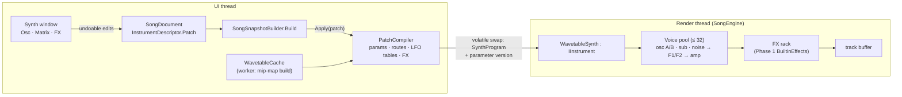
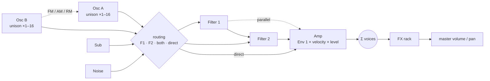
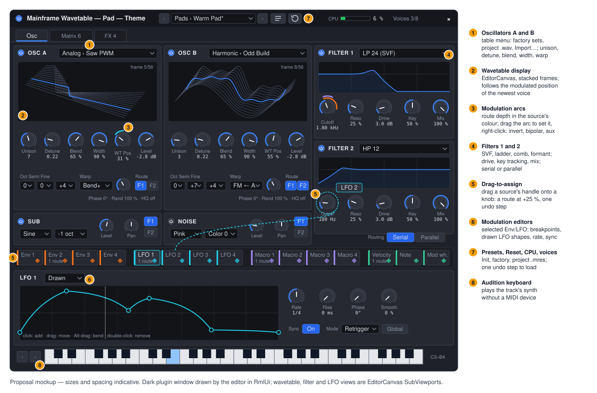
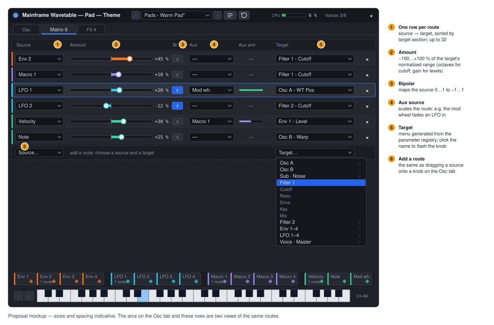
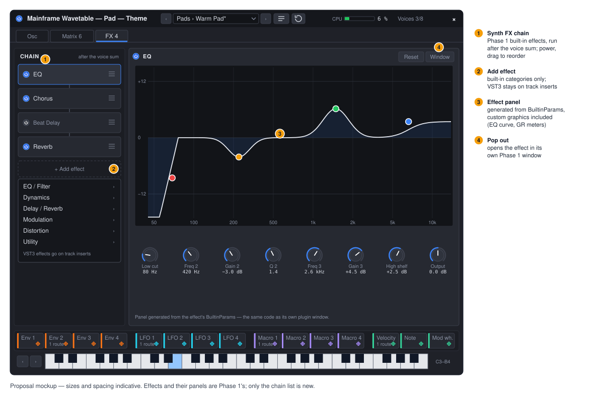

# Proposal: Wavetable synth (a built-in instrument for Music mode)

**Milestone:** unscheduled (editor tooling, Phase 2 of the Logic-style DAW work, after the built-in effects) · **Status:**
proposal (2026-10-18) · **Depends on:** [Music editor](music-editor.md) (`SongEngine`, `IInstrument`, the song model),
the Phase 1 built-in effects framework (`BuiltinParam`, `BuiltinEffect`, `Effects/Dsp/`, the plugin window; its design
doc `docs/design/music-effects.md` and ADR 0193 land with it) · **ADR draft:**
[0195](../../../memory/decisions/0195-wavetable-synth.md) · **Related:** [Sound designer](sound-designer.md) (ZzFX, the
other built-in instrument), [Editor](../editor.md#song-tab-music-editor), [Audio](../audio.md)

## Problem

Music mode has one built-in instrument, ZzFX: a 16-voice sample player of a sound-effect line rendered once per
pitch. It is good for chiptune placeholders and nothing else. Anything richer (pads, basses, leads, plucks) needs a
VST3 instrument, which needs the plugin host, which only exists on the machine that has the plugin. A song made on one
machine plays silence on the next, CI renders it silent, and a new user has no real instrument at all.

The DAW needs one serious instrument that is always there: a modern wavetable synth of the kind people already know how
to program (oscillators that scan a table of single-cycle frames, unison stacks, two filters, envelopes, LFOs, and a mod
matrix you assign by dragging), written in C#, with its patch stored inside the `.msong` like every other built-in.

## Goals

- **A built-in instrument, `builtin: "wavetable"`**, selectable in the mixer's instrument slot and the Browser like
  ZzFX, that works on every machine and in CI (no plugin host, no natives).
- **The v1 sound engine** (decided with the user):
  - 2 wavetable oscillators (up to 256 frames of 2048 samples, band-limited mip-maps), each with one warp mode: sync,
    bend, PWM, mirror, FM / AM / RM from the other oscillator;
  - unison of 1–16 voices per oscillator with detune, blend, stereo width, phase and phase randomness;
  - a sub oscillator and a noise oscillator;
  - 2 filters (state-variable LP/HP/BP/notch/peak, ladder, comb, formant; drive, key tracking), serial or parallel;
  - 4 envelopes (envelope 1 is the amp) with curved segments, 4 LFOs (tempo sync, drawable shapes);
  - a mod matrix: any source → any continuous parameter, assigned by drag-and-drop onto a knob;
  - polyphony up to 32, mono and legato with glide;
  - an FX rack made of the Phase 1 built-in effects.
- **Content:** factory wavetables generated in code, `.wav` wavetable import (2048-sample frames, the `clm ` chunk),
  factory presets, and presets saved as `.mres` files.
- **A plugin window** with Osc / Matrix / FX tabs, built on the Phase 1 descriptor-driven window and knobs, with the
  wavetable, envelopes and LFOs drawn on an `EditorCanvas`.
- **Real-time safe:** zero allocation on the render thread, no locks, no clicks on parameter changes, deterministic
  offline renders.
- **Our own product.** Working name **Mainframe Wavetable** (id `wavetable`). It reproduces a familiar *workflow*;
  no third-party name, branding, wavetables, presets, artwork or layout is copied.

## Non-goals

- **A wavetable editor** (drawing frames, formula or spectral editing, resynthesis of arbitrary audio into tables).
  v1 imports `.wav` tables and generates factory ones; editing them is a later design.
- A third oscillator, sample/granular/spectral/multisample oscillator modes, a second warp slot per oscillator,
  spectral morphing between frames.
- Importing third-party presets (`.fxp`) or reading other synths' preset formats. Importing a `.wav` wavetable is in
  scope; `.wav` with a `clm ` chunk is a de-facto interchange format written by many tools.
- An arpeggiator, chord mode, MPE / per-note expression.
- Mod-matrix routes to FX parameters (see [Open questions](#open-questions)).
- Running the synth in games. It is pure C# and could later (see [Open questions](#open-questions)); v1 is editor-only,
  and games play the rendered `.ogg` as they do today.
- Automation lanes and recorded controllers (a music-editor non-goal that still stands).

## Overview



The synth is an in-process `IInstrument` in `MainframeEngine.Editor/Src/Music/Synth/`, selected the way ZzFX is. The
UI thread owns everything that allocates: it parses the patch, builds wavetable mip-maps (on a worker), compiles the
mod matrix into flat arrays, and hands the render thread an immutable **`SynthProgram`** plus a lock-free parameter
block. The render thread only reads them: voice allocation, oscillators, filters, envelopes, LFOs and the FX rack run
on preallocated state.

It reuses Phase 1 throughout: parameters are `BuiltinParam` descriptors (ranges, curves, formatting, the knob window
generated from them), the DSP blocks come from `Effects/Dsp/` (`Svf`, `Biquad`, `Lfo`, `NoteDivision`, `LinearRamp`,
`OnePole`, `Oversampler2x`, denormal flushing), parameter hand-off follows `BuiltinEffect.Apply`, and the FX rack *is*
a list of Phase 1 built-in effects.

## Data model

The patch lives in the track's `InstrumentDescriptor`. `Params` cannot be reused: it is already ZzFX's sound line
(a string), and a synth patch is more than a flat dictionary (routes, drawn LFO shapes, table references, an effect
chain). So the descriptor gains one additive object, `Patch`; no song format bump (an older editor keeps it in
`[JsonExtensionData] Extra` and plays the track silent, like any unknown built-in):

```json
{
  "id": "t2", "name": "Pad", "kind": "instrument",
  "instrument": {
    "builtin": "wavetable",
    "preset": "res_9c1…",
    "patch": {
      "version": 1,
      "params": {
        "a.on": 1, "a.level": 0.72, "a.wt_pos": 0.31, "a.warp_mode": 2, "a.warp": 0.4,
        "a.unison": 7, "a.detune": 0.22, "a.blend": 0.65, "a.width": 0.9, "a.random": 1,
        "b.on": 1, "b.octave": -1, "b.level": 0.5,
        "f1.type": 1, "f1.cutoff": 1800, "f1.reso": 0.25, "f1.keytrack": 0.5,
        "env1.attack": 0.02, "env1.release": 1.4, "env2.decay": 0.6, "env2.sustain": 0,
        "lfo1.sync": 1, "lfo1.division": 7,
        "voice.polyphony": 8, "voice.glide": 0
      },
      "tables": {
        "a": { "source": "factory:analog/saw-pwm" },
        "b": { "source": "aud_51e…", "frameSize": 2048 }
      },
      "lfoShapes": [ { "points": [[0, 0, 0], [0.25, 1, 0.4], [1, 0, -0.3]] }, null, null, null ],
      "macros": ["Brightness", "Motion", "Space", "Width"],
      "matrix": [
        { "source": "env2", "target": "f1.cutoff", "amount": 0.45 },
        { "source": "lfo1", "target": "a.wt_pos", "amount": 0.2, "bipolar": true },
        { "source": "velocity", "target": "env1.level", "amount": 0.3, "aux": "macro1" }
      ],
      "fx": [
        { "builtin": "chorus", "params": { "mix": 0.3 } },
        { "builtin": "reverb", "params": { "size": 0.7, "mix": 0.25 }, "bypass": false }
      ]
    }
  },
  "clips": []
}
```

- **`params`** follows the Phase 1 rule for built-in effects: one float per parameter id, defaults for missing ids,
  out-of-range values clamped, unknown ids kept. Choices and toggles are stored as their index, so choice lists are
  append-only (a new filter type goes at the end).
- **`tables`** names each oscillator's wavetable: `factory:<set>/<name>` (generated, never stored) or a project `.wav`
  by UID (rewritten by the FileSystem panel's reference fix-ups, as audio clips are). `frameSize` overrides the frame
  size for files without a `clm ` chunk. A missing file plays the default table and sets the track status
  ("missing wavetable: …").
- **`lfoShapes`** holds only drawn shapes (`[x, y, curve]` points, x and y in 0–1, curve in −1…1 bends the segment
  that ends at the point); built-in shapes are a parameter.
- **`matrix`** entries are `source`, `target` (a parameter id), `amount` (−1…1, in the target's *normalized* range),
  optional `bipolar` (maps the source 0…1 to −1…1), optional `aux` source that scales the route. Up to 32 routes.
- **`fx`** is a list of Phase 1 `PluginInsert`s restricted to built-ins (`builtin`, `params`, `bypass`): the same
  type, the same tolerant reading, the same plugin panels.
- **`preset`** remembers which preset the patch came from (the window shows "Warm Pad*" once it differs). Purely UI.
- **Undo:** `SongDocument` gains `SetSynthParam(track, id, value, mergeKey)` (knob drags merge into one entry, as
  Phase 1's `SetInsertParam`), `SetSynthParams` (presets, Init, Reset), `SetSynthTable`, `AddModRoute` /
  `SetModRoute` / `RemoveModRoute`, `SetLfoShape` and `SetSynthFx` (add, remove, move, bypass, a parameter).

### Parameters

All ids, ranges and curves are `BuiltinParam`s in one registry (`SynthParams`), which also generates the window's
knobs and the matrix's target list. `X` stands for `a` or `b`; `n` for 1–4.

| Section | Parameters (id: range, default) |
|---|---|
| Oscillator A/B | `X.on` · `X.level` 0–1 (0.75) · `X.pan` −1…1 · `X.octave` −4…4 · `X.semi` −12…12 · `X.fine` −100…100 ct · `X.coarse` −48…48 st (continuous, a mod target) · `X.wt_pos` 0–1 · `X.frame_mode` smooth/step · `X.warp_mode` off, sync, bend+, bend−, PWM, mirror, FM, AM, RM · `X.warp` 0–1 · `X.unison` 1–16 · `X.detune` 0–1 (0.25) · `X.range` 0–48 st (2) · `X.blend` 0–1 (0.75) · `X.width` 0–1 (1) · `X.phase` 0–360° · `X.random` 0–1 · `X.retrigger` · `X.to_f1`, `X.to_f2` (both off = straight to the amp) · `X.hq` (2× oversampling) |
| Sub | `sub.on` · `sub.shape` sine/triangle/saw/square · `sub.octave` −2…0 relative to osc A · `sub.level` · `sub.pan` · `sub.to_f1`, `sub.to_f2` |
| Noise | `noise.on` · `noise.type` white, pink, brown, crackle, sample-and-hold · `noise.color` −1…1 (tilt) · `noise.rate` (S&H, key-tracked) · `noise.level` · `noise.pan` · `noise.to_f1`, `noise.to_f2` |
| Filter 1/2 | `fN.on` · `fN.type` LP12, LP24, HP12, HP24, BP12, BP24, notch, peak, ladder LP24, comb+, comb−, formant · `fN.cutoff` 20 Hz–20 kHz (log) · `fN.reso` 0–1 · `fN.drive` 0–24 dB · `fN.keytrack` 0–1 · `fN.mix` 0–1 · `filter.routing` serial/parallel |
| Envelope 1–4 | `envn.delay` · `envn.attack` · `envn.hold` · `envn.decay` (0–30 s, log) · `envn.sustain` 0–1 · `envn.release` 0–30 s · `envn.attack_curve`, `envn.decay_curve`, `envn.release_curve` −1…1 · `env1.level` (amp, 0–1) |
| LFO 1–4 | `lfon.shape` sine, triangle, saw up, saw down, square, sample-and-hold, smooth random, drawn · `lfon.rate` 0.01–100 Hz (log) · `lfon.sync` · `lfon.division` (Phase 1 `NoteDivision`: 8 bars … 1/64, dotted, triplet) · `lfon.mode` free, retrigger, envelope (one-shot) · `lfon.global` · `lfon.delay` · `lfon.rise` · `lfon.phase` · `lfon.smooth` |
| Voicing | `voice.polyphony` 1–32 (8) · `voice.mode` poly, mono, legato · `voice.glide` 0–5 s · `voice.glide_mode` always/legato · `voice.bend_range` 0–24 st (2) |
| Macros, master | `macro1`…`macro4` 0–1 · `master.volume` −60…+6 dB · `master.pan` |

**Mod sources:** `env1`–`env4`, `lfo1`–`lfo4`, `velocity`, `note` (key 0–127 → 0–1), `random` (per note-on),
`macro1`–`macro4`, `modwheel`, `aftertouch`, `pitchbend` (see [Open questions](#open-questions) for the controller
path). Every source outputs 0…1 (pitch bend −1…1); a route's `bipolar` maps 0…1 to −1…1. **Targets** are the
continuous parameters above (not choices or toggles), including `env1.level` (velocity → amp) and LFO rates.

## Voice architecture and DSP



Per voice: oscillator A and B (each a unison stack), sub and noise → each source to filter 1, filter 2, both or
straight to the amp → filters (serial: F1 into F2; parallel: summed) → amp (envelope 1 × velocity route × level) →
stereo sum. All voices sum into the instrument bus → FX rack → master volume/pan → the track buffer (added, as
`IInstrument.Process` requires).

### Wavetables: band-limited mip-maps

A **wavetable** is 1–256 frames of 2048 samples, one cycle each. The cache turns it into a **mip-mapped** table on a
worker thread when first used (`WavetableCache`, keyed by source + frame size, shared by every track and both
oscillators; release by reference count when no program uses it):

1. Per frame: remove DC, real FFT (2048 points: a small radix-2 `Fft` in `Synth/Dsp/`, no package), keep bins 1…1024.
2. **Level L = 0…10** keeps harmonics `1 … H_L` with `H_L = 1024 >> L`, inverse-FFT into `N_L = clamp(4·H_L, 64,
   2048)` samples (2048, 2048, 1024, 512, 256, 128, then 64 for levels 6–10). A level is ~3.1 frames of memory in
   total, so a 256-frame table is about 6.5 MB of floats; factory tables (16–64 frames) are 0.4–1.6 MB.
3. Each level keeps a 3-sample guard at both ends so the 4-point read never wraps.

**Choosing the level.** Aliases that fold back above 20 kHz are inaudible, so a harmonic may go up to
`F_max = max(fs − 20 kHz, fs / 2)` (28 kHz at 48 kHz, 24.1 kHz at 44.1 kHz) instead of Nyquist. For a playback
frequency `f` the level is the smallest `L` with `H_L · f ≤ F_max`:

```
L = clamp(ceil(log2(1024 · f / F_max)), 0, 10)
```

So nothing audible ever aliases, and the worst case (just above a level boundary) still keeps harmonics up to
`F_max / 2` (14 kHz at 48 kHz). `f` is the oscillator's highest effective frequency in the block: the note with pitch
modulation and glide, times the unison voice's detune, times the sync ratio for sync warp. The level is chosen **once
per voice per control step** (below); when it changes, the oscillator reads both levels and crossfades over that step,
so sweeping a note across a boundary does not click.

**Reading.** Each unison voice has a 32-bit unsigned phase accumulator (wraps for free, identical on every CPU; the
increment is `round(f / fs · 2³²)`). The index into a level of length `N_L = 2^k` is `phase >> (32 − k)`, the fraction
the remaining bits. Samples are read with a 4-point, 3rd-order Hermite interpolator (two frames → 8 reads), which at
≥ 4 samples per period of the highest harmonic keeps interpolation images under about −70 dB.

**Frame position.** `wt_pos` (0–1, modulated) selects a fractional frame `p = wt_pos · (frames − 1)`. *Smooth* mode
crossfades frames ⌊p⌋ and ⌊p⌋+1 linearly; *step* plays ⌊p + 0.5⌋ (a stepped, digital sound).

### Warp modes

One warp per oscillator, with amount `a` in 0–1. Warps reshape the phase `φ` (0…1) before the table read, or combine
the output with the other oscillator. `φ_w` is the phase actually read; `y_A`, `y_B` are the oscillators' outputs.

| Mode | Math | Notes |
|---|---|---|
| Sync (windowed) | `r = 2^(4a)` (1–16×); `φ_w = frac(φ · r)`; output × `w(φ) = sin(π·φ)^0.5` blended in by `a` | the window hides the reset discontinuity; the level is chosen for `f · r` |
| Bend+ / Bend− | `φ_w = φ^γ`, `γ = 2^(−3a)` (bend+) or `2^(3a)` (bend−) | squeezes the cycle toward its start or end; `a = 0` is the identity |
| PWM | `w = 1 − 0.98a`; `φ_w = φ / w` for `φ < w`, else the output is 0 | the cycle plays in the first `w` of the period |
| Mirror | `m = 2φ` for `φ < ½`, else `2 − 2φ`; output `(1 − a)·y(φ) + a·y(m)` | forward then backward in each period |
| FM (from the other osc) | `φ_w = frac(φ + I · y_other)`, `I = 4a` (cycles) | phase modulation: through-zero, pitch-stable; `hq` 2× oversamples it |
| AM | `y = y_A · ((1 − a) + a · (0.5 + 0.5 y_B))` | |
| RM | `y = y_A · ((1 − a) + a · y_B)` | |

FM, AM and RM read the other oscillator's sample for the same unison voice index (`i mod unisonOther`). When A and B
modulate each other, B uses A's previous sample (a one-sample feedback path; no cycle). FM and hard sync create
partials the mip level cannot remove; `X.hq` runs that oscillator at 2× with the Phase 1 `Oversampler2x` and is off by
default (the CPU table below counts it separately).

### Unison

For `N` voices, voice `i` has a position `u_i = −1 + 2i/(N − 1)` (0 when `N = 1`):

- **Detune:** `cents_i = u_i · detune · range · 100`; `range` is `X.range` semitones (2 by default, so detune 1.0 is
  ±2 semitones at the outer voices).
- **Blend:** the centre voice (the two centre voices when `N` is even) has gain `1 − blend`, the others `blend`; the
  stack is then scaled by `1 / sqrt(Σ g_i²)`, so loudness stays steady as `N` or blend change (detuned voices are
  uncorrelated, so their power adds).
- **Width:** voice `i` pans to `u_i · width` with the equal-power law (`AudioMath.PanGains`), so pitch spreads across
  the stereo field and `width = 0` is mono.
- **Phase:** at note-on each voice starts at `phase + random · ρ_i` (ρ uniform in 0–1, from the voice's RNG); with
  `retrigger` off the oscillator is free-running (phase continues from the voice slot's last note).
- **Determinism:** each voice's RNG (xorshift32) is seeded from the note's start frame, pitch and unison index, so an
  offline render of the same song is bit-identical every time and on every machine with the same floating-point mode.

### Sub and noise

- **Sub:** sine, triangle, saw or square, one or two octaves below oscillator A (or at its pitch), band-limited with a
  small built-in factory table through the same mip-map reader. No unison.
- **Noise:** white (xorshift), pink (Paul Kellet's 7-pole filter), brown (leaky integrator), crackle (sparse random
  impulses) and sample-and-hold (rate key-tracked), with a tilt `color` (a one-pole shelf). Stereo: two independent
  generators panned by `noise.pan`.

### Filters

Two filters per voice, stereo (unison width makes the voice stereo before the filter):

| Type | Implementation |
|---|---|
| LP/HP/BP 12, notch, peak | Phase 1 `Svf` (TPT, Zavalishin), one stage |
| LP/HP/BP 24 | two cascaded `Svf` stages; resonance on the second |
| Ladder LP24 | a TPT 4-pole ladder with a `tanh` stage per pole (drive and resonance interact like the analog circuit); self-oscillates at `reso` 1, bounded by the nonlinearity |
| Comb+ / Comb− | a delay of `1 / cutoff` seconds (Phase 1 `DelayLine`, Hermite), feedback `±0.98·reso`, damping in the loop |
| Formant | three parallel band-passes at vowel formants (A–E–I–O–U table), `cutoff` morphs along the vowels, `reso` is the bandwidth |

- **Drive** is `tanh(g·x)/tanh(g)` before the filter, `g` from 0–24 dB.
- **Key tracking:** `cutoff · 2^(keytrack · (note − 60) / 12)`.
- **Coefficients** (`g = tan(π·fc/fs)`) are computed once per control step at the step's end value and
  interpolated linearly per sample; `fc` is clamped to `0.49·fs`.
- **Routing:** serial (F1 → F2; sources routed only to F2 skip F1) or parallel (F1 + F2). `mix` crossfades dry/wet per
  filter.

### Envelopes

Delay → attack → hold → decay → sustain → release; times 0–30 s on a log curve (the knob's middle is ~0.3 s). Each
curved segment maps its progress `x` (0…1) through `s(x) = (e^{kx} − 1)/(e^k − 1)` with `k = 6c` for curve `c ∈ [−1,
1]` (`c = 0`: linear). Attack defaults to slightly convex, decay and release to exponential-like (`c = −0.6`).
A note-off during attack or decay releases from the *current* level (no jump); a retriggered voice restarts the attack
from its current level, not from zero. Envelope 1 drives the amp; a voice is freed when envelope 1 finishes its
release (below −96 dB).

### LFOs

Built-in shapes or a **drawn** shape (up to 64 points with curved segments) baked by the UI thread into a 1024-entry
table. Rate in Hz or tempo-synced through Phase 1 `NoteDivision`; *free* LFOs (per voice, phase continues),
*retrigger* (restart at `phase` on each note-on) and *envelope* (one cycle, then hold the last value). A **global**
LFO runs once per instrument; when synced and the song is playing, its phase is derived from the song position
(`EffectContext.PositionFrames`), so it lands on the same beat in every playback and in renders. `delay` and `rise`
fade it in; `smooth` low-passes the output (useful on S&H).

### Mod matrix: control rate and smoothing

Modulation is evaluated at a **control rate of one step per 16 frames** (3 kHz at 48 kHz), the usual split between
cost and accuracy:

1. At each control step, per voice: advance envelopes and per-voice LFOs to the step's end, read the global sources
   (global LFOs, macros, controllers), and evaluate the compiled routes.
2. For each modulated target: `v_norm = clamp(base_norm + Σ amount_r · s_r · aux_r, 0, 1)`, then `BuiltinParam`
   denormalizes it. Working in normalized space means a cutoff route moves in octaves (the log curve) and a level route
   in linear gain, with the same amount semantics everywhere.
3. Audio-rate consumers (pitch → phase increment, level, pan, wavetable position, warp amount, filter coefficients)
   ramp **linearly across the 16 frames** from the previous step's value, so a 0 ms attack is a 0.33 ms ramp and
   nothing zippers.

The routes are compiled on the UI thread into flat arrays (`ModRoute { short Source, Target, Aux; float Amount;
bool Bipolar }`, sorted by target) with per-voice source values in a `float[voices, sources]` block, so evaluation is a
tight loop with no lookups. A per-voice source routed to a global target (an FX parameter later, `master.volume` now)
uses the most recently started voice. Pitch modulation is summed in semitones before one `exp2` per voice per step.

**Base-value smoothing.** Knob changes, preset loads and undo arrive as new base values; each continuous parameter
glides to its new base with a 20 ms `LinearRamp` (Phase 1), so a knob drag on a playing note is click-free. Choices
and toggles switch at the next note-on for voice structure (`unison`, `warp_mode`, filter `type`), or immediately with
a 5 ms crossfade for what can change under a sounding voice (filter type, warp mode).

### Voice management

- **Poly:** up to `voice.polyphony` voices (1–32). Stealing order: the oldest released voice, then the oldest held
  voice; a stolen voice fades out over 3 ms in a reserved *tail* slot (polyphony + 4 slots are allocated) while the
  new note starts at once.
- **Mono / legato:** one voice, last-note priority with a held-note stack (returning to a still-held note on
  release). Legato does not retrigger envelopes or LFOs on overlapping notes.
- **Glide:** constant-time portamento in pitch (semitones), `always` or only between overlapping notes.
- `AllNotesOff` (stop, seek) releases every voice over 5 ms, as the ZzFX instrument does.

## Threading and zero allocation

The render thread is the `SongEngine`'s; the rules are the music editor's (no allocation after preparation, no locks)
plus Phase 1's parameter hand-off:

- **`WavetableSynth : IInstrument`** is created once per track slot while the instrument key stays `builtin:wavetable`
  (the existing `SongSnapshotBuilder.InstrumentKey`), so DSP state survives edits. Every `Build` calls
  `synth.Apply(descriptor.Patch)` on the UI thread, the same hook Phase 1 adds for built-in effects (an
  `IBuiltinInstrument` interface the builder recognizes).
- **Two hand-off paths:**
  - *Parameter values* (the common case: a knob drag): `Apply` writes the 200-odd base values into a
    `float[]` with volatile writes and bumps a version, exactly like `BuiltinEffect.Apply`. The render thread copies
    them into its own array when the version changes and starts the smoothing ramps.
  - *Structure* (routes, tables, drawn LFO shapes, the FX list): `Apply` builds a new immutable `SynthProgram` and
    publishes it with `Volatile.Write`. The render thread picks it up at the next block boundary. A program holds
    only arrays sized at compile time; nothing on the render thread grows.
- **Wavetables** are built by `WavetableCache` on a worker task (a 256-frame import takes tens of milliseconds). Until
  a table is ready the program keeps the previous table (or the default saw), and the next `Build` after completion
  publishes it. The cache never runs on the render thread.
- **Preallocated state:** voices (`polyphony` + 4 tail slots, at the 32-voice maximum: the pool does not reallocate
  when polyphony changes), 16 unison phase accumulators per oscillator, per-voice filter state, LFO/envelope state,
  control-step scratch, and the FX rack's own Phase 1 buffers. About 200 KB per synth instance.
- **The `IInstrument` signature** gains the Phase 1 `in EffectContext ctx` (tempo, playing, position) for tempo-synced
  LFOs and the FX rack; the ZzFX and VST3 instruments ignore it.
- **Floating point:** denormals are flushed explicitly at filter and feedback states (Phase 1's helper); no NaN can
  escape (the ladder and comb clamp their states), and a test runs the synth through 60 s of silence after a loud note.
- **CPU meter:** each `Process` measures itself with `Stopwatch.GetTimestamp()` (no allocation) and publishes a
  smoothed load (percentage of the block's real-time duration) the window shows next to the voice count.

## CPU budget

Targets for a **Release** build on the reference machine (Apple M1, one core), at 48 kHz, 256-frame blocks (5.33 ms
of real time each), measured by the benchmark suite (`Tests/MainframeEngine.Benchmarks`, compared against
`baseline.json` by `just bench`):

| Patch | Voices × oscillators × unison | Target (share of one core) |
|---|---|---|
| Init (1 osc, no unison, 1 filter) | 1 × 1 × 1 | ≤ 0.3 % |
| Typical lead (2 osc, 2 filters, 4 routes) | 1 × 2 × 4 | ≤ 1 % |
| Supersaw pad | 8 × 2 × 7 | ≤ 8 % |
| Worst case (all modulated, both filters, FX rack of 4) | 16 × 2 × 16 | ≤ 40 % (a block in ≤ 2.1 ms) |
| Worst case with `hq` on both oscillators | 16 × 2 × 16 | ≤ 75 % |

How it is reached: 32-bit integer phases; 16 unison lanes processed with `System.Numerics.Vector<T>` /
`Vector128` for phase, pan and gain math (the table reads are scalar gathers); one mip level and one `exp2` per voice
per control step, not per sample; filter coefficients per control step; silent sources (`on` off, level 0) skipped;
and an idle synth (no voices, FX tails decayed) costs nothing. Polyphony × unison past the worst case is allowed but
may miss deadlines; the CPU meter turns amber over 70 %.

## Wavetable sources

### Factory wavetables (code-generated)

`FactoryWavetables` generates every factory table deterministically from code at first use; none are stored in the
repository or in songs, and all are original. About 30 tables in five sets:

| Set | Examples (how each is made) |
|---|---|
| Basic | sine → triangle → saw → square morph; pure saw; pure square |
| Analog | PWM sweep; saw with a drifting low-pass; stacked detuned saws; "sync sweep" (hard-sync ratios 1–8) |
| Harmonic | additive build-ups (1 → 64 harmonics), odd-only and even-only sweeps, a bell (inharmonic partials folded in) |
| Formant | additive frames shaped by vowel formant envelopes (A → E → I → O → U), a vocal "yeah" morph |
| Digital | bit-reduced and sample-rate-reduced saws, FM sweeps (ratio 1–8, index 0–8), waveshaped and wavefolded sines |

Generation runs once per process on the worker (a few milliseconds per table), then goes through the same mip-map
build as an imported table.

### `.wav` import

A project `.wav` becomes a wavetable when an oscillator's table menu picks it ("Import Wavetable…" opens the file
picker and copies an outside file into `Content/Wavetables/`, the default folder). The file stays an ordinary audio
asset; its patch reference is its UID.

- **Frame size** comes from the `clm ` chunk when present: its text starts with `<!>` followed by the frame size in
  decimal (`<!>2048 …`); the flags after it are ignored. Without the chunk: the `frameSize` stored in the patch
  reference, else 2048 when the sample count is a multiple of 2048, else the whole file is **one** single-cycle frame.
  The table menu offers frame sizes 256, 512, 1024, 2048, 4096 and "single cycle" to override.
- Frames of another size are resampled to 2048 in the frequency domain (FFT, pad or truncate the spectrum, inverse
  FFT), so they stay band-limited.
- Channels are mixed to mono; 8/16/24/32-bit PCM and 32-bit float are read by a small RIFF reader in `Synth/` (the
  engine's decoders resample and stream, which a table import must not do).
- At most 256 frames (the rest is dropped with a warning in the Output panel); each frame has its DC removed; the
  table is peak-normalized as a whole (not per frame, so a quiet frame stays quiet).
- Malformed files (no `fmt `/`data`, zero frames) are refused with a message; the oscillator keeps its table.

## Presets

- **Factory presets** (about 40: basses, leads, pads, plucks, keys, FX) are written in C# (`FactoryPresets`, a patch
  per preset built from the parameter registry), so they always match the current parameter set and use only factory
  tables.
- **User presets** are `.mres` resources of a new type, `WavetablePreset`: `Name`, `Category`, `Author`, `Tags` and
  `Patch` (the patch JSON as written in the `.msong`, canonical form). The editor has no source generator (its nodes
  stay unregistered on purpose), so the type lives in the engine core
  (`MainframeEngine/Src/Audio/Synth/WavetablePreset.cs`), where the generator registers it and a future runtime synth
  can load it. Default folder: `Content/Presets/Wavetable/`. A preset that references a `.wav` table references it by
  UID like any resource.
- **The preset menu** in the window header (Phase 1's Presets button, extended): Init, the factory categories, the
  project's presets (found by type through the `AssetDatabase`), Save Preset… / Save As…. Loading a preset is one undo
  step (`SetSynthParams` + tables + matrix + FX together). Next/previous arrows step through the current category.

## The synth window (UI)

The Phase 1 plugin window in a larger size (920 × 600 dp, resizable down to 760 × 520), opened from the instrument
slot (mixer strip, track header) or by double-clicking the instrument in the Browser. One window per instrument at a
time, like the insert windows; its position is saved. The header is Phase 1's (power, "Mainframe Wavetable — Pad —
Theme", presets, Reset, close) plus the CPU meter and active voice count, then the tab bar **Osc · Matrix · FX** (the
user's three tabs) and, always visible along the bottom, the **modulation strip**: Env 1–4, LFO 1–4, Macros 1–4,
Velocity, Note, Mod wheel. The tab is remembered per window.

### Osc tab



- **Oscillator A and B panels:** on/off, the table menu (factory sets, project tables, Import Wavetable…), the
  **wavetable display**, then knobs: octave/semi/fine (steppers), unison, detune, blend, width, wt pos, warp mode
  (menu) + warp, phase, random, level, pan; the filter-routing toggles F1/F2.
- **Wavetable display** (`WavetableCanvas : EditorCanvas`, one `SubViewport` per oscillator, `engine://synth-osc-a`):
  the frames drawn as a stacked pseudo-3D view (up to 32 frames, each a 128-point polyline, the current frame bright)
  or a flat view of the current frame (click toggles). With voices sounding, the frame drawn follows the *modulated*
  position of the newest voice, which the render thread publishes as a float (lock-free, read once per editor frame).
  It redraws only when the table, position or size changes, from a preallocated `Vector2[]`; the 2048-sample frame is
  reduced to 128 min/max points when the table is built, not per frame.
- **Sub and noise** are compact rows under the oscillators; **Filter 1 and 2** sit at the right with a type menu,
  cutoff, resonance, drive, key tracking, mix, the serial/parallel switch, and a response curve (`FilterCanvas`)
  computed from the same coefficients (`MagnitudeDb`, shared with the EQ graph in Phase 1).
- **Bottom: modulation editors.** Selecting an Env or LFO tile in the modulation strip shows its editor: the envelope
  curve with draggable breakpoints (time and curve per segment), or the LFO shape with rate, sync and mode. In *drawn*
  mode, click adds a point, drag moves it, Alt-drag bends the segment, double-click removes it; edits are
  `SetLfoShape` steps (one undo entry per drag).

### Drag-to-assign modulation

- Every source tile in the modulation strip has a drag handle (a crossed-arrows icon, tooltip "Drag onto a knob to
  modulate it"). Dragging it creates a `SynthModDrag(source)` with a ghost after a 4 dp move (the Phase 1 Browser's drag
  pattern); continuous knobs carry `data-drop="mod:<param id>"` and highlight while a drag hovers them.
- Dropping on a knob adds a route (`AddModRoute`, amount +25 %, unipolar) or, if that source already modulates the
  knob, selects the existing route. Choices and toggles do not accept drops.
- A modulated knob shows an **arc** in the source's colour around it, from the base value to base + amount; several
  routes stack as concentric arcs. Dragging on the arc (or Alt-drag on the knob) sets the selected route's amount; the
  value readout shows "Env 2 → Cutoff +45 %". While a note plays, a small dot on the arc shows the live modulated
  value.
- Right-click on a modulated knob lists its routes: invert, bipolar, set aux source, remove. Removing the last route
  removes the arc.
- Each tile shows how many routes it drives; hovering a tile highlights its targets.

### Matrix tab



A table of every route (the same data the arcs show): source, amount (a horizontal slider centred on 0), the bipolar
toggle, aux source, aux amount, target, and a remove button; an empty last row adds a route by choosing source
and target from menus (the target menu is grouped by section and generated from `SynthParams`). Rows sort by target
section. Clicking a target name switches to the Osc tab and flashes that knob. Up to 32 routes; the count shows in the
tab title ("Matrix 6").

### FX tab



The synth's own effect chain, made of Phase 1 built-in effects: a vertical list of slots on the left (power, name,
drag to reorder, "+" opens the built-in categories menu; VST3 effects are not offered here, they belong on the track's
inserts) and, on the right, the selected effect's panel, generated from its `BuiltinParam`s by the same code as its
own plugin window, including custom graphics (the EQ curve, gain-reduction meters). The chain runs after the voice sum
and before the synth's master volume.

### Window behaviour

- Knob gestures are Phase 1's (vertical drag, Shift fine, wheel, double-click reset, each drag one undo step).
- Read-only songs disable editing; the window still shows the patch and plays notes.
- Clicking the piano keyboard strip at the window's bottom edge (a two-octave strip, octave shift buttons) auditions
  the patch through the track (`SongPlayer`'s preview-note path), without a MIDI device.
- The window closes when its track disappears (undo, tab switch), as Phase 1's windows do.

## Reusing the Phase 1 framework

| Phase 1 piece | Used by the synth for |
|---|---|
| `BuiltinParam`, `ParamCurve`, Normalize/Format | every synth parameter, the matrix's normalized math, readouts |
| `BuiltinEffect.Apply` hand-off (volatile writes + version) | the synth's base-value block |
| `Effects/Dsp/Svf`, `Biquad` + `MagnitudeDb` | filters and the filter curve display |
| `Lfo`, `NoteDivision` | LFO phase and tempo sync (the synth adds drawn shapes on top) |
| `LinearRamp`, `OnePole` | base-value smoothing, LFO smooth, noise colour |
| `DelayLine` | comb filters |
| `Oversampler2x` | `hq` oscillators |
| `EffectContext` | tempo, transport and position for synced LFOs and the FX rack |
| `BuiltinEffects` registry + effects | the FX tab's chain and its panels |
| Plugin window, knobs, popups, presets button, drag ghost | the synth window's chrome and gestures |
| `PluginInsert` (`Builtin`, `Params`, `Bypass`) | the `patch.fx` entries |

New in Phase 2: `Synth/` (`WavetableSynth`, `SynthProgram`, `PatchCompiler`, `SynthParams`, `Voice`, `Oscillator`,
`Warp`, `Filters` (ladder, comb, formant), `Envelope`, `WavetableCache`, `Wavetable`, `FactoryWavetables`,
`FactoryPresets`, `WavetableWav`, `Dsp/Fft`), `IBuiltinInstrument`, the synth window
(`UI/SynthWindow.cs`, `Content/Editor/synth_window.rml`, `WavetableCanvas`, `EnvelopeCanvas`, `LfoCanvas`,
`FilterCanvas`) and the engine's `WavetablePreset` resource.

## Error handling

| Situation | Behaviour |
|---|---|
| Wavetable `.wav` missing | default table plays; track status "missing wavetable: Content/Wavetables/x.wav"; reference kept |
| `.wav` malformed or not a table | refused at import with a message; an existing reference shows the status above |
| Unknown parameter id / route target / source | kept in the file, ignored by the compiler; the Matrix tab shows the route greyed ("unknown target") |
| Unknown effect in `patch.fx` | pass-through, as Phase 1 |
| Patch `version` newer than this editor | the track plays what it understands; the window opens read-only with a notice |
| Older editor opens a song with the synth | it keeps `patch` in `Extra`; the track is silent (unknown built-in) |
| Render-thread overload | the block is late like any other (xrun counter); the CPU meter shows it |

## Testing

New tests in `Tests/MainframeEngine.Editor.Tests/Music/Synth/` (all without audio devices, ffmpeg or the helper):

- **Mip-maps:** each level of each factory table has no energy above `H_L` (FFT of the level, < −120 dB); level
  selection follows the formula at 44.1 and 48 kHz; tables with 1, 2, 256 and 300 frames (the last truncated).
- **Aliasing:** render a saw sweep 20 Hz → 20 kHz and a fixed set of notes (A0 … C8) at 48 kHz; measure, by FFT,
  every component below 20 kHz that is not a harmonic: ≤ −70 dB relative to the fundamental (mip-maps alone). FM and
  sync with `hq` on are measured against `hq` off and must improve by ≥ 20 dB.
- **Warp math:** each warp function at known phases; `a = 0` is the identity for every mode (sample-identical output);
  sync's level selection uses `f · r`.
- **Unison:** `N = 1` equals a single oscillator; measured detune frequencies; RMS within ±1 dB across `N` 1–16 and
  blend 0–1; pan law; width 0 is mono.
- **Envelopes and LFOs:** segment lengths in frames (± one control step); release from mid-attack starts at the current
  level; tempo-synced LFO period (1/4 at 120 BPM = 24 000 frames at 48 kHz) and phase locked to the song position.
- **Filters:** SVF −3 dB at cutoff (LP12, Q 0.707), 24 dB/oct slopes, key tracking, ladder and comb stay bounded at
  maximum resonance and drive; no NaN or denormals after 60 s of silence.
- **Mod matrix:** compiled routes give the expected parameter values (normalized math, clamping, aux scaling,
  bipolar); smoothing ramps reach their target within 20 ms; no clicks (maximum sample-to-sample step bounded) on
  knob changes during a held note.
- **Voices:** stealing order, tail fade, mono/legato note stack, glide time, `AllNotesOff`.
- **Determinism:** the same song renders bit-identical twice (seeded RNGs, integer phases).
- **Allocation:** zero bytes (`GC.GetAllocatedBytesForCurrentThread`) across 1 000 blocks at 16 voices × 16 unison,
  with parameter changes, program swaps, table swaps, note storms, voice stealing and FX bypass toggles.
- **CPU:** the benchmark table above in `Tests/MainframeEngine.Benchmarks` (regressions against `baseline.json`), plus a
  CI-safe unit test that the supersaw pad renders 1 s of audio in under 0.5 s on any runner (catches gross
  regressions without timing flakiness).
- **Data model:** patch JSON round trip; missing parameters read defaults, out-of-range values clamp, unknown ids,
  sources, targets and effects are preserved byte for byte; undo/merge of knob drags, route edits and preset loads.
- **Import:** `clm ` chunk parsing, each fallback, frame resampling, 8/16/24/32-bit and float files, stereo mixdown,
  malformed files.
- **Goldens and QA:** render-test goldens of the three tabs (`editor-synth-osc`, `editor-synth-matrix`,
  `editor-synth-fx`, both drivers); `editor-music-song` gains a synth track so the allocation gate covers it. QA verbs
  `song synth-window`, `synth tab`, `synth mod-drag` and a walkthrough capture of each tab; `just qa-editor` and
  inspect by eye.

## Delivery

Four PRs after Phase 1's A1 (framework) and E (plugin window); 1 → 2 → 3 → 4, with 2 able to run beside 3:

1. **Synth engine, no window:** `Synth/` DSP (tables + FFT + factory tables, oscillators, warps, unison, sub, noise,
   filters, envelopes, LFOs, matrix compiler, voices), `WavetableSynth`, `IBuiltinInstrument` and the `EffectContext`
   on `IInstrument`, the `patch` data model and `SongDocument` methods, "Wavetable" in the instrument slot and the
   Browser (Init patch; parameters editable through the generic Phase 1 knob window as a stopgap), benchmarks and the
   DSP, allocation, determinism and data-model tests.
2. **Content:** `.wav` import, factory presets, the `WavetablePreset` resource and the preset menu, the table menu.
3. **Synth window, Osc tab:** the larger window, `WavetableCanvas`, `FilterCanvas`, envelope and LFO editors (drawn
   LFOs), modulation strip, drag-to-assign and the knob arcs.
4. **Matrix and FX tabs, docs:** the Matrix table, the FX rack with embedded effect panels, the CPU meter, goldens, QA
   verbs and captures; the as-built `docs/design/wavetable-synth.md` (this proposal rewritten), [editor.md](../editor.md)
   (song tab), the milestone row, the landing page's DAW section and the README with screenshots.

## Open questions

- **Name.** "Mainframe Wavetable" is a working title; the stored id `wavetable` does not depend on it, so the display
  name can change any time before release. Pick a product name?
- **Mod wheel, pitch bend and aftertouch.** `IInstrument` has no controller path (a music-editor open question), and
  songs store no controller data. v1 can ship the sources reading their resting values (useful live only once the
  path exists), or add a `ControllerEvent` path for live MIDI as a small PR before PR 1. Recommendation: add the live
  path (pitch bend, CC1, channel aftertouch) in PR 1; recording controllers stays with automation lanes.
- **Mod-matrix routes into the FX rack.** Serum-style synths let LFOs drive FX parameters. It needs a render-thread
  override entry on `BuiltinEffect` (per-block modulated values over the UI's base values). Recommendation: leave it out
  of v1, design it with automation lanes, which need the same entry.
- **Where `WavetablePreset` lives.** The engine core (proposed: registered by the generator, ready for runtime use)
  adds an engine type that only the editor uses today. The alternative is an editor-registered type with a hand-written
  `NodeTypeInfo`, or a plain JSON preset file instead of `.mres`. Engine core is recommended.
- **A user-wide preset library** (presets shared across projects, e.g. `~/.mainframe/presets/`) is not in v1, since
  `.mres` files and UIDs belong to a project. Wanted for v1, or later?
- **Runtime use in games.** The synth could run in `AudioServer` (an `AudioStreamGenerator` or a dedicated stream)
  for procedural music and sound effects. It would move the DSP into the engine and add CPU on game audio threads.
  Separate design after v1?
- **Polyphony × unison ceiling.** Allow 32 × 16 × 2 freely (may miss deadlines, the meter warns), or cap total lanes
  (e.g. 512) and steal beyond it?
