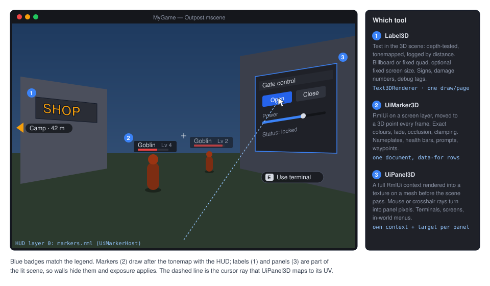
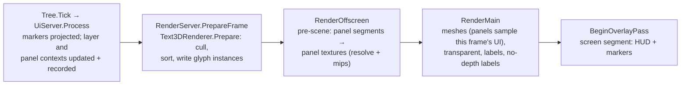

# Proposal: World-space UI and 3D text

**Milestone:** [Gameplay toolkit](../../milestones.md#gameplay-toolkit-) (G11) · **Status:** 🚧 a first slice shipped
([ADR 0200](../../../memory/decisions/0200-label3d-first-slice.md): `Camera3D.UnprojectPosition`/`IsPositionBehind` and a
single-line `Label3D` on the mesh batcher; see [What shipped](#what-shipped-adr-0200)), and sub-viewport textures on 3D
materials ([ADR 0216](../../../memory/decisions/0216-viewport-textures-on-3d-materials.md), [What shipped](#what-shipped-adr-0216)) ·
**Depends on:** [M8 game UI](../game-ui.md) (RmlUi, `VulkanUiRenderer`), [canvas text](../canvas.md#text-adr-0118)
(ADR 0118: `Font`), [M6 physics](../physics.md) (occlusion and line-of-sight rays) · **Related:**
[Rendering features](rendering-features.md) (G6.3 billboards), [Localization](../localization.md),
[Haptics and input glyphs](input-haptics-and-glyphs.md) (G12: prompt glyphs), [Accessibility](accessibility.md) (G14:
UI scale), [Editor](../editor.md#ui-preview) (stand-in data)

## Problem

Games put UI in the world all the time: shop signs, damage numbers, nameplates and health bars over enemies, "press E"
prompts, waypoints that stick to the screen edge, and terminals the player clicks. The engine has text and UI only on
the screen:

- **No 3D text.** `Font` rasterises glyphs into 512 px atlas pages per size and outline
  (`MainframeEngine/Src/Text/Font.cs:24-27`, `:152-187`) and draws only through canvas items (`Font.Draw` is internal,
  `:104`; `CanvasItem.DrawString`, `MainframeEngine/Src/Scene/Canvas/CanvasItem.cs:369`). It is single-line with no
  fallback fonts (`Font.cs:19`), so CJK text from `Tr` shows missing glyphs. The only text node is `Label2D`
  (`MainframeEngine/Src/Scene/Nodes2D/Label2D.cs:12`).
- **The nearest 3D node is `Sprite3D`:** a textured quad with no billboard mode and one draw per sprite
  (`MainframeEngine/Src/Scene/Nodes3D/GeometryInstance3D.cs:169-177`). Billboards are planned as a material mode in G6.3
  ([rendering-features.md](rendering-features.md), "Billboards"). Materials have no depth-test switch and no
  fixed-screen-size mode: `MaterialRenderState` is alpha, cull and double-sided only
  (`MainframeEngine/Src/Rendering/Resources/Material.cs:115-127`).
- **No world → screen call on `Camera3D`.** It has the inverse, `ProjectRay`/`ProjectRayOrigin`/`ProjectRayNormal`
  (`MainframeEngine/Src/Scene/Nodes3D/Camera3D.cs:90-114`), but no `UnprojectPosition`. The projection exists twice in
  private code: `GizmoProjection.TryProject` (`MainframeEngine/Src/Rendering/Gizmos/GizmoProjection.cs:8`) and the
  editor's `EditorCamera.Project` (`MainframeEngine.Editor/Src/Viewport/EditorCamera.cs:234`).
- **UI is screen-only.** A `UiLayer` is "a screen-space UI layer" sized to the framebuffer or its `Region`
  (`MainframeEngine/Src/UI/UiLayer.cs:31-42`; `UiServer.cs:553-556`). Every visible context renders into one command
  list (`UiServer.cs:689-708`), which `VulkanUiRenderer` replays into swapchain-sized layers in
  `IOverlayRenderer.RecordOffscreen` (`MainframeEngine/Src/UI/Rendering/VulkanUiRenderer.Replay.cs:97-131`). That hook
  runs inside `BeginOverlayPass`, after the scene pass has ended
  (`MainframeEngine/Src/Rendering/Vulkan/IOverlayRenderer.cs:10-15`), so the scene cannot sample a UI image in the same
  frame. M8 lists world-space panels as a non-goal ([game-ui.md → Known issues](../game-ui.md#known-issues)).
- **Many small documents do not scale.** Data model names are unique per layer (`UiDocument.cs:141`), so 100 copies of
  one nameplate document in one layer collide on their model name. The shim cannot create or clone elements (the only
  structural call is `ElementSetInnerRml`, `MainframeEngine/Src/UI/Rml/RmlNative.cs:356`; "the binding cannot create
  elements", [game-ui.md → Tooltips](../game-ui.md#tooltips-adr-0121)). Moving an existing element is cheap:
  `RmlElement.SetProperty` takes spans (`RmlElement.cs:179`).
- **3D materials cannot show render targets** (fixed by [ADR 0216](#what-shipped-adr-0216)). `Texture2D.FromViewport` serves canvas items only
  (`MainframeEngine/Src/Rendering/Resources/Texture2D.cs:249-258`). `TextureGpu.Update` decodes CPU pixels
  (`MainframeEngine/Src/Rendering/Meshes/MeshGpuResources.cs:221-246`), and a viewport texture throws "has no CPU pixels"
  (`Texture2D.cs:350-351`), which is logged as "cannot be uploaded". A `SubViewport` on a monitor mesh does not work
  either, although its `ColorImage` exists (`MainframeEngine/Src/Scene/SubViewport.cs:128`).
- **Input reaches UI only by window position.** Mouse events go to layers in window pixels (`UiServer.cs:934-985`,
  `:1159-1177`) and skip the UI entirely while the mouse is raw or captured (`:923-932`), which is the normal state of a
  first-person game. Object-ID picking finishes a few frames later on the GPU (`Servers/RenderServer.cs:928-945`), which
  is too late for hover. The physics ray `PhysicsDirectSpaceState3D.RayCast` is synchronous and allocation-free
  (`MainframeEngine/Src/Physics/3D/PhysicsDirectSpaceState3D.cs:47`).

What G11 builds on: frame servers run after the transform flush (`MainframeEngine/Src/Scene/SceneTree.cs:366-372`), so
the UI server sees final positions. `RenderServer.RenderOffscreen` runs before the scene pass
(`MainframeEngine/Src/Core/Engine.cs:559-562`), which is the slot panels need. `DrawWorld` draws non-batched visuals
around the opaque batch by `RenderPriority`, then the transparent batch (`Servers/RenderServer.cs:890-925`). Lit
shaders fog through `applyFog` (`MainframeEngine/Assets/Shaders/include/fog.slang:43`).

## What shipped (ADR 0200)

A first slice for Buy My Snake Oil's NPC name tags (mainframe-engine#56). The Problem section below describes the
engine before it.

- `Camera3D.UnprojectPosition(worldPoint)` (plus a static overload taking an `ICamera` and a viewport size) and
  `IsPositionBehind(worldPoint)`, with Godot's semantics. A point behind the camera projects mirrored. `IsPositionInFrustum`
  and `GetFrustumPlanes` are not done yet.
- `Label3D : GeometryInstance3D`, with Godot's defaults. It supports `Text` (shown through `Atr`, and rebuilt on
  locale change), `Font` (null = the engine's Lato Latin), `FontSize`, `PixelSize`, `Modulate`, `OutlineSize`,
  `OutlineModulate`, `OutlineRenderPriority`, `HorizontalAlignment`, `VerticalAlignment` (a new enum), `Offset`,
  `Billboard` (the `Sprite3D` billboards, [ADR 0199](../../../memory/decisions/0199-sprite3d-billboards-on-the-cpu.md)),
  `NoDepthTest`, `Shaded` and `DoubleSided`. It builds an `ArrayMesh` of glyph quads from `Font.Layout`, which `Font.Draw`
  also uses: one surface per atlas page for the outline, then one per page for the text. The mesh goes through the
  ordinary mesh batcher, so picking, billboards and culling come for free. It is rebuilt only on change.
- `StandardMaterial3D.NoDepthTest` (Godot's `no_depth_test`) joins `MaterialRenderState` and `PipelineKey`. The surface
  draws in the transparent pass with no depth test or writes; the object-ID pass still depth-tests it.

Still to do from this proposal: the batched `Text3DRenderer` and its shader (labels are one draw per page each),
multiple lines and autowrap, `FixedSize`, fog, alpha cut, `VisibilityRangeEnd` fading, fallback fonts, atlas uploads
without re-creating the texture, `UiMarker3D` and `UiPanel3D`. A Godot `render_priority` for the text itself is also
missing: `VisualInstance3D.RenderPriority` already means node order, so the text draws at material priority 0.

## What shipped (ADR 0216)

`SubViewport.GetTexture()` on 3D materials, for the Neon example's monitors and TV: any material texture slot
(`StandardMaterial3D` albedo, emission, normal, ORM; `GpuParticles3D` materials; spatial `ShaderMaterial` sampler
uniforms) takes a viewport texture.

- `TextureGpu` uploads nothing for a viewport texture: it borrows the view's colour image (`GpuTexture.Borrow`) and
  follows it across resizes, rewriting the material's set through the deletion queue. Colour slots sample through an
  `R8G8B8A8_SRGB` view of the `UNORM` target (the targets are created `MUTABLE_FORMAT`); data slots and samplers without
  `source_color` sample the stored values. Steady frames allocate nothing.
- A 3D view renders before the scene pass, so the scene shows its current frame (`SubViewportTargets.Presented`). A 2D
  view (`Disable3D`) is drawn by the canvas after the scene pass: the scene samples the one target before the canvas
  overwrites it, so it shows the previous frame, ordered by the canvas pass's dependencies (no second image or copy).
- Before a view's first frame the slot is empty. A `TransparentBg` 2D view is premultiplied: give screens an opaque
  clear colour. CPU consumers (bakes, packers) still get no pixels from a viewport texture.

Not done from G11.1: `Texture2D.FromGpuSource` (the general external path, for `UiPanel3D`'s images),
`IsPositionInFrustum`/`GetFrustumPlanes`.

## Goals

- **`Label3D`** (Godot's names and defaults): one or more lines of text in the scene, as a billboard or a fixed quad,
  with outline, alignment, width and autowrap. Options: fixed screen size, depth test off, fog. All labels of a world
  are batched (one draw per atlas page and pipeline). Translated through `Atr`; fallback fonts for CJK.
- **`UiMarker3D`**: RmlUi on a screen layer, placed at a 3D point every frame, for nameplates, health bars, interaction
  prompts and waypoints. Distance fade and scale, occlusion, clamp to the screen edge with an angle for arrows. Colours
  stay exact because markers draw after the tonemap with the HUD. 100 markers cost ≤ 0.3 ms CPU and 0 B per frame.
- **`UiPanel3D`**: a full RmlUi context rendered into a texture before the scene pass and shown on a quad or mesh. Input
  comes from the mouse ray, a crosshair (raw mouse) or code (VR hands, NPCs). Focus, keyboard and gamepad navigation
  work inside the panel.
- `Camera3D.UnprojectPosition` / `IsPositionBehind` (Godot's), and GPU-sourced textures on 3D materials. The second
  also makes `SubViewport.GetTexture()` work on meshes.
- Editor support (icons, picking, panels previewed with stand-in data) and a Demo `world_ui` scene.

## Non-goals

- Shaping beyond kerning, right-to-left text, ligatures (the same limits as canvas text and RmlUi, M9).
- VR-specific UI (laser pointers, curved cylinders as a primitive). The manual pointer API lets a VR layer drive panels.
- Lit or shadow-casting text. Labels are unshaded and cast no shadows in G11.
- Screen-space reflections or refraction of panels; panels in sub-viewport worlds beyond the first rendering view.
- Replicating markers or panel state over the network. Panels are local UI; games replicate their own data.

## Design



### Choosing a tool

| | `Label3D` | `UiMarker3D` | `UiPanel3D` |
|---|---|---|---|
| Drawn | in the scene pass (HDR, tonemapped, fog) | after the tonemap, in a screen `UiLayer` | in the scene, from a per-panel texture |
| Hidden by walls | depth test (optional) | physics occlusion (optional) | depth test |
| Size | world units, or fixed pixels | dp, optional distance scale | world units |
| Content | plain text | any RML (one host document) | any RML (own context) |
| Input | none | none (prompts only) | mouse, crosshair, code |
| 100 instances | one draw per page | one document, one list binding | not intended (≤ 8 rendered per frame) |

### Code layout

| Type (all new unless noted) | Where | Role |
|---|---|---|
| `Camera3D.UnprojectPosition`, `IsPositionBehind`, `GetFrustumPlanes` (new members) | `Src/Scene/Nodes3D/` | world → framebuffer pixel, behind test, frustum culling |
| `Texture2D.FromGpuSource` (internal), `TextureGpu` external path (changed) | `Src/Rendering/` | 3D materials sample a GPU image (panels, sub-viewports) |
| `TextLayout`, `GlyphQuad`, `Font.Fallbacks` (new member) | `Src/Text/` | Multi-line layout into caller spans; fallback faces |
| `Label3D : VisualInstance3D` | `Src/Scene/Nodes3D/` | The text node |
| `Text3DRenderer` + `Assets/Shaders/Text/text3d.slang` | `Src/Rendering/Text/` | Batching, culling, sorting, glyph atlas uploads, object IDs |
| `UiMarker3D : Node3D`, `UiMarkerHost : UiDocument` + `Assets/UI/markers/` | `Src/UI/World/` | Screen-anchored markers |
| `IUiContextHost` (internal), `UiPanel3D : GeometryInstance3D` | `Src/UI/`, `Src/UI/World/` | Context owners; the panel node |
| `IPreSceneRenderer`, `IVulkanContext.AddPreSceneRenderer` (new member) | `Src/Rendering/Vulkan/` | Offscreen work before the scene pass |

### `Camera3D` projection

```csharp
public partial class Camera3D
{
    /// <summary>Framebuffer pixel (top-left origin) of a world point (Godot's unproject_position).</summary>
    public Vector2 UnprojectPosition(Vector3 worldPoint);
    public bool IsPositionBehind(Vector3 worldPoint);           // behind the near plane
    public bool IsPositionInFrustum(Vector3 worldPoint);
    public void GetFrustumPlanes(Span<Plane> planes);            // 6 planes, for culling without allocation
}
```

They use the same synced `PerspectiveCamera` as `ProjectRay` (no TAA jitter) and `GizmoProjection.TryProject`'s math.
The editor's `EditorCamera.Project` keeps its own copy (it has no `Camera3D`).

### `Label3D`

```csharp
[EditorIcon("letter-t", Family = EditorIconFamily.Space3D)]
public class Label3D : VisualInstance3D
{
    [Export(Translatable = true)] public string Text { get; set; } = "";
    [Export] public Font? Font { get; set; }                    // null = the engine's Lato Latin (ContentPaths.Resolve)
    [Export(Range = "1,256,1")] public int FontSize { get; set; } = 32;           // atlas raster size, px
    [Export(Range = "0.0001,1,0.0001")] public float PixelSize { get; set; } = 0.005f; // world units per px
    [Export] public Color Modulate { get; set; } = Colors.White;                  // sRGB
    [Export(Range = "0,127,1")] public int OutlineSize { get; set; } = 12;        // Godot's units
    [Export] public Color OutlineModulate { get; set; } = Colors.Black;
    [Export] public LabelBillboard Billboard { get; set; }      // Disabled, Enabled, FixedY
    [Export] public bool FixedSize { get; set; }                 // constant on-screen size: 1 label px = 1 framebuffer px
    [Export] public bool NoDepthTest { get; set; }               // drawn over the scene (still below the screen UI)
    [Export] public bool DoubleSided { get; set; } = true;
    [Export] public bool Fog { get; set; } = true;
    [Export] public LabelAlphaCut AlphaCut { get; set; }         // Disabled (blend, sorted), Discard (depth-writing)
    [Export] public HorizontalAlignment HorizontalAlignment { get; set; } = HorizontalAlignment.Center;
    [Export] public VerticalAlignment VerticalAlignment { get; set; } = VerticalAlignment.Center; // new enum
    [Export] public float Width { get; set; } = 500;             // px, used by autowrap and Fill
    [Export] public bool Autowrap { get; set; }
    // also Godot's LineSpacing, Uppercase, Offset (px)
    [Export] public float VisibilityRangeEnd { get; set; }       // 0 = always; fades over the last 10 %

    public Aabb GetAabb();                                       // local bounds (editor focus, culling)
    protected override void OnReady() => ApplyText();            // shows Atr(Text)
    protected override void OnLocaleChanged() => ApplyText();
}
```

- **Layout.** A new internal `TextLayout.Layout(Font, ReadOnlySpan<char>, in TextLayoutOptions, Span<GlyphQuad>)`
  splits lines at `\n`, wraps words in `Width` when `Autowrap` is on, aligns, kerns, and writes one `GlyphQuad`
  (atlas page, source rectangle, pixel rectangle) per visible glyph. It returns the number of quads it needs, so a
  caller retries with a bigger pooled buffer and steady state allocates nothing. `Font.Draw` and `Label2D` move onto the
  same code, so canvas text gains multi-line output at no cost. `Label2D` keeps its single-line behaviour unless `\n`
  appears.
- **Fallback fonts.** `Font.Fallbacks` (a `Font[]`) is searched when `GlyphIndex` returns 0. When a label has no
  explicit fallbacks, the label loads the faces of the current locale chain from the `FontFallbackTable` that RmlUi
  already uses ([Localization](../localization.md#game-ui-rmlui)). Fallback glyphs go into the primary font's atlas pages.
- **A glyph run is retained per label.** It is rebuilt only when the text, font, size, outline, width or locale
  changes. An outline is a second run drawn first, from the atlas entries with an outline (as `Label2D` does).
- **Rendering.** `Label3D` registers in a new `World3D.Labels` list. In `PrepareFrame`, `Text3DRenderer.Prepare`:
  - culls each label against the frustum (bounds are padded for `FixedSize`) and its `VisibilityRangeEnd`;
  - sorts blended labels back to front by their origin, using preallocated key and index arrays;
  - writes one instance per glyph (position, size, UV, colour, label index) into a grow-only, per-frame-slot
    host-visible buffer, and one label record per label (model matrix, flags, pixel size).

  `DrawWorld` then draws the depth-tested labels after `DrawTransparent`, and the `NoDepthTest` labels after
  everything else. Each label is drawn with an instanced quad (four vertices from `SV_VulkanVertexID`), one draw per atlas
  page and pipeline. There are eight pipelines (depth test × blend/discard × cull) through `IVulkanContext.Pipelines`.
- **Shader** (`text3d.slang`, compiled and committed like every engine shader). The vertex stage builds the basis from
  the frame's inverse view rotation for billboards (`FixedY` keeps the label's up axis). For `FixedSize`, it scales by
  `depth × 2 tan(fov/2) / viewHeight`. The fragment stage samples coverage, multiplies by the linearised colour, and
  applies `applyFog` when fog is on. `Discard` labels write depth with a 0.5 threshold.
- **Atlas uploads.** One `GpuTexture` per font page; dirty rows go through `IVulkanContext.Uploads` at frame start, so
  a new glyph never re-creates the texture (`Texture2D.SetPixels` would).
- **Colour and post.** Labels are scene geometry: exposure, tonemap and grading apply, as in Godot. A `#ffffff` label is
  white only at exposure 1 ([open question 2](#open-questions)). Labels are drawn after the depth prepass, so they write
  no motion vectors and behave like other blended surfaces under TAA.
- **Object IDs.** `Text3DRenderer.DrawObjectIds` draws the glyph quads with the label's `Id`, so picking finds labels.

### `UiMarker3D` and `UiMarkerHost`

A marker is a 3D point. The host is one document on a screen layer that draws every marker of its viewport as a row
of a `data-for` list. This avoids per-marker documents, model-name clashes and element creation in the shim.

```csharp
[EditorIcon("map-pin", Family = EditorIconFamily.Ui)]
public class UiMarker3D : Node3D
{
    [Export] public string Kind { get; set; } = "nameplate";     // the row template: data-if="m.kind == 'nameplate'"
    [Export(Translatable = true)] public string Text { get; set; } = "";
    [Export(Translatable = true)] public string Subtext { get; set; } = "";
    [Export(Range = "0,1,0.01")] public float Value { get; set; } = 1f;   // health, progress
    [Export(File = "*.png,*.svg")] public string Icon { get; set; } = "";
    [Export] public Vector3 WorldOffset { get; set; } = new(0, 2, 0);
    [Export] public Vector2 ScreenOffset { get; set; }           // dp
    [Export] public float MaxDistance { get; set; } = 50;        // hidden beyond
    [Export] public float FadeDistance { get; set; } = 5;        // fades over the last metres before MaxDistance
    [Export] public bool ScaleWithDistance { get; set; }         // between MinScale and 1, reference ReferenceDistance
    [Export] public float ReferenceDistance { get; set; } = 10;
    [Export(Range = "0.05,1,0.01")] public float MinScale { get; set; } = 0.5f;
    [Export] public MarkerOffscreen Offscreen { get; set; }      // Hide, ClampToEdge
    [Export] public float EdgeMargin { get; set; } = 32;         // dp
    [Export] public MarkerOcclusion Occlusion { get; set; }      // None, Physics
    [Export(Flags = true)] public uint OcclusionMask { get; set; } = CollisionLayers.All;
    [Export(NodeType = typeof(UiMarkerHost))] public NodePath Host { get; set; }        // empty: the viewport's first host
    [Export(NodeType = typeof(UiDocument))] public NodePath TargetDocument { get; set; } // element mode (below)
    [Export] public string TargetElementId { get; set; } = "";

    [Signal] public event Action? ScreenEntered;                 // also fired on un-occlusion
    [Signal] public event Action? ScreenExited;

    public Vector2 ScreenPosition { get; }                       // layer pixels, after clamping
    public bool IsOnScreen { get; }
    public bool IsOccluded { get; }
    public float Distance { get; }
    public float EdgeAngle { get; }                              // degrees, 0 = right; for edge arrows
}

[EditorIcon("map-pins", Family = EditorIconFamily.Ui)]
public class UiMarkerHost : UiDocument                           // Source defaults to Assets/UI/markers/markers.rml
{
    [Export(NodeType = typeof(Camera3D))] public NodePath Camera { get; set; } // empty: the layer viewport's active camera
    [Export] public bool SortByDistance { get; set; } = true;    // nearer markers draw on top
    [Export(Range = "1,256,1")] public int OcclusionRaysPerFrame { get; set; } = 16;
    [Export] public float OcclusionFadeSeconds { get; set; } = 0.15f;
    public IReadOnlyList<UiMarker3D> Markers { get; }
}
```

- **The `markers` model.** In `OnReady`, the host binds `BindList("markers", rows, MarkerRowType)`. The rows are a
  preallocated `List<MarkerRow>` of structs with `x`, `y` (layer pixels), `scale`, `opacity`, `visible`, `edge`,
  `angle`, `distance`, `kind`, `text`, `subtext`, `value` and `icon`. Strings are the markers' own (translated)
  references, so filling a row allocates nothing. The default document styles four kinds (`nameplate`, `health`,
  `prompt`, `waypoint`) on a `body.hud`; a game copies it or points `Source` at its own document:

  ```html
  <div class="marker" data-for="m : markers" data-visible="m.visible"
       data-style-transform="'translate(' + m.x + 'px, ' + m.y + 'px) scale(' + m.scale + ')'"
       data-style-opacity="m.opacity" data-class-edge="m.edge">
    <div data-if="m.kind == 'nameplate'" class="nameplate">{{ m.text }}<progress data-attr-value="m.value"/></div>
    <div data-if="m.kind == 'waypoint'" class="waypoint">{{ m.text }} · {{ m.distance | format(0) }} m</div>
  </div>
  ```

- **Per frame** (in `UiDocument.PrepareFrame`, which runs just before `context.Update`, `UiServer.cs:674`; it becomes
  an internal virtual that `UiMarkerHost` overrides): for each marker, the host reads the global position plus
  `WorldOffset`, projects it with `UnprojectPosition`, maps it into the layer's region, then applies distance
  hide/fade/scale. Off-screen and behind points are clamped to the margin rectangle along the ray from the screen
  centre (`EdgeAngle`). Rows are sorted by distance in place with a static comparer, and the host dirties `markers`
  once. Positions use a `translate` transform, so layout is not redone per frame; G11.4 measures this against
  `left`/`top` before it is final ([open question 3](#open-questions)).
- **Occlusion** (`Physics`). Each frame the host casts up to `OcclusionRaysPerFrame` rays from the camera to the
  markers that need it, round robin, through `GetWorld3D().DirectSpaceState.RayCast`. The ray excludes the marker's
  nearest `CollisionObject3D` ancestor. A hit hides the marker by fading its opacity over `OcclusionFadeSeconds`, so a
  ray that flickers through foliage does not blink. 100 markers at 16 rays per frame are re-checked every 7 frames.
  Depth-buffer occlusion is [open question 5](#open-questions).
- **Element mode.** With `TargetDocument` + `TargetElementId` set, the marker does not take a row. It moves that
  element directly with `SetProperty("transform", …)`, formatted into a stack buffer. Use it for a single rich widget,
  such as a boss bar that follows the boss.
- **Split screen.** Each player's HUD layer has a `Region` and its own host whose `Camera` is that player's camera.
- Markers translate `Text`/`Subtext` through `Atr` in `OnReady` and `OnLocaleChanged`. The host's fonts follow the
  RmlUi locale fallback. Prompt glyphs (`[E]`, gamepad buttons) come from G12's glyph lookup.

### `UiPanel3D`

```csharp
[EditorIcon("device-tv", Family = EditorIconFamily.Ui)]
public class UiPanel3D : GeometryInstance3D               // holds UiDocument children, like a UiLayer
{
    [Export] public Vector2I Resolution { get; set; } = new(1024, 640);  // context and texture pixels
    [Export(Range = "0.25,4,0.05")] public float DpScale { get; set; } = 1f; // panel pixels per dp
    [Export(Range = "0.0001,0.1,0.0001")] public float PixelSize { get; set; } = 0.001f; // m per panel pixel
    [Export] public Mesh? Mesh { get; set; }                  // null = that quad; otherwise UV 0–1 maps the panel
    [Export] public Color Background { get; set; } = new(0.08f, 0.09f, 0.11f); // sRGB, behind the documents
    [Export] public bool Transparent { get; set; }            // straight-alpha blend instead of Background
    [Export] public bool Shaded { get; set; }                 // lit like a sign, or unshaded like a screen
    [Export(Range = "0,16,0.01")] public float Brightness { get; set; } = 1f;
    [Export] public SubViewportUpdateMode UpdateMode { get; set; }   // Always, Disabled, Once
    [Export] public float MaxUpdateDistance { get; set; } = 30;      // beyond: keep the last image
    [Export] public PanelInputMode InputMode { get; set; } = PanelInputMode.Mouse; // None, Mouse, Crosshair, Manual
    [Export] public float MaxInteractDistance { get; set; } = 4;
    [Export] public bool RequireLineOfSight { get; set; } = true;    // physics ray must not hit before the panel
    [Export] public string ClickAction { get; set; } = "ui_accept";  // Crosshair mode: the action that clicks

    [Signal] public event Action? PointerEntered;
    [Signal] public event Action? PointerExited;
    [Signal] public event Action<bool>? FocusChanged;

    public RmlContext? Context { get; }
    public IReadOnlyList<UiDocument> Documents { get; }
    public bool HasFocus { get; }
    public void GrabFocus();
    public void ReleaseFocus();
    public bool TryRayToPixel(Vector3 origin, Vector3 direction, out Vector2 pixel, out float distance);
    public void PushPointer(Vector3 origin, Vector3 direction);          // Manual mode
    public void PushButton(MouseButton button, bool pressed);
    public void PushWheel(Vector2 delta);
}
```

```text
Terminal (StaticBody3D)
├── CollisionShape3D            blocks the line-of-sight ray from behind
└── Screen (UiPanel3D)          1024×640 px, 1.024 × 0.64 m
    └── TerminalUi (UiDocument) Source = "Assets/UI/terminal.rml"
```

- **Context hosts.** `UiLayer` and `UiPanel3D` implement an internal `IUiContextHost` (context, documents, server,
  inert flag). `UiDocument.FindLayer` becomes `FindHost`, and a new `UiDocument.Host` returns it; `UiDocument.Layer`
  stays and is null under a panel. Model names are unique per panel, as they are per layer.
- **Server.** `UiServer` keeps panels in their own list. In `Process` it updates a panel's context at `Resolution` with
  dp ratio `DpScale` when the panel is due: `UpdateMode`, inside `MaxUpdateDistance`, and inside the active camera's
  frustum (its bounds against `GetFrustumPlanes`). At most 8 panels render per frame, nearest first; the others keep
  their last image. Before each panel's `context.Render()`, the server calls `VulkanUiRenderer.BeginTarget(panel)`, so
  the command list is split into target segments. The screen layers form the last segment.
- **Rendering before the scene.** A new `IPreSceneRenderer` hook (`IVulkanContext.AddPreSceneRenderer`) is called by
  `RenderServer.RenderOffscreen` before the sub-viewports. `VulkanUiRenderer` replays the panel segments there. Each
  panel draws through the existing region path into the top-left of the shared layer stack, whose extent becomes the
  maximum of the swapchain and the largest panel. A resolve pass then composites the result over `Background`,
  un-premultiplies it (for `Transparent`), and writes the panel's own RGBA8 image (`_SRGB` view). Blits then build its
  mips, so a panel seen from afar does not shimmer. The screen segment replays later in `BeginOverlayPass`, as it does
  today. Filters, clip masks and gradients work unchanged inside panels.
- **Texture and material.** The panel is drawn by the mesh batcher like `Sprite3D` (`GetRenderMesh`, a private
  `StandardMaterial3D`). This gives it shadows, picking and sorting. Its albedo is an internal
  `Texture2D.FromGpuSource(() => image)`. `TextureGpu` gains a path that wraps an external `GpuImage` instead of decoding
  pixels, and bumps `Generation` when the image is re-created. `SubViewport.GetTexture()` uses the same path, so
  a security-camera monitor works on a mesh too. Unshaded panels multiply by `Brightness` (emission-like, so glow can
  catch them).
- **Input** (`UiServer.HandleInput`, after the screen layers and before game nodes):
  - *Mouse:* the cursor ray from the active camera (`ProjectRayOrigin`/`ProjectRayNormal`) is tested against every
    interactive panel within `MaxInteractDistance` (`TryRayToPixel`: a ray–plane test for the default quad). The
    nearest hit wins if `RequireLineOfSight` finds no closer physics hit. Its pixel goes to `ProcessMouseMove`, and
    presses, releases and wheel follow with the same capture rules as layers. Leaving the panel sends a mouse-leave and
    `PointerExited`.
  - *Crosshair:* the screen-centre ray, also while the mouse is raw. `ClickAction` presses and releases the left
    button, so a first-person game clicks the button under the crosshair.
  - *Manual:* the game pushes rays and buttons (VR controllers, scripted demos, tests).
  - *Focus:* clicking a panel focuses it. Keys, text and gamepad navigation then go to the focused panel's context
    (before game nodes, after screen layers). Escape or a click outside releases it. A focused text field takes every
    key, as on a layer.
  - Custom meshes need a triangle test with UV interpolation (`MeshRaycast` over the CPU surface arrays), task G11.9.
- **Edit mode.** Like layers, panels of an edited scene are inert for input, but they render once
  (`UpdateMode.Once` on load and on document changes) with the stand-in data the editor's UI preview binds
  ([Editor → UI preview](../editor.md#ui-preview)), so the terminal shows its layout in the scene view.
- **Cost.** Each panel costs about 3.5 MB of texture at the default resolution with mips, plus its context update and
  replay. An idle panel (`UpdateMode.Disabled` after `Once`, or out of range) costs nothing.

### Frame order



**Allocation and threads.** Everything runs on the main thread. Label runs, glyph instances, marker rows, sort keys
and panel lists are grow-only arrays; projection, `RayCast` and `SetProperty` formatting use the stack. Native RmlUi
work (expression strings, layout) is outside the managed heap and is covered by the benchmarks.

### Editor

- Icons: `letter-t` (`Label3D`, already in `icons.txt`); `map-pin`, `map-pins`, `device-tv` (new, `just
  editor-icons-fetch`).
- Labels render and pick in the scene view (`DrawWorld`, object IDs); `GetAabb` feeds focus and the selection box.
  Markers draw a pin icon and a dashed overlay line to `WorldOffset`.
- `UiPanel3D`'s inspector gets an icon button with the tooltip "Open document in UI preview", which opens its first
  document's preview tab at the panel's `Resolution`.

### Demo

A `world_ui` tab (icon `device-tv`, the next free nav key as in [2D content](2d-content.md#demo-scene)): a street with
`Label3D` signs (billboard, fixed quad, a `FixedSize` + `NoDepthTest` debug tag, one in Japanese), six walking dummies
with nameplate markers (health drains on click), a waypoint that clamps to the screen edge, and a terminal `UiPanel3D`
that opens a gate (Tab toggles mouse and crosshair mode). The side panel toggles occlusion, distance scale and fog;
text is translated into Spanish and `qps`. `Demo.Tests` clicks the terminal headless through `PushPointer`.

## Testing

- **Unit, `Tests/MainframeEngine.Tests/`:**
  - `Camera3DProjectionTests`: `UnprojectPosition` inverts `ProjectRay` at corners and centre, behind points, frustum
    planes against known points.
  - `TextLayoutTests`: glyph positions equal today's `Font.Draw`; `\n`, autowrap, alignment, `Uppercase`, CJK
    fallback faces, buffer-too-small retry, 0 B on re-layout into a warm buffer.
  - `Label3DTests` (headless): run rebuilt only on changes, `Atr` on ready and on locale change, bounds, culling and
    blended sort order through `Text3DRenderer.Prepare`'s CPU half.
  - `UiMarkerTests` (headless, `SerialRmlUi`): projection into regions, distance hide/fade/scale, edge clamp and angle
    for points behind the camera, occlusion with a static box (fade, hysteresis, own body excluded), sort order, element
    mode, signals, model rows read without allocation.
  - `UiPanel3DTests` (headless): documents attach to panels, model names per panel, `TryRayToPixel` on rotated and
    scaled quads, mouse/crosshair/manual routing, capture across the panel edge, focus and keyboard, line of sight,
    layer-first precedence, `UpdateMode` and distance gating, at most 8 renders per frame.
  - `WorldUiAllocationTests`: **0 B** over 300 frames after warm-up with 100 labels (20 moving, text changing every
    60 frames into warm buffers), 100 markers with occlusion on, and one panel updating every frame.
- **Render tests** (`Tests/MainframeEngine.RenderTests/WorldUiRenderTests.cs`, goldens for MoltenVK and lavapipe):
  `label3d` (billboard, fixed quad, `FixedSize`, `NoDepthTest` through a wall, outline, fog, CJK fallback),
  `ui-markers` (nameplates, edge waypoint, `#3366cc` swatch checked exact after the tonemap), `ui-panel3d` (a panel at
  an angle with a gradient, clip mask and blur, and a sub-viewport monitor through the same texture path), and a
  same-frame check: a panel changed in frame N shows in frame N's image. No validation warnings; the allocation gate is
  unchanged.
- **Benchmarks** (`WorldUiBenchmarks`, added to `baseline.json`): 100 markers per frame (transform vs `left`/`top`,
  budget 0.3 ms), 1 000 labels prepare, a 1024×640 panel update and record.
- **QA:** `Tests/QA/editor-walkthrough.qa` adds a `Label3D` and a `UiPanel3D`, picks both in the viewport, and opens the
  panel's preview.

## Acceptance

- `Label3D` matches Godot's look for the shared options (billboard, fixed size, outline, no depth test) in the goldens.
  1 000 labels prepare in under 1 ms and draw in one call per atlas page.
- 100 nameplate markers with occlusion cost ≤ 0.3 ms CPU and 0 B per frame. Edge waypoints clamp with the right
  angle, and colours stay exact.
- A terminal panel is clicked with the mouse and with a crosshair in raw mouse mode, receives text input when focused,
  and shows this frame's UI in this frame's scene. `SubViewport.GetTexture()` works on a 3D material.
- The Demo's `world_ui` tab works in English, Spanish and Japanese text on labels.
- Docs updated when this ships: new `docs/design/world-space-ui.md` (current state); `game-ui.md` (context hosts,
  panels in input routing and rendering, the known-issue line), `canvas.md` (multi-line layout, fallbacks),
  `materials-and-meshes.md` (GPU-sourced textures), `scene-graph-and-nodes.md` (new nodes), `editor.md` (icons, panel
  preview), `localization.md` (`Label3D`, markers), `demo.md`, `testing.md` (goldens, allocation case), and the
  project structure in `CLAUDE.md` (`Src/UI/World/`, `Src/Rendering/Text/`).

## Task list

1. **G11.1 Projection and GPU textures.** `Camera3D.UnprojectPosition`/`IsPositionBehind`/`IsPositionInFrustum`/
   `GetFrustumPlanes`; `Texture2D.FromGpuSource` and the `TextureGpu` external path; `SubViewport.GetTexture()` on 3D
   materials (done: ADR 0216, the `viewport-material` golden); tests and a `subviewport-monitor` golden.
2. **G11.2 Text layout.** `TextLayout`/`GlyphQuad` (multi-line, autowrap, alignment), `Font.Fallbacks` and locale
   faces from `FontFallbackTable`, `Font.Draw` on the shared code; tests (positions unchanged for existing canvas
   goldens).
3. **G11.3 `Label3D`.** Node, `World3D.Labels`, `Text3DRenderer` (prepare, cull, sort, page uploads, eight pipelines,
   object IDs), `text3d.slang` + `.spv` + `shaders.lock`; unit tests, `label3d` golden, allocation case, benchmark.
4. **G11.4 Markers.** `UiMarker3D`, `UiMarkerHost`, the default `Assets/UI/markers/` document (four kinds), occlusion,
   element mode, split-screen regions; measure transform vs `left`/`top`; unit tests, `ui-markers` golden, benchmark.
5. **G11.5 UI render targets.** `IUiContextHost`, panel contexts in `UiServer`, command-list segments,
   `IPreSceneRenderer`, shared stack sizing, resolve pass + mips; render tests including the same-frame check.
6. **G11.6 `UiPanel3D`.** The node (quad, material, `Brightness`, update gating), input (mouse, crosshair, manual),
   focus, keyboard and gamepad routing; unit tests and the `ui-panel3d` golden.
7. **G11.7 Editor.** Icons, label picking and bounds, marker gizmo, panel render-once with stand-in data, "Open
   document in UI preview"; editor tests; QA step.
8. **G11.8 Demo and docs.** The `world_ui` tab, translations, `Demo.Tests`, `just demo-screenshots`; the docs in
   Acceptance.
9. **G11.9 Later.** Input on custom panel meshes (`MeshRaycast`), SDF text (after open question 1), depth-buffer marker
   occlusion (after open question 5).

## Open questions

1. **Text technique for `Label3D`.** G11 ships coverage bitmaps at `FontSize`, which is Godot's default for non-MSDF
   fonts. Bitmaps blur when magnified and need one atlas per size and outline. Alternatives:
   - *Single-channel SDF* computed from the TrueType outlines in managed code. This needs no dependency. Corners round
     off at large sizes, and outlines and soft shadows become free in the shader.
   - *MSDF* (sharp corners at any size, Godot's `multichannel_signed_distance_field`). Either a managed port of
     msdfgen (MIT, C++) or a native build in `Native/` next to `mfrmlui` ([natives.md](../natives.md)). No NuGet
     package is assumed; any package would need the dependency discussion first.
2. **Exposure and tonemapping of labels and panels.** Godot tonemaps both. Should labels and unshaded panels offer
   `IgnoreExposure` (divide by the frame's exposure in the shader) so that UI colours survive auto exposure in scenes
   like the Forest? ACES would still shift them.
3. **Marker positioning.** Is a data-bound `transform` (native expression evaluation per row) cheaper than
   `SetProperty` from C# per marker? Does RmlUi 6.3 skip layout for transform changes, as expected? G11.4 measures this
   and picks one.
4. **Shim ABI 1.1 element creation** (`element_append_child`, `element_clone`). With these, markers could clone a
   per-kind `<template>` into the host instead of using `data-if` rows. That allows richer per-marker markup at the cost
   of a native rebuild on every RID. Is the row model enough?
5. **Depth-buffer occlusion for markers.** Copy the scene depth at marker pixels into a host-visible buffer and read it
   two frames later (like `ObjectIdPicker`). This is exact for geometry without colliders (foliage, terrain detail), but
   it lags and costs a copy. Should it be offered as `MarkerOcclusion.Depth`?
6. **Panel input precedence.** Should a focused panel see keys before screen layers (a terminal over an open HUD menu),
   and how do `InputBeforeUi` nodes (ADR 0138) interact with panels?
7. **Panels and post effects.** Bright panels feed glow, and TAA softens small panel text. Should panels opt out of TAA
   (draw after the TAA resolve like debug visuals) or apply a sharpen, or is the jitter acceptable at 1024 px?

## Related

- [Game UI](../game-ui.md) (contexts, renderer, input routing), [2D canvas](../canvas.md) (ADR 0118 text),
  [Localization](../localization.md) (`Atr`, font fallback), [Materials & meshes](../materials-and-meshes.md)
  (`Sprite3D`, textures), [Physics](../physics.md) (queries), [Post-processing](../post-processing.md) (TAA, glow),
  [Editor](../editor.md) (UI preview, icons), [Demo](../demo.md)
- Gameplay toolkit siblings: [Rendering features](rendering-features.md) (G6.3 billboards for `Sprite3D`; `Label3D`
  billboards in its own shader and does not wait for them), [Haptics and input glyphs](input-haptics-and-glyphs.md)
  (G12: prompt glyphs in markers), [Accessibility](accessibility.md) (G14: UI scale applies to markers through the
  layer, not to panels), [Save games and settings](save-and-settings.md) (G4: the settings menu can live on a panel)
