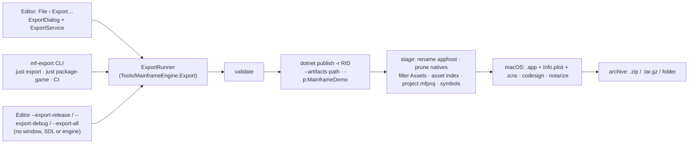

# Game export — File › Export, presets, mf-export

**Milestone:** [Gameplay toolkit](../milestones.md#gameplay-toolkit-) (G5) · **Status:** ✅ shipped ·
**Decisions:** [ADR 0229](../../memory/decisions/0229-export-runner-in-csharp.md) (runner, library, format 5, spike
outcomes), [ADR 0230](../../memory/decisions/0230-export-open-questions.md) (the open questions) · **Related:**
[Release → Games](release.md#games), [Editor → Export](editor.md#export), [Project and GameHost](project-and-gamehost.md),
[Steamworks](steamworks.md), [Crash reporting → Symbols](crash-reporting.md#symbols),
[Distribution via NuGet](distribution-nuget.md), [Mobile core](future/mobile.md) (M12.7 extends the presets)

Player builds come from **export presets** stored in `project.mfproj` (`export`). One C# pipeline,
**`ExportRunner`** in [`Tools/MainframeEngine.Export`](../../Tools/MainframeEngine.Export), runs them for every entry
point, so they all produce the same output:



`build/package-game.sh` is gone; `just package-game` keeps its arguments and runs `mf-export`.


## Preset schema (`project.mfproj` → `export`)

`export` is an array of presets. Keys common to every platform sit next to platform-specific ones, flat. Defaults are not
written, like every other section.

```jsonc
"export": [
  { "name": "Windows (Steam)", "platform": "windows", "rid": "win-x64", "output": "export/windows", "steam": true },
  { "name": "Windows (Steam demo)", "platform": "windows", "rid": "win-x64",
    "output": "export/windows-demo", "demo": true, "steam": true },
  { "name": "macOS", "platform": "macos", "rid": "osx-arm64", "output": "export/macos",
    "bundleId": "com.example.mygame", "copyright": "© 2026 Example",
    "sign": "Developer ID Application: Example (ABCDE12345)", "notaryProfile": "example-notary" },
  { "name": "Linux", "platform": "linux", "rid": "linux-x64", "output": "export/linux" },
  { "name": "Linux server (headless)", "platform": "linux", "rid": "linux-x64",
    "output": "export/server", "archive": false, "exclude": ["Assets/Audio/**"], "profiler": false }
]
```

| Key | Platforms | Default | Meaning |
|---|---|---|---|
| `name` | all | required, unique | Shown in the dialog; `mf-export --preset` selects presets by it. |
| `platform` | all | required | `windows`, `macos`, `linux` (M12.7 adds `android`, `ios`). Selects the known keys. |
| `rid` | desktop | the platform's first supported RID | `win-x64`, `linux-x64`, `osx-arm64`, `osx-x64`: the RIDs with engine natives under `MainframeEngine/runtimes/`. |
| `output` | all | `export/<name as a slug>` | Output folder, project-relative or absolute. Not inside `Assets/`. |
| `configuration` | all | `Release` | `Debug` exports are development runs (see [Steam](#steam)). |
| `demo` | all | `false` | `-p:MainframeDemo=true\|false`: one project ships the full game and its demo. The top-level `isDemo` stays the editor and Play setting. |
| `steam` | desktop | `false` | Off: the exported `project.mfproj` gets app ids 0 (Steam stays inert). On: validated, see [Steam](#steam). |
| `version` | all | `""` = project `version`, else `0.0.0` | Names the archive and fills `CFBundleShortVersionString`. Mobile maps it to `versionName`. |
| `icon` | all | `""` = `window.icon` | A PNG; becomes `.ico` (Windows) and `.icns` (macOS). An explicit preset icon also wins over the desktop project's own `ApplicationIcon`/`MacAppIcon`. |
| `exe` | desktop | the project name without spaces | The player-facing executable. |
| `selfContained` | desktop | `true` | `false` makes players install .NET 10 (servers that have it). |
| `readyToRun` | desktop | `true` | `-p:PublishReadyToRun`: faster start-up, larger output. |
| `singleFile` | desktop | `false` | `-p:PublishSingleFile` + `IncludeNativeLibrariesForSelfExtract`; `Assets/` and `project.mfproj` stay beside the exe. Windows and Linux only. |
| `trim` | desktop | `false` | `-p:PublishTrimmed`. Experimental (warns) until the engine is trim-clean (M12.6). |
| `symbols` | desktop | `ship` | `separate` moves the PDBs, with their assemblies, into `<exe>-<version>-<rid>-symbols.zip` for `mf-symbolicate` ([Crash reporting → Symbols](crash-reporting.md#symbols)). |
| `profiler` | desktop | `true` | `false` publishes with `MainframeProfilerDisabled=true`: `MainframeGame.props` sets the `MainframeEngine.Profiler.Disabled` AppContext switch in the runtimeconfig ([Profiler](profiler.md)). |
| `archive` | all | `true` | Zip (Windows, macOS) or `.tar.gz` (Linux). `false` leaves a folder (e.g. a Steam depot's content root). |
| `include` | all | `["Assets/**"]` | Globs of the game's `Assets/` files that ship. |
| `exclude` | all | `["Assets/**/*.po", "Assets/**/*.pot"]` | Applied after `include`. `.mo` catalogs are compiled at build time. |
| `bundleId` | macos | `com.mainframegames.<exe lowercased>` | `CFBundleIdentifier`. |
| `copyright` | macos | `""` | `NSHumanReadableCopyright`. |
| `sign` | macos | `""` = ad hoc | A Developer ID identity name (not a secret). `MF_SIGN_IDENTITY` overrides it. |
| `notaryProfile` | macos | `""` = no notarization | A `notarytool` keychain profile name. `MF_NOTARY_PROFILE` overrides it. |

Globs (`Glob`, in the export library: no globbing package) are `*` (within one folder), `**` (any depth, also none) and
`?`, matched case-sensitively on project-relative paths with `/`. **Only the game's own files are filtered**: a staged
`Assets/` file that does not exist in the project's `Assets/` (engine shaders and UI, compiled `.mo` catalogs) always
ships, so a narrow `include` cannot break the engine.

The C# model is [`ExportPreset`](../../MainframeEngine/Src/Project/ExportPreset.cs) (common keys) with
`IExportPlatformOptions Options`: `DesktopExportOptions` (with `MacOsExportOptions? MacOs`) now, mobile options in M12.7.
`ProjectSettings.ExportPresets` holds them; the reader checks known keys per `platform` (an Android key on a Windows
preset warns like any unknown key), duplicate names and bad values throw `InvalidDataException` with the key path. The
reader and writer are hand-written `Utf8JsonWriter`/`JsonObject` code in `ProjectSettingsFormat`, AOT-safe.

### Format 5

`ProjectSettingsFormat.Current` is **5**. The step 4 → 5 does not change the tree: the bump only makes an older editor
reject the file ("Update the engine.") instead of reading it, dropping the section it does not model, and deleting every
preset on its next save. The template's `project.mfproj` is format 5 with no presets (the dialog adds one for this
machine), and its `.gitignore` has `export/` and `.mainframe/`. The Demo has Windows, macOS, Linux and Linux server
presets. `MainframeGame.props`' regex reads of `window.icon` and the top-level `version` stop at `"export"`, whose
presets have icons and versions of their own.

## The export library and `ExportRunner`

[`Tools/MainframeEngine.Export`](../../Tools/MainframeEngine.Export) (namespace `MainframeEngine.Export`, references the
engine) holds the pipeline, plus the tool helpers the editor already used, moved out of it unchanged except for
namespaces: `ProcessRunner`, `DotnetSdk`, `GameProjectLayout`, `MsBuildOutputParser`/`BuildDiagnostic`. The editor
references the library (a global `using`). `ThumbnailCache.Downscale` moved to the engine as
[`ImageResize.Downscale`](../../MainframeEngine/Src/Imaging/ImageResize.cs). The thin
[`Tools/MainframeEngine.Export.Cli`](../../Tools/MainframeEngine.Export.Cli) is `mf-export`.

| Type | Role |
|---|---|
| `ExportRequest(ProjectDirectory, Preset, OutputOverride?, AppName?)` | one export (the preset need not be saved: the CLI's legacy form makes one) |
| `ExportPhase`, `ExportProgress(PresetIndex, PresetCount, Phase, Fraction?, Status)` | progress (Stage and Archive report fractions) |
| `ExportIssue(Severity, Code, Message, Fix?)` | a [validation](#validation) finding |
| `ExportResult(Preset, Succeeded, Cancelled, ArtifactPath?, SymbolsPath?, Duration, Issues, Diagnostics, Error?)` | `Invalid`, `Summary`, `Tally(results)` (`3 exported, 1 failed, 1 skipped (invalid)`) |
| `ExportEnvironment` | the `dotnet` path and SDK check, host OS/RID, environment variables, the tool runner (`codesign`, `xcrun`, `ditto`, `dotnet`); `DetectAsync()` |
| `ExportRunner : IExportRunner` | `Validate`, `RunAsync`, `RunAllAsync` (a failed or invalid preset does not stop the rest); never throws for export failures |
| `ExportPlan` | pure: effective values, folders and the `dotnet publish` arguments |
| `ExportValidator`, `ContentFilter`/`Glob`, `NativesPruner`, `ExportedProjectFile`, `ReferenceScanner`, `IconWriter`, `AppBundleWriter`, `MacSigner`, `Archiver`, `SymbolCollector` | the steps |
| `ExportCli` | the command line of `mf-export` and of the editor's export flags |

The steps of one preset:

1. **Validate.** Errors stop this preset (in `RunAllAsync`: it is skipped).
2. **Icon (Windows).** `IconWriter` writes an `.ico` with PNG entries (16–256 px, valid since Vista) before the publish
   and passes it as `ApplicationIcon`, unless the desktop project sets its own.
3. **Publish.** `dotnet publish <Desktop.csproj> -c <cfg> -r <rid> --self-contained <bool> -p:MainframeDemo=<bool>
   -p:PublishReadyToRun=… -p:PublishSingleFile=… -p:PublishTrimmed=… [-p:IncludeNativeLibrariesForSelfExtract=true]
   [-p:MainframeProfilerDisabled=true] [-p:MainframeWindowsGui=true | -p:MacBundleAppDirectory=MonoBundle]
   [-p:ApplicationIcon=<ico>] --artifacts-path <project>/.mainframe/export/obj/<rid>-<full|demo>
   -o <stage>/publish -nologo -v:minimal -clp:NoSummary -p:GenerateFullPaths=true` through the tool runner; lines stream
   to `onLine`, diagnostics are parsed with `MsBuildOutputParser.ParseAll`. `--artifacts-path` moves the bin/ and obj/
   of the desktop project, the game library and the engine projects, so the full and demo defines, other RIDs and
   Release never rebuild or race the editor's Debug output. The engine finds its Steamworks shim builds under the
   artifacts path too (`MainframeEngine.csproj`). The stage is `<project>/.mainframe/export/stage/<preset slug>`,
   emptied first.
4. **Stage.**
   - Rename the apphost to `exe` (`.exe` on Windows; mode 755 elsewhere).
   - `NativesPruner` deletes every engine native of the other platforms and the other `steamworks/{win64,posix}`
     folder. The list is `MainframeEngine/runtimes/*/native/*`, baked into the library at build time
     (`EngineNatives.g.cs`), so the package's and the released editor's exporter know it and new natives are pruned.
   - With `steam: true`, the RID's `steam_api` native and `steamworks/<variant>/MainframeEngine.Steamworks.dll` must be
     there (else the export fails: `Steam.TryInitialize` would report `NativeLibraryMissing`).
   - `ContentFilter` applies `include`/`exclude` to the game's files.
   - The exported `project.mfproj` ([below](#exported-project-file)) is written over the published one.
   - `Assets/assets.index.json`: `new AssetDatabase(stage).Scan()` + `WriteIndex()`, so shipped builds skip the start-up scan.
   - Fail if a `steam_appid.txt` is in the stage.
   - `symbols: separate`: `SymbolCollector` (the C# twin of `build/collect-symbols.sh`) moves the PDBs, with copies of
     their assemblies, into `<exe>-<version>-<rid>-symbols.zip`.
5. **Bundle (macOS).** `AppBundleWriter` lays out `<Name>.app` as the [macOS bundle layout](release.md#macos-bundle-layout)
   requires: the apphost alone in `Contents/MacOS` (checked to start `../MonoBundle/<assembly>.dll`), the rest in
   `Contents/MonoBundle`, `icon.icns` in `Contents/Resources` (the desktop project's `MacAppIcon` `.icns`, else
   `IconWriter`'s PNG chunks `icp4`…`ic10`, 16 to 1024 px, never enlarged), and an XML Info.plist with the keys the old
   script wrote (name, bundle id, executable, icon, version, copyright, `LSMinimumSystemVersion` 11.0,
   `NSHighResolutionCapable`, games category).
6. **Sign / Notarize (macOS host).** `MacSigner` does what `build/macos/sign-app.sh` does (the editor's own release
   still uses the script): every Mach-O (by its magic number) but the main executable, deepest first, then the bundle;
   never `--deep`; ad hoc by default; a Developer ID adds the hardened runtime, a timestamp and the .NET entitlements on
   the bundle; then `codesign --verify --deep --strict`. With `notaryProfile`: `ditto` zip, `xcrun notarytool submit
   --wait`, `stapler staple`, re-zip.
7. **Archive.** `<output>/<exe>-<version>-<rid>.zip` (Windows: `ZipArchive`; macOS: `ditto -c -k --norsrc --noextattr
   --keepParent`) or `.tar.gz` (`TarWriter` + `GZipStream`) with explicit Unix modes (the executable and `createdump`
   755), so the executable bit survives an export from Windows. Archives are written as `<name>.partial` and moved over
   the old one at the end; a cancelled or failed export leaves the previous artifact intact. `archive: false` moves the
   publish (or the folder holding the `.app`) to `<output>/<exe>-<version>-<rid>/` the same way.
8. **Clean.** The stage, the `.ico` and any `.partial` are deleted; the artifacts cache is kept for incremental exports.

**Cancel** cancels the token: the tool runner kills `dotnet` (or `codesign`/`notarytool`) with its process tree, the
stage and `.partial` files are deleted, and the result has `Cancelled = true`.

### Exported project file

`ExportedProjectFile.Transform` writes a changed copy of the project's settings (never the file as is):
`ExportPresets` cleared; `IsDemo` = the preset's `demo`; `Version` = the effective version; `steam: false` →
`Steam.AppId = Steam.DemoAppId = 0` and `RestartThroughSteam = false`.

### Steam

App ids stay in the `steam` section. The preset only has `steam: true|false` (`ProjectSettings.SteamAppId` already picks
`demoAppId` or `appId` by the built demo flag). The dialog shows the effective id read-only with an icon button to
Project Settings › Steamworks. For `steam: true`:

| Check | Severity | Why |
|---|---|---|
| effective app id (full or demo) ≠ 0 (`steam-app-id`) | error | an id of 0 leaves Steam off |
| the RID's `steam_api` native and `steamworks/<win64\|posix>/` in the stage | export error | only a broken publish lacks them |
| `configuration` is `Release` (`steam-debug`) | warning | a Debug build is a development run: it writes `steam_appid.txt` on players' machines and never relaunches through Steam |

### Hosts and platforms

| Target | From macOS | From Windows | From Linux |
|---|---|---|---|
| `win-x64` | ✅ (exe icon and GUI subsystem too) | ✅ | ✅ |
| `linux-x64` | ✅ | ✅ (modes set in the tar) | ✅ |
| `osx-arm64`, `osx-x64` | ✅ ad hoc, Developer ID, notarization | ❌ `host-unsupported` | ❌ `host-unsupported` |

Self-contained cross-publishing works from any host; on .NET 10 the SDK also writes the Win32 icon resource into the
apphost from macOS and Linux (the spike found no NETSDK1074), and ReadyToRun cross-compiles `win-x64` and `linux-x64`
from macOS. Other RIDs appear when `MainframeEngine/runtimes/<rid>/native` exists.

### Validation

`ExportValidator.Validate` starts no process (the SDK check comes from the environment, detected once per session).
The dialog re-runs it on every edit; the CLI before each preset.

| Code | Severity | Condition |
|---|---|---|
| `sdk-missing` | error | no .NET SDK ≥ 10 (the message ends with the download URL) |
| `no-desktop-project` | error | `GameProjectLayout.DesktopProjectOf` is null |
| `main-scene` | error | `mainScene` empty or not resolvable (UID through the project's `AssetDatabase`, or an `Assets/` path) |
| `main-scene-excluded` | error | the main scene, an enabled autoload scene or the bus layout is filtered out |
| `rid-unsupported` | error | no engine natives for the RID, or a RID of another platform |
| `host-unsupported` | error | a macOS target from a non-macOS host |
| `output-in-content` | error | `output` is inside `Assets/` |
| `duplicate-name` | error | two presets share a name (also rejected on load) |
| `glob` | error | a glob is empty, absolute, has `\` or `..` |
| `steam-app-id` / `steam-debug` | error / warning | see [Steam](#steam) |
| `notarize-needs-sign` | error | a notary profile with ad hoc signing |
| `single-file` | error / warning | error on macOS (a bundle), else experimental |
| `trim` | warning | experimental |
| `configuration` | warning | neither Release nor Debug |
| `include-empty` | warning | no include globs |
| `broken-reference` | warning | a shipped `.mscene`/`.mres` references an excluded file (`ReferenceScanner`: `{"ref"\|"instance": uid, "path"}` objects and `Assets/` strings; skipped when only translation sources are excluded) |
| `meta-excluded` | warning | an `exclude` drops `.meta` sidecars of shipped files |
| `icon` | warning | the icon is missing, not a PNG, or under 256 px (where the platform needs one) |
| `version` | warning | not `MAJOR.MINOR.PATCH[-suffix]` |

The editor saves every scene before an export (`EditorCommands.SaveAll`, as Play does) and does not start when a save
fails.

## Editor: File › Export…

See [Editor → Export](editor.md#export) for the dialog, `ExportService`, the toolbar chip and the Output lines. File ›
Export… (`file.export`, Ctrl/Cmd+Shift+E, `package-export`) is enabled when the project has a desktop project.

## Headless export: CLI, `just`, CI

- **`mf-export`** (`just export …`, or `dotnet run --project Tools/MainframeEngine.Export.Cli -c Release --`):
  - `--project <dir> --preset "<name>" [--output <dir>]`, `--project <dir> --all`, `--project <dir> --list` (the presets
    with ✓/⚠/✕ and their issues);
  - the legacy form `<Desktop.csproj> <rid> <out> [--name] [--exe] [--version] [--bundle-id] [--copyright] [--icon]
    [--sign] [--notarize] [--demo] [--steam] [--symbols ship|separate] [--configuration] [--folder]`, mapped onto an
    unsaved preset (`just package-game`). The project is the folder above the desktop project's.
  - Exit codes: 0 exported, 1 a preset failed, 2 usage or validation error. Errors go to stderr in MSBuild's canonical
    format (`file : error code: text`) so CI annotates them; the artifact is the last stdout line. Ctrl+C cancels.
- **The package.** The `MainframeEngine` package carries `mf-export` in `tools/mf-export` (managed files and
  runtimeconfig, like `mf-l10n`; `build/pack-nuget.sh` builds it first). `MainframeGame.props` sets
  `MainframeExportTool` to it (in a checkout: the CLI's `.csproj`): `dotnet "$(dotnet msbuild MyGame.Desktop
  -getProperty:MainframeExportTool)" --project . --preset Windows`.
- **Editor flags** (Godot's names): `MainframeEngine.Editor --project <dir> --export-release "<preset>" [<out>]`,
  `--export-debug "<preset>" [<out>]` (configuration `Debug`, the file unchanged) and `--export-all` run `ExportCli` from
  `Program.cs` before an `EditorApp` exists (no window, SDL or engine), so the released editor exports from scripts.
- **CI.** `build/template-smoke.sh` (the `template` job, both engine sources) writes a preset for the host RID into the
  generated game's `project.mfproj`, runs `mf-export --list` and `--preset`, unpacks the archive, checks the exported
  `project.mfproj` (no presets), the asset index, the content and the missing `.po`, and runs it with `--headless
  --max-frames`. The package run also packages `linux-x64`, `win-x64` (and `osx-arm64` on a Mac) with the package's
  `mf-export` in the legacy form and checks each archive.

## Mobile (M12.7) extends the same schema

- **Kept:** mobile presets live in the same `export` array with the common keys (`name`, `platform`, `output`,
  `configuration`, `demo`, `version`, `icon`, `archive`, `include`, `exclude`).
- **New platform values:** `platform: "android" | "ios"` select `AndroidExportOptions` / `IosExportOptions`
  (`IExportPlatformOptions`) holding the drafted mobile keys; `bundleId` is the macOS key. Today the reader rejects
  them with "update the engine", so an older engine never drops a mobile preset.
- **Version name:** the mobile draft's `versionName` is the common `version`.
- **Pipeline:** `ExportRunner` gains platform steps behind an `IExportPlatform` interface (desktop: publish → stage →
  bundle → archive; Android: cook → publish → APK/AAB signing; iOS: cook → build → archive). Validation, progress,
  Output, cancel, the CLI and the editor flags are shared. The Add Preset menu already lists Android and iOS, disabled.
- **Format:** no bump is needed for new platform values.

## Threading and allocation

Export is editor and tool code; nothing runs per game frame. The runner works on the thread pool; `ExportService.Update`
drains its queues on the main thread and allocates only when there is something to report (a test checks an idle
`Update` allocates 0 bytes); RmlUi updates happen on the main thread. The runner never touches RmlUi, a scene tree or
`AssetDatabase.Current`: it builds its own `AssetDatabase` over the stage.

## Testing

- **Settings** (`Tests/MainframeEngine.Tests/Project/ExportPresetFormatTests.cs`): the spec example parses and round
  trips, defaults are omitted, per-platform keys warn, bad presets throw with the key path, formats 1–4 upgrade with
  nothing else changed, the 4 → 5 step leaves the tree alone, a format-4 reader rejects a format-5 file, the Demo's
  presets load.
- **Library** (`Tests/MainframeEngine.Editor.Tests/Export/`, no SDK): globs, the content filter, natives pruning (a fake
  table and the baked one), the exported project file, the reference scanner, `.ico`/`.icns` parsed back, tar and zip
  modes, `.partial` cleanup on cancel, symbols, signing order and arguments, the Info.plist; `ExportPlan` values and
  arguments for every option and platform; every validation code; `ExportRunner` end to end over a fake `dotnet publish`
  and fake `codesign`/`ditto`/`xcrun` (Linux tar, Windows zip with icon, folder with separate symbols, macOS bundle
  ad hoc and notarized, invalid presets, missing Steam files, build errors, cancel, Run All, repeatable entries);
  `mf-export` parsing (presets, legacy form, editor flags), exit codes and MSBuild-format errors.
- **Editor** (`ExportEditorTests`): `ExportService` raises events only from `Update` on the main thread, an idle
  `Update` allocates 0 bytes, an export waits for a running build and cancels; the presets model with undo; the Add
  menu; File › Export with its shortcut and enablement; the dialog edits, saves and exports; Play and Build & Reload wait;
  Output lines and diagnostics with their source.
- **Integration** (`ExportIntegrationTests`, `Slow`, skipped without the .NET 10 SDK): a game from the template (temp
  folder), exported for this machine's RID to a folder, its layout checked and run with `--headless`; a demo export
  whose assembly carries `MainframeDemo=true` and whose runtimeconfig disables the profiler.
- **QA:** `Tests/QA/export.qa` (`just qa-export`): create a game, add a preset for this machine, demo on, an exclude,
  export it, capture the dialog and the Output panel. `readme-screenshots.qa` captures `editor-export`.

## Changes from the proposal

- **Format 5, not 3.** Other milestones had taken formats 3 and 4; the step 4 → 5 is the empty bump the proposal
  described.
- **`symbols` and `profiler` preset keys.** G15 shipped `package-game.sh --symbols ship|separate` and its doc named G5's
  `symbols` option; the profiler doc named a per-preset profiler switch. Both are desktop keys.
- **No `win-icon-host` warning.** The G5.1 spike found that .NET 10 writes the exe icon (and the GUI subsystem) into the
  apphost from macOS, so Windows exports from any host get their icon.
- **`--artifacts-path` needed an engine fix.** The engine copied its Steamworks shim builds from their projects'
  `bin/<cfg>/<tfm>/`; under the artifacts layout it now takes them from the artifacts path.
- **Content filter scope.** Only files that exist in the project's `Assets/` are filtered, so engine content always ships.
- **Signing ported to C#** (`MacSigner`) rather than run through `sign-app.sh`, so exports from the package and the
  released editor need no script; `sign-app.sh` stays for the editor's release. Likewise `SymbolCollector` and
  `collect-symbols.sh`.
- **`main-scene-excluded` also covers enabled autoload scenes and the bus layout; `glob`, `include-empty`, `configuration`
  codes added; `single-file` is an error on macOS** (a single-file apphost cannot live in a bundle).
- **Legacy `--name`** is an `ExportRequest.AppName` (the `.app` and default exe name), not a preset key; `--folder` and
  `--configuration` were added to the legacy form.
- **Mac exports in CI's Linux template job** are no longer packaged (they need a Mac); the fake-host runner tests cover
  the bundle layout and the template smoke covers it on macOS.
- **The Output panel** shows each result line but has no Show in Finder link (its rows open code); the dialog's result
  rows have the reveal button.
- **Mobile platforms** are rejected by the reader for now (the proposal's enum listed them as M12.7 values).

## Related

- [Release → Games](release.md#games) · [Editor → Export](editor.md#export) · [Project and GameHost → Demo builds](project-and-gamehost.md#demo-builds)
- [Steamworks → Export](steamworks.md#export) · [Crash reporting → Symbols](crash-reporting.md#symbols) · [Distribution via NuGet → Player builds](distribution-nuget.md#player-builds)
- [Mobile core → Editor integration](future/mobile.md#editor-integration), the M12.7 presets that extend the schema
