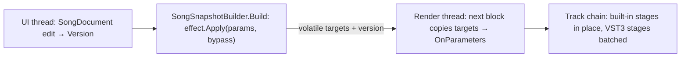

# Built-in music effects

The music editor's songs (`.msong`, [Music editor](future/music-editor.md), [Song tab](editor.md#song-tab-music-editor))
take insert effects on every track and on the master. Besides hosted VST3 plugins, the editor has **built-in effects**:
fifteen effects written in C# that run in process on the song's render thread, ship with the editor, and play the same in
every render. Code: `MainframeEngine.Editor/Src/Music/Effects/`. Decision: ADR 0193.

## The effects

| Category | Effect (`builtin` id) | What it does |
|---|---|---|
| EQ & Filter | Channel EQ (`eq`) | Low cut and high cut (6/12/24/48 dB/oct Butterworth), low and high shelves, four peaking bands, output gain |
| | Filter (`filter`) | Resonant low/high/band-pass or notch (TPT state-variable, 12 or 24 dB/oct), drive, an auto-filter LFO (song-synced note values or Hz, six shapes) |
| Dynamics | Compressor (`compressor`) | Feed-forward, stereo-linked, soft knee, log-domain attack/release, make-up (manual or auto), mix for parallel compression |
| | Limiter (`limiter`) | 3 ms lookahead brickwall: input gain, ceiling, release; never passes the ceiling |
| | Noise Gate (`gate`) | Threshold with hysteresis, range (floor), attack, hold, release |
| Delay & Reverb | Beat Delay (`delay`) | Note values (1/1 … 1/64, 2 and 4 bars; straight, dotted, triplet) or ms up to 4 s; feedback through a low and high cut; ping-pong; width; mix |
| | Reverb (`reverb`) | Freeverb with pre-delay, size, damping, width, low and high cut on the tail, mix |
| Modulation | Chorus, Flanger, Phaser (4–12 stages), Tremolo / Auto-pan | Each with a song-synced or free LFO |
| Distortion | Saturation (tape, tube, soft clip; asymmetry, tone tilt), Distortion (overdrive, hard clip, fuzz, foldback; tone), Bitcrusher (bits, downsample) | Saturation and Distortion run 2× oversampled with a DC blocker |
| Utility | Utility (`utility`) | Gain, balance, stereo width 0–200 % (mid/side), invert L/R, mono |

Each effect has presets (`BuiltinEffectInfo.Presets`).

## In the song file

A built-in insert is `{"builtin": "<id>", "params": {"<param id>": value, …}, "bypass": false}` in a track's or the
master's `inserts`, next to VST3 inserts (`{"plugin": {…}, "state": "…"}`). Parameter ids and the order of choice
lists are a file contract: never renamed, choices only appended.

- A parameter missing from `params` plays at its default; out-of-range values are clamped when played (the file is not
  rewritten).
- Unknown keys are kept. An unknown `builtin` id is kept byte for byte, plays as pass-through and shows on the track as
  "unknown built-in effect: x".
- No format bump: an older editor keeps both fields in `[JsonExtensionData]` and writes them back.

Edits are `SongDocument` methods: `AddBuiltinInsert`, `ReplaceInsert`, `SetInsertParam` (one parameter; drags pass a
merge key), `SetInsertParams` (several at once: an EQ handle drag, Reset, a preset). Undo of a parameter that was absent
removes it again.

## Parameters and the registry

`BuiltinParam(Id, Name, Unit, Min, Max, Default, Curve, Choices, Group)` describes one parameter: `ParamCurve.Linear`,
`Log` (equal knob travel per octave: frequencies, times, ratios), `Toggle` (0/1) or `Choice` (an index). It maps to
and from a 0..1 knob position and formats its value ("2.40 kHz", "-6.0 dB", "4.0 : 1", "30 L"). A parameter's index in
`BuiltinEffectInfo.Params` is its index in the effect's value array.

`BuiltinEffectInfo` holds an effect's id, name, category, icon, tooltip, parameters, factory, the graphic its window
draws (`BuiltinGraph`: none, the EQ curve, a gain-reduction meter, the delay readout) and presets. Each effect class
owns its static `Definition`; `BuiltinEffects` lists them by category (`BuiltinEffects.Categories.cs`) for the
mixer's add menu, the plugin window and the Browser.

## On the render thread

- **One instance per insert.** `SongSnapshotBuilder` keeps a `BuiltinEffect` per `PluginInsert` object (by reference)
  for as long as the insert exists. Rebuilding the snapshot (any edit) never resets an effect's state (filter memories,
  delay lines, reverb tails). The live player and every render have their own builder, so their own instances. An
  instance's sample rate is fixed; buffers are allocated in its constructor.
- **Parameters without locks.** `Apply` (UI thread) writes changed targets with `Volatile.Write` and bumps a version;
  the render thread copies them at its next block when the version moved and calls `OnParameters`, where effects set
  smoothing targets: `BlockSmoother` (coefficient parameters, ~20 ms, frequencies in the log domain) and `LinearRamp`
  (gains and mixes, per sample across one block). Coefficients are recomputed only while a smoother moves.
- **Bypass stays in the chain.** A bypassed built-in crossfades to its dry signal over 10 ms; the dry path is delayed by
  the effect's latency, so plugin delay compensation never changes. After two seconds bypassed, the effect's state is
  cleared when it comes back. (Bypassed VST3 inserts are left out of the chain, as before.)
- **Song context.** `IEffect.Process(stereo, in EffectContext)` gets the sample rate, tempo, transport state and the
  block's song position. Synced LFOs derive their phase from the position at each block start while playing (two
  renders, or a seek, line up on the beat) and free-run while stopped. A tempo edit rebuilds the snapshot; the delay
  glides to the new time (a tape-like bend, never a click).
- **Latency.** The limiter reports a fixed 3 ms lookahead (`LatencyFrames`), summed into the track's latency for delay
  compensation. On the master it only shifts the output by those milliseconds.
- **No allocation, no denormals.** Processing allocates nothing (an allocation test runs every effect through parameter
  changes and bypass toggles). .NET cannot portably enable flush-to-zero, so recursive state is flushed explicitly
  (`Dsp.Flush`, `DelayLine.Write`, the biquads per block).
- **Meters.** Compressor, limiter and gate report gain reduction through lock-free "highest since taken" bits
  (`PeakBits`, shared with the mixer's peak meters); the plugin window takes it every frame.

### Chains of built-ins and VST3 plugins

The builder splits each chain into **stages**: runs of built-ins and runs of VST3 inserts (`EffectStage`). A plugin
instrument opens the first stage. Per block the engine runs every track's built-in stages in place until each reaches
a plugin stage; all tracks waiting at a plugin stage then share one plugin-host round trip; then each runs on. A chain of
built-ins only costs no round trip, VST3 only one (as before), and each built-in placed between VST3 inserts one more
round trip per block. The master chain is the same on the mixed output.

### DSP building blocks (`Effects/Dsp/`)

`BiquadCoefficients` (RBJ cookbook, double precision; `MagnitudeDb` draws the EQ curve from the same coefficients the DSP
plays), `StereoBiquad` (transposed direct form II), `Svf` (Zavalishin/Simper topology-preserving state-variable filter:
stable under per-sample cutoff modulation), `DelayLine` (power-of-two ring, cubic Hermite reads), `Lfo` (sine, triangle,
square, saw up/down, sample-and-hold), `NoteDivision`, `Freeverb` (a port of the engine's bus reverb with settable size,
damping and width), `Oversampler2x` (for waveshapers).

## The plugin window

Clicking a built-in insert's slot on a mixer strip (or adding one, from the slot menu or the Browser) shows `PluginWindow`
(`Src/UI/PluginWindow.cs`, `Content/Editor/plugin_window.rml`): one reused, floating, non-modal window over the song
view, dragged by its title bar. Its title shows "Effect — Track — Song", a bypass button, Presets, Reset (one undo step)
and close (Esc).

- **Controls** are built from the parameter descriptors, grouped by `Group`: knobs (drag up/down, Shift for fine; the
  wheel steps; double-click resets to the default), toggles and choice menus. A drag is one undo step; values shown
  follow undo, redo and edits from anywhere on the next frame (only changed values touch the DOM).
- **Channel EQ:** the curve (`EqGraphCanvas`: log frequency 20 Hz–20 kHz, ±24 dB) with each band's own response in its
  colour and a handle per band, drawn in a `Disable3D` sub-viewport published as `engine://plugin-graph` and rendered
  only when the parameters or the size change. Drag a handle for frequency and gain (it switches the band on), the wheel
  over the graph sets the selected band's Q, double-click switches a band on or off. Below it one column per band.
- **Compressor, Limiter, Noise Gate:** a falling gain-reduction meter (0 to −30 dB).
- **Beat Delay:** the time as note value and milliseconds at the song's tempo ("1/8 dotted · 375.0 ms at 120 BPM"),
  marked when it is clamped to 4 s.

It closes when its insert leaves the song (removed, undone, replaced), when another song tab becomes active, or when
the editor leaves music mode.

QA verbs: `song insert <track|master> <id> [param=value …]` (adds and opens), `song fx-window <track|master> <slot>`,
`song fx-close`.

## Testing

`Tests/MainframeEngine.Editor.Tests/Music/Effects/`: the registry (unique ids, defaults in range, knob mapping round
trips, icons in the atlas), every effect at 44.1/48/96 kHz with finite output, no NaN or subnormal output after 20 s of
silence, zero allocation, bypass equals the (latency-delayed) dry signal; EQ gain at a band's frequency and the curve
against the measured response; the compressor's static curve and knee; the limiter's ceiling and latency; the gate's
range; the delay's first echo on each note value and ping-pong; the reverb's tail and reset; tremolo phase locked to the
song position; the filter's slope; the bitcrusher's levels and hold. `BuiltinChainTests` cover the song file, undo and
merging, built-ins without a plugin host, instance reuse across builds and engine allocation; `PluginRackTests` a VST3 →
built-in → VST3 chain (two ordered round trips); `PluginWindowTests` the window.
