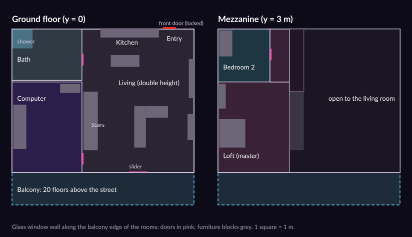

# Neon

## Purpose

[`Examples/Neon`](../../Examples/Neon/) ("Neon Demo") is the engine's second showcase after the [Forest](forest.md): a
first-person walk round a two-bedroom industrial loft about 20 floors up in a rainy neon city at night
([ADR 0218](../../memory/decisions/0218-neon-example.md)). You can open the doors, run the shower and the taps, flip the
lights, watch TV, play music, close the blinds, sit at a computer whose six monitors are live and whose terminal runs
the apartment, and step out on the balcony over the traffic. You can never leave. Like the Forest it is a game project
of its own built against this checkout (`MainframeEnginePath = ../..`, `Examples/Neon/Neon.slnx`) and **not** part of
`MainframeEngine.slnx`.

It was built together with three engine features it needed:

- [Paths](paths.md): `Path3D`/`PathFollow3D` and closed `Curve3D`s with smooth rotation and up vectors (ADR 0215).
- Sub-viewport textures on 3D materials: monitors and TVs (ADR 0216, [world-space UI](future/world-space-ui.md)).
- Nearest-light selection over the point/spot limits (ADR 0217, [Lighting](lighting.md)): about 16 room lights.


## Layout

```
Examples/Neon/
├── Neon.slnx, Directory.Build.props, global.json, .gitignore, .gitattributes (LFS: images, glTF buffers, probes),
│   NOTICE.md (every third-party asset), README.md
├── project.mfproj        "Neon Demo" (window title and app name), window.icon Assets/Brand/icon.png, main scene neon,
│                         the input map (the Forest's without wading), shadows High, TAA, the audio bus layout
├── Brand/                the app icon: icon.svg, icon-small.svg, icon-macos.svg → png/, neon.ico, neon.icns (`just neon-brand`)
├── Neon/Src/Player       FirstPersonController (the Forest's, without wading; MovementLocked, EyeHeightOverride,
│                         SetLook for the seat), IFootstepSurface
├── Neon/Src/Interaction  IInteractable, Interactor + InteractPrompt; DoorBase (Door, SlidingDoor), FrontDoor,
│                         LightSwitch; Appliance (Shower, Tap, Tv, Stereo, BlindsPanel), Blinds, ComputerSeat
├── Neon/Src/Computer     ComputerRig (the monitors and the keyboard), Terminal, Screens (the panels), TvFeed
├── Neon/Src/World        NeonScene + SceneWriter, NeonApartment, NeonParticles, FallSafety; the city: CityLayout,
│                         CityKit, NeonCity, CityTraffic, NeonRain, NeonLook
├── Neon/Src/Audio        NeonAudio, NeonSynth, NeonSoundBank, NeonMusic + NeonMusicPlayer, NeonFootstepAudio, NeonDsp
├── Neon/Src/Menu         NeonPause (the engine's SettingsMenu on Esc)
├── Neon/Src/Dev          NeonDev (the game flags)
├── Neon.Desktop/         GameHost.Run(args, typeof(Neon.FirstPersonController).Assembly) + --write-scenes <dir>
├── Neon.Tests/           xUnit v3, no GPU; the art tests skip without the LFS content
├── Tools/                fetch_assets.py (the CC0 texture sets), apartment/build_apartment.py + make_posters.py,
│                         city/build_city_kit.py (Blender, headless)
└── Assets/               Scenes/neon.mscene + neon-lighting.mres/.probes, PostProcess/neon.mres + neon-lens.mres,
                          Settings/AudioBusLayout.mres, Shaders/*.gdshader (+ SPIR-V), UI/prompt.rml,
                          Art/Apartment (glTF, textures, posters), Art/City (the kit and the signs' words)
```

## The apartment



`Tools/apartment/build_apartment.py` builds it headless in Blender (`just neon-art`), seeded, as the Forest's cabin
script does, and exports `Assets/Art/Apartment/apartment.gltf`. Its docstring is the contract with the game:

- **Names say what the game does.** `Door_*` meshes become doors (hinge at the origin), `Furn_*` get a box collider
  each, `Decor_*`, `Rug_*`, `LED_*`, `Screen_*` and `Glow_*` have none, the walkable slabs (`Floor`, `Tile_Bath`,
  `Balcony`, `Mezzanine`, `Planks_Bed2`) collide as boxes (`Collider_<mesh>_<n>`: a capsule catches on a triangle
  mesh's internal edges), and the rest of the shell collides as triangles. The glass is solid: nobody leaves.
- **Empties are sockets**: `Light_<Room>_<n>` (the scale is the range), `Switch_<Room>`, `Zone_<Room>`, `Spawn`,
  `Seat`, `Shower` and `Valve_Shower`, `Tap_<Room>`, `Tv`, `Stereo`, `Monitor_<n>`, `Blinds_<Room>_<n>` (scale = half
  width and drop) and `Panel_Blinds_<Room>`.
- **Materials**: thirteen CC0 ambientCG sets fetched and packed by `Tools/fetch_assets.py` (1024², `_Color`, `_NormalGL`,
  `_ORM`), tinted in the script (the tint becomes the glTF base colour factor, kept by `NeonApartment.ToPbr`), with
  metres-based UVs per set. `LED_<Room>` materials are the switchable fixtures, `Glow_*` the always-on neon. Eight
  posters are original art drawn by `Tools/apartment/make_posters.py`.
- **The stairs** have a hidden ramp collider (`Collider_Stairs`) on their nosings: the capsule cannot climb a 20 cm
  step.

`NeonApartment` (`[Tool]`) instantiates the model and walks it: PBR materials (the ORM by file name), collision,
doors, 16 `OmniLight3D`s (four with cube shadows: the living room, computer room, bathroom and loft; nearest-light
selection, ADR 0217, keeps the 16 nearest when the city or a future room adds more), switches, and the interactables.
Shared imported meshes are converted under a lock (tests build several apartments at once).

## Interaction

`Interactor` (a child of the player) casts one ray a frame, 2.2 m from the camera, against the world and interact
layers; the collider it hits or an ancestor that is an `IInteractable` is what `interact` (E, pad X) uses and what the
prompt shows. Every interactable raises an event the [audio](#audio) listens to.

| Thing | Class | Does |
|---|---|---|
| Doors | `Door`, `SlidingDoor` | Eased swing or slide; the collider moves with the leaf |
| Front door | `FrontDoor` | Always "Locked"; buzzes |
| Light switches | `LightSwitch` | A room's lights (`Visible`) and its `LED_<Room>` glow |
| Shower | `Shower` (an `Appliance`) | The valve outside the glass runs water streaks and steam, and mists the glass over ≈ 20 s |
| Taps | `Tap` | A thin stream into the basin |
| TV | `Tv` | On, three channels, off (the picture is `TvFeed`, below) |
| Stereo | `Stereo` | Play, next track, stop (the music is `NeonMusicPlayer`) |
| Blinds | `BlindsPanel` + `Blinds` | A wall panel per room opens or closes its venetian blinds (slats turn and stack) |
| Computer | `ComputerSeat` | Sit: the body is locked, the eye eases to 1.18 m facing the monitors, the keyboard types into the terminal; Esc stands up |

Particles have no collision, so water streaks die when they reach the basin or floor (`NeonParticles.FallTime`).

## The computer and the TV

The monitors are E2's viewport textures:

- **One 2D atlas** (`ComputerRig`, a 1920 × 720 `SubViewport` with `Disable3D`) holds five 640 × 360 panels:
  graphs, the terminal, the traffic map, a hex dump and a status panel (clock, weather, a music visualiser). Each
  monitor's own `StandardMaterial3D` shows one cell through `UvScale`/`UvOffset` on its `EmissionTexture`.
- **One 3D sub-viewport** with its own small world turns a wireframe tower on the sixth monitor.
- **The TV** draws its three channels (news with a ticker, ads for made-up brands, a synthwave video) into its own
  960 × 540 2D view (`TvFeed`).

Three sub-viewports in all, well under the engine's seven a frame. Panels redraw every frame from preallocated buffers
and constant strings: 0 B per frame.

`Terminal` is a small shell over an `ITerminalHost` (the apartment): `help`, `whoami`, `weather`, `traffic` (the city's
vehicle count), `lights <room|all> on|off`, `blinds open|close`, `music play|next|stop`, `tv on|off`, `clear`, `exit`.
`InputEventText` feeds it while seated; `interact` (E) is a letter then, so only `pause` (Esc) or `exit` stands up.

## The city

`CityLayout` is the city as data, seeded (2077): a grid of streets and blocks round the apartment's tower, about 820
towers of 8 archetypes, about 2 500 signs, three holograms, and the loops traffic runs on. Scene space is the
apartment's: the street is 70 m below the apartment's floor (`CityLayout.GroundY`).

`NeonCity` (`[Tool]`) builds it at load from the kit (`Tools/city/build_city_kit.py`: towers, the rail, vehicles and
sign frames, headless in Blender; the signs' made-up words come from Noto Sans JP, OFL, rendered into an atlas):

- one `MultiMeshInstance3D` per tower archetype, with `INSTANCE_CUSTOM` seeds for the `facade` shader's window grids,
  flicker and neon bands;
- the home tower's facade round the apartment and its neighbours' balconies, the wet `street` ground, three `skyline`
  cylinders far off, the signs (`sign`, `screen`), the koi, dancer and logo `hologram`s, the elevated rail, and puddles
  on the balcony (`WaterMaterial3D`, SSR);
- **no lights**: all the city's light is emission and glow.

`NeonRain` is camera-following streaks outside only (past the balcony's overhang), with drips off its edge.

## Traffic

`CityTraffic` runs two kinds of vehicle over the layout's loops:

- **Crowds.** Cars both ways on every street loop and hover cars on the far sky lanes are `MultiMesh` instances,
  their transforms sampled from each loop's baked `Curve3D` every frame (a few hundred vehicles, no nodes).
- **Followers** ([Paths](paths.md)). The four-car train (`PathRotationMode.Oriented` on the rail's up vectors), the two
  airships with their ad screens and the hover cars on the lane that passes the balcony each ride a `Path3D` with a
  `PathFollow3D` moving by `Speed`. They carry their sounds: the train's rumble, the airships' drone, and a Doppler
  whoosh (`CityTraffic.FlyBy`) when a hover car comes within 70 m of the listener.

Moving vehicles are `GIMode.Disabled`, so they never make the probe bake stale. `MapPositions` writes the vehicles'
positions for the computer's map. 0 B per frame.

## The look

- **Sky and air:** a dark procedural sky glowing magenta at the horizon, purple fog and height fog. A dim moon is the
  only directional light.
- **Post** (`NeonLook` writes `Assets/PostProcess/neon.mres` and `neon-lens.mres`): AgX, a strong wide additive glow
  (threshold 0.7), GTAO, a mild grade, vignette, grain and a little chromatic aberration.
- **Light probes:** a 1 m box `LightProbeVolume` over the apartment and the balcony, baked with `--bake-lighting`
  (`Assets/Scenes/neon-lighting.mres` + `.probes`, ADR 0170). Its sky occlusion keeps the sky's magenta out of indoor
  reflections. The bake is deterministic (moving meshes are excluded), so a launch finds it current; a stale bake
  re-bakes in the background in about a second.

### Reference shots

`just neon-screenshots` renders N1–N8 into `docs/images/neon` (`build/neon-screenshots.sh`: a fixed `--view` and props
per shot, `NEON_SHOTS` / `NEON_SHOTS_OUT` to pick or redirect).

| Shot | View |
|---|---|
| N1 | The living room from the loft, the TV on |
| N2 | The computer room, the stereo playing |
| N3 | The bathroom with the shower running |
| N4 | The balcony, looking down at the boulevard |
| N5 | The skyline from the balcony, holograms and an airship |
| N6 | Bedroom 2 |
| N7 | The kitchen |
| N8 | The living room and the window wall |

## Audio

All of Neon's audio is synthesised at load (`Neon/Src/Audio/`), as in the [Forest](forest.md#audio). The README
lists the sounds and the API. These are the decisions behind it.

- **Indoor and outdoor are two loops, not a moving filter.** `AudioEffect` parameters only apply when a bus layout
  is applied ([Audio, Known issues](audio.md#known-issues)), so a bus low-pass cannot follow the player. Each bed
  therefore has an outdoor loop and a pre-muffled indoor loop. They are crossfaded at equal power by *openness*, which
  is 0 inside the apartment's box and 1 on the balcony, eased over 0.35 s. The two loops are uncorrelated, so equal
  power keeps the loudness steady through the crossfade.
- **Outdoor emitters are muffled with the voice's distance low-pass.** This applies to city events, fly-bys, and the
  train and airships once the city registers them with `RegisterOutdoor` (or creates them with `CreateLoop`).
  - The distance low-pass is the only filter that moves live, so `NeonAudio` sets each emitter's `MaxDistance` just
    past its current distance. It then aims `LowPassAtMaxDistance` so that the engine's linear interpolation lands on
    the target cutoff: about 800 Hz inside, 9 kHz outside.
  - The margin is 4 % of the distance past the unit size, plus twice the emitter's last frame of travel. It keeps the
    emitter inside its max distance, where it is never silenced.
  - The margin also sets the lowest cutoff reachable this way, about 800 Hz.
  - A proper per-voice or per-bus live filter in the engine would remove this workaround.
- **The music uses adaptive music, with stems rendered at run time.**
  - Each song is a `MusicManifest` built in code (`AdaptiveMusic.FromManifest`). It has one 8-bar looping section,
    four layers with a low-pass each, and a `muffle` parameter whose curves drive the cutoffs and volumes.
  - The runtime streams stems from files, so the synth writes them once to `$TMPDIR/neon-music`, named by song, seed
    and `NeonMusic.StemVersion`. Bump `StemVersion` when a recipe changes. No audio is committed.
  - Tempos give a whole number of frames per beat at 48 kHz: 100 and 90 BPM.
  - Each pass's release tails and echoes are added onto the start of the loop (`SignalTools.WrapTail`), so the loop
    point is seamless.
- **The stereo is placed by hand.** Adaptive music is not positional, so `NeonMusicPlayer` sets the level from the
  distance to the `Stereo` socket (inverse, 3 m unit size, at most −24 dB). It sets `muffle` from the listener's room:
  - none in the open-plan rooms;
  - 0.25 on the loft;
  - 0.5 to 0.9 behind a door, depending on whether it is open.
- **Hooks are events on the interactables:**
  - `DoorBase.Toggled(bool open)` when a door starts to move, and `DoorBase.Settled(bool open)` when it comes to rest.
    The hinged door's thud plays on `Settled(false)`.
  - `LightSwitch.Switched(bool on)` fires only when the player flips the switch, so lights changed from code stay
    silent.
  - `FrontDoor.Rattled` already existed.
- **0 B per frame** is gated by `NeonAudioTests.FramesAllocateNothing` with the apartment, footsteps, doors, switches,
  city events, fly-bys and the stereo all running.


## Pause menu

`NeonPause` opens the engine's drop-in [`SettingsMenu`](game-ui.md) on `pause` (Esc, Start): per-bus volumes (Music,
City, Rain, Effects, TV; Bathroom, SFX and UI hidden), key rebinding and display options, with the tree paused until it
closes. Not while seated (or standing up): there Esc stands the player up.

## `NeonDev`: game flags

After `++`: `--no-capture`, `--view x,y,z,yaw[,pitch]` (feet in apartment space; yaw 0 looks at the front door),
`--open-doors`, `--lights-off <Room>`, `--tv <channel>` (after half a second), `--music`, `--shower`,
`--blinds-closed`.

## Recipes

```bash
just neon                  # Release
just neon-test             # Neon.Tests (no GPU)
just neon-audio            # render the soundscape to Examples/Neon/artifacts/audio
just neon-art              # posters, then the apartment in Blender, then .meta sidecars
just neon-city-art         # the city kit and the signs' words atlas in Blender
just neon-screenshots      # N1–N8 into docs/images/neon
just neon-brand            # the app icon
python3 Examples/Neon/Tools/fetch_assets.py   # the CC0 texture sets
```

Re-bake the probes after changing the apartment or the city: from `Neon.Desktop/bin/Release/net10.0`, `dotnet
Neon.Desktop.dll --bake-lighting --headless`, then copy `Assets/Scenes/neon-lighting.*` back to the project.

## Tests

`Neon.Tests` (xUnit v3, no GPU; art tests skip on LFS pointers):

- `ApartmentTests`, `InteractionTests`: the model's nodes, a walk through every room, doors, switches, containment.
- `ApplianceTests`: the shower and its mist, taps, TV channels, stereo, blinds, sitting and terminal commands through
  typed input, 0 B with everything running.
- `TerminalTests`: the shell against a fake host.
- `CityLayoutTests`, `CityTests`: the layout's determinism and loops, the kit, the build, followers on paths, the map,
  0 B.
- `NeonSynthTests`, `NeonMusicTests`, `NeonAudioTests`, `NeonAudioRenderTests`: see [Audio](#audio).
- `ProjectTests`: the committed scene matches the builder.

## Related

[Forest](forest.md), [Paths](paths.md), [Lighting](lighting.md), [World-space UI](future/world-space-ui.md),
[Audio](audio.md), [Post-processing](post-processing.md), [Shaders](shaders.md),
[ADR 0218](../../memory/decisions/0218-neon-example.md).
