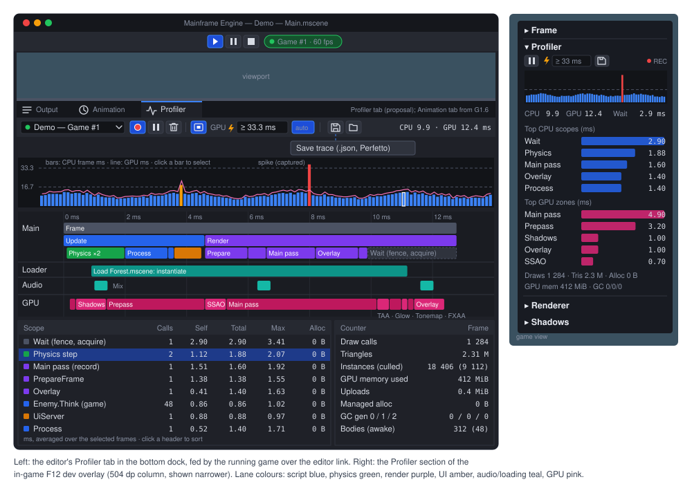

# Frame profiler

**Milestone:** [Gameplay toolkit](../milestones.md#gameplay-toolkit-) (G10) · **Status:** ✅ shipped
([ADR 0219](../../memory/decisions/0219-profiler-recording-model.md): recording model,
[ADR 0220](../../memory/decisions/0220-profiler-gpu-timeline-and-ui.md): GPU timeline and UI)



## Purpose

Named CPU scopes on any thread, GPU timestamps around every pass and post effect, per-frame counters, a history ring
of frames with spike capture and freeze, and Chrome trace export, shown in the F12 overlay and in the editor's Profiler
tab. Recording costs 0 bytes per frame; with nothing recording a scope is one static load and a branch, and an
`AppContext` switch compiles scopes out.

Not covered: sampling of managed code (`dotnet-trace`, Instruments, Superluminal), GPU pipeline statistics or hardware
counters (RenderDoc, Xcode, Nsight), per-draw GPU timing, heap snapshots, the audio mixer's inner graph (one `Mix` scope
per callback) and network profiling.

## Key types

| Type | File | Role |
|---|---|---|
| `Profiler` | [Profiler.cs](../../MainframeEngine/Src/Debugging/Profiling/Profiler.cs) | Static, process-wide recorder (like `Log` and `Tr`): consumers, frames, registries, spikes |
| `ProfilerMarker`, `ProfilerScope`, `ProfilerCounter` | [ProfilerMarker.cs](../../MainframeEngine/Src/Debugging/Profiling/ProfilerMarker.cs) | The recording API |
| `ProfilerThreadBuffer` | [ProfilerThreadBuffer.cs](../../MainframeEngine/Src/Debugging/Profiling/ProfilerThreadBuffer.cs) | internal — one thread's single-producer ring and open-scope stack |
| `ProfilerFrame`, `ProfilerHistory`, `ProfilerEventSpans` | [ProfilerFrame.cs](../../MainframeEngine/Src/Debugging/Profiling/ProfilerFrame.cs) | A recorded frame; the preallocated rings and spike slots |
| `ProfilerSnapshot` | [ProfilerSnapshot.cs](../../MainframeEngine/Src/Debugging/Profiling/ProfilerSnapshot.cs) | Read access to the history (main thread, allocation-free) |
| `ProfilerStatistics` | [ProfilerStatistics.cs](../../MainframeEngine/Src/Debugging/Profiling/ProfilerStatistics.cs) | Calls, total, self, max and allocations per marker over a set of events; `Top` |
| `ProfilerTrace`, `CaptureTrace`, `SaveTraceAsync` | [ProfilerTrace.cs](../../MainframeEngine/Src/Debugging/Profiling/ProfilerTrace.cs) | A self-contained copy of frames for export |
| `ChromeTraceWriter`, `ChromeTraceReader` | [ChromeTraceWriter.cs](../../MainframeEngine/Src/Debugging/Profiling/ChromeTraceWriter.cs) | Trace Event Format JSON out and back in |
| `EngineMarkers`, `EngineCounters` | [EngineMarkers.cs](../../MainframeEngine/Src/Debugging/Profiling/EngineMarkers.cs) | internal — the built-in scopes, zones and counters |
| `ProfilerOptions`, `ProfilerEvent`, enums | [ProfilerTypes.cs](../../MainframeEngine/Src/Debugging/Profiling/ProfilerTypes.cs) | Settings; the 24-byte event; categories, marker kinds, counter units |
| `GpuProfiler`, `GpuZone` | [GpuProfiler.cs](../../MainframeEngine/Src/Rendering/Vulkan/GpuProfiler.cs) | The one timestamp query pool, zones, read-back, debug labels |
| `DevOverlayProfiler` | [DevOverlayProfiler.cs](../../MainframeEngine/Src/Debugging/DevOverlay/DevOverlayProfiler.cs) | The F12 overlay's Profiler section |
| `ProfilerStreamer` | [ProfilerStreamer.cs](../../MainframeEngine/Src/EditorLink/ProfilerStreamer.cs) | Copies frames for the editor link |
| `ProfilerTraceRun` | [ProfilerTraceRun.cs](../../MainframeEngine/Src/Project/ProfilerTraceRun.cs) | `--profile-trace` for `GameHost` and `HeadlessHost` |
| `ProfilerPanel`, `ProfilerCapture` | [ProfilerPanel.cs](../../MainframeEngine.Editor/Src/UI/ProfilerPanel.cs), [ProfilerCapture.cs](../../MainframeEngine.Editor/Src/Profiling/ProfilerCapture.cs), [profiler.rml](../../MainframeEngine.Editor/Assets/Editor/profiler.rml) | The editor's Profiler tab and the frames it holds |

Profiler text is developer-facing English, like the rest of the dev overlay; it does not go through `Tr`.

## API

```csharp
private static readonly ProfilerMarker Think = new("Enemy.Think", ProfilerCategory.Script); // once, static readonly
private static readonly ProfilerCounter Enemies = new("Enemies");                            // ProfilerCounterUnit.Count

protected override void OnPhysicsProcess(float delta)
{
    using var _ = Think.Auto();      // or Think.Begin() ... Think.End() where a using block does not fit
    Enemies.Set(_alive.Count);       // Add(n) accumulates over the frame instead
}

using (Profiler.Scope("Rebuild nav")) { /* a literal name: registered on first use, then looked up by reference */ }
```

| Member | Meaning |
|---|---|
| `ProfilerMarker(name, category, [CallerFilePath], [CallerLineNumber])` | Registers the name (may allocate; create once). Markers made at the same line with the same name share one id; up to `Profiler.MaxMarkers` (4096), then `(unknown)` with one warning |
| `Auto()` → `ProfilerScope` (`ref struct`), `Begin()` / `End()` | A no-op unless recording. `End` ends the marker's innermost open scope on this thread |
| `ProfilerCounter(name, unit)`, `Set`, `Add`, `Value` | Units `Count`, `Bytes`, `Milliseconds`, `Percent`, `Microseconds`; lock-free from any thread; up to `MaxCounters` (64) |
| `Profiler.IsAvailable` | `false` when the `AppContext` switch `MainframeEngine.Profiler.Disabled` is set (`DisabledSwitch`); a static readonly, so tier-1 code drops the branch |
| `Profiler.Acquire()` / `Release(token)`, `ConsumerCount`, `IsRecording` | Recording happens while at least one consumer holds the profiler, it is available and not `Paused`. `Acquire` returns 0 when unavailable |
| `Profiler.Paused` | Freezes the history: no new frames, GPU zones of recorded frames still arrive |
| `Profiler.Clear()` | Drops the recorded frames (markers and counters stay registered) |
| `Profiler.SetThreadName(name)` | Names this thread's lane and lets it record; `null` stops it ([Threads](#threads)) |
| `SpikeThresholdMs`, `FreezeOnSpike`, `SpikeCaptured` | [Spikes](#frames-history-and-spikes) |
| `Snapshot`, `Version`, `FrameNumber` | Read access (main thread); `Version` changes whenever the history does |
| `CaptureTrace(lastFrames, title)`, `SaveTraceAsync(path, lastFrames, title)` | [Trace export](#trace-export) |
| `DroppedEvents`, `UnbalancedScopes` | Totals; both are 0 in a healthy run (the render tests check) |
| `Configure(ProfilerOptions)` | Called by the engine with `EngineOptions.Profiler`; sizes apply when recording next starts from no consumer |

**Consumers.** The overlay section (while expanded and the overlay visible), the editor link's streamer (between
`ProfilerStart` and `ProfilerStop`), the editor's own Profiler tab when its source is the editor, and `--profile` (the
engine holds a token from its constructor). The first `Acquire` allocates the history; nothing allocates per frame
after that.

**Misuse never throws in a frame.** A scope ended out of order, or left open at a frame end (the main thread) or at its
thread's outermost end, is closed there and counted in `UnbalancedScopes`, with one `Log.Warning` per marker. A thread
deeper than 255 open scopes, or whose ring is full, drops the scope and counts it in `DroppedEvents` (also the counter
"Profiler dropped").

**Allocation tracking.** With `ProfilerOptions.TrackAllocations`, scopes also read
`GC.GetAllocatedBytesForCurrentThread()` at begin and end, and `ProfilerEvent.AllocatedBytes` (the editor table's
Alloc column) says which scope allocated. Off by default: it about doubles a scope's cost.

### Options

`EngineOptions.Profiler` (`ProfilerOptions`; `HeadlessHost` takes the same from its options):

| Option | Default | Meaning |
|---|---|---|
| `RecordFromStart` | false | hold the profiler from the first frame (`--profile`) |
| `GpuTimings` | true | pass-level GPU zones ([ADR 0219](../../memory/decisions/0219-profiler-recording-model.md)) |
| `DetailedGpuZones` | false | in-pass zones too: one per overlay renderer |
| `HistoryFrames` | 600 | frames in the history ring (10 s at 60 Hz) |
| `EventCapacity` | 65 536 | CPU events for the whole history (24 bytes each, 1.5 MiB) |
| `MaxGpuZones` | 128 | GPU zones per frame (2 timestamps per zone per frame slot) |
| `SpikeSlots` | 8 | spike frames kept apart from the ring |
| `TrackAllocations` | false | per-scope managed allocations |
| `AudioThread` | false | the audio callback records a `Mix` scope on the "Audio" lane (opt-in: the callback must never wait) |

## Recording model

- **Event.** `ProfilerEvent { long Start, End; ushort Marker; byte Depth, Thread; int AllocatedBytes }`, 24 bytes,
  `Stopwatch.GetTimestamp()` ticks. GPU zones use the same struct on lane `ProfilerEvent.GpuThread` (255), already on the
  CPU clock.
- **Thread buffers.** Each recording thread has a single-producer ring of events in begin order (a slot is reserved
  when a scope begins and written when it ends) and a stack of open scopes. The main thread's ring holds 32 768 events,
  other threads' 8 192. Producer methods are wait-free and allocation-free. A buffer is created on the thread's first
  scope while recording, a one-time allocation outside any steady-state window.
- **Draining.** At each frame end the main thread drains every buffer into the history's event ring. A background
  thread's events become visible once its outermost scope has ended, and belong to the frame in which they ended, so
  an event can start before its frame does.

### Threads

The main thread (the engine's, set by `Engine` and `HeadlessHost` through `SetMainThread`) always records. **Other
threads record only once named** with `Profiler.SetThreadName`; unnamed thread-pool threads are not recorded, so work
fanned out to the pool costs nothing and fills no lanes. Up to `MaxThreads` (64) lanes, lane 0 being Main.

- **Loader.** The asynchronous scene loader's worker (ADR 0183) is the "Loader" lane while it runs (`Load scene`, with
  `Instantiate` and `Prepare loadables` inside) and calls `SetThreadName(null)` when done, since it is a pool thread.
- **Released lanes are reused.** `SetThreadName(null)` closes the thread's open scopes and frees its lane; the next
  thread that names itself the same takes it over, so a loader per scene load does not use up lanes.
- **Audio.** With `ProfilerOptions.AudioThread`, the mixer callback names its thread "Audio" and records `Mix`.

### Frames, history and spikes

`Engine` calls `Profiler.BeginFrame()` at the start of its update and `Profiler.EndFrame(cpuMs, waitMs)` after the
render, so a frame is an update and the render after it; `HeadlessHost.Step` does the same around its step. Only the
main thread's calls count. `BeginFrame` opens the `Frame` scope and resets `Add` counters; `EndFrame` closes scopes left
open (counted), drains the threads, samples the GC counters and the [built-in counters](#counters), and records a
`ProfilerFrame`:

| Member | Meaning |
|---|---|
| `Number`, `StartTicks`, `EndTicks`, `DurationMs` | frame number (every frame counts, recorded or not) and its wall-clock span |
| `CpuMs` | update + render without the GPU/swapchain wait (`Engine.LastFrameCpuMilliseconds`); the wall time in headless frames |
| `WaitMs` | blocked on the fence, acquire and present (`LastFrameWaitMilliseconds`) |
| `GpuMs` | first to last timestamp; NaN while `GpuPending` (read back two frames later) or untimed |
| `IsSpike`, `EventCount`, `GpuZoneCount` | the spike flag; the frame's CPU events and GPU zones (read through `ProfilerSnapshot.GetEvents` / `GetGpuZones` / `GetCounter`) |

Storage is preallocated by the first `Acquire`: the frame ring (`HistoryFrames`), the CPU event ring (`EventCapacity`,
shared by all frames), a GPU zone ring (`HistoryFrames × min(MaxGpuZones, 32)`), a counter block (`HistoryFrames × 64`
longs) and the spike slots. When the event ring wraps, the oldest frames lose their events and keep their totals.

**Spikes.** A frame whose CPU time (at its end) or GPU time (when its zones arrive) exceeds `SpikeThresholdMs` (0 =
off) is flagged and its events, zones and counters are copied into one of `SpikeSlots` preallocated slots (the oldest
is reused), so it survives the ring wrapping; `ProfilerSnapshot.GetSpike(i)` and `TryFindFrame` read them.
`SpikeCaptured` is raised on the main thread with the frame number. With `FreezeOnSpike`, `Paused` becomes true once
that frame's GPU data has arrived (or after eight frames without it).

## GPU zones

`GpuProfiler` is owned by `VulkanRenderer` and exposed as `IVulkanContext.GpuProfiler`, so code drawing in
`OnRenderMainPass` can add zones: `using var _ = vk.GpuProfiler.Zone(cb, MyMarker);`.

- **One pool.** `MaxFramesInFlight × MaxGpuZones × 2` timestamp queries (512 by default); frame slot *s* owns its own
  range. The mask comes from the graphics family's `timestampValidBits`. `IsSupported` is false without
  `timestampComputeAndGraphics`, a timestamp period or valid bits: zones then record debug labels only.
- **Lifecycle.** Right after the slot's fence wait in `BeginFrame`, the slot's previous zones are complete:
  `vkGetQueryPoolResults` without `WAIT` reads them into a preallocated array, aligns them to the CPU clock and hands
  them to `Profiler` for their frame (`MaxFramesInFlight` frames later). After the command buffer begins, the slot's
  range is reset with `vkCmdResetQueryPool`, outside any render pass and before the upload queue's copies. A zone writes
  `TopOfPipe` at begin and `BottomOfPipe` at end; zones nest. A zone past `MaxGpuZones` is dropped and counted
  (`DroppedZones`). Nothing waits: no `WAIT_BIT`, no `vkQueueWaitIdle`; a frame the renderer skips (swapchain
  recreation) has no zones, and the profiler stops waiting for it.
- **Always on.** Pass-level zones write timestamps whenever `GpuTimings` is set (the default, about 15–40 timestamps a
  frame), recording or not, because the engine's own GPU numbers read them: `GpuProfiler.LastMilliseconds(marker)` is
  the marker's zones in the most recent read-back, **summed over every view** (a sub-viewport's SSAO adds to the main
  view's), and 0 when untimed or not seen for eight read-backs. `ShadowSystem.LastGpuMilliseconds`,
  `SsaoEffect`/`AutoExposure`/`VolumetricFogEffect.LastGpuMilliseconds` and `RenderServer.SsaoGpuMilliseconds`,
  `AutoExposureGpuMilliseconds`, `VolumetricFogGpuMilliseconds` are read-throughs to it; those passes have no
  timestamp pools of their own. `ShadowSystem.LastCpuMilliseconds` stays a `Stopwatch` (the profiler records only
  while held).
- **Debug labels.** `VK_EXT_debug_utils` is enabled whenever the instance offers it, not only with validation, and every
  zone also records `vkCmdBeginDebugUtilsLabelEXT`/`End` with its marker's name and category colour
  (`GpuProfiler.CategoryColour`). RenderDoc and Xcode captures show the passes by name. Label strings are marshalled
  once per marker into unmanaged memory.
- **Timeline alignment.** Each frame's first timestamp is placed at its submit time on the CPU clock and the rest
  follow by the timestamp period: the GPU lane is "aligned to submit". Calibrated timestamps are not used
  ([ADR 0220](../../memory/decisions/0220-profiler-gpu-timeline-and-ui.md)).
- **MoltenVK.** Apple GPUs sample timestamps at encoder boundaries (`SamplesAtEncoderBoundaries`, set when
  `VK_KHR_portability_subset` is present). Zones bracketing whole render passes or compute/blit work measure correctly;
  zones that begin or end inside one render pass collapse onto its boundaries. Those are markers of kind `GpuInPass`
  (`Tonemap`, `Overlay`, the detailed per-renderer zones). The editor link flags every frame from such a GPU, and the
  editor's timeline then shows in-pass zones with "≈" and a tooltip saying why. The overlay prefixes `GpuInPass` zones
  with "≈" on every GPU.
- **lavapipe.** Timestamps exist but time a CPU rasterizer: tests check structure, never durations.

The built-in zones, in recording order:

| Zone | Kind | Where |
|---|---|---|
| `Uploads` | pass | around the upload queue's `Record` at the start of the command buffer |
| `Skinning` | pass | `RenderServer.SkinMeshes` (compute pre-skinning, ADR 0207) |
| `Shadows` | pass | `ShadowSystem.RenderShadows` |
| `Offscreen` > `Picking` | pass | `RenderServer.RenderOffscreen`: skies' LUTs, sub-viewports (their own zones nest inside), object-ID picking |
| `Prepass` | pass | `BeginPrepass` → `EndPrepass` (when the depth prepass runs) |
| one per post effect | pass | `PostProcessStack.Record` around each enabled effect, named by `PostEffect.Name`: `ssao`, `contact shadows` (after the prepass); `taa`, `upscale`, `volumetric fog`, `auto exposure`, `depth of field`, `glow`, `light shafts` (before the tonemap); `fxaa`, `taa sharpen`, `color grade`, `velocity view` (after it) |
| `Main pass` | pass | the scene pass: sky, visuals, `OnRenderMainPass` |
| `UI offscreen` | pass | the overlay renderers' offscreen work (UI layers, clip masks, filters) |
| `Tonemap` | in-pass | the tonemap draw (it ends inside the swapchain pass when no `AfterTonemap` effect runs) |
| `Overlay` | in-pass | the overlay pass; with `DetailedGpuZones` one nested zone per overlay renderer, named by its type |

GPU zone markers have their own ids: the CPU scope `Shadows` and the GPU zone `Shadows` are separate rows.

## Built-in CPU markers

| Scope | Where |
|---|---|
| `Frame` | the whole frame (opened by `BeginFrame`) |
| `Update` > `OnUpdate`, `Tree.Tick` | `Engine.OnUpdate` (the legacy hook; `HeadlessHost` has `Update` too) |
| `Scene load` | `SceneTree`'s scene-load advance |
| `Physics step` > `<Server>.FixedStep` | each fixed step, then one scope per fixed-step server (`PhysicsServer3D.FixedStep`, `PhysicsServer2D.FixedStep`) |
| `Process`, `Deferred`, `Transform sync` | the tree's process pass, deferred calls and frees (before and after process), transform sync |
| one per frame server | named by its type once at registration (`UiServer`, `DevOverlay`, `AudioServer`, ...) |
| `Render` > `PrepareFrame`, `BeginFrame` (> `Wait (fence)`, `Acquire`), `Skinning`, `Shadows`, `Offscreen`, `Prepass`, `Main pass`, `Overlay`, `Submit`, `Present` | `Engine.RenderFrame` and the renderer; `Overlay` is `EndPasses` (UI offscreen, the post stages, the tonemap and the overlay pass) |
| `Load scene` > `Instantiate`, `Prepare loadables` | the loader worker ("Loader" lane) |
| `Mix` | the audio callback ("Audio" lane, opt-in) |
| `Navigation sync`, `Navigation query`, `Navigation bake`, `Navigation debug draw` | a navigation map's sync, `NavigationMap2D.QueryPath` (agents' repaths included), grid bakes, the debug draw ([Navigation](navigation.md#profiler)) |

Node callbacks are not wrapped one by one (a scope per node per frame);
games mark their own hot paths ([ADR 0219](../../memory/decisions/0219-profiler-recording-model.md)).
`SceneTree.ProcessSeconds` and `PhysicsProcessSeconds` are unchanged.

## Counters

`Set` keeps a value until the next `Set`; `Add` accumulates over a frame and restarts from 0 at each `BeginFrame`.
Values are copied into the history at the frame end. The built-ins (`EngineCounters`, registered first so their ids are
stable) are O(1) reads of statistics that already exist, sampled at each recorded frame's end:

| Counter | Source |
|---|---|
| `Draw calls`, `Triangles`, `Instances`, `Culled`, `Prepass draws`, `Shadow draws`, `ID draws` | `MeshDrawStats` (`Triangles` = index count / 3 × instances, summed where draws are counted) |
| `Canvas draws`, `UI draws` | the canvas renderer, the UI renderer |
| `Managed allocated` (bytes), `GC gen 0/1/2`, `GC pause` (µs) | the main thread's allocation delta over the frame, `GC.CollectionCount` and `GC.GetTotalPauseDuration` deltas |
| `GPU memory used`, `GPU memory reserved`, `Uploaded` (bytes) | `GpuAllocator.Totals`, the upload queue's bytes since the last sample |
| `Bodies`, `Bodies awake`, `Physics allocated` | the root world's 3D and 2D spaces (the libraries' allocations since the last sample) |
| `Nodes`, `Audio voices`, `Profiler dropped` | `SceneTree.NodeCount`, the audio server, `Profiler.DroppedEvents` |

## Dev overlay section

`DevOverlayPanels.AddBuiltIns` adds a `profiler` panel after Frame ([Developer overlay](dev-overlay.md)). It starts
**collapsed**, and holds `Profiler.Acquire()` only while it is expanded and the overlay visible
(`DevOverlayPanel.ExpandedChanged`, `DevOverlay.VisibleChanged`): a visible overlay costs nothing extra until someone
opens the section, and hiding the overlay lets go of the profiler. Contents (see the figure):

- **Pause** / Resume and **Save trace**: the whole history to `{user data}/{game}/profiles/trace-<utc>.json`, the path
  logged (open it in `ui.perfetto.dev` or `chrome://tracing`).
- **Spike ms**: a slider from 0 to 100 ms (0 = off), and **Freeze on spike**.
- A **frame graph** of the last 60 frames as data-bound bars (`data-for` over a reused `BindList`, heights from an
  `int`, classes `over` and `spike` from the 16.7 / 33.3 ms budgets).
- The selected frame's CPU / GPU / wait ms (the newest frame whose GPU data is in).
- The **top 5 CPU scopes** (self ms per frame, `Frame` left out) and the **top 5 GPU zones** over the frames since the
  last refresh (the newest eight while paused), as bars.
- A counters line: draws, ktris, allocated KiB, gen 0 collections, nodes.

It refreshes on `DevOverlay.Refreshed` (4 Hz) into one reused `DevOverlayProfilerStats`; numbers bind as `int`/`float`
and names are the markers' cached strings, so a refresh allocates nothing. F12 stays the overlay's only key.

## Trace export

`ChromeTraceWriter` writes Chrome's Trace Event Format (JSON object form), which `ui.perfetto.dev` and
`chrome://tracing` open:

- complete events (`"ph":"X"`, `ts`/`dur` in µs with three decimals, `cat` = the category) per scope and zone;
- process and thread names (`"ph":"M"`): the CPU lanes are process 1 (named after the game), the GPU lane process 2,
  "GPU (aligned to submit)";
- counters as `"ph":"C"`, written when their value changes;
- a `"Frame n"` instant event at each frame start, its `args` holding the end, `cpuMs`, `waitMs`, `gpuMs` and `spike`.

`Profiler.CaptureTrace(lastFrames)` copies the newest frames (0 = the whole history) with their events, zones,
counters, markers and threads into a `ProfilerTrace` on the main thread (it allocates; a save is not per-frame), and
`SaveTraceAsync` writes it on a worker. `ChromeTraceReader` reads such a file back (the editor's Open trace).

| Flag (`GameHostOptions`) | Effect |
|---|---|
| `--profile` | record from the first frame (`ProfilerOptions.RecordFromStart`) |
| `--profile-trace <file.json>` | record, and write the trace on exit, or after `--profile-frames n` and then quit |
| `--profile-frames <n>` | loaded frames the trace keeps (loading frames excluded, like `--max-frames`); needs `--profile-trace` (a bad command line without it) |

With either flag the history and the event ring grow to hold the trace's frames (`HistoryFrames` at least n + 8,
`EventCapacity` about 1 024 events a frame, at most 4 M). With a renderer the trace is written two frames after the
n-th loaded frame, leaving those two out, so the last frames' GPU zones are in. `HeadlessHost` honours the same flags
(CPU lanes and counters), which covers dedicated servers.

## Editor Profiler tab

The bottom dock has an **Output | Profiler** tab strip in each panel's header (`BottomDockTab`,
`EditorWorkspace.ShowBottomTab`; the two panels share the output rectangle, and the active tab persists with the
layout). The tab's icon is `activity`. Layout as in the figure:

- **Toolbar** (icon buttons with tooltips): source picker (each running game instance, plus **Editor** to profile the
  editor process in process); Record (`circle-dot`); Pause (`player-pause`: freezes the view while the game keeps
  running; frames that arrive meanwhile are dropped); Clear (`trash`); GPU zones (`cpu`); spike threshold field with
  auto-freeze (`lock`); Save trace (`device-floppy`: the selected range, else every frame held); Open trace (`file`).
- **Frame graph**: 240 bars (the newest, or the window around the selection) of CPU time with a GPU mark and the 16.7 /
  33.3 ms budgets. Click selects a frame, shift-click a range.
- **Timeline** of the selection: Main, the other named threads and the GPU lane, nested bars coloured by category.
  The wheel zooms and dragging pans; hover shows the name, duration and self time. It is a DOM pool capped at 1 500 bars
  (`MaxTimelineBars`: the widest are kept).
- **Scope table**: CPU scopes, then GPU zones, with Calls, Self, Total, Max and Alloc; sortable; double-click opens the
  marker's `[CallerFilePath]` line in the code editor. **Counters** of the selected frame, formatted by unit.

`ProfilerCapture` holds the received frames in a ring of 3 600 (60 s at 60 Hz). They are wire data
(`EditorLinkProfileFrame`), never game objects, so code reload ([editor.md](editor.md)) is unaffected. Record sends
`ProfilerStart` with `gpu=…;spike=…;freeze=…` (`PlayService.StartProfiler`); changing GPU zones, the threshold or
auto-freeze while recording sends it again. With **Editor** as the source the tab calls `Profiler.Acquire()` in the
editor process and copies its frames each editor frame (`ProfilerCapture.AddLocal`). A game whose hello reports a
protocol below 5 (`PlayInstance.CanProfile`) cannot stream: Record is disabled with "Game built with an older engine".

QA steps (`--qa-script`): `profile tab|output|record|stop|pause|editor|slowest`, `profile save <file>` (into
`--qa-out`) and `wait-for profiled N [seconds]`.

## Editor link messages

Protocol `Version` is **5** (4 added recording). New message types and commands:

| Message | Direction | Payload |
|---|---|---|
| `ProfileMarkers = 10` | game → editor | `u16 count, count × (u16 id, u8 category, u8 kind, str name, str file, i32 line)`, for the markers the editor has not seen on this connection. Counters are entries of kind `Counter` in their own id space, with `line` = the unit |
| `ProfileFrame = 11` | game → editor | `u64 frame, i64 startTicks, i64 endTicks, i64 tickFrequency, f32 cpuMs, f32 waitMs, f32 gpuMs, u8 flags (1 spike, 2 truncated, 4 encoder boundaries), u8 counters × (u16 id, i64 value), u16 threads × (u8 id, str name), u32 cpu × (u16 marker, u8 thread, u8 depth, i32 startUs, u32 durUs, i32 alloc), u16 gpu × (u16 marker, u8 depth, i32 startUs, u32 durUs)`; times relative to the frame's start (signed: a background thread's event can start before its frame) |
| `ProfileDropped = 12` | game → editor | `i64 frames` dropped because the editor fell behind |
| `ProfilerStart = 9` | editor → game command | argument `gpu=1;spike=33.3;freeze=0` (missing keys: GPU on, no spikes, no freeze); again while streaming reconfigures |
| `ProfilerStop = 10` | editor → game command | — |

`GameSession` handles the commands: Start creates a `ProfilerStreamer`, which holds the profiler, and Stop releases it.
Each game update the streamer copies the frames whose GPU zones have arrived (frames go out in order; one still
pending after six frames goes without) into one of `EditorLinkClient.ProfileBlockCount` (8) preallocated blocks, and
the link's thread serialises them. When no block is free the frame is dropped and counted (`ProfileDropped`): the game
never waits for the editor. A frame carries at most `MaxProfileEvents` (16 384) CPU events and `MaxProfileGpuZones`
(4 096) zones; a bigger frame keeps its shallowest depths that fit and is flagged truncated.

## Benchmarks and tools

- **`just bench`**: `ProfilerBenchmarks` — `ScopeOff` (the switch set, in that benchmark's own process), `ScopeIdle`
  (available, not recording), `ScopeRecording` and `ScopeRecordingWithAllocations` (per scope, a frame end amortised
  over 1 000 scopes), `CounterAdd`, `EndFrame500Events`, `GpuZoneOffCpuSide` (a zone's CPU side outside a frame). All
  0 B. First recorded (Apple M5, while other builds ran: refresh them on a quiet machine): `ScopeOff` 0.24 ns,
  `ScopeIdle` 0.33 ns, `ScopeRecording` 20 ns, `ScopeRecordingWithAllocations` 22 ns, `CounterAdd` 1.7 ns,
  `EndFrame500Events` 10.2 µs, `GpuZoneOffCpuSide` 0.25 ns.
- **`ForestBenchmark`** ([Forest](forest.md#forestdev---autowalk-and-the-benchmark)): reads every GPU zone and the top
  ten CPU scopes from the profiler's frames; its JSON has `GpuZones` and `CpuScopes` (p50/p99 each) next to the old
  columns, which are its zones too. `--trace <file>` writes the flight as a trace; `just forest-bench` forwards it.
- **Render-test host**: `--profile` (records from the first frame; the showcase expands the overlay's Profiler section)
  adds `GpuZones` (average ms per zone), `TopCpuScopes`, `GpuZoneOrder`, the read-back latency and `ProfiledFrames` to
  `result.json` (logged, not gated: machine-dependent); `gamehost --stream` streams to an in-process editor-link server
  (`StreamedFrames`). See [Testing](testing.md).
- **QA**: the editor walkthrough profiles the editor itself (it builds no game) and saves `27-profiler-trace.json`;
  `readme-screenshots.qa` profiles the running MyGame for the `editor-profiler` capture.

## Testing

- **Unit** ([Tests/MainframeEngine.Tests/Profiling](../../Tests/MainframeEngine.Tests/Profiling/), collection
  `SerialProfiler`): `ProfilerTests` (off records nothing; nesting with `Auto` and `Begin`/`End` mixed; unbalanced
  scopes closed and counted; `Acquire`/`Release` and `Paused`; the `AppContext` switch through
  `Profiler.ReadAvailability`, no child process; ring wrap keeps totals; a full thread ring drops and counts; background
  threads record once named and land in the frame they ended in; a released lane is reused; counter rules; GC counters;
  spikes survive a wrap; `FreezeOnSpike` waits for GPU data; literal and same-line markers; allocation tracking;
  self/total statistics). `ChromeTraceTests` (golden JSON, read back, a saved history parses). `ProfilerLinkTests`
  (round trips, truncation, drops and commands; a slow link drops frames and the game never waits; a session streams
  between Start and Stop). `ProfilerCommandLineTests` (flags; a headless run writes its trace after `--profile-frames`
  and quits).
- **Allocation gates**: `ProfilerAllocationTests` (frames of scopes on two threads with counters and a spike every frame,
  and scopes while not recording: **0 bytes**, `AllocationGate.SmallestWindow`); `DevOverlayProfilerTests` (the section
  holds the profiler only while expanded and shown, its refresh allocates nothing, Save writes under the game's user
  data); the render tests' `ShowcaseRecordingTheProfilerAllocatesNothing` (`--profile`) and
  `GameHostStreamingProfilerFramesToTheEditorAllocatesNothing` (`--stream`), both also validation-clean.
- **GPU** (render tests, both drivers): `ProfilerGpuZoneTests` on the showcase checks the pass-level zones in frame
  order, durations ≥ 0, the read-back exactly `MaxFramesInFlight` frames late, no unbalanced scopes, and a clean
  validation log (query resets outside render passes, debug labels). **No goldens**: the profiler draws nothing unless
  the overlay shows it; the existing goldens did not change.
- **Editor**: `ProfilerPanelTests` (bottom dock switching, frames filling graph, table and counters, selection, pause and
  clear, save and reopen a trace, the editor profiling itself, Record without a game, counter formatting by unit).

Not done: a check that `LastFrameWaitMilliseconds` matches a run with the profiler off (timing-dependent), and a
measurement of the recording overhead on the Forest at 1920 × 1080.

## Changes from the proposal

- Editor link protocol **5** (4 was taken by recording): `ProfileMarkers = 10`, `ProfileFrame = 11`,
  `ProfileDropped = 12`; commands `ProfilerStart = 9`, `ProfilerStop = 10`. Counter names travel as `ProfileMarkers`
  entries of kind `Counter`; `ProfileFrame` also carries `endTicks`, and event starts are `i32` µs.
- Background threads record only once named; unnamed thread-pool threads are not recorded. The loader worker is the
  "Loader" lane while it runs, and a released lane is reused by the next thread of the same name. Staging rings: 32 768
  events on the main thread, 8 192 on others.
- The GPU lane is always "aligned to submit"; calibrated timestamps are not used (ADR 0220).
- In-pass zones are marked by the marker kind `GpuInPass` and shown with "≈" where the frame's encoder-boundaries flag
  is set, instead of a per-zone flag.
- `ShadowSystem.LastCpuMilliseconds` stays a `Stopwatch`. The GPU read-throughs work always, because pass-level timing
  is on by default (ADR 0219), and a marker's GPU ms sums every view's zones.
- Saving copies the history into a `ProfilerTrace` (lists) rather than a pooled buffer; it allocates at save time only.
- The overlay's spike threshold is a slider (0–100 ms); the section also lets go of the profiler while the overlay is
  hidden.
- Editor: the tab strip lives in each bottom-dock panel's header (no new layout rectangle); the graph shows 240 bars;
  shift-click selects a range (no drag-select); the timeline is a DOM pool capped at 1 500 bars (the widest kept), zoomed
  with the wheel and panned by dragging; the scope table lists CPU scopes then GPU zones; Pause drops frames that arrive
  meanwhile; "Editor" profiles the editor in process.
- QA: `profile tab|output|record|stop|pause|editor|slowest`, `profile save <file>`, `wait-for profiled N`. The
  walkthrough profiles the editor itself; the README capture profiles MyGame.
- `--profile-frames` needs `--profile-trace`; the history and event ring grow to hold the trace's frames; with a
  renderer the trace is written two frames later.
- The `AppContext` switch test checks `Profiler.ReadAvailability` (no child process).
- No external sink (G10.8): none now, an `EventSource`/`Metrics` bridge later if wanted (ADR 0219).

## Related docs

[Developer overlay](dev-overlay.md) · [Editor](editor.md) · [Project & GameHost](project-and-gamehost.md) ·
[Testing](testing.md) · [Engine lifecycle](engine-lifecycle.md) · [Vulkan renderer](vulkan-renderer.md) ·
[GPU resources](gpu-resources.md) · [Post-processing](post-processing.md) · [Shadow system](shadow-system.md) ·
[Color pipeline](color-pipeline.md) (MoltenVK timestamps) · [Forest](forest.md) ·
[Rendering backend abstraction](future/rendering-backend-abstraction.md) (M11 moves `GpuProfiler` behind `IGpuDevice`) ·
[Game export](game-export.md) (G5: the profiler switch per preset)
