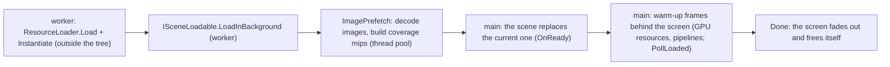
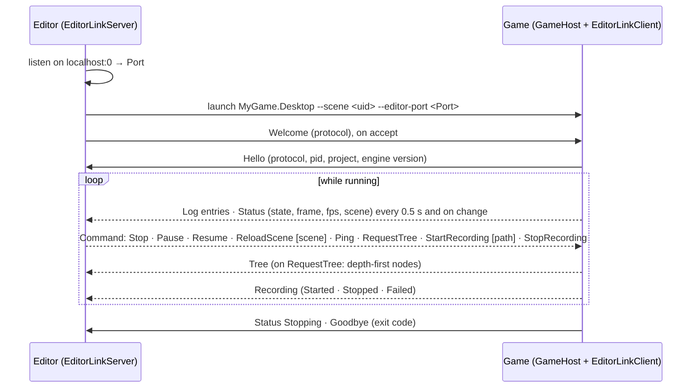

# Projects, GameHost and the editor link

## Purpose

How a game is laid out and run without an `Engine` subclass, and the engine-side pieces the editor builds its
project workflow on (M10 E4): the project file, `GameHost`, input actions, log routing, the editor link used by
out-of-process play, collectible loading of game assemblies for code reload, and the `mfgame` template. The editor UI
that drives them lives in `MainframeEngine.Editor` ([Editor](editor.md#projects)).

Decisions: [project file + GameHost](../../memory/decisions/0090-project-file-and-gamehost.md),
[log sinks](../../memory/decisions/0091-structured-log-sinks.md),
[editor link](../../memory/decisions/0092-editor-link-protocol.md),
[collectible game assemblies](../../memory/decisions/0093-collectible-game-assemblies.md),
[template engine reference](../../memory/decisions/0094-game-template-engine-reference.md).

## Key types

| Type | File | Notes |
|---|---|---|
| `ProjectSettings` (+ `WindowSettings`, `PhysicsProjectSettings`, `AudioProjectSettings`, `LocalizationProjectSettings`, `RenderingProjectSettings`, `SavesProjectSettings`, `AutoloadSettings`) | [Project/ProjectSettings.cs](../../MainframeEngine/Src/Project/ProjectSettings.cs) | the contents of `project.mfproj`; `Load`, `Parse`, `Save`, `ToJson`, `ToEngineOptions` |
| `ProjectSettingsFormat`, `ProjectMigration` | [Project/ProjectSettingsFormat.cs](../../MainframeEngine/Src/Project/ProjectSettingsFormat.cs) | reader/writer, `format` migrations |
| `GameHost : Engine`, `GameHostOptions`, `GameSession` | [Project/](../../MainframeEngine/Src/Project/) | runs a project; command line; the testable session logic |
| `UserSettings`, `UserSettingsSection` | [Project/UserSettings.cs](../../MainframeEngine/Src/Project/UserSettings.cs) | the player's `settings.json`: audio, input, display, language ([below](#user-settings)) |
| `InputMap`, `InputAction`, `InputBinding`, `InputState`, `Input` | [Scene/Input/](../../MainframeEngine/Src/Scene/Input/) | actions; per-tree polled state (`SceneTree.Input`); static facade |
| `Log`, `LogEntry`, `ILogSink`, `ConsoleLogSink`, `FileLogSink`, `MemoryLogSink` | [Debugging/](../../MainframeEngine/Src/Debugging/) | structured log routing |
| `UserDataPaths`, `EngineInfo` | [Core/](../../MainframeEngine/Src/Core/) | per-user folders; engine version |
| `SaveServer`, `SaveSchema<T>`, `SaveInfo`, `SaveSlotInfo`, `SaveResult`, `SaveLoad<T>`, `SaveOptions` | [Saves/](../../MainframeEngine/Src/Saves/) | save games: slots, `.msave` files, async writes, recovery |
| `ISaveStorage`, `LocalSaveStorage`, `ICloudSaveBackend`, `CloudSaveMeta`, `CloudSaveFile`, `SaveConflictPolicy` | [Saves/](../../MainframeEngine/Src/Saves/) | storage seam; local files; the cloud hook (M13 backends) |
| `EditorLinkProtocol`, `EditorLinkClient`, `EditorLinkServer`, `EditorLinkLogSink` | [EditorLink/](../../MainframeEngine/Src/EditorLink/) | game ↔ editor channel |
| `GameAssemblyLoader`, `Debouncer`, `DebouncedFileWatcher` | [Project/](../../MainframeEngine/Src/Project/) | code reload support |
| `mfgame` template | [Templates/MainframeEngine.Templates](../../Templates/MainframeEngine.Templates/) | `dotnet new` project template |

## A game project

```text
MyGame/                      ← dotnet new mfgame -n MyGame --engine-version X.Y.Z (the MainframeEngine package)
├─ project.mfproj            ← ProjectSettings (copied next to the app)
├─ Content/Scenes/Main.mscene
├─ MyGame/MyGame.csproj      ← class library: node/resource types (generator as analyzer)
├─ MyGame.Desktop/           ← exe: return GameHost.Run(args, typeof(MyGame.Spinner).Assembly);
├─ Directory.Build.props     ← TargetFramework, warnings as errors, MainframeEnginePath
├─ MyGame.slnx · global.json · .gitignore · .gitattributes (LFS rules)
```

`MyGame.Desktop` is the game's desktop *head*: the executable for Windows, macOS and Linux. The planned mobile heads
(`MyGame.Android`, `MyGame.iOS` — [mobile](future/mobile.md)) sit next to it over the same library. The desktop project
copies `project.mfproj` and `Content/**` to its output; engine content and natives come through the engine project
reference, as for the Demo. The editor loads `MyGame.dll` (the library), never a head; Play builds and runs the desktop
project (`GameProjectLayout.DesktopProjectOf`). Projects made before the rename have `MyGame.Launcher`, which the editor
still finds when there is no `*.Desktop` project.

## `project.mfproj`

JSON in the [scene-format](scene-serialization.md#file-format) conventions (UTF-8, LF, indented, comments and trailing
commas tolerated). Only values that differ from the defaults are written, except `format`, `name` and
`engineVersion`; whole sections are omitted when default.

```jsonc
{
  "format": 3,
  "name": "Space Game",
  "engineVersion": "0.4.2",                    // the engine the project was created with / upgraded to
  "userDataName": "SpaceGame",                 // the user data folder's name (default: name); keep it stable
  "mainScene": "scn_0123456789ab",             // UID or Content/ path
  "assemblies": ["SpaceGame"],                 // game assemblies (types registered before scenes load)
  "isDemo": true,                              // this build is the game's Steam demo (see Demo builds)
  "steam": { "appId": 480, "demoAppId": 481, "devAppIdFile": true, "restartThroughSteam": true },
  "window": { "title": "Space!", "width": 1920, "height": 1080, "vsync": false, "maxFps": 144, "icon": "Content/icon.png" },
  "physics": {
    "ticksPerSecond": 120, "maxStepsPerFrame": 8,
    "3d": { "gravity": [0, -20, 0], "substeps": 2, "solverIterations": 8, "relaxationIterations": 3,
            "allowDeactivation": false, "multiThreaded": false, "deterministic": true },
    "2d": { "gravity": [0, -500], "pixelsPerMeter": 64, "substeps": 8, "allowSleep": false, "continuous": false }
  },
  "input": {
    "jump": { "bindings": ["key:Space", "pad:A"] },
    "move_left": { "deadzone": 0.25, "bindings": ["key:A", "axis:LeftX-"] }
  },
  "audio": { "enabled": true, "busLayout": "Content/Settings/AudioBusLayout.mres", "sampleRate": 44100, "bufferMs": 20 },
  "localization": { "defaultLocale": "es", "sourceLocale": "en", "fallbacks": ["es"], "directory": "Content/locale", "domain": "messages" },
  "rendering": { "exposure": 1.1, "shadows": "Low" },
  "ui": { "scaleMode": "ScaleWithScreenSize", "referenceResolution": [1920, 1080], "matchWidthOrHeight": 1, "minScale": 0.5 },
  "loading": { "async": true, "screen": "Content/UI/loading.rml" }, // ADR 0183: the start scene loads behind a loading screen
  "saves": { "maxBytes": 16777216, "backups": 2, "compression": "none", "thumbnails": true,
             "thumbnail": { "width": 320, "height": 180 } },
  "autoloads": [
    { "name": "Music", "scene": "Content/Autoload/Music.mscene" },
    { "name": "Stats", "type": "GameStats", "enabled": false }
  ]
}
```

- **Versioning.** `format` is `ProjectSettingsFormat.Current` (3; format 1 had a top-level `steamAppId`, which the
  1 → 2 migration moves to `steam.appId`; the 2 → 3 migration writes `ui.scaleMode: "ConstantPixelSize"` into projects
  that have none, so their UI keeps its size). Older files run through `ProjectMigration` steps
  (`From` → `From + 1`, each editing the `JsonObject`) before they are read; newer files are rejected ("update the
  engine"). `engineVersion` is advisory: `GameHost` warns when its major/minor differs from `EngineInfo.Version`
  (development builds `0.0.0-*` never warn).
- **Rendering**: `exposure` → `IVulkanContext.Exposure`, `shadows` → `RenderServer.ShadowQuality`, `antiAliasing`
  (`None` default, `Fxaa` or `Taa`; ADR 0154, ADR 0166) → `IVulkanContext.AntiAliasing`, `taaSharpness` (0–1, default
  0.25, written only when it differs; the sharpen after TAA) → `IVulkanContext.TaaSharpness`, `waterSsr` (`Off`,
  `Low` default, `High`: refracting water's screen-space reflections, ADR 0173) → `RenderServer.WaterSsr`, and ADR 0174's
  render scaling under Godot's names: `scaling3DMode` (`Bilinear` default, `Fsr`, `Taau`) → `IVulkanContext.Scaling3DMode`,
  `scaling3DScale` (0.25–1, default 1: native) → `IVulkanContext.Scaling3DScale`, `fsrSharpness` (0–2 stops, default 0.2)
  → `IVulkanContext.FsrSharpness` (optional keys: no migration; [Post-processing → Render and output resolution](post-processing.md#render-and-output-resolution)), all applied
  by `GameHost.OnLoad`. The editor's Project Settings show them under Rendering.
- **UI** (`UiProjectSettings`, ADR 0181; [Game UI → Scaling](game-ui.md#scaling)): how every game UI follows the window
  — each `UiLayer` in its default `UiScaleMode.Project`, the developer overlay (F12) and the RmlUi debugger. `scaleMode`
  is `ScaleWithScreenSize` (the default for new projects: the UI is authored for `referenceResolution`, default
  `[1920, 1080]` pixels, and 1 dp = framebuffer ÷ reference, so 2560×1440 draws it at 1.333 and 4K at 2) or
  `ConstantPixelSize` (1 dp = the content scale, the engine's behaviour before format 3). `matchWidthOrHeight` (0 =
  width, 1 = height, default 1; between: a log-space blend, Unity's formula), `minScale`/`maxScale` (0 = no limit) clamp
  the result. `ToScaling()` → `UiServerOptions.Scaling` (`GameHost.CreateUiOptions`); change it at run time with
  `UiServer.Scaling`. The editor's Project Settings show it under UI.
- **Loading** (`LoadingProjectSettings`, ADR 0183; [Async loading](#async-loading-and-the-loading-screen-adr-0183)): `async`
  (default true) makes `GameHost` load the start scene on a worker thread behind a loading screen; `screen` is the
  screen's document (`.rml` binding the `loading` data model), null (default) the engine's
  (`LoadingScreen.DefaultSource`), `""` none. Optional keys, no migration.
- **User data** (`userDataName`, Godot's `config/custom_user_dir_name`): the name of the game's per-user folder
  (`GameHost.UserDataDirectory`: logs, saves, settings); when unset, `name` is used (`ProjectSettings.UserDataFolderName`).
  Set it once and keep it, so renaming the project or its window title never orphans player data; the template sets it
  to the project name at creation, and the Demo has one. An optional key: no format bump (older engines warn and ignore it).
- **Saves** (`SavesProjectSettings`, [Save games](#save-games)): `maxBytes` (the largest payload, uncompressed, default
  16 MiB), `backups` (previous versions kept per slot, 0–16, default 2), `compression` (`"none"` default or `"gzip"`),
  `thumbnails` (default false; true makes `ToEngineOptions` turn on `EngineOptions.EnableFrameCapture`, which slows some
  drivers, so it is opt-in) and `thumbnail.width`/`height` (default 320×180). `SaveOptions.FromProject` reads them.
  Optional keys, no migration.
- **Errors** are `InvalidDataException`s naming the file and the setting (`'project.mfproj': window.width must be an
  integer.`); unknown keys log a warning and are ignored.
- **Physics**: `ticksPerSecond` → `EngineOptions.PhysicsTicksPerSecond` (the tree's fixed tick), `3d`/`2d` → the
  `PhysicsSettings3D`/`2D` the engine builds `PhysicsServer3D`/`2D` with (gravity, substeps, solver, sleeping,
  determinism), `maxStepsPerFrame` → `SceneTree.MaxPhysicsStepsPerFrame` at `GameSession.Start`.
- **Audio bus layout**: a reference to the `.mres` resource ([Audio](audio.md#buses)) the `AudioServer` loads; missing
  → the built-in default layout, invalid → the default with an `[ERROR]`.
- **Localization** (`LocalizationProjectSettings.ToOptions()` → `EngineOptions.Localization`, `defaultLocale` →
  `EngineOptions.Locale`): the engine constructor calls `Tr.Configure` with them before any game code runs, so the
  catalog folder, domain, source locale and fallback chain are the project's. `defaultLocale` is used when catalogs
  exist for its chain (itself, its parents or the fallbacks), else the OS language under the same rule, else the source
  locale; `--locale` (the player's choice) overrides it. Fallbacks never apply to the source language itself.
- **Shadows** (`RenderServer.ShadowQuality`, applied in `GameHost.OnLoad` before any visual exists): `Off` runs without
  shadow maps (`ShadowsEnabled = false`); `Low`/`Medium`/`High` apply `ShadowQualitySettings.For(level)` to the shadow
  system — atlas size, PCF filter, cascade limit and per-map resolution limit
  ([shadow quality levels](shadow-system.md#quality-levels)). `High` is the shadow system's defaults.
- **Steam** (`SteamProjectSettings`, the editor's Steamworks section; [Steamworks](steamworks.md#project-settings)):
  `appId` (full game) and `demoAppId` (the demo's own Steam app). `ProjectSettings.SteamAppId` is the one this build
  uses — `demoAppId` when `isDemo`, else `appId`; 0 leaves Steam off — and becomes `EngineOptions.SteamAppId`.
  `devAppIdFile` (default true) lets development runs start Steam without being launched by it; `restartThroughSteam`
  (default false) makes shipped builds started outside Steam relaunch through it.

### Splash (`splash`, ADR 0192)

Every game shows a splash sequence before gameplay: Mainframe, BRUTAL (its licence requires the BRUTAL logo before
gameplay), then the game's own cards. Format 4 added the section (the 3 → 4 migration gives older projects the defaults).

```json
"splash": {
  "cards": ["@mainframe", "@brutal", "Content/Brand/studio.png"],
  "background": "#000000",
  "holdSeconds": 2.0,
  "skippable": true,
  "nonProfit": false
}
```

| Key | Meaning |
|---|---|
| `cards` | Ordered. `@mainframe` and `@brutal` are built in; any other entry is a PNG in the game's `Content/`. A missing image is skipped with a warning |
| `background` | sRGB hex (`#RRGGBB`/`#RGB`) behind every card. BRUTAL's white logo shows on a background of relative luminance below 0.5, its black one otherwise |
| `holdSeconds` | Fully visible time per card, clamped to 1.5–10 (a warning names an out-of-range value) |
| `skippable` | A fresh key, click or gamepad press ends a card's hold once it has run 1.5 s; a key held from launch never does |
| `nonProfit` | Unlocks `@brutal` (BRUTAL's README waiver for non-profits; confirm with Ahwoo, brutal@ahwoo.com) |

**The lock**: without `nonProfit`, a `cards` list lacking `@brutal` shows it after `@mainframe` (or first);
`ProjectSettings.Load` warns once per load naming the licence until the file is fixed (the saver writes what you set).
Repeated entries show once, with a warning. `ProjectSettings.Splash.ResolvedCards` is the list shown.

`SplashSequence` (`Src/Project/Splash/`, owned by `GameHost`) draws on an engine `UiLayer` above every game layer
(`int.MaxValue - 1`, under the dev overlay) with `Content/UI/splash/splash.rml`. Every card's image fits a square box of
40 % of the shorter screen side, aspect kept, so no logo is less prominent than another. Per card: 0.3 s fade in, the
hold, 0.3 s fade out, on the frame's delta (paused trees too; one frame counts at most 0.1 s, so a hitch cannot jump a
card). `GameHost` starts the session with `GameSession.StartAsync` on the first update as before and shows the splash above
the loading screen; the sequence ends when the last card has faded out and the load has completed (a spinner shows under
the last card until then). With `loading.async` false or `--sync-load` the splash plays first and the synchronous load runs
after it. A failed load ends the splash and takes the usual error path. While the splash is up `SceneTree.IsLoading` is
true and no input event reaches the game (polled `Input` still sees held keys).

The splash does not run with `--headless`, `--editor-port` (the editor's Play), `--scene`, `--max-frames` with `--hidden`
(CI smoke) or `--no-splash` (development). `--qa-splash` runs only the sequence and quits (the editor's Preview);
`--qa-splash-out <dir>` also saves each card halfway through its hold as `splash-N.png`, unskippable.

### App name and icon (ADR 0182)

`name` is the game's player-facing name and `window.icon` (a PNG, `Content/…`) its icon, everywhere:

- **Run time.** The window title when `window.title` is unset, the user data folder (`GameHost.UserDataDirectory`), and
  `window.icon` → `EngineOptions.IconPath` (the SDL window/taskbar icon on Windows and Linux; on macOS the Dock icon of
  an unbundled run — a bundled one keeps its `.icns`, see [Release → Game executables](release.md#game-executables-adr-0182)).
- **Build time.** [`build/MainframeGame.props`](../../build/MainframeGame.props) reads `name`, `window.icon` and
  `version` (the first such strings in the file; JSON escapes are not decoded) into `MainframeAppName`,
  `MacAppDisplayName`, `MacAppIcon` and `MacAppVersion`: the macOS development bundle `bin/<cfg>/net10.0/<name>.app`,
  `Product` and the executable's `AssemblyTitle` (Windows file description). Desktop projects override them (an `.icns`
  on Apple's icon grid in `MacAppIcon`, an `.ico` in `ApplicationIcon`).
- **Packaging.** `build/package-game.sh` names the `.app` and the executable from `name` and takes the icon from
  `window.icon` ([Release → Games](release.md#games)).

Renaming a game moves its user data folder (settings, saves, logs) with it unless `userDataName` pins the folder's
name (new projects set it). The editor's Project Settings already edit `name` and `window.icon`.

### Demo builds

`isDemo` (Application › Demo Build) marks the game's **Steam demo** build, as opposed to the full game:

- **Compile time.** Every project of the game imports the engine's
  [`build/MainframeGame.props`](../../build/MainframeGame.props) (the template's `Directory.Build.props` does, as does
  `Examples/Demo`'s). It reads
  `isDemo` from the nearest `project.mfproj` and, when true, adds `DEMO` to `DefineConstants`, so game code separates
  the builds with `#if DEMO` / `#if !DEMO` (cut content, a "buy the full game" screen). A build overrides the file with
  `-p:MainframeDemo=true|false`: `dotnet publish MyGame.Desktop -c Release -p:MainframeDemo=true` makes the demo from
  the same checkout as the full game.
- **Run time.** The props also stamp every game assembly with `[AssemblyMetadata("MainframeDemo", "true|false")]`.
  `GameHost.Run` sets `ProjectSettings.IsDemo` from it (`GameHost.BuiltAsDemo`; the entry assembly first), so the
  running game agrees with how it was compiled even when `-p:MainframeDemo` differs from the copied project file.
  `GameHost.IsDemo` is the runtime check; Steam starts with the demo app id; the log says `Demo build (Steam app N)`.
- The editor builds and loads the game with the project's `isDemo`; save the setting and Play (or Build & Reload) to
  switch. Projects created before `MainframeGame.props` add the import to their `Directory.Build.props` by hand.

## GameHost

```csharp
// MyGame.Desktop/Program.cs
return GameHost.Run(args, typeof(MyGame.Spinner).Assembly);
```

`GameHost.Run` parses the command line, loads the project (`--project`, else `project.mfproj` next to the app),
adds a `FileLogSink` (`{user data}/{name}/logs/{name}.log`), loads the game assemblies (the ones passed plus
`ProjectSettings.Assemblies`, by name) and runs a `GameHost`. Exit code: 0, 1 (failed start, e.g. the main scene
does not load), 2 (bad command line).

| Flag | Effect |
|---|---|
| `--project <path>` | project file or folder |
| `--scene <uid\|path>` | start this scene instead of `mainScene` (editor "play current scene") |
| `--editor-port <n>` | connect the editor link to `localhost:n` |
| `--headless` | no window, renderer or audio device: a dedicated server (`HeadlessHost`, below) |
| `--max-frames <n>` · `--fixed-fps <n>` · `--hidden` · `--no-vsync` · `--validation` | headless/CI runs |
| `--no-log-file` | no log file |
| `--locale <name>` | start in this locale (overrides `localization.defaultLocale`) |
| `--screenshot <file.png>` | save the frame `--max-frames` ends on (frame 60 without it) as a PNG |
| `--frame-capture` | allow `SceneTree.CaptureFrame` (a game's own screenshot harness; implied by `--screenshot`) |
| `--dev-overlay` | start with the developer overlay (F12) shown (QA captures) |
| `--sync-load` | load the start scene synchronously, without the loading screen (as `loading.async: false`; before/after timings) |
| `--loading-hold <s>` | keep the loading screen up at least this long before the scene enters (QA of its look) |
| `--loading-screenshot <file.png>` | save the loading screen's first frame at or past half progress (QA) |
| `--no-splash` | skip the splash sequence while developing (ADR 0192; a game launched normally always shows it) |
| `--qa-splash` | run only the splash sequence, then quit (the editor's Project Settings › Splash › Preview) |
| `--qa-splash-out <dir>` | `--qa-splash`, unskippable, saving each card halfway through its hold as `dir/splash-N.png` |
| `--record <file.mp4>` | record gameplay (live; offline with `--fixed-fps`) with the user's ffmpeg and write `file.mp4.mfcap.json`; starts on the first update, so loading is recorded; implies frame capture; rejected with `--headless` ([Gameplay recording](recording.md)) |
| `--record-scale <n>` | fixed content scale for the recording (a 1920×1080-point window at 2 is 4K, if the display can hold it) |
| `--ffmpeg <path>` | the ffmpeg to record with (else `MAINFRAME_FFMPEG`, `PATH`, common install folders) |
| `++ …` | everything after `++` is the game's (`GameHost.UserArgs`, Godot's `OS.get_cmdline_user_args`), never parsed by the host |

Anything else before `++` is left in `GameHostOptions.Remaining` for the game. `GameHost.IsDebugBuild` is true when the
game's first assembly was compiled in Debug (developer keys), `GameHost.IsHeadless` under `--headless`. Nodes ask the host to quit with
`SceneTree.Quit(code)`; `GameHost.Project` is the running project's settings (its `version` for build stamps).

Startup: `ProjectSettings.ToEngineOptions()` (window, VSync, physics settings and tick, audio, localization, Steam) +
the flags + `CreateUiOptions` (the UI scale, hot-reload folders) → `Engine` constructor (`Tr.Configure`) → `GameSession` (connects the editor link first) → `OnLoad`:
`base.OnLoad()`, the `SaveServer` (`GameHost.CreateSaveServer`: `LocalSaveStorage` in `{user data}/saves`, registered last
so it is disposed — and flushed — first on close), frame cap, exposure, shadow quality; then, on the **first update** (the window is up: SDL shows it
after `OnLoad`, ~0.3 s on macOS, and Godot readies its scene with the window already there) and with that update's
delta discarded (`Engine.DiscardFrameDelta`, so start-up time never reaches the game; with `--fixed-fps` the frame keeps the fixed delta like every other, as Godot's first frame does: ADR 0135), `GameSession.Start`: input map → `Tree.Input.Map`, `MaxStepsPerFrame`,
autoloads (each added as `/root/{Name}`, in order, before the scene; a failing one is logged and skipped), then
`Tree.ChangeSceneToFile(--scene ?? mainScene)` — or, by default, `GameSession.StartAsync` (below). Each frame
`GameSession.Update` applies editor commands and reports status. `GameHost` can be subclassed (call the bases); subclassing `Engine` directly still works (the editor and render-test host do).

### Async loading and the loading screen (ADR 0183)

The start scene loads asynchronously by default, so the window shows a loading screen from its first frame instead of
staying black and unresponsive (macOS's beachball) until the scene is ready. On the first update `GameHost` calls
`GameSession.StartAsync` (input map and autoloads at once, then `SceneTree.ChangeSceneToFileAsync`) and adds a
`LoadingScreen` (`loading.screen`, else the engine's branded one) over everything:



Meanwhile the main loop runs normally (window events, audio, the screen's RCSS animations); only the warm-up frames,
where the new scene creates its GPU resources behind the screen, are long. `SceneLoad` reports `Stage`, `Progress`
(weighted stages, monotonic) and `StageText`; see [Scene serialization → Asynchronous loading](scene-serialization.md#asynchronous-loading-adr-0183)
for the API and [Game UI → Loading screen](game-ui.md#loading-screen-adr-0183) for the document.

- **Frames count once the game is on screen.** `SceneTree.IsLoading` is true while a load runs or a loading screen is
  shown (fading out included); the engine decides per frame, when its update begins, and frames that were loading do
  not count for `--max-frames` (`Engine.LoadedFrameCount`), `--screenshot` or `--bake-lighting`'s update. So captures
  and timings start after the fade: with `--fixed-fps` a capture lands warm-up + fade frames (~30) later in scene time
  than with `--sync-load`.
- **A failed load** logs `[Project] Could not start scene …` and quits with exit code 1, like the synchronous start.
- **Start-up times** are logged: `[GameHost] First frame presented N ms after the process started` and `Start scene on
  screen N ms … (loaded asynchronously in S s)`. The Forest on an M5 (cached bakes, 1920×1080): the first frame at
  ~1.3 s (was ~10.3 s: the window stayed black through the valley build and the first frame's uploads) and the game
  playable at ~9.4 s (was ~12.8 s); the image prefetch removed ~4.5 s of main-thread decoding and mip building.
- `--headless` (no UI) and the editor's Reload Scene keep loading synchronously; `--sync-load` or `loading.async: false`
  restore the old start.

### Headless (`--headless`, ADR 0120)

`GameHost.Run` with `--headless` runs a `HeadlessHost` instead of a `GameHost` (no `Engine`: no SDL window, Vulkan,
canvas, UI or dev overlay): its own `SceneTree` with `MultiplayerApi`, both physics servers, a `SaveServer` (no
thumbnails) and, when the project has audio, an `AudioServer` on the null device (buses and players work, nothing is
heard). It runs the same
`GameSession` (input map, autoloads, `--scene`/`mainScene`) and loops at `window.maxFps`, else the physics rate:
`GameSession.Update`, `Tree.Tick`, then the queued canvas draws (Godot runs `_draw` headless too). `--fixed-fps`
and `--max-frames` apply. Ctrl+C / SIGTERM raise `SceneTree.CloseRequested` (the game's chance to save), then quit.
`GameHost.IsHeadless` tells game code (Godot's `DisplayServer.get_name() == "headless"`). `UiLayer`s warn and load
nothing; `UiDocument.CreateDataModel` throws, so UI nodes check `IsHeadless` first.

### UI hot reload

Debug engine builds (`UiServerOptions.DefaultHotReload`) hot-reload the game's `.rml`/`.rcss` from the project sources:
`GameHost.Run` hands the desktop project's game assemblies to the `GameHost` constructor, and `GameHost.CreateUiOptions` turns
their `[AssemblyMetadata("MainframeContentSource", …)]` folders (`UiServerOptions.SourceDirectoriesOf`) into the UI's
source directories, so saving a document in the project's `Content/` reloads it in the running game. The `mfgame`
template's `MyGame.csproj` records its sibling `Content/` folder under that key in Debug builds only; Release builds and
installed games load from the output folder. An explicit `EngineOptions.Ui` (tests, engine subclasses) is left alone.

## User settings

The player's options live in `{user data}/settings.json` (`UserSettings.FileName`, in
`UserDataPaths.GetDirectory(ProjectSettings.UserDataFolderName)`): one [`ConfigFile`](scene-serialization.md#config-files-configfile)
holding the typed sections the engine applies itself and the game's own sections (`UserSettings.Config`).

```json
{
  "format": 1,
  "audio":   { "volume": { "Master": 1.0, "Music": 0.7, "SFX": 0.85 }, "mute": ["Voice"] },
  "input":   { "interact": ["key:F", "pad:X"] },
  "display": { "mode": "fullscreen", "size": [1600, 900], "vsync": true, "maxFps": 0, "uiScale": 1.25, "shadows": "High" },
  "locale":  { "language": "es" },
  "game":    { "subtitles": true, "fov": 80 }
}
```

- **Every key is optional** and means "the project's default" when missing, so the file never pins a value the player
  did not change: setting a value equal to the project's (`window.vsync`, `window.maxFps`, `rendering.shadows`; volume
  1, UI scale 1, windowed) erases its key, and emptied sections go. `WindowSize` is null for the project's size.
- **Input** holds the full binding list (the [text form](#input-actions)) of only the actions whose bindings differ from
  `project.mfproj`, order included (slots). `UserSettings.DefaultInput` is a clone of the project's map taken before the
  overrides; `StoreInput(map)` records the live map after a rebind, `ApplyInput(map)` applies the overrides. An action
  added in a game update keeps its defaults; actions that no longer exist, unknown buses and non-list values are dropped
  from the file with a warning, unparseable bindings are skipped.
- **Values:** `GetBusVolume`/`SetBusVolume` (0..1, [`AudioBus.UserVolume`](audio.md#buses)), `IsBusMuted`/`SetBusMuted`
  (`AudioBus.Mute`), `WindowMode` (`Windowed`, `Maximized`, `Fullscreen` = borderless, `ExclusiveFullscreen`),
  `WindowSize` (windowed, points), `VSync`, `MaxFps`, `UiScale` (0.75–2, [`UiServer.UserScale`](game-ui.md#scaling)),
  `Shadows` (`RenderServer.ShadowQuality`) and `Language` (`Tr.SetLocale`). Hand-edited garbage reads as the default
  with one warning per key; a damaged file is quarantined and the backup restored (`ConfigFile.Load`).

**When values are applied:**

1. **Before the window exists.** `GameHost.Run` loads the file right after the project (and after the log file is set
   up, so a damaged file is reported there) into `UserSettings.Current` and passes it to the `GameHost` constructor,
   which runs `UserSettings.PatchEngineOptions` on `ToEngineOptions()`: `VSync`, `WindowSize` and `Locale`, before the
   command-line flags (which win). The window opens at the player's size and the first frame is in their language.
2. **In `GameSession.Start`/`StartAsync`, before the autoloads** (`GameSession.UserSettings`; `UserSettings.Apply(tree)`
   after the input map is installed), so autoloads see the player's values: input overrides, bus volumes and mutes,
   window mode, VSync and frame cap (when set), UI scale and shadows. Shadows Off works here: no visual has created GPU
   resources yet.
3. **Live.** `Apply` attached the tree, so every setter (and `Reset(section)`) applies at once and raises
   `Changed(UserSettingsSection)` when something changed. Saving is explicit: `Save()` writes durably
   (`DurableFile`, one backup) and logs, rather than throws, on a full disk.

`ShadowQuality` switches live between Low, Medium and High; a switch to or from Off once visuals exist is saved and
`UserSettings.ShadowsNeedRestart` turns true until the next start (a settings menu shows "applies after restart").
`HeadlessHost` loads the file for `Config` only (`HeadlessHost.UserSettings`, `UserSettings.Current`) and applies nothing:
it has no window, audio device or input. Games read their own sections through `Config` (cache the values: it is a JSON
tree, not a per-frame store); `GameHost` loads it without game migrations, so a game that versions its sections reads
`Config.Version` itself.

**Window modes on SDL.** `IWindowControl.Mode` calls SDL directly (`WindowModeFlags`): `Fullscreen` is
`SDL_SetWindowFullscreen(SDL_WINDOW_FULLSCREEN_DESKTOP)` (borderless at the desktop's resolution, Godot's
`WINDOW_MODE_FULLSCREEN`), `ExclusiveFullscreen` is `SDL_WINDOW_FULLSCREEN` after `SDL_SetWindowDisplayMode(NULL)` (the
display mode closest to the window's size; there is no mode list yet), `Maximized`/`Windowed` leave fullscreen and
maximize or restore. Silk.NET 2.23's own `WindowState.Fullscreen` is exclusive (`SDL_WINDOW_FULLSCREEN`), and its
`WindowState.Normal` only restores, which does not leave fullscreen. The `Fullscreen` shortcut means borderless.
`IWindowControl.VSync` forwards to `IRenderer.VSync` and `IWindowControl.MaxFps` to `Engine.MaxFPS`.

## Input actions

`InputMap` holds named actions (`InputAction`: deadzone, bindings, and for settings menus an optional `label`, a
conflict `group` and `rebindable: false` for a locked action; see
[Cameras & input → Rebinding](cameras-and-input.md#rebinding-g44)). `InputBinding` is a key, a mouse button, a
gamepad button or one direction of a gamepad axis, on any pad or one pad index; its text form is used in the project
file: `key:Space`, `mouse:Left`, `pad:A`, `pad1:Start`, `axis:LeftX-`, `axis:RightTrigger+` (stick Y is SDL's: positive
down).

Every `SceneTree` has an `InputState` (`tree.Input`), fed by `SceneTree.PushInput` **before** the UI and nodes (an
event the UI consumes still updates polled state, so keys never stick). The engine points the static `Input` at its
tree's state:

```csharp
if (Input.IsActionJustPressed("jump")) Jump();
var move = Input.GetVector("move_left", "move_right", "move_up", "move_down"); // length ≤ 1
protected override void OnUnhandledInput(InputEvent e) { if (e.IsActionPressed("pause")) ... }
```

- Strength: 1 for keys/buttons; axes past the deadzone rescale 0..1; an action takes the strongest of its inputs.
- "Just pressed/released" follow Godot 4: true in the process frame after the change, and in `OnPhysicsProcess` only
  for the first physics step after it; a change made during a physics step (`ActionPress` from `OnPhysicsProcess`)
  counts from the next step, and a tap released again before that step still reads as just pressed
  ([ADR 0129](../../memory/decisions/0129-godot-just-pressed-timing.md)).
- `ActionPress`/`ActionRelease` simulate input; `ReleaseAll` clears everything (focus loss). Editing or replacing the
  map rebuilds the action table (held inputs stay pressed, without an edge). Polling and event handling do not
  allocate.

## Log routing

`Log.Debug/Info/Warning/Error/Fatal/Write` build a `LogEntry` — level, UTC time, category (from the `"[Category] "`
prefix, or explicit with `Write`), message, caller member/file/line, and its **source** (`LogEntry.Source`: `engine` for
call sites in the engine checkout's `MainframeEngine*` projects, `game` for everything else, from the caller file;
[ADR 0141](../../memory/decisions/0141-log-source-tag.md)) — and pass it to each `ILogSink` in `Log.Sinks`
(`AddSink`/`RemoveSink`; copy-on-write, no lock). `Log.LogLevel` filters first: a filtered `Log.Debug($"…{x}")`
formats and allocates nothing (per-level interpolated-string handlers, invariant culture). A throwing sink is reported
on stderr and skipped; a sink that logs does not recurse.

| Sink | |
|---|---|
| `ConsoleLogSink` (`Log.ConsoleSink`, default) | `[12:00:00.123] [INFO] engine Audio: message` / `[12:00:00.130] [INFO] game Net: message` (`game message` without a category), call site while `Level.Verbose` is set |
| `FileLogSink` | UTF-8, LF; `Write` only queues — a background thread writes, flushing within 1 s and at once after errors (`Flush()` on demand); a full queue drops entries and logs how many; previous runs kept as `.1.log`, `.2.log`… (`MaxFiles`), rotates at `MaxBytes` (a failed rotation is retried after 30 s); a second process logging to the same folder writes `{name}-{pid}.log` (the owner holds `{name}.log.lock`); I/O failures reported once on stderr; `ForUser(game)` writes to `UserDataPaths.LogDirectory(game)` |
| `MemoryLogSink` | ring of the last N entries; `Snapshot()`, `CopySince(sequence)` for incremental panels; no allocation once full |
| `EditorLinkLogSink` | queues entries on the editor link |

File log lines read like the console's (`2026-10-05T12:00:00.123Z [INFO] game Net: …`). The log folder is
`{user data}/logs` ([User data](#user-data)).

## User data

`UserDataPaths`: `%APPDATA%\{game}`, `~/Library/Application Support/{game}`, `$XDG_DATA_HOME/{game}`
(`~/.local/share`); `MAINFRAME_USER_DATA` overrides the base folder (tests, CI, portable installs).
`GameHost.UserDataDirectory` is the running game's folder, named by `userDataName`, else `name` (created on use), and
`GameHost.UserDataPath("saves/x")` a path inside it. Nothing the game writes goes next to the app, which may be
read-only.

```text
{user data}/                 GameHost.UserDataDirectory
├── saves/                   SaveServer (LocalSaveStorage)
│   ├── slot1.msave          header line + payload
│   ├── slot1.msave.bak1     previous save (rolling, saves.backups copies)
│   ├── slot1.png            optional thumbnail
│   ├── slot1.msave.corrupt-20261008T101500123Z   a damaged copy, kept for support
│   └── .sync.json           the last synced hash per slot (with a cloud backend)
└── logs/                    FileLogSink
```

## Save games

`SaveServer` (`Tree.Servers.Get<SaveServer>()`, registered by `GameHost` and `HeadlessHost`) saves the game's own data
type in named slots. There is no automatic scene serialization (Godot has none either): a save is a game record,
serialized through the game's source-generated `JsonTypeInfo<T>` — no reflection, so it works trimmed and under iOS AOT.

```csharp
public sealed record CrateSave(List<CrateState> Crates, int Spawned);

[JsonSourceGenerationOptions(PropertyNamingPolicy = JsonKnownNamingPolicy.CamelCase, IncludeFields = true)]
[JsonSerializable(typeof(CrateSave))]
internal sealed partial class GameSaveJson : JsonSerializerContext;

static readonly SaveSchema<CrateSave> Schema = new(GameSaveJson.Default.CrateSave, version: 2,
    new JsonMigration(1, static root => root["spawned"] ??= root["crates"]!.AsArray().Count)); // v1 had no counter

var saves = Tree!.Servers.GetRequired<SaveServer>();
var result = await saves.SaveAsync("slot1", snapshot, Schema, new SaveInfo("Level 2 — 14 crates", Progress: 0.4, Thumbnail: true));
var load = saves.Load("slot1", Schema);  // LoadStatus.Ok / RecoveredFromBackup → load.Data
foreach (var slot in saves.ListSlots()) { /* slot.Description, slot.PlayTime, slot.ThumbnailPath, … */ }
```

- **API.** `SaveAsync`/`Save` (blocking, for quit and pause paths), `Load` (blocking, behind a loading screen)/`LoadAsync`,
  `ListSlots` (headers only, newest first, cached until the next write), `Exists`, `Delete` (the slot, its temp file,
  backups and thumbnail; damaged and conflict copies are kept), `CaptureThumbnail`, `Flush(timeout)`, `PlayTime`, the
  `Saved` event. Slot names are `[a-z0-9_-]{1,64}` (`SaveServer.IsValidSlotName`); anything else throws
  `ArgumentException`, and games show their own labels from `SaveInfo.Description` (at most 1 024 characters).
  `SaveResult` is the slot, `SaveStatus` (`Ok`, `TooLarge`, `IoError`, `Cancelled`), the error, the written header
  (`SaveSlotInfo`) and `CloudTooLarge`; `SaveLoad<T>` is `LoadStatus` (`Ok`, `RecoveredFromBackup`, `NotFound`,
  `Corrupt`, `TooNew`, `IoError`), the data, the header of the copy that loaded and the error.
- **File format.** A `.msave` is UTF-8 in two parts: line 1 is a compact JSON header (at most 64 KiB, ending with `\n`),
  the rest the payload JSON, optionally gzip. Both are readable in any editor:

  ```json
  {"kind":"mainframe-save","format":1,"slot":"slot1","version":2,"savedUtc":"2026-10-08T10:15:00.000Z","playTimeSeconds":5423.5,"description":"Physics 3D — 14 crates","progress":0.4,"device":"brogan-mbp","game":"Mainframe Demo","gameVersion":"1.2.0","engine":"0.9.3","compression":"none","payloadBytes":18234,"sha256":"9f2c…","thumbnail":"slot1.png"}
  ```

  `format` is the engine's container (`TooNew` when newer), `version` the game's payload (`SaveSchema.Version`; older
  payloads run the schema's `JsonMigration`s, newer are `TooNew`). `payloadBytes` and `sha256` describe the stored
  (possibly compressed) bytes. A listing reads the header line with one small buffered read and `Utf8JsonReader`, never
  touching the payload: a slot with a 50 MB payload lists in well under 5 ms. The header fields are a superset of M13's
  `SaveMeta` (slot, description, play time, modified time, device, progress), so cloud backends map them one to one.
- **Write path.** `SaveAsync` serializes on the calling (main) thread at once — the bytes are the snapshot, so the game
  may change its state on the next line — and checks `saves.maxBytes` (`TooLarge`, nothing written). One worker per
  server (a single-reader `Channel`) hashes (SHA-256), optionally gzips, builds the header and writes: the thumbnail
  first (`slot1.png`; a lost one is cosmetic), then `ISaveStorage.WriteDurable` (`DurableFile`: temp file, flush to
  disk, `saves.backups` rolling backups, replace; [Scene serialization → Durable writes](scene-serialization.md#durable-writes-durablefile)).
  Queued saves of the same slot that have not started are coalesced: the newest wins, every caller gets that result and
  `Saved` is raised once per write.
- **Completion.** Results go into a `ConcurrentQueue`; `SaveServer.Process` (a frame server, main thread) drains it,
  completes the task and raises `Saved`. The engine has no `SynchronizationContext`, so completing from `Process` makes
  an `await` in game code continue on the main thread.
- **Load and recovery.** The header is checked (`kind`, `format`, `version`), then `payloadBytes` and `sha256`; the
  payload is decompressed (the size limit includes the decompressed size), migrated and deserialized. On any failure
  (truncated, bad checksum, bad JSON, a failed migration) the file is renamed `slot1.msave.corrupt-{utc}` (never
  deleted, so a player can send it to support), then the `.tmp` of an interrupted write and `.bak1` … `.bakN` are tried
  in order: the first valid copy is restored as the slot and returned as `RecoveredFromBackup` with its own header
  ("Restored the save from 10:02"). No valid copy: `Corrupt`. A `TooNew` file is left untouched. A successful load sets
  `PlayTime`.
- **Threading and allocation.** Saving and loading allocate freely. `Process` advances `PlayTime` while the tree is not
  paused and checks a pending count: **0 B** when idle (allocation gate). Storage is touched by one thread at a time (a
  lock around every call: the worker, the cloud worker, or the caller of a blocking method). Call the methods from the
  main thread. `Dispose` (engine close, after `SceneTree.CloseRequested`) calls `Flush(5 s)`, so a quit right after
  `SaveAsync` still writes the save; mobile's `OnApplicationPause` will call `Flush` too.
- **Thumbnails.** `SaveInfo.Thumbnail`, or an earlier `CaptureThumbnail()` (e.g. as the pause menu opens, before it
  covers the game), captures the frame with `SceneTree.CaptureFrame`; the save waits for it (at most 2 s, or until a
  `Flush`), and the worker crops it to the thumbnail's aspect, box-filters it to `saves.thumbnail` (320×180) and encodes
  it with `Png.EncodeRgba8`. A blocking `Save` uses an already captured frame only. Without frame capture
  (`saves.thumbnails` false) requests are ignored with a one-time warning.
- **Storage seam.** `ISaveStorage` (`List`, `OpenRead`, `WriteDurable`, `Delete`, `GetModifiedUtc`, and `Move` with a
  copy-and-delete default) is what consoles or tests replace; `LocalSaveStorage(root)` is the desktop one and creates its
  folder on the first write. Paths are relative to the root, `/`-separated.
- **AOT safety.** The engine csproj enables the trim and AOT analyzers (`EnableTrimAnalyzer`, `EnableAotAnalyzer`), and
  `MainframeEngine/.editorconfig` makes their diagnostics (IL2026, IL3050, …) errors in `Src/Saves/` and silences them
  elsewhere, since the rest of the engine still reflects over game types. A reflection-based `JsonSerializer` call in the
  save code fails the build.

### Cloud saves (the M13 seam)

`SaveServer.Cloud` takes an `ICloudSaveBackend` (`Name`, `MaxBytes` per slot, `ListAsync`, `UploadAsync(slot, file,
thumbnail)`, `DownloadAsync`); the Steam Cloud, iCloud and Play Saved Games backends are [M13](future/mobile-services.md).
Backends store whole `.msave` files, so the file format needs no change; `CloudSaveMeta.FromFile` reads a file's header
for their listings.

- **Local first.** Local storage is the source of truth. After every local write the same bytes are uploaded, best
  effort, retried `SaveOptions.CloudRetries` times with a doubling `CloudRetryDelay`; uploads run one at a time on a
  cloud worker and coalesce per slot. A file over the backend's `MaxBytes` stays local and `SaveResult.CloudTooLarge`
  says so.
- **Sync.** `SyncAsync()` (at start-up, on resume, from a "cloud" button) compares the remote headers with the local ones
  against `saves/.sync.json`, the payload hash of each slot at its last sync. A slot changed on one side is copied to the
  other (a slot deleted locally since the last sync is not brought back); a slot changed on both is a conflict that
  `ConflictPolicy` settles: `MostRecent` (`savedUtc`), `HighestProgress` (`progress`, ties by time) or `Manual`, which
  raises `ConflictDetected(local, remote)` on the main thread and waits for `ResolveConflict(slot, keepLocal)`. The losing
  copy is kept as `slot1.msave.conflict-{utc}`. Downloaded files are checked (header and checksum) before they replace
  anything, and a slot that changes locally while a download is in flight is left for the next sync.
- **Steam Auto-Cloud** needs no code: configured on the Steamworks partner site, it syncs `{user data}/saves/*.msave`.

## Editor link



- **Wire format** (`EditorLinkProtocol`): `u32 length` (type byte + payload, ≤ 1 MiB) · `u8 type` · payload,
  little-endian; strings `u32` byte count + UTF-8 (strict). Oversized log text is truncated to fit. A malformed frame
  closes the connection. `EditorLinkProtocol.Version` is checked from the hello (version 3 added the welcome, version 4 the recording commands and message).
- **Game side** (`EditorLinkClient`): a background thread connects (and reconnects with back-off when the editor goes
  away), sends a hello per connection and waits for the editor's welcome; only then does the connection count
  (`IsConnected`, `ConnectionCount`) and drain queued logs (batched up to 64 KB), the latest status and the goodbye.
  A connection with no welcome within `WelcomeTimeoutMilliseconds` (2 s) is closed and retried with the back-off,
  with the logs still queued. A reader thread queues commands, which `GameSession.Update` applies on the game loop.
  Nothing on the game loop blocks: when more than `QueueCapacity` (4096) entries wait, new ones are dropped, counted and reported as
  `LogDropped`.
- **Editor side** (`EditorLinkServer`): an async accept loop (cancelled on `Dispose`) writes the welcome to each new
  connection before listing it; several games at once (each message carries a `GameId`; local `Connected`/
  `Disconnected` markers); `TryRead` from the editor's main thread; `SendCommand(command)` to all or
  `SendCommand(gameId, command)`; `Disconnect(gameId?)`. Each game has its own send lock and a 2 s send timeout, so a game that stops reading is dropped without stalling the others. Received logs beyond 100 000 unread messages are dropped and
  counted.
- **Commands in the game**: Stop → `Quit(Ok)`; Pause/Resume → `Tree.Paused`; ReloadScene → re-read cached scenes from
  disk (`ResourceLoader.RefreshCachedScenes`) and `ChangeSceneToFile` the given scene or the current one (autoloads
  stay); Ping → status now; RequestTree → `GameSession.SnapshotTree(Tree.Root)` sent as a `Tree` message (protocol
  version 2, [0133](../../memory/decisions/0133-remote-scene-tree.md)): `u8 truncated, i32 count`, then per node `i32 depth,
  str name, str type` depth-first from the root (depth 0); at most `MaxTreeNodes` (3000) nodes and names/types cut to 48
  characters, so the worst case fits a frame. The latest snapshot waits next to the status (a newer one replaces it).
- **Recording** (protocol version 4, [Gameplay recording](recording.md#recording-from-the-editor)). Editor → game:
  `StartRecording` (command argument: the `.mp4` path) and `StopRecording`. Game → editor: a `Recording` message,
  `u8 state (0 Started, 1 Stopped, 2 Failed), str path, f32 elapsed seconds, i64 dropped frames, i64 duplicated frames,
  str error`. `GameSession.AttachRecorder` wires the host's `GameRecorder` to it; a start that throws is answered
  `Failed` with the reason (a recorder still finalising included), a start while already recording is answered `Started`
  with the running recording's path, and a recorder that stops with an error is sent as `Failed`. A `--record` start
  that fails on the first update is reported `Failed` (`GameSession.ReportRecordingFailed`) before the game quits with
  its error code; the session then waits up to about 3 s for the link to connect so the report and the goodbye reach
  the editor. The editor gives a stopped game that is recording or saving 2 min 15 s to exit (the game's own two-minute
  finalise cap plus a margin) instead of the usual 3 s, and refuses to record games whose hello reports a protocol below 4. Unlike the latest-wins status
  and tree, recording events are **queued** in `EditorLinkClient` (`MaxQueuedRecordings` 64, never coalesced) and written
  before the goodbye. The editor treats a recording as failed by itself only when the game's link is gone. A game must
  have been started with `--frame-capture` (the editor always does) for a mid-session start to succeed.
- **Sockets inherited by child processes.** macOS has no `SOCK_CLOEXEC`/`accept4`: .NET calls `socket()`/`accept()`
  and then sets `FD_CLOEXEC` separately, and `Process.Start` forks, so a child started in between (the editor runs
  `dotnet build`, whose build servers outlive it, and games) holds the socket for its whole life. Two consequences
  are handled:
  - A listener the editor closed keeps completing handshakes into its backlog while such a child lives. Nobody reads
    them, so a game that counted the handshake as a connection would write its logs into the void. Hence the welcome.
  - .NET unblocks a blocking call before closing a socket only when the descriptor has `FD_CLOEXEC` (one without may
    be shared). A blocking accept on a descriptor without it makes `TcpListener.Stop()` spin forever. The async
    accept is cancelled instead. A fork-race leak sets the flag on the editor's copy, so this only guards
    descriptors that something made inheritable.

## Game assemblies and code reload

```csharp
var dll = GameAssemblyLoader.FindBuildOutput("MyGame/MyGame.csproj")!; // newest bin/Debug/<tfm>/MyGame.dll
using var loader = new GameAssemblyLoader(dll);
loader.Load();                    // collectible context; its [Export] types register
// … edit scenes using game types …
// serialize open scenes, free every node of game types, then:
if (!loader.Unload()) Log.Warning("game code still referenced");   // collected (GC-verified) or not
loader.Load();                    // the rebuilt dll; re-instantiate the scenes
```

- The engine and every assembly the host already has are shared with the default context; the game's private
  dependencies load into its context from the build folder (`.deps.json` when present). Files are read into memory,
  so the build can overwrite them.
- `Unload` releases what would pin the context: type and replication registrations (with M9's translatable-property
  metadata, which lives in `NodeTypeInfo`), cached resources of game types and cached scenes' inline tables holding
  them (`ResourceLoader.ReleaseTypesOf`), `Node`'s per-type caches (weak for collectible types), and — for game code
  that forgot to clean up — handlers of game code left on `Tr.LocaleChanged` and on any live `SceneTree`'s events
  (`Tr.ReleaseCodeOf`), and in the game UI (`UiServer.ReleaseCodeOf`): data models still bound to game delegates,
  owners or types are disposed, documents closed since the last UI frame are destroyed (their element listeners) and
  queued RmlUi handles are released. Each forced removal logs a warning naming the handler or model. `Tr`'s catalogs
  and format caches hold only strings. It then unloads and runs the GC until a weak reference to the context dies (default 5 s);
  `LastUnloadedContext` stays alive when something leaked.
- Keep game objects out of long-lived locals of the code that unloads (Debug builds extend temporaries to the end of
  the method): touch them in separate methods.
- While a type is missing, scenes load it as `MissingNode`/`MissingResource` with its data and save it back
  byte-identically; the reloaded assembly restores the real type.
- `DebouncedFileWatcher` (a `FileSystemWatcher` + `Debouncer`) raises one `Changed` batch per burst of file changes —
  for the editor's "rebuild needed" badge (sources) and reload trigger (build output).

## Template

`Templates/MainframeEngine.Templates` is the `dotnet new` template package `MainframeEngine.Templates` (nuget.org,
released with the engine at the same version; the published editor ships a copy for New Project) with `mfgame`:

```bash
dotnet new install MainframeEngine.Templates                # or, from a checkout: Templates/MainframeEngine.Templates/content/mfgame
dotnet new mfgame -n MyGame                                 # the MainframeEngine package of the template's version
dotnet new mfgame -n MyGame --engine-version 1.2.0          # another release (needed with the checkout's source template)
dotnet new mfgame -n MyGame --engine-source project --engine-path /path/to/mainframe-engine   # engine work
dotnet run --project MyGame/MyGame.Desktop
```

| Option | |
|---|---|
| `--engine-source` | `package` (default): a `PackageReference` to `MainframeEngine` ([Distribution via NuGet](distribution-nuget.md)), whose `buildTransitive` targets bring the generator, natives, engine content and the build integration. `project`: project references into a checkout, and the game imports `build/MainframeGame.props` and `build/Localization.targets` from it |
| `--engine-path` | with `project`: the engine checkout (absolute, or relative to the new project) |
| `--engine-version` | recorded in `project.mfproj`; with `package`, the package version (`MainframeEngineVersion` in `Directory.Build.props`), so it must be a release. Default: the `MainframeEngine.Templates` package's own version (stamped at pack time), `0.0.0-dev` in the source template; the editor passes its own |

The game's `Directory.Build.props` sets `ImportDirectoryPackagesProps=false`: a game inside a repository that uses central
package management keeps its own versions.

A new game's `project.mfproj` spells out the defaults it starts from: a 1280×720 VSync window, 60 Hz physics with
5 steps per frame and Earth gravity, `Content/Settings/AudioBusLayout.mres` (shipped: Master → Music, SFX, UI, Voice),
`en` as the source locale with catalogs in `Content/locale` (the desktop project sets `LocaleContentRoot=../Content` for
`Localization.targets`, from the package or imported from the checkout, so a `.po` added there is compiled and shipped) and `High` shadows.

The game library has a `SaveGame` autoload (`MyGame/Src/SaveGame.cs`, registered in `autoloads`) showing the
[save API](#save-games) in about 60 lines: a `SaveData` record with a source-generated `JsonSerializerContext` (no
reflection: trimming- and AOT-safe) and a `SaveSchema`, `Save()` (`SaveAsync`) and `Load()` over
`Tree.Servers.GetRequired<SaveServer>()` into its `Data`, a load in `OnReady`, a blocking `Save` of the `autosave` slot
on `SceneTree.CloseRequested`, and `Flush` when it leaves the tree. M12's `OnApplicationPause` is where it will also
save on mobile.

`just template-smoke` (`build/template-smoke.sh`) installs the template into a private hive, creates `SmokeGame`
against the checkout, builds it warnings-as-errors and runs it for 30 hidden frames with `--screenshot`, failing on any
`[ERROR]` in its log or a missing screenshot. `just template-smoke-package` does the same with both NuGet packages
packed into a local feed: the template comes from the packed `MainframeEngine.Templates` and the game references
`MainframeEngine` ([Distribution via NuGet](distribution-nuget.md#tests)). CI's `template` job runs both on lavapipe.

## Testing

Unit suites in [Tests/MainframeEngine.Tests/Project](../../Tests/MainframeEngine.Tests/Project/),
[Debugging](../../Tests/MainframeEngine.Tests/Debugging/) and [Scene/InputMapTests.cs](../../Tests/MainframeEngine.Tests/Scene/InputMapTests.cs):

| Suite | Covers |
|---|---|
| `SaveServerTests`, `SaveThumbnailTests`, `SaveCloudTests` ([Saves/](../../Tests/MainframeEngine.Tests/Saves/)) | round trip, the header line, gzip, slot-name validation, header-only listing of a 50 MB payload (< 5 ms, ≤ 4 KiB read), listing order and cache; truncated, flipped byte, bad JSON and failed migration → `RecoveredFromBackup` with `.corrupt-*` kept, recovery from `.tmp`, `TooNew` (format and version) untouched, `TooLarge`, migration, same-slot coalescing, `Flush` and flush on dispose, completion on the thread that calls `Process`, play time only while unpaused, `Delete`, **0 B idle `Process`**; thumbnail capture, scaling and PNG, `CaptureThumbnail`, no capture; uploads (same bytes, retries, too large), sync both ways, local deletes, every conflict policy against `FakeCloudSaveBackend` |
| `JsonMigrationsTests`, `DurableFileTests` | the shared upgrade loop; durable writes, backup rotation, a crash between any two steps then recovery |
| `ProjectSettingsTests` | defaults write only the identity, every setting round-trips and re-writes identically, LF, hand edits, unknown keys, every error message, migration chains/gaps, save/load by file or folder, `ToEngineOptions`, version comparison |
| `InputMapTests` | binding text forms, map edits, edges in process and physics, multiple inputs, deadzones/rescale, `GetVector`, per-pad bindings, UI-consumed events, simulation, `ReleaseAll`, live map changes, event helpers, the static facade, 0 B |
| `InputRebindingTests`, `InputRebinderTests`, `InputBindingNameTests` | slots per device class, every conflict policy, groups, locked actions, any-pad overlap, resets, `Version`; capture (next frame, opening click, repeats, reserved inputs, axis threshold, timeout, handled events, 0 B); display names, translation, extraction |
| `LogRoutingTests`, `LogSinkTests`, `UserDataPathsTests` | entries, categories, explicit categories, filtering, **0 B when filtered** (and to a memory sink), invariant culture, failing/recursive sinks, console format; memory ring/`CopySince`, file format, run and size rotation; per-OS folders |
| `EditorLinkProtocolTests`, `EditorLinkConnectionTests` | every frame round-trips, back-to-back frames, bad lengths, malformed bodies, truncation; streaming in order, commands, goodbye, reconnect after the editor restarts (queued logs delivered) or drops the link, logs held until the welcome (an unanswered connection is retried), a stalled editor (never blocks, drops reported exactly), no editor at all, garbage peers, several games by id |
| `EditorLinkInheritedSocketTests` (macOS/Linux) | a child process holding the listener: `Dispose` returns when the editor's descriptor is inheritable; a closed listener only a child holds gets no logs and no connection count, and the logs reach the next editor once |
| `GameHostOptionsTests`, `GameSessionTests`, `GameSessionEditorLinkTests` | flags and overrides (the loading flags); autoloads (scene/type/disabled/broken), `--scene`, missing scene, `StartAsync` (autoloads at once, the scene once loaded, a missing scene fails the load), reload from disk, commands; a session against a real `EditorLinkServer` |
| `SceneLoadTests`, `LoadingScreenTests`, `ImagePrefetchTests` (ADR 0183) | see [Scene serialization → Asynchronous loading](scene-serialization.md#asynchronous-loading-adr-0183); the `loading-screen` render golden (moltenvk, lavapipe) |
| `ProjectServersTests`, `ProjectLocalizationTests` | a project file's gravity moves a body at its tick rate, `maxStepsPerFrame` reaches the tree, the referenced bus layout is the one the audio server mixes with; `defaultLocale` + fallbacks drive `Tr`, `--locale` overrides |
| `GameUnloadLeakTests` | a game type with `[Export(Translatable)]` re-translated on a locale switch, and a game HUD (`UiDocument` data model, data event, element listener, a raw model never disposed) — with forgotten `Tr`/`SceneTree.LocaleChanged` subscriptions — unload and are **collected** with no UI frame in between |
| `GameAssemblyLoaderTests`, `DebouncerTests` | Roslyn-compiled game assemblies: load → tick → save/load scenes with inline game resources → unload → **collected** → rebuild in place → reload with values kept; `MissingNode` round trip while unloaded; leak detection; private dependencies; build-output discovery; debounce and the real watcher |

## Known issues

- Shadow quality cannot switch between `Off` and the other levels after visuals exist (no shadow system to create
  or drop at run time); `Low`/`Medium`/`High` switch at any time.
- The template's sample scene has a fixed UID (unique within each game, the same across games).
- Game-registered `RemovedNodeTypes` upgrades and `Codecs.Register` codecs are not removed on unload.
- The editor link has no authentication (loopback only).

## Related docs

[Editor](editor.md) · [Engine lifecycle](engine-lifecycle.md) · [Cameras & input](cameras-and-input.md) ·
[Scene serialization](scene-serialization.md) · [Distribution via NuGet](distribution-nuget.md) ·
[Release](release.md) · [Testing](testing.md)
