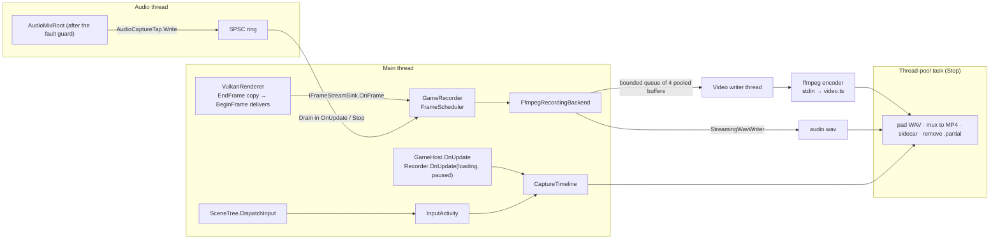

# Gameplay recording

## Purpose

Records a running game to an H.264 `.mp4` plus a `.mfcap.json` **sidecar** that says what the engine knew while it
recorded: when the player gave input, when the game was loading or paused, and what the game marked as worth keeping or
cutting. [Cutback](https://github.com/brogan89/Cutback) (and later the editor's Clips tab) reads the sidecar to
trim idle play, loading and pauses. Two modes:

- **Live** (`--record file.mp4`): real time. Frames are resampled to a constant rate, audio is tapped from the master
  mix, and the player keeps playing and hearing the game.
- **Offline** (`--record file.mp4 --fixed-fps 60`): every update is exactly one output frame, and the audio is rendered from the manual null
  audio device so that `round(n · sampleRate / fps)` samples exist through frame `n` (exact totals for any fps). A slow
  4K render therefore still plays back smoothly and in sync. The player hears nothing, by design.

The engine never links, bundles or P/Invokes an encoder: frames go to the stdin of the user's own **ffmpeg** run as a
child process (found by `FfmpegResolver`; without it `--record` fails with an install hint). Decision and rejected
alternatives: [ADR 0190](../../memory/decisions/0190-gameplay-recording-ffmpeg-child-process.md). The renderer half
(frame stream) is in [Vulkan renderer](vulkan-renderer.md) and the audio half (capture tap) in [Audio](audio.md#architecture);
this document does not repeat them.

Command line (documented in `GameHostOptions` and [Projects & GameHost](project-and-gamehost.md)):

| Flag | Effect |
|---|---|
| `--record <file.mp4>` | Record until quit or `Recorder.Stop()`. Implies frame capture. Offline when `--fixed-fps` is also given, else live. Rejected with `--headless` (exit code 2, like any invalid argument): `HeadlessHost` has no renderer to record. |
| `--record-scale <n>` | `EngineOptions.ContentScale`: pixels per point of the window size (a 1920×1080-point window at 2 is 3840×2160). Needs a display big enough for the scaled window, see [Known issues](#known-issues). |
| `--ffmpeg <path>` | The ffmpeg to use; else `MAINFRAME_FFMPEG`, then `PATH`, then common install folders. |

`--frame-capture` (no recording by itself) makes the swapchain readable so `Recorder.Start` works mid-session; the editor passes it
on every launch ([Recording from the editor](#recording-from-the-editor)).

Game code uses `SceneTree.Recorder` (`GameRecorder`; null under `--headless`): `Start(RecordingOptions)`, `Stop()`,
`Mark(label)`, `Keep(label)` / `Skip(label)` (scopes, `IDisposable`), `IsRecording`, `Elapsed`, and the `Started` /
`Stopped` events. `Mark`, `Keep` and `Skip` are no-ops when not recording, so games call them unconditionally. An offline
recording always runs at the host's `--fixed-fps` (one update is one output frame): a `RecordingOptions.Fps` that differs
is ignored with a warning. The dev
overlay is hidden when a recording starts (F12 brings it back, into the recording); a game that wants a clean feed hides
its own HUD on `Started` (the Forest's FPS readout does, and returns on `Stopped`).

## Key types

All internal except `GameRecorder`, `RecordingOptions`, `RecordingResult` and `FfmpegNotFoundException`.

| Type | File | Notes |
|---|---|---|
| `GameRecorder` (+ `CaptureInfoSource`) | [Recording/GameRecorder.cs](../../MainframeEngine/Src/Recording/GameRecorder.cs) | the state machine; `IFrameStreamSink`; owns the clock, the timeline and the audio path; finalises in the background |
| `RecordingOptions`, `RecordingResult` | [Recording/RecordingOptions.cs](../../MainframeEngine/Src/Recording/RecordingOptions.cs), [IRecordingBackend.cs](../../MainframeEngine/Src/Recording/IRecordingBackend.cs) | `sealed record`s with `required`/`init` properties: path + fps in; path, duration, dropped and duplicated frames and an error (null on success) out |
| `FrameScheduler` | [Recording/FrameScheduler.cs](../../MainframeEngine/Src/Recording/FrameScheduler.cs) | pure; how many times each rendered frame is written so the output is constant frame rate (live: `floor(t·fps) − written + 1` copies, 0 drops it; offline: one in, one out) |
| `SampleScheduler` | [Recording/SampleScheduler.cs](../../MainframeEngine/Src/Recording/SampleScheduler.cs) | pure; `round(n · sampleRate / fps)` samples through frame `n`, so the total never drifts for rates that do not divide |
| `CaptureTimeline` | [Recording/CaptureTimeline.cs](../../MainframeEngine/Src/Recording/CaptureTimeline.cs) | pure; builds the sidecar's spans from per-frame flags and events: input (250 ms tail, held controls keep it open, gaps under 100 ms rejoin), loading, paused, keep, skip, markers |
| `InputActivity` | [Recording/InputActivity.cs](../../MainframeEngine/Src/Recording/InputActivity.cs) | classifies input events (given their arrival time, for mouse motion) and tracks held controls; `Reset()` when the window loses focus |
| `CaptureSidecarWriter`, `CaptureInfo`, `CaptureSpans` | [Recording/CaptureSidecarWriter.cs](../../MainframeEngine/Src/Recording/CaptureSidecarWriter.cs) | the `.mfcap.json` writer (source-generated `System.Text.Json`); written through a temp file and a move |
| `IRecordingBackend`, `RecordingFormat` | [Recording/IRecordingBackend.cs](../../MainframeEngine/Src/Recording/IRecordingBackend.cs) | where frames and audio go, so the pacing logic never depends on a child process |
| `FfmpegRecordingBackend` | [Recording/FfmpegRecordingBackend.cs](../../MainframeEngine/Src/Recording/FfmpegRecordingBackend.cs) | the only backend: encoder child process + writer thread + WAV + mux + sidecar |
| `FfmpegResolver`, `EncoderSelector`, `FfmpegArgs`, `FfmpegProcess` | [Recording/](../../MainframeEngine/Src/Recording/) | ffmpeg lookup, hardware-first encoder choice, the command lines (argument lists, never a shell string), the process wrapper |
| `StreamingWavWriter` | [Recording/StreamingWavWriter.cs](../../MainframeEngine/Src/Recording/StreamingWavWriter.cs) | 32-bit float WAV written as the recording runs (`WavWriter` needs the whole buffer); padded or truncated to the exact length at `Finish` |
| `IFrameStreamSource`, `IFrameStreamSink` | [Rendering/IFrameStream.cs](../../MainframeEngine/Src/Rendering/IFrameStream.cs) | the renderer's presented-frame stream (implemented by `VulkanRenderer`) and the recorder's receiving end |
| `AudioCaptureTap` | [Audio/Graph/AudioCaptureTap.cs](../../MainframeEngine/Src/Audio/Graph/AudioCaptureTap.cs) | a copy of every master-mix block into a lock-free ring (live mode) |

## Architecture



- **Start.** `--record` starts on the **first update** (`GameHost.OnUpdate`, just before the session starts), so the time
  between creating the window and showing it stays out of the video, and the start scene's **loading is recorded**
  (as `loading` spans). Consequently an offline video is longer than `--max-frames`, which counts loaded frames only.
  `Start` resolves ffmpeg, picks and probes the encoder, creates `<out>.partial/`, starts the encoder and the writer
  thread, attaches the audio tap (live) and begins the frame stream. A recording that cannot start makes a `--record`
  run exit with an error rather than play unrecorded.
- **Clock.** Live: seconds of the monotonic `Stopwatch` clock (never game time) from an **origin anchored at the first
  captured frame**: half an output slot before it (`first − 0.5/fps`), but never before `Start`. A 60 Hz game recorded at
  60 fps then presents mid-slot, so a few ms of present jitter never makes a frame repeat or skip; anchored on `Start`
  instead, a first frame near a slot boundary turned every jittered frame into a coin toss between the two (in a test
  with ±3 ms jitter, 154 repeats and 152 skips in 600 frames, against none anchored). Video stamps, the audio lead and
  every timeline event use this origin; anything before it (or before the first frame, while it is unknown) is at 0.
  Offline: `frameIndex / fps` exactly. Every sidecar time is on this clock, which is the output video's timeline.
- **Video.** The renderer copies the presented swapchain image into one host-visible buffer per frame in flight (two).
  `BeginFrame` waits the slot's own fence before reusing it, which proves the copy finished, so the frame is read there:
  recording adds a copy, never a stall. `FrameScheduler` is asked before the copy is recorded, so a frame that would be
  dropped is never copied. The recorder copies the pixels into a pooled buffer and queues it (4 deep). Live and the
  queue is full: the frame is dropped and counted (`droppedFrames`), and the next frame written gets the missing
  copies, so length and sync hold and only smoothness suffers. Output frames written more than once (a slow frame, or
  the make-up copies after a drop) are counted: `Stop` logs the count and percentage and `RecordingResult.DuplicatedFrames`
  carries it (the sidecar format is unchanged). Offline: the game thread waits for room, which is
  harmless because game time does not move. If the swapchain changes **size** the stream ends and so does the
  recording ("window size changed"); a same-size recreation (VSync toggle) keeps it. Details:
  [Vulkan renderer](vulkan-renderer.md).
- **Odd dimensions.** yuv420p needs even sizes, so an odd width or height is cropped by one pixel in the encoder
  (`crop` at the head of the `-vf` chain); the sidecar's `width`/`height` are the swapchain's, the video's are the even ones.
- **Colour.** ffmpeg's implicit `bgra` → `yuv420p` conversion uses BT.601 and leaves the stream untagged, while players
  assume BT.709 for HD, so reds and greens would shift. The encoder converts explicitly
  (`scale=out_color_matrix=bt709:out_range=tv,setparams=color_primaries=bt709:color_trc=bt709`) and tags the output
  (`-colorspace bt709 -color_primaries bt709 -color_trc bt709 -color_range tv`); the tags survive the mux. `setparams` is
  needed because the filter graph's frame properties override the output options, and `scale` sets only the matrix and
  range. Verified with ffmpeg 9.0.2: a pure red frame decodes to Y 63, Cb 102, Cr 240 (BT.709 limited), not 81/90/240.
- **Live audio.** The tap sits after the mixer's fault guard, so it records exactly what the device plays (silence after
  a fault) and takes **whole blocks only**: a block that does not fit the ring (about 2.7 s of 48 kHz stereo) is
  dropped, counted in `OverflowSamples`, and the recorder writes that much silence so the length still matches. The
  first block's `Stopwatch` timestamp aligns the audio to the clock's origin: a later block is led by silence, an earlier
  one loses the samples mixed before the origin (overflow silence from before it is discarded too). Nothing is drained
  until the first frame has set the origin. The recorder requires a stereo mix. See [Audio](audio.md#architecture).
- **Offline audio.** The host starts the engine with `AudioDeviceMode.NullManual`; after each update the recorder
  calls `AudioServer.RenderNullDevice` for exactly the samples `SampleScheduler` says that frame owes. With no audio
  server the WAV is silence of the right length.
- **Input.** `SceneTree.DispatchInput` hands every event to the recorder before the UI can consume it (menus clicked
  while recording are still play). Keys, mouse and gamepad buttons, actions (`InputEventAction`, held by name), text,
  the wheel, mouse motion adding up to more than 2 px (summed across events, so a slow mouse-look of many 1 px moves
  counts, and forgotten after 100 ms without motion, so a lone twitch does not) and a stick or trigger beyond 0.25 count
  as input; so does any event type the
  recorder does not know, because a missed input cuts footage the player was acting in while a false positive only
  keeps a little idle time. A held control keeps a span open, so walking with W down is never idle.
  `InputActivity.Reset()` runs when the window loses focus, because a key released in another window never sends its
  key-up.
- **Loading and pause** are polled once per update (`SceneTree.IsLoading`, `SceneTree.Paused`) into spans.
- **Encoding.** `EncoderSelector` lists `ffmpeg -encoders` and takes the first candidate that passes a probe encode:
  macOS `h264_videotoolbox`; Windows `h264_nvenc`, `h264_qsv`, `h264_amf`, `h264_mf`; Linux `h264_nvenc`; then
  `libx264` (`-preset ultrafast -crf 14`) and `libopenh264` everywhere. Hardware encoders and `libopenh264` get a
  bitrate of `width · height · fps / 4` bits/s (about 31 Mbit/s at 1080p60); the GOP is one second (`-g fps`) so a
  trimming tool never moves a cut more than a second. The result is a high-quality intermediate, not a delivery file.
  The result is probed once per process and ffmpeg path and cached. The encoder is passed `-progress pipe:1`, whose
  output is drained but not parsed: the recording's health comes from failed pipe writes and the encoder's exit code,
  reported with the tail of its stderr.
- **Files.** While recording: `<out>.partial/video.ts` (MPEG-TS: it needs no trailer, so a crash leaves a playable file,
  and its 90 kHz timestamps hold 1/60 s exactly, where MKV's milliseconds made the MP4 60.03 fps) and
  `<out>.partial/audio.wav`. At `Stop` the WAV is **padded or truncated to the video's exact sample count**
  (`SampleScheduler.SamplesThrough(frames, sampleRate, fps)`) in both modes, then
  `ffmpeg -i video.ts -i audio.wav -map 0:v:0 -map 1:a:0 -c:v copy -c:a aac -b:a 192k -movflags +faststart <out>` muxes, the sidecar is
  written, and `.partial/` is deleted. On failure `.partial/` is kept and `RecordingResult.Error` names it.
  A recording that captured **zero frames is abandoned**: no mux and no sidecar (a sidecar with
  `durationSeconds` 0 is rejected by Cutback), `.partial/` is deleted (an empty video and a WAV header are not worth
  keeping), and `Error` says so.
- **Failure policy.** Nothing the recorder does may take the game down: a failing encoder, a full disk or a resize ends
  the recording with a readable `RecordingResult.Error`, never an exception from the renderer, the audio path or the
  update. Only `Start` throws. After a failure the next update (or the `Stop` in progress) ends the recording with the
  first reason. A **live** run logs the error and keeps playing; an **offline** `--record` run (a capture script or CI
  job whose whole purpose is the file) whose recording ends with an error exits **non-zero**
  (`GameHost.ShouldQuitOnRecordingError`).
- **Shutdown.** `GameHost.OnClose` stops the recording and waits up to two minutes for finalising, while the renderer
  and the audio server are still alive. If that times out, an offline `--record` run exits non-zero too.

### Threading

| Thread | What runs |
|---|---|
| Main | `GameRecorder` (start, stop, `OnUpdate`, `Mark`/`Keep`/`Skip`), the renderer's frame stream and its sink callbacks, `CaptureTimeline`, input observation, draining the audio tap, offline audio rendering, raising `Started`/`Stopped` |
| Audio | `AudioCaptureTap.Write` only: one `EnqueueBatch` into the ring (lock-free, allocation-free; the audio thread's guarantees in [Audio](audio.md) hold) |
| Video writer | `FfmpegRecordingBackend.WriteFrames`: takes frames off the bounded queue and writes them to the encoder's stdin; keeps draining (without writing) after a failure so a producer blocked on a full queue is released |
| Thread-pool task | Finalising after `Stop`: finish the encoder, pad the WAV, mux, sidecar, cleanup. `Stop` returns without waiting for the encode and mux (it flushes the frame stream, drains audio and, live, waits about 20 ms for the last audio block); the next update raises `Stopped` on the main thread. A new `Start` throws until then, because the previous recording still owns its files |

## Recording from the editor

The editor records a game it launched, over the [editor link](project-and-gamehost.md#editor-link) (protocol version 4),
so promo footage needs no command line. Three equal entry points, one command (`play.record`): **F10**, **Run › Play and
Record**, and the toolbar's record button (`#record`, the atlas's existing `point-filled` icon tinted red; highlighted red while
recording: dark red fill, red border, white icon; only while frames are being recorded, not while saving). F10 and not
Shift+F5, which is Run Another Instance. Its tooltip follows the state: "Play and Record (F10)" with nothing running,
"Start Recording (F10)" while a game runs, "Stop Recording (F10)" while recording, "Saving recording…" while saving.

| State | F10 does | Run menu label |
|---|---|---|
| No game runs | launches the main scene with `--record <path>`, so the file covers the game from its first frame | Play and Record |
| A game runs, not recording | sends `StartRecording <path>` to the first running (or paused) instance; with none connected yet it logs that the game is still starting | Start Recording |
| Recording | sends `StopRecording` to the instance that is recording | Stop Recording |
| Saving | nothing (the item is disabled) | Saving recording… |

- **Where.** `{project user data}/recordings/{scene}-{yyyyMMdd-HHmmss}.mp4`: the scene's file name (Play and Record: the
  project's main scene; Start Recording: the scene the game reports running; `game` when there is none, characters other
  than letters, digits, `-` and `_` become `_`), with `-2`, `-3`… added while the name is taken (`RecordingPaths`). The
  folder is created before the launch; failing to create it is a dialog, not a launch.
- **Run Another Instance never records.** Shift+F5 repeats the last launch without its `--record <path>` (the pair is
  dropped from the host flags before `++`), so a second game neither records nor writes to the first one's file.
- **Older games.** The hello's protocol version is kept on the instance (`PlayInstance.ProtocolVersion`); a game below
  protocol 4 cannot record from the editor (`PlayInstance.CanRecord`): `PlayService.StartRecording` refuses it, and Start
  Recording, or a Play and Record whose game connects with an older protocol, shows once "This game was built with an
  older MainframeEngine that cannot record from the editor. Rebuild it against this engine."
- **`--frame-capture` on every editor launch.** `PlayService` passes it, before `--editor-port`, on every play launch, so
  `StartRecording` works mid-session: the swapchain must be created with `TRANSFER_SRC` usage, which `--record` implies
  but a plain run does not. The cost is that one usage flag on the editor's games (the copy itself happens only while
  recording).
- **Messages** (protocol v4). Editor → game: `Command StartRecording` (argument: the `.mp4` path) and `Command
  StopRecording`. Game → editor: `Recording` with a state (`Started`, `Stopped`, `Failed`), the path, elapsed seconds,
  dropped and duplicated frames and an error string. `GameSession.AttachRecorder` (called by `GameHost` once the
  recorder exists, before a `--record` start) forwards `GameRecorder.Started` and `Stopped` as `Recording` events, so a
  `--record` launch reports too. `Started` carries `GameRecorder.OutputPath`; `Stopped` carries the result, and a
  `RecordingResult` with an error is sent as `Failed` with its message. A start that throws (no ffmpeg, bad path, already
  recording finalising) is also answered `Failed`, so the editor never waits for a `Started` that cannot come. A start
  that reaches a game **already recording** (a `--record` launch whose `Started` crossed the editor's F10) is answered
  `Started` with the running recording's path, and the editor keeps that recording's start time. A `--record` start that
  fails on the first update (no ffmpeg, say) is reported `Failed` through the session before the game quits with its
  error code (`GameSession.ReportRecordingFailed`); the session waits up to about 3 s for the link to connect so the
  report and the goodbye are not lost when the game quits before it has. Stopping a game that is recording finalises in
  `GameHost.OnClose` and sends `Stopped` before `Goodbye`.
- **Events are queued, never coalesced.** `EditorLinkClient.SendRecording` keeps up to 64 events (a status or tree
  snapshot replaces its predecessor; a `Stopped` must not), and they are written out ahead of the goodbye.
- **Editor state** (`PlayInstance.Recording`: `None`, `Recording`, `Saving`). `Started` sets `Recording`; pressing Stop
  Recording, or stopping the game (F8), sets `Saving` at once; `Stopped`/`Failed` return to `None` and raise
  `PlayService.RecordingFinished`. The editor fails
  a recording itself **only when the game's link is gone** (a `Disconnected`, or a process exit with no link): then
  `RecordingFinished` gets a `Failed` event, "The game exited before the recording was saved.", so it never waits for a
  save that cannot come. It never fails one ahead of the game's own last report: an exit with the link still up waits for
  the `Stopped` or `Failed` and the `Disconnected` that follows, even when the exited instance was cleared from the
  toolbar meanwhile (a recording instance stays reachable by its connection until the `Disconnected`). The toolbar shows
  a red dot (`#rec-dot`, the `point-filled` icon: the UI font, LatoLatin, has no ● glyph) and `REC m:ss` (refreshed once
  a second), then `Saving recording…`.
- **Stopping a recording game waits for the save.** A stopped game is normally killed if it is still alive 3 s later
  (`PlayService.StopTimeout`); killing takes its whole process tree, ffmpeg's mux included, so a game that is recording or
  saving gets `PlayService.RecordingStopTimeout` (2 min 15 s: the game's own two-minute `StopAndWait` cap at quit plus a
  margin) and shows `Saving recording…` meanwhile. Quitting the editor does the same: games that are not recording get
  a second, recording ones up to that cap, and the wait is logged every few seconds.
- **Debounce.** `ToggleRecording` sends one `StartRecording` and ignores further presses until `Started` or `Failed`
  returns (a 5 s backstop, so a game that never answers cannot wedge F10), and while a recording is saving. The recording
  controls stay available while a game runs during a build (Start/Stop apply to the running game); with nothing running,
  Play and Record needs the project to be a desktop project and no build to be running.
- **When it finishes** (`RecordingNotifier`). A modal `MessageDialog` (the editor has no toast system), one per finished
  recording, queued by the dialog if several finish together. Saved: title "Recording saved", the file name with its
  length and the folder, buttons **Open in Cutback** (default), **Show in Folder**, **Close**. Failed: "Recording
  failed" with the recorder's message, plus **Show in Folder** (the kept `.partial` folder) when the message names one
  or the folder exists (a game that exited mid-recording reports nothing, but leaves it). Long paths wrap in the dialog.
- **Open in Cutback** starts [Cutback](https://github.com/brogan89/Cutback) as a **separate process** with the
  recording's path as its argument (it opens the first command-line argument that is an existing file, and finds the sidecar next to it); the
  editor never links it (Cutback is GPL) and does not wait for it. `CutbackLocator` looks, in order, at **Editor
  Settings › Cutback** (`EditorSettings.CutbackPath`), each `PATH` folder (`cutback`/`Cutback`, `Cutback.exe` on
  Windows), then the OS location: `/Applications/Cutback.app/Contents/MacOS/Cutback`,
  `%LocalAppData%\Programs\Cutback\Cutback.exe`, `~/.local/bin/cutback`. On macOS the setting may also name the `.app`
  bundle itself. A setting that points at a missing file falls through to the rest. On macOS any bundle path (`X.app` or
  `X.app/Contents/MacOS/*`) is started with `open -a X.app --args <file>` (`CutbackLocator.LaunchCommand`), so Launch
  Services activates Cutback in front and it is not in the editor's process tree. If none exists (or the launch fails) a second dialog, "Cutback is not installed", offers
  **Download** (the releases page) and Close.
- **QA.** `Tests/QA/record.qa` (`just qa-editor Tests/QA/record.qa`) drives both start paths and a Stop (F8) while
  recording, and captures the dialogs; it needs a display and ffmpeg and is not run in CI.

## Sidecar format

`<video file name>.mfcap.json`, next to the video (`forest-20261012-143005.mp4.mfcap.json`). It is written atomically
(temp file and rename) after the mux succeeds. All times are seconds on the output video's timeline.

```jsonc
{
  "format": "mainframe-capture",
  "version": 1,
  "video": "forest-20261012-143005.mp4",   // file name, relative to the sidecar
  "engineVersion": "0.42.0",
  "game": "Forest",
  "scene": "res://Scenes/Forest.scn",
  "mode": "live",                          // "live" | "offline"
  "frameRate": 60,
  "width": 1920,
  "height": 1080,
  "durationSeconds": 60.0,
  "droppedFrames": 0,
  "input":   [ { "start": 0.0,  "end": 8.0 } ],
  "loading": [ { "start": 14.5, "end": 19.0 } ],
  "paused":  [ { "start": 56.0, "end": 60.0 } ],
  "keep":    [ { "start": 32.0, "end": 35.0, "label": "cutscene" } ],
  "skip":    [ ],
  "markers": [ { "time": 26.0, "label": "boss intro" } ]
}
```

Rules:

- Every list is sorted by start (markers by time). `input`, `loading` and `paused` spans never overlap within their
  list; `keep` and `skip` spans may (scopes can nest or interleave). Lists may overlap each other.
- Unknown fields are ignored. A higher `version` is a new contract, and readers refuse it with a clear message.
- The engine owns the format. The canonical example is
  `Tests/MainframeEngine.Tests/Recording/Fixtures/sample.mfcap.json`, and it **must stay byte-identical** to the copy in
  Cutback's tests. Both test suites parse it, so drift fails CI on both sides. Change the format only by changing both.

## Performance

- Streaming adds one GPU copy of the presented image per recorded frame and no fence stall: two readback buffers (one per
  frame in flight), each read after the fence wait `BeginFrame` already does. Frames the scheduler would drop are
  never copied.
- On the CPU each recorded frame is one copy into a pooled (`ArrayPool`) buffer; the encoder pipe is written from the
  video writer thread, so a slow encoder shows up as dropped frames (live) or a waiting game thread (offline), not as
  an unbounded queue (the queue holds 4 frames).
- The audio callback stays lock-free and allocation-free; a full ring drops whole blocks and counts them.
- Verified on a Mac (`build/forest-record.sh`, `h264_videotoolbox`): an offline Forest flyover at 1920×1080 wrote
  4039 frames (7.317 s of loading plus exactly 60.000 s), audio 67.316667 s, equal to frames / 60; a live autowalk
  of 22.2 s dropped 2 frames; both sidecars were valid. The script needs ffmpeg and ffprobe on `PATH`, an awake display
  and the LFS art, so it runs locally, not in CI.
- The intermediate and colour arguments were checked by hand with ffmpeg 9.0.2 (h264_videotoolbox and libx264): 3600
  frames at 60 fps mux to an MP4 with `avg_frame_rate=60/1` and `duration=60.000000` through MPEG-TS (through MKV:
  `3600000/59999`, 59.999 s), tagged `bt709`/`bt709`/`bt709`/`tv` after the mux.
- The tests under `Tests/MainframeEngine.Tests/Recording/` never run ffmpeg: schedulers, timeline, argument builders, the
  WAV writer, the sidecar against the fixture, the audio tap and `GameRecorder` itself.

## Known issues

- **`--record-scale` is display-limited.** A fixed content scale needs a window of `WindowSize × scale` pixels, and the
  engine refuses to start when the display cannot hold it: a 1920×1080-point window at scale 2 fails on a smaller display.
  4K offline capture is therefore display-dependent (verified on the development Mac); `ContentScale` does not give
  4K on any display.
- **Any window resize ends a recording** ("window size changed"; the footage so far is kept). A game that resizes
  after startup, such as the Forest's `--resolution` dev flag, ends a `--record` run, and `build/forest-record.sh`
  avoids it.
- **Live audio runs on the device clock**, video on the monotonic clock. Drift is not corrected (the length is fixed to
  the video's at `Stop`).
- After a long stall (longer than the ring, about 2.7 s), the overflow silence is written after the audio that was
  drained, so a few milliseconds of sound can land early; the total length stays exact.
- A synchronous start-scene load (`--sync-load`, or `loading.async` false) blocks the first update, before the first
  frame is captured, so it is **not in the video** in either mode (the live origin is anchored at that frame; offline,
  that frame is frame 0). `GameHost` still opens a `loading` span just before it, which is empty and dropped.
- The first recording in a process **probes the encoders**, up to about 1 s on the game thread, and the probes have no
  timeout.
- The WAV header's sizes are unsigned 32-bit, exact up to 4 GiB of data (about 3.1 hours of 48 kHz stereo float). Past
  that both are written as `0xFFFFFFFF` ("unknown length"), which ffmpeg reads to the end of the file, so the mux keeps
  all of the audio; other tools may not accept such a WAV, but it never leaves `.partial/` on success.
- `StartRecording` mid-session needs the game launched with `--frame-capture` (the swapchain needs `TRANSFER_SRC`). The
  editor always passes it (see [Recording from the editor](#recording-from-the-editor)); a game started by hand without
  it answers `Failed` to the editor's start.
- Recording requires a stereo audio mix; a device that mixes other channel counts ends a live recording with an error.

## Related docs

[Vulkan renderer](vulkan-renderer.md) (frame stream) · [Audio](audio.md) (capture tap) ·
[Projects & GameHost](project-and-gamehost.md) (host flags) · [Engine lifecycle](engine-lifecycle.md) ·
[Testing](testing.md) · [ADR 0190](../../memory/decisions/0190-gameplay-recording-ffmpeg-child-process.md)
