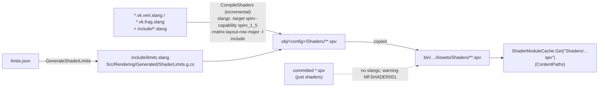

# Shaders

## Purpose

Inventory of every shader in [`MainframeEngine/Assets/Shaders`](../../MainframeEngine/Assets/Shaders),
which C# class loads it, its interface (inputs, sets, bindings, push constants), and how shaders are
built, shared and kept in sync with C#. Shaders are written in **Slang** ([ADR 0144](../../memory/decisions/0144-slang-shader-language.md));
the rules for writing them are under [Writing shaders](#writing-shaders).

## Workflow

Shaders compile as part of `dotnet build` ([ADR 0007](../../memory/decisions/0007-build-time-shaders-and-shared-limits.md)).



- One stage per file: `X.vk.vert.slang` / `X.vk.frag.slang` / `X.vk.comp.slang`, entry point `main`
  (`[shader("vertex")]` etc.), compiled to `X.vk.vert.spv` and so on — the names C# loads. The stage comes from the
  file name. The targets live in [`build/Shaders.targets`](../../build/Shaders.targets), imported by
  `MainframeEngine.csproj`.
- `slangc` is `$(Slangc)`, else `$(VULKAN_SDK)/bin/slangc` (the LunarG Vulkan SDK ships it next to the validation
  layers), else `slangc` on `PATH`. Without it the build warns and copies the committed `.spv` files;
  `-p:CompileShaders=false` forces that (CI does: its build runners have no slangc and build with `-warnaserror`).
  CI's shaders job installs Slang **v2026.1** from its GitHub release (pinned by SHA-256). An older `slangc` (below
  `SlangMinimumVersion`, 2026.1) is treated like a missing one: warning `MFSHADER001` and the committed `.spv`.
  `shaders.lock` records the `slangc` that built the committed `.spv` (`# slangc …`); `just shaders` with a different one
  says so, since the bytes may change (CI checks the lock against the sources, not the bytes). Slang is a build tool
  only: nothing of it ships.
- Shader sources, includes and `shaders.lock` are not copied to the output; only `.spv` files are.
- **After editing a shader** run `just shaders` (recompiles the committed `.spv` with the same flags
  and rewrites `shaders.lock`) and commit the `.spv` files with the lock. `just shaders-check` (and CI)
  fail when a source, an include or a `.spv` no longer matches the lock.
- C# loads modules through `IVulkanContext.Shaders` (`ShaderModuleCache`): one module per file, shared
  by every pipeline. Pipelines go through `IVulkanContext.Pipelines` (the persisted pipeline cache).

## Shared includes

`#include "x.slang"` (resolved through `-I include`; every include has `#pragma once`). The includes are textual
headers, not Slang modules, because they are configured by macros defined before including them (`MATERIAL_SET`,
`LIGHTS_SET`, `SHADOW_SET`, `CANVAS_LIGHT_SET`).

| Include | Contents | Override macros |
|---|---|---|
| `limits.slang` | **Generated** from `limits.json` — `MAX_DIR_LIGHTS`, `MAX_POINT_LIGHTS`, `MAX_SPOT_LIGHTS`, `MAX_SHADOW_DIR/SPOT/POINT`, `MAX_SHADOW_CASCADES`, `MAX_SHADOW_ATLAS_MAPS` | — |
| `common.slang` | `PI`, `srgbToLinear`, `linearToSrgb`, `glsl_mod`, `textureSize2D`; includes `limits.slang` | — |
| `frame.slang` | Set 0 binding 0 `FrameData` (camera, viewport, near/far, time, exposure), `linearizeDepth` | — |
| `shadows.slang` | Shadow set (`ShadowUBO`, cascade array, atlas, point cubes; all comparison samplers), receiver bias, PCF kernels, `dirShadow/spotShadow/pointShadow`, `shadowCascadeTint` (includes `frame.slang`) | `SHADOW_SET` (default 1) |
| `lights.slang` | Lights UBO, Blinn-Phong per light, `shadeLightsBlinnPhong(base, N, Ngeo, worldPos, specular, shininess)` (`Ngeo`: geometric normal for the shadow normal offset) and `shadeLights` (0.3, 32); `counts.w = 1` skips shadow maps (offscreen views) (needs `shadows.slang` first) | `LIGHTS_SET`/`LIGHTS_BINDING` (default 0/1) |
| `material.slang` | `StandardMaterial3D` set 2 (`MATERIAL_SET`; the cutout shadow casters use 1) (parameters UBO, one sampler, albedo/normal/emission images), `materialUv/Albedo/Emission`, `materialNormal` (derivative tangent frame) | — |
| `sky.slang` | Sky push constants (`SkyParams`), `skyRay(ndc)` | — |
| `spatial.slang` | The helpers of the entries generated around spatial surface shaders (ADR 0205): `spatial_normal_matrix`, `spatial_inv_view`, `spatial_normal_map` (no descriptors, so the casters include it too) | — |

The surface-shader modules (ADR 0237) are real Slang modules under `include/mainframe/`, imported with `import`, never
included:

| Module | Contents |
|---|---|
| `mainframe/spatial.slang`, `mainframe/canvas.slang` | What a game shader imports (`import mainframe.spatial;` / `import mainframe.canvas;`): the render-mode attributes and their enums, and it re-exports the three below |
| `mainframe/material.slang` | The parameter attributes (`[color]`, `[range]`, `[filter]`, `[repeat]`, `[defaultTexture]`, `[group]`) and their enums |
| `mainframe/math.slang` | PI, TAU, E and GLSL's `mod` |
| `mainframe/surface/spatial.slang`, `mainframe/surface/canvas.slang` | The built-in structs (`SurfaceVertex`, `SurfaceFragment`, `CanvasVertex`, `CanvasFragment`). The generated entries import only these, since they include `common.slang`'s own PI |

## Descriptor frequency model

| Set | Frequency | Contents | Owner |
|---|---|---|---|
| 0 | per frame | b0 `FrameData` (368 B), b1 lights UBO (1200 B) | `FrameContext` (`IVulkanContext.Frame`) |
| 1 | per frame | shadows (`shadows.slang`) | `ShadowSystem` or the renderer's fallback |
| 2 | per material | `StandardMaterial3D` (`material.slang`); other drawers' textures (sky, Spine) | `MaterialGpu`, the drawer |
| binding 1 (vertex input) | per instance | mesh instances: model matrix + object id (`MeshInstanceData`) | `MeshRenderer` instance buffer |
| push | per draw | 128-byte vertex+fragment range: model matrix (+ extras) for non-batched drawers | the drawer |

`FrameContext.Begin(camera, lights)` writes set 0 once per frame; renderer-owned drawers (sky, grid,
Spine) call `EnsureCamera`/`EnsureLights` with the camera they were given, which write only if nothing
has this frame. Pipeline layouts made with `FrameContext.CreatePipelineLayout` share set 0 (and set 1
when they take shadows) and the push range, so they are compatible. Every frame *view* (main view, offscreen
`SubViewport`s) has its own set 0 copy (`FrameContext.SetView`). Meshes follow the model through the
[mesh renderer](materials-and-meshes.md#descriptor-sets).

## In use

Each row's source is the name plus `.slang` (`Mesh/Mesh.vk.vert.slang` → `Mesh/Mesh.vk.vert.spv`).

| Shader | Loaded by | Inputs | Sets / bindings | Push constants |
|---|---|---|---|---|
| `Mesh/Mesh.vk.vert` | `MeshRenderer` (lit pipelines) | 0 `vec3 pos`, 1 `vec3 normal`, 2 `vec2 uv`; instance 3–6 model rows | s0 frame | — |
| `Mesh/MeshId.vk.vert` | `MeshRenderer` (`MeshObjectId`) | 0 pos, 2 uv; instance 3–6 model rows, 7 `uint objectId` (outputs uv + id only) | s0 frame | — |
| `Mesh/Mesh.vk.frag` | `MeshRenderer` (`MeshLit`) | world pos, normal, uv | s0 frame + lights · s1 shadows · s2 material | — ; specialization 0 `kAlphaMode` |
| `Mesh/MeshId.vk.frag` | `MeshRenderer` (`MeshObjectId`) | uv, id | s2 material (cutout) | — ; specialization 0 `kAlphaMode`; writes `uint` |
| `Mesh/MeshOutline.vk.vert` | `MeshRenderer` (`MeshOutline`) | same as `Mesh.vk.vert` | s0 frame · s2 b0 material (`flags.w` = outline width bits; the binding is visible to the vertex stage) | — |
| `Shadows/Shadow2DInstanced.vk.vert`, `ShadowPointInstanced.vk.vert` | `ShadowSystem` (instanced casters) | 0 `vec3`; instance 1–4 model rows | s0 b0 `LightVP` (dynamic offset) | point: `lightPosRange` at offset 64 |
| `Spine/SpineLit.vk.vert` | `SpineRenderer` | 0 `vec3`, 1 `vec2`, 2 `vec4` | s0 frame | `mat4 model; vec4 worldNormal` |
| `Spine/SpineLit.vk.frag` | same | uv, tint, world pos, normal | s0 frame + lights · s1 shadows · s2 b0 `Sampler2D` | — ; specialization 0 `kPremultipliedTexture` |
| `Shadows/Shadow2D.vk.vert/.frag` | `ShadowSystem` | 0 `vec3` | s0 b0 `LightVP{mat4}` (dynamic offset) | `mat4 model` (64 B). The frag shader is empty (depth only). |
| `Shadows/ShadowPoint.vk.vert/.frag` | `ShadowSystem` | 0 `vec3` | s0 b0 `LightVP{mat4}` (dynamic offset) | `mat4 model; vec4 lightPosRange` (80 B). The frag shader writes linear depth (`SV_Depth`). |
| `Sky/Sky.vk.vert` | `SkyEnvironment` | `SV_VulkanVertexID` | — | — |
| `Sky/Sky.Procedural.vk.frag` | same | NDC xy | s0 frame | `SkyParams` (96 B) |
| `Sky/Sky.Panoramic.vk.frag` | same | NDC xy | s0 frame, s1 b0 `Sampler2D` (sRGB) | `SkyParams` |
| `Sky/Sky.Cubemap.vk.frag` | same | NDC xy | s0 frame, s1 b0 `SamplerCube` (sRGB) | `SkyParams` |
| `SceneGrid/SceneGrid.vk.vert/.frag` | `SceneGrid` | 0 `vec3`, 1 `vec4`, 2 `vec3` (other end of the line; the vertex shader clips the line) | s0 frame | — |
| `SceneGrid/GridAnalytic.vk.vert/.frag` | `SceneGridAnalytic` ([Scene grid](scene-grid.md#analytic-style)) | none (6 vertices from `SV_VulkanVertexID`) | s0 frame | `vec4 params` (pixel scale, plane height, cell); specialization 0 `kDisplayOutput` |
| `Gizmos/Gizmo.vk.vert/.frag` | `GizmoRenderer` ([Gizmos](gizmos.md)) | 0 `vec3`, 1 `vec3` (other end), 2 `vec4` (sRGB), 3 `vec2` UV, 4 `vec2` (side, width px) | s0 frame, s1 atlas | specialization 0 `kDisplayOutput` |
| `Post/Fullscreen.vk.vert` | tonemap pass | `SV_VulkanVertexID` | — | — |
| `Post/Tonemap.vk.frag` | `VulkanRenderer` | `SV_Position` | s0 b0 `Sampler2D` HDR scene | `float exposure; uint encodeSrgb` (8 B) |
| `Post/TonemapPost.vk.frag` | `VulkanRenderer` (non-default `PostProcessSettings`, ADR 0124) | `SV_Position` | s0 b0 `Sampler2D` HDR scene, b1 `sampler2D[7]` glow levels | exposure, encodeSrgb, tonemapper, glow mode/enabled/intensity, white, whiteTonemapped, 7 weights (60 B) |
| `Post/GlowBlur.vk.frag` | `GlowEffect` (ADR 0124) | `SV_Position` | s0 b0 `Sampler2D` source (scene, temp or previous level) | dstSize, flags (horizontal, first), strength, exposure, threshold, scale, bloom, luminanceCap (36 B) |
| `Gizmos/ScreenGizmo.vk.vert/.frag` | `ScreenGizmosRenderer` ([Developer overlay](dev-overlay.md#screen-gizmos)) | 0 `vec2` (pixels), 1 `vec4` (sRGB, straight alpha) | — | `vec2 scale; vec2 translate`; specialization 0 `kLinearizeColors` |

The legacy OpenGL shaders and the unused `Quad.vk.*`/`Spine.vk.*` were deleted in M3, and `Shapes/Shapes.vk.*`
with `ShapeBase` (replaced by the mesh shaders).

## Writing shaders

Slang is HLSL-like. These rules keep the shaders matching the C# side (they were checked against the former GLSL
shaders' SPIR-V when the engine moved to Slang):

- **Matrices are the C# values.** Every shader compiles with `-matrix-layout-row-major`, so a `float4x4` in a buffer
  or push constant holds exactly the bytes of the uploaded `System.Numerics.Matrix4x4`, and **`mul(v, M)`** transforms
  like `Vector4.Transform(v, M)`. Chain transforms left to right: world → clip is
  `mul(mul(float4(p, 1.0), model), frame.viewProjection)`. A matrix built in a shader lists the four C# rows:
  `float4x4(inModel0, inModel1, inModel2, inModel3)`; `m[i]` is row `i`; `(float3x3)m` is the upper 3×3.
- **Built-ins:** `SV_VulkanVertexID` / `SV_VulkanInstanceID` (not `SV_VertexID` / `SV_InstanceID`, which subtract the
  base vertex/instance), `SV_Position` (also the fragment coordinate), `SV_Depth`, `SV_IsFrontFace`, `SV_Target0`.
- **Interfaces:** stage inputs and outputs carry `[[vk::location(n)]]`; integer varyings are `nointerpolation`.
  Resources carry `[[vk::binding(binding, set)]]`; push constants are a `[[vk::push_constant]] ConstantBuffer<T>`
  (`[[vk::offset(n)]]` on a member reproduces a range that starts past 0); specialization constants are
  `[vk::constant_id(n)] const T k = default;`. Uniform buffers are std140 and push constants std430 by default.
- **Textures:** combined `Sampler2D`/`SamplerCube`/`Sampler2DShadow`/`Sampler2DArrayShadow`/`SamplerCubeShadow` with
  `Sample`, `SampleLevel`, `SampleGrad`, `SampleCmp` (implicit LOD) and `Load`; separate `Texture2D` + `SamplerState`
  for the material set.
- **Maths:** `lerp`, `frac`, `atan2(y, x)`, `rsqrt`, `ddx`/`ddy`; `glsl_mod` (from `common.slang`) for GLSL's `mod` —
  never `fmod`, which rounds towards zero.
- **A stage writes only what the next one reads.** Slang drops every unread stage input from the SPIR-V (no option
  keeps them), and the validation layer warns about a vertex output no fragment input reads, and about a vertex
  attribute the vertex shader does not read. So a vertex shader shared by several fragment shaders outputs only what
  they all read (`Post/Fullscreen.vk.vert` outputs nothing but the position), the object-ID pass has its own
  `Mesh/MeshId.vk.vert`, and each mesh pipeline passes only the attributes its vertex shader reads
  (`VertexLayouts.MeshAttributes` / `MeshIdAttributes`). Unused *resources* are dropped too; that needs nothing (the
  pipeline layouts come from C#).
- **No Metal keywords as names** (`vertex`, `fragment`, `kernel`, `constant`, `device`, …): Slang keeps local names in
  the SPIR-V, and MoltenVK's SPIRV-Cross passes them into the Metal source, which then fails to compile.
- Game shaders are surface shaders in plain Slang ([Surface shaders](#surface-shaders) below): the engine generates their
  passes, so the rules above are its job, not the game's.

## Surface shaders

Game shaders are **Slang surface shaders** ([ADR 0237](../../memory/decisions/0237-slang-surface-shaders.md)): `.slang` files
under a project's `Assets/` whose first statement is `import mainframe.spatial;` (3D meshes, as a `ShaderMaterial`: on a
`MeshInstance3D` or `MultiMeshInstance3D`, as a surface material, `MaterialOverride`, `MaterialOverlay` or `NextPass`; ADR
0205) or `import mainframe.canvas;` (canvas items, [Canvas shaders](canvas.md#canvas-shaders); ADR 0113). The game writes
a material, the values its stages share and up to two functions against built-in structs; the engine generates every pass
around them and owns their descriptor sets, vertex inputs and stage interfaces. Any other `.slang` file under `Assets/` is
a helper module shaders can `import` (start it with `module name;`), never a `Shader` resource. Before ADR 0237 game
shaders were Godot's shading language (`.mfshader`, `.gdshader`); such files now fail to load with an error that points at
[Porting from Godot](#porting-from-godot).

```slang
import mainframe.spatial;

[cull(Cull.Disabled), specular(Specular.BlinnPhong)]
struct Material
{
    [color] float3 stalk_color = float3(0.85, 0.80, 0.70);
    float sway = 0.45;
    float speed = 1.3;
};

struct Varyings
{
    float3 tint;
};

void vertex(inout SurfaceVertex v, Material m, out Varyings o)
{
    float3 world = mul(float4(v.vertex, 1.0), v.modelMatrix).xyz; // the C# matrices: mul(v, M)
    float bend = (1.0 - v.uv.y) * (1.0 - v.uv.y);
    v.vertex.x += sin(v.time * m.speed + v.instanceCustom.x * TAU + world.x * 0.4) * m.sway * bend;
    o.tint = v.instanceCustom.yzw;
}

void fragment(inout SurfaceFragment s, Material m, Varyings i)
{
    s.albedo = lerp(m.stalk_color, i.tint, smoothstep(0.25, 0.15, s.uv.y));
    s.roughness = 0.6;
}
```

### The contract

| Piece | Rule |
|---|---|
| `import mainframe.spatial;` / `import mainframe.canvas;` | The first statement (after comments): the file is a shader, and of that kind |
| `struct Material` | Optional. Its fields are the material parameters, its attributes the render modes ([below](#material-parameters)) |
| `struct Varyings` | Optional. What `vertex` passes to `fragment`; integer fields are flat, others take `nointerpolation` to be |
| `void vertex(inout SurfaceVertex v[, Material m][, out Varyings o])` | Optional; the material and varyings in either order. Without it the mesh's own vertices draw |
| `void fragment(inout SurfaceFragment s[, Material m][, Varyings i])` | Optional. Without it the surface is white (canvas: the vertex colour × the texture) |
| Canvas | `CanvasVertex` / `CanvasFragment`, the same optional parameters |
| Anything else | Helper functions, `static const`s, structs, `import`s of the project's modules (next to the shader or below it). A global shader parameter (`uniform float x;`, a global `Sampler2D`) is a build error: parameters go in `Material` |

mf-shaders reads only the first statement, which optional parameters each function declares, the literal defaults and
whether the code names `normalMap`, `lightVertex`, `alpha` or `alphaScissorThreshold`; slangc checks everything else.
Names starting with `mf_`, `main` and the engine includes' globals (`frame`, `lights`, `shadeLightsPbr`, …) are reserved:
the generated entry imports the shader as a module beside them.

**Built-ins** are camelCase struct fields with the meanings and spaces Godot's built-ins have. `SurfaceVertex` (model space;
world space with `[worldVertexCoords]`): `vertex` and `normal` (write them to displace, in every pass), `uv`, `uv2` (= `uv`:
meshes have one UV set), `color` (white without vertex colours), `custom0` (`custom1`–`3` are zero), `instanceId` and
`instanceCustom` (a `MultiMesh`'s index and custom data, zero otherwise), `vertexId`, `modelMatrix`, `modelNormalMatrix`
(normals: `mul(n, modelNormalMatrix)`), `modelViewMatrix`, `modelViewNormalMatrix`, `viewMatrix`, `invViewMatrix`,
`mainCamInvViewMatrix`, `projectionMatrix`, `invProjectionMatrix`, `nodePositionWorld`, `nodePositionView`,
`cameraPositionWorld`, `cameraDirectionWorld`, `viewportSize`, `time`. `SurfaceFragment` (view space): `vertex`, `normal`
(written back, it shades), `view`, `uv`, `uv2`, `color`, `fragCoord`, `frontFacing`, `screenUv`, the same matrices and
camera values, `time`, and the outputs `albedo` (1), `alpha` (1), `alphaScissorThreshold` (0), `metallic` (0), `roughness`
(1), `specular` (0.5, Blinn-Phong only), `ao` (1), `emission` (0), `normalMap` + `normalMapDepth` (a tangent frame from
screen derivatives, as `material.slang`; the colour pass applies them only when the code names `normalMap`) and
`lightVertex` (the position lights are computed at; used only when the code names it). Matrices are the C# values:
`mul(v, M)`, `m[3].xyz` the translation. In the shadow passes "view space" is world space (`viewMatrix` = identity), so
`mul(float4(s.vertex, 1.0), s.invViewMatrix)` is still the world position. Godot built-ins the engine ignored (rim,
clearcoat, anisotropy, SSS, backlight, fog, radiance, irradiance, tangents, point size) are not declared, so using one is a
compile error. `mainframe.math` adds PI, TAU, E and GLSL's `mod` (Slang's `fmod` rounds towards zero).

### Material parameters

`struct Material`'s fields are the parameters, read from slangc's `-reflection-json`: one std140 block at binding 0 of the
material set (set 2; set 1 in the shadow casters; canvas: set 1) in declaration order, then the textures at bindings 1….
A material of textures only is declared at binding 1, so its textures still start there (slangc drops the empty block).
Types: `bool`, `int`, `uint`, `float`, `floatN`, `intN`/`uintN`, `float2x2`/`3x3`/`4x4`, 1-D arrays of those, and
`Sampler2D` (up to **4** in a spatial shader: the mesh fragment stage already binds 12 of MoltenVK's 16 samplers). Anything
else is a build error naming `Material.<field>`. Values come from `ShaderMaterial.SetShaderParameter` or a `.mres`
(`ShaderParameters`); the mesh side is in [Materials & meshes](materials-and-meshes.md#shadermaterial-spatial-shaders-adr-0205).

| Attribute | Meaning |
|---|---|
| `[color]` | A vector authored in sRGB: converted to linear for spatial shaders, kept as written for canvas ones (Godot's non-HDR canvas); on a texture, sampled as sRGB |
| `[range(a, b)]` | The range an editor offers (stored nowhere yet) |
| `[filter(Filter.Nearest)]`, `Filter.Linear` | A texture's filter over the texture's own sampling |
| `[repeat(Repeat.Enabled)]`, `Repeat.Disabled` | A texture's repeat |
| `[defaultTexture(DefaultTexture.Black)]`, `.Transparent`, `.Normal` | What an unset texture samples (white without it; `Normal` is linear data) |
| `[group("Wind")]` | An inspector group (stored nowhere yet) |

**Defaults are literal initializers**: `float sway = 0.45;`, `float4 tint = float4(0.4, 0.8, 0.3, 1.0);` (one value
broadcasts), `bool on = true;`. mf-shaders reads them from the text and checks their count against the reflected type;
anything computed (`0.5 * 2.0`, `PI`) is a build error, as are array defaults for now. Slang's reflection reports no
initializers (its C API, scalars only), so this is the one place mf-shaders reads values from the source.

### Render modes

Attributes on `struct Material` (an empty `struct Material {}` carries them for a shader without parameters), typed by the
module's enums, so slangc rejects a typo at its line (`'Disabld' is not a member of 'typeof(Cull)'`):

| Attribute | Spatial |
|---|---|
| `[blend(Blend.Mix)]`, `Blend.Add`, `Blend.PremulAlpha` | Any but Mix blends the surface |
| `[alpha(Alpha.Opaque)]`, `Alpha.Cutout`, `Alpha.Blend` | Opaque without it. Cutout discards below `alphaScissorThreshold` and casts cut shadows; Blend blends back to front, without shadows. A non-Mix blend implies Blend. mf-shaders warns when the code writes `alpha` on an opaque material, or names `alphaScissorThreshold` without Cutout |
| `[cull(Cull.Back)]`, `Cull.Front`, `Cull.Disabled` | Disabled lights back faces with the flipped normal |
| `[depthDraw(DepthDraw.Opaque)]`, `.Always`, `.Never` | Which surfaces write depth |
| `[noDepthTest]`, `[unshaded]`, `[worldVertexCoords]`, `[noFog]` | No depth test; albedo + emission, no lights; `vertex` in world space; no fog |
| `[specular(Specular.Pbr)]`, `Specular.BlinnPhong` | The engine's PBR (the default), or its Blinn-Phong (shininess from roughness, strength from specular) |

Canvas shaders take `[blend(Blend.Mix|Add|Sub|Mul|PremulAlpha|Disabled)]`, `[unshaded]` and `[lightOnly]`.

### Passes

Each spatial shader is compiled for five passes, a vertex and a fragment stage each, and every pass runs the shader's
`vertex` and `fragment`, so displacement, `discard` and the alpha cut agree everywhere:

| Pass | SPIR-V (`x.slang` + …) | Set 0 / the material set | What it writes |
|---|---|---|---|
| Colour | `.vert.spv`, `.frag.spv` | the frame, lights, sky lighting, SSAO / set 2 | the surface lit by the engine (or `[unshaded]`) + emission, fogged |
| Depth prepass (ADR 0163) | `.depth.vert.spv`, `.depth.frag.spv` | the frame / set 2 | depth and the velocity: `vertex` runs for this frame and for the last (last frame's model matrix and `time`) |
| Directional/spot shadows | `.shadow.*` | the light matrix / set 1 | depth (`time` and the camera from the casters' push block; in `fragment` through a flat varying) |
| Point shadows | `.shadow-point.*` | the light matrix / set 1 | the linear distance to the light (`SV_Depth`) |
| Object IDs | `.id.*` | the frame / set 2 | the instance's object id (cut out like the colour pass) |

Constant 0 of the colour, depth and ID fragment stages is the alpha mode (a prepassed cutout runs as opaque: its EQUAL
depth test replaces the discard); the casters are built for the shader's own mode. The colour and prepass vertex stages
get an invariant position (`SpirvInvariance`). Next passes and overlays draw with a small depth bias towards the camera
(another vertex module reaches the surface by other instructions, a rounding step apart). `Varyings` sit from location 12
(canvas: 2) up to 31.

**Not yet:** `light()`, instance and global parameters, POSITION/DEPTH writes, tangents. Use `SampleLevel` in `vertex`.

### Building

The SPIR-V is built ahead of time (no runtime compiler) and committed next to the source: `just canvas-shaders [folders]`
(mf-shaders `build`) and `just shaders-check` (mf-shaders `check` over `surface_shader_folders`). For each shader
`SurfaceShaderBuild`:

1. compiles a probe entry (the material at its binding, a fragment input of the varyings, nothing else) for its
   `-reflection-json`, which `SlangReflection` turns into the layout: the parameters with slangc's offsets, the render
   modes, the varyings' locations. Every other reflected parameter is the shader's own global, which is an error;
2. generates every pass's entry (`SurfaceShaderCompiler`; `mf-shaders translate x.slang [pass]` prints one), which
   `import`s the shader as a module, fills the built-in struct, calls its functions with the parameters they declare and
   finishes the pass. Each fragment stage compiles first; its vertex stage then writes only the inputs that stage kept
   (`SpirvInputs`; Slang drops unread fragment inputs). Ten slangc runs in parallel for a spatial shader;
3. writes `x.slang.layout.json` (the layout in the engine's own format, so nothing reads Slang's JSON at run time) and
   `x.slang.spvlock`: its first line hashes the shader, its layout and its generated entries (what `Shader.Load` checks,
   warning when stale); each further line hashes a file slangc's `-depfile` listed (`include:frame.slang`,
   `include:mainframe/spatial.slang`, an imported `noise.slang`), which `check` verifies too. The depfile names files by
   their real path (slangc resolves symbolic links: macOS's temp folder `/var/…` is `/private/var/…`), so the build
   compares and relativises them against real paths too (`SurfaceShaderBuild.RealPath`); its own temp entry files never
   reach the lock.

The flags are the engine's (`-matrix-layout-row-major`, `spirv_1_5`) plus `-obfuscate`, which drops every name from the
SPIR-V (MoltenVK's SPIRV-Cross would carry a name like the Metal keyword `vertex` into the Metal source); the probe is not
obfuscated. Errors name the shader's file and line, since slangc compiles it as a module: `ground.slang(11): error 30015:
undefined identifier 'x'`. No `#line` directives are generated, so slangc 2026.1's Linux crash under `-obfuscate`, which
needed them, cannot happen. A shader without its layout file loads with no parameters and draws with the default
material (a warning).

### Editor support

`.slang` is the shader-slang VS Code extension's own language (slangd underneath): diagnostics, completion on `s.` and
`v.`, hover with the modules' `///` docs, go-to-definition. It needs the engine's include folder on its search path. Every
build of a game's executable copies that folder to `.mainframe/shaders/include/` next to `project.mfproj` (from the
package's `mainframe/shaders/include/`, or a checkout's), and the `mfgame` template's `.vscode/settings.json` points there:

```json
"slang.additionalSearchPaths": ["${workspaceFolder}/.mainframe/shaders/include"]
```

In this repository, point it at `${workspaceFolder}/MainframeEngine/Assets/Shaders/include`.

### Building from a game

Games run mf-shaders through the `MainframeShaders` target (`MainframeGame.props`, the package's or a checkout's):
`dotnet msbuild MyGame.Desktop -t:MainframeShaders` builds the stale shaders under `Assets/` (needs slangc), and
`-p:MainframeShadersCommand=check` only checks them. mf-shaders takes `--include <dir>`; without it, the package's copy
finds `mainframe/shaders/include/` next to itself and a checkout's finds `MainframeEngine/Assets/Shaders/include/`
([Distribution via NuGet → Surface shaders](distribution-nuget.md#surface-shaders)).

### Porting from Godot

A Godot `.mfshader` (or `.gdshader`) becomes `x.slang` in place: `git mv` it and its `.meta` (the UID stays) and delete
its old `.spv` and `.spvlock`, then:

- `shader_type spatial;` → `import mainframe.spatial;` (`canvas_item` → `mainframe.canvas`);
- `uniform T name : hints = value;` → a `Material` field with the attribute table's attributes and a literal initializer
  (`source_color` → `[color]`, `hint_range` → `[range]`, `filter_*` → `[filter(…)]`, `repeat_*` → `[repeat(…)]`,
  `hint_default_*`/`hint_normal` → `[defaultTexture(…)]`); `render_mode` → `Material` attributes; `varying` → a
  `Varyings` field (`flat` → `nointerpolation`);
- give `vertex()`/`fragment()` their parameters, and prefix built-ins (`VERTEX` → `v.vertex`, `ALBEDO` → `s.albedo`,
  `INSTANCE_CUSTOM` → `v.instanceCustom`), parameters (`m.name`) and varyings (`o.name` in `vertex`, `i.name` in
  `fragment`). Helpers that sampled a uniform take the texture (or the `Material`) as a parameter;
- the language: `vecN`/`ivecN`/`matN` → `floatN`/`intN`/`floatNxN`, `mix` → `lerp`, `fract` → `frac`, `dFdx`/`dFdy` →
  `ddx`/`ddy`, `atan(y, x)` → `atan2(y, x)`, `texture(t, uv)` → `t.Sample(uv)`, `textureLod` → `SampleLevel`, `const` →
  `static const`; rename locals that are HLSL keywords (`line`, `point`, `patch`, `sample`);
- **matrix products swap**: `M * v` → `mul(v, M)` (`MODEL_MATRIX[3]` stays `modelMatrix[3]`);
- Godot's alpha rule is gone: a shader that wrote `ALPHA_SCISSOR_THRESHOLD` takes `[alpha(Alpha.Cutout)]`, one that wrote
  `ALPHA` `[alpha(Alpha.Blend)]`.

The 19 shaders of the render-test host, the Demo and the Neon were ported this way with every render golden unchanged.

### Changes from the proposal

The G18 proposal (folded into this section when it shipped) left five questions to the owner, which
[ADR 0237](../../memory/decisions/0237-slang-surface-shaders.md) records; those answers and what building it found:

- **`.slang`, not `.mfshader`** (owner): the files are Slang's, so editors know them unconfigured. Detection is the first
  statement, so helper modules share the extension.
- **camelCase built-ins** (owner), not Godot's upper case.
- **Literal initializers** (owner) instead of `[Default("…")]`. Slang's C API reports scalar defaults only, `slangi`
  evaluated a vector initializer wrongly, and an extra SPIR-V compile can't default-construct a `Material` holding a
  `Sampler2D`, so mf-shaders reads the literals itself.
- **No deprecation period** (owner): the Godot front end, `-allow-glsl` and `glsl_compat.slang` are gone, and
  `.mfshader`/`.gdshader` files fail to load with the porting error. The proposal's Godot/Slang golden-parity theory went
  with it; the unchanged goldens prove the port instead.
- **`import`, not `#include`**, of the user file: with a `.slang` extension the shader is a module, with its own
  namespace, and errors still name it.
- **Lowercase attributes** (`[color]`, `[cull(…)]`), as Slang's own (`[shader]`, `[numthreads]`).
- **The per-pass code stays C# templates** (`SurfaceShaderCompiler`), ported from the Godot ones, rather than moving into
  static Slang modules: the SPIR-V keeps the same maths.
- **A textures-only material moves to binding 1**, and **the engine's constants live apart** (`mainframe.math`;
  `mainframe.surface.*` hold the structs the entries import), because slangc drops an empty block and `common.slang`
  declares its own PI. Neither was in the proposal.
- **The include path for editors**, the proposal's `.mainframe/shaders/` copy, came in a follow-up: the package ships the
  modules and `mf-shaders`, and the template's `.vscode/settings.json` points there.

## Constants that must match C#

Light and shadow limits come from [`limits.json`](../../MainframeEngine/Assets/Shaders/limits.json)
(edit only there): `LightEnvironment.MaxDirectional/MaxPoint/MaxSpot` and
`ShadowSystem.MaxShadowDir/MaxShadowSpot/MaxShadowPoint/MaxCascades` are defined from the generated `ShaderLimits`;
`ShaderLimitsTests` fails if the generated files drift or a shader re-`#define`s a limit (`limits.json` names the shader
macro `shader`).

The UBO and push layouts (`LightsUBO` 1200 B, `FrameData` 368 B, `SkyParams` 96 B, `ShadowUBO`
1680 B) must match the C# writers byte for byte. See [Lighting](lighting.md#lights-ubo),
[Sky](sky.md) and [Shadow system](shadow-system.md#shadowubo).

## Known issues

- `.spv` files are committed as the no-SDK fallback, so a shader change touches both the source and
  the binary (enforced by `shaders.lock`).

## Related docs

[Build & platforms](build-and-platforms.md) · [GPU resources](gpu-resources.md) ·
[Color pipeline](color-pipeline.md) · [Vulkan renderer](vulkan-renderer.md)
