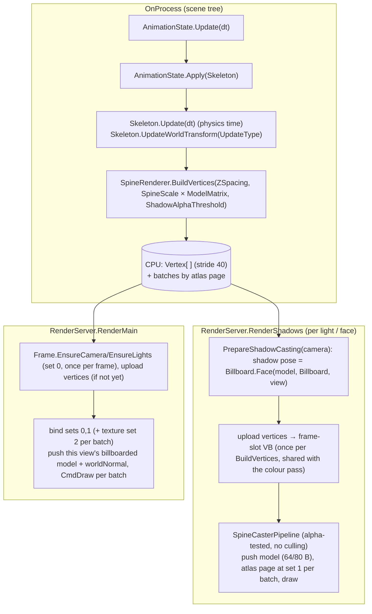

# Spine Integration

> The engine-owned replacement for new work is planned in [2D skeletal animation](future/skeleton-2d.md) (G17,
> [ADR 0184](../../memory/decisions/0184-engine-owned-2d-skeletal-animation.md)). Spine stays for teams with Spine
> licences; its rigs import into the new format with the Spine JSON importer.

## Purpose

Renders Spine skeletal animations as lit, shadow-casting geometry in the 3D scene. Use `SpineNode`;
`SpineRenderer` and `SpineTextureLoader` are implementation details.

Runtime: spine-csharp **4.3** (fork branch `4.3`, ADR 0116): binary `.skel` and `.json` exports. Two nodes draw it:
`SpineNode` (3D, lit, shadow-casting; below) and **`SpineSprite`** (2D canvas, spine-godot's `SpineSprite`): set
`SkeletonDataRes` (a `SpineSkeletonDataResource`: `AtlasRes`, `SkeletonFileRes`, `DefaultMix`, `AnimationMixes`), drive
`AnimationState`/`Skeleton` directly, `GetGlobalBoneTransform(bone)` for attachments (Y-down, as spine-godot reports it).
Both build triangles with `SpineGeometry` (draw order, sequences, tints, clipping).

## Key types

| Type | File | Role |
|---|---|---|
| `SpineNode : VisualInstance3D` | [Nodes/SpineNode.cs](../../MainframeEngine/Src/Nodes/SpineNode.cs) | Loads the atlas and skeleton, drives animation in `OnProcess`, forwards draw calls (the design's `SpineSprite3D`); `ShadowAlphaThreshold`, `Billboard` (ADR 0204); `AnimationState`, track entries and animation events |
| `SpineFolder` | same file | `readonly struct`: folder → `Name`, first `*.atlas`, first `*.json` (throws if missing) |
| `SpineRenderer` (internal) | [Rendering/Spine/SpineRenderer.cs](../../MainframeEngine/Src/Rendering/Spine/SpineRenderer.cs) | Builds vertices, owns the pipeline, buffers and descriptor sets |
| `SpineTextureLoader` | [Rendering/Spine/SpineTextureLoader.cs](../../MainframeEngine/Src/Rendering/Spine/SpineTextureLoader.cs) | Decodes atlas pages to RGBA (StbImageSharp); `page.rendererObject = page index` |
| Spine runtime | `Plugins/Spine/spine-csharp` | Vendored git submodule. Do not modify. |

## Usage

```csharp
// In a scene (or a .mscene file: "type": "SpineNode", "props": { "Folder": ..., "Animation": "walk" }):
var boy = new SpineNode { Folder = "Assets/Models/Spine/SpineBoy", Animation = "walk", Scale = new Vector3(0.1f) };
Root.AddChild(boy);   // the render server creates its renderer; it animates in OnProcess, draws and casts shadows
boy.SetAnimation("run");                                  // replaces track 0, looping
var swing = boy.SetAnimation("swing", loop: false)!;     // a one-shot; returns the TrackEntry (null if unknown)
swing.TimeScale = swing.Animation.Duration / useSeconds; // fit the clip to a gameplay duration
boy.AddAnimation("idle", loop: true);                     // queued: starts when the swing completes
boy.SetAnimation("aim", loop: true, track: 1);            // other tracks layer over track 0
boy.AnimationEvent += (entry, e) => { if (e.Data.Name == "footstep") PlayStep(); };
boy.AnimationCompleted += entry => Log.Info($"{entry.Animation.Name} done");
boy.Billboard = BillboardMode.FixedY;   // upright, turned to each view's camera (Enabled also tilts to the view)
boy.ShadowAlphaThreshold = 0.5f;        // the default: silhouette shadows; 0 casts the attachments' whole quads
boy.FlipX(true);                        // mirrored, billboarded or not
```

The skeleton data (atlas, JSON) loads on the CPU on first use (`Skeleton`, entering the tree, the first
process); the GPU renderer is created through the `RenderServer` when the node enters a tree, with the
server's `ShadowSystem`. Tree-less code uses
`new SpineNode(renderer, folder)` (loads immediately, no shadows), then `Advance(gameTime)` and
`Draw(camera, lights)` inside the main pass.

Animation (issue #123, as `SpineSprite`): `SetAnimation(name, loop = true, track = 0)` and `AddAnimation(name, loop,
delay = 0, track = 0)` return the Spine `TrackEntry` (`TimeScale`, `MixDuration`, `Alpha`, …); `QueueAnimation(name)` is
`AddAnimation(name, loop: true)`. `AnimationState` is the skeleton's state (mixes through its `Data`, its own `TimeScale`,
`GetTrack`, `ClearTrack`). The state's listeners are raised as the node's `[Signal]` events `AnimationStarted`,
`AnimationInterrupted`, `AnimationEnded`, `AnimationCompleted` (each loop's end, or once for a one-shot),
`AnimationDisposed` and `AnimationEvent(TrackEntry, Spine.Event)` for keyed events, on the main thread inside the
node's `OnProcess` (or `Advance`). They are wired once when the skeleton loads, so updating allocates nothing.

## Per-frame data flow



### Vertex building

- Walks `Skeleton.DrawOrder`. A `RegionAttachment` produces 6 vertices (two triangles, not indexed).
  A `MeshAttachment` produces one vertex per triangle index.
- Each slot is pushed `ZSpacing` (default 0.01) further along z to avoid z-fighting.
- Tint = skeleton RGBA × slot RGBA, straight (never × alpha) and sRGB-authored; premultiplication happens
  once, in the fragment shader.
- A new batch starts whenever the atlas page changes.
- The CPU arrays start at 8192 vertices and **grow** (doubling) when a pose needs more; GPU vertex
  buffers grow the same way per frame slot. Steady-state poses never allocate.
- Order per update (Spine's documented order): `AnimationState.Update` → `Apply` → `Skeleton.Update`
  → `UpdateWorldTransform`, so the drawn pose is this frame's.

| CPU vertex (40 B) | Offset |
|---|---|
| `vec3 Position` | 0 |
| `vec2 Uv` | 12 |
| `vec4 Color` | 20 |
| `float ShadowAlphaThreshold` (the casters read `Color.a` and it as one `vec2` at 32) | 36 |

### Descriptor sets

| Set | With `ShadowSystem` | Without `ShadowSystem` |
|---|---|---|
| 0 | the per-frame shared set (`FrameContext`): camera + lights UBO | same |
| 1 | `ShadowSystem.MainDescSetLayout` | renderer's "no shadows" fallback (same layout, everything lit) |
| 2 | `sampler2D uTexture`, one static set per atlas page | same |

Push constant (128-byte vertex+fragment range, 80 B used): `mat4 model` + `vec4 worldNormal`. The normal is
`normalize(TransformNormal(+Z, model))`, so the whole skeleton shares one normal.

Pipeline: `SpineLit.vk.{vert,frag}`, no culling, CCW, **premultiplied** blend (`One/OneMinusSrcAlpha`),
depth test and write `Less`. The fragment shader discards alpha < 0.01. Pages are `GpuTexture`s with a
Linear/ClampToEdge sampler: straight-alpha atlases `R8G8B8A8_SRGB`, premultiplied (`pma: true`, e.g.
SpineBoy) `R8G8B8A8_UNORM`, which the shader un-premultiplies, decodes and re-premultiplies
(specialization constant `kPremultipliedTexture`) — see [Color pipeline](color-pipeline.md#spine-premultiplied-alpha).
Vertex buffers are per-frame-slot `GpuBuffer`s that grow by doubling, written once per frame slot after each
`BuildVertices` and drawn by the colour pass and the shadow casters alike; `Dispose` defers to the deletion queue.

## Shadows

ADR 0204. Spine casts into every shadow pass: cascades, spot atlas tiles and point cubes. It is not batched and has
no bounds, so it is never culled per pass. The casters are `ShadowSystem.SpineCasterPipeline(point)`, built once by
`EnsureSpineCasters` when the first renderer with a shadow system is created:

- `Spine/SpineShadow2D.vk.vert` + `SpineShadow.vk.frag` for cascades and spot tiles.
- `Spine/SpineShadowPoint.vk.{vert,frag}` for cubes (linear distance, like the other point casters).
- No culling: a flat skeleton casts whichever side faces the light.

Their layout (`SpineCasterLayout`) is the plain caster layout plus set 1:

| Set | Contents |
|---|---|
| 0 | the light view-projection ring (dynamic offset), bound by `ShadowSystem.RecordPass`; compatible because the push ranges match the plain layouts (64 B vertex; 80 B vertex+fragment for points) |
| 1 | the atlas page: the same descriptor set as the colour pass's set 2, from the identically defined `SpineRenderer.CreateTextureSetLayout` |

The fragment discards where `atlas alpha × tint alpha < SpineNode.ShadowAlphaThreshold`. The threshold is exported, in
the range 0–1, with a default of 0.5. It travels in each vertex: the 2D push range is full with the model matrix.

- Attachments cast their silhouettes, not their quads.
- A slot or skeleton fading out (tint alpha) fades its shadow.
- 0 discards nothing: the quad shadows from before ADR 0204.
- A premultiplied page's alpha is the same as a straight one's, so both atlas kinds test alike.

## Billboards

`SpineNode.Billboard` (`BillboardMode`, as on `Sprite3D` and `Label3D`) is done on the CPU (ADR 0199/0204):

- **`FixedY`** turns the skeleton about world Y to face the camera and keeps it upright.
- **`Enabled`** also tilts it back to meet the view.

The node's position and scale (`SpineScale` included) are kept and its rotation is ignored.

- **Colour pass:** `Draw(camera)` pushes `Billboard.Face(model, mode, camera.ViewMatrix)`, and the lighting normal comes
  from that matrix. Each view sees its own facing skeleton.
- **Shadows:** before each shadow render, `RenderServer` calls `VisualInstance3D.PrepareShadowCasting(camera)` on the
  non-batched casters, with the camera the shadows are rendered for. The skeleton then casts from the pose that view
  sees, as `Sprite3D` does.
- **Flips:** `FlipX` (the skeleton's `ScaleX` sign) and a negative `SpineScale` live in the vertices, so they still
  mirror a billboarded skeleton. `ZSpacing` stays along the billboard's +Z, toward the camera.

## Invariants

- `Folder` cannot change once the skeleton is loaded. A `ShadowSystem` is optional
  (`RenderServer.ShadowsEnabled = false`, or the tree-less constructor): without one the node binds the
  renderer's fallback at set 1 and casts no shadows (`DrawShadow*` are no-ops). `Animation` (exported) is the
  animation set when the skeleton loads (looping, track 0); before `Folder` is set, `SetAnimation` just sets it and
  returns null, and once it is set, `SetAnimation` loads the skeleton.
- `SpineScale` (default `SpineNode.DefaultSpineScale = 0.02`) applies immediately and keeps `FlipX`. It scales
  the drawn vertices (x/y of the model matrix passed to `BuildVertices`; `ZSpacing` stays in node units), not the
  skeleton: the skeleton keeps unit scale and only carries the flip signs, so bone world positions are in skeleton
  units. Spine's IK solver uses absolute epsilons (e.g. a parent determinant ≤ 0.0001), and a skeleton scaled below
  ~0.01 solved a crumpled pose; the `spine-small-scale` render test guards this. `SetAnimation` replaces its track now and loops unless `loop: false`; `AddAnimation`/`QueueAnimation` append after
  the current entry.
- Atlas pixel arrays are released after the GPU upload (`SpineTextureLoader.ReleasePixelData`); only the
  page sizes stay.
- Draw Spine after opaque geometry (tree order / `RenderPriority`). It alpha-blends but also writes depth.

## Known issues

- Per-slot blend modes and two-color tint are ignored (clipping attachments are applied by `SpineGeometry`). Per-command
  canvas blend modes, planned in [2D skeletal animation](future/skeleton-2d.md#canvas), would let `SpineSprite` honour
  slot blend modes.
- Only `atlas.Pages[0].pma` is honoured.
- Shadows are alpha-tested per pixel against the atlas (ADR 0204). Two limits remain:
  - A skeleton has no bounds, so it is drawn into every shadow pass and never culled per pass.
  - With several views in a frame, the shadows come from one billboarded pose: the view's that renders them.
- The editor's selection box does not follow a billboarded skeleton.

## Related docs

[Scene graph & nodes](scene-graph-and-nodes.md) · [Lighting](lighting.md) · [Shadow system](shadow-system.md) ·
[Color pipeline](color-pipeline.md)
