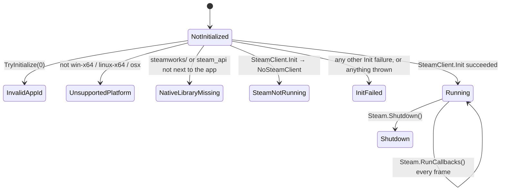
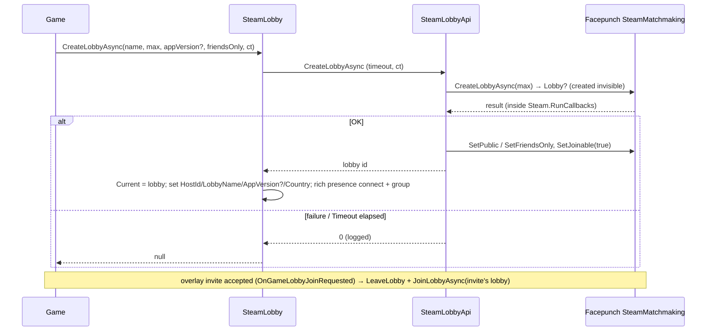

# Steamworks

## Purpose

Optional Steam integration: identity, friends, lobbies, rich presence, overlay and achievements. All of it goes
through an engine-owned `Steam` service, which starts only when Steam can really run. Otherwise every wrapper is a
quiet no-op, and the game never fails because Steam is missing (CLAUDE.md: "only activate if Steam is running").

> **Status:** Steam runs on Windows x64, Linux x64 and macOS (x64 and Apple Silicon) through
> [Facepunch.Steamworks](https://github.com/Facepunch/Facepunch.Steamworks) 2.4.1, the same setup as Speed Golf
> ([ADR 0189](../../memory/decisions/0189-facepunch-steamworks.md)). The `steam_api` natives ship with the engine and
> its NuGet package. Multiplayer connects over Steam relay sockets (`SteamSocketsTransport`), and avatars load as
> textures (`Steam.GetAvatarAsync`).

## Lifecycle



```csharp
Steam.TryInitialize(appId, writeDevAppIdFile: isDevBuild); // never throws; returns Steam.Valid
// every frame, main thread:
Steam.RunCallbacks();                                       // no-op unless Running
// at exit:
Steam.Shutdown();
```

- **`Steam.TryInitialize(uint appId, bool writeDevAppIdFile = false)`** checks, in order:
  1. The app id is not 0.
  2. The platform is supported (`Steam.IsPlatformSupported`: Windows x64, Linux x64, macOS x64 or arm64).
  3. This OS's `MainframeEngine.Steamworks` build is in `steamworks/` (see [Layers](#layers)).
  4. The dev app id file, if `writeDevAppIdFile` is set.
  5. `SteamClient.Init(appId, asyncCallbacks: false)` succeeds. Before it, `SteamAppId` and `SteamGameId` are set in
     the native environment too (below).

  On success it subscribes the lobby, invite and rich-presence events and routes exceptions thrown inside Facepunch's
  callback dispatch (`Dispatch.OnException`) to `Log.Error`. Every failure ends in a `SteamStatus` plus a
  `Steam.StatusMessage`, logged at info level. As a last resort, any exception becomes `InitFailed`.
- **`Steam.RunCallbacks()`** must be pumped once per frame on the main thread. Lobby results and `await`
  continuations of the lobby calls run inside it. Facepunch's own callback loop is off (`asyncCallbacks: false`): it
  pumped callbacks a second time in Speed Golf.
- **`Steam.Shutdown()`** leaves the current lobby and clears rich presence *before* `SteamClient.Shutdown` (Facepunch
  throws on the user's SteamID afterwards), then removes the events again: they are static, and a later
  `TryInitialize` must not subscribe them twice.
- **App id outside Steam.** `SteamClient.Init(appId)` sets `SteamAppId` in .NET's environment. On macOS and Linux that
  never reaches the native `getenv` steam_api reads, and init fails with "No appID found" (Speed Golf, 2026-09-25), so
  the shim also calls libc `setenv`. Steam therefore starts the same way on all three OSes, also outside the Steam
  client and without a `steam_appid.txt`. Use `restartThroughSteam` (below) when a store build must run through Steam.
- **Dev app id.** `writeDevAppIdFile: true` writes `steam_appid.txt` next to the executable, only when it is missing
  or different, and sets `SteamAppId` for the process. **Never enable it in shipped builds:** it bypasses Steam's
  "launched through Steam" check. The [export](game-export.md) refuses a stage that contains the file.
- **`Steam.RestartAppIfNecessary(uint appId)`** wraps `SteamAPI_RestartAppIfNecessary`: true when the game was
  started outside the Steam client and Steam is relaunching it, so the process must exit at once. It never throws and
  returns false (carry on) when Steam cannot be asked: app id 0, an unsupported platform, no native library.
- **Never set `Dispatch.OnDebugCallback`.** It crashed Speed Golf with SIGBUS, with async callbacks on or off.

## Layers

Facepunch ships two managed builds: `Facepunch.Steamworks.Win64.dll` (Windows) and `Facepunch.Steamworks.Posix.dll`
(macOS, Linux). They have different assembly names, import different library names (`steam_api64`, `libsteam_api`)
and pack Steam's structs differently (8 and 4 bytes), so neither works everywhere. Speed Golf compiles once per
platform (Godot sets a define per export); the engine ships one `MainframeEngine.dll` for every RID, so it puts a shim
between itself and Facepunch:

| Layer | Files | Rule |
|---|---|---|
| Public facade | `Steam`, `SteamLobby`, `SteamLobbyInfo`, `SteamAchievements`, `SteamOverlay`, `SteamRichPresence`, `SteamFriend` | No Steamworks type in any signature, field or method body. Every member checks `Steam.Valid` first. |
| Adapter | [`Native/SteamApi.cs`](../../MainframeEngine/Src/Steamworks/Native/SteamApi.cs), [`Native/SteamLobbyApi.cs`](../../MainframeEngine/Src/Steamworks/Native/SteamLobbyApi.cs) (internal) | The only engine code that calls the shim. Members are `[MethodImpl(NoInlining)]` with engine or primitive types, so compiling a caller never loads the shim. Maps results to `SteamStatus`/`SteamFriend`, adds lobby timeouts. |
| Shim | [`MainframeEngine.Steamworks/Src/`](../../MainframeEngine.Steamworks/Src) | The only code that says `using Steamworks;`. Internal API (`InternalsVisibleTo` the engine), primitive types, no engine reference: logging and events go out through delegates the adapter sets. Built twice under one assembly name: `Win64/` against Facepunch's Win64 build, `Posix/` against its Posix build. |
| Facepunch | [`Plugins/Facepunch.Steamworks/`](../../Plugins/Facepunch.Steamworks) | Vendored 2.4.1 (`net6.0`), not modified. |

**How the right build loads.** The engine compiles against the Posix shim, but neither shim is copied next to the app
or listed in its `deps.json` (`Private="false"`). Both go, with their Facepunch assembly, to
`<output>/steamworks/win64/` and `<output>/steamworks/posix/`; a build or publish with a RID gets only that
platform's folder. Before the first adapter call, `SteamworksLoader.Register()` hooks
`AssemblyLoadContext.Default.Resolving`: the runtime's own probing misses `MainframeEngine.Steamworks`, and the
handler loads it and `Facepunch.Steamworks.*` from this OS's folder. The shim then sets a `DllImportResolver` on
Facepunch's assembly and its own (Speed Golf's `SteamNativeLoader`): `steam_api64` / `libsteam_api` load from the app
directory, and otherwise the default probing finds them (a NuGet package game's RID-less build keeps them in
`runtimes/<rid>/native`, listed in `deps.json`).

**Calls Facepunch keeps internal** go through the steam_api flat API in the shim (`SteamworksNative`, `LibraryImport`
against the same library), never reflection: the connect-string invite dialog and the Remote Play Together invite
dialog (`SteamAPI_ISteamFriends_*` on `SteamAPI_SteamFriends_v017()`).

**Relay sockets** (`SteamSocketsTransport`, [Networking › Steam relay sockets](networking.md#steam-relay-sockets)) follow
the same layers: the shim's `SteamworksSockets` owns Facepunch's `SocketManager`/`ConnectionManager` subclasses and
queues their state changes; the adapter `Native/SteamSocketsApi.cs` is the transport's backend. Receiving uses the flat
`ReceiveMessagesOnConnection` and `SteamNetworkingMessage_t_Release` (Facepunch's `Receive` allocates per message).

The unit tests (`SteamTests`) run the real path on every CI OS: `TryInitialize(480)` must load the shim, this OS's
Facepunch build and steam_api and reach `SteamNotRunning` (CI has no Steam client), or `Running` on a developer
machine with Steam open. The wrappers' no-op path is tested with app id 0.

## Key types

| Type | Surface |
|---|---|
| `Steam` | `TryInitialize`, `RunCallbacks`, `Shutdown`, `Status`, `StatusMessage`, `Valid`, `AppId`, `IsPlatformSupported`, `NativeLibraryFileName`, `SteamId`, `Username`, `Branch`, `GetLaunchCommandLine(flag)`, `GetFriends()`, `GetFriendUsername`, `HasDLC`, `GetAvatarAsync(steamId, size)`, `RegisterAvatarAsync(ui, name, steamId, size)`, `AvatarTimeout` ([Avatars](#avatars)) |
| `SteamAvatarSize` | `Small` (32×32), `Medium` (64×64), `Large` (184×184) |
| `SteamStatus` | `NotInitialized`, `Running`, `UnsupportedPlatform`, `InvalidAppId`, `NativeLibraryMissing`, `SteamNotRunning`, `InitFailed`, `Shutdown` |
| `SteamLobby` | `CreateLobbyAsync`, `JoinLobbyAsync`, `LeaveLobby`, `GetLobbyListAsync(friendsOnly)`, `Current`, `Timeout` (15 s), events `OnLobbyUpdated`, `OnLobbyJoined`, `OnMemberChanged(lobby, user, joined)` |
| `SteamLobbyInfo` | Live lobby metadata: `HostId`, `LobbyName`, `AppVersion`, `Country`, `IsAdvertising`, `PlayerCount`, `MaxPlayers`, `OwnerId`, `GetPlayers()` |
| `SteamAchievements` | `IsUnlocked`, `Unlock` and `Clear` (both call `StoreStats`), `StoreStats` |
| `SteamRichPresence` | `Set*`, `Clear`, `GetFriendConnect`, `GetFriendGroupSize`, `OnJoinRequested(connect)` |
| `SteamOverlay` | `IsEnabled`, `OpenWeb`, `OpenStore`, `InviteFriendToGame(connect)`, `InviteFriendToRemotePlay` |
| `SteamFriend` | `readonly struct (SteamId, Username)`, `GetAvatarAsync(size)` |

`Steam.GetFriends()` returns immediate friends (Facepunch's `SteamFriends.GetFriends()`).

Without Steam:

- async lobby and avatar calls return `null` or an empty list;
- getters return `0`, `""` or empty;
- setters and overlay calls do nothing;
- argument validation still throws, because that is a caller bug.

## Lobbies



`JoinLobbyAsync` awaits Facepunch's `JoinLobbyAsync`, which succeeds only for a successful enter response; then it
sets `Current` and raises `OnLobbyJoined`. `GetLobbyListAsync(false)` runs `SteamMatchmaking.LobbyList` with at most 60
results. The friends-only path reads the lobbies of immediate friends who are playing this app id. Timeouts log and
return null or empty. A `CancellationToken` cancels the wait with `OperationCanceledException`. Member events come
from Facepunch's `OnLobbyMemberJoined` (joined) and `OnLobbyMemberLeave`/`Disconnected`/`Kicked`/`Banned` (left).

## Avatars

```csharp
Texture2D? me = await Steam.GetAvatarAsync(Steam.SteamId);                  // Large (184×184) by default
await Steam.RegisterAvatarAsync(ui, "avatar-host", lobby.OwnerId, SteamAvatarSize.Medium);
// RML: 
```

- **Shim → adapter → facade.** `SteamworksAvatars.GetAvatarAsync(steamId, size)` (shim) awaits Facepunch's
  `SteamFriends.GetSmall/Medium/LargeAvatarAsync` and returns `(uint Width, uint Height, byte[] Rgba)?`;
  `SteamAvatarApi` (adapter, `NoInlining`) passes it through. Facepunch requests the persona, then polls for the image
  with `Task.Delay`, so the task finishes on a thread-pool thread: the facade queues the result and completes the
  returned task inside `Steam.RunCallbacks()`, on the main thread, where the `Texture2D` is created. `AvatarTimeout`
  (15 s) bounds the wait.
- **Texture.** `Texture2D.FromPixels` of Steam's RGBA8 (straight alpha) with sRGB colour, no mipmaps, clamped: renderers
  upload it through their normal path (`IVulkanContext.Uploads`) like any code-created texture.
- **Cache.** Per (SteamID, size): a second request returns the same task, and so the same texture. A null result
  (no avatar, timeout, failure) is not cached, so asking again retries. `Steam.Shutdown` empties the cache, completes
  pending requests with null and drops results that arrive afterwards. Fetching is on demand: an empty
  `RunCallbacks` allocates nothing.
- **UI.** `Steam.RegisterAvatarAsync(ui, name, steamId, size)` registers the avatar with
  `UiServer.RegisterTexture(name, Texture2D)`, which uploads the pixels once (UNORM, premultiplied in the shader) and
  owns that upload until the name is unregistered or replaced, so it outlives `Steam.Shutdown`.
- **Tests.** Without Steam every request is null and the cache stays empty (`SteamAvatarTests`).
  `OwnAvatarLoadsWhenSteamIsRunning` is the live check: with the Steam client open it fetches your own large avatar as
  Spacewar (480) and checks its size and pixels; it is skipped when Steam is not running (CI).

## Natives

| Platform | Facepunch build (`steamworks/…`) | `steam_api` native (`MainframeEngine/runtimes/<rid>/native`) |
|---|---|---|
| win-x64 | ✅ `win64/` (`Facepunch.Steamworks.Win64.dll`) | ✅ `steam_api64.dll` |
| linux-x64 | ✅ `posix/` (`Facepunch.Steamworks.Posix.dll`) | ✅ `libsteam_api.so` |
| osx-x64, osx-arm64 | ✅ `posix/` | ✅ `libsteam_api.dylib` (universal, in both RID folders) |
| Windows/Linux arm64, 32-bit | — | ❌ none in the SDK → `UnsupportedPlatform` |

The natives are Valve's Steamworks SDK `redistributable_bin` files that Facepunch.Steamworks 2.4.1 was built
against (the SDK's redistribution terms allow shipping them with a game; Facepunch's and Steamworks.NET's public
repositories carry them too). They are vendored, not built by `natives.yml`, and not in `Native/natives.lock`
(`natives-lock.sh` ignores files it has no component for). Refresh them only together with
`Plugins/Facepunch.Steamworks`: the flat-API interface versions must match. The engine csproj copies them like the
other natives; the NuGet package carries them in `runtimes/<rid>/native` and the Facepunch builds in
`mainframe/steamworks/`, which its `buildTransitive` targets copy into the game's output.

**Player builds.** The [export](game-export.md) (File › Export, `mf-export`; in the package: `tools/mf-export`, found
through `MainframeExportTool`; see [Release → Games](release.md#games)) keeps only the RID's steam_api and
`steamworks/` folder, checks them for Steam presets ([Export](#export)), and fails if a `steam_appid.txt` is in the stage. macOS Developer ID signing signs
`libsteam_api.dylib` with the other Mach-O files.

## Engine hook

Set `EngineOptions.SteamAppId` and `Engine.OnLoad` registers a `SteamServer` (an `IFrameServer`):
`Steam.TryInitialize` when it is registered, `Steam.RunCallbacks` from `IFrameServer.Process` — which
`SceneTree.Tick` calls once per frame for every frame server, after process, deferred frees and transform sync — and
`Steam.Shutdown` when the servers are disposed. It is inert (`Started` false) when Steam cannot start.
`EngineOptions.SteamWriteDevAppIdFile` passes `writeDevAppIdFile` through.

## Project settings

Games set Steam in `project.mfproj` (`steam` section; the editor's Project Settings › Steamworks), and `GameHost`
applies it:

| Setting | Default | Effect |
| --- | --- | --- |
| `appId` (App ID) | 0 | The full game's app id. 0 leaves Steam off. |
| `demoAppId` (Demo App ID) | 0 | The demo's own app id (a Steam demo is a separate app), used when the build is a demo (`isDemo`, [demo builds](project-and-gamehost.md#demo-builds)). 0 leaves Steam off in the demo. |
| `devAppIdFile` (Run Outside Steam in Development) | true | Development runs — started by the editor's Play (`--editor-port`) or a Debug build (`GameHost.IsDevelopmentRun`) — set `EngineOptions.SteamWriteDevAppIdFile`, so Steam starts without the game being launched by Steam. Never in Release builds run on their own. |
| `restartThroughSteam` (Relaunch Through Steam) | false | Shipped runs (not development) call `Steam.RestartAppIfNecessary` in `GameHost.Run` before the window opens and exit when Steam relaunches the game, so ownership checks and the overlay always apply. |

`ProjectSettings.SteamAppId` (read-only) is the id the build uses: `demoAppId` for a demo, else `appId`.

## Export

Export presets ([Game export](game-export.md#steam)) have `steam: true|false`; the app ids stay here. Steam off writes
app ids 0 and `restartThroughSteam: false` into the exported `project.mfproj`, so Steam stays inert. Steam on is
validated before building: the effective id (`demoAppId` for a `demo` preset, else `appId`) must not be 0
(`steam-app-id`, an error naming Project Settings › Steamworks), a Debug configuration warns (`steam-debug`: a
development run writes `steam_appid.txt` and never relaunches through Steam), and after the publish the stage must hold
the RID's `steam_api` native and `steamworks/<win64|posix>/MainframeEngine.Steamworks.dll`, else the export fails. A
`steam_appid.txt` in the stage always fails it. Only the RID's Steam files ship.

## Lobby → transport handoff

The host advertises where its server can be reached in the lobby's `connect` metadata
(`SteamLobbyInfo.ConnectAddress`, key `SteamLobbyInfo.ConnectKey`; or `CreateLobbyAsync(…, connectAddress:)`): a
`;`-separated [`NetworkAddress`](networking.md#bad-networks-and-the-lobby-handoff) list, best first.

```csharp
// Host: Steam relay and ENet at once (MultiServerTransport), Steam first in the lobby
ITransport server = EnetTransport.Listen(7777, 8);
if (SteamSocketsTransport.TryListen(virtualPort: 0, maxPeers: 8, out var steam))
    server = new MultiServerTransport(steam, server);
mp.StartServer(server);
var connect = NetworkAddress.FormatList(NetworkAddress.Steam(Steam.SteamId), NetworkAddress.Enet(NetworkNode.LocalIp, 7777));
var lobby = await SteamLobby.CreateLobbyAsync("My game", 8, connectAddress: connect);

// Member (after JoinLobbyAsync or an accepted invite, SteamLobby.OnLobbyJoined)
if (!mp.TryConnect(lobby.ConnectAddress))
    Log.Warning("no usable address");
```

`MultiplayerApi.TryConnect` gives the string to a `TransportSelector`, which opens the first address whose transport
works on this machine: `steam:` → `SteamSocketsTransport` (a relay connection whenever Steam runs; it fails at once
without Steam or for the member's own SteamID, and the next address is tried), `enet:` → `EnetTransport`. The
selection logic is tested end to end over `LoopbackTransport` (`loopback:` addresses through a
`LoopbackTransportFactory`) and over an in-memory fake Steam, so it needs no Steam client.

## Known issues / not done

- **Steam relay sockets** are unit-tested over a fake Steam only; a live join needs two Steam accounts
  ([Tests/QA/steam-relay.md](../../Tests/QA/steam-relay.md)). The network conditioner
  (`SteamSocketsTransport.SimulateNetworkConditions`) has no dev-overlay panel yet.
- **Avatar changes** during a session are not picked up: a cached avatar stays until `Steam.Shutdown` (Facepunch's
  `OnPersonaStateChange` does not say what changed, so refreshing on it would refetch on every status change).
  Facepunch keeps polling after an `AvatarTimeout`, and its polling runs on thread-pool threads, which can still be
  inside a Steam call while `Steam.Shutdown` runs.
- **Member updates.** `OnLobbyUpdated` reports lobby-level metadata updates only; member data updates are ignored.
- **Lobby continuations** run inside `RunCallbacks` on the main thread. A continuation after a timeout runs on a
  thread-pool thread.

## Related docs

[Networking](networking.md) · [Build & platforms](build-and-platforms.md#platform-matrix) ·
[ADR 0043: lobby connect strings](../../memory/decisions/0043-lobby-connect-strings-transport-selection.md) ·
[ADR 0044: Steam features without natives](../../memory/decisions/0044-steam-features-without-natives.md) ·
[ADR 0189: Facepunch.Steamworks](../../memory/decisions/0189-facepunch-steamworks.md)
