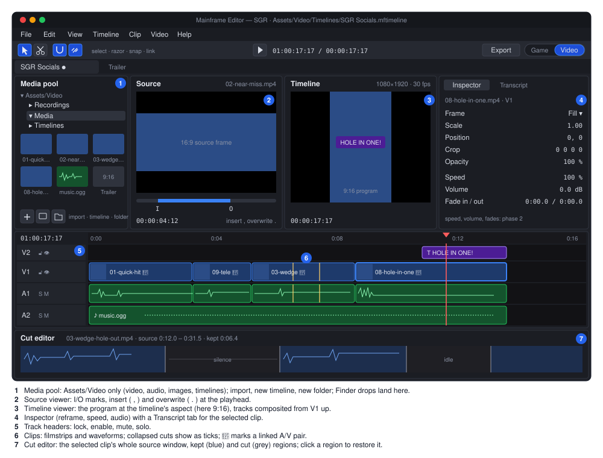

# Video editing mode

**Status:** ✅ G20c and G20d built (branch `feature/video-nle`, 2026-11-05): the multi-track timeline editor, with
Cutback's tools (Detect Silence, Detect Idle Gameplay, Transcribe, Remove Fillers) on the selected clip · **ADRs:**
[0241](../../memory/decisions/0241-video-mode-nle.md) (the timeline editor), which partly supersedes
[0191](../../memory/decisions/0191-video-editing-mode.md) (the Cutback port) · **Proposal:**
[Video NLE](future/video-nle.md) · **Depends on:** [Gameplay recording](recording.md) (the recorder, the `.mfcap.json`
sidecar, F10), [Editor](editor.md#editor-modes) (modes, undo, file drag), [Song tab](editor.md#song-tab-music-editor)
(the track-header and canvas-lane pattern), [Audio](audio.md) (`AudioStreamGenerator`) · **Related:**
[Video playback](future/video-playback.md) (G16, games only; not used here), ADR 0190 (ffmpeg as a child process)

## Purpose

The editor records gameplay (F10). Turning recordings into socials and trailers (a 9:16 short, a Steam trailer) took
another editor. Video mode is now a small timeline editor laid out like DaVinci Resolve's Edit page, inside the open game
project: a media pool, a Source and a Timeline viewer, an Inspector, video and audio tracks with Premiere's keys, a cut
editor under them, and export through presets.


*The Demo's Physics 2D recording with a short narration (`just readme-screenshots`), imported and placed on a vertical
timeline (Fill crops the landscape picture); Detect Silence cut its pauses and Remove Fillers its "um" and "uh", struck
in the Transcript tab; the cut editor shows the clip's cuts.*

Not in scope yet:
- **G20.2:** volume and fades, dissolves and fade to black, titles, still images, speed, auto-captions.
- **G20.3:** nested timelines, proxies, roll/slip, sync lock, crash recovery for timelines.
- **Games are unaffected:** neither the runtime nor shipped games reference any of this, and `Assets/Video` never ships.

## Code layout

```
MainframeEngine.Video/                editor-only library, net10.0, MIT (LICENSE-CUTBACK); only the editor references it
  SegmentList.cs                      Cutback's cut partition (a clip's cuts)
  Timelines/                          the timeline model, edits, layout, snapping, reframing, .mftimeline, MediaRefs
  Timelines/Export/                   TimelineGraphBuilder (export and preview graphs), presets, arguments, exporter
  Media/                              FfmpegLocator, MediaProbe, WaveformExtractor, FilmstripExtractor, PosterExtractor, …
  Media/Export/                       DeliveryEncoder, FfmpegProgressParser, FilterGraphBuilder (splice fades only)
  Media/Preview/PreviewDecoding.cs    the Source viewer's decode arguments
  Models/ Capture/ Detection/ Transcript/ Analysis/   Cutback's detectors, sidecar, transcript and Whisper (G20d)
MainframeEngine.Editor/Src/Video/     the mode's UI (below)
MainframeEngine.Editor/Assets/Editor/ video.rml, video_export.rml; the toolbar's video group (toolbar.rml), the Timeline menu
```

**Library (G20b, `Timelines/`).** Immutable records: `Timeline` (settings, tracks, clips, markers, in/out), `Track`,
`Clip`, `MediaRef`, `ClipTransform`. A clip is a window of a media file at a start on a track. Its `Segments` are
Cutback's partition of the whole file, so the detectors and `SegmentList` work on clips unchanged, and the clip lasts its
kept time ÷ speed in whole frames. `TimelineEdits` returns a new timeline per edit, or the same instance when nothing
changed or a lock refused it. `TimelineLayout`, `Snapping` and `ClipLayout` (fit, fill, stretch, scale, position, crop)
are pure. `MediaRefs.ProbeAsync` probes and hashes a file into a `MediaRef`.

**Editor (`Src/Video/`):**

| Type | Role |
|---|---|
| `TimelineDocument` | An open `.mftimeline`: the current `Timeline`, its file, its history in the editor's `UndoRedo`. `Apply(name, edit, mergeKey)` and `ApplyFrom(base, …)` for gestures; `Resolve(MediaRef)` (cached) gives ffmpeg's path. |
| `TimelineTab : IEditorTab` | A document plus its view state, controller, canvas, viewers, cut editor, notice and export job. |
| `TimelineViewState` | Zoom, scroll, playhead, selection, tool, snapping, target tracks, lane geometry. |
| `TimelineCanvas` | The tracks, drawn in a `SubViewport`: ruler in timecode, clips with names, filmstrips or waveforms, link marks, cut ticks, selection, in/out, markers, snap line, playhead. 0 B per frame. |
| `TimelineController` | The gestures (below). |
| `ClipCutTarget` (`ICutTarget`) | The selected clip's cuts for the cut editor (`VideoTimelineView`, `VideoTimelineController`, `VideoTimelineCanvas`, Cutback's strip), mapped to `TimelineEdits.SetClipCuts`. |
| `VideoPreview` over `IPreviewProgram` | ffmpeg decoders into a `Texture2D` in a `SubViewport`, the audio voice as the clock. `SourceProgram` decodes one file; `TimelineProgram` decodes the timeline through `TimelineGraphBuilder.BuildPreview`. |
| `SourceViewer` | The Source viewer: one media file, its In/Out marks per media. |
| `MediaPool`, `MediaImporter` | The pool's listing of `Assets/Video`; copying files in. |
| `MediaCache` | Waveforms, filmstrips and posters per media hash in `<project>/.mainframe/cache/video/`. |
| `ClipTools`, `TranscriptStore` | Cutback's four tools on the selected clip and their jobs; the media's transcripts by hash. |
| `TranscriptPanel` | The Inspector's Transcript tab: the selected clip's words, their gestures. |
| `VideoPanel` + `video.rml` | The screen: pool, viewers, Inspector, notice, track headers, canvases, splitter. |
| `VideoView` (`[Tool]` node) | Per-frame driver: places and publishes the four textures, routes pointer and keys, runs the `video.*` commands, probes, imports, drops, exports. |
| `ExportVideoDialog` + `video_export.rml`, `TimelineExport` | Presets, range, output path; the export job. |
| `VideoJob<T>`, `VideoFfmpeg`, `VideoPaths`, `VideoFormat` | Background jobs polled each frame; which ffmpeg; same-file checks; time formatting. |

## The mode



`EditorMode { Game, Video, Music }` lives on `EditorWorkspace`. **Video mode needs the open game project**
(`EditorMode.UsesProject()`): without one, the Game|Video toggle opens the Project Manager instead. The last mode is
remembered (`EditorSettings.LastMode`), so the editor reopens in video mode behind the Project Manager and the project
picked there opens into it. Project switches ask about and close timeline tabs like scene tabs.

**Folders** (made when video mode first uses the project, not when a project merely opens):

| Folder | What goes there |
|---|---|
| `Assets/Video/Recordings` | F10 recordings and their `.mfcap.json` sidecars |
| `Assets/Video/Media` | Imported files, original names kept; a clash becomes `name-2.ext` |
| `Assets/Video/Timelines` | `*.mftimeline` |

`Assets/Video` is the editor-only folder (`ContentPaths.EditorOnlyFolder`): builds do not copy it and export never ships
it (G20a). Exports go to `<project>/Exports`, outside `Assets/`.

**The screen.**
- **Top row:** media pool | Source viewer | Timeline viewer | Inspector, with an Inspector | Transcript tab pair. Without a timeline tab the pool sits beside
  "Open a timeline from the media pool, or start one." with New Timeline and Import Media.
- **Notice line** (amber): the last operation's result or problem ("Exported Trailer-vertical-30.mp4.", "ffmpeg not
  found…" with an Editor Settings link).
- **Timeline:** track headers (V*n*…V1 over A1…A*n*: a target strip, the name, lock, show/hide for video, mute and solo
  for audio; icon buttons with tooltips) beside the canvas; 240 dp by default, resizable with the splitter.
- **Cut editor:** the selected clip's whole source with its cuts, under the tracks.
- **Tab strip:** timeline tabs only; "+" is New Timeline.

**Menus** (`EditorCommands`, video mode):
- **File:** New Timeline… (Cmd+N), Open Timeline… (Cmd+O), Import Media… (Cmd+I), Save, Save As…, Export Video…
  (Cmd+E), Close Tab, Quit.
- **Edit:** Undo, Redo, Select All (Cmd+A), Delete (Lift) (Del), Ripple Delete (Shift+Del), Video Settings….
- **View:** Zoom In (=), Zoom Out (−), Zoom to Fit (Shift+Z), Show/Hide Output, Switch to Game/Music Mode.
- **Timeline:** Play/Pause, Selection Tool, Razor Tool, Snapping, Add Edit, Add Edit to All Tracks, Ripple Trim
  Start/End to Playhead, Link/Unlink, Mark In, Mark Out, Clear In/Out, Insert, Overwrite, Detect Silence, Detect Idle
  Gameplay, Transcribe, Remove Filler Words, Add Video/Audio Track. The clip's right-click menu has the four tools too.

**Toolbar:** Selection and Razor tools, Snapping, Link/Unlink; Play and Stop with the position; Detect Silence, Detect
Idle Gameplay, Transcribe and Remove Filler Words (icon buttons, enabled with a selected clip; a running one shows its
percent and pressing it cancels; Detect Idle Gameplay's tooltip says when the clip's media has no sidecar); Import Media
and New Timeline; on the right Export (reads "Cancel n %" while exporting), the Game|Music|Video toggle and Documentation.

**Keys** (Premiere's, `EditorWorkspace.VideoShortcutFor`, after the tab's own):

| Key | Does | Key | Does |
|---|---|---|---|
| V / C | Selection / Razor tool | Space | play/pause the focused viewer |
| Cmd+K | add edit on the selected clips' tracks (all unlocked tracks when none) | Shift+Cmd+K | add edit on every track |
| Q / W | ripple trim the start / end to the playhead | Del / Backspace | lift (leave the gap) |
| Shift or Alt + Del | ripple delete | Cmd+L | link / unlink |
| I / O, Alt+X | mark in / out, clear | `,` / `.` | insert / overwrite the Source range |
| J / K / L | back a second (paused) / stop / play | S | snapping |
| ← / → | a frame | ↑ / ↓ | previous / next edit |
| Home / End | start / end | = / − / Shift+Z | zoom in / out / fit |
| Esc | deselect | Cmd+N, I, E | new timeline, import, export |

Game-only keys (gizmos, Play, F10) do nothing in video mode.

## Behaviour

### Media pool and importing

- **The pool** lists `Assets/Video` with folders first, then files, filtered to video, audio, images and timelines
  (`.mfcap.json`, `.meta`, `.tmp` and everything else are hidden). Video items get a poster from the media cache once
  ffmpeg has made it. Double-click: a folder opens, media shows in the Source viewer, a timeline opens as a tab. Media
  drags onto the timeline. The pool follows file changes through a watcher.
- **Importing:** File › Import Media…, the pool's Import button, or a **Finder drop** (`SceneTree.FilesDropped`). A drop
  on the pool imports into the pool's folder; on the timeline, into `Media`, then places the clips at the drop time on
  the track under the pointer (overwrite), one after another. SDL gives no drag-over events, so nothing highlights before
  the drop.
- **`MediaImporter`** copies through `<name>.tmp` (which the asset database skips) and renames, numbers clashes, copies a
  recording's sidecar along, and uses a file already inside the project where it is.

### Timelines

- **New Timeline** asks for a name and a frame (Vertical 9:16, Landscape 16:9, Square 1:1 at 30 fps) and writes
  `Assets/Video/Timelines/<name>.mftimeline` (numbered when taken). The Inspector changes the size, rate and background.
- **The recording dialog's Open in Video Editor** writes `Timelines/<recording>.mftimeline` at the recording's size and
  rate, with it on V1 and A1, linked, and opens it. Open in Cutback is gone.
- **New tracks:** V1, V2, A1, A2. The Timeline menu and the header's right-click menu add tracks; the header menu
  removes one (not the last of its kind, nor a locked one), clips and all.

### Editing

- **Select tool:** click a clip to select it and its linked partner (Shift adds or removes); drag to move it, to another
  track of its kind too; drag an edge to trim (Cmd: ripple trim); drag in empty space for a marquee. At a cut, the edge
  on the pointer's side is the one trimmed.
- **Razor tool:** click a clip to cut it and its linked partner there.
- **Snapping** catches clip edges, the playhead, markers and in/out within 8 dp.
- **Ruler:** press or drag to scrub. **Wheel** zooms about the pointer; Shift scrolls in time, Alt scrolls the tracks.
- **Locks:** an edit that would touch a locked track (or a linked partner on one) changes nothing.
- **Undo:** every edit is one step in the editor's history (`TimelineDocument`): a drag is one step (it re-applies to
  the timeline as it was at the press under one merge key), an edit that changes nothing adds none, and undoing back to
  the save is clean. The limit is Video Settings › Undo history (100).

### Inspector

- **A selected clip:** Fit / Fill / Stretch, scale, position (timeline pixels from the centre), crop (source pixels),
  opacity; the source range and its length on the timeline; enabled. An audio clip shows its track's gain.
- **Nothing selected:** the timeline's size (even numbers), rate and background.
- Fields commit on Enter or blur, each commit one undo step; a value that does not parse shows the current one again.

### The per-clip Cutback tools

Cutback's tools run on the selected clip (the video one of a linked pair). Each result is one undo step through
`TimelineEdits.SetClipCuts`, so the clip and its linked audio cut together and the clips after them ripple; each keeps
every manual cut, and the cuts of its own kind outside the clip's window (`ClipDetection.InWindow`), so a run in one
clip never undoes another clip's results on the same partition. The notice reports the kept time a run removed inside
the window, in Cutback's sentences.

- **Detect Silence** reads only the clip's window (`SilenceDetector` with `-ss`/`-t`) in a job, then
  `SilenceCutPlanner` → `ReplaceAutoSegments`. Settings: Video Settings' silence numbers (padding 60 ms, min silence
  400 ms, threshold −34 dB, min keep 120 ms).
- **Detect Idle Gameplay** reads the recording's `.mfcap.json` (the importer copies it along):
  `GameplayCutPlanner` → `ReplaceOriginCuts(Gameplay)`, with Video Settings' gameplay numbers. Without a sidecar it is
  disabled, and its tooltip says why.
- **Transcribe** runs Whisper on this computer over the clip's **whole media file** (downloading the model first when
  missing, the first half of the progress) and writes `<media>.mftranscript.json` beside it: every clip of that recording
  then shows its words, also after a restart. A file that already has a transcript asks before making it again.
- **Remove Filler Words** finds the fillers among the words inside the window and locates them on the media's waveform
  (Cutback's envelope and DTW anchors, else Whisper's span snapped to the waveform): `FillerCutPlanner` →
  `ApplyFillerCuts`. Without a transcript it transcribes first and cuts when the words arrive.
- **The Transcript tab** shows the selected clip's words inside its window, paragraphs at 2 s pauses, struck where cut,
  the word under the playhead highlighted. Click a word to cut it (or restore a struck one), drag across words for a
  run, Cmd/Ctrl+click to move the playhead there, right-click for Play from here and Cut/Restore. Word edges snap
  within ±40 ms; each edit is one undo step on the link group. The markup is rebuilt only when the words shown change;
  an edit flips the classes in place, and steady frames allocate nothing.
- **Jobs** (silence, transcription) live on the tab, one of each at a time, apply to the clip they started on if it
  still exists, and are cancelled when the tab closes.

### The cut editor

The selected clip's whole source window with its cuts greyed, as Cutback's timeline: click a region to cut or restore it,
drag a boundary (one undo step), drag to draw a section, right-click › Delete Region. Each gesture is
`TimelineEdits.SetClipCuts` on the clip and its linked partners, and the clips after them ripple. On the main timeline a
collapsed cut is a thin tick on the clip.

### Viewers and preview

- **The Timeline viewer plays the timeline through the export's own filter graph** at preview size
  (`TimelineGraphBuilder.BuildPreview`: the long side at most 960 px, at most 30 fps, raw RGBA; 540×960 for vertical):
  one video decoder and one audio decoder per play, the audio voice as the clock. What it shows is what export writes.
  An edit restarts the decode from the playhead; paused, a scrub decodes one frame (newest request wins).
- **The Source viewer** decodes the one file (`SourceProgram`, today's `VideoPreview` machinery: gapless ranges,
  prefetch, decoders started and killed on the pool). It has its own scrub bar, Play, Mark In/Out (kept per media) and
  Insert/Overwrite.
- **One viewer plays at a time.** Space plays the focused one; showing media focuses the Source viewer, placing it hands
  focus back to the timeline.
- **Textures:** `engine://video-source`, `engine://video-program`, `engine://video-timeline`, `engine://video-cuts`, each
  a `SubViewport` updated only while shown, uploaded in place (`GpuTexture.Update2D`).
- **Caches** (`MediaCache`, `<project>/.mainframe/cache/video/<hash>/`): waveforms, `filmstrip-<h>.png`, `poster.png`.
  A miss starts one background job per file and allocates nothing on the frames that ask again.

### Export

- **File › Export Video…** (Cmd+E) opens `ExportVideoDialog`: a preset list (TikTok/Reels/Shorts 30 and 60 fps,
  YouTube/Steam 1080p MP4 and WebM, 4K, X/Discord 720p within 25 MB, a GIF loop, a silent WebM loop, the timeline's own;
  the table is in the [proposal](future/video-nle.md#export)), the range (the whole timeline, or in to out when either is
  set) and the output, `<project>/Exports/<timeline>-<preset>.<ext>` by default (numbered when taken; it follows the
  preset until edited). An empty timeline has nothing to export (a notice).
- **Refused outputs:** a folder, the wrong extension for the preset, and any of the timeline's media files. An existing
  file asks "Replace file?".
- **The job** gets the timeline snapshot taken when Export was pressed, with every media path resolved on the main thread,
  so edits while it runs do not touch it. The viewers pause; Export reads "Cancel n %". It ends in "Export finished" with
  Show in Folder, the ffmpeg error, or "Export cancelled.". Closing the tab cancels it.

### Settings (Editor Settings › Video)

| Setting | Default | Range |
|---|---|---|
| ffmpeg | blank: `MAINFRAME_FFMPEG`, then PATH, then the usual install folders | a folder holding ffmpeg and ffprobe, or one of the two files |
| Whisper model | base.en | tiny.en (78 MB) to medium.en (1.5 GB) |
| Filler words | Cutback's list | comma-separated |
| Silence: threshold / min silence / padding / min keep | −34 dB / 400 / 60 / 120 ms | as before |
| Gameplay: min idle / padding / min keep / marker window | 3000 / 500 / 1000 / 1500 ms | as before |
| Undo history | 100 | 10–1000 |

The ffmpeg setting also serves Play and Record: the editor passes it to the game as `--ffmpeg`.

## File format: `.mftimeline`

Versioned JSON (`TimelineSerializer`, `TimelineMigrator`, version 1), written atomically, with the asset UID (`vtl_…`)
at the top so the asset database reads it like a scene (no `.meta`). Media are `MediaRef`s: the asset UID (moves in the
pool keep working), the project-relative path as a fallback, the content hash and the probed facts. The old `.mfcut` and
`.cutback` projects are no longer read (ADR 0241: no migration).

**`<media>.mftranscript.json`** (`TranscriptSerializer`, version 1, written atomically): `{ version, sourceHash, model,
words: [{ text, start, end, confidence, anchor }] }`, in source seconds. It is read only when its `sourceHash` matches
the media's, so a replaced file is transcribed again; a newer or broken file is ignored. The pool hides it.

## Licensing

- The Cutback code (`MainframeEngine.Video`, the cut editor's gestures and draw pass) is MIT, its author's relicensing of
  the GPL parts for this copy (2026-10-13); `MainframeEngine.Video/LICENSE-CUTBACK` keeps its copyright line, and
  `THIRD_PARTY_NOTICES.md` lists it with Whisper.net and whisper.cpp (all MIT, editor only).
- ffmpeg remains the user's, run as a separate program and never linked (ADR 0190).

## Testing

- **`Tests/MainframeEngine.Video.Tests`** (`just test`): the timeline model, edits, layout, snapping, reframing, file
  format, export and preview graphs, presets and arguments, and Cutback's tests. Nothing runs ffmpeg.
- **`just test-video-ffmpeg`** (opt-in): real ffmpeg renders lavfi sources through the presets' graphs; ffprobe checks
  size, rate and duration (outputs in `artifacts/video-ffmpeg`); silence detection over a window finds only the silence
  inside it.
- **Editor tests** (`Tests/MainframeEngine.Editor.Tests/Video/`), with ffmpeg faked at its seams (`VideoView.Prober`,
  `DecoderFactory`, `ExporterFactory`):
  - `TimelineDocumentTests` (a drag is one step, nothing changed records nothing, dirty against the save), `MediaPoolTests`,
    `MediaImporterTests`, `TimelineControllerTests` (select, move across tracks, trim and ripple trim, razor, marquee,
    snapping, locks);
  - `VideoWorkflowTests`: folders on first use, New Timeline, Open in Video Editor, save and reopen, Add Edit, lift and
    ripple delete, tools and unlink, the track menu, Source marks with insert and overwrite, Finder drops on the timeline
    and the pool, the Inspector, the export dialog and job, the program's graph per visible track;
  - `ClipToolsTests` (G20d, with the detector and transcriber faked): silence in the selected clip's window as one step
    with ripple, a clip removed mid-job, cancel, `SharedBySourceHash`, fillers after transcribing, `WordCutAppliesToLinkGroup`,
    `IdleNeedsSidecar`, `RestoreRipplesLater`, 0 B with the Transcript tab; the library's `ClipDetectionTests`
    (`SilenceOnlyInsideWindow`, `ManualCutsSurvive`, `OtherWindowsKeepTheirCuts`) and `TranscriptSerializerTests`;
  - `EditorModeTests` (the mode needs a project, Premiere's keys), the cut editor's view, gestures and canvas, the Source
    preview, and `TimelineAllocationTests` (0 B steady frames, headless).
- **Render goldens** (`EditorRenderTests`, no ffmpeg): `editor-video-empty` (a generated project's pool, no tab) and
  `editor-video-timeline` (`VideoGolden`: 3 video and 2 audio tracks, linked pairs, a picture-in-picture, a clip with two
  cuts selected in the cut editor, music on A2, colour bars from a fake decoder), then the **allocation gate** (0 B over
  300 frames).
- **QA, by hand:** `just qa-editor Tests/QA/video.qa` on the Demo with the 12 s fixture: import, a 9:16 timeline, the
  Source viewer, overwrite, Detect Silence, Detect Idle Gameplay and a tiny.en transcription on the clip, two add edits
  and a ripple delete, fit, unlink, play, export; captures `video-01-empty` to `video-13-exported` in
  `artifacts/qa-editor`. It waits on `wait-for video-jobs` and `wait-for video-position` and
  removes the Demo's `Assets/Video` and `Exports` at both ends (`video reset`).

## Known limits

- **An edit restarts the preview decode** (the cost of previewing through the export graph); scrubbing while paused
  decodes one frame each time.
- **No reverse or fast shuttle:** J steps back a second while paused, L plays at normal speed.
- **Import Media's picker takes one file**; drag several from Finder instead.
- **No drag-over highlight** for Finder drops (SDL sends none).
- **Crash recovery covers scenes only**, not timelines (G20.3).
- **Whisper is trained to drop disfluencies**; recall of "um"s depends on the prompt (Cutback's known issue, same
  mitigation). The first transcription downloads 78 MB to 1.5 GB, depending on the model.
- **Hard links** to a media file are not detected by the same-file export check; symbolic links are.

## Changes from the proposal

G20d, built 2026-11-05:
- **Transcribe covers the whole media file**, not the clip's window, so one transcript serves every clip of a recording.
- **Detectors keep their own cuts outside the window** (`ClipDetection.InWindow`): the proposal did not say what a run
  does to the rest of the shared partition.
- **Export Transcript** (`.txt`/`.srt`) did not come back: on a timeline its times need the output's layout across clips;
  with captions (G20.2).
- **The Transcript tab** is beside the Inspector in its column, not a tab of its own panel.

G20c, built 2026-11-05:
- **The preview plays through the export graph** (`TimelineGraphBuilder.BuildPreview`), not per-track sprite layers and
  a separate audio mixer: one video and one audio decoder per play, and what it shows is exactly what export writes.
  `TimelinePreviewTests.OneLayerPerVisibleTrack` and `TimelineAudioMixerTests.MuteAndSolo` became the graph tests (a chain
  per visible track; muted and solo tracks) and `VideoWorkflowTests.TheProgramPlaysTheTimelineThroughOneGraphPerVisibleTrack`.
- **Folders are made when video mode first uses a project**, so opening a project in game mode never adds `Assets/Video`.
- **J/K/L:** no reverse or fast shuttle yet (above).
- **Import Media's picker takes one file.**
- **Add Edit with a clip selected** cuts that clip's tracks and its linked partner's, as the razor does.
- **The Inspector commits one undo step per field commit** (Enter or blur) rather than merging a field's edits.
- **The scenario tests live in `VideoWorkflowTests`** (`OsDropOnTimelineInsertsAtTimeAndTrack`, `AddEditAtPlayhead`,
  `OpenInVideoEditorCreatesTimeline`, `ExportDialogPresetAndDefaultPath`) and `EditorModeTests.VideoModeNeedsAProject`.

## Related docs

- [Video NLE proposal](future/video-nle.md) · [Editor](editor.md#editor-modes) (modes, shortcuts) ·
  [Gameplay recording](recording.md) · [Audio](audio.md) · [Testing](testing.md)
