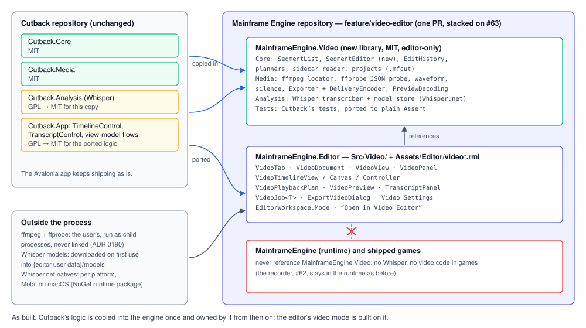
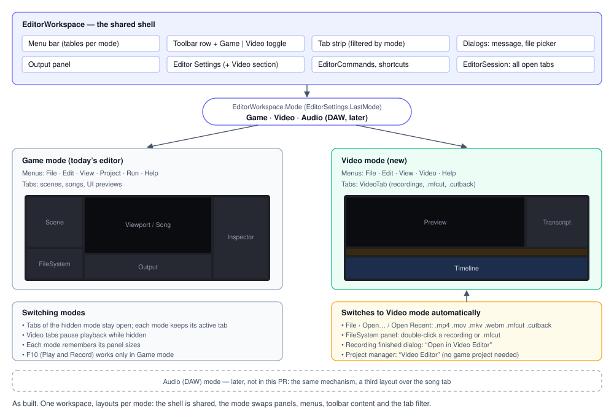
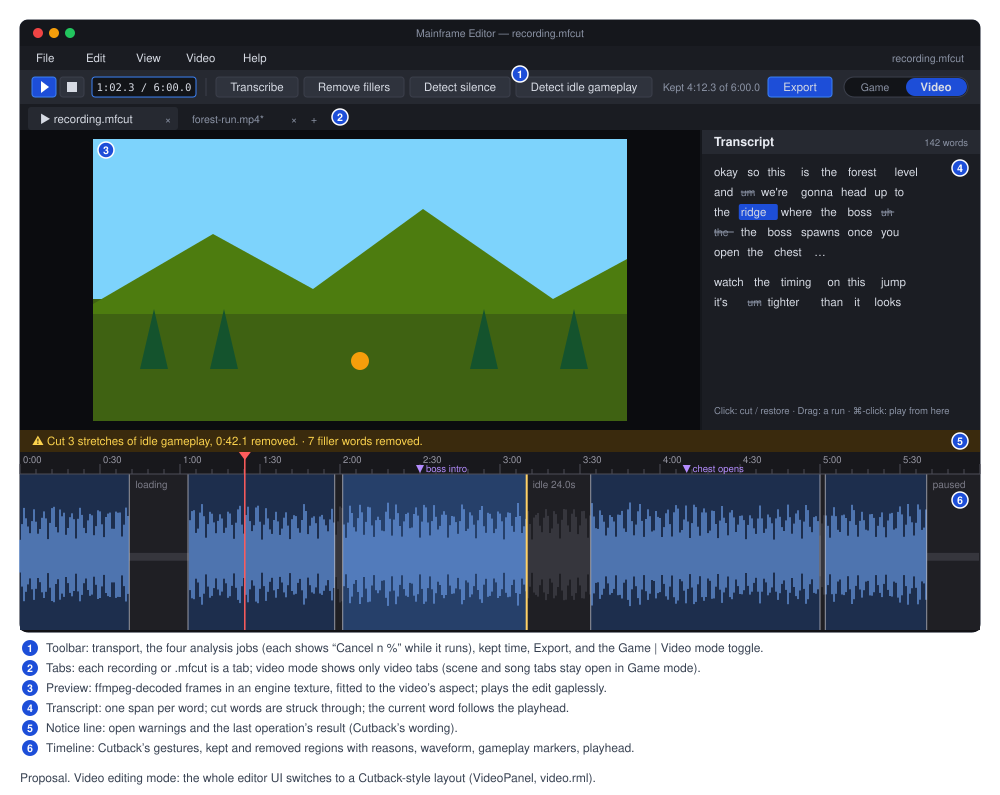
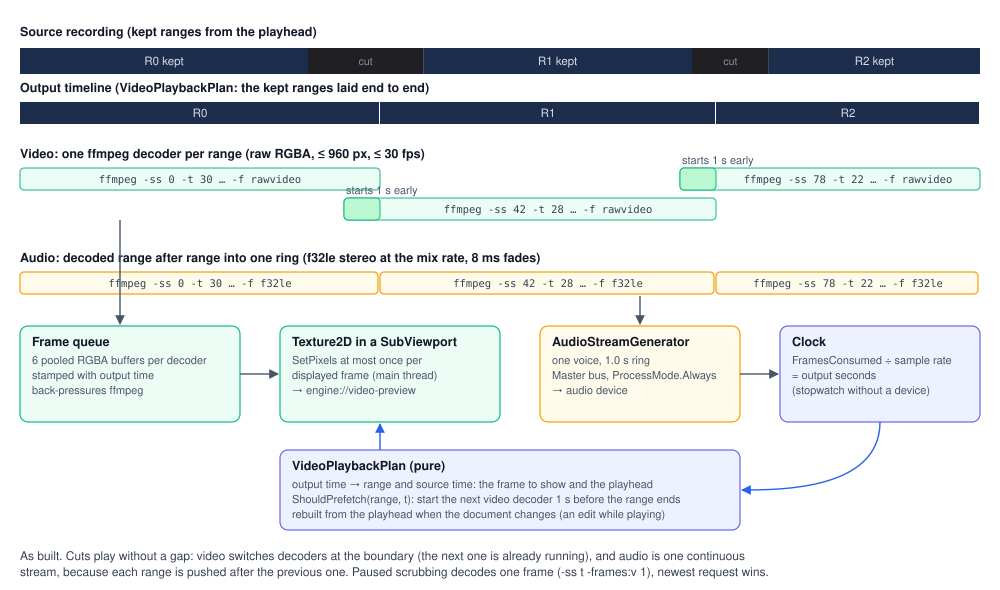

# Video editing mode

**Status:** ✅ built (branch `feature/video-editor`, 2026-10-14) · **ADR:**
[0191](../../memory/decisions/0191-video-editing-mode.md) · **Depends on:** [Gameplay recording](recording.md) (the
recorder, the `.mfcap.json` sidecar and Record from the editor), [Song tab](editor.md#song-tab-music-editor) (the canvas,
`SubViewport` and job patterns this copies), [Audio](audio.md) (`AudioStreamGenerator`) · **Related:**
[Video playback](future/video-playback.md) (G16, games only; not used here), ADR 0190 (ffmpeg as a child process)

## Purpose

The editor records gameplay (F10). Turning a recording into promo footage means trimming dead air and idle gameplay,
transcribing speech, removing filler words and exporting the result: what [Cutback](https://github.com/brogan89/Cutback)
does as a separate app. The editor now does all of it in a **video mode**. A Game|Video toggle switches the whole editor
UI between the game-engine editor and the video editor; an Audio (DAW) mode can follow the same way later.

Cutback's logic is copied into the engine (Cutback.Core, Cutback.Media and Cutback.Analysis are MIT, written by the same
author), not consumed as packages. The Cutback repository and its Avalonia app are not touched, and the recording dialog
still offers Open in Cutback beside Open in Video Editor.

Not in scope, by design:
- no multi-track timeline, transitions, titles, effects or music beds (Cutback's "not an NLE" rule);
- no Claude analysis (Cutback's `ICutSuggester` is a stub and is not ported);
- no change to games: neither the runtime nor shipped games reference any of this.

## Code layout



```
MainframeEngine.Video/                    editor-only library, net10.0, MIT (LICENSE-CUTBACK); only the editor references it
  SegmentList.cs  SegmentEditor.cs  EditHistory.cs                 ← Cutback.Core root files, plus SegmentEditor
  Models/ Capture/ Detection/ Transcript/ Projects/ Playback/        ← Cutback.Core (CutbackProject is VideoProject)
  Media/   (FfmpegLocator, MediaProbe + FfprobeJson, WaveformExtractor, PcmExtractor, SilenceDetector, FfmpegProcess, …)
  Media/Export/ (Exporter, FilterGraphBuilder, KeyframeSnapper, DeliveryEncoder)
  Media/Preview/PreviewDecoding.cs
  Analysis/ (ITranscriber, WhisperTranscriber, WordAssembler, ModelStore, WhisperModel)
Tests/MainframeEngine.Video.Tests/        Cutback's tests in plain Assert; never runs ffmpeg or loads a model
MainframeEngine.Editor/Src/Video/         the mode's UI (below)
MainframeEngine.Editor/Content/Editor/    video.rml, video_export.rml; the toolbar's video group in toolbar.rml
```

- **Core** is copied file for file. The changes are the namespaces (`Cutback.Core` → `MainframeEngine.Video`,
  `Cutback.Media` → `MainframeEngine.Video.Media`, `Cutback.Analysis` → `MainframeEngine.Video.Analysis`), the project
  extension, `CutbackProject` → `VideoProject` and `FfmpegNotFoundException` → `FfmpegMissingException` (the engine
  already has a public `FfmpegNotFoundException`). `TempSession`'s folder is `MainframeVideo`.
- **`SegmentEditor`** holds the edit-session rules from Cutback's view model, so the UI never reimplements them: one edit
  is one undo step and an edit that changes nothing leaves none; a boundary drag is one step; a drawn section takes the
  opposite state of where it was anchored; dirty means "differs from the last save".
- **`DeliveryEncoder`** picks export's H.264 encoder by probe-encoding a tiny clip: libx264, then the platform's hardware
  encoder, then libopenh264, so export works on an ffmpeg built without x264. The probe is shared by concurrent callers,
  each candidate has a 10 s timeout, and a cancelled or failed probe is evicted so the next export probes again.
- **`MediaProbe`** has no FFMpegCore: it runs `ffprobe -v error -print_format json -show_format -show_streams` and parses
  the JSON (`FfprobeJson`), falling back to the stream duration when the format has none.
- **`PreviewDecoding`** builds the preview's decode arguments. The preview is at most 960 px wide (rounded down to even)
  and 30 fps.
- **`ModelStore`** takes the editor's user-data path (`~/.mainframe/models`) instead of Cutback's `CreateDefault()`.
- **Dependencies:** System.Text.Json, and `Whisper.net` plus `Whisper.net.Runtime` 1.9.1 (MIT; whisper.cpp is MIT). The
  runtime package brings native libraries per platform, with Metal on macOS.

**Editor side, `MainframeEngine.Editor/Src/Video/`:**

| Type | Role |
|---|---|
| `VideoDocument` | One project: `VideoProject`, `SegmentList` + `SegmentEditor`, capture sidecar, transcript, waveform. Open (video or `.mfcut`/`.cutback`), save, detect, transcript and filler cuts, export transcript. Main thread only. |
| `VideoTab : IEditorTab` | A document plus its preview, timeline (view, state, controller, canvas in a `SubViewport`), notice and jobs. `Mode` is `EditorMode.Video`. |
| `VideoTimelineView` | Zoom, pan, hit-testing and ruler maths. Pure. |
| `VideoTimelineCanvas` | An `EditorCanvas` port of `TimelineControl`'s draw pass: segments, reasons, waveform, boundaries, pending section, ruler, markers, playhead. |
| `VideoTimelineController` | The timeline gestures. One per document. |
| `VideoPlaybackPlan` | The kept ranges from the playhead, contiguous ones merged, laid end to end on an output timeline and mapped back to source time. Pure. |
| `VideoPreview` | ffmpeg decoders into a `Texture2D` in a `SubViewport`, with an `AudioStreamGenerator` voice as the clock. Decoders come from an `IVideoDecoderFactory`, so tests use fakes. |
| `TranscriptPanel`, `TranscriptMarkup` | The transcript column: RmlUi word spans with the cut state, gestures and context menu. |
| `VideoJob` / `VideoJob<T>` | Background work polled each frame: waveform, silence detection, model download and transcription, export. `VideoJob.Start<T>(name, work)` starts one (a static on the non-generic class, CA1000). |
| `VideoView` (`[Tool]` node) | Per-frame driver: places and publishes `engine://video-preview` and `engine://video-timeline`, routes pointer and keys, polls jobs, starts detection, transcription and export. |
| `VideoPanel` + `video.rml` | The video-mode view: empty state with recent videos, preview, transcript, notice line, timeline, splitters. |
| `ExportVideoDialog` + `video_export.rml` | Output path, Precise/Fast, Export. |
| `VideoExport`, `VideoPaths`, `VideoFfmpeg`, `VideoFormat` | Export request and defaults; same-file checks that protect the recording; which ffmpeg; `m:ss.t` formatting. |

Settings live in `EditorSettings` (`Video*` properties) and are edited in the Editor Settings dialog's Video section.

## Modes



`EditorMode { Game, Video }` lives on `EditorWorkspace`; `Audio` is left for the DAW. `EditorWorkspace.SetMode`:

1. **Swaps the layout.** Game mode is the usual editor. Video mode hides the Scene tree, Inspector and FileSystem
   (releasing their focus) and the Output unless View › Show/Hide Output is on, and shows `VideoPanel` over the viewport
   panel's view area, below its tab strip. The transcript width (320 dp) and timeline height (180 dp) persist in the
   layout file.
2. **Swaps the menus.** Game: File, Edit, View, Project, Run, Help. Video: File, Edit, View, Video, Help.
   `EditorCommands.MenuItems` returns the video tables in video mode; command ids are shared where the meaning is the
   same (`file.save`, `edit.undo`) and a video tab handles them first.
3. **Swaps the toolbar group.** The Game|Video toggle sits near the right end of the toolbar in both modes (before Documentation, the update badge and the fps readout).
4. **Filters the tab strip.** Game mode shows scenes, songs and UI previews; video mode shows video tabs. Each mode
   remembers its active tab. Tabs of the hidden mode stay open, and a video tab pauses when it is hidden (playback stops,
   its gesture is cancelled and its viewports stop rendering).
5. **Persists the mode** as `EditorSettings.LastMode`, so the editor reopens in the last mode.

**Entering video mode.** The toolbar toggle, View › Switch to Video Mode, and automatically when opening a video
(`.mp4 .mov .mkv .webm`), `.mfcut` or `.cutback` from File › Open, Recent Videos, the FileSystem panel (double-click; the
files have a video icon), the QA `open` verb, the recording dialog's **Open in Video Editor**, or the Project Manager's
**Video Editor** button.

**Closing the last video tab stays in video mode**, on the empty state. Closing a tab activates a neighbour of the same
mode, never a tab of the other mode, so closing never switches modes.

**Without a project.** Video mode needs no game project: Recent Videos are their own list
(`EditorSettings.RecentVideos`, 10 entries, 5 in the File menu), and opening a recording never calls
`EditorSession.UseProjectOf` (recordings live in the user-data folder, and switching projects would throw while scene
tabs are open).

**Shortcuts in video mode** (`EditorWorkspace.VideoShortcutFor`, after the tab's own keys):
- Space plays and pauses, Home goes to the start, Delete/Backspace dissolves the hovered region;
- Cmd/Ctrl+O open, S save, Shift+S save as, W close tab, Q quit, Z undo, Shift+Z or Y redo, E export; F1 documentation;
- nothing else: no gizmo, view, Play or Record keys (F10 does nothing).

## The video-mode screen



- **Menus:**
  - **File:** Open… (Cmd+O), Recent Videos (up to 5), Save, Save As…, Export Video… (Cmd+E), Export Transcript… (enabled
    with a transcript), Close Tab, Quit.
  - **Edit:** Undo, Redo, Delete Region, Video Settings… (opens Editor Settings scrolled to its Video section).
  - **View:** Show/Hide Transcript, Show/Hide Output, Switch to Game Mode.
  - **Video:** Play/Pause, Transcribe, Remove Filler Words, Detect Silence, Detect Idle Gameplay.
- **Toolbar.** Play/Pause and Stop (pause and go to the start), the position (`m:ss.t / m:ss.t`), then Transcribe,
  Remove fillers, Detect silence and Detect idle gameplay. On the right: "Kept m:ss.t of m:ss.t", Export, and the
  Game|Video toggle, followed by the editor's Documentation button, update badge and fps readout.
  - Without a video tab every video button is disabled, and the position is hidden.
  - Detect idle gameplay is disabled without a sidecar; its tooltip says why.
  - **Remove fillers is enabled without a transcript**: it transcribes first and cuts the fillers when the words arrive
    (while a transcription runs, it asks that one to cut them).
  - Transcribe, Detect silence and Export show "Cancel n %" while their job runs, and pressing it cancels the job.
    Transcribe shows "Downloading model n %" while the model downloads.
- **Tab strip:** the viewport panel's own strip, filtered to video tabs; the title shows `*` when unsaved.
- **Panels:**
  - **Preview:** fitted to the video's aspect, with black bars. The image is sized in code (`VideoPanel`).
  - **Transcript:** on the right, 320 dp by default, resizable with a splitter; View › Show/Hide Transcript hides it,
    and a finished transcription or filler cut shows it again. Before a transcript exists it says "No transcript yet.
    Transcribe to edit by text."
  - **Timeline:** at the bottom, 180 dp by default, resizable.
- **Notice line**, one amber line above the timeline: open warnings (bad sidecar, source changed), the last operation's
  result ("Cut 3 stretches of idle gameplay, 0:42.1 removed.", in Cutback's wording), cancellations, and "ffmpeg not
  found: Detect Silence needs it." followed by an **Editor Settings** link (`video.settings`). Opening a recording
  without ffmpeg has no tab to hold a notice, so that one is a message box with a Video Settings… button.
- **Empty state** (no video tab): "Open a recording (File › Open…) or record one in Game mode (F10)", and the Recent
  Videos list.
- **Colours.** The timeline uses Cutback's palette as `Vector4` constants in `VideoTimelineCanvas`:

  | Colour | Value | Colour | Value |
  |---|---|---|---|
  | ruler | #18181C | body | #121215 |
  | kept | #1D2E4D | kept hover | #26406A |
  | removed | #1F1F24 | removed hover | #2A2A31 |
  | kept wave | #6FA3F0 | removed wave | #45454E |
  | boundary | #C8C8D2 at 0xB0 alpha | active boundary | #FFD166 |
  | section fill | #FFD166 at 0x38 alpha | playhead | #FF5C5C |
  | tick | #4E4E58 | label | #9A9AA6 |
  | reason | #7C7C88 | marker | #B48CFF |

  The chrome uses the editor's `theme.rcss`.

## Behaviour

### Preview and playback



- **Decoders.** `VideoPreview` runs one video decoder (raw RGBA at the preview size and rate) per kept range, and one
  audio task that decodes the ranges one after another (`f32le`, stereo, at `AudioServer.SampleRate`).
- **Gapless video.** The next range's decoder starts **1.0 s** before the current range ends (at most three decode at
  once), and frames switch at the boundary without a seek. Contiguous kept ranges are merged into one, so a seamless join
  never restarts a decoder.
- **Gapless audio.** All audio goes into one `AudioStreamGenerator` voice with a 1.0 s ring, on the master bus at
  `int.MaxValue` priority with `ProcessMode.Always`. Each range is pushed after the previous one (one producer, the
  ring's rule), with the export's 8 ms fades at every splice.
- **Clock.** The voice's consumed frames are the clock, in output seconds; `VideoPlaybackPlan` maps them back to source
  time for the playhead and the frame to show. Without an audio device a stopwatch is the clock.
- **Threads.** Starting ffmpeg takes milliseconds, so only the user's own Play starts a decoder on the main thread:
  prefetched readers, scrubs and the audio task start their own on the pool, and stopped decoders are killed on the pool.
  The texture and the voice are touched only on the main thread.
- **Buffers.** Each of four stream slots owns six frame buffers, allocated on first use and reused; a full pool blocks its
  reader, which back-pressures ffmpeg.
- **Edits while playing.** The plan is rebuilt from the playhead when the document's version changes, so a new cut is
  skipped. **During a boundary drag the tab holds the version** it plays: each change would kill and respawn the
  decoders, so the restart happens once, when the drag ends.
- **Opening a tab shows its first frame**: the tab scrubs to 0 when it opens, so the preview is never black.
- **Stopping.** Playback stops at the end of the last kept range, and pauses when the tab is hidden, the mode switches or
  an export starts. Closing the tab kills every decoder.
- **Play from the end.** Play starts over from 0 when no kept footage follows the playhead: where playback stopped on a
  recording whose tail is cut, inside a trailing cut, or at the very end.
- **Scrubbing while paused** decodes one frame (`-ss t -frames:v 1`); while one runs, only the newest request waits.
- **Texture.** One `Texture2D` in its own `SubViewport`, published as `engine://video-preview`, updated with `SetPixels`
  at most once per displayed frame.
- **Failures.** A failed decoder logs `[Video] Preview decode failed: …` and pauses. A preview problem never opens a
  dialog.

### Timeline

Cutback's gestures with Cutback's constants: the ruler is 22 dp; a boundary grab is within 6 dp; a drag starts after
4 dp; the minimum view is 0.25 s; boundary snapping looks within 20 ms; the wheel zooms 1.25 per notch; ruler labels are
at least 80 dp apart. Only the left button edits, and a gesture keeps the pointer until release wherever it moves.

- **Click** a region to toggle it. It becomes manual.
- **Drag a boundary** to move it. It snaps to the quietest waveform bucket on release, and the whole drag is one undo
  step.
- **Drag in the body** to draw a section with the opposite state of where the drag started.
- **Shift+drag** pans. **Press or drag the ruler** to scrub.
- **The wheel** zooms about the cursor; Shift+wheel or a horizontal wheel pans (in the song tab's direction).
- **Right-click** › Delete, or **Delete/Backspace** over a region, dissolves it into its neighbours. The hover is
  re-tested after every edit and cleared when the pointer leaves the timeline or the tab changes, so Delete never hits a
  region the pointer has left.
- **While playing,** the view follows the playhead and re-centres when the playhead leaves it.
- **Losing the pointer** (another tab or mode activating) ends a boundary drag where it is, as one undo step, and drops
  a section being drawn. **Undo or redo during a drag cancels the gesture first**, so the drag's step is never lost.
- **Ruler intervals** are 0.1, 0.5, 1, 2, 5, 10, 15, 30 s and up; sub-second majors are labelled in tenths (`0:01.5`),
  since whole seconds would repeat. There is no 0.25 s step. Labels are cached, so a steady view allocates nothing.

### Transcripts

- **Transcribe** runs `WhisperTranscriber` in a `VideoJob`:
  1. If the model is missing, it downloads it into `~/.mainframe/models` first (the first half of the progress; the button
     says "Downloading model n %"). This is the editor's only network access for video.
  2. It extracts 16 kHz PCM with ffmpeg and runs Whisper with Cutback's disfluent prompt and DTW anchors.
  3. The words go into the project's `transcript` (saved in the `.mfcut`); the notice says "Transcribed n words." or "No
     speech was recognised.".

  A model that fails to load is deleted when it looks truncated, so the next run downloads it again.
- **Model choice:** Video Settings, tiny.en (78 MB) to medium.en (1.5 GB); the default is base.en (148 MB).
- **Transcript panel.** Paragraphs break after 2 s pauses; one `<span>` per word, struck through when cut
  (`TranscriptView.IsCut`); the current word is highlighted. The panel rebuilds its markup only when the transcript
  changes; an edit updates the `cut` class of the changed spans, and nothing changes mid-drag.
  - **Click** a word to cut it, or restore it if struck. **Drag across words** to set the run to the opposite state of
    the first word. **Cmd/Ctrl+click** plays from the word. **Right-click** offers Play from here and Cut/Restore.
  - Word edges snap within ±40 ms, and every edit is one undo step (`SetRange`, manual).
- **Remove Filler Words** runs `FillerDetector` → `FillerSpanLocator` (envelope bursts around DTW anchors) →
  `FillerCutPlanner` → `ApplyFillerCuts`, as one undo step that never touches manual edits. Without a transcript it
  transcribes first. The word list is in Video Settings, with Cutback's defaults.
- **A transcript made before anchors existed** still works with heuristic spans, and the notice suggests transcribing
  again.
- **Export Transcript…** writes `.txt` or `.srt` (`TranscriptExporter`), with times remapped by `OutputTimeline` to match
  the exported video.

### Detection

- **Detect Silence** runs ffmpeg's `silencedetect` in a `VideoJob` with the settings captured when it starts, then
  `SilenceCutPlanner` → `ReplaceAutoSegments`, as one undo step that keeps every non-auto segment. Defaults: padding
  60 ms, min silence 400 ms, threshold −34 dB, min keep 120 ms.
- **Detect Idle Gameplay** reads the `.mfcap.json` sidecar: `GameplayCutPlanner` → `ReplaceOriginCuts(Gameplay)`, as one
  undo step. Defaults: min idle 3000 ms, padding 500 ms, min keep 1000 ms, marker window 1500 ms. Cutback's rules: idle
  only in live recordings; loading, pause and Skip cut exactly; Keep never cut; markers protect the footage around them.
- The results use Cutback's wording.

### Export

- **Export Video…** opens `ExportVideoDialog` (nothing to export when every segment is cut, which the notice says):
  - The output defaults to `<video>-cut.mp4` beside the source, numbered if taken; the folder button opens the save
    picker. The format follows the extension: `.mp4 .mov .mkv .webm`; any other is refused with a readable message.
  - **Precise** (the default) re-encodes with `DeliveryEncoder`'s choice: libx264 at CRF 20, else hardware or OpenH264 at
    0.1 bit per pixel per frame. Audio is AAC 192k, and the filter graph goes in a file.
  - **Fast** stream-copies with keyframe-snapped starts, labelled "approximate: cuts snap back to keyframes". It is
    disabled for `.webm`.
  - A typed path that exists asks "Replace file?"; a picked one was confirmed by the picker.
- **Running.** The request is snapshotted on the main thread, so edits during the export do not touch it; the preview
  pauses. The Export button reads "Cancel n %". Cancelling kills ffmpeg and deletes the partial file.
- **Finishing.** It is reported by how the job ended, not by whether Cancel was pressed: success shows "Export finished"
  with Show in Folder and Close; failure shows the ffmpeg error with the tail of its stderr; a cancel says "Export
  cancelled.".
- **Closing a tab** cancels its export; quitting the editor cancels exports and waits up to 2 s before removing the
  scratch folder.

### Protecting the recording

The source is opened read-only and never written. Save As, Export and Export Transcript **resolve their output path
component by component** (`VideoPaths.SameFile`: a symbolic link anywhere in the path counts, `/tmp` and `/var` on macOS
included) and **refuse the source recording**. Save paths are also normalised to one `.mfcut` (`trim.mp4` saves as
`trim.mfcut`, `x.mfcut.mfcut` collapses).

### Opening, saving, undo

- **Opening a video** probes it and refuses it with "has no audio track" when it has none (export and the preview clock
  splice audio). It is hashed (`SourceHash`) and starts as one kept segment. The sidecar is read when present; a bad or
  newer one is a notice, never a failed open. The waveform is extracted by a job, so the tab appears at once.
- **Opening a `.mfcut` or `.cutback`** uses the saved source info without probing; it is refused, naming the path, when
  the source is missing, and opens with a warning when the source's hash changed. A `.cutback` opens unsaved as
  `<name>.mfcut` and is never overwritten.
- **Opening a file that is already open** activates its tab.
- **Save** writes atomically; an unsaved recording asks where, suggesting `<video dir>/<video name>.mfcut`; Save As moves
  the project.
- **Undo** is `SegmentEditor`: one edit is one step, a boundary drag is one step, and undoing back to the saved partition
  is clean. The limit is 100 steps (Video Settings, 10–1000).
- **Unsaved changes.** Close and Quit ask Save / Don't Save / Cancel through the editor's unsaved-changes flow.

### Settings (Editor Settings › Video)

| Setting | Default | Range |
|---|---|---|
| ffmpeg | blank: `MAINFRAME_FFMPEG`, then PATH, then the usual install folders | a folder holding ffmpeg and ffprobe, or one of the two files |
| Whisper model | base.en | tiny.en, base.en, small.en, medium.en |
| Filler words | Cutback's list | comma-separated; nothing usable falls back to the defaults |
| Silence: threshold / min silence / padding / min keep | −34 dB / 400 / 60 / 120 ms | −80–0 dB / 50–5000 / 0–500 / 0–2000 ms |
| Gameplay: min idle / padding / min keep / marker window | 3000 / 500 / 1000 / 1500 ms | 500–60000 / 0–2000 / 0–10000 / 0–10000 ms |
| Undo history | 100 | 10–1000 |

Every value clamps in its setter. The text fields commit on Enter or when they lose focus (Apply commits the focused
one), so typing "100" or "-40" is never rewritten mid-keystroke. The ffmpeg setting also serves Play and Record: the
editor passes it to the game as `--ffmpeg` (the `ffmpeg` inside a folder, or beside an `ffprobe`).

## File format: `.mfcut`

Cutback's project JSON, schema version 3, unchanged:

```jsonc
{ "version": 3,
  "source": { "path": "/abs/recording.mp4", "sha256": "…", "durationSeconds": 612.44, "width": 1920, "height": 1080, "frameRate": 60.0 },
  "segments": [ { "id": "…", "start": 0.0, "end": 3.21, "enabled": true, "origin": "auto", "reason": null } ],
  "transcript": [ { "text": "so", "start": 1.02, "end": 1.18, "confidence": 0.93, "anchor": 1.05 } ],
  "settings": { "paddingMs": 60, "minSilenceMs": 400, "silenceThresholdDb": -34.0, "minKeepMs": 120 } }
```

- **Segments partition `[0, duration]`.** The invariant is enforced and tested (`SegmentList`).
- **`origin`** is `auto | manual | claude | filler | gameplay`. Each detector replaces only its own cuts, and manual
  edits survive every detector.
- **Paths.** The source path is absolute. The `.mfcut` lives next to the video by default, usually the recordings folder
  in user data; one inside a project folder appears in the FileSystem panel with a video icon.
- **Compatibility.** The engine owns the format from now on. A `.mfcut` renamed to `.cutback` opens in Cutback today, but
  that is not promised.

## Licensing

- **The copied code is MIT.** Cutback.Core and Cutback.Media were already MIT. Cutback.Analysis and the Cutback.App logic
  this ports (`TimelineControl`'s draw pass and gestures, `TranscriptControl`'s gestures, the view model's flows) are
  GPL-3.0 in Cutback's repository; their sole author relicensed them as MIT for this copy (2026-10-13). The UI parts are
  reimplemented on the engine's canvas and RmlUi; no Avalonia code is copied.
- **`MainframeEngine.Video/LICENSE-CUTBACK`** keeps the line `Copyright (c) 2026 Cutback contributors`.
  `THIRD_PARTY_NOTICES.md` lists the Cutback code, Whisper.net and whisper.cpp (all MIT, editor only).
- **ffmpeg** remains the user's, run as a separate program and never linked (ADR 0190).
- **Shipped games are unaffected**: `MainframeEngine` never references `MainframeEngine.Video`.

## Testing

- **`Tests/MainframeEngine.Video.Tests`** (part of `just test`): Cutback's Core, Media and Analysis tests in plain
  `Assert` (the partition invariant, `SetRange`, `Dissolve`, `Restore`, `EditHistory`; the silence, filler and gameplay
  planners, `ReplaceOriginCuts`, the sidecar reader; project round-trips, migration, hashing; the transcript view and
  exporters, the output timeline; locator, peaks, parsers, capabilities, filter graphs, keyframe snapping; word assembly
  and model metadata), plus `SegmentEditor`, `DeliveryEncoder`, `PreviewDecoding` and the ffprobe JSON parser. Nothing
  runs ffmpeg or loads a model.
- **Editor tests** (mostly `Tests/MainframeEngine.Editor.Tests/Video/`): modes (layout, menus, tab filter, persistence,
  auto-switch, closing), `VideoTab` in the session (open, save `.mfcut`, `.cutback` import, close prompt, undo during a
  drag), the timeline view, gestures and canvas, the playback plan, the preview with a fake decoder factory (kill on
  pause, close and mode switch; rebuild on edit; the held version during a drag; the first frame), the transcript panel,
  transcription and filler flows with a fake transcriber, the export dialog and job with a fake runner, the same-file
  checks, Video Settings (clamps, typing), the recording dialog's Open in Video Editor, and 0 B idle video frames.
- **Render goldens** (`EditorRenderTests`, MoltenVK and lavapipe, no ffmpeg needed, so CI checks them):
  - `editor-video-empty`: video mode's empty state.
  - `editor-video-timeline`: a tab over a document built in code (`VideoGolden`: segments of every origin, a synthetic
    waveform, markers, a transcript with struck words, colour bars from a fake decoder), fitted to its 60 s. Its steady
    frames then get the **allocation gate** (0 B over 300 frames).
- **QA, by hand:** `just qa-editor Tests/QA/video.qa` over the committed 12 s fixture `Tests/QA/Fixtures/video/sample.mp4`
  (`build/make-video-fixture.sh`: a test pattern whose 440 Hz tone drops out from 4 to 6 s, with a hand-written sidecar:
  loading 7–9 s, a marker at 10 s). It opens the fixture, runs Detect Idle Gameplay and Detect Silence, transcribes with
  tiny.en (`video set whisper-model tiny.en`), undoes, plays past the cut and switches modes, capturing each step. It
  waits on conditions, not frame counts: `wait-for video-jobs` and `wait-for video-position`.

## Known limits

- **Preview memory.** Four stream slots of six frame buffers each: up to about 48 MB at 960×540.
- **Per-frame texture re-upload.** The preview's CPU `Texture2D` re-uploads (and recreates its GPU image) once per
  displayed frame, at most 960×540 and 30 fps. G16's planned `VideoTexture` would remove that.
- **Hard links** to the recording are not detected by the same-file checks (a hard link is a second name for the same
  data); symbolic links are.
- **Crash recovery covers scenes only**: `WriteRecoveryCopies` does not write video projects.
- **No drag-in from the OS**: the engine does not deliver SDL drop events yet.
- **Whisper is trained to drop disfluencies**; recall of "um"s depends on the prompt (Cutback's known issue, same
  mitigation). The first transcription downloads 78 MB to 1.5 GB, depending on the model.
- **The DAW mode comes later**, as a third `EditorMode` over the song tab.

## Changes from the proposal

The proposal was agreed on 2026-10-13; these changed while it was built:
- Remove Fillers is enabled without a transcript (it transcribes first); the proposal said it was disabled.
- Closing the last video tab stays in video mode; closing never activates a tab of the other mode.
- "ffmpeg not found" for a tab's operation is a notice with an Editor Settings link, not a dialog.
- Save As, Export and Export Transcript refuse the source after resolving links component by component.
- Undo or redo during a drag cancels the gesture first; the preview holds its version during a boundary drag.
- The preview starts and kills decoders off the main thread, merges contiguous ranges, and shows the first frame on open.
- The ruler has no 0.25 s interval; sub-second labels show tenths.
- The Video Settings text fields commit on Enter or blur.
- Jobs start with `VideoJob.Start<T>`; `DeliveryEncoder`'s probe is shared, time-limited and evicted on failure.
- The view menu has Switch to Game/Video Mode items, not a toggle; the Edit menu opens Video Settings.
- The recording dialog offers Open in Video Editor first and keeps Open in Cutback.

## Related docs

- [Editor](editor.md#editor-modes) (modes, shortcuts) · [Gameplay recording](recording.md) · [Audio](audio.md) ·
  [Testing](testing.md)
